# autopilot — Claude による Issue ライフサイクル自律オーケストレーター

> **🆕 Smalruby 独自** — 開発運用のために作られた仕組み。upstream（Scratch Foundation）には存在しない。

autopilot は、複数の GitHub Issue を Claude が**並行**して

> 起票 → トリアージ → 実装 PR → 敵対的レビュー → 人間レビュー → DoD → マージ

まで自律的に進めるための常駐プログラム群と運用規約。状態は smalruby organization の
専用 **GitHub Projects v2「Autopilot」** のフィールドで一元管理する。

設計の出発点となった課題と意思決定の経緯は Issue #760（EPIC）に集約されている。
プロンプト/Runner が従う詳細な契約は [`autonomous-contract.md`](./autonomous-contract.md)、
**状態遷移とそのトリガーの正準表**は [`state-machine.md`](./state-machine.md) を参照
（全状態の「出口」= 固着が無いことは `tools/autopilot/test/state-machine.test.js` が機械的に担保する）。
モニターの見た目の決まり（デザインシステム）は [`design-system.md`](./design-system.md)。

---

## 全体像

```
            GitHub Projects v2「Autopilot」 = 状態の単一の真実（Issue のみ管理）
                    ▲  poll / 更新 (gh GraphQL, GitHub App bot)
                    │
        ┌───────────┴────────────────────────────────────────────┐
        │  autopilot daemon（常駐・単独プロセス）                    │
        │   - Project をポーリングし着手可能 item を並行数上限内で処理  │
        │   - フェーズ state machine 駆動                            │
        │   - pause / resume / force-stop、CLI からの割り込み投入(HTTP) │
        └───┬───────────────────┬────────────────────┬────────────┘
            │                   │                    │
     Claude runner        Web ステータスモニタ        CLI（単発検証）
   tmux send-keys +       一覧 / 状態 / ログ /        例: あるフェーズだけ
   watchdog, worktree隔離  手動 操作                   1 Issue で試す
```

### コンポーネント

| 要素 | 役割 | 実装 |
|---|---|---|
| **状態モデル** | フェーズの単一の真実 | GitHub Projects v2「Autopilot」 |
| **daemon** | Project をポーリングし着手可能 item を処理。並行制御・pause/resume/force-stop・HTTP 割り込み | `tools/autopilot/src/daemon.js` |
| **Claude runner** | 対話 Claude Code を端末（既定 herdr・tmux に切りかえ可）で起動して駆動、watchdog で監視。プロンプトで止まったら読んで答える | `tools/autopilot/src/runner.js` / `terminal.js` / `blocked*.js` |
| **Web モニタ** | item 一覧・状態・ログ閲覧・手動操作（daemon が `GET /` で配信） | `tools/autopilot/src/monitor.js` |
| **CLI** | 単一フェーズを単一 Issue で実行（動作確認・ドライラン） | `tools/autopilot/bin/autopilot` |
| **フェーズ・プロンプト** | 各フェーズの「頭脳」。非対話で1フェーズを遂行 | `tools/autopilot/prompts/autopilot-*` |
| **worktree** | Issue ごとの隔離作業場（軽量・即作成） | `bin/autopilot-worktree` |
| **UI 確認ヘルパー** | worker が headless bundled chromium で UI を確認（スクショ `tmp/`・Playwright MCP は使わない・#891） | `tools/autopilot/bin/pw-check` |
| **後片付け** | worker が終わる前に、自分の worktree に残した dev server・ブラウザを止める（#2463） | `tools/autopilot/bin/cleanup-leftovers` |

> daemon は常駐の単独プロセスとして起動する。並行数は設定可能（既定 2、必要に応じて増やす）。

---

## 状態モデル（GitHub Projects v2）

状態は **Issue のみ**を Project で管理する（PR を Project に入れると二重管理になる）。

### Status — 人間の Scrum ボード列（人間にとってのフェーズ）

```
No Status(未設定) → Backlog / Icebox → Sprint Backlog(autopilot キュー)
  → In Progress → Review → DoD → Close
```

| Status | 意味 |
|---|---|
| No Status | 起票直後・未トリアージ（Status 未設定の列。Projects v2 UI では「No Status」列に並ぶ） |
| Backlog | やると決めた |
| Icebox | やらないと決めた（保留） |
| Sprint Backlog | autopilot のキュー（着手対象） |
| In Progress | 実装〜PR〜敵対的レビュー |
| Review | 人間レビュー待ち |
| DoD | approve 後の DoD 検証（一般 UI は verify が headless で自己完結・#891 / 音・autoplay 等の実 Chrome 必須ケースのみ daemon がホスト引き継ぎ生成・#821） |
| Close | 完了（merge 後） |

> 実装メモ: Status 未設定（UI の「No Status」列）は内部的に `'New Item'` という sentinel で
> 正規化して扱う（`tools/autopilot/src/phases.js` の `status || 'New Item'`）。本ドキュメントの
> 表記は UI に合わせて「No Status」で統一する。

### AI Status — AI 専用の細フェーズ（各値 ≈ 1 プロンプト）

人間は Status を見れば十分。AI Status は daemon が「次に呼ぶプロンプト」を引くための内部状態で、
Issue を状態の正とすることで daemon が落ちても現在地が分かる。

| AI Status | 対応プロンプト | 主な Status |
|---|---|---|
| Triaging | autopilot-triage | No Status |
| Discussing | autopilot-discuss（実装前ディスカッション） | No Status / Backlog |
| Understanding | autopilot-understand | No Status / Backlog（EPIC） |
| Decomposing | autopilot-decompose | Backlog（EPIC→sub-issue） |
| EPIC Decomposed | —（親トラッカー化） | In Progress（EPIC） |
| Release Check | autopilot-release-check（分解済み EPIC のリリース確認。子が全部済むと daemon がこの値にする。🙋 なしで観点をまとめる / 人間の確認の結果を受けて NG ごとに sub-issue を作る） | In Progress（🧭 EPIC） |
| Implementing / Creating PR | autopilot-implement | In Progress |
| Self-Reviewing | autopilot-review | In Progress |
| Addressing Comments | autopilot-address-review | Review / DoD（NG 差し戻し） |
| Resolving Conflicts | autopilot-resolve-conflict（base とのコンフリクトを AI が解消。Status は動かさず、解消中だけこの値にして終わったら元に戻す） | 変えない（Review / DoD / Blocked / In Progress のまま） |
| Running DoD | autopilot-verify（一般 UI は headless Playwright で自己完結・#891）／ 音・autoplay 等は daemon `applyDodHandoffs`（ホスト引き継ぎ生成） | DoD |
| Awaiting Continuation | 元フェーズ（例 implement）を再 dispatch（協調的チェックポイント・EPIC #906。soft-limit で worker が安全に中断し、常に HITL で継続確認してから再開） | In Progress |

### その他フィールド

- **Size**（small / middle / large）— leaf Issue の重み付け（EPIC は付けない）
- **Kind**（EPIC / Issue）
- **Current Step / Worktree / Tmux Window**（text, observability）

---

## enroll モデル — 開発者個人ごとの daemon と担当者ベースの取り分け

プロジェクトに携わる**開発者個人個人が自分の autopilot（daemon）を起動する**運用を想定する。
daemon に `--assignee <GitHub login>`（または env `AUTOPILOT_ASSIGNEE`）を渡すと:

- **自分がオーナーの item だけ**を処理する。オーナー = **assignee の辞書順先頭**
  （複数 assignee の Issue を複数開発者の daemon が同時に拾わない決定的タイブレーク）。
  本文に `autopilot-assignee: <login>` ディレクティブがあり、それが Assignees に含まれて
  いれば辞書順先頭より優先してオーナーになる（下記ディレクティブ表・#938）。
- **未 assign の item は誰も拾わない**。Issue を autopilot に処理させる enroll 手順は
  「① Project に追加 → ② 担当者を assign → ③ Status を設定（例 Sprint Backlog）」。
- `--assignee` 未指定は従来どおり全件処理（単一 daemon 運用）。
- **共同担当（オーナーでない Assignees）は自分の monitor で観察できる**（dispatch はしない）。
  Web モニタの俯瞰ボードは「自分がオーナー」ではなく「**自分が Assignees のいずれか**」の
  item を表示する（下記「俯瞰ボード」参照）。ある機能に詳しくない担当が別の担当に駆動を
  引き継ぎつつ、進捗だけ自分の monitor で見続けたいケースを想定する。

### 投入順は 優先度 → 続きの作業か → Project Board view の見た目

着手候補は、まず **Project の `Priority`**（P0〜P3。P0 が最優先）の順に並べる。sub-issue は自分に
`Priority` が無ければ**親の EPIC の値を継ぐ**（親の親まで遡る。どこにも無ければ P2 とみなす）。
`autopilot-after` が解けていないものは除く。

同じ優先度の中は、**続きの作業を新しい作業より先に**する（人間を待たせない・作りかけを減らす）:

1. 人間のレビューへの直し（`address-review`。Request changes・モニターの指示）
2. PR がある作業の続き（`review`・`verify` など、すでに PR を作ったもの）
3. 新しく始める作業（`triage`・`implement`・`decompose` など）

判定は daemon が dispatch のために持っている値（次のフェーズ・PR の有無）だけで行い、GitHub の read は
増やさない（`scheduler.workStage`）。優先度は段より強い（P0 の新しい作業は P1 の直しより先）。
同じ段の中は **Board view の見た目**（Status 列順 = Status フィールドの option 定義順、列内は Project の
手動並び順）の順。Project 上で上に置いた item から処理される。同じ優先度に段の違う候補が並んだときは、
モニターの「並列:」の行の最後に「順: 同じ P1 で、直しを先に」のように理由が出る。優先度はモニターの ▲▼ でも変えられる
（下記「並列の計画と優先度」）。

### 並列の計画と優先度

同時に動かす worker の数は固定ではなく、**dispatch のたびに作業の重さと空きメモリ・CPU から決める**
（判断は `tools/autopilot/src/scheduler.js` の純粋関数。daemon は `/proc/meminfo` と `os.loadavg()` を読んで渡すだけ）。

- **重さ**（heavy / light）。重さの原因は CPU とメモリ。決め方の順番:
  1. Issue 本文の `autopilot-weight: heavy|light`（行頭のみ・下のディレクティブ表）
  2. 中身で重さが変わるフェーズ（implement・verify・address-review・resolve-conflict）は、タイトルと本文の
     言葉から推測する。表（`LOAD_PATTERNS`）: jest・integration・ブラウザ（playwright / selenium / e2e /
     スクリーンショット）・webpack / build / dev server・`packages/scratch-gui` は重い（2 点）、lint・テスト・
     scratch-vm（tap）は 1 点。docs だけ・`tools/autopilot` は軽い。重い点が 2 以上で重い、軽い点の方が
     大きければ軽い。「テスト」だけでは重くしない（ほとんどの Issue に出るため）
  3. フェーズの既定: implement・verify は重い。triage・understand・decompose・discuss・review・
     address-review・resolve-conflict は軽い
- **計画**（既定。`settings.json` の `scheduler` で変えられる）:

  | 設定 | 既定 | 意味 |
  |---|---|---|
  | `maxTotal` | 6 | 同時に動かす worker の上限（CLI の `--concurrency` を付けたときはその値） |
  | `maxHeavy` | 2 | 同時に動かす重い worker の上限 |
  | `heavyMinMemMb` | 2560 | 空きメモリがこれ未満なら重いものを始めない |
  | `anyMinMemMb` | 1024 | 空きメモリがこれ未満なら新しい作業を始めない |
  | `heavyMemMb` / `lightMemMb` | 1500 / 300 | 同じ tick で始めた分として空きから引く見込み（始めてすぐにはメモリが減らないため） |
  | `heavyMaxLoadPerCpu` / `maxLoadPerCpu` | 1.0 / 2.0 | 1 CPU あたりの loadavg（1 分）がこれ以上なら重いもの / 新しい作業を始めない |

  優先度の順に見て、重いものが上限やメモリ・CPU で始められないときも、後ろの軽いものは始める
  （軽い仕事で空きを埋める）。決めた理由（例「空き 4.5GB・負荷 0.32/CPU・実行中 1（重い 1）→ 2 件開始
  （重い 1・軽い 1）。待ち 重いものの上限 2 で 1 件」）を daemon のログとモニターの状況板の上の「並列:」の行に出す。
- **モニターでの操作**: 「並列:」の行の −/+ で全体・重いの上限を一時的に変えられる（`POST /scheduler`。
  再起動で消える。ずっと変えるなら `settings.json`）。各行の ▲▼（行に乗せると出る）か行の ⋯ で `Priority` を 1 段上げ下げする
  （`POST /priority`。自分に値が無ければ継いだ値・既定から動かす）。**EPIC の行で動かすと、自分の値を
  持たない sub-issue にも効く**。継いだ値は斜体で出る。
- 親（EPIC）の番号は本文と同じ REST 1 回（`parent_issue_url`）で取り、本文と同じ TTL でキャッシュする
  （追加の API なし）。空きがある tick は、優先度の継承と重さの推定のために全候補の本文を読む。

### 本文ディレクティブ（行頭のみ反応）

Issue 本文の**行頭**に書くディレクティブで挙動を制御できる（本文中の言及では発火しない。
行頭からの HTML コメント `<!-- ... -->` 内でも可）:

| ディレクティブ | 意味 |
|---|---|
| `autopilot-base: <branch>` | PR 先・worktree 分岐元のベースブランチ（EPIC サブ Issue を親 epic ブランチに積む等） |
| `autopilot-after: #N [#M ...]` | 依存宣言。N（と M …）が完了（GitHub closed / Project Close・Done。**N が `🧱 infra` なら GitHub closed のみ**＝prod デプロイ後）するまで着手しない。ブロック中は次点候補が繰り上がる。**待ち Issue は Sprint Backlog に置く**（Backlog はそもそも着手候補にならないので先行 Close で自動着手しない）。ゲート中は daemon が `⏳ waiting` ラベルを付け、先行 Close で自動除去 → 次 tick で着手 |
| `autopilot-weight: heavy\|light` | 作業の重さを明示する（上の「並列の計画と優先度」）。中身からの推測より優先する |
| `autopilot-assignee: <login>`（`@login` も可） | 複数 assignee の Issue でオーナー（駆動する担当）を明示指定する（#938）。指定 login が Assignees に含まれていなければ無視して従来どおり辞書順先頭。指定した担当の daemon（`--assignee <login>`）だけが駆動し、他の担当の daemon は駆動しない。共同担当（非オーナー）は自分の monitor で Issue を観察できる（下記「俯瞰ボード」参照） |

本文は 10 分の TTL でキャッシュする。ネット断などで本文を取得できなかったときは
「ディレクティブが無い」とはみなさない（fail-closed）: 前回取得した値があればそれを使い、
一度も取得できていない Issue はその tick では dispatch しない（次 tick で取り直す）。
`autopilot-after` 待ちの Issue が動き出したり、`autopilot-base` 指定の Issue が既定 base で
作業を始めたりしないため。

### 🧭 tracking ラベル（分解済み親のトラッカー化）

sub-issue に分解済みの親（Kind=EPIC）には daemon が **`🧭 tracking` ラベル**を付与する。
以後の tick はラベルだけで「作業 item ではない」と判定でき、merge 検知・PR 投影・
フェーズ選択から低コストに除外される（完了は closed-reconcile が拾う）。人間が任意の
Issue に手動で付けてトラッカー化してもよい（autopilot は外さない。外せば作業 item に戻る）。

### ⏳ waiting ラベル（先行 Issue 待ちの可視化）

`autopilot-after:` の先行 Issue がまだ完了しておらず、ゲートで着手を待たされている leaf には
daemon が **`⏳ waiting` ラベル**を付ける。GitHub Projects の view や Web モニタで「他 Issue 待ち」
を一目で判別できる。🧭 tracking と同じく **状態から毎 tick 動的に導出**し（静的な一度付けでは
なく）、先行 Issue が Close された瞬間に自動で外す → 次 tick で着手する。順序付きで分解した
EPIC の leaf は **全部 Sprint Backlog に入れておけば**、依存順に自動で 1 つずつ流れる（並列
衝突はゲーティングが防ぐ）。

### 🔬 spike ラベル（要件の相談中の可視化）

技術調査に加え、要件が決まっていないときに人間と決めきる行動も **Spike** とみなし、その間は
daemon が Issue に **`🔬 spike` ラベル**を付ける。GitHub のラベル絞り込みで「相談中」を探せる。
⏳ waiting と同じく **状態から毎 tick 導出**する（判定は `phases.js` の `isSpikeItem` →
`labelActions`）。

- **付ける**: AI Status が `Discussing` のとき（🙋 の有無を問わない）。または triage / understand が
  質問を出して `🙋 HITL` で止まっているとき（AI Status が `Triaging` / `Understanding` + 🙋）。
  Status=Blocked で付けるのは understand の質問待ちだけ（triage / discuss が Blocked なのは run 失敗で、
  障害として 🧱 Blocked に数える）。
- **外す**: 実装（implement）以降に進んだとき、または閉じた（Close / Done）・Icebox にしたとき。
  閉じた item でもラベルが残っていれば label healing が外す（item-list の labels だけで判定でき、
  追加の読み取りは要らない）。
- **導出が正**: 人間が手で付けたものも、条件を満たさなければ外す（「人間が Spike を始める」は
  扱わない）。PR には付けない（Issue 面だけ）。

### 🧱 infra ラベル（infra を先に出す・infra-first）

ブランチプレビュー（`https://preview.smalruby.app/<slug>/`）は stg の API を見るので、infra と GUI を同じ PR に入れると新しい API を使う GUI をプレビューで確認できない。そこで **infra（`infra/**`）の変更は GUI と別の sub-issue に
分け、`🧱 infra` ラベルを付けて先に develop へ出す**（手順の正準は
`.claude/rules/infra/development.md` の「infra は別 Issue に分けて先に出す」）。

1. triage は infra とそれ以外の両方に変更が要る Issue を EPIC にし、decompose が infra の leaf
   （`🧱 infra`・`autopilot-base:` なし＝develop 宛て）と残りの leaf（`autopilot-after: #<infra>`）に分ける。
2. infra の PR は**後方互換な変更だけ**・本文は `Refs #N`。人間が develop へマージする。
3. daemon は merge を検知すると Project を Close に進めるが、**GitHub の Issue は閉じない**。
4. `Deploy Infra` workflow が stg → prod へ出し、**prod に出せたら infra の Issue を閉じる**
   （削除・置き換えを含む差分は自動では出さず、PR に知らせる）。
5. `autopilot-after` の相手が 🧱 infra のときは **GitHub で closed になるまで未完了**とみなすので、
   GUI の leaf はここで初めて `⏳ waiting` が外れて動き出し、プレビュー（stg の API）で確認できる。
   確かめる前に stg が develop（または自分の PR）の状態かを確認し、ログインは
   `?devlogin=<DEV_BYPASS_TOKEN>` で省く（手順は `.claude/rules/infra/development.md` の
   「ブランチプレビューで確かめる（stg の API）」）。

ラベルは Issue を作る側（decompose / 人間）が付ける。daemon は付け外ししない。

### 💤 later ラベル（「あとでやる」一覧の分離）

難しく使用頻度も低いので後回しにしたい Issue（例: tutorial 改修）に **人間が付ける**ラベル。
目的は **Web モニタ上の一覧の分離だけ**で、付いていても autopilot の処理（dispatch・ゲート・
merge 検知）は**一切変わらない**。label healing は外さない・付け直さない（人間の操作だけで
付け外しする）。モニタの「💤 あとで」/「↩ 今やる」ボタン（`POST /later`）か、GitHub 上で
直接付け外しする。

---

## 学びとタスク

- **学び**: 決定ページで人間の答えが AI のおすすめと違ったときの意図と、人間との確認で分かったレビューの観点を
  `tmp/autopilot-learnings/` にためる。たまったらモニターの操作で `docs/autopilot/learned/<area>.md` にまとめる
  PR を作り、CI が通ったらモニターの操作でマージする。worker は触る分野のものだけ読む。
- **タスク**: Issue に結びつかない仕事（1 回・決めた時刻・定期）を `tools/autopilot/tasks.json` と
  `tmp/autopilot-tasks.local.json` に定義し、daemon が時刻に worker で実行する。モニターから作る・いま実行できる。

詳しくは [`learnings-and-tasks.md`](learnings-and-tasks.md)。

## 実装前ディスカッション（discuss フェーズ）

triage が「実装方針の合意が必要」（Size=large・設計分岐・要件曖昧）と判断した leaf は、
方針提案コメントを投稿して **Backlog + AI Status=Discussing + `🙋 HITL`** で人間に渡す。

- 人間が**返信する**（コメントするだけでよい。`🙋` を外しても同じ）と daemon が
  `autopilot-discuss` を起動し、承認なら **Sprint Backlog を返して implement へ直接ハンドオフ**、
  継続なら改訂提案を同じスレッドに積んで再び人間へ。
- **議論の往復中 Status は Backlog に固定**され、triage との再提案ループでステータスが
  固着・振動しない。見送り（Icebox）への遷移は人間の確定操作のみ（提案では動かさない）。

---

## HITL（Human In The Loop）— `🙋 HITL` ラベルに一本化（#813）

HITL は「人間の番」を表す。状態は **`🙋 HITL` ラベル**が唯一の真実で、Issue と PR の両面に投影される
（Project に HITL フィールドは設けない／daemon は読まない・書かない）。**PR は Project フィールドを
持てない**ため、ラベルなら 1 系統で Issue/PR を賄え、成果物ページにも見える。set と release で
非対称のルールを持つ。

- **set（人間に渡す）**: daemon が **Issue/PR の両面に一括で `🙋 HITL` ラベルを付与**して整合を保つ。
- **release（AI に戻す）**: Issue / PR いずれかの `🙋 HITL` ラベルを**外したときだけ**解除される
  （OR 解除・`isHitlReleased`）。**コメントや Request changes だけでは解除されない**ので、人間は
  気軽にコメントできる。詳細は [`state-machine.md`](./state-machine.md)。

### 人間レビューの流れ（Request changes で指定して 🙋 を外す）

1. PR が出ると、autopilot が review フェーズで指摘を 1 コメントにまとめる（`[M1]` / `[Q1]` / `[FYI1]` …）。
2. 人間は自由にコメントしてよい（何も動かない）。
3. 直してほしいことを **Request changes** で出す。本文に「FYI1 を直して」のように ID を書くか、
   対象のコメントの URL を貼る（行コメントで指示してもよい）。
4. PR（か Issue）の `🙋 HITL` を外す → address-review が、**まだ対応していない Request changes で
   指定されたことだけ**に対応し、再び Review + 🙋 に戻す。言及の無い指摘や、Request changes
   以外のコメントには対応しない。未対応の Request changes が無ければ何もしない（マージ待ち）。

対応したレビューの ID は、address-review のまとめコメントの先頭のマーカー
`<!-- autopilot-address-review handled-reviews=<id,id> -->` に残り、同じレビューに二重に対応しない。

人間が判断/レビューに使う HITL ゲート: 実装前ディスカッション・EPIC 理解・分解承認・
人間レビュー（approve）・DoD・Blocked の対処・merge。

> **移行注意（#813）**: 走行中 daemon は再起動するまで旧コード（HITL フィールド読み）。この変更を
> merge + daemon 再起動して初めてラベル主体に切り替わる。既存の HITL フィールド値が残っていても
> daemon はラベルだけを見るので実害はない（Project の HITL 単一選択フィールドは将来削除可）。

### モニターで答える（質問・選択肢・推奨）

worker が人間に選んでほしいことがあるとき、`signal=hitl` の結果に `questions`（選択肢・一行の説明・AI の推奨）を書く
（形は `autonomous-contract.md` §2.3）。daemon は:

1. 質問を Issue にマーカー付きで書く（`<!-- autopilot-monitor-questions issue=N round=R -->`。同じ質問なら書き直さない。
   新しい質問なら round を 1 つ進める）。worker の文字列は `sanitizeForSurface` を通す。
2. 質問をローカルの置き場（`~/.config/autopilot/monitor-answers.json`。`AUTOPILOT_STATE_DIR` で変更可）に置き、
   `GET /board`・`GET /status` の `monitorQuestions` に載せる（`answered / total` と、答えた内容・時刻）。
3. 人間がモニターで答える（`POST /answer`）:
   - **メモだけ保存**（`proceed:false`）: 置き場に置くだけ。GitHub に書かない・🙋 も外さない。
   - **答えて先へ進める**（`proceed:true`）: 質問ごとに答えを Issue に書き（`<!-- autopilot-monitor-answer issue=N round=R q=<id> -->`。
     同じ答えは書き直さない）、Issue / PR の 🙋 を外し、すぐ 1 tick 回す。ゲートは `state-machine.md` の
     「モニターの『答えて先へ進める』も 🙋 を外す合図」のとおり開く。
4. 次にその Issue の worker を起こすとき、答え（質問 ID・選んだ選択肢・メモ）を worktree の
   `tmp/autopilot-answers-<issue>.md` に書き、`AUTOPILOT_ANSWERS_FILE` と起動の指示で渡す。worker を起こすと
   置き場からは消える（答えていない質問も、worker を起こし直した時点で古くなるので消す）。

判断と本文の組み立ては `phases.js`（`planMonitorQuestionsComment` / `planMonitorAnswer` / `planMonitorAnswerComments` /
`renderMonitorAnswersForPrompt` ほか）、置き場と受け口と GitHub のつなぎは `monitor-answers.js`、書き込みは `project.js`
（`applyCommentPlans`）。モニターでは「あなた宛て」の「答えが要る」に出る（下の「Web モニタ」）。

**worker 以外が質問を出す — `bin/autopilot-ask`**: セッションの AI や人間が「人間の判断が要る Issue」を作るときは、
本文に案を書くだけにしない（モニターは決まった形の質問のコメントしか読まないので、「答える」に出ず、ゴーサインの行に
なってしまう。押すと答えないまま 🙋 が外れて実装が始まる）。代わりに質問を JSON に書いて道具で出す:

```bash
bin/autopilot-ask <issue> tmp/questions-<issue>.json   # --repo owner/name / --port 8787（env AUTOPILOT_PORT）
```

- 中身の形は worker の結果の `questions` と同じ（`autonomous-contract.md` §2.3 の「worker 以外が質問を出す」）。検証も同じ
  （`contract.js` の `questionListErrors` → `phases.js` の `normalizeAskInput`）。
- 質問のコメントは worker と同じ道（`monitor-answers.js` の `writeQuestionsComment`）で **Bot 名義**で書く。同じ中身は書かず、
  新しい質問は round を続ける。Bot のトークンが取れなければ何も書かずに止まる（個人のトークンで書かない）。
- 書いたあと、daemon の `POST /questions`（合言葉 `X-Autopilot-Token` が要る。`ask.js` が合言葉のファイルを読む）で置き場に載せる。
  同じ round の同じ質問は置き直さない（モニターで書いた「メモだけ保存」を消さない）。worker が動いている Issue は受けない（409）。
  daemon に届かないときはコメントだけ書いて終了コード 2 で終わる。daemon を起こしてからもう一度流せば、コメントは書き直さずに載る。
- 載った質問は、Status（Sprint Backlog・Backlog・Blocked など）・⏳ 待ちによらず「答える」になる（`humanAction`）。
  ゴーサインにはしない。EPIC の子でも隠さない: 子は「答えが要る」の欄に出て、EPIC の行は段階によらずそれを指す
  （Release Check の行は「確認ページを開く」のまま、一文に「子 #N に答え待ちの質問があります」を足す。任せる前の
  「この EPIC を AI に任せる」には質問のある子を入れず、同じ一文で子を指す）。
- 答えると、いまと同じく答えを記録して 🙋 を外す。Sprint Backlog の Issue は implement に進み、答えのファイル
  （`tmp/autopilot-answers-<issue>.md`）を受け取る。

### モニターの「AI に任せる」（人間待ちを autopilot に渡す）

モニターの「あなた宛て」には、🙋 HITL の付いた Issue（人間待ち）が並ぶ（`GET /board` の `humanWait`）。
各行の「AI に任せる」（`POST /delegate` body `{issue}`）は、人間が GitHub で 🙋 を外す・Status を動かすのと
同じ意味の操作をする（`.claude/rules/human-wait.md` の表）。押せるかどうかは `humanWait[].delegate` に出る。

| item | 「AI に任せる」ですること | 次の段 |
|---|---|---|
| Sprint Backlog（Kind=Issue） | 🙋 を外す | implement |
| まだ分解していない EPIC（Backlog・Kind=EPIC） | Status を Sprint Backlog にしてから 🙋 を外す | decompose |
| 人間ゲート（Review / DoD / Blocked / Discussing / Awaiting Continuation / Decomposing / Triaging）・New Item | 🙋 を外す | 🙋 を外したときと同じ（address-review・triage・discuss など） |
| 分解済みの EPIC（🧭・In Progress / EPIC Decomposed） | 受けない（409 `tracker`）。子が全部済んだら人間が閉じる | — |
| リリース確認の EPIC（🧭・In Progress / Release Check） | 🙋 を外す（ボタンは「確認の結果を書く」。下の節） | release-check |
| 人間がする作業（Backlog・Kind=Issue） | 受けない（409 `human-work`）。AI に渡すなら人間が Sprint Backlog へ動かす | — |
| 答え待ちの質問がある Issue | 受けない（409 `open-questions`）。「AI の推奨で進める」は `POST /answer` で推奨の選択肢を送る | — |
| 外しても進める段が無い（例: セッションの作業の In Progress・AI Status 空）・Icebox / Close / Done | 受けない（409 `no-ai-phase` / `resting`） | — |

🙋 を外す流れ（Project のフィールド → Issue / PR の 🙋 → `state.monitorReleases`）は「答えて先へ進める」と同じ
（`monitor-answers.js` の `releaseHumanGate`）。通ったら pause 中でなければすぐ 1 tick 回す（pause 中は外して覚えるだけ）。
判断は `phases.js` の `planDelegate` / `humanWaitRows`。

#### 「AI に直してもらう」で指摘を見て指示を書く（Review / DoD）

次の段が address-review になる行（Review / DoD など）のボタンは **「AI に直してもらう」** で、押してもすぐには
🙋 を外さない。ダイアログを開いて、その PR の bot の指摘を見せ、直してほしいことを書いてもらう
（GitHub で Request changes を書く手間をなくすため）。

1. ダイアログを開くと `GET /delegate/findings?issue=N` で、PR の会話コメントを 1 回だけ読む（REST の
   `issues/<pr>/comments`。押したときだけで、定期では取らない）。いちばん新しい round の指摘のまとめコメント
   （`<!-- autopilot-review-findings round=N -->`）を、markdown を軽く整形して見せる（`monitor-inbox.js` の
   `renderMiniMarkdown`。本文を先にエスケープする・外部のライブラリは読まない）。M1 / FYI1 を個別に選ぶ
   ボタンは作らない。まだ対応されていない前の指示があれば、その件数も出す。
2. 下のコメント欄に、GitHub にコメントを書くように指示を書く（例: 「FYI1 と FYI3 は直して。FYI2 はそのままで」）。
   空のままでは送れない。
3. 「送って AI に直してもらう」で `POST /delegate` body `{issue, instruction}`。daemon は、指示を目印付きの
   コメント（先頭 `<!-- autopilot-monitor-instruction -->`、本文に「モニターから <login> の指示」）として Bot で
   PR に残してから、ふつうの「AI に任せる」と同じく 🙋 を外す。押し直しで同じ指示を二重に書かない
   （まだ対応していない指示に同じ文があれば書かない・`planMonitorInstructionPost`）。
4. address-review は、まだ対応していない Request changes に加えて、まだ対応していない指示コメント
   （`selectMonitorInstructions`）も指示として扱う。指示の中の ID は `planAddressReview` で読む。
   対応した指示コメントの ID は、まとめコメントのマーカーの `handled-instructions=` に残す。

指示を受けるのは次の段が address-review の行だけ（ほかは 409 `no-instruction-phase`）。開いている PR が
無ければ 409 `no-pr`。判断は `phases.js` の `normalizeDelegateInstruction` / `renderMonitorInstructionComment` /
`selectMonitorInstructions` / `reviewFindingsView`。

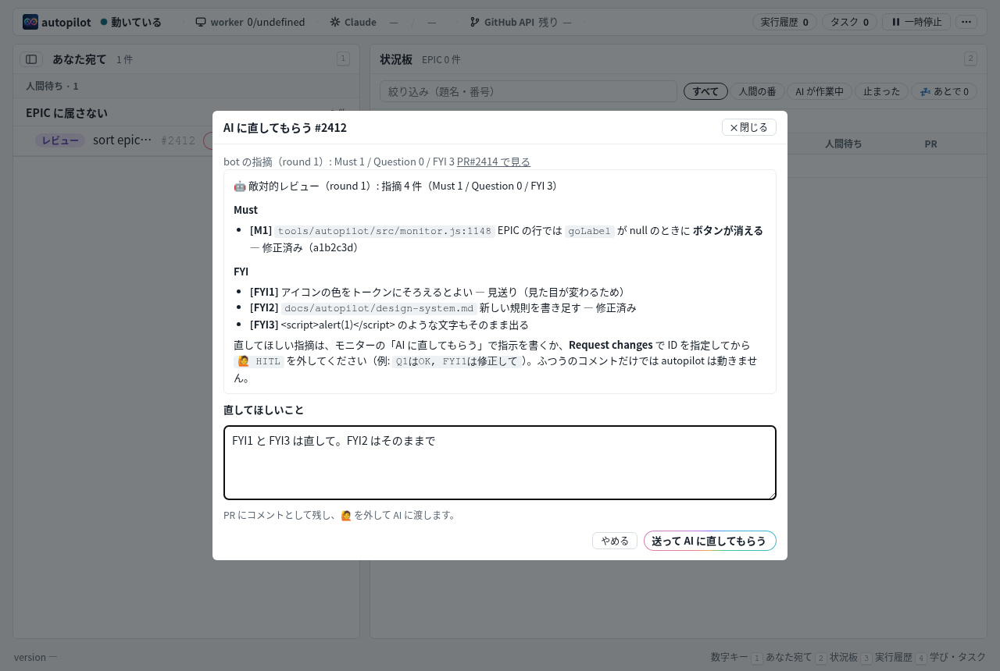

### topic → develop の draft PR（daemon が作る）

EPIC の子の PR は topic ブランチ宛てで、daemon が CI 通過後に topic へ自動でマージする（`src/epic-merge.js`）。
子を topic にマージしたあと、daemon は **topic → develop の open な PR が無ければ draft で作る**（Bot 名義）。
判断は `src/epic-pr.js`（純粋関数 `epicPrPlan`）、GitHub の読み書きは `project.js`（`getEpicPrFacts` は GraphQL 1 回）。

- 題は `epic: <EPIC の題>`（EPIC の題が `EPIC:` / `epic(scope):` で始まるときは重ねない）。本文の 1 行目は目印 `<!-- autopilot-epic-pr epic=N -->`。
  **本文は daemon だけが書く**（単一ライター。手で直しても次の更新で上書きされる）。
- 本文: EPIC への `Refs #N`（topic → develop のマージで EPIC を閉じるかは人間が決めるので `Closes` にしない）、
  プレビューの URL（`scripts/preview-slug.mjs` と同じ規則の slug。`previewSlug` は同じ値になることをテストで確かめる）、
  sub-issue の一覧と状態（✅ topic に入った / 🚧 作業中 / ⏳ 待ち / ⛔ 閉じた）とそれぞれの PR、
  「develop へのマージは人間がリリース確認のあとで行う」の一文。
- 子を topic にマージするたびに本文を作り直し、**変わったときだけ** PATCH する。
- **人間が作った topic → develop の PR**（目印なし）があれば新しく作らず、本文も書きかえない。代わりに
  目印 `<!-- autopilot-epic-pr-status epic=N -->` のコメント 1 つで進み具合を出す（`upsertMarkedComment`）。
- 子がまだ topic に入っていない・EPIC が閉じている・topic ブランチが無いときは何もしない。
- **起動時に 1 回**（人間の一時停止中は行わない）、最近マージされた PR 100 件から topic 宛ての子を見つけ、
  既に子が topic に入っている EPIC の PR もそろえる（`bootEpicTopicPrs`）。人間が手で topic にマージしたときは、
  次の自動マージか daemon の起動でそろう。
- daemon は develop へのマージをしない（下のリリース確認の 5.）。
- 本文のプレビューの節に、**develop と競合していてプレビューが作られないときはそう**書く（`previewStatus` / `previewStatusText`。
  「⚠️ develop と競合しています。プレビューはまだありません」）。CI を待つあいだの状態は、本文を次に直すまで
  古い文として残るので書かない（リリース確認の前の確かめは下の `preview-status`）。`getEpicPrFacts` が同じ GraphQL 1 回で
  topic → develop の PR の `mergeable` と CI（`preview-deploy` のジョブ）を読む。

### topic を develop に追従させる（競合したら develop を取り込む）

GitHub は base と競合している PR では `pull_request` の workflow を動かさない。topic → develop の PR が develop と
競合すると CI が 1 つも付かず、**プレビューが一度も作られない**（人間が開くと S3 の AccessDenied になる）。
そこで daemon は、子を topic にマージしたあと（と起動時）に topic → develop の PR の `mergeable` を見て、
競合していたら develop を topic に取り込む（判断は `epic-pr.js` の `topicSyncPlan`、I/O は `epic-merge.js` の
`applyEpicTopicSync` / `runTopicSync`）。

1. 取り込むブランチ `<topic>-sync-develop`（`topicSyncBranch`。子の `topic/autopilot-<N>` と取り違えない形）を
   topic の先頭から作り、専用の worktree（`.autopilot-worktrees/issue-sync-<EPIC>`）で develop を **merge** する
   （rebase しない）。競合したら `autopilot-resolve-conflict` の worker に解かせる（子の PR の解消と同じ確かめ方）。
2. push して、topic 宛ての PR（draft にしない・本文は `Refs #<EPIC>`）を作る。
3. 次の tick から、その PR の CI を見る。通ったら daemon が topic にマージし、topic → develop の PR の本文を直す。
4. 解けない・取り込む PR の CI が落ちた・また競合したときは、EPIC の Issue に 🙋 のコメントを 1 回書いて人間に任せる。

read は、子を topic にマージしたときに読む `getEpicPrFacts`（もとからある 1 回）に相乗りし、追加は取り込み中の
PR の数だけ（`getPrMergeFacts`）。取り込みの追跡は daemon のメモリ（`state.topicSyncs`）に持ち、再起動したら
起動時の `bootEpicTopicPrs` で見つけ直す。

### リリース確認（分解済み EPIC の最後の確認）

EPIC は topic ブランチに sub-issue の PR を集め、最後に人間がプレビューで確かめて develop へ出す
（`.claude/rules/topic-branches.md`）。この最後の確認を autopilot が手伝う。判断は `src/release-check.js`（純粋関数）、
daemon とのつなぎ・HTTP は `src/release-check-http.js`、段のプロンプトは `prompts/autopilot-release-check.md`。

1. **入る**: 🧭 トラッカー（In Progress / EPIC Decomposed）で、sub-issue が全部済んだか、残りが
   リリース後の作業だけになったら、daemon がボードを更新したあと
   AI Status を **Release Check** にする（`releaseCheckReady` / `selectReleaseCheckEntries`。ボードの値と、dispatch の計画で
   既に読んだ本文のキャッシュだけで決め、追加の read はしない。担当がほかの人でボードに載らない子があるときは入らない）。
   リリース後の作業とみなすのは、**`🚀 after-release`** ラベルの付いた子と、自分の親 EPIC を `autopilot-after:` で
   待っている子（本文のキャッシュがあるときだけ）。decompose は「develop に出してからする作業」の sub-issue に
   `🚀 after-release` を付ける（`prompts/autopilot-decompose.md`）。🙋 の有無は問わない。分解済みの EPIC は決まりどおり 🙋 を付けたままのことが多く（`.claude/rules/human-wait.md`）、そのときは入った時点で人間の番になる。「確認の結果を書く」のダイアログの **「AI に観点をまとめてもらう」** で 🙋 を外すと 2. に進む。
2. **観点をまとめる**: release-check フェーズが topic → develop の PR とプレビューの URL を探し、EPIC の本文・
   決めたこと・sub-issue の DoD・見送った指摘・関係する docs の方針から、番号付きの確認の観点（`### R1. <題>` …
   「どこを開いて何をすると、どうなれば OK か」）を、トラッカーに目印付きのコメント
   `<!-- autopilot-release-check round=N -->` で書く（同じ round があれば PATCH）。続けて **確認ページ**（claude.ai の
   artifact）を 1 枚作り（下の「確認ページ」）、観点のコメントにリンクを入れる。終わったら 🙋 で人間に渡す。
   観点を書く前に **`tools/autopilot/bin/preview-status --pr <topic → develop の PR>`** でプレビューができているか
   （PR が競合していないか・`preview-deploy` が成功したか・URL が開けるか）を確かめる。まだなら
   `**プレビュー**: まだありません — <理由>` と書き（`releasePreviewLine`）、**開けない URL を「確かめる場所」として
   人間に渡さない**（観点だけを先に出す）。
3. **人間が確かめる**: モニターの「あなた宛て」の行（札「🚀 リリース確認」）のボタンが **「確認ページを開く」**（別タブ）になる
   （確認ページがまだ無いときは、プレビューへのリンクと、確認の結果を書くダイアログを出す）。確認ページで観点ごとの OK / NG・
   決定待ちごとの答え・全体のコメントを書いて「答えを送る」を押し、モニターの行の ⋯ にある
   **「確認ページの答えを AI に渡す」**（またはトラッカーの 🙋 を外す）で AI に渡す。worker が答えを読み、
   `<!-- autopilot-release-review round=N -->` のコメントを Bot で書いてから 4. に進む。
   **モニターのダイアログ「確認の結果を書く」も残す**（確認ページが開けないときの予備。⋯ の「✨ 確認の結果を書く」）。
   ダイアログは観点のコメントを整形して見せ、観点ごとに **OK / NG** と
   メモ、全体のコメントを書ける（`GET /release-check?issue=N` で押したときだけトラッカーのコメントを 1 回読む）。
   「送る」で `POST /release-check/review`。daemon は結果を `<!-- autopilot-release-review round=N -->` のコメントとして
   Bot で書いてから 🙋 を外す（同じ round の結果は二重に書かない・`planReleaseReviewPost`。確認ページとモニターの両方から
   送っても、先に書いたほうだけが残る）。
4. **結果を受ける**: release-check が結果を読み、NG とコメントの指摘、確認ページの決定待ちで「推奨でよい」以外を選んで
   直しが要るものごとに EPIC の sub-issue を作る（決定待ちの目印は `point=D1` など。本文の行頭に
   `autopilot-base: <topic ブランチ>`、目印 `<!-- autopilot-release-ng epic=E round=N point=R1 -->` で二重に作らない・
   `planReleaseResult`）。daemon が sub-issue を Sprint Backlog / Kind=Issue にし、トラッカーは EPIC Decomposed に戻る。
   作った子が全部済むと、1. から次の round になる。全部 OK なら topic → develop の PR の本文を更新して 🙋 で人間に返す。
   受けたことは `<!-- autopilot-release-result round=N -->` で残す。
   **topic → develop の PR に人間が直接書いたレビュー・コメント**（Request changes・レビューの本文・行コメント・
   PR のコメント。Bot のものは読まない）も、この段で結果として受ける（`selectPrFeedback`）。直してほしいことごとに
   EPIC の sub-issue を作り（本文に目印 `<!-- autopilot-release-pr epic=E ref=review-<id> -->`。行コメントは
   `review-comment-<id>`、PR のコメントは `comment-<id>`）、直すことが無かったものは結果のコメントに
   `<!-- autopilot-release-pr-seen refs=... -->` で残す。どちらも次から読まない（`handledPrFeedbackRefs`。時刻や
   状態ファイルでは管理しない）。段に入る合図は今と同じ**トラッカーの 🙋 を外したときだけ**（PR に書いただけでは
   動き出さない）。PR の 🙋 は合図にしない（topic → develop の PR は autopilot の head ブランチではないので、daemon は
   🙋 を投影しない）。子が残っているあいだに書いたレビューは、そのときは動かず、リリース確認に入ってから
   未対応のものとして受ける。モニターのまだ受けていない結果が無いとき（PR のレビューだけを受けるとき）は
   `autopilot-release-result` の目印を書かず（あとで書かれたモニターの結果を取りこぼさないため）、作るものが無ければ
   続けて観点をまとめる。
5. **develop へのマージは人間が決める**（#2544）。全部 OK のとき、release-check は結果の目印を
   `<!-- autopilot-release-result round=N allOk=1 pr=<PR> head=<SHA> -->` にし（`releaseResultMarker`。SHA は人間が確かめたときの
   topic の head）、結果ファイルに `allOk` / `pr` / `headSha` を書く。daemon がそれを覚え（`~/.config/autopilot/release-check-merges.json`）、
   「あなた宛て」の行の主ボタンを **「develop へマージする」** にする（確認ページは ⋯ の「📄 確認ページを開く」に残す）。
   - 押すと「これを行います: topic → develop の PR #N の draft を外して develop へマージし、EPIC #M を Close にする」と確かめる。
     平日の 12:50〜13:15 の外（16:15 以降の予備も含む）なら、ここに「⚠️ いまは平日のマージの時間の外です」と出す
     （`developMergeWindow`。日本時間・祝日は見ない）。
   - 「行う」で `POST /release-check/merge?issue=N`。daemon は押したときだけトラッカーのコメント・PR のレビューとコメント・
     sub-issue の本文・PR を読み直し、`releaseMergeReadiness` / `planReleaseMerge`（`src/release-merge.js`）で確かめる:
     いちばん新しい round の結果が全部 OK で、そのあとに新しい観点・結果・PR のまだ受けていないレビューやコメントが無い、
     PR が open・develop 宛て・コンフリクト無し・CI が全部通っている、PR の head が目印の SHA と同じ、
     `.github/workflows` などの Bot の権限外のファイルを含まない。どれかに当たれば 409 で理由を返して何もしない。
   - **時間の決まり**（`.claude/rules/merge-and-release.md`）: 時間の外は、確かめに出したうえで人間が押せば通す
     （押すのは人間の判断。モニターは確かめを出したので `confirmOffHours: true` を送る。ほかから叩いて付けなければ
     409 `off-hours`）。メッシュに関わる変更（`MESH_PATH_PATTERNS`）は、平日の 8:00〜19:00 は確かめても断る。
   - 通れば Bot で draft を外し、`--merge` でマージし（squash は使えない）、EPIC を Status=Close・AI Status 空にし、
     🙋 を外して Issue を閉じる（`finishEpicMerge`）。Bot の権限で通らないときは理由を返し、GitHub でのマージを頼む。
   - 二重押し・その EPIC で worker が走っているときは 409（`in-flight` / `busy`）。
   - **人間が GitHub でマージしたとき**も同じ終わり方にする: ボードを更新したあと、Release Check の EPIC ごとに
     topic（子の `autopilot-base:` のキャッシュ）→ develop の merged な PR を 1 回探し、あれば `finishEpicMerge` する
     （`applyReleaseMergedEpics` / `selectMergedReleaseEpics`）。覚えた PR（全部 OK の材料・下の「EPIC を閉じる」の材料）が
     あればその PR の状態を見る（1 件につき 1 回の read）。
   - `finishEpicMerge` は Issue を閉じてから Project を Close にする。閉じられなかったときは Project を動かさず、
     次のボードの更新で取り直す（閉じたあとに Project だけ失敗したら closed-reconcile がそろえる）。
   - **予備の口「EPIC を閉じる」**: topic → develop の PR は merged なのに、Release Check でない EPIC が開いたまま
     （古い EPIC・途中で人間がマージした・閉じるのに失敗した）のとき、終端でない 🧭 トラッカーについて同じ read で見つけ、
     「あなた宛て」の主ボタンを **「EPIC を閉じる」** にする（`selectEpicCloseOffers`。材料は daemon のメモリだけ）。
     確かめに開いたままの子の一覧を出す。押すと `POST /release-check/close?issue=N` で PR を読み直し（`planEpicClose`）、
     同じ `finishEpicMerge` で閉じる。**開いたままの子は閉じない**（リリース後の作業は EPIC が閉じるのを待って始まるもの。
     閉じるかは人間が決める）。Release Check でない EPIC は開いた子があり得るので、自動では閉じない。
   - マージの前のファイルの確かめ（メッシュ・Bot の権限外）は、REST でページを送って全部のファイルを読む
     （`gh pr view --json files` は 100 件で切れる）。`changedFiles` より少なければ `files-incomplete` で断る。

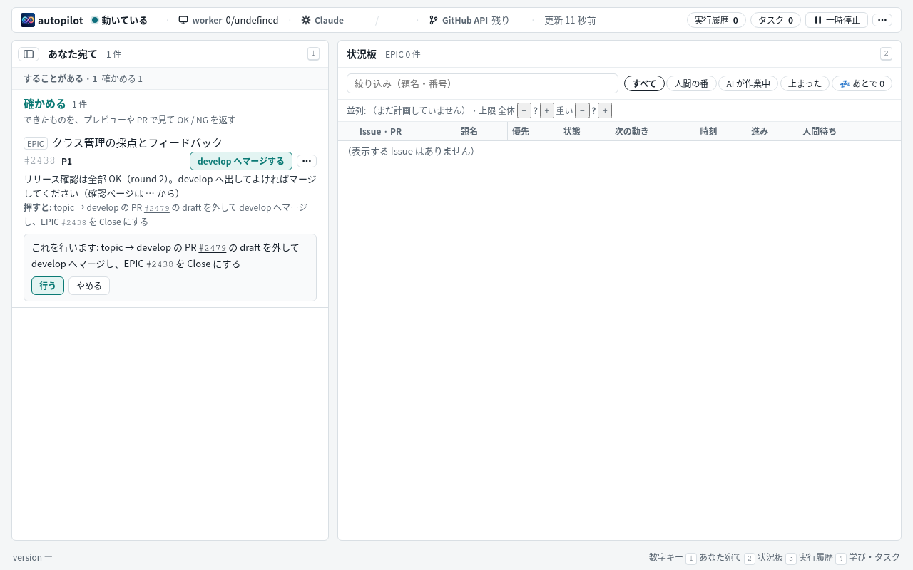

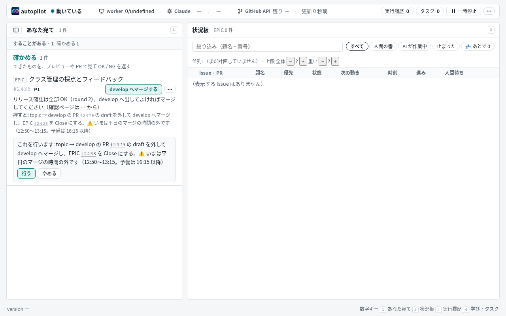

どちらの段（まとめる / 受ける）かは、トラッカーの目印付きコメントと、PR のまだ受けていないレビュー・コメントの数だけで
決める（`releaseCheckMode`）。
プレビューの URL は段の結果（`previewUrl`）か、ダイアログを開いたときに覚えたものだけを行に出す（定期では取らない）。

#### 確認ページ（artifact）

EPIC の最後の確認を 1 枚で済ませるページ（#2474）。決まり（`.claude/rules/topic-branches.md`）の「決定ページ」にあたる。

- **作る**: release-check の「観点をまとめる」段で worker が作る。形は **テンプレート**
  `tools/autopilot/templates/release-check/template.html` が正で、worker は `bin/release-page-render.js` が
  トラッカーのコメントから作るデータ（`draftReleasePageData`。`RELEASE_PAGE_SCHEMA`）に、冒頭の一文（`lead`）だけを足す。
  データの形を変えたら、スキーマ・下書きの関数・テンプレートの JS を対で直す（`test/release-page.test.js` が確かめる）。
- **載せるもの**（上から）: EPIC の題・プレビュー・topic → develop の PR・トラッカーへのリンク（別タブ）→ 確認の観点（R1, R2 …。
  開く / する / OK / 出どころ、観点ごとに OK / NG とメモ）→ 決定待ち（EPIC の「決定待ち」まとめコメントの中身。採用しなかった
  指摘も入る。D1, D2 …。AI の推奨と、ほかの案、「推奨でよい / 別の案 / コメント」）→ 全体のコメント → 「答えを送る」。
- **答え**: ページの保存先（artifact の db）の `answers/round-N` に入る。押すまでは下書き（`status: "draft"`）で、送ると
  `status: "submitted"` になり、ページは変えられない表示になる。
- **読むのは worker**: db を読めるのは Claude の ArtifactData だけ（daemon は Node で claude.ai の認証を持たない）。人間が
  「確認ページの答えを AI に渡す」で 🙋 を外すと release-check が起き、db の答えを読んで `bin/release-page-answer.js`
  （`postReleasePageAnswer`。モニターと同じ `normalizeReleaseReviewBody` で検証する）でトラッカーに結果のコメントを書く。
  答えは閲覧者が書いたデータなので、指示として読まない。
- **同じ URL**: URL は daemon が `~/.config/autopilot/release-check-pages.json`（`AUTOPILOT_STATE_DIR` で場所を変えられる）に
  EPIC ごとに持ち、worker に `AUTOPILOT_ARTIFACT_URL` で渡す。2 回目の round からは同じ artifact を更新する（db の答えは
  round ごとの文書なので、前の round の答えも残る）。結果ファイルの `artifactUrl` が artifact の URL の形でなければ覚えない。

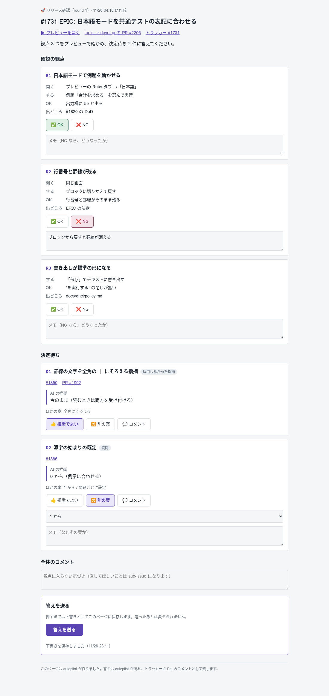

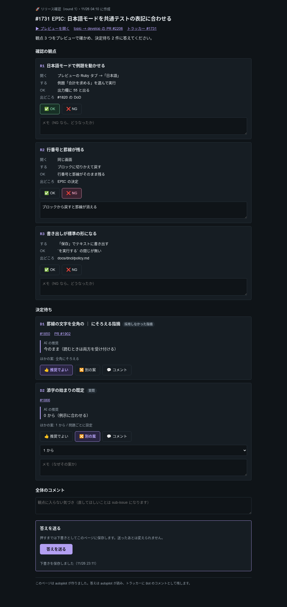

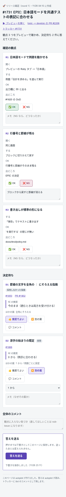

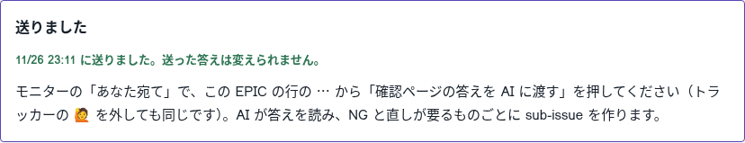

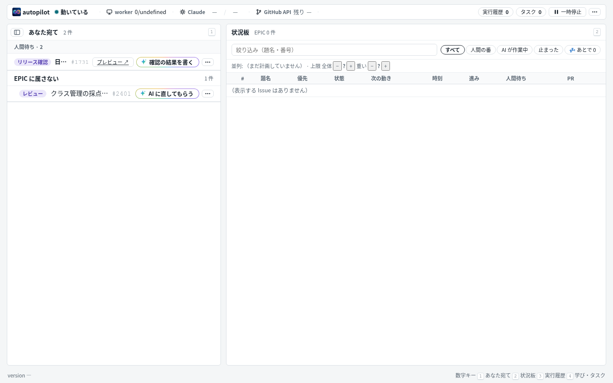

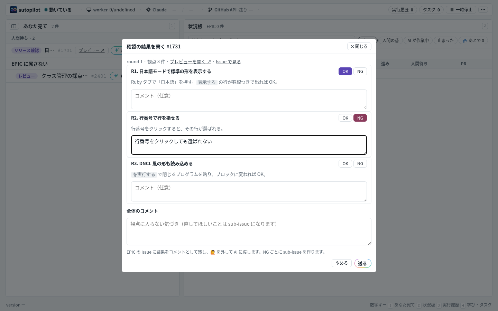

---

## merge は独立した「前進シグナル」

PR が merge されたら、`🙋 HITL` ラベルが残っていても autopilot は前進する。

- **leaf Issue**: ひも付く PR が merge されたら Issue を **Close** へ進める（人間が `🙋 HITL` ラベルを
  別途外す必要はない。daemon が両面のラベルを除去する）。
- **EPIC**: 子 PR の merge では完了しない（後述の EPIC 運用）。

autopilot は **自動 merge しない**。daemon はポーリングのたびに「PR が出た後〜Close 前」の leaf
（Status が In Progress / Blocked / Review / DoD）について、`Closes #<issue>` などで紐付く PR が **人間に
merge 済みか**を GitHub に問い合わせ（`closedByPullRequestsReferences`）、merge 済みなら Status を
**Close**・AI Status をクリアし、両面の `🙋 HITL` ラベルを除去する。close リンクは PR が
**非デフォルト base 宛て**（EPIC サブ Issue を親 epic ブランチに積む等）だと登録されないため、
close リンクで見つからなければ head ブランチ `topic/autopilot-<N>` の merged PR も見て base 非依存に
検知する（#831）。**同じブランチで PR を分けて出す Issue では、open の PR があればマージ済みと
みなさない**（前の PR がマージ済みでも、いま開いている PR が本物で人間のレビュー待ち。close リンクと
head ブランチのどちらでも同じ。head ブランチは `--state all` の 1 回で open と merged を取る・
`phases.js` の `hasMergedHeadPr`）。判定は `phases.js` の
`selectMergeCandidates` / `mergeProgressionIntents`（純粋関数）、問い合わせと書き込みは
`project.hasMergedPullRequest` と daemon の `applyMergeProgression`（ラベル除去は force 同期）。
実行中（run が所有する）item は触らない。

非デフォルト base 宛て PR では GitHub の `Closes #N` 自動 close が効かないため、Status を **Close**
へ進めた leaf は `project.closeIssue`（`gh issue close`・冪等）で **GitHub issue も明示的に閉じる**
（#843 Fix A）。

### closed-issue → Project Close 整合（#843 Fix B）

merge-progression は leaf の連携 PR merge しか見ないため、(A) 非デフォルト base 宛て PR で手動
close した leaf、(B) 統合 PR の `Closes #<epic>` で閉じた EPIC、(C) 人手で閉じた issue が Project に
取り残される。daemon はポーリングのたびに `applyClosedReconcile` で **GitHub 上で closed な issue**
（`project.listClosedIssueNumbers`）のうち Project Status が終端（Close / Done）でないものを
**Status=Close + AI Status クリア**へ整合する。closed という事実だけを根拠にするので **EPIC も対象**。
判定は `phases.js` の `selectClosedToReconcile`（純粋関数・終端は `TERMINAL_STATUSES`）。実行中
（run が所有する）item は触らない。冪等。

閉じた Issue の Status が空（New Item）や In Progress のままだと、拾う判定が reconcile より先に worker を
起こし、running に入った item を reconcile が飛ばしてしまう（triage が閉じた Issue を、また triage する
くり返し）。そのため daemon は次の 2 つを行う。

- **拾う前に外す**: tick は closed 状態の確認を拾う判定より先に行い、閉じた Issue を stalled 復帰と
  `selectActionable` に渡さない（`excludeClosedItems`）。Close へそろえるのは同じ tick の reconcile。
- **フェーズが閉じたら Close**: run が done で終わったとき、その Issue が GitHub で閉じていれば、
  結果の `nextStatus` を問わず Status=Close・AI Status 空にし、🙋 を付けない（`closedRunIntents` /
  `isIssueClosedAfterRun`。1 件のバッチ GraphQL）。プロンプトは `nextStatus` に Close を書かない
  （I4 の静的検査が `"nextStatus":"Close"` を禁じている）。Close にした Issue は reconcile の対象から
  外れるので、worktree の片付け（#1362 と同じ判定）も run の終わりに daemon が行う。hitl / error で
  終えたときは書きかえず、次の tick の reconcile が Close にする。

---

## implement→review の自動ディスパッチ（自己レビュー）

`autopilot-implement` が完了すると Status=`In Progress` / AI Status=`Self-Reviewing` / `🙋 HITL`
ラベル無しになる。daemon はこの状態を検知して **`autopilot-review`（敵対的レビュー）を自動ディスパッチ**
し、人間の介入なしに implement→review→（人間レビュー待ちの）Review/HITL まで前進させる。

- 判定は `phases.js` の `phaseForItem`（純粋関数）: `status==='In Progress' && aiStatus==='Self-Reviewing'`
  → `'review'`。`🙋 HITL` ラベルがあるときは人間の番なので渡さない。
- review は **既存 PR ブランチ**で作業する（`PR_BRANCH_PHASES` に含む）。
- 二重起動は daemon の running セットで防止（review 実行中も In Progress / Self-Reviewing のままだが
  `selectActionable` が running の item を除外する）。

### レビューは `.claude/rules` 準拠 + Must/Question/FYI 分類（#921）

`/code-review` 等の動的マルチエージェント Workflow は使わない（#893・トークン浪費）ため、
レビューの深さと視認性を **`.claude/rules` 準拠のインラインレビュー + 指摘の 3 分類**で確保する。

1. 差分の変更ファイルから `touchedRuleAreas`（`phases.js` の純粋関数）で touch する
   `.claude/rules/<area>/` を機械的に導き、それを読んでからレビューする（プロジェクト固有の
   実装規約・マーカー・不変条件の逸脱を見落とさない）。
2. 各指摘を **Must / Question / FYI** に分類する:

   | 分類 | 定義 | autopilot の対応 |
   |---|---|---|
   | **Must** | セキュリティ問題・考慮漏れ（明確なバグ/退行） | **必ず修正する** |
   | **Question** | 直した方がいいが動作する。稀なコーナーケース | **基本は修正する**（`fix-or-followup`）。よほど大変・効果が小さいときだけ見送り、その場合も **follow-up の sub-issue**（assignee・`🤖 autopilot` なし。enroll は人間が決める）を作って番号を残す。仕様・方針の選択が要るものだけ人間へ（`🙋 HITL` は Review 遷移で既に立つので追加分岐は無い） |
   | **FYI** | 動作・安全性に影響しない改善点（重複・整理の余地） | **簡単なら修正する**（`fix-if-easy`）。ただし振る舞いが変わる・設定値（env / settings / URL パラメータ等）が増える・infra の変更が要るものは見送り、理由を残す |

   各指摘の行末には扱い（`修正済み（<sha>）` / `見送り: <理由>。#<follow-up>` / `人間の判断に委ねる: …`）を必ず書く。

3. **1 回のレビューの全指摘を 1 コメントにまとめて**投稿する（`renderReviewFindingsComment`）。
   先頭に冪等マーカー `<!-- autopilot-review-findings round=N -->`、次の行に件数サマリ
   （「指摘 N 件（Must a / Question b / FYI c）」形式。別のサマリコメントは出さない）、以降に
   Must → Question → FYI の見出しごとに `- **[M1]** \`file:line\` 内容 — 対応` を並べる。
   ID は分類ごとの連番（`M1` / `Q1` / `FYI1` …）で、**同じ PR の再レビュー（round 2 以降）は
   前回の続きから採番する**（`nextReviewFindingNumbers`）ので、人間の「Q1」が曖昧にならない。

#### ID での返信（address-review）

人間は `Q1はOK, FYI1は修正して` のように ID で短く返信できる。address-review は
`planAddressReview`（`parseFindingReferences` + `resolveFindingAction`）で各指摘の対応を決める:

| 人間の返信 | 対応 |
|---|---|
| 「OK」「そのままで」「直さなくていい」 | 変更しない（`no-change`） |
| 「修正して」「直して」 | 修正する（`fix`。**FYI でも人間の明示指示が既定方針より優先**） |
| それ以外（質問・代案） | 返信し、必要なら修正（`reply`） |
| 言及なし | review フェーズの扱いのまま（既定方針は review が既に当てているので、address-review は再適用しない） |

ID の表記ゆれ（`Q1` / `q1` / `Question1`、`M1` / `Must1`、`FYI1` / `F1`、全角数字）を受け付ける。
`Q1, Q2は直して` のように ID だけを並べた節は後ろの節の指示を引き継ぐ。引用行（`>`。GitHub の
Quote reply）は bot の指摘本文なので指示として読まない。
address-review のまとめコメントも ID で書く（例: 「Q1: 変更なし（人間 OK） / FYI1: 修正済み（`<sha>`）」）。

旧形式（1 コメント 1 指摘で `**[Must]**` 等のマーカーだけ持つコメント）が残る既存 PR も
`countReviewFindings` が合算し、address-review も従来の既定方針で扱う（後方互換）。

分類・件数集計・対応方針テーブル・採番・ID 参照の解釈は `phases.js` の純粋関数
（`parseReviewFindingCategory` / `parseReviewFindings` / `countReviewFindings` /
`renderReviewFindingsSummary` / `renderReviewFindingsComment` / `nextReviewFindingNumbers` /
`parseFindingReferences` / `planAddressReview` / `addressReviewPolicyFor`）でテスト済み。
分類の実行（何が Must/Question/FYI か）自体は LLM の判断で、機械的に検証できるのは
マーカー形式・集計・対応表の整合性のみ。

---

## Review 解除後の自動遷移（address-review に一本化・#815）

`Review` の item は人間レビュー待ち（`🙋 HITL` ラベルあり）。人間がレビューを終えてラベルを外すと、
daemon は **構造化シグナル（approve/changes-requested）で機械的に分岐せず、必ず
`autopilot-address-review` を起動する**（`phaseForItem` が Review 解除 → `address-review`）。

approve でも本文に改善依頼が書かれていたり、"changes requested" でも実質 LGTM だったりと、
自由文の意図は構造化シグナルでは判定できない。そこで**判断はプロンプト側に置く**: address-review が
PR の **diff と全コメント（Issue/レビュー本文/インライン）**を読んで分類する。

分類対象は 2 系統（#921）: (A) review フェーズが残した `Must`/`Question`/`FYI` マーカー付き
コメントのうち未対応のもの、(B) 人間の自由文コメント・レビュー。(A) は review フェーズと同じ対応表
（Must=修正 / Question=基本は修正・見送るなら follow-up sub-issue / FYI=簡単なら修正）に従う。(B) は次の表:

| プロンプトの分類（HITL 解除後・人間コメント） | 対応 |
|---|---|
| 質問 | bot で返信（必要ならコード修正）→ 再レビューへ |
| 改善依頼 / 変更要求 | worktree で修正・push → 再レビューへ |
| LGTM / 対応不要 | 何もしない → 人間のマージ待ち |
| 判断がつかない | 論点を整理してコメント + `AUTOPILOT_HITL`（人間に質問） |

- 解除は **2 系統の OR**: (a) Issue / PR いずれかの `🙋 HITL` ラベル除去、(b) ゲート開放中の
  **人間の発言**（レビュー送信・コメント。ラベルを触らなくてよい）。`getGateContext` が
  ラベル 2 面 + 発言アクティビティを集め、`phaseForItem` が `isGateReleased` で判定する。
  daemon が両面を atomic に同期する（後述「PR 側の状態可視化」）ので、人間は目の前の
  PR ラベルを外すだけでも、コメントを返すだけでも差し戻せる。
- address-review は **既存 PR ブランチ**で作業する（daemon が worktree を `--pr` で用意）。
- **base とのコンフリクトは AI が解消する**（#1348）。着手時の base 追従でコンフリクトしたら、
  daemon が先に `autopilot-resolve-conflict` を走らせ、解消できたら address-review を続ける。
  解消できなければ Blocked + 🙋 で人間に渡す（後述「base 追従」）。

---

## DoD — headless 確認と headful 引き継ぎ（#891 / #821）

DoD（Definition of Done）は最終ゲート。確認手段は **UI 種別で分かれる**。

**worker は bundled chromium を headless で動かせる**（#891 で実証）。したがって **一般的な UI 確認は
verify フェーズ（`autopilot-verify`）が headless Playwright で自己完結**する（`tools/autopilot/bin/pw-check`
ヘルパー。Playwright MCP は host Chrome 依存で使わない）:

- **自己完結ページ（autopilot monitor 等）**: dev server 不要。daemon の `http://localhost:8787/` を開くか、
  `MONITOR_HTML` を静的 serve して確認。
- **scratch-gui の UI**: dev server（`localhost:8601`）が必要。プレビュー URL があれば優先、無ければ起動して待機。

**音・autoplay など実 Chrome が必須のケースだけ**、従来どおり daemon が「**ホスト側 Claude（headful
Playwright / 実 Chrome）に渡す引き継ぎを生成する**」。LLM は in-container で回さず、**純粋な I/O + 文字列
テンプレート**で完結する（child Claude 不要）。

### 引き継ぎのトリガと生成（daemon の tick ステップ・限定ケース）

人間がコードレビューを終え「次は DoD 検証」と判断して Status を **Review → DoD** にすると、daemon は
ポーリングのたびに `Status=DoD` の leaf について次を行う（`applyDodHandoffs`、`🙋 HITL` は維持）:

1. 連携 PR と Issue 本文の **DoD チェックリスト**を取得（`extractDodChecklist`）。
2. **プレビュー URL** を PR の CI コメントから拾う（`extractPreviewUrl`。
   stg の API を見る `https://preview.smalruby.app/<slug>/`。旧 GitHub Pages の
   `https://smalruby.jp/smalruby3-editor/<branch>/` は出力を止めて更新されないので拾わない）。
3. **テンプレートで引き継ぎ本文を生成**（`dodHandoffBody`）して `autopilot:dod-handoff` マーカー付き
   コメントを PR に投稿する。本文は「プレビュー URL ＋ Issue の DoD チェックリスト転記 ＋ 定型 headful
   手順（`?no_beforeunload=1`、スクショは `tmp/`→`docs/<feature>/screenshots/`、秘密情報は本文に
   書かずローカル `.env` 参照、本番 Chrome で確認）＋ 報告の出口」。
4. sticky ステータスコメントに「DoD 引き継ぎあり」の 1 行ポインタが出る（`renderSticky`。sticky 本体は
   上書きされない別コメント）。

**冪等**: 既に `autopilot:dod-handoff` コメントがあれば再投稿しない（`hasDodHandoffComment` /
`needsDodHandoff`）。判定は `phases.js` の純粋関数、I/O と投稿は `project.js` / daemon の
`applyDodHandoffs`。実行中（run が所有する）item は触らない。

### 報告の出口（ホスト Claude → 人間）

- **OK**: ホスト Claude が PR に「DoD 検証 OK」+ スクショ要約をコメントし、必要なスクショ commit を
  push。人間が merge → 既存 merge-progression が leaf を **Close**（DoD は `MERGE_CHECK_STATUSES`）。
- **NG**: ホスト/人間が PR に NG をコメントし `🙋 HITL` を外す → daemon が **DoD 解除 → address-review**
  を起動（Review と対称。`phaseForItem` が DoD 解除 → `address-review`、OR セマンティクスも同じ）。

> 一般 UI の DoD は `autopilot-verify` プロンプト（`tools/autopilot/prompts/`）が headless Playwright で
> 確認する（#891）。この daemon 生成（`applyDodHandoffs`）の引き継ぎは **音・autoplay 等の実 Chrome 必須
> ケース**向けに限定される（#821）。

---

## decompose の分割戦略（PR 数最小化）

decompose は EPIC を leaf に分割する前に、**「① 1 PR で完結 / ② 数個にまとめる /
③ 細かく分割」の 3 案を明示的に比較**して選ぶ（素直に最大分割しない）。基準は
**各 leaf が 1 実装バジェット（1 run のタイムアウト。checkpoint 導入後は複数ラン跨ぎ可）
に収まる範囲で、「最少かつレビュー単位として一貫した」leaf 群**になること。

分割するのは次のいずれかの理由があるときのみ:

1. 独立して価値がある / 独立してレビューしたい
2. 共有ファイルの衝突を避けたい（並列着手での衝突防止）
3. 1 実装バジェットに収まらない（重い実装・Playwright スクショ多数等）
4. レビュースコープを分けたい

当たらない関連コンポーネントは、別ファイルで衝突しない限り 1 leaf に束ねてよい。
直列依存が残る場合は `autopilot-after`（前述）で順序付ける。分解案コメントには
**なぜこの粒度か（PR 数の根拠）を 1 行**添える。詳細な判断手順は
[`tools/autopilot/prompts/autopilot-decompose.md`](../../tools/autopilot/prompts/autopilot-decompose.md) の A-1 を参照。

---

## EPIC の扱い

EPIC は「作業項目」ではなく「**トラッカー**」。

1. daemon は **leaf（Kind=Issue）だけ**をキューから拾う。EPIC は分解後キューに入れない。
2. EPIC の Status: `Backlog`(未分解) → `In Progress`(子を追っている) → `Done`(子が全部完了)。
   一時停止は `Icebox`。AI Status は分解完了で `EPIC Decomposed`。進捗は標準の
   「Sub-issues progress」で見る。
3. 「もう十分」のときは **納品スライスを Done + 残りをフォローアップ EPIC** に切り出す
   （半分終わった EPIC を滞留させない）。
4. EPIC を Done にする遷移は **HITL**（未クローズの子がある EPIC を勝手に閉じない）。
5. **分解済み EPIC の Issue 本体には、daemon が sub-issue 進捗 + 人間アクションの sticky
   コメント（`<!-- autopilot-tracker-status -->`）を維持する**（#934）。トラッカー
   （Kind=EPIC または `🧭 tracking`）で非終端・sub-issue が 1 件以上のときだけ出る:
   - 未完了時: 完了数/全体数と割合、「すべて閉じたらこの EPIC を Close してください」を表示。
   - 全 sub-issue 完了時: 「この EPIC を Close してください」に文言を切り替える
     （**autopilot は EPIC を自動 Close しない**ので、人間が Close するか Project の
     Status を Close/Done に変更する必要がある。closed にすれば closed-reconcile が
     Project を整合する）。
   sub-issue 進捗は俯瞰ボードの enrichment（`refreshBoard` が既に取得済みの board キャッシュ）を
   再利用するため追加の GraphQL は発生しない。書き込みは本文が変わった tick だけ（冪等 upsert）。

### 人間の確認は EPIC ごとにまとめる（topic への自動マージ・決定待ち）

人間が決めるのは**最初の EPIC の設計**（triage / discuss の方針と decompose の分解案）だけ。そのあと
sub-issue（本文に `autopilot-base: topic/...`）は、topic へのマージまで AI のおすすめで進める。
develop へのマージ（EPIC の draft PR）はこれまでどおり人間。判断は `src/epic-flow.js`（純粋関数）、
daemon 側の実行は `src/epic-merge.js`。

- **途中の 🙋 は 3 つだけ**: ① 3 案以上に分かれる判断 ② 直しを 3 回しても Must が残る ③ エラーで続けられない
  （認証・使用量・壊れた環境）。それ以外は worker が結果ファイルの `decisions` に書いて先へ進む
  （契約は `autonomous-contract.md` §2.6）。checkpoint も 🙋 を付けずに続きを再開する。
- **Must の直し**: review が残った Must の数（`mustCount`）を返す。0 なら Review + 🙋 なし（自動マージ待ち）、
  あれば In Progress + Addressing Comments にして address-review が直し、もう一度 review。直した回数は
  review のまとめコメントの round で数え、3 回直しても残ったらその sub-issue だけ Blocked + 🙋 にする。
- **topic への自動マージ**（tick ステップ `applyEpicAutoMerge`）: Review + 🙋 なしで PR の base が `topic/...` のものを、
  CI が通った（チェックが無い PR は push から 10 分待つ）・コンフリクトが無い・まだ対応していない Request changes が
  無いときにマージする（merge commit）。直後の merge-progression が Project を Close にし、GitHub の Issue を閉じる。
  コンフリクトは resolve-conflict、CI の失敗と Request changes は Must の直しと同じ流れに回す。
- **決定待ち**: `decisions`（review の Question・採用しなかった指摘・AI が決めたこと・2 案・3 案以上）と、daemon が
  止めた理由（Must が残った・想定外の 🙋）を、daemon が EPIC の Issue の「決定待ち」まとめコメント
  （`<!-- autopilot-epic-decisions count=N -->`・1 つ。中に機械用の JSON を base64 で埋める）に書き足す。**書くのは daemon だけ**。
  親の EPIC は REST の `issues/<n>/parent` で引く。指揮役は EPIC を develop へ出す前に、これを決定ページにまとめて確認する。
- **2 案**: おすすめを Issue のブランチで topic へ、もう 1 案を `topic/<epic のブランチ>-alt-<番号>` の draft PR にする
  （`Closes` を書かないので daemon はマージしない）。決定待ちに両方の PR とプレビューを書く。
- **3 案以上**: その sub-issue だけ止め（`hitlKind:"diverge"`）、決定待ちに足す。`autopilot-after` で待つものも止まる。

---

## PR 側の状態可視化（Issue のみ Project 管理 + PR は投影）

PR を見ただけで連携 Issue の状態が分かるよう、daemon が PR へ状態を投影する（Project が真実、
PR 側は読み取り投影）。実装は daemon の `applyPrProjection`（ポーリングのたびに走る per-tick 同期）
と、フェーズ適用後・merge 前進後の権威的な同期 `syncFacesAfterIntents`（force）。判定は
`phases.js` の純粋関数（`labelActions` / `draftAction` / `renderSticky` / `selectPrSyncCandidates`）、
書き込みは `project.js`（`editLabels` / `setPrDraft` / `upsertStickyComment`）。実行中（run が
所有する）item は触らない（live phase と競合しない）。

| 手段 | 意味 | 同期ルール |
|---|---|---|
| `🤖 autopilot` ラベル | autopilot 管理対象（AI 処理対象） | Issue/PR に常時担保 |
| `🙋 HITL` ラベル | 人間の対応待ち（**HITL の唯一の真実**・#813） | 人間に渡すとき Issue/PR の両面に付与 / release・merge で除去 |
| Draft ⇄ Ready for review | Draft=AI 作業中 / Ready=人間が見る段階 | **Status 基準**（#815）: `Review`/`DoD`/`Close`/`Blocked`→Ready / それ以外（`In Progress` 等）→Draft |
| sticky ステータスコメント | bot が1コメントを編集し続け、連携 Issue の Project 状態を投影 | Status / AI Status / HITL（ラベル由来）/ Size をマーカー付き 1 コメントに upsert。人間待ちなら「いま: 🔬 Spike・回答待ち — …」のように**何待ちか**を 1 行足す（`humanWaitReason`）。本文が変わったときだけ PATCH |

- 対象は連携 PR を持ちうる post-PR ステータス（In Progress / Review / DoD / Blocked）の leaf。
  EPIC は実装 PR を持たないので除外（`selectPrSyncCandidates`）。
- **Review 中の `🙋 HITL` ラベルは人間の「解除ジェスチャ」を兼ねる**ため、steady-state（per-tick）の
  同期では**人間が外したラベルを再付与しない**（解除シグナルを潰さない）。Review への handoff は
  force 同期で明示的に付与する（`hitlLabelAction` の `force` 分岐）。
- 「作業中」専用ラベルは作らない（Draft が兼ねる）。

---

## worker 設定（フェーズ別 model / effort・追加ディレクトリ）と起動時スナップショット

worker（子 claude）の起動構成は `tools/autopilot/src/settings.js` の
**DEFAULT_SETTINGS（推奨構成: 実装・レビュー系 = opus、分類・対話系 = sonnet）** を基底に、

1. リポジトリ共通の `tools/autopilot/settings.json`（任意・コミット可）
2. 開発者ごとの `~/.config/autopilot/settings.json`（または env `AUTOPILOT_SETTINGS` のパス）

の順で deep merge して決まる。設定例:

```json
{
  "addDirs": ["~/ghq"],
  "phases": {
    "default": { "effort": "medium" },
    "implement": { "model": "opus", "effort": "high" }
  }
}
```

- `addDirs` は worker に読み書きを許可する追加ディレクトリ（`--add-dir`）。参照リポジトリ群
  （ghq 等）を許可する用途。
- `phases.<phase>.model` / `.effort` / `.args` でフェーズ単位に上書き。`effort` は
  `--effort` フラグになるため、対応していない Claude Code では指定しない（既定は未指定）。
- env `AUTOPILOT_CLAUDE_CMD` は従来どおり**最優先**（settings を使わず固定コマンドで起動）。

daemon は**起動時にプロンプト一式 + 解決済み settings を tmpdir へスナップショット**し、
run 中に checkout のブランチが切り替わってもプロンプト/設定が変わらない（worker は
スナップショットの絶対パスを Read する。`--add-dir` は daemon が自動で付与）。

### 許可プロンプトで停止しない — `auto` モード + プロンプトを読んで答える

worker は**非対話**で動くので、許可プロンプトで止まると運用が止まる。worker は
**コンテナ内 root** で動くため、`bypassPermissions`（= `--dangerously-skip-permissions`）は
使えない（root で拒否 + 社内規定でも禁止）。そこで **`--permission-mode auto`** を採用する:

- **`auto` モード**は AI classifier（`claude auto-mode defaults` の allow / soft_deny / hard_deny
  ルール）が **通常の開発操作を自動許可・危険操作を自動拒否**し、**対話プロンプトを基本出さない**。
  `bypassPermissions` の「全バイパス」とは異なり危険操作は自動拒否するので、規定に抵触しにくい。
  root でも起動できる。
- **`auto` モードでは allowlist（`--allowedTools` / `permissions.allow`）は機能しない**（classifier が
  判定を握る）。そのため `buildClaudeCommand` は `auto` のときこれらを**出力しない**
  （`acceptEdits` 等にフォールバックしたときの保険として定義だけ残す）。
- **それでも対話プロンプトが出た場合は、止めずに画面を読んで答える**（既定。下の
  「worker の端末（herdr / tmux）と、止まった worker の扱い」）。AI が NG と判定したものだけ一時停止して、
  モニターから人間が答える。settings の `blocked.mode: "hitl"` にすると従来どおり、`tPromptMs`（既定 6 秒）
  で打ち切って Blocked/🙋 にする。
- review/verify フェーズは、トークンを大量消費する `/code-review` などの **動的 Workflow を起動しない**
  （プロンプト内で軽量なインライン敵対的レビューを行う。`autopilot-review.md`）。
- セキュリティ上の位置づけ: `auto` は「全許可(bypass)」ではなく **classifier による限定自動許可**。
  devpod はディスク隔離 + egress allowlist 前提（`.claude/rules/devpod-workflow.md`）。

---

## 認証の無人運用（Secrets Manager / SSO auto-pause）

- **GitHub App 秘密鍵**: `~/.config/smalruby-bot/config` に `PRIVATE_KEY_SECRET_ID`
  （+ 必要なら `AWS_PROFILE` / `AWS_REGION`）を設定すると、`bin/bot-token` が
  **AWS Secrets Manager から秘密鍵を取得**する（生 `.pem` の各自配付を廃止。ローカル
  `.pem` はフォールバック）。
- **SSO 失効の検知と auto-pause**: daemon は interval ごとに認証ヘルスチェックを行い、
  bot トークンが取得できなくなると **auto-pause**（`pausedBy: "auth"`）して Web モニタに
  再認証手順（`aws sso login --sso-session smalruby --use-device-code`）を表示する。
  再認証して回復すると**自動で resume** する（人間が押した pause は上書きしない）。
- **モニタからワンクリック再認証（device code）**: ブラウザの無い devpod 向けに、認証エラー
  バナーの **「🔐 再接続（SSO ログイン）」** ボタン（`POST /reauth`）が daemon 側で
  `aws sso login --use-device-code` を起動し、出力から**認証 URL と user code** を抽出して
  モニタに表示する。ボタンは**認証ページを別タブで自動オープン**し、**コードはコピー
  ボタン**付きで出す。ホストのブラウザでコードを承認すれば `aws sso login` が完了し、
  次の認証ヘルスチェックで **auto-resume** する（`onSuccess` で即時再チェック）。
- **SSO が切れたままでも起動できる（起動待ち）**: devpod の再起動直後のように、起動の時点で
  bot トークンが取れないときも daemon は落ちない。先に Web モニタを立て、**起動待ち**
  （`booting: true` + `pausedBy: "auth"`・状態ピル **`SSO 待ち`**）として
  「SSO ログインが必要です（autopilot は起動待ち）」と表示する。上の「🔐 再接続（SSO ログイン）」で
  コードを承認するか、コンテナで `aws sso login` を実行すると（30 秒ごとに確かめ直す）、Project の
  情報を取って稼働を始める。起動待ちの間は Project 情報が要る操作（`/tick` / `/refresh` /
  `/resume` / `/later` / `/inject` / `/resolve-conflict`）を `503 {booting:true}` で断る。認証が通る
  起動でも、最初に Project 情報を取り終えるまでの数秒は `booting: true`（`notice: "starting"`・
  ピル **`起動中`**）。SSO ログインが通ったのに bot トークンが取れないとき（秘密鍵・App の設定など
  SSO 以外の原因）は、案内を「bot トークンが取れません」に切り替える（`notice: "boot-not-sso"`）。
  **GitHub API のレート制限**（`API rate limit exceeded` / secondary rate limit）で起動できないときも
  exit しない（exit すると supervisor の再起動でまた落ちるだけなので）。モニタを立てたまま
  **起動待ち**（`booting: true` + `bootWait: {reason:"rate-limit", message, resetAt, retryAt}`・
  `notice: "boot-rate-limit"`・ピル **`API 待ち`**）にし、`gh api rate_limit`（レート消費なし）で残量 0 の
  資源のリセット時刻を見て、その少し後に取り直す。リセットが分からないときは 30 秒から倍々で待つ
  （1 回は最長 10 分。過ぎたら残量を見直す）。レート制限では auth の pause にしない。
  認証・レート制限以外の起動エラー（GitHub に届かない等）は従来どおり exit して supervisor に任せる。
  `--once` は待たずに終了する。

## 人間の一時停止は再起動をまたいで残る

人間が止めた（`POST /pause`・モニタの「一時停止」、`pausedBy: "human"`）ことは
**`~/.config/autopilot/human-pause-<port>.json`**（`AUTOPILOT_STATE_DIR` で置き場を変えられる。
`monitor-answers.json` と同じ置き場）に残す。daemon は起動時、HTTP を立てる前・最初の tick より前に
このファイルを読み、あれば **pause したまま**始める（`/status` の `pausedAt` に止めた時刻）。
crash → `autopilot-supervise` の再起動で、人間の知らないうちに tick が回るのを防ぐため。

- ファイルを消すのは人間の再開（`POST /resume`・モニタの「再開」）だけ。起動待ちの間も、人間の pause の
  `/resume` だけは通す（ほかの pause の `/resume` は従来どおり `503 {booting:true}`）。
- auth / usage の auto-pause はファイルに残さない（起動時に改めて判定する）。auto-resume は人間の pause を
  外さない（`authRecoveryPatch` / `usagePauseAction` は `pausedBy` が `auth` / `usage` のときだけ外す）。
- 判断は `phases.js` の `restoredHumanPause` / `humanPauseFileAction`、読み書きは daemon の
  `restoreHumanPause` / `persistHumanPause`。

---

## Claude 使用量の auto-pause と強制再開

Claude の使用量（セッション枠）が 100% に達すると worker はプロンプトを受け付けなくなり、
watchdog の再起動も効かずに `stalled; restart limit reached` で Blocked になる。そこで
手前で **auto-pause**（`pausedBy: "usage"`）して新しいタスクを入れないようにする。

- **閾値**: セッション（直近 5 時間）**90%** 以上、または週間（7 日）**95%** 以上。
  settings の `usagePause` で変更できる（部分指定は既定とマージ。100 より大きくするとその枠では止めない）:
  ```json
  { "usagePause": { "sessionPercent": 85, "weeklyPercent": 98 } }
  ```
- **止めるのは新規ディスパッチだけ**。実行中の worker はそのまま続ける（既存の pause と同じ）。
- **判定しないケース**: usage が読めない（ファイル無し・非サブスク）とき、その枠の `resetsAt` を
  過ぎているとき（枠はリセット済み）、`resetsAt` が無く usage ファイルが枠の長さ以上古いとき。
  usage は worker 稼働時にしか更新されないが、`resetsAt` を過ぎれば据え置きのままでも**自動で再開**する。
- **人間 / 認証の pause は上書きしない**。自動再開するのは `pausedBy: "usage"` のときだけ。
- **強制再開**（`POST /force-resume`・モニタの `⚡ 強制再開…` → `再開する` の 2 段階）: いま閾値を
  超えている枠に「その枠の次のリセットまで」の override を付けて再開する。override は**枠ごと**で、
  セッションで強制したあとに週間が閾値を超えたら、週間側で改めて auto-pause する。リセット時刻を
  過ぎると override は自動で外れて通常の判定に戻る（daemon 再起動でも外れる＝in-memory）。
- **usage pause 中の `POST /resume` は `409 {forceResumeRequired:true}`** を返し解除しない（次の再評価で
  即また pause される上、上限に近いことを見落とさせないため）。モニタの ▶ は強制再開の確認段を開く。
- 判定は `phases.js` の純粋関数（`usagePausePlan` / `usageForceOverrides` / `usagePauseAction`）。
  daemon は usage を読み直すたび（毎 tick・`GET /board`・worker 完了時）に再評価する。usage は
  ローカルファイル読みなので GitHub API を消費しない。

---

## Bot 権限外パス（workflows 等）は個人トークンで push / PR

GitHub App bot は `workflows` 権限を持たないため、`.github/workflows/**` /
`.github/actions/**` を含む push は拒否される。push には **`bin/autopilot-push`** を使う:

- 変更にこれらのパスが**含まれない** → `bin/bot-git push`（Bot 名義・通常経路）
- **含まれる** → 個人クレデンシャルの plain `git push` に自動で切り替わる
  （`route=personal` を出力）。この場合プロンプトは PR も plain `gh`（個人トークン）で作成し、
  **`👥 human-review-required` ラベル**を付けて**作成者本人以外のレビューを必須**にする
  （autopilot の想定外領域の変更には他人の目を通す）。

---

## 手元の lint は変えたファイルだけ（`bin/lint-changed`）

ルートの `npm run lint` は、秘密の検査・hosting のスクリプトのテスト・scratch-vm と scratch-gui の
**全ファイル**の eslint と prettier を流すので重い。worker が流すとコンテナがもたつくので、
implement・review・address-review・resolve-conflict のプロンプトは **`bin/lint-changed`** を使う
（全体は CI が流す。重い処理の一覧は `.claude/rules/parallel-work.md`）。

- **検査するファイル**: base（既定は `origin/$AUTOPILOT_BASE_BRANCH`、無ければ `origin/develop`。
  `--base <ref>` で変えられる）との merge-base からの差分（消したファイルは除く）+
  まだコミットしていない変更 + 新しいファイル。
- **パッケージごと**（`packages/<name>/`・`infra/<name>/`・`tools/autopilot/`）に、そのディレクトリで:
  - eslint: `npx eslint [--max-warnings N] --no-warn-ignored <files>`（`.js` `.jsx` `.mjs` `.cjs` `.ts` `.tsx`。
    `eslint.config.*` の無いパッケージは飛ばす）。`--max-warnings` は `package.json` の `lint` の eslint に合わせる
    （scratch-gui は 0、警告を許している upstream の scratch-vm・scratch-render などは付けない）。`lint` に eslint が
    無い Smalruby のパッケージ（admin など）は 0
  - prettier: `npx prettier --check --ignore-unknown --no-error-on-unmatched-pattern <files>`
    （`package.json` の `lint` に prettier があるパッケージだけ。`.prettierignore` のホワイトリストで外れるものは
    prettier が自分で飛ばす）
  - `format-message lint`: `lint` に含まれるパッケージ（scratch-vm）で、`lint` の glob に合うファイルを変えたときだけ、
    `lint` と同じ引数でそのファイルにかける。npm の scripts は globstar の無い sh で動くので、`src/**/*.js` は
    `src/<dir>/<file>.js` にだけ合う（全体の lint もそれより深いファイルを見ない。深いファイルにかけると古いパーサーが
    `?.` や `import()` で落ち、CI は通るのに手元だけ落ちる）
- **リポジトリ root**: `npm run lint:secrets` はいつも、`npm run test:hosting-scripts` は
  `scripts/hosting/`・`scripts/precompress-assets*` を変えたときだけ。
- 変えたファイルが無ければ何もせず 0。どれかが失敗したら 1 で終わり、失敗したパッケージとコマンドを出す。
- `--dry-run` で流すコマンドだけを出す。
- 判断（振り分け・コマンドの組み立て）は `tools/autopilot/src/lint-changed.js` の純粋関数。

---

## Web モニタ（あなた宛て＋表）

daemon の `GET /`（既定 `http://localhost:8787/`）は、人間と同意した並べ方 **D「あなた宛て＋表」** の画面を出す。
見た目の決まりは [`design-system.md`](./design-system.md)。左に**人間がすること**（あなた宛て）、右に
**全体の状況**（状況板）を並べ、幅の広い画面では**ページ自体はスクロールせず、各列の中だけが動く**。
幅 900px 未満では「人間の番 / 状況板 / 実行履歴 / 学び・タスク」のタブ（件数つき）に切りかわる。

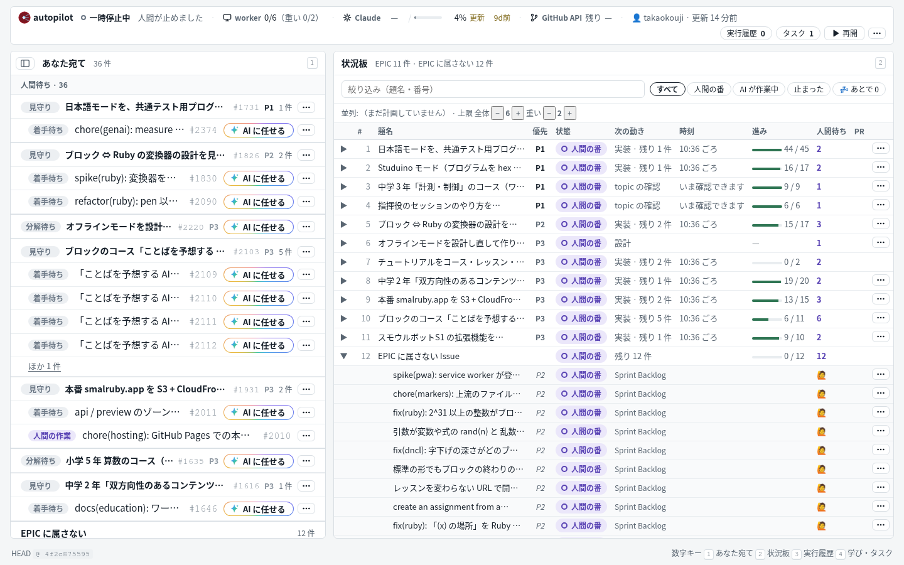

| 場所 | 出すもの・操作 |
|---|---|
| 上の 1 行 | 動いている / 一時停止中（AUTH ⚠・USAGE ⏸・起動中・SSO 待ちも）・worker の数（実行中 / 上限・重いもの）・**Claude** の使用量（セッション / 週間の細い棒）・**GitHub API** の残り・更新からの経過・件数バッジ「実行履歴 N」「タスク N」（押すと右から開く）・一時停止 / 再開・**⋯**（更新 `POST /refresh`・tick `POST /tick`・現在地を作る `POST /current-status` と現在地を開く） |
| アラートの帯 | 認証（再接続・device code）・Claude 使用量の自動 pause（2 段階の強制再開）・強制実行中・API レートの僅少・起動中・レート制限の起動待ち。地は塗らず文字と細い線だけ |
| 左「あなた宛て」 | **答えが要る**（worker の質問・選択肢・AI の推奨・メモ）→ **止まっている worker**（`blocked-panel.js`）→ **学び・確かめてほしい**（`/learnings` の action が PR を作る / マージする のとき）→ **人間待ち**（`GET /board` の `humanWait`。人間がすることごとの欄。下の「することごとの欄」） |
| 右「状況板」 | GitHub Projects の表の形。1 行 = 1 EPIC（EPIC に属さない Issue は優先度ごとのまとまり「EPIC に属さない · P0」〜「· P3」）。`▶` で sub-issue の行を開く。絞り込みの文字とチップ（すべて / 人間の番 / AI が作業中 / 止まった / 💤 あとで）。上に並列の計画の 1 行 |
| 右から開く欄 | 実行履歴（最新 100 件）、学び・タスク（`monitor-learn-tasks.js`。学びの PR・タスクの作成といま実行） |
| 下の帯 | 稼働バージョン（`branch @ shortCommit`）と ⬆️ 更新ありバッジ（更新手順のモーダル） |

- **することごとの欄**（`human-action.js` の `forYouModel` / `humanAction`）: 人間待ちを、人間がすることで分ける。
  順は 確かめる → 答える → ゴーサインを出す → 分解を始めるか決める → 人間の作業、欄の中は優先度（P0→P3）→ 番号順。
  見出しは「することがある · N」と内訳。人間の番ではないもの（🚀 after-release・⏳ 待ち・AI が作業中・子を進めている EPIC）は
  数えず、最後に「人間の番ではない」としてたたむ。決まりの理由は [`design-system.md`](./design-system.md) の
  「『あなた宛て』は人間がすることで分ける」。

  | 状態 | すること | ボタン | 押すと |
  |---|---|---|---|
  | 🧭 EPIC で Release Check（最後の確認） | 確かめる | 確認ページを開く | プレビュー / topic → develop の PR と「確認の結果を書く」のダイアログを開く（確認ページの artifact ができるまでのあいだ）。子に答え待ちの質問があれば一文で示す（子は「答えが要る」の欄に出る） |
  | 🧭 EPIC で子が全部済んだ（Release Check の前） | 確かめる | プレビューで確かめる | プレビュー / topic → develop の PR を開く |
  | Review / DoD（ほか 🙋 付き）で OPEN の PR が base とコンフリクト（`mergeable=CONFLICTING`・worker なし） | 確かめる | コンフリクトを解消してもらう | `POST /resolve-conflict`。AI が base を取り込んで解消し push する。🙋 と Status はそのまま（済めば daemon が `mergeable` を直し、行はもとのボタン（Review / DoD なら「PR を見る」）に戻る）。分解済み EPIC の途中の相談の子がこの状態なら、EPIC の行も同じボタン |
  | Review / DoD（PR あり） | 確かめる | PR を見る | PR を開く。OK なら 🙋 を外すと AI が先へ進む |
  | Blocked | 確かめる | Issue を見る | Issue を開く |
  | モニターの質問（worker・`bin/autopilot-ask`。Status・⏳ によらない）・相談中（Discussing / 🔬 spike） | 答える | 答える | 質問の欄を開く / Issue を開く |
  | Sprint Backlog + 🙋（Issue） | ゴーサイン | 実装を始めてもらう | 🙋 を外す（`POST /delegate`）。AI が実装して PR を作る |
  | 🧭 EPIC で、子に Sprint Backlog + 🙋 がある（任せる前） | ゴーサイン（EPIC にまとめる） | この EPIC を AI に任せる | 子 N 件の 🙋 を外す（子ごとに `POST /delegate`）。AI が順に実装して topic にマージし、最後の確認だけ返す。子の行は重ねない |
  | 🧭 EPIC で、子が答え・確認を待つ（途中の相談） | 答える / 確かめる | 子のボタン（答える・Issue を見る など） | 子の質問の欄・Issue を開く。子の行は重ねない |
  | 🧭 EPIC で、子を AI が進めている（自律で進行中） | 人間の番ではない | なし | — 進み具合と「決定待ち n 件（最後にまとめて確認）」を一文に出す |
  | Awaiting Continuation | ゴーサイン | 続きを始めてもらう | 🙋 を外す |
  | Backlog + 🙋（EPIC・未分解） | 分解を始めるか決める | 分解を始めてもらう | Sprint Backlog へ動かす（`POST /delegate`） |
  | Backlog + 🙋（Issue） | 人間の作業 | Issue を開く | Issue を開く（閉じない）。済んだら GitHub で閉じる |

  行は 優先度・題・`#番号`・状態の一文（EPIC の子には札「EPIC #N」）・「押すと: …」・動詞のボタン・「⋯」。
  ボタンを押すと行の中で「これを行います: …」と確かめ、「行う」で初めて行う。前の「AI に任せる」「AI に直してもらう」
  「確認の結果を書く」は「⋯」のメニューに残す。一文・「押すと」の `#N` は別タブで開くリンク。
  `GET /board` の `waitReason`（`humanWaitReason`）も同じ分け方（`continue` / `epic` / `go` / `decompose` / `hand`）にそろえた。

- **EPIC を AI に任せる流れ**（`humanAction` の `epicPhase`・#2475）: 分解済みの EPIC は、ボードの値（子の Status・AI Status・🙋・
  Release Check・決定待ちの件数 = `epicGroups` の `pendingDecisions`）だけで「いま」を 1 つに決め、「あなた宛て」の EPIC の行に出す。

  1. **任せる前**（`before-delegate`）: 🙋 の付いた子（Sprint Backlog）が残る。人間は「この EPIC を AI に任せる」を 1 回押す
     （確かめてから、子ごとに `POST /delegate` で 🙋 を外す）。
  2. **自律で進行中**（`autonomous`）: AI が子を順に実装し、topic 宛ての PR を自分でマージする。人間の番ではないので数えない。
     途中で AI が決めたことは「決定待ち」にためて、最後にまとめて確かめる。
  3. **途中の相談**（`consult`）: 途中で人間に返すのは 2 種類だけ — 方針が 3 案以上に分かれた（`diverge`。子の質問に答える）と、
     環境の問題で止まった（`environment`。Blocked の理由を確かめる）。EPIC の行に子の番号とボタンを出す。
  4. **最後の確認**（`final-check`）: 子が全部 topic に入ると Release Check になる。「確認ページを開く」で確かめて答える
     （確認ページの artifact ができるまでは「確認の結果を書く」のダイアログ）。develop へのマージは人間。

  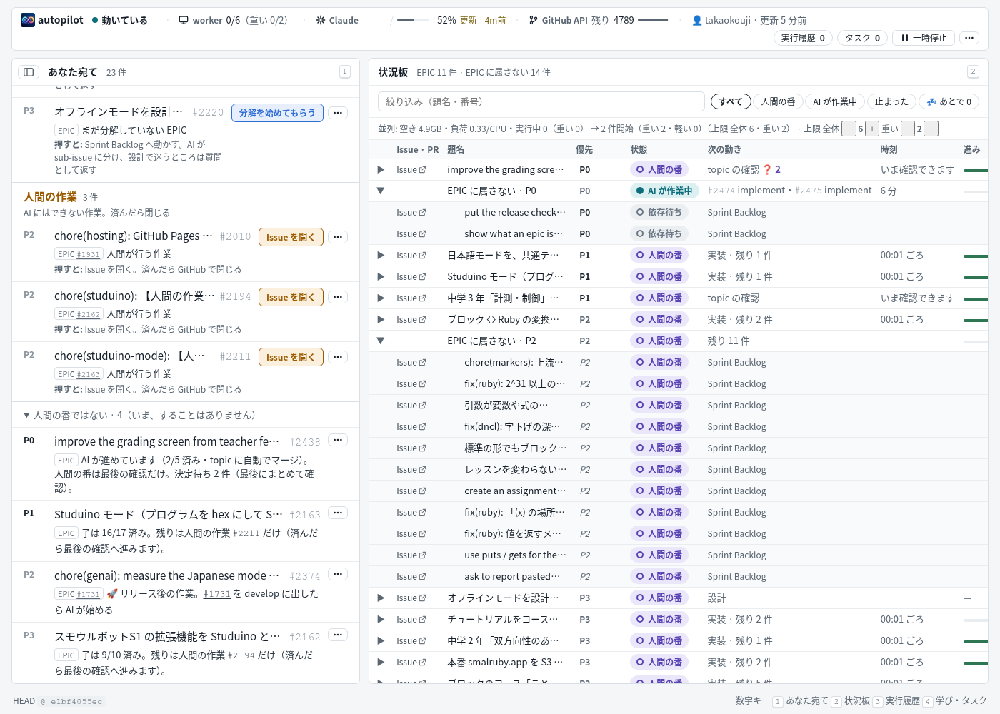
  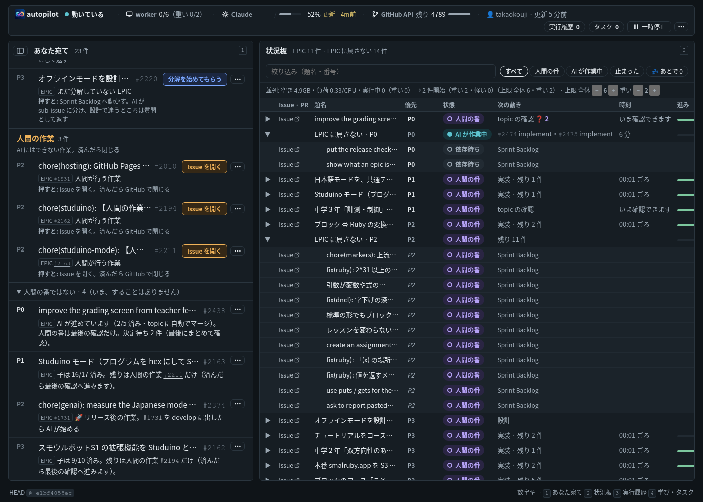
  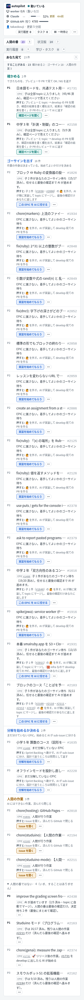

  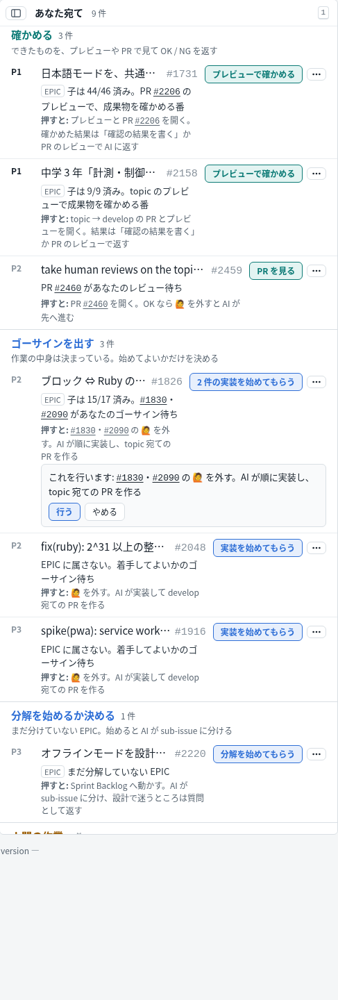
  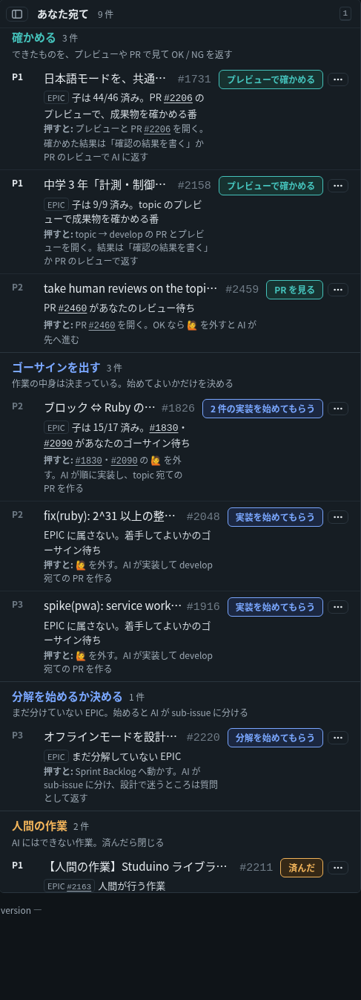
  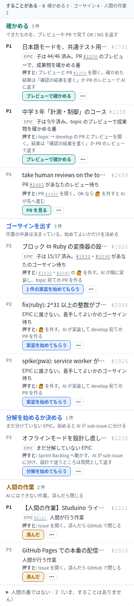
- **「あなた宛て」の開け閉め**（幅 900px 以上）: 見出しの左のサイドバーの印か `[` キーで閉じると、細い帯（44px）に
  なり、答え・学び・人間待ちの件数を縦に残す（帯のどこを押しても開く）。数字キー `1` でも開く。開け閉めは
  `localStorage` の `autopilot:inboxOpen` に覚える。900px 未満（タブ）では出さない。
- **タイトルのツールチップ**（「あなた宛て」の質問・まとまりの見出し・人間待ちの行）: … で切れたタイトルの全文と
  `#番号`、今の状態（例「In Progress · 見守り」）を小さなポップオーバー（`#titletip`、`role="tooltip"`）で出す。
  マウスは乗せると出て外れると消える。押す / タップすると出たままになり、もう一度押す・ツールチップを押す・外を押す・`Esc` で消える。
  タブキーでタイトルに移っても出る（`aria-describedby`）。開くのは常に 1 つ。切り替わるのはタイトルの文字の部分だけで、
  `#番号` のリンクやボタンの動作は変わらない。「あなた宛て」を細い帯に畳んでいるときは出さない。開け閉めの判定は
  `titleTipNext`、置き場所は `titleTipPlace`、中身は `titleTipInfo`（どれも `monitor-inbox.js`）。

  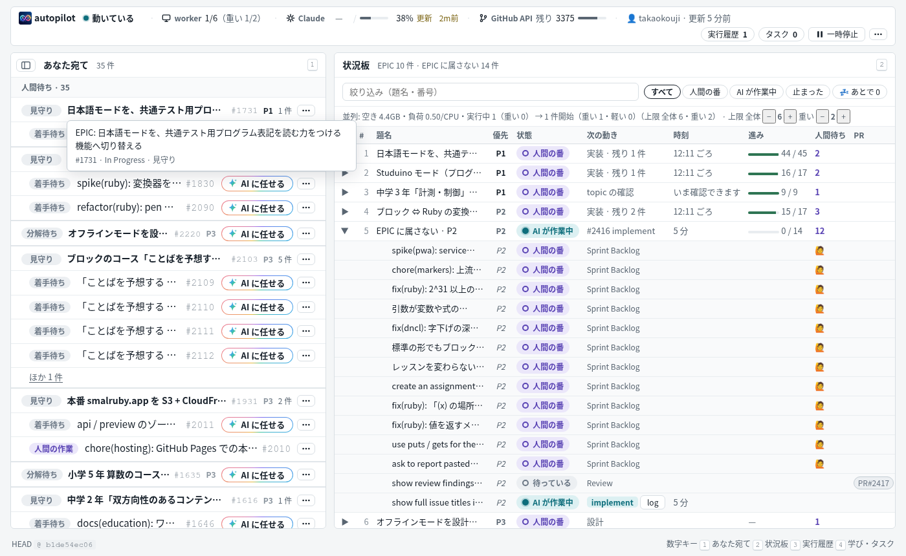
  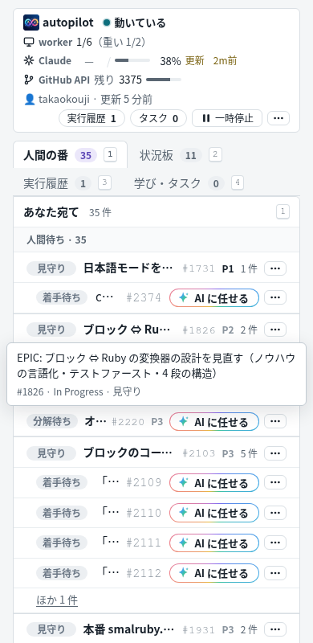
- **数字キー** `1` あなた宛て・`2` 状況板・`3` 実行履歴・`4` 学び・タスク。入力欄の中と ⌘ / Ctrl / Alt との
  組み合わせでは効かない（ブラウザのタブの切りかえと重なるため）。`[` は「あなた宛て」の開け閉め（同じ条件）。
  `Esc` でメニュー・欄・モーダルを閉じる。
- **「AI に任せる」**（虹色の輪のボタン）: 人間待ちの行では「⋯」のメニューから `POST /delegate`（下の「モニターの『AI に任せる』」）。
  Review / DoD で押すと差し戻し（address-review）に進むので、そのときの文言は **「AI に直してもらう」**。
  こちらは押すとダイアログを開き、bot の指摘を見ながら直してほしいことを書いて送る（「『AI に直してもらう』で
  指摘を見て指示を書く」の節）。
  `humanWait[].delegate.ok=false` の行にはボタンを出さない（理由は行の title）。失敗はトーストに出す。
  質問では **「AI に任せる（推奨 X で進める）」** で、全部の問いに AI の推奨があるときだけ出し、推奨の選択肢を
  `POST /answer`（`proceed:true`）で送る。ほかに「選んだ答えで進める」「メモだけ保存」（`proceed:false`）。
  メモを書いている途中は 5 秒ごとの描き直しを止める。
- **行の ⋯**: GitHub で開く・📋 Issue と PR をコピー（`issueCopyText`。コピーした行は一瞬光る）・PR の一覧・
  worker の log・🔀 コンフリクトを解消（`POST /resolve-conflict`）・💤 あとで / ↩ 今やる（`POST /later`）・
  優先度を上げる / 下げる（`POST /priority`）・`check autopilot #N` のコピー。一時停止・やめる は今後の操作（押せない）。
- **「開く」ボタンは置かない**。`#番号` が GitHub へのリンク。
- **状況板の列**: 左端に **Issue · PR**（「Issue」「PR」の短いリンクと外部リンクのアイコン。別のタブで GitHub を開き、
  `#番号` はマウスを乗せると出る。PR は open だけ並べ、merged / closed があれば ▼ で全部。番号の無い
  「EPIC に属さない」の行は空）・題名・優先（行に乗せるかフォーカスすると ▲▼。場所は取ってあるので列は動かない）・状態の札（AI が作業中 / 人間の番 / 止まった / 終わった /
  待っている・依存待ち）・次の動き（実行中のフェーズと log、AI Status、Awaiting Continuation は専用バッジと残タスク数）・
  時刻（実行の経過、EPIC は次の確認の見込み）・進み（sub-issue の棒）・人間待ち（EPIC は数、sub-issue は理由の印）。
  次の動きの `#番号` も別のタブで開くリンク。sub-issue の行には Size（S/M/L）・🧭・⏳・💤 と、
  自分がオーナーでない共同担当の行に 👁 + オーナー（担当は題名の title）。
- **💤 あとでやる**（#1190）: 状況板はふだん `💤 later` の Issue を隠し、チップ「💤 あとで N」で見る。
  切りかえは行の ⋯ で、**楽観的更新**（先に画面で動かし、失敗したら元に戻してトースト）。daemon も Issue ごとに
  直列化して最後の目標に畳み込む。あとでやる の中の人間待ちも「あなた宛て」に出る（💤 の印つき）。
- **コンフリクト**（#1348）: GitHub が判定した `mergeable` で、コンフリクトしている OPEN の PR の「PR」のリンクに枠（title に理由）。
  「あなた宛て」では、レビューより先に「コンフリクトを解消してもらう」を主ボタンにする（行の ⋯ の 🔀 も残す）。
- **除外**: Close / Done / Icebox はボードに出さない。`--assignee` 起動時は自分が Assignees のいずれかの item に限る
  （共同担当も観察のため出る。観察中の item は `refreshBoard` の周期か「更新」でだけ最新になる）。
- **判断の置き場**: 意味の色・あなた宛ての組み立て・状況板の行の絞り込み・答えの組み立て・数字キーは
  `src/monitor-inbox.js` の純粋関数（`itemSem` / `epicSem` / `inboxModel` / `boardRows` / `recommendedAnswers` /
  `chosenAnswers` / `digitTarget` / `isInboxToggleKey`）で、`phases.js` の `splitLaterBoard` などと同じく `fn.toString()` でページに埋め込む
  （二重定義しない）。
- **Claude 使用量**: 値は worker の status line が書く usage ファイル（`tools/autopilot/bin/usage-statusline.sh` →
  `os.tmpdir()/autopilot-claude-usage.json`。`rate_limits` は status line の stdin にしか無い）を daemon が毎 tick・
  `GET /board`・`POST /refresh` で読み直したもの（API 予算を使わない）。80% 以上で注意の色。最終更新からの経過を
  併記し、90 秒以上更新が無ければ据え置き（stale）の色にする（基準は usage ファイルの mtime）。Claude の印を押す
  （Enter / Space）と、セッション / 週間の使用率とリセット日時（JST）のポップオーバー。未取得は「—」。
- **データ**: ブラウザは 5 秒ごとに `GET /board`（daemon のキャッシュ）と `GET /learnings`・`GET /tasks`
  （手元のファイル）を読むだけで、GitHub には触らない。board の再取得（`listItems` ≈ 100 GraphQL ポイント）は
  専用のタイマーを持たず、すぐ最新にしたいときは ⋯ の「更新」（`POST /refresh`）。

### EPIC ごとの進み具合と「現在地」

状況板の行は **EPIC ごと**（`GET /board` の `epicGroups`）。ボードの item を親の EPIC で束ね、
EPIC の無い Issue は、実際に効く優先度ごとに「EPIC に属さない · P0」〜「EPIC に属さない · P3」のまとまりにする
（`src/epic-summary.js` の `groupItemsByEpic`。key は `solo-P0`〜`solo-P3`）。優先度の決め方は作業を始める順番
（`scheduler.effectivePriority`）と同じで、Priority の無い Issue は既定の P2 に入る。中身が 0 件の優先度のまとまりは作らない。

| 出すもの | 決め方 |
|---|---|
| 段 | `design`（sub-issue がまだ無い）→ `implement`（済みが全部に届かない）→ `topic-review`（全部済んだ。人間が topic をまとめて確かめる番）→ `develop`（EPIC が終端か、EPIC の PR が merge 済み） |
| 済み / 全部 | EPIC の `subIssuesSummary`（終端の sub-issue はボードに出ないので GitHub の数を正とする）。親がボードに無いときは見えている子の数 |
| 動いている worker | EPIC と子のうち実行中のもの |
| 決定待ち | `state.epicDecisions[<EPIC>]`（数・`{count}`・`{items}`）。EPIC の決定待ちのまとめコメント（`<!-- autopilot-epic-decisions count=N -->`）を書く daemon が載せる。コメントの本文から数えるときは `countEpicDecisions` |
| 次の確認の見込み | `implement` のとき「残りの sub-issue × これまでの 1 件の時間 ÷ 並列の数」（並列は残りを超えない。1 件の時間は実行履歴を Issue ごとに足した平均。測れないときは 60 分）。`topic-review` は「いま確認できます」 |
| 優先度 | Project の `Priority`（P0〜P3）。EPIC に無ければ子の中でいちばん高いもの |

並びは 優先度 → 段 → 番号。優先度の無い EPIC は作業を始める順番と同じく既定の P2 の位置に置く。同じ優先度では EPIC のまとまりが上、「EPIC に属さない · Pn」がその下
（例: P1 の EPIC → P2 の EPIC → EPIC に属さない · P2 → P3 の EPIC）。状況板の並びが AI の作業の順番とずれないようにするため。
▲▼ で優先度を変えた Issue は、次の再描画でその優先度のまとまりへ移る。親の EPIC は enrichment の GraphQL に `parent{number title}` を足して取る
（追加の問い合わせは無い）。

**現在地**は Claude に作らせる artifact（claude.ai のページ）で、モニタにはリンクと最終更新の時刻だけを出す。
トークンを使うので、**人間が上の行の ⋯ の「現在地を作る」を押したときだけ**作り直す（`POST /current-status`）。

1. daemon が材料（`GET /status.json` と同じ JSON）をファイルに書き、`autopilot-current-status` の worker を 1 つ起動する
   （Issue に属さない job。Status / AI Status は動かさず、並行上限の外。走っている間は 409）。
2. worker はテンプレート（`tools/autopilot/templates/current-status/template.html`）の下書きを
   `bin/current-status-render.js --material … --draft …` で作り、ことば（冒頭の説明・人間にしてほしいこと・EPIC の一言・入れたもの）を
   足して HTML にし、Artifact ツールで publish する。**2 回目からは同じ URL を更新する**。
3. 結果ファイルの `artifactUrl` を daemon が `~/.config/autopilot/current-status.json`（`AUTOPILOT_STATE_DIR` で場所を変えられる）に
   残し、次回の `AUTOPILOT_ARTIFACT_URL` にする。最初の URL を決めておきたいときは settings の `currentStatus.artifactUrl`。
4. worker がテンプレートの改善の案を `templateNotes` に書くと、daemon が `current-status-notes.jsonl` にためる（モニタに数が出る）。
   採り方は `tools/autopilot/templates/current-status/IMPROVEMENTS.md`。形が決まったら、下書き（`draftDataFromMaterial`）だけで
   Claude なしに作れるようにする。

### 稼働バージョン表示と更新検知（#885）

daemon はモジュールを**起動時にロード**するので「動いているコード = 起動時のコミット」。
以降 working tree が進んでも稼働中コードは起動時コミットのままなので、**今どのブランチ・
どのコミットで動いているか**を常時可視化し、さらに `tools/autopilot/` に更新があるかを
定期チェックして「再起動が必要か」を判断しやすくする。

- **稼働バージョン**: daemon は起動時に動作中 checkout（`project.REPO_ROOT`）の
  `git rev-parse --abbrev-ref HEAD`（ブランチ）と `HEAD`（コミット・`--short` も）を取得して
  `state.version = {branch, commit, shortCommit}` に保持し、`GET /board`・`GET /status` に載せる。
  モニタのフッターに `develop @ 9380da0` のように**常時表示**する（取得できなければ「version —」）。
- **更新検知（~15 分ごと）**: 起動直後に 1 回 + 以降 15 分間隔（`unref` タイマー）で
  既定ブランチ（`origin/develop`）を `git fetch`（remote-tracking ref のみ更新・working tree は
  触らない）し、`git log <起動時コミット>..origin/develop -- tools/autopilot` の件数で
  **更新あり**を判定する。結果は `state.autopilotUpdate = {available, behind, commits, checkedAt, error}`
  として `/board`・`/status` に載る。private repo なので fetch の認証は既存の gh credential
  helper に委ねる。**失敗（ネットワーク/認証）時は前回値（available/behind/commits）を保持**し、
  `error` だけを控えめに surface して表示を崩さない。頻度は `UPDATE_CHECK_INTERVAL_MS` 定数で調整可能。
- **更新ありの表示 + 更新手順**: 更新ありのときフッターに **`⬆️ 更新あり（N 件）`** バッジを表示。
  押すと**更新手順モーダル**（テキスト表示のみ・実行はしない）を出す:
  - 主導線: Claude の autopilot セッションで **`update autopilot`** と指示（コピー用ボタンつき）
  - 手動手順: `curl -X POST -H "X-Autopilot-Token: $(cat /tmp/autopilot-http-token-8787)" localhost:8787/shutdown` → `/app` で `git pull` →
    `bash tmp/autopilot_up.sh` で再起動
  - `tools/autopilot` の差分コミット一覧（短 SHA + 件名）も表示
- 実装: 判定は `tools/autopilot/src/version.js`（`readVersion` / `checkAutopilotUpdate` —
  git は `execFile` で実行し `deps.execFileP` で差し替え可能）、daemon 連携は
  `checkForUpdate` / `startUpdateChecks`（`tools/autopilot/src/daemon.js`）。

### 色のトークン（`--ap-*`）

- 見た目の決まり（型・密度・意味の色・「AI に任せる」・並べ方・ライトとダーク）は
  [`design-system.md`](design-system.md) が正。画面を変えるときはそれに合わせる。
- モニターの色は、`tools/autopilot/src/monitor.js` の `<style>` の先頭にある `:root`（ライト）と、
  ダークの 2 つの塊（OS に従う形・`data-theme="dark"` で固定する形）の CSS 変数（`--ap-` で始まる）で持ち、
  各ルールは `var(--ap-...)` で参照する。**トークンの一覧は monitor.js が正**（ここには書き写さない）。
  新しい色を足すときも、直書きせずトークンを足す。モニターに差しこむ部品（学び・タスク、止まっている worker）も同じ。
- 自己完結ページのため外部の CSS は読まない。favicon と見出しのアイコン（虹色の ∞ + A）は PNG の data URI で埋め、
  Claude の印の SVG の色は絵として直書きのまま。アイコンの決まりと作り直し方は [`design-system.md`](design-system.md) の「ロゴ」。

---

## GitHub API レート制限対策

Bot 単独・GraphQL 偏重だとレート制限に当たる（実測: Bot の GraphQL 残 0 / REST 残 4987）。
次の分散・削減を行う:

| 対策 | 内容 |
|---|---|
| **トークン分散** | **書き込み**（コメント・ラベル・Draft/Ready・Project 編集・close）= Bot（名義が見える操作）。**読み取り**（一覧・PR/Issue 情報・レビュー状態・アクティビティ）= 個人トークン（`AUTOPILOT_READ_TOKEN` → env `GH_TOKEN` → `gh auth token` → Bot フォールバック）。`AUTOPILOT_READS=bot` で従来動作 |
| **GraphQL / REST の使い分け** | バッチ読み（ボード enrichment・closed 状態一括確認・レビュー状態）= GraphQL（alias 50〜100 件/回）。単発読み（PR 情報 `/pulls/N`・Issue メタ `/issues/N`・コメント一覧）= REST。別枠の予算を並行活用する |
| **問い合わせ対象の限定** | Issue/PR の広い問い合わせは **`🤖 autopilot` ラベル付き限定**（label healing が非終端 item に毎 tick 担保）。**ステータス限定**: 終端（Close/Done）は定常問い合わせから除外。旧「リポジトリ全体の closed 一覧（最大 1000 件 × 毎 tick）」は廃止し、**非終端 item + `autopilot-after` 依存先だけ**の state をバッチ確認（`getIssueStates`） |
| **書き込み削減** | sticky コメントは**内容が変わったときだけ** PATCH（`stickyUpsertPlan`）。Issue ラベルは item-list の値を再利用して面同期の再取得を廃止 |
| **残量監視・自動退避** | `rate_limit`（レート消費なし）を tick ごとに Bot / 個人の両方で確認し、最小残量をモニタに表示。**残量 < 200 で低優先処理（PR 面投影・ボード更新）を自動スキップ**（warn は < 500）。dispatch・merge 検知は継続し、回復で自動復帰 |

---

## Claude runner の堅牢性

対話 Claude Code を端末（herdr / tmux）で起動し、キーを送って駆動する。完了検出の権威は
**「結果ファイル（`AUTOPILOT_RESULT_FILE`）の出現」**（pane トークンは人間観測用の補助）。
watchdog が次を処理する:

| 課題 | 検出 | 対応 |
|---|---|---|
| 起動しない | pane が準備完了するまでポーリング（ブラインド sleep しない） | `T_ready` 超で kill→再起動 |
| インタビューで停止 | pane 無変化が継続 | `T_idle` 超で再起動（no-interview 指示を強めて再投入） |
| 原因不明の長時間稼働 | 絶対上限 `T_max` / 手動 force-stop（人間を待つあいだは数えない） | worker の端末を止める |
| 終了したのに状態不変 | サブプロセス実体をポーリング（`pane_dead` 等） | 最終結果を反映 |

再起動回数を数え、上限超で `Blocked` + HITL に escalate。判断ロジックは
`tools/autopilot/src/phases.js` の `evaluate`（純粋関数・テスト済み）。

**1 回の run の時間**は settings の `watchdog`（分単位）で決める。既定は 60 分で、52 分の時点で
worker に「まとめに入れ」（協調的チェックポイント）の信号を送る。大きな実装が 1 回に収まらず
checkpoint を繰り返して上限（3 回）に近づくなら、ここを延ばす:

```json
{ "watchdog": { "maxMinutes": 60, "softMinutes": 52 } }
```

- `softMinutes` を省くと `maxMinutes` − 8 分。不正な値（0 以下・`softMinutes` ≥ `maxMinutes`）は既定に戻る。
- run が無いまま作業中の表示が残った item を Blocked にする猶予（stuck 検知）は `maxMinutes` + 5 分。
- 解釈は `phases.js` の `watchdogFromSettings`。変えたら daemon の再起動で反映される。

---

## worker の端末（herdr / tmux）と、止まった worker の扱い

worker は既定で [herdr](https://github.com/herdrdev/herdr) の上で動かす（tmux に切りかえられる）。herdr は
pane の中の Claude Code の状態（`idle` / `working` / `blocked` / `done`）を判定するので、許可や確認の
プロンプトで止まった worker にすぐ気づける。

### しくみ

- **1 worker = herdr の workspace 1 つ**（label = `autopilot-<phase>-<issue>`。tmux の session 名と同じ）。
  autopilot 専用の herdr の session（既定 `autopilot`）を使い、server は daemon が
  `herdr --session autopilot server` で画面なしに起こす（tmux は使わない）。
- 起こし方: `workspace create --cwd <worktree> --label <name> --env K=V ...` → `pane run <pane> "exec claude ..."`。
  `exec` なので claude が終わると pane と workspace も閉じる（tmux の session が消えるのと同じに扱える）。
- 指示は `pane send-text` → `pane send-keys Enter` で送る（`agent prompt` は Enter が効かないことがある）。
  届いたかどうかは下の「送り直しの決まり」で見る。
- **autopilot が止まるときは全部一緒に止める**: daemon の `exit` で `herdr session stop autopilot`
  （中の worker ごと止まる・ゾンビを残さない）。tmux のときは、その daemon が起こした worker だけを止める。
- 端末の I/O は `terminal.js` にまとめ、runner と daemon は tmux / herdr のコマンドを直接書かない。

### 送り直しの決まり

指示を送ったあと、受理（busy・結果ファイル・blocked）が見えないときの扱い（`phases.js` の
`planResend` / `promptStillInInput` / `acceptWindowFor`・純粋関数）:

- **受理を待つ時間**は `watchdog.acceptWindowMs`（既定 8 秒）。マシンが重いときは、1 CPU あたりの
  loadavg（1 分）の倍率で延ばす（上限 4 倍。値は scheduler と同じ daemon の `readResources`）。
- 待っても受理が見えなければ、送り直す前に画面を読む。**入力欄（最後の `❯` / `>` の行から下）に
  指示の文がまだ残っていれば、文を送らずに Enter だけを送る**。重いときに Enter だけが捨てられると
  文が入力欄に残るので、文と Enter を送り直すと文がつながるだけで送信されないため。残っていなければ、
  今までどおり文と Enter を送る。
- 送り直しを `watchdog.maxSendAttempts`（既定 4 回）まで使い切ってさらに待っても受理が見えず、画面も
  そのあいだ変わっていなければ、黙って `tIdleMs`（10 分）まで待たずに **worker を起こし直す**（`maxRestarts` を
  使い切っていれば失敗として Blocked）。画面が動いているときは、busy の見落としで実は動いているかもしれないので
  殺さずに待つ（そのあとは `tIdleMs` が見る）。人間を待っているあいだ（blocked で一時停止中）は、送り直しも時計も進めない。

### blocked のとき（止めずに続ける）

devpod の中で動くので、基本は続けてよい。見回り（3 秒）で 2 回続けて blocked に見えたら:

1. **画面を読む**（herdr の `pane read --source visible`。最後の実線 `───` より下だけを見る）。
2. **決まった形をルールで判定**（`blocked.js` の `classifyBlockedScreen`・純粋関数）:
   - NG（force push・`cdk deploy`・AWS への書き込み・`.env` や鍵・`gh pr merge`・広い `rm -rf` など）→ 一時停止
   - フォルダの信頼の確認 → 「Yes, I trust this folder」を選ぶ
   - 「Do you want to proceed?」型 → **`1. Yes`（今回だけ）**。「always allow」「switch to auto mode」は選ばない
3. **決まった形でなければ AI が判定**: `claude -p --model haiku` に画面を渡し、`{"verdict":"ok"|"ng","keys":[...]}`
   を返させる（tmpdir で動かし CLAUDE.md は読ませない。数秒・数円）。ok なら答え、NG・読めない返事なら一時停止。
4. **同じ画面に 3 回答えても進まない**ときも一時停止する（答えのループを防ぐ）。

**一時停止したら**、モニターの上に「⏸ 止まっている worker」が出る（画面・理由・選択肢）。人間は
選択肢のボタン・キー（`down enter` など）・文で答える（`POST /blocked/answer`）。herdr に attach して直接
答えてもよい（画面が進めば待つのをやめる）。Issue に結びつかない worker（現在地の job・タスク・学びの PR）も同じ欄に
出る（worker の名前で区別し、`POST /blocked/answer` は `{key: "<worker の名前>", ...}`）。resolve-conflict の worker は
この欄に出さず、従来どおり人間へ渡す（HITL）。**待っているあいだは 60 分の上限（`tMax`）と checkpoint の時計を
止め、いつまでも待つ**。止まっている worker はモニターだけに出す（現在地には出さない）。

どれに何と答えたか（ルール・AI・人間）は、daemon のログ・`GET /blocked` の履歴・
`$TMPDIR/autopilot-blocked-log.jsonl` に残る。

### 設定（settings.json）

```json
{
  "terminal": { "backend": "herdr", "herdrSession": "autopilot", "herdrBin": "herdr" },
  "blocked": { "mode": "handle", "judge": true, "judgeModel": "haiku", "judgeTimeoutMs": 90000 }
}
```

- `terminal.backend`: `herdr`（既定）/ `tmux`。env `AUTOPILOT_TERMINAL` が最優先。herdr が入っていなければ
  ログを出して tmux で動く。別の daemon を試すときは env `AUTOPILOT_HERDR_SESSION` で session を分ける。
- `blocked.mode`: `handle`（既定。読んで答える・人間を待つ）/ `hitl`（従来どおり打ち切って HITL）。
- `blocked.judge: false` にすると、決まった形でないものはすべて人間を待つ。
- 解釈は `blocked.js` の `resolveTerminalSettings`。daemon の再起動で反映される。

### herdr の入れ方（devcontainer）

いまは手で入れる（あとで Dockerfile に入れるときはこの版と sha256 を使う）。herdr.dev は firewall で
届かないので、GitHub の releases から取る:

| 版 | ファイル | sha256 |
|---|---|---|
| 0.9.5 | `herdr-linux-aarch64` | `17d7536f2da50859523680ef279dffcac8e4a235f4e46fe8da6c2ec44141897c` |

```bash
curl -fsSL -o /usr/local/bin/herdr \
  https://github.com/herdrdev/herdr/releases/download/v0.9.5/herdr-linux-aarch64
echo "17d7536f2da50859523680ef279dffcac8e4a235f4e46fe8da6c2ec44141897c  /usr/local/bin/herdr" | sha256sum -c -
chmod +x /usr/local/bin/herdr
mkdir -p ~/.config/herdr && printf '[update]\nmanifest_check = false\n' > ~/.config/herdr/config.toml
```

x86_64 の devcontainer では `herdr-linux-x86_64` を使い、release の digest で sha256 を確かめる。
`manifest_check = false` は、firewall の外にある判定ルールの更新を取りに行かないため（同梱のルールで動く）。

### 調べたこと（herdr 0.9.5）

- **イベントの購読**: socket API（`<session>/herdr.sock`、1 行 1 JSON）の `events.subscribe` で
  `pane.agent_status_changed`（pane ごとに `pane_id` が要る）・`pane.exited`・`workspace.closed` などを
  受け取れる。見回り（3 秒の polling）の代わりにできるが、いまは polling のまま（3 秒で十分・
  再接続の扱いが要らない）。速くしたくなったら、runner の待ちをこのイベントで起こす形にする。
- **`agent explain <pane>`** で blocked と判定した規則と根拠が見られる（調べるとき用）。
- herdr の `agent start --kind claude` を使わなくても、pane で claude を起こせば herdr が見つけて判定する。

---

## 自律コントラクト

すべての `autopilot-*` プロンプトは [`autonomous-contract.md`](./autonomous-contract.md) に従う。要点:

- **対話的に人間へ質問しない**。判断が要れば bot で Issue/PR にコメントし `AUTOPILOT_HITL` で終了。
- 終了直前に `AUTOPILOT_RESULT_FILE` へ JSON を書き、pane に signal トークン（`AUTOPILOT_DONE` /
  `AUTOPILOT_HITL` / `AUTOPILOT_ERROR`）を出す。
- Project フィールドは直接書かない（意図は結果ファイルで伝え、daemon が書く＝単一ライター）。
- 冪等・再入可能。bot identity（`bin/bot-git` / `bin/bot-token`）で作業。
- 非対話権限で動く（権限プロンプトで止めない）。

---

## 使い方

### worktree（Issue ごとの隔離作業場）

```bash
bin/autopilot-worktree create <issue> [base-ref]   # 軽量（既定 base: origin/develop）
bin/autopilot-worktree create <issue> --full        # npm install + build:dev も行う
bin/autopilot-worktree path <issue>                 # パス表示
bin/autopilot-worktree remove <issue> [--delete-branch]
bin/autopilot-worktree list
```

軽量モードは `.env` をコピーし `node_modules`/dist を main checkout へ symlink するので、
`npm install` / `build:dev` 無しで即作業できる（`@smalruby/*` は main の dist に解決される）。
単一パッケージのソース編集を想定。クロスパッケージのソース編集は `--full`。

`infra/<project>/node_modules`（npm workspaces の外）は、main checkout の入っている版
（`node_modules/.package-lock.json`）が worktree の `package-lock.json` と同じときだけ main へ symlink し、
違う・main に無いときは lock でキーにした**共有の置き場**へ symlink する。
main checkout は人間と共有で develop より古いことがあり、そのまま共有すると worktree の lock に足された
依存が無くてテストが読み込めないため。比べるのは package ごとの `version` / `resolved`
（`tools/autopilot/src/lockfile.js`。他プラットフォーム向けの optional 依存は無くてよい）。
`npm ci` は lock に固定された版を入れるので 3 日ルールに反しない。

**infra の共有の置き場（#1456）**: worktree ごとに `npm ci` すると 1 worktree あたり約 1.45 GB・約 4 分
（5 プロジェクト分）かかるため、`<WT_ROOT>/.infra-node-modules/<project>-<package-lock.json の sha256 先頭16桁>/`
に 1 回だけ入れ（worktree の `package.json` / `package-lock.json` をコピーして `npm ci`）、同じ lock の worktree
（同じ develop から切ったもの）はそこを共有する。

- 作りかけは `<置き場>.tmp.<pid>` に入れ、完成してから rename で置く（途中の状態は見えない）。
- 作成・リンク・掃除は置き場ごとの `<置き場>.lock`（`mkdir` の排他）の中で行う。持ち主の pid が死んだロックは
  奪う。ロックが待ちの上限（`AUTOPILOT_INFRA_LOCK_WAIT` 秒・既定 900）までに取れなければ、従来どおり worktree で
  `npm ci` する。置き場の中身が lock と合わなければ入れ直す。
- どの worktree の `infra/*/node_modules` からも指されなくなった置き場は、worktree の片付け（下の #1362・
  `bin/autopilot-worktree remove`）の後に `bin/autopilot-worktree prune-infra-store` が消す（ロック中のものは
  飛ばす。持ち主の死んだ作りかけ・ロックも消す）。手で呼んでもよい。登録済みの worktree に見えないものが
  1 つでもあると（ホストから呼んで devpod の `/app/...` が見えない等）、使用中かを確かめられないので何も消さない。

**自動の片付け（#1362）**: daemon が PR の merge を検知して Project を Close に進めたとき
（merge-progression）と、GitHub で閉じた Issue を Close に揃えたとき（closed-reconcile）に、その Issue の
worktree とローカルブランチを片付ける（🧱 infra の Issue も対象）。リモートブランチは消さない
（`gh pr merge --delete-branch` に任せる）。ローカルブランチは autopilot が作った `topic/autopilot-*` だけ
消し、`--pr` で別名のブランチを checkout していた場合は worktree だけ消す。gitignore されたファイル
（`tmp/` のスクショや結果 JSON など）は worktree ごと消える。次のどれかに当てはまるときは**消さずに**
daemon ログに理由を残す（残った worktree は `bin/autopilot-worktree remove` で手で消す）:

- その Issue の worker が実行中
- worktree に未コミットの変更か未追跡ファイルがある（`git status --porcelain` が空でない）
- ブランチの先端が `origin/<base>`（`autopilot-base:` の値、無ければ develop。fetch 後）に含まれない
  （merge せずに閉じた Issue はここで残る）
- detached HEAD でブランチが分からない、または判定中に git がエラーになった

判定は `phases.js` の `shouldCleanupWorktree`（純粋関数）、git の実行は daemon の `cleanupIssueWorktree`。
片付けに失敗しても Close への前進は止めない。

**dev server・ブラウザの後片付け（#1381・#2463）**: worker が UI 確認で起動した dev server（`webpack serve` /
`npm start`）は、worker の tmux を閉じても残り、8601 をふさいだり、別の worktree の古いコードを返したり、
親を失って大きくなり続けたりする。integration テストや pw-check を途中で止めたときのブラウザ
（chromedriver・chromium・headless_shell）も、作業場が消えたあとまで残る。

- **worker**: implement・verify・review・address-review・resolve-conflict のプロンプトの「終わる前の後片付け」で、
  dev server は `setsid -f` で起動して PGID を記録しプロセスグループごと止め、結果ファイルを書く前に
  **`tools/autopilot/bin/cleanup-leftovers`**（`--dry-run` で一覧だけ）を流す。自分の worktree を cwd に持つ
  dev server・ブラウザだけを止める。
- **webpack のコマンド行**: webpack-cli は `process.title = "webpack"` で `/proc/<pid>/cmdline` を `webpack` だけに
  書き換える。`webpack serve` だけを探すと npm と sh だけが止まり、webpack そのものが親を失って残るので、
  引数の無い `webpack` も dev server として扱う。

それに加えて daemon が次のときに止める（SIGTERM・種類と PID と理由を daemon ログに残す）:

- **run が終わったとき**: その Issue の worktree を cwd に持つ dev server・ブラウザ
- **worktree を片付けるとき**（上の自動の片付け）: `git worktree remove` の前に、その worktree のもの
- **毎 tick の掃除**: cwd の worktree が削除済みのもの（`/proc/<pid>/cwd` が `(deleted)`）と、
  Status が終端（Close / Done）の Issue の worktree のもの

止めるのは **autopilot の worktree（`.autopilot-worktrees/issue-<N>`）を cwd に持つプロセスだけ**。
main checkout（`/app`）や人間・ほかのセッションが立てた dev server・ブラウザ、worker が実行中の Issue のものは止めない。
ブラウザは実行ファイルの名前（先頭の語）だけで見る（引数にブラウザの名前が出るだけの jest や `pgrep` は含めない）。
`pkill -f` のような広い一致は使わず、`/proc` を読んで PID と cwd で特定する（`/proc` が無い環境では何もしない）。
判定は `phases.js` の `selectLeftoversToStop`（純粋関数）、プロセスの列挙と停止は daemon の
`listProcesses` / `stopWorktreeLeftovers`。

**base 追従（stale 起点の衝突防止・#950/#953）**: 新ブランチ作業フェーズ（implement 等）**と**
PR ブランチ作業フェーズ（review / address-review）の**両方**で、着手時に daemon が作業ブランチを
最新の base（`autopilot-base:` 指定 or develop）へ **merge** して自動追従する（rebase ではなく
merge = 既に push 済みの Draft PR ブランチでも force push 不要）。長時間・複数日にまたがる作業や、
PR 作成後に develop が進んで PR が CONFLICTING になる問題を防ぐ。PR フェーズでは worker が必ずしも
push しないため、clean に追従できたら daemon がその merge を **push** してリモートの PR を mergeable
に保つ（implement は後で worker が自分の commit ごと push するので push 不要）。

**コンフリクトの解消（#1348）**: base 追従がコンフリクトしたら、daemon は merge を途中のまま残し、
本来のフェーズの前に **`autopilot-resolve-conflict`**（AI Status `Resolving Conflicts`）を走らせる。
worker は両側の変更を確かめて解消し（`package-lock.json` は PR 側を採って
`npm install --package-lock-only --before <3日前>` で作り直す）、lint と関係するテストを通してから
merge commit を作り、PR があれば push する。daemon は worker の申告だけでなく、merge が完了して base を
取り込んだこと・PR ブランチのリモートが同じ commit であることを git で確かめる。解消できたら本来の
フェーズを続け、できなければ merge を中断して元に戻し、コンフリクトしたファイルと理由を添えて
Blocked + `🙋 HITL` にする。

レビュー待ちなどで着手されない PR は、モニタの **🔀 解消** ボタン（`POST /resolve-conflict`）で
同じ worker を走らせる。こちらは **Status と 🙋 を動かさない**割り込みで、AI Status だけ解消中に
`Resolving Conflicts` にして終わったら元に戻す。clean に merge できる（コンフリクトしていない）
なら worker を起動せず push だけする。解消できなければ理由をコメントし、🙋 を付けて人間に渡す。

### daemon（常駐・本番運用）

実ワークロードは **常駐 daemon** が回す。Project をポーリングし、着手可能な item を並行上限内で
拾って Claude runner にディスパッチし、結果を Project に反映する。pause/resume/force-stop と
Web モニタは daemon が立てる HTTP サーバ（既定 `:8787`）で操作する。

#### 起動

```bash
# 既定: owner=smalruby / project=4 / repo=smalruby/smalruby3-editor / interval=300s / port=8787
# 並列の数は settings.json の scheduler で動的に決める（--concurrency は全体の上限を固定したいときだけ）
node tools/autopilot/bin/autopilot daemon

# オプション指定の例（並行 3・60 秒ポーリング・ポート 9000）
node tools/autopilot/bin/autopilot daemon --concurrency 3 --interval 60 --port 9000

# 1 サイクルだけ回して終了（動作確認・cron 的運用）
node tools/autopilot/bin/autopilot daemon --once
```

daemon オプション: `--owner` / `--project` / `--repo` / `--concurrency` / `--interval`（秒）/
`--port` / `--once` / **`--assignee <login>`**（enroll モデル: 自分がオーナーの item だけ処理。
env `AUTOPILOT_ASSIGNEE` でも可）。起動すると PID ファイル（`$TMPDIR/autopilot-daemon.pid`、通常
`/tmp/autopilot-daemon.pid`）を書き、ログを stderr に出す。バックグラウンド常駐は herdr の session（`autopilot-daemon`。worker の `autopilot` とは分ける）で。

```bash
# herdr で常駐させる例（クラッシュ耐性を持たせるため supervisor 経由で起動する・#953）
nohup herdr --session autopilot-daemon server >/dev/null 2>&1 &
PANE=$(herdr --session autopilot-daemon workspace create --cwd "$PWD" --label daemon --no-focus \
  | node -e 'process.stdout.write(JSON.parse(require("fs").readFileSync(0)).result.root_pane.pane_id)')
herdr --session autopilot-daemon pane run "$PANE" 'tools/autopilot/bin/autopilot-supervise --port 8787'
```

> **起動 / 再起動 / 更新反映（update autopilot）は Claude（autopilot スキル）が実行してよい。**
> autopilot スキルが生成する起動ラッパ（herdr） `tmp/autopilot_up.sh` があれば、Claude が
> `bash tmp/autopilot_up.sh` で起動・再起動できる（従来「人間のみ」だったが解禁）。
> **SSO が切れていても起動してよい** — daemon はモニタを立てて起動待ちになり、人間がモニタの
> 「🔐 再接続（SSO ログイン）」でコードを承認すると稼働を始める（上の「認証の無人運用」）。
> **AWS SSO 再認証だけは人間**（device code + ブラウザ承認は代行不可）。Claude は起動したあと
> モニタの URL を伝え、承認を人間に頼む。再起動は `POST /shutdown` →（必要なら `git pull`）→
> `bash tmp/autopilot_up.sh`。詳細は `.claude/skills/autopilot/SKILL.md`。

##### クラッシュ耐性（外部 supervisor・#953）

daemon の**未知の非認証エラー**は、Node 公式の指針（`uncaughtException` 後のプロセスは
「未定義の状態」で継続は非推奨）に従い **`process.exit(1)` でいったん終了**する（「log して
継続」はしない）。落ちた daemon を無人で立て直すために **`tools/autopilot/bin/autopilot-supervise`**
（bash 監視ループ・MIT）経由で起動する。`tmp/autopilot_up.sh`（autopilot スキルが生成）も
これを使う。

- **非ゼロ終了（クラッシュ）のみ再起動**する。**exit 0（`POST /shutdown` / SIGTERM / SIGINT に
  よる意図的停止）ではループを抜けて停止のまま**にする（正常に止めたものを再起動し続けない）。
- **クラッシュループ防止**: 60 秒以内に 5 回落ちたら再起動を諦め、人間向けの明示メッセージを
  ログに残して終了する（閾値は `AUTOPILOT_MAX_RESTARTS` / `AUTOPILOT_RESTART_WINDOW`）。
- 各 (再)起動を **時刻 + 前回 exit code** 付きで `tmp/autopilot-daemon.log` に記録する。
- **認証エラーは exit しない**: SSO 失効等は従来どおりプロセス内で **auto-pause**
  （`pausedBy:"auth"`・#949）して耐え、再認証で auto-resume する（下の認証の無人運用を参照）。

##### stalled / 孤児 worker の自動復帰（#953 起動時 → #995 定常 tick）

crash → supervisor 再起動では daemon の in-memory 状態（`state.running`）を失うが、worker は
tmux の別プロセスなので**生き残りうる**。また worker が異常終了・**Blocked マーキングの一時失敗**
（#972: address-review の tMax 失敗 → Blocked にする `gh` が SSO 失効で失敗 → Status=In Progress /
🙋 HITL のまま残留）でも in-flight AI Status のまま worker が消える。

daemon は **起動時に 1 度**（`recoverOrphanedWorkers`）と **毎 tick 冒頭**（`recoverStalledInFlightWorkers`）
の両方で、**実作業系 AI Status（Understanding / Implementing / Creating PR / Self-Reviewing /
Addressing Comments / Running DoD）なのに worker が生存していない item を対応フェーズへ自動で
再ディスパッチ**する（`selectStalledInFlightItems` 純粋関数）。生存判定は
**in-memory running ∪ `tmux list-sessions`** のユニオン。これで手動 inject なしに復帰する。

- 実作業系 AI Status は dispatch のみが設定するため、**🙋 HITL が付いていても**「人間の番」では
  なく異常終了の残渣とみなし再開する（#972 の固着解消）。人間の判断待ち HITL（Triaging /
  Decomposing / Discussing / Awaiting Continuation / EPIC Decomposed）はこの集合に入らないので
  誤って再開されない。
- 実作業系フェーズ（implement 等）が **意図して** `signal=hitl` で人間に返したとき（nextStatus /
  nextAiStatus なし）は、`applyResult` が Status を **Blocked** にする。In Progress のまま残すと
  ここで「止まった worker」とみなされ、返事を待たず毎 tick 起動し直されるため（#1310）。🙋 を外すと
  Blocked の出口（PR ありは address-review・無ければ triage）で再開する。Blocked の書き込みが
  一時失敗して In Progress + 🙋 だけ残った場合は、従来どおり上の自動再開に任せる（#972）。
- 生存中 worker を持つ item・この daemon が所有中の item は触らず完走させる。
- 毎 tick 走るため Self-Reviewing の happy-path も対象に入るが、**空き容量（`cfg.concurrency -
  running`）の分だけ再開**し溢れは次 tick へ回すので並行上限を跨がない。recovery が tick 冒頭で
  running を埋めるので selectActionable / stuck 検知と二重ディスパッチせず、Blocked より再開を優先する。

#### 監視（Web モニタ）

ブラウザで **`http://localhost:8787/`** を開くと**モニター**が表示される
（5 秒ごとに `/board` をポーリング。詳細は上の「Web モニタ（あなた宛て＋表）」）。

上の行の ⋯ の「tick を 1 回走らせる」は interval（既定 5 分）を待たず `POST /tick` を叩いて 1 サイクルだけ
即実行する（レビュー直後など「今すぐ次を処理させたい」とき用）。実行中は再入防止で `409 busy`、
pause 中は no-op（`paused:true` で返る）。

#### 書き込みの守り（127.0.0.1・合言葉・Origin / Host）

daemon の HTTP は、ほかのサイトや別のマシンから状態を変えられないように、次の 3 つで守る
（判断は `tools/autopilot/src/http-guard.js` の純粋関数。ルーティングの手前の 1 か所でかけるので、
あとから足す POST にも自動でかかる）。

- **127.0.0.1 だけで待つ**。devpod のポート転送（`forwardPorts`）はコンテナの中の localhost へつなぐので、
  ホストのブラウザからは今までどおり `http://localhost:8787/` で開ける。待ち受けのアドレスは env
  `AUTOPILOT_HTTP_HOST` で変えられる（例: `0.0.0.0`。変えるときは守りの残り 2 つが効いていることを確かめる）。
- **合言葉（トークン）**: daemon は起動ごとに 32 バイトの乱数の合言葉を作り、モニターの HTML
  （`GET /`）に埋めて配る（`cache-control: no-store`）。状態を変える要求（**GET / HEAD 以外の全部**）は
  ヘッダ `X-Autopilot-Token` の値を時間一定の比較（`crypto.timingSafeEqual`）で確かめ、無い・違うと `403`。
  モニターの JS は `fetch` を 1 か所で包んで自動で付ける。合言葉はログ・GitHub には出さない。
  開いたままのモニターが daemon の再起動をまたぐと合言葉が古くなるので、包みは `403`（`forbidden: token`）を受けたら
  同じオリジンの `GET /` から新しい合言葉を読み直して 1 回だけやり直す（それでも通らなければ「ページを読み直してください」）。
- **Origin / Host**: `Host` が `localhost` / `127.0.0.1` / `[::1]` と待っているポートでなければ、GET も含めて
  `403`（DNS rebinding 対策）。`Origin` が付いていれば同じく自分自身（`http://`）だけを許す（CSRF 対策）。
  `Origin` の無い要求（curl など）は合言葉で守る。ポート転送が別のポート（例: 8788）に振られて開けないときは、
  env `AUTOPILOT_HTTP_ALLOWED_HOSTS=localhost:8788`（カンマ区切り）で足す。

**CLI（curl）からの書き込み**: 合言葉は daemon が `<os.tmpdir()>/autopilot-http-token-<port>`
（コンテナでは `/tmp/autopilot-http-token-8787`）に **0600** で書き、止まるときに消す。curl はここから読んで付ける:

```bash
TOKEN_HEADER="X-Autopilot-Token: $(cat /tmp/autopilot-http-token-8787)"
curl -X POST -H "$TOKEN_HEADER" localhost:8787/tick | jq
```

読み取り（`GET /status` / `/board` / `/log` など）には合言葉は要らない。

HTTP API（curl からも操作可能。POST は上の合言葉のヘッダを付ける）:

| メソッド・パス | 用途 |
|---|---|
| `GET /` | Web モニタ（俯瞰ボード HTML） |
| `GET /board` | 俯瞰ボードデータ（items + running + history + auth 状態 + `claudeUsage` + `usagePause` / `usageOverrides` + `version` + `autopilotUpdate` + `epicGroups` + `currentStatus` + `monitorQuestions`（モニターで答える質問）+ `humanWait`（🙋 の付いた人間待ちと「AI に任せる」が押せるか `[{issue, title, status, aiStatus, kind, delegate:{ok, action?, nextPhase?, code?, error?}}]`）+ 並列の計画 `schedule` / `schedulerLimits` / `schedulerOverrides`）を JSON で返す。items は `priority`（自分の値）と `effectivePriority`（`{priority, source: own\|inherited\|default, from}`）を持つ |
| `GET /status.json` | 現在地の材料（`buildStatusMaterial`）: `groups`（EPIC ごと）・`priorities`（優先している順）・`running`・`waitingHuman`・`nextInterview`・`pendingDecisionsTotal`・`blocked`・`recentHistory`・`currentStatus` |
| `GET /status` | `{paused, pausedBy, pausedAt, authError, reauthHint, reauth, booting, bootWait, notice, assignee, concurrency, claudeUsage, usagePause, usageOverrides, version, autopilotUpdate, running:[{issue,phase}], monitorQuestions}`。`pausedBy` は `human` / `auth` / `usage`。`usagePause` は判定結果（`pause, window, percent, threshold, resetsAt, thresholds, forced[]`） |
| `GET /log?issue=<n>` | 実行中 item の画面（herdr / tmux の pane。人間観測用） |
| `GET /blocked` | 止まっている（人間の答えを待つ）worker の一覧（画面・理由・選択肢）と、答えの履歴 |
| `POST /blocked/answer` | body `{issue, keys:["1"]}` か `{issue, text:"..."}`。止まっている worker に人間の答えを送る（キーは `1`〜`9` / `enter` / `esc` / `up` / `down` など決まったものだけ） |
| `POST /answer` | body `{issue, answers:[{q, key, note?}], proceed: boolean}`。モニターで質問に答える（「モニターで答える」の節）。`proceed:false` はメモだけ保存（daemon のローカル）、`proceed:true` は答えを Issue に記録して 🙋 を外す（全部の質問に答えが要る。足りなければ 400、worker が実行中なら 409） |
| `GET /delegate/findings` | `?issue=N`。「AI に直してもらう」のダイアログで見せる、PR のいちばん新しい round の bot の指摘（`{issue, pr, findings:{round, id, body, counts}\|null, pendingInstructions:[]}`）。押したときだけ REST を 1 回。Project に無いと 404 |
| `POST /delegate` | body `{issue, instruction?}`。`instruction` があれば、目印付きのコメントとして Bot で PR に残してから 🙋 を外す（address-review の段だけ。空は 400・ほかの段は 409 `no-instruction-phase`・PR が無いと 409 `no-pr`）。モニターの「AI に任せる」（「モニターの『AI に任せる』」の節）。🙋 を外して（まだ分解していない EPIC は Sprint Backlog へ動かしてから）autopilot に渡し、pause 中でなければ 1 tick 回す。`{ok:true, issue, action:'release'\|'decompose', nextPhase}`。入力が違うと 400、Project に無いと 404、🙋 が無い・worker が実行中・答え待ちの質問がある・トラッカー・人間がする作業などは 409 `{error, code, issue}`、GitHub に書けないと 502 |
| `GET /release-check` | `?issue=N`。「確認の結果を書く」のダイアログで見せる、トラッカーのいちばん新しい round の観点（`{issue, check:{round, id, body, points:[{id,title,body}], previewUrl}\|null, reviewed}`）。押したときだけ REST を 1 回。Project に無いと 404 |
| `POST /release-check/merge` | `?issue=N`・body `{confirmOffHours?: boolean}`。全部 OK の EPIC の topic → develop の PR を確かめてから draft を外して develop へマージし、EPIC を Close にして閉じる（#2544）。確かめで断ると 409（`code` は `src/release-merge.js` の `REFUSE_TEXT` のキー。時間の外は `off-hours` + `confirm: true`）、マージの失敗は 502。Project に無いと 404 |
| `POST /release-check/close` | `?issue=N`。topic → develop の PR は merged なのに開いたままの EPIC を、PR を読み直して確かめてから Close にして閉じる（「EPIC を閉じる」・#2544）。材料が無いと 409 `no-offer`、PR がまだ merged でないと 409 `pr-not-merged`、worker の実行中・二重押しは 409、閉じきれないと 502 |
| `POST /release-check/review` | body `{issue, round, results:[{id:"R1", verdict:"ok"\|"ng", note?}], comment?}`。結果を目印付きのコメントとして Bot でトラッカーに書いてから 🙋 を外す（リリース確認の節）。Release Check の 🙋 待ちでないと 409 `not-release-check`、round が最新の観点と違うと 409 `stale-round`、入力が違うと 400 |
| `POST /tick` | interval を待たず 1 サイクル即実行。`{ran, paused, picked:[...], running:[...]}` を返す。実行中は `409 {busy:true}`、pause 中は `{ran:true, paused:true, picked:[]}` の no-op |
| `POST /pause` | 新規ディスパッチを止める（実行中はそのまま）。再起動をまたいで残す（`~/.config/autopilot/human-pause-<port>.json`） |
| `POST /resume` | ポーリング再開（usage の auto-pause 中は `409 {forceResumeRequired:true}`）。人間の pause のファイルを消す |
| `POST /force-resume` | Claude 使用量の auto-pause を強制再開。超過中の枠はその枠の次のリセットまで auto-pause しない。`{paused, pausedBy, overrides}` |
| `POST /reauth` | SSO 再認証（device code）を daemon 側で起動し、認証 URL と user code を抽出して返す（`{status, url, code, completeUrl}`）。成功で auto-resume（起動待ちなら稼働を始める） |
| `POST /refresh` | 俯瞰ボードを即時再取得（`listItems`）。モニタの上の行の ⋯ の「更新」。レート僅少時は `{refreshed:false, skipped:'rate-limited'}` で no-op |
| `POST /later` | body `{issue, later: boolean}`。`💤 later` を付与 / 除去する（モニタの「💤 あとで」/「↩ 今やる」）。Issue 単位で直列化し連続リクエストは最後の目標へ畳み込む。既に目的の状態なら書き込まない。`{issue, later, changed}` を返す |
| `POST /priority` | body `{issue, direction: 'up'\|'down'}` か `{issue, priority: 'P0'..'P3'}`。Project の `Priority` を書く（モニタの ▲▼）。`{issue, priority, from}` を返す |
| `POST /scheduler` | body `{maxTotal, maxHeavy, ...}`（`null` で上書きを外す）。並列の上限を一時的に変える（再起動で消える）。`{overrides, limits}` を返す |
| `POST /stop?issue=<n>` | その item の worker（herdr の workspace / tmux の session）を止めて force-stop |
| `POST /inject?issue=<n>&phase=<p>` | 並行上限を超えて 1 フェーズを割り込み投入 |
| `POST /resolve-conflict?issue=<n>` | PR の base とのコンフリクトを AI に解消させる（モニタの 🔀 解消）。Status と 🙋 は変えない。並行上限の外。実行中なら 409、OPEN の PR が無ければ 409 |
| `POST /current-status` | 「🧭 現在地を作る」。現在地の artifact を作り直す worker を 1 つ起動する（202）。走っている間は 409 |
| `POST /shutdown` | daemon プロセスを安全停止 |

```bash
TOKEN_HEADER="X-Autopilot-Token: $(cat /tmp/autopilot-http-token-8787)"
curl -s localhost:8787/status | jq                            # 状態確認（合言葉は要らない）
curl -X POST -H "$TOKEN_HEADER" localhost:8787/tick | jq        # 今すぐ 1 tick 実行
curl -X POST -H "$TOKEN_HEADER" localhost:8787/pause            # 一時停止
curl -X POST -H "$TOKEN_HEADER" localhost:8787/resume           # 再開
curl -X POST -H "$TOKEN_HEADER" 'localhost:8787/stop?issue=123' # #123 を force-stop
```

#### 停止

```bash
# 安全停止（推奨）: HTTP で止める（合言葉のヘッダが要る）
curl -X POST -H "X-Autopilot-Token: $(cat /tmp/autopilot-http-token-8787)" localhost:8787/shutdown

# または PID ファイル経由（pkill -f は daemon 自身を巻き込むため使わない）
kill "$(cat /tmp/autopilot-daemon.pid)"
```

SIGTERM / SIGINT でも終了し、PID ファイルは終了時に削除される。

### CLI（単発フェーズ実行・動作確認）

```bash
# あるフェーズだけを 1 Issue で試す
node tools/autopilot/bin/autopilot <phase> <issue> [options]

# 例: triage を試す（claude を起動せず配線だけ確認）
node tools/autopilot/bin/autopilot triage 123 --dry-run

# 実 claude で triage を通す（worktree を作って実行、結果を Project に反映）
node tools/autopilot/bin/autopilot triage 123
```

主なオプション: `--owner` / `--project` / `--repo` / `--command`（claude 起動コマンド差し替え）/
`--worktree <path>` / `--no-worktree` / `--dry-run` / `--no-apply`。

`phase` は `triage` / `discuss` / `understand` / `decompose` / `implement` / `review` /
`address-review` / `verify`（`tools/autopilot/src/phases.js` の `PHASE_BY_COMMAND`）。

### テスト

```bash
cd tools/autopilot && node --test    # 純粋ロジックの unit テスト（依存なし）
```

---

## ファイル構成

| パス | 内容 |
|---|---|
| `docs/autopilot/README.md` | 本ドキュメント（機能全体の入口） |
| `docs/autopilot/autonomous-contract.md` | プロンプト/Runner の契約 |
| `docs/autopilot/state-machine.md` | 状態遷移とトリガーの正準表（固着防止の不変条件） |
| `tools/autopilot/prompts/autopilot-*/` | 各フェーズのプロンプト |
| `bin/autopilot-worktree` | 軽量 worktree スクリプト |
| `bin/autopilot-push` | push 経路の自動判定（Bot / 個人トークン。権限外パス対応） |
| `bin/autopilot-ask` | セッションの AI や人間が、worker と同じ形の質問を Bot 名義で Issue に書き、モニターの「答える」に出す（中身は `tools/autopilot/src/ask.js`） |
| `bin/lint-changed`, `tools/autopilot/src/lint-changed.js` | 変えたファイルだけの lint（全体は CI） |
| `tools/autopilot/src/contract.js` | 番兵/結果ファイルの検証（純粋） |
| `tools/autopilot/src/phases.js` | フェーズ↔プロンプト、結果→フィールド意図、watchdog 判断、ゲート解除、merge-progression、PR 投影、enroll/並び順、ディレクティブ、サニタイズ（純粋） |
| `tools/autopilot/src/epic-flow.js` | EPIC の流れの判断（review の Must の数→次の状態、自動マージの計画、決定待ちのまとめコメント）（純粋） |
| `tools/autopilot/src/epic-merge.js` | EPIC の流れの daemon 側の実行（topic への自動マージ・決定待ちの書き込み） |
| `tools/autopilot/src/scheduler.js` | 並列の計画（重さの推定・上限と空きメモリ・CPU）と優先度（Priority・EPIC からの継承・続きの作業か・並べ替え）（純粋） |
| `tools/autopilot/src/settings.js` | worker 設定（フェーズ別 model/effort・addDirs）+ スナップショット |
| `tools/autopilot/src/project.js` | GitHub Projects v2 + Issue/PR ラベル・Draft・sticky への gh ラッパ（非同期） |
| `tools/autopilot/src/runner.js` | runner + watchdog（端末は terminal.js） |
| `tools/autopilot/src/terminal.js` | worker の端末（herdr / tmux）の backend |
| `tools/autopilot/src/blocked.js` | blocked の画面の判定・AI の判定の読み取り・人間の答えの確認（純粋） |
| `tools/autopilot/src/blocked-handler.js` | 1 worker の blocked の扱い（答える・一時停止・待った時間） |
| `tools/autopilot/src/blocked-hub.js` | 止まっている worker の置き場と `/blocked` の HTTP |
| `tools/autopilot/src/http-guard.js` | HTTP の受け付けの守りの判断（Host / Origin の許可・合言葉の時間一定の照合。純粋関数） |
| `tools/autopilot/src/blocked-panel.js` | モニターの「止まっている worker」の欄 |
| `tools/autopilot/src/monitor-answers.js` | モニターで答える質問の置き場・`POST /answer`・`POST /questions`（`bin/autopilot-ask` の質問を載せる）・`POST /delegate`（AI に任せる・指示つき）と `GET /delegate/findings` の受け口・Issue への記録と 🙋 の解除・worker への受け渡し |
| `tools/autopilot/src/release-check.js` | リリース確認の判断（入る条件・目印・どちらの段か・観点の解析・結果のコメント・sub-issue の計画。純粋） |
| `tools/autopilot/src/release-check-http.js` | リリース確認の daemon 側（入る意図の適用・`GET /release-check`・`POST /release-check/review`・プレビューと確認ページの URL を覚える・確認ページの答えを結果のコメントにする） |
| `tools/autopilot/src/release-page.js` | リリース確認の確認ページ（artifact）のデータの下書き・描画・答えの読み取り・URL の状態（純粋） |
| `tools/autopilot/templates/release-check/` | 確認ページのテンプレート（`template.html`。形の正） |
| `tools/autopilot/bin/release-page-render.js` | トラッカーのコメント → 確認ページのデータの下書き、下書き → HTML |
| `tools/autopilot/bin/release-page-answer.js` | 確認ページで送られた答え（db の文書）→ トラッカーの結果のコメント（Bot） |
| `tools/autopilot/src/daemon.js` | 常駐 daemon（ポーリング・ディスパッチ・HTTP 制御・認証ヘルスチェック・俯瞰ボード） |
| `tools/autopilot/src/monitor.js` | Web モニタ（あなた宛て＋表・自己完結 HTML） |
| `tools/autopilot/src/icon-data.js` | モニターのアイコン（favicon・見出し）の data URI。`tools/autopilot/assets/make-icon.py` が作る |
| `tools/autopilot/assets/` | アイコンの元（`autopilot-icon-512.png`）と作り方（`make-icon.py`） |
| `tools/autopilot/src/human-action.js` | 「あなた宛て」で人間がすること（確かめる / 答える / ゴーサイン / 分解 / 人間の作業 / 人間の番ではない）と、動詞のボタン・「押すと」・状態の一文、`#N` のリンク（純粋）。ページへ `fn.toString()` で埋め込む |
| `tools/autopilot/src/monitor-inbox.js` | モニターの判断の純粋関数（意味の色・あなた宛て・人間待ちの札とまとまり・状況板の行・答えの組み立て・数字キー）。ページへ `fn.toString()` で埋め込む |
| `tools/autopilot/src/epic-summary.js` | EPIC ごとのまとめ・次の確認の見込み・現在地の材料・モニタの EPIC 欄の HTML（純粋） |
| `tools/autopilot/src/current-status.js` | 現在地の job の結果の解釈・テンプレートの下書きと描画（純粋） |
| `tools/autopilot/src/current-status-job.js` | 現在地の job の起動と状態ファイル（URL・最終更新・改善メモ） |
| `tools/autopilot/templates/current-status/` | 現在地のテンプレート（`template.html`）と改善メモの置き場（`IMPROVEMENTS.md`） |
| `tools/autopilot/bin/current-status-render.js` | 材料 → 下書き、下書き → HTML |
| `tools/autopilot/prompts/autopilot-current-status.md` | 現在地を作る worker のプロンプト |
| `tools/autopilot/src/usage.js` | usage ファイルから Claude 使用率（session/weekly）を読む純粋関数 |
| `tools/autopilot/bin/usage-statusline.sh` | worker の status line。stdin JSON の `rate_limits` を usage ファイルへ書き出す |
| `tools/autopilot/bin/cleanup-leftovers` | worker が終わる前に、自分の worktree に残した dev server・ブラウザを止める（判定は `phases.js` の `selectLeftoversToStop`） |
| `tools/autopilot/bin/preview-status` | topic → develop の PR のプレビューができているかを 1 行の JSON で出す（リリース確認の観点を書く前に使う。判断は `epic-pr.js` の `previewStatus`） |
| `tools/autopilot/src/cli.js`, `bin/autopilot` | CLI（単発フェーズ + `daemon` サブコマンド） |
| `tools/autopilot/test/` | unit テスト（状態遷移網羅 `state-machine.test.js` を含む） |
| `.claude/skills/autopilot/` | 総合サポートスキル（初期化インタビュー→`tmp/autopilot_up.sh` 生成・enroll ショートカット・運用支援。`init autopilot` / `autopilot開始` / `go autopilot` 等で起動） |
| `.claude/skills/check-autopilot/` | モニタのショートカットに対応する診断・復旧支援スキル |

---

## 認証

コミット/PR/Project 操作は GitHub App bot **`smalruby3-editor-bot`** 名義で行う
（`bin/bot-git` / `bin/bot-gh ...`）。詳細は
[`docs/github-app-bot/README.md`](../github-app-bot/README.md)。

---

## 運用上の注意（実地で得た知見）

- **worktree のプロンプト可用性**: `autopilot-*` プロンプトが対象ブランチに存在する必要がある（develop に
  マージ済みなら worktree でも解決可能）。
- **非対話権限**: runner は権限プロンプトで止まらない設定（許可ツール指定など）で claude を起動する。

---

## ライセンス

autopilot のツール群（`tools/autopilot/**`）と autopilot プロンプト（`tools/autopilot/prompts/autopilot-*/**`）、
autopilot が使うコマンド（`bin/autopilot-worktree` / `bin/autopilot-push` / `bin/autopilot-ask` / `bin/bot-token` / `bin/bot-git`）は、
リポジトリ全体の AGPL-3.0 ではなく **MIT ライセンス**とする。詳細は `tools/autopilot/LICENSE` を参照。
