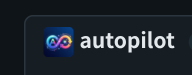

# autopilot モニターのデザインシステム

> **🆕 Smalruby 独自** — autopilot のモニター（`tools/autopilot/src/monitor.js`）の見た目と使い心地の決まり。

人間と同意した動くモックアップ（並べ方 D「あなた宛て＋表」）で決まった「感じ」を、
**規則の文 + トークン + 理由**の形で書く。モニターの画面を変えるときは、ここに合わせる。
ここに無い見た目を足すときは、先にモックアップで人間と同意してから、ここへ書き足す
（`.claude/rules/ui-mockup-first.md`）。

- トークンの値の正は `tools/autopilot/src/monitor.js` の `<style>` の先頭（`:root` とダークの 2 つの塊）。
  この文書には、決まりと代表の値だけを書く。
- 名前はすべて `--ap-` で始める（エディタ本体の `docs/design-system/` のトークンとは別）。
  モニターは自己完結の HTML なので、外部の CSS・Web フォント・画像を読まない（devpod の egress firewall）。
- `monitor-learn-tasks.js`・`blocked-panel.js` など、モニターに差しこむ部品も同じトークンを使う。色を直書きしない。

---

## 1. 型: GitHub Projects の表の骨格に、状況板の読み方

- **規則**: 画面の骨格は GitHub Projects のテーブル型にし、行の単位と読み方は空港の出発案内（状況板）にする。
  1 行 = 1 EPIC。行の左の `>` で sub-issue の行を開く。列は「題名・状態の札・PR・sub-issue の進み・次の動き・時刻」。
- **規則**: 行は優先度の順に並べる。EPIC に属さない Issue は優先度ごとのまとまり（「EPIC に属さない · P2」など）にし、
  同じ優先度の EPIC の下に置く。最後へまとめて送らない。
- **理由**: 開発者が毎日見ている Projects と同じ操作感なら、覚えることが少ない。状況板の読み方なら、行が増えても読み方が変わらない。
  板の並びが AI の作業の順番と同じなら、P2 を付けた意味が板で見える。
- **しないこと**: グラフや大きな数字のタイルを並べるダッシュボードにしない。数は文の中か表の列に置く。

## 2. 密度: 表は密、「あなた宛て」だけゆったり

| 場所 | 規則 | トークン |
|---|---|---|
| 状況板・上の行 | 密。行の高さ 30px、本文 13px | `--ap-row-dense: 30px` / `--ap-font-sm: 13px` |
| 「あなた宛て」 | 中〜ゆったり。本文 15px、まとまりの間 16px、選択肢の高さ 40px | `--ap-human-font: 15px` / `--ap-human-gap: 16px` / `--ap-row-comfy: 40px` |

- 最初に開いたときに「あなた宛て」へ出す件数は 3 件。質問は 1 件目だけ開いておく。
- **理由**: 開発用の画面なので、スクロールなしで見える範囲を広くしたい。ただし人間がすぐ答えるものは、
  密だとうんざりして答える気がなくなる。
- 文字の大きさは 5 段だけ: `--ap-font-xs` 12 / `sm` 13 / `md` 14 / `lg` 16 / `xl` 20px。見出しも 16px まで。
- 間隔は `--ap-space-1`〜`6`（2 / 4 / 8 / 12 / 16 / 24px）、角は `--ap-radius-sm` 4px（欄）・`md` 6px（ボタン）・`pill` 999px（札）。
- 文字は system フォントだけ（`--ap-font-ui`）。番号・ブランチ名・ログは等幅（`--ap-font-mono`）。数字は `tabular-nums` で揃える。

## 3. 意味の色

色の意味は **6 つだけ**。寒色を中心にし、止まった・注意は小さい面にしか使わない。

| 意味 | 本体（ライト / ダーク） | 地（`-wash`） | 使う状態 |
|---|---|---|---|
| AI が動いている `--ap-ai` | `#0e6e7c` / `#5cc3cf`（青緑） | `#dcf0f2` / `#163238` | In Progress |
| 人間の番 `--ap-human` | `#5a44b4` / `#b3a0f2`（すみれ） | `#ebe7fa` / `#2a2543` | Review・DoD・Discussing・Awaiting Continuation・🙋 |
| 終わった `--ap-done` | `#2e7553` / `#7cc79e`（緑） | `#e0f0e7` / `#173025` | Done・Close・PR の ready / merged |
| 待っている `--ap-idle` | `#6b7785` / `#9aa6b1`（灰） | `#eceff2` / `#222b33` | Backlog・Sprint Backlog・⏳・draft・閉じた PR |
| 止まった `--ap-stop` | `#8a3b5c` / `#e39ab6`（くすんだ薔薇色） | `#f4e4ea` / `#3a2230` | Blocked・一時停止・コンフリクト・失敗の文字 |
| 注意 `--ap-notice` | `#7c6514` / `#d9bf6a`（黄土色） | `#f4eed9` / `#332c17` | 使用量・レートが少ない・認証の切れ間近 |

- **規則**: 意味の色は点・輪の印・細い線・文字と、小さな札の地（`-wash`）にだけ使う。行や帯の地には塗らない
  （`--ap-ai-row` / `--ap-stop-row` は表の地と同じ）。
- **規則**: 止まった・注意に赤やオレンジを使わない。ダークでも明るい暖色にしない（薔薇色・黄土色を明るくするだけ）。
- **規則**: 色だけに頼らない。どの状態にも言葉（「人間の番」「止まった」）と印の形（輪・塗りの丸・チェック）を添える。
- **規則**: 状態でないもの（Size・優先度）には意味の色を使わない。Size は灰色の地の濃さ、優先度は P0・P1 を本文の濃さ・それ以外を薄い文字にする。
- **規則**: 細かい名前のトークン（`--ap-merged` や `--ap-human-dod` など）は、6 つの意味の色の別名にする。新しい色の値を足さない。
- **理由**: オレンジと赤は落ち着かない。広い面に色があると、本当に見てほしいところが目立たない。
- 地・文字・罫線: `--ap-bg` `#f4f6f7` / `#0f1418`、`--ap-surface` `#ffffff` / `#161d23`、`--ap-ink` `#17202a` / `#e3e8ec`、
  `--ap-muted` `#5a6672` / `#9aa6b1`、`--ap-faint` `#8a949e` / `#6f7b86`、`--ap-line` `#d9dfe4` / `#2a353e`。
- 上の行（状態の 1 行）は暗い帯にせず、表と同じ地（`--ap-chrome-*` は地・文字・罫線の別名）にする。
- 色の強さ（モックアップの「混ぜ具合」）は 100%（意味の色をそのまま使う）。
- コントラストの目安: 意味の色の文字は地に対して 4.5:1 以上、印・線は 3:1 以上。

## 4. 「AI に任せる」ボタン

- **規則**: いちばん多く押すボタン。キラキラのアイコン + 虹色の輪（札の形）にし、輪の色がゆっくりめぐる（5 秒で 1 周）。
  質問の欄では「AI の推奨で進める」として置く。
- **トークン**: `--ap-go-1`〜`--ap-go-6`（輪の 6 色）、`--ap-go-wash`（押す前に乗せたときの地）、`--ap-motion-go: 5s`。
  ライト `#7b6cf0 #3fa9e6 #3cc59a #e9b93c #ee7f8c #b77ad9`、ダークはそれぞれ明るくした値。
- **規則**: 虹色はこのボタンだけに使う。ほかのボタン・札に使わない。
- **規則**: `prefers-reduced-motion: reduce` のときは輪を止める（色はそのまま）。
- **理由**: 「AI がやる」と読める形として、いまよく見かける形。いちばん押すものが一目で分かる。

### 「AI に直してもらう」のダイアログ

- **規則**: 差し戻し（Review / DoD）の「AI に直してもらう」は、押すとすぐ渡さず、ダイアログで bot の指摘と
  コメント欄を見せる。送るボタン「送って AI に直してもらう」も同じ虹色の輪のボタン（`.go`）にし、「やめる」は
  ふつうのボタン（`.ibtn`）にする。コメント欄が空のあいだは送るボタンを押せなくする。
- **規則**: 指摘は GitHub の markdown を軽く整形して、細い線（`--ap-line-soft`）で囲んだ欄に出す。コードの地は
  `--ap-code-bg`、引用は左の線（`--ap-line`）と薄い文字（`--ap-muted`）。指摘を 1 件ずつのボタンやチェックにはしない。
- **規則**: ダイアログの形はほかのモーダル（`.mbox`・`--ap-overlay`・`--ap-radius-md`）と同じ。新しいトークンは作らない。
- **理由**: 人間は GitHub でコメントを書くように、自分の言葉で「どれを直すか」を書く方が早い。指摘を細かい
  ボタンにすると、密な画面がうるさくなる。

### 「確認の結果を書く」のダイアログ（リリース確認）

- **規則**: 「AI に直してもらう」のダイアログと同じ形（`.mbox`・送るボタンは `.go`・「やめる」は `.ibtn`）。
  上にプレビューへのリンク、続けて観点（R1, R2, …）ごとに整形した本文と **OK / NG** の切りかえ・メモ欄、最後に全体のコメント欄を置く。
  OK / NG を 1 つも選ばず全体のコメントも空のあいだは、送るボタンを押せなくする（選ばなかった観点は結果に入れずに送る）。
  選んだ OK は `--ap-primary`、NG は `--ap-stop` の地にする。新しいトークンは作らない。
- **理由**: 人間は観点ごとに「見た・だめだった」を残すだけで、AI がそのまま sub-issue にできる。

### リリース確認の確認ページ（artifact）

- **規則**: モニターの外に出す 1 枚のページ（claude.ai の artifact）も、このデザインシステムのトークンの値をそのまま使う
  （`--ap-*` の地・文字・罫線・6 つの意味の色・文字の 5 段・間隔・角）。新しい色の値を足さない。テンプレートは
  `tools/autopilot/templates/release-check/template.html`。
- **規則**: 人間がすぐ答えるページなので、密度は「あなた宛て」と同じゆったり（本文 `--ap-human-font`・選択肢の高さ
  `--ap-row-comfy`）。観点・決定待ちは 1 件 1 枚のカード（`--ap-surface`・`--ap-line`・`--ap-radius-sm`）にする。
- **規則**: OK は `--ap-primary`、NG は `--ap-stop` の地（ダイアログと同じ）。決定待ちの「推奨でよい / 別の案 / コメント」は
  人間の番の色 `--ap-human` の地にする（状態ではなく人間の選んだもの）。AI の推奨は左の細い線（`--ap-human`）で示す。
- **規則**: 「答えを送る」は 2 段にする（押すと「送る（あとで変えられません）」と「やめる」が出る）。送ったあとは
  入力を全部止め、送った時刻と、次に人間がすること（モニターで AI に渡す）を書く。
- **規則**: 虹色の「AI に任せる」の輪は使わない（AI に任せるボタンではなく、人間の答えを送るボタンなので）。送るボタンは
  `--ap-human` の塗り（文字は `--ap-on-solid`）にする。
- **理由**: モニターと同じ色と言葉なら、別のページに移っても読み方が変わらない。送ったら変えられないことを
  先に見せると、まだ迷っている答えを送ってしまわない。

## 5. 行の操作

- **規則**: 各行の右にアクションボタンを置く。主な操作（「AI に任せる」）と「⋯」。「⋯」には将来の操作（一時停止・やめる）を入れる。
- **規則**: 「開く」ボタンは置かない。`#番号` を GitHub へのリンクにする（等幅・薄い文字 `--ap-faint`、乗せると本文の色と下線）。
- **規則**: 状況板で**いちばんよく押すリンク（Issue・PR）は、左端の自分の列に短く置く**。文字は「Issue」「PR」と
  外部サイトへのリンクのアイコン（箱から矢印が出る形・インラインの SVG・`currentColor`）だけにし、`#番号` は
  ホバー（`title`）と読み上げ（`aria-label`）で渡す。列の幅は決めておき、題名の長さで切れたり消えたりしない。
  別のタブで開く。「次の動き」の文に出る `#番号` もリンクにする。題名を押したときの動きは変えない。
- **理由**: 題名の末尾の `#番号` は、題名が長いと「…」で一緒に切れて押せなかった。目が最初に向かう左端に、
  Issue と PR を 1 か所にまとめると、迷わず押せる。番号まで出すと列が長くなるので、番号はホバーで見せる。
- **規則**: 状況板を横にスクロールしても、**左の 3 列（開閉・Issue · PR・題名）は左に残す**（`position: sticky`）。
  優先から右の列だけが動く。固定する列は行と同じ不透明な地（`--ap-surface`、子の行は `--ap-surface-2`、
  乗せたときは `--ap-tint-1` を重ねる）にし、題名の列の右端に `--ap-line` の線を引く。`left` は列の実際の幅から決める。
  幅 600px 未満では題名を短く切って、右の列が見える幅を残す。右端の「⋯」は固定しない。
- **理由**: 右へスクロールすると、行の「⋯」がどの Issue のものか分からなくなる。透けると下を通る列の文字が重なって読めない。
  「⋯」まで固定すると、狭い画面で動く列の幅がほとんど残らない。
- **規則**: **ホバーで出す操作（優先度の ▲▼ など）は、場所をいつも取っておき、`visibility` だけを切りかえる**
  （`display` を切りかえない）。行の中にフォーカスがあるとき（`:focus-within`）も出す。
- **理由**: 出たときだけ場所を取ると列の幅が変わり、マウスを動かすたびにほかの列が左右に動いて（ぴょこぴょこして）読めない。
- **規則**: 「現在地を作る」は autopilot 全体で 1 つ。「更新」「tick」と一緒に上の行の「⋯」に入れる。
- **理由**: 行ごとに同じ場所に同じ操作があると、迷わずに押せる。ボタンが多いと密な表がうるさくなる。
- **規則**: 「⋯」のメニューは、項目を選んだら**すぐ閉じる**。上の行の「⋯」では、フォーカスを「⋯」へ戻す。時間のかかる操作は、
  押した直後に「〜を頼みました」のトーストを出し、済んだら結果のトーストを出す。押せない（disabled）項目では閉じない。
- **理由**: 開いたまま残ると、押せたのかどうかが分からない。返事を待つあいだ何も変わらないと、もう一度押してしまう。

## 6. 使用量とレート

- **規則**: 上の行に、何のサービスかが分かるように名前とアイコンを付けて並べる（「Claude」「GitHub API」）。
  計りは細い棒（高さ 4px）。ふだんは灰色（`--ap-usage-ok` = `--ap-muted`）、少なくなったら注意の色（`--ap-usage-warn` = `--ap-notice`）。
- **理由**: 数字だけだと、どれが何の残りか分からない。棒を色の面にすると落ち着かない。

## 7. 並べ方 D

- **規則**: 左に「あなた宛て」（答えが要る質問・確かめてほしい学び・人間待ちを 1 本に並べる）、右に状況板。
- **規則**: ページ自体はスクロールしない。各列の中だけスクロールする。
- **規則**: 実行履歴とタスクは、上の行の件数バッジにする。押すと横から引き出し（drawer）で開く。
- **規則**: 幅 900px 未満では、欄をタブ（並べ方 B）に切りかえる。
- **規則**: 数字キー 1〜4 で欄へ移る（入力欄の中では効かない）。⌘ / Ctrl + 数字はブラウザのタブ切りかえと重なるので使わない。
- **理由**: いちばん知りたいのは「人間待ちがいくつあるか」と「次にいつ聞かれるか」。それを常に左に見せたまま、表を見られるようにする。

### 「あなた宛て」の開け閉め

- **規則**: 開くか閉じるかの 2 つだけにする（幅を自由に変える仕切りは置かない）。切りかえは「あなた宛て」の見出しの左端の、
  左に列のある四角の印のボタン（`aria-expanded` / `aria-controls`、title「あなた宛てを閉じる ([)」）。
- **規則**: 閉じても消さない。幅 `--ap-rail-w`（44px）の細い帯にし、上に開く印、下に件数の札を縦に積む
  （答え = 人間の色、学び = 注意の色、すること = 待っているの色。0 件は薄い文字）。帯のどこを押しても開く。空いた幅は状況板が使う。
- **規則**: `[`（入力欄の外・⌘ / Ctrl / Alt なし）で開け閉め。数字キー `1` は閉じていれば開いて移る。状態は `localStorage` に覚える。
- **規則**: 幅の動きは `--ap-motion-pane`（150ms）。`prefers-reduced-motion: reduce` では動かさない。幅 900px 未満（タブ）では切りかえを出さない。
- **理由**: 表を広く見たいときがある一方、閉じて中身が見えなくなると「人間待ちがあるのに気付かない」ことになる
  （この並べ方を作ったそもそもの理由）。件数だけでも見えていれば、開くべきときが分かる。
  印は、サイドバーの切りかえとして広く見かける形（Claude.ai など）にして、説明なしで押せるようにする。

### 「あなた宛て」は人間がすることで分ける

同意したモックアップ: https://claude.ai/artifact/8sqjfZJNPFiutXC9sz1YEV （つまみ: 並べ方 = することごと → 優先度、
「押すと」の説明 = いつも出す、密度 = 状態の一文を出す）。

- **規則**: 人間待ちは「人間がすること」の欄に分ける。順は 確かめる → 答える → ゴーサインを出す → 分解を始めるか決める →
  人間の作業。欄の中は優先度（P0 → P3）、同じ優先度は番号の小さい順。することは `human-action.js` の `humanAction` が決める。
- **理由**: 「人間待ち · 36」のように 1 つにまとめると、どれから何をすればよいか分からない。することが同じものを並べると、
  まとめて片付けられる。
- **規則**: 人間の番ではないもの（🚀 after-release・⏳ 待ち・AI が作業中・子を AI が進めている EPIC）は数えず、最後に
  「人間の番ではない · N」としてたたむ。見出しの件数は、することがあるものだけ（内訳: 確かめる / 答える / ゴーサイン / 人間の作業）。
- **理由**: 人間の番ではないものまで数えると、件数が「やること」を表さなくなる。
- **規則**: ボタンは「AI に任せる」ではなく、そのときにすることの**動詞**にする（「プレビューで確かめる」「PR を見る」
  「実装を始めてもらう」「この EPIC を AI に任せる」「分解を始めてもらう」「コンフリクトを解消してもらう」「Issue を開く」）。ボタンの名前は押したときの動きと合わせる（開くだけのボタンを「済んだ」にしない。押すと済んだことになると誤解する）。行には「押すと: …」の説明を**いつも出す**。
  前の「AI に任せる」は「⋯」のメニューに残す。
- **理由**: どの行も同じボタンだと、押すと何が起きるか分からず、押してよいと思えない。
- **規則**: ボタンを押してもすぐには行わない。行の中で「これを行います: …」と確かめ、「行う」で初めて行う（「やめる」で戻る）。
- **理由**: 🙋 を外す・Status を動かすのは、AI の作業を始める操作で、取り消しにくい。
- **規則**: 分解済みの EPIC で、子に着手待ち（Sprint Backlog + 🙋）があれば、EPIC の行の 1 つのボタンにまとめる
  （子の行は重ねて出さない）。EPIC の行には「いま何をしているか」の一文を出す（例「子は 15/17 済み。#1830・#2090 があなたの
  ゴーサイン待ち」）。材料はボードの値だけにする。
- **規則**: 分解済みの EPIC の「いま」は 1 つに決める: 最後の確認 → 任せる前 → 途中の相談 → 自律で進行中（`humanAction` の `epicPhase`）。
- **規則**: 自律で進んでいる EPIC（子を AI が進め、人間に返すものが無い）は**人間の番に数えない**。「人間の番ではない」の欄に入れ、
  一文に進み具合と「決定待ち n 件（最後にまとめて確認）」を出す。
- **理由**: 自律で進んでいる EPIC が人間待ちと同じに見えると、人間は何をすればよいか分からない。決定待ちは途中で答えるものではなく、
  最後の確認でまとめて見るものなので、件数だけ見せて数えない。
- **規則**: 任せる前の EPIC（🙋 の子が残る）は、**1 つのボタン「この EPIC を AI に任せる」**で子全部の 🙋 を外す。押すと:
  「子 N 件の 🙋 を外す。AI が順に実装して topic にマージし、最後の確認だけあなたに返します」。子の数で文言を変えない。
- **理由**: EPIC の設計は承認済みなので、人間が決めるのは「この EPIC を AI に任せてよいか」の 1 つだけ。子を 1 件ずつ任せさせると、
  同じ判断を何回もすることになる。
- **規則**: 途中の相談は、🙋 の付いた子（または質問のある子）の先頭 1 件の番号とボタンを EPIC の行に出し（その子の行は重ねない）、
  最後の確認のボタンは「確認ページを開く」にする。相談が 2 件以上なら、ほかの子は「ほか #N も」と書き、自分の行に残す。
- **理由**: 🙋 の無い子（topic への自動マージを待つ Review など）は AI の番なので、相談に数えると自律で進む EPIC が人間待ちに見える。
  2 件目以降を EPIC の行にたたむと、その子のボタンが無くなる。
- **規則**: 状態の一文・「押すと」・確かめの中の `#N` は全部、別のタブ（`target="_blank" rel="noopener"`）で Issue / PR を開くリンクにする
  （`linkIssueRefs`）。
- **理由**: 文の中の番号を見て、その場で中身を確かめたい。いまのモニターを残したまま開けるよう、別のタブにする。
- **規則**: することの色は `--ap-act-check`（確かめる・青緑）/ `--ap-act-go`（ゴーサイン・分解・青）/ `--ap-act-hand`（人間の作業・黄土）、
  答えるは人間の色（`--ap-human`）、人間の番ではないものは待っているの色（`--ap-idle`）。ボタンは地を `-wash`、字と線を本色にする。
  優先度は灰色の濃さだけ（P0 / P1 だけ濃い字）。
- **規則**: あなた宛ての行は 2 行にする。1 行目は種類の札（EPIC）と**題名だけ**にして、ペインの幅いっぱいに題名を出す
  （長いときは 1 行目の終わりで「…」、全文は下のツールチップ）。2 行目に `#番号`（別のタブで開くリンク）・優先度・親 EPIC の札・
  「💤 あとで」・することのボタン・「⋯」を並べ、その下に状態の一文と「押すと: …」を置く。子の行も同じ形にする。
- **理由**: 人間は題名でどの Issue かを見分けている。番号・優先度・ボタンと同じ 1 行に並べると、ペインの幅（約 480px）では
  題名が数文字しか残らず（「i.」「日本語モ…」）、どれのことか分からなくなる。
- **規則**: 2 行目は折り返してよい（スマホの幅でもボタンが横にはみ出さない）。ボタンは 2 行目の右に寄せる。

### タイトルのツールチップ

- **規則**: … で切ったタイトルには、全文を出す自前のツールチップを付ける。中身はタイトルの全文と、薄い小さな字
  （`--ap-font-xs`・`--ap-muted`）で `#番号 · 今の状態`。地は `--ap-surface`、線は `--ap-line-strong`、角は `--ap-radius-md`、
  影は `--ap-shadow-menu`、字は `--ap-font-sm`。幅は 28rem まで（画面の幅から 16px 引いた幅まで）で折り返す。
- **規則**: ブラウザの `title` 属性には頼らない（スマホで出ず、出るまで遅い）。切ったタイトルに `title` を重ねて付けない（二重に出る）。
- **規則**: 置き場所はタイトルの下 6px、入らなければ上。画面の端から 8px 内に収める。
- **規則**: マウスは乗せると出て外れると消える。押す / タップで出たままにし、もう一度押す・ツールチップを押す・外を押す・`Esc` で消す。
  フォーカスでも出す（`aria-describedby`）。開くのは 1 つだけ。切り替えはタイトルの文字の部分だけにし、行のほかの操作と重ねない。
- **規則**: 畳んだ帯（`--ap-rail-w`）の状態では出さない。
- **理由**: 狭い幅では題名がほとんど「…」になり、何の Issue か分からない。スマホでも同じ部品で読めるようにする。

## 8. 動き

- **規則**: くり返す動きは 2 つだけ。AI が動いている印のゆっくりした脈（`--ap-motion-pulse: 2s`）と、「AI に任せる」の輪。点滅はしない。
  1 回きりの動きは「あなた宛て」の開け閉めの幅（`--ap-motion-pane: 150ms`）だけ。
- **規則**: 値が変わっても行全体を光らせない。コピーしたときなどの一瞬の合図は、AI の地の色（`--ap-flash` = `--ap-ai-wash`）を使う。
- **規則**: `prefers-reduced-motion: reduce` のときは、どの動きも止める。

## 9. ライトとダーク

- **規則**: ライトとダークの両方を持ち、既定は OS に従う。
- **作り**: 素の `:root` がライト。`@media (prefers-color-scheme: dark)` の中の `:root:not([data-theme="light"])` と、
  `:root[data-theme="dark"]` がダーク。手で切りかえるときは `<html>` に `data-theme="light"` / `"dark"` を付ける。
- **規則**: ダークの塊では、本体の色（地・文字・罫線・6 つの意味の色・虹色・半透明）だけを差しかえる。別名のトークンは
  本体を `var()` で指しているので、差しかえ不要。ダークの塊に `:root` に無い名前を足さない
  （`tools/autopilot/test/monitor.test.js` が確かめる）。
- 人間の色の地に乗る文字（`--ap-on-solid`）は、ライトで白、ダークで濃い色（`#15121f`）にする。
- `color-scheme` もライト / ダークに合わせる（フォームの部品とスクロールバーが地に合う）。

## 10. ロゴ（アイコン）

### コンセプト

- このアイコンは、「開発の自動運転（autopilot）」と「AI の知性と支援」を 1 つの印にまとめたもの。
- モニターの落ち着いた画面になじみつつ、先進さ・信頼・AI と一緒に進む躍動を出す。
- 「自動化 = 無機質」ではなく、「AI と一緒に進化する開発 = 知的で創造的」と感じさせる。
- キーワード: Automation, AI, Integration, Infinity, Rainbow, Sparkle, Synergy。

### 3 つの層

| 層 | 形 | 色（512px の画像で測った値） | 表すもの |
|---|---|---|---|
| 地: 紺の入れ物 | 角丸の四角。縦横の比は 1:1 で固定する | 深い紺のグラデーション。中ほど `#0b336b`・右上 `#0a4183`・左下 `#04092f` | 信頼・安定・開発の土台。虹色が映える下地 |
| 中: 虹のループ | 「A」の形を抱えて、切れ目なく続く ∞ のリボン。右側は回る矢印 | シアン `#3dcae7` → 青 `#3c8ee1` → 紫 `#904cd1` → マゼンタ `#ea4c9c` → オレンジ `#fbaf53` → 黄 `#fcdd5b` | 「A」は autopilot の頭文字。∞ は CI・自動で回り続けるタスク・止まらない開発。虹色は先進的な AI の知性・多様な解き方・AI と人間が一緒に作る創造の過程 |
| 上: きらめきと粒 | ∞ の交わるあたりの小さな輝きと、まわりの光の粒 | 白と虹色のハイライト | AI が自分で動くこと・速さ・知的な支援・システムが生き生きと動いている感じ |

- 虹色は「AI に任せる」の虹（`--ap-go-1`〜`--ap-go-6`）と**意味が同じ**（どちらも AI を表す）。ただし値は別で、
  アイコンの虹は緑を含まず、シアンから黄へ流れる。アイコンは絵なので、この色をトークンにしない（ライト・ダークで同じ画像）。
  §4 の「虹色はこのボタンだけ」は、ボタン・札の決まり。ロゴのアイコンはその外にある。
- 見え方: 紺の地は、ライトでもダークでも四角の形が分かり、虹色が浮き立つ。

### 小さくしたときの見え方（確かめた結果）

512px の画像を 16px と 32px に縮めて、拡大して確かめた。

- **16px**: 紺の角丸と虹色の ∞ は分かる。「A」は ∞ に溶け、きらめきは消える。
- **32px**: ∞ ははっきりする。「A」はかろうじて明るい形として見える。きらめきはほぼ消える。
- **64px 以上**: ∞・「A」・きらめきがみな見える。
- 決まり: 16px・32px でも**同じ画像**を使う（きらめきを省いた版は作らない）。その大きさでは ∞ と虹色と紺の地で
  autopilot と分かれば足りる。きらめきは縮めると地に溶けるだけで、にじみや汚れにならない。
- 「A」まで見せたいところは、表示を 20px 以上にし、2 倍の画像を使う（下の規則）。

### 使うところ

- **いま使うところ**: モニターの favicon（64px）と、上の行の見出し `autopilot` の前（20px で表示。2 倍の 40px の画像）。
  ほかの画面に見出しを足すときも同じアイコンを使う。
- **将来の候補**（まだ使っていない）: PWA のアイコン、macOS / Windows のアプリのアイコン、iOS / Android のアプリのアイコン、
  apple-touch-icon。使うときは、元の 512px の画像から縮めて作る。

### 規則

- 小さく出すときは、ブラウザに縮めさせず、表示する大きさの 2 倍に縮めた画像を使う（∞ と A がつぶれないように）。
- モニターは自己完結の HTML なので、PNG を data URI で埋める（外部のファイルを参照しない）。
- HTML が重くならないよう、埋めるのは favicon と見出しの 2 つだけ（apple-touch-icon の 180px は 70KB を超えるので入れない）。
- 縦横の比を変えない。角丸の外は透明にし、灰色の縁を残さない。

### 置き場所と作り方

- 元の大きさ（512px・角の外は透明）は `tools/autopilot/assets/autopilot-icon-512.png`。
- data URI は `python3 tools/autopilot/assets/make-icon.py datauri` で `tools/autopilot/src/icon-data.js` に作る（手で直さない）。
- 512px の画像は、人間が画像生成 AI で作った案の画像から `make-icon.py crop <元の画像>` で切り出した（元の画像は repo に入れない）。

---

## License

This document is part of the Smalruby autopilot and is licensed under the **MIT License** (not the repository's AGPL-3.0). See `tools/autopilot/LICENSE`.
