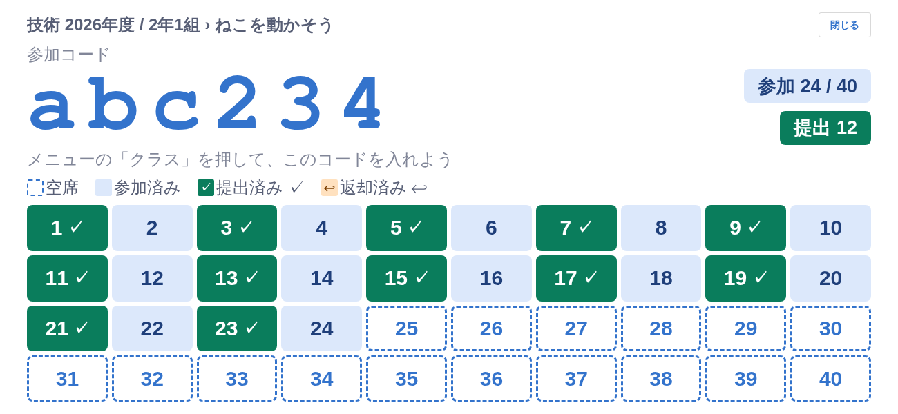
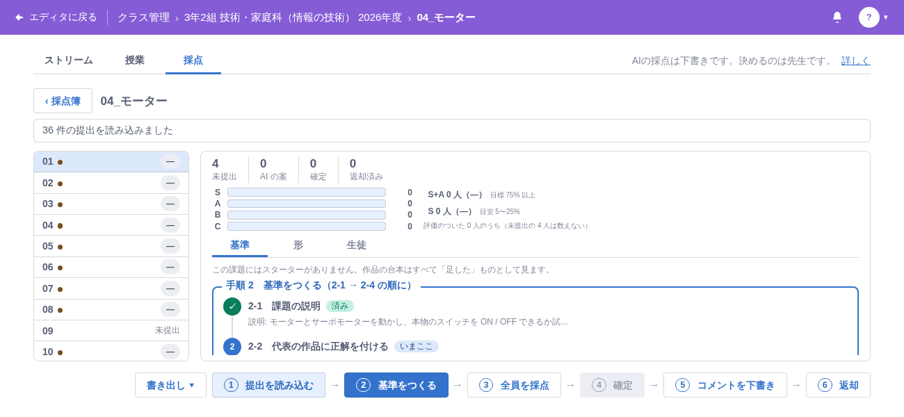
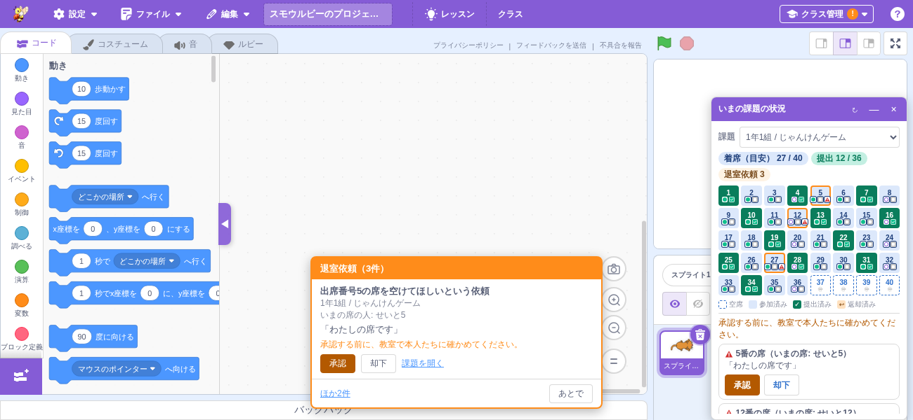

# クラス管理が新しくなりました（先生向けの案内）

> **🆕 Smalruby 独自** — クラス管理（先生）と生徒の「クラス」の画面の見た目と組み立てを作り替えたことを、先生に短く伝えるための案内です。
> 学校で配るときは、文面を学校の実情に合わせて直して使ってください。

クラス管理の画面を、Scratch のボタンやタブの形と、Google Classroom のページの組み立て・言葉に合わせて作り替えました。
**授業の進め方とデータは変わりません。** 前の画面に戻すスイッチはありません。

## どこが変わったか

### 1. 画面の上の帯と、クラスの中のタブ

- 画面のいちばん上の紫の帯に「**← エディタに戻る**」と、いまいる所（「クラス管理 › クラス名 › 課題名」）が出ます。押すとその階層へ戻れます。
- クラスを開くと、**［ストリーム］［授業］［採点］**のタブが並びます（Google Classroom と同じ）。メンバー（座席）は、これまでどおり課題の中にあります。
- ボタンは Scratch と同じ形（角丸・太字）になり、いちばんよく使う操作だけが青く塗られています。

### 2. クラス一覧はカード、クラスごとに色の帯

- クラスは 4 列のカードで並びます。8 クラスまでなら 1 画面に収まります。
- クラスごとに**色の帯**が付きます。色は自動で決まります（色だけでなく名前で見分けてください）。

### 3. ストリームの「いまの課題」と［⛶ 映す］

- ［ストリーム］の左に「**いまの課題**」のカード（参加コード・参加と提出の数）と、保存期限のカードが出ます。
- 課題の［**⛶ 映す**］で、参加コード・座席・数を大きく映す画面になります。プロジェクターで生徒に見せるときに使います。**生徒の名前は出ません。**

### 4. 採点は「採点簿」の表

- 採点は、点だけの表（採点簿）になりました。行を選ぶと、右にその人の根拠とコメントが出ます。表が横に広がりすぎないようにしました。

### 5. いまの課題の状況（エディタの上のパネル）

- 形はそのままで、色とボタンをクラス管理にそろえました。着席・提出・退室依頼の数は、丸い小さな札で並びます。

### 6. 言葉が少し変わりました

| これまで | これから |
|---|---|
| 戻る | エディタに戻る |
| あなたのクラス | クラス |
| 課題詳細（画面の上の位置） | 課題名 |
| まだ参加していない（座席の凡例） | 空席 |
| 削除（メンバー） | 退室させる |

生徒が参加コードをまちがえたときの文と、生徒の「おかえりなさい」の画面の先生からのコメントの見せ方も直しました。

## 変わらないこと

- **参加コード**は課題ごと。名前も「参加コード」のままです。
- 生徒は名前やアカウントを使わず、**出席番号**で入ります。生徒の流れ「① 参加 → ② 番号 → ③ はじめる → ④ つくる → ⑤ 提出」も同じです。
- **座席の色**の意味（空席は白に点線・参加は淡い青・提出は緑 ✓・返却は淡いオレンジ ↩）は、どの画面でも同じです。
- 採点の 4 段（提出を読み込む → AI で採点 → コメントを下書き → 返却）と、「AI の採点は下書きで、決めるのは先生」であることも同じです。
- ［＋ 作成 ▾］の中身（課題・レッスン・課題を再利用・みんなの課題からさがす・合言葉で取り込み・トピック）も同じです。
- クラス・課題・メンバー・提出のデータはそのままです。前に作ったクラスや課題も、そのまま新しい画面で開けます。

## 授業の PC で

- 授業の PC（1300×600 の画面）で、主なボタンがスクロールしなくても見えるように作っています。座席や課題の一覧のように長くなるものだけ、その枠の中でスクロールします。

画面ごとの詳しい説明は [UI/UX](ui-ux.md) にあります。
