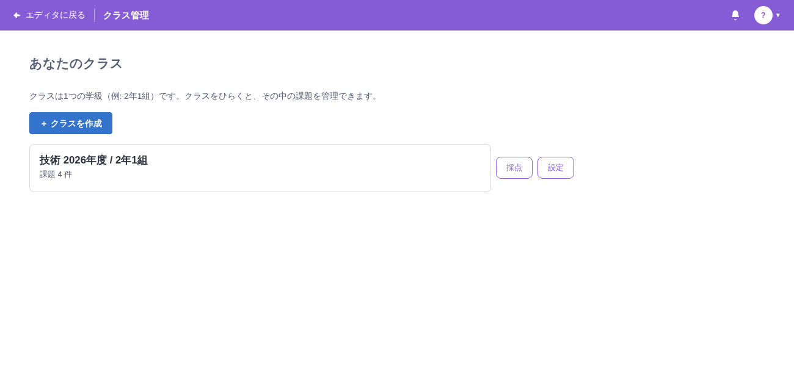
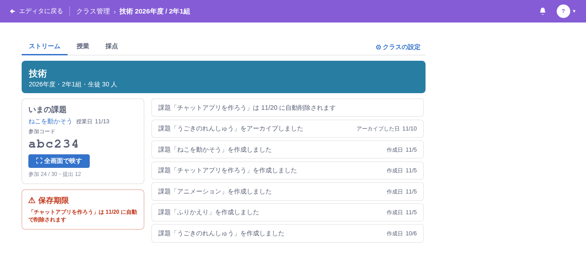
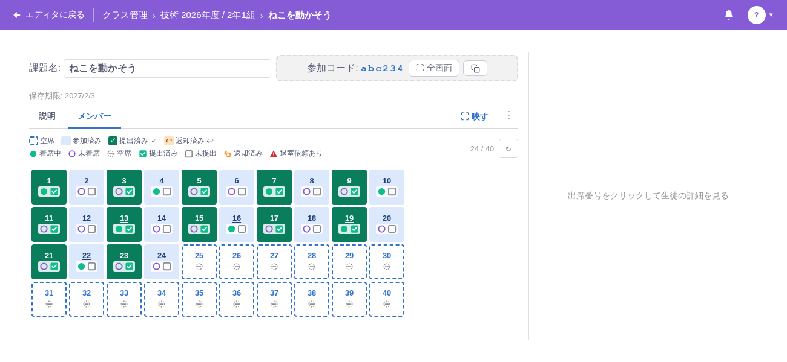

# クラス管理の使い方（先生向けの手引き）

> **🆕 Smalruby 独自** — クラス管理で、どこで何をするかを先生向けに短くまとめた手引きです。
> 学校で配るときは、文面を学校の実情に合わせて直して使ってください。画面ごとの詳しい決まりは [UI/UX](ui-ux.md) にあります。

## 開く・戻る

- メニューバーの「**クラス管理**」から開きます（先生としてログインしている間だけ出ます）。
- 画面のいちばん上の紫の帯に、いまいる所（「クラス管理 › クラス名 › 課題名」）が出ます。名前を押すと、その画面へ戻れます。
- 「**← エディタに戻る**」でスモウルビーのエディタへ戻ります。

## クラスを作る・選ぶ

- 「クラス管理」を押すと、クラスのカードが並びます。カードの色の帯はクラスの見分けの手がかりです（名前でも見分けてください）。
- 新しいクラスは［**＋ クラスを作成**］から。クラス名・セクション・年度・人数（出席番号の数）を入れます。
- カードを押すとクラスが開きます。カードの「採点」「設定」から、そのクラスの採点・設定へも進めます。

## クラスの中: ストリーム・授業・採点

クラスを開くと、［ストリーム］［授業］［採点］のタブが並びます。

### ストリーム

- 左の「**いまの課題**」に、今日（または近い日）の課題の参加コードと、参加・提出の数が出ます。［⛶ 全画面で映す］で、プロジェクターに映す画面になります。
- その下の「保存期限」のカードに、もうすぐ消える課題が出ます。
- 右に、課題を作った・アーカイブしたなどの記録が新しい順に並びます。

### 授業

- 課題を作るのは［**＋ 作成 ▾**］から。課題・レッスン・課題を再利用・みんなの課題からさがす・合言葉で取り込み・トピックを選べます。
- 課題の行には、参加・提出の数の札が出ます。行を押すと課題が開きます。

### 採点

- 下の 4 つの段（① 提出を読み込む → ② AI で採点 → ③ コメントを下書き → ④ 返却）を順に進めます。
- 表は点だけの採点簿です。行を選ぶと、右にその人の根拠と生徒へのコメントが出ます。
- **AI の採点は下書きです。決めるのは先生です。**

## 課題の中: 説明・メンバー・映す

- ［説明］で、生徒に見せるページとスタータープロジェクトを作ります。あまり変えない設定（他者参照・メッシュのグループの人数）は「詳しい設定」の中にあります。
- ［メンバー］に、出席番号ごとの座席が並びます。座席を押すと、右にその生徒の作品・コメント・［返却］が出ます。
- 座席の色: **空席**は白に点線・**参加済み**は淡い青・**提出済み**は緑 ✓・**返却済み**は淡いオレンジ ↩。どの画面でも同じ意味です。
- ［**⛶ 映す**］で、参加コード・座席・数を大きく映します。生徒の名前は出ません。

## 授業中に、エディタを使いながら見る

- 「クラス管理」メニューの「**いまの課題の状況**」で、エディタの上に小さなパネルを出せます。パネルを出したまま、ブロックやステージを操作できます。
- 着席（目安）・提出・退室依頼の数が札で並び、その下に座席が出ます。座席を押すと、クラス管理でその生徒の詳細が開きます。
- 退室依頼は、**教室で本人たちに確かめてから**［承認］します。

## 生徒の入り方（生徒に伝えること）

- 生徒は名前やアカウントを使わず、**参加コード**と**出席番号**で入ります。
- 生徒の画面の流れ: ① 参加 → ② 番号 → ③ はじめる → ④ つくる → ⑤ 提出。
- 参加コードは課題ごとです。［⛶ 映す］の画面を見せると、生徒が入力しやすくなります。

## 授業の PC で

- 授業の PC（1300×600 の画面）でも、主なボタンはスクロールしなくても見えます。座席や課題の一覧のように長くなるものだけ、その枠の中でスクロールします。
