# UI/UX

> 各画面の data-testid はここには書かず、[testing.md の data-testid 一覧](testing.md#data-testid-一覧)に一元化しています。

## 画面遷移図

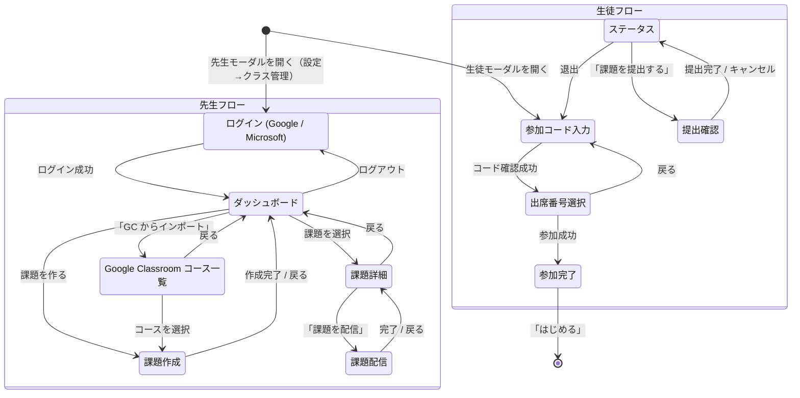

---

## メニューバー

メニューバーの右端に「クラス」ボタンが表示されます（`CLASSROOM_API_ENDPOINT` 環境変数が設定されている場合）。

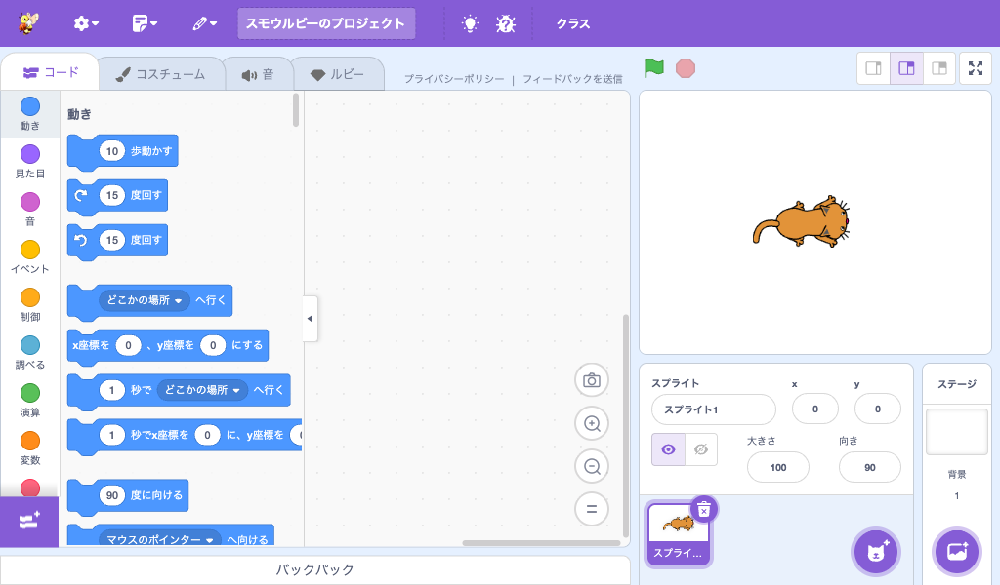

**パーツ:**

| 要素 | テキスト/内容 |
|------|-------------|
| 設定メニュー | ⚙ アイコン |
| クラス管理メニュー | 「クラス管理...」（設定メニュー内） |
| クラスボタン | 「クラス」（未参加時） |
| ラベル | — |

生徒が課題に参加中の場合、ボタンのテキストは固定の「クラス:出席番号NN」表記に変わります (NN は 0 埋め 2 桁):

| 要素 | テキスト/内容 |
|------|-------------|
| ラベル全体 | 例: 「クラス:出席番号03」 |
| 出席番号 (内側 span) | 例: 「03」 |
| 提出状態アイコン | 未提出 / 提出済み / 返却済み のアイコン（[状態アイコン](#状態アイコン)） |

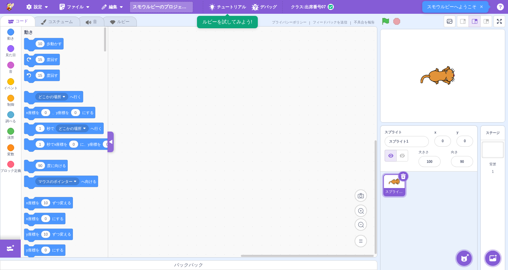

未参加時はラベルが「クラス」のみになる。 課題名 / クラス（学級）名はメニューに表示せず、モーダル内でのみ確認する設計。なお、生徒が参加するのは課題（1 授業）だが、メニューバーのラベル自体は「クラス」のまま（UI 文言の整理は #1135）。

### 先生メニュー（クラス管理）

先生がログインしている間は、生徒用の「クラス」ボタンに加えて **「クラス管理」メニュー**が表示されます。未読のお知らせがあるとメニューボタンと「お知らせ」項目に「!」バッジが付きます。

| 項目 | 表示条件 | 動作 | data-testid |
|------|---------|------|-------------|
| メニューボタン「クラス管理」 | 先生ログイン中 | ドロップダウンを開く | `classroom-teacher-menu-button` / `classroom-teacher-menu-label` |
| 未読バッジ「!」 | 未読のお知らせ、または未処理の退室依頼あり | — | `classroom-teacher-menu-badge` |
| 退室依頼（N件） | 未処理の退室依頼がある（先頭に表示・バッジ付き） | 画面下部に依頼の一覧を開く（モーダルは開かない） | `classroom-teacher-menu-kick-requests` |
| いまの課題を開く | 最後に開いた課題がある | クラス管理モーダルでその課題の詳細を開く | `classroom-teacher-menu-current-assignment` |
| いまの課題の状況 | 常に | 着席・提出状況のフローティングパネルを開く（モーダルは開かない） | `classroom-teacher-menu-status-panel` |
| クラス一覧を開く | 常に | クラス一覧（ダッシュボード）を開く | `classroom-teacher-menu-class-list` |
| お知らせ | 常に（未読時はバッジ `classroom-teacher-menu-notifications-badge`） | お知らせセンターを開く | `classroom-teacher-menu-notifications` |
| ログアウト | 常に | 先生をログアウトし、保存したログイン記録も消す | `classroom-teacher-menu-logout` |

### 退室依頼のトースト（先生）

先生がログインしている間は、クラス管理モーダルを閉じていても 10 秒ごとに未処理の退室依頼を確かめ、新しい依頼が来ると**画面下部にトースト**を 30 秒表示します（タブが非表示の間は止め、戻ったらすぐ確かめます）。

| 部品 | 内容 | data-testid |
|------|------|-------------|
| 見出し | 「退室依頼（N件）」 | `classroom-teacher-kick-toast` |
| 依頼 | 「出席番号Nの席を空けてほしいという依頼」・組 / 課題名・**いまの席の人のニックネーム**・依頼のひと言 | `classroom-teacher-kick-toast-request` / `classroom-teacher-kick-toast-reason` |
| 注意書き | 「承認する前に、教室で本人たちに確かめてください。」 | — |
| 承認 / 却下 | 既存の承認・却下 API をそのまま使う | `classroom-teacher-kick-toast-approve` / `classroom-teacher-kick-toast-reject` |
| 課題を開く | 「いまの課題を開く」と同じ導線でその課題を開く | `classroom-teacher-kick-toast-open` |
| ほかN件 | 複数あるときは重ねず 1 件だけ出し、ここから全件の一覧に切り替える | `classroom-teacher-kick-toast-show-all` |
| あとで | トーストを閉じる。件数はメニューに残る | `classroom-teacher-kick-toast-later` |

- 席を空けるかは先生が教室で本人に確かめてから決める前提です。「着席中」表示（1 時間の目安）は承認してよい根拠ではないため、トーストには出しません。
- 授業用 PC（1300×600）でも邪魔にならないよう、幅は約 26rem に収めています。

### いまの課題の状況（先生のフローティングパネル）

クラス管理はフルスクリーンなので、開いている間はスモウルビーを操作できません。先生メニューの「いまの課題の状況」は、**着席・提出状況を出したまま操作を続けられる**ドラッグ可能なパネルです。オーバーレイはクリックを素通しするので、パネルの外ではステージ・ブロック・メニューバーをそのまま使えます。

| 部品 | 内容 | data-testid |
|------|------|-------------|
| ヘッダー | ドラッグで移動。位置は localStorage `smalruby:classroomTeacherPanelPosition` に記憶し、画面外にはみ出す位置は画面内に戻す | `classroom-teacher-panel-header` |
| 更新 / 最小化 / 閉じる | 手動更新（メンバー・提出と課題の一覧を取り直す）。最小化するとヘッダーだけになり、`着席/定員 · 提出/参加` と退室依頼の有無をヘッダーに出す | `classroom-teacher-panel-refresh` / `classroom-teacher-panel-minimize` / `classroom-teacher-panel-close` |
| 課題 | 最近の課題（アーカイブを除く・新しい順に 8 件）から切り替える。選んだ課題は「いまの課題を開く」と同じ「いまの課題」になる | `classroom-teacher-panel-assignment` |
| 着席（目安） / 提出 | 「着席（目安） N / 定員」「提出 N / 参加数」。着席は `isMemberSeated()`（直近 1 時間にクラスの画面を開いた）の目安で、tooltip でそう説明する | `classroom-teacher-panel-seated` / `classroom-teacher-panel-submitted` |
| 座席ミニグリッド | 8 列。#1196 の状態アイコン（着席・提出・退室依頼）。セルを押すと、クラス管理でその課題のメンバー詳細を開く（パネルは最小化） | `classroom-teacher-panel-seat-<N>` |
| 退室依頼 | この課題の未処理の依頼。席番号・いまの席の人のニックネーム・ひと言・「承認する前に、教室で本人たちに確かめてください。」と承認 / 却下 | `classroom-teacher-panel-kick-request` / `-kick-approve` / `-kick-reject` |

- **取得はパネルを開いている間だけ・30 秒ごと**（メンバータブ表示中だけ取得する既存の費用方針と同じ）。最小化中も続け、閉じる・タブ非表示で止め、開いた / 課題を切り替えた / タブに戻ったときはすぐ 1 回取得する。取得するのはメンバーと提出だけ。
- **退室依頼はパネルでは問い合わせない**。先生ログイン中に 10 秒ごとに動いている退室依頼の見張り（上記トースト）の結果を共有する。
- 授業用 PC（1300×600）で 40 席・退室依頼が複数ある状態でも画面内に収まる大きさ（幅 17.5rem）。初期位置は画面右下（ステージの上半分と旗・停止ボタンを隠さない位置）。

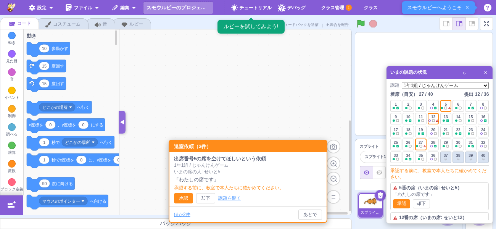

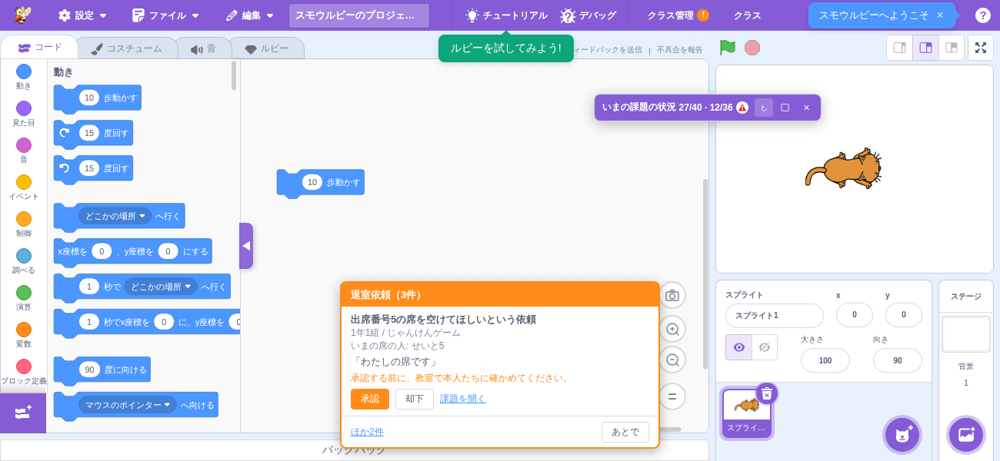

**表示ルール:**

- 生徒用「クラス」ボタンは先生のログイン状態にかかわらず**常に表示**する。先生も、生徒に説明するときに自分でクラス（課題）に参加することがあるため。
- 先生ログイン中は、その左に「クラス管理」メニューを並べて表示する（ログアウト中は表示しない）。

**「クラス」メニューとの連動:**

クラス管理で選んだ課題と、生徒用「クラス」メニューの参加コードは連動する（`decideTeacherSelectionSync` / `resolveAutoJoinCode`、`src/containers/classroom-classcode-utils.js`）。

- クラス管理で課題を選ぶと、その後「クラス」メニューを開いたときに**その課題の参加コードで出席番号の選択画面**から始まる（参加コードの入力は不要）。
- 生徒として別の課題（出席番号まで選択済み）に参加している状態でクラス管理から課題を選ぶと、**いったん今のクラスから退出する**（サーバーの席も解放。失敗しても先へ進む）。同じ課題を選んだときは参加したまま。
- 「クラス」メニューを開いただけでは、参加中のクラスから退出させない。`?classcode=` URL パラメータがあるときはそちらを優先する。

**リロード時のログイン復元:**

- ページをリロードしても先生のログイン状態を復元する。保存先は 2 つ:
  - localStorage `smalruby:classroomTeacher`: **プロバイダ（google / microsoft）と最後に開いたクラス・課題の ID だけ**（トークンなし）。
  - sessionStorage `smalruby:classroomTeacherToken`: **ID トークン本体**。タブ単位で、タブを閉じると消える（共有 PC で次の人に残さないため）。トークン自身の有効期限（約 1 時間、残り 1 分を切ったものは使わない）までだけ使う。`?devlogin=` のような期限の無いトークンは保存しない。
- 起動時はまずこのタブに残っている有効なトークンを使う。無い・期限切れのとき（新しいタブ、1 時間以上たった後）は各プロバイダのサイレント再認証を試み、失敗したら黙ってログアウト状態にする（エラーは出さない）。サイレント再認証だけでは、Google の FedCM 自動再認証の回数制限などで、単なるリロードでもログアウトしてしまうことがあったため、トークンを残す形にした。
- XSS でトークンを読まれるリスクはあるが、同じ XSS はメモリ上のトークンでも API を呼べるので、リスクは増えない。期限はトークンの `exp` で区切られる。
- `?devlogin=<token>` の開発用バイパスは URL から毎回復元し、記録には残さない。

---

## 共通: モーダル構造

すべてのフェーズは `classroom-modal` モーダル内に表示されます。

| 要素 | 備考 |
|------|------|
| モーダル全体 |  |
| ヘッダー | 紫色、「クラス」タイトル |
| 閉じるボタン (×) | ヘッダー右端 |
| ローディング表示 | API 通信中に表示 |
| エラー表示 | エラーメッセージ |
| エラーアクションリンク | セッション切れ時に「参加画面を表示」等 |
| セッション切れ Alert | Alert バナー（オレンジ帯）がモーダルの上に表示。「参加しなおす」ボタン付き |

---

## 1. 先生: ログイン (`teacher-login`)

Google または Microsoft アカウントでサインインする画面。先生は「設定 → クラス管理」メニューからアクセスします。

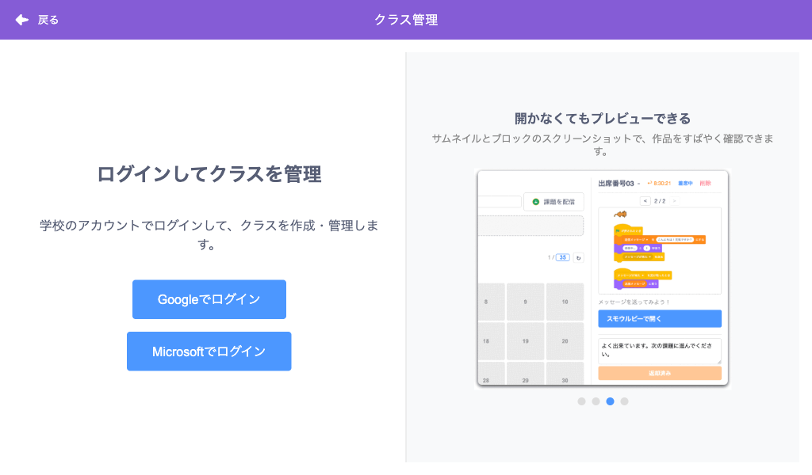

**パーツ:**

| 要素 | テキスト/内容 | 操作 |
|------|-------------|------|
| 戻るリンク | 「< 戻る」 | → teacher-dashboard |
| 見出し | 「ログイン」 | — |
| 説明文 | 「アカウントでログインして、クラスを管理します。」 | — |
| ヒント | 「学校の Google Workspace for Education のアカウントで…」 | — |
| Google ログインボタン | 「Googleでログイン」 | Google 認証画面を開く |
| Google サインインスロット | ログイン開始後に GIS の「Sign in with Google」ボタンが入る（未開始時は空で非表示） | GIS ボタンのホスト。内側の生成ノードは `google-signin-button` |
| Microsoft ログインボタン | 「Microsoftでログイン」 | Microsoft 認証ポップアップを開く |
| カルーセル | 右ペインに機能紹介画像（4枚、5秒ごと自動切替） | ドットクリックで手動切替 |

**レイアウト:** 左右分割レイアウト。左ペイン: ログインフォーム（Google / Microsoft の2つのログインボタン）、右ペイン: 画像カルーセル（薄いグレー背景）。1024x600 の画面でもスクロールなしで表示。

**セッション管理:** Google / Microsoft ID Token（1時間有効）。期限切れ時はプロバイダーに応じたサイレント再認証を試行し、透過的にトークンを更新。失敗時のみ Alert バナーを表示。詳細は [Microsoft 認証](microsoft-authentication.md) を参照。

---

## 1.5 先生: クラス一覧 (`teacher-class-list`) — ログイン後の入口

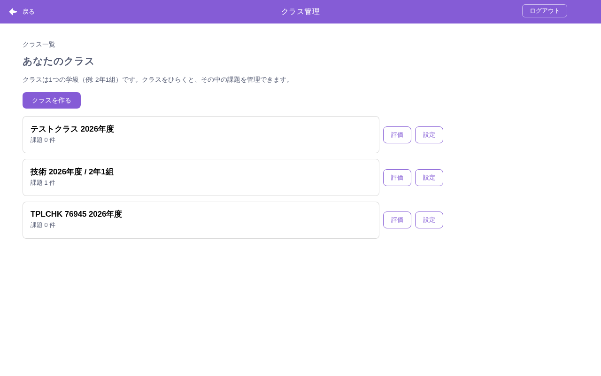

ログイン直後に表示される v2 の入口。Google Classroom の「クラス」に相当するクラス（学級）のカードが並ぶ。初回表示時に v1→v2 の冪等 migration（`POST /classroom-groups/migrate`）を自動実行する。

クラスのプロパティは GC 準拠: **クラス名（必須・例: 技術）/ 年度（必須・現在年度デフォルト）/ セクション（オプション・例: 2年1組）/ 人数**。同時作成フォームの課題名はオプション（空欄=クラスのみ作成）。カードの「設定」でインライン編集（名前・年度・セクション・人数・**クラス単位の共同管理者**・アーカイブ）。表示形式は「%クラス名% %年度%年度 / %セクション%」。**ログアウトはタイトルバー右端に常時表示**。

- カード: クラス名・年度・課題数・GC/共同管理/アーカイブバッジ・「評価」ボタン
- 「クラスを作る」: クラスと最初の課題を **1 画面で同時作成**し、作成後は新しいクラスの中（課題ボード）に着地する
- 「Google Classroom からインポート」（Google ログイン時のみ）: コースを選ぶとクラスを作成（コース名→クラス名・生徒数→人数・courseId をクラスへ）
- クラスをひらくとサイドバーがそのクラスの課題にスコープされる（「‹ クラス一覧」で戻る）
- **アーカイブ済みのクラス**: 一覧の下部に「アーカイブ済みのクラス（{count}）」トグル（1 件以上のとき表示）。展開するとアーカイブ済みカード（アーカイブバッジ + 「元に戻す」ボタン）が並び、ワンクリックで復元できる。設定からのアーカイブは **2 段階確認**（1 回目で警告メッセージ、2 回目で実行）

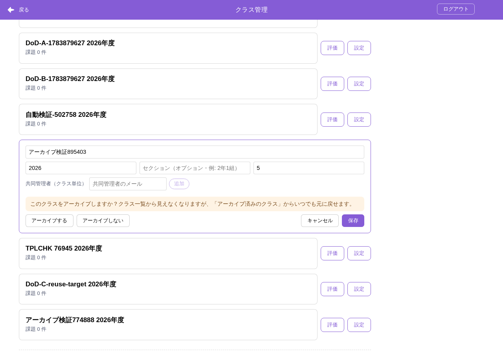

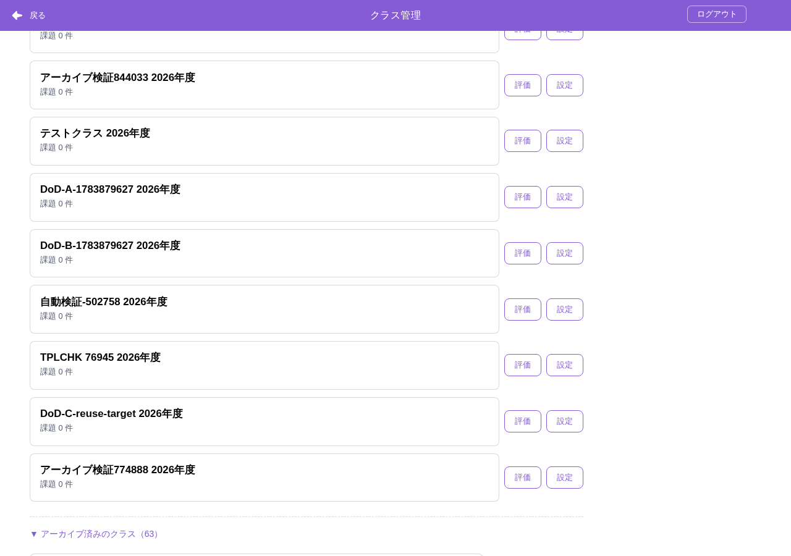

## 1.6 先生: 課題管理ボード（クラス内の `teacher-dashboard`）

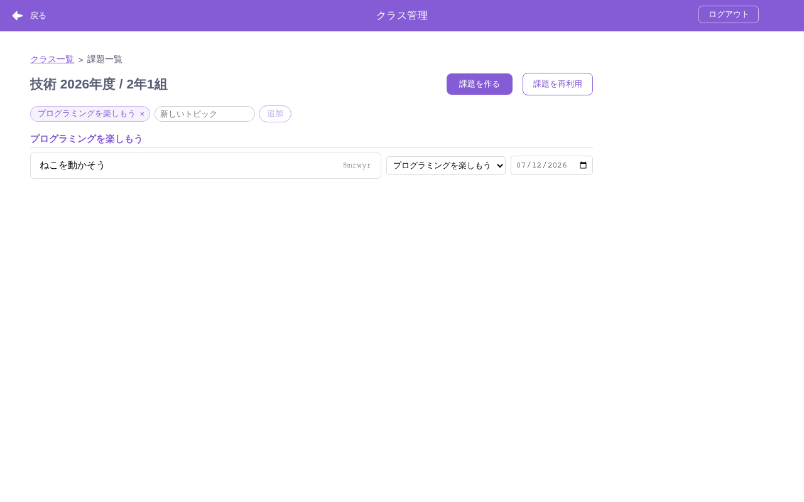

クラスをひらいたときのメイン領域。GC の「授業」タブに相当する。

- トピック未設定の課題を見出しなしで最上部に、以下クラスのトピック順のセクション。各セクションは日付（`sortDate`、既定=作成日・意味を持たない並び順キー・生徒非表示）降順
- トピックチップ: 追加・クリックでリネーム（クラス内の課題へ一括追従）・×で削除（課題はトピックなしへ）
- 課題行: トピック select と日付 input の**その場編集**、行クリックで課題詳細へ
- **サイドバーは無い**。ナビは**パンくず**「クラス一覧 > 課題一覧 (> 課題詳細)」
- 課題作成は課題名のみの**インラインフォーム**（クラス名・人数はクラスから）。「**課題を再利用**」で全クラスの課題を日付降順に表示し、クラスフィルタ → 「このクラスに複製」（説明・スターター・トピックごと複製。同一クラスは「のコピー」付き）
- **アーカイブ済みの課題**: ボード最下部に「アーカイブ済みの課題（{count}）」トグル（1 件以上のとき表示）。展開すると課題名・保存期限（TTL 由来の `expiresAt`）・「元に戻す」ボタンの行が日付降順に並ぶ。アーカイブしても保存期限は延長されない

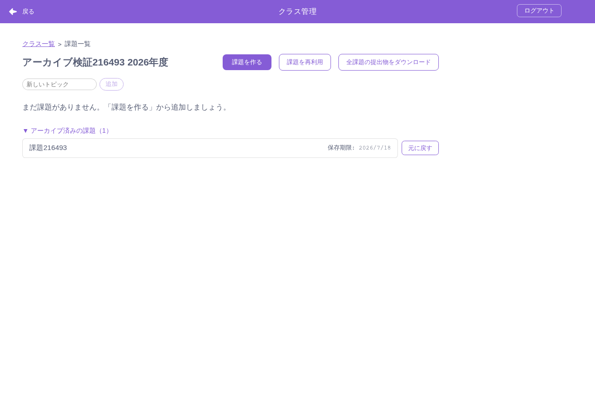
- **残り日数バッジ**: 保存期限（自動削除）まで 30 日以下の課題行に「あと{days}日」バッジを表示（7 日以下は警告色）。閾値の根拠は EPIC #1049 の D8
- **全課題の提出物をダウンロード**（`classroom-board-download-class`）: クラス内の全課題（アーカイブ済み含む — どちらも保存期限で消えるため）の提出物を 1 つの zip（`課題名/席番号_名前/作品.sb3` + サムネ/スクショ + `提出状況.csv`）でダウンロード。進捗は「n/m」表示
- **みんなの課題からさがす**（`classroom-board-shared-catalog`、EPIC #1066）: 全国の先生が共有した課題のカタログをボード内に展開。学校種・教科・学年・タグで絞り込み → 詳細プレビュー（説明ページ・「© 表示名 / CC BY 4.0」クレジット・補足資料リンクは外部ドメイン名付き確認を挟んで新規タブ）→「このクラスに取り込む」でスターターごと課題として複製（新しい参加コードが発行される）。「自分の投稿」タブから取り下げ / 再公開。他人の投稿には通報（理由必須）

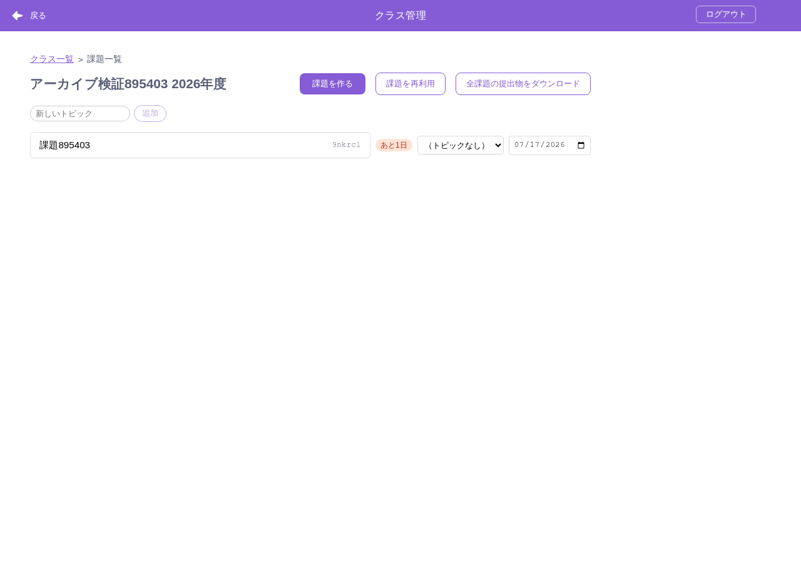

## 1.7 先生: 課題詳細の「説明」タブ

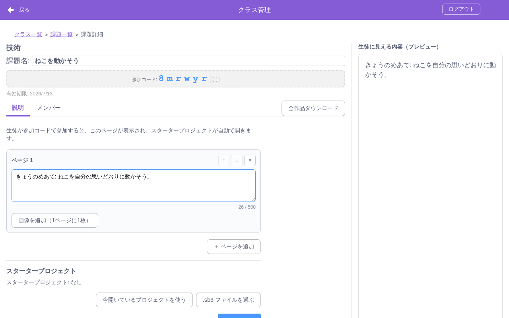

課題をひらくと、ふだんは「メンバー」タブが最初に表示される。「説明」タブが最初に出るのは、**このセッションで新しく作った課題をはじめてひらいたときだけ**（説明を書くのは作った直後なので。そこで書かなかった課題は、説明が要らない課題とみなす）。メニューバーの「いまの課題を開く」は常に「メンバー」タブでひらく。「説明」タブでは左に生徒へ表示する説明・画像・スターターの編集フォーム、**右ペインに生徒視点プレビュー**（編集内容をライブ表示・ページ送り。生徒への反映は保存時のみ）。

- 出席・提出のポーリング（30秒）は**メンバータブ表示中のみ**（費用抑制）
- **この課題を共有**（`classroom-share-assignment`）: 課題（説明ページ + スターター）を「みんなの課題」（全国の先生の共有ライブラリ、EPIC #1066）に公開するフォームを開く。属性（学校種・学年・教科・タグ・コマ数）、補足資料 URL（https のみ + 期待内容のガイダンス表示）、表示名・所属（localStorage 記憶）、**CC BY 4.0 同意チェック必須**。公開後は「© 表示名 / CC BY 4.0」付きの完了メッセージを表示
- 課題の所属クラス変更・人数編集・課題単位の共同管理者・複製は**できない**（クラス設定 / 課題一覧の再利用へ集約）。フッターのボタンは「**課題をアーカイブ**」（soft-delete。ボードの「アーカイブ済みの課題」からいつでも復元可能。testid は歴史的経緯で `classroom-delete-classroom` のまま）

## 1.8 先生: お知らせセンター（タイトルバー・EPIC #1111）

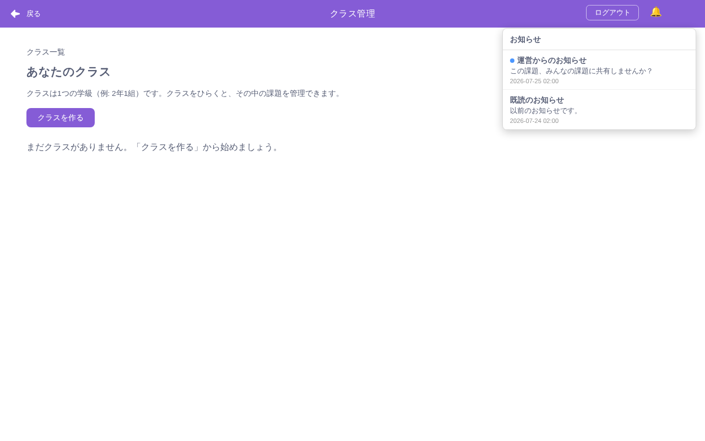

クラス管理のタイトルバー右上（× の左隣）は **アバターメニュー**（メール頭文字 + ▼）に固定。その左に **白一色のベル**（お知らせ）を置く。運営（Admin）からのお知らせが届くと未読数バッジが付く。

- **アバターメニュー**: メール頭文字（`kouji@…`→`K` / `kouji.takao@…`→`KT`）の丸アイコン + ▼。クリックでポップアップ（メール表示 + ログアウト。将来の設定項目もここに集約）。紫背景で視認できる白丸 + 紫文字
- ベルのクリックで一覧パネルを開閉。**開くだけでは既読にしない**（バッジは残る）。既読はパネルヘッダーの **⋯ メニュー**から明示的に行う
- パネルは **先頭 5 件**のみプレビュー表示。ヘッダーの **⋯ メニュー**に「**すべて既読にする**」「**お知らせを開く**（全件一覧ページ・`teacher-notifications` フェーズ・**10 件/ページ**）」。一覧は件数に関係なく開ける
- お知らせ本文をクリックすると、`link` の種類に応じて該当画面へジャンプ（`kind: 'classroom'` → そのクラスを選択して課題詳細へ / `kind: 'shared-mine'` → みんなの課題の自分の投稿へ）。未知の kind は無視（前方互換）
- **全件一覧ページ**は「**クラス管理 > お知らせ**」パンくず（先頭「クラス管理」でトップ=クラス一覧へ戻れる）+ **左下に「戻る」ボタン**（キャンセルが不適切な画面のポリシー）
- **取得は 1 日 1 回**（コスト削減）: その日はじめてクラス管理を開いたときだけ `GET /notifications` を 1 回呼び、localStorage に日付つきでキャッシュ。同じ日の再オープンは API を叩かない（旧 60 秒ポーリングは廃止）。共有 PC 対策として先生メールでキャッシュを識別。取得エラーはクラス管理本体に影響させない（表示しない）。※その日の初回取得後に届いたお知らせは翌日反映（運営連絡は多くて週 1 回程度の前提）
- 送信側は Admin SPA（課題詳細の「先生へのお知らせ」フォーム → `POST /admin/notifications`）。`docs/admin/README.md` を参照

| 要素 | 操作 |
|------|------|
| アバターボタン | クリックでアカウントメニュー開閉 |
| イニシャル丸 | メール頭文字（1〜2 文字） |
| メニューのメール | ポップアップ内のメール表示 |
| ログアウト | アカウントメニュー内 |
| ベルボタン | クリックでパネル開閉 |
| 未読バッジ | 未読数（10 以上は「9+」）。未読 0 で非表示 |
| 一覧パネル | 先頭 5 件プレビュー |
| ⋯ メニューボタン | パネルヘッダー右の三点 |
| ⋯ メニュー | — |
| すべて既読にする | 全件既読（未読 0 で無効） |
| お知らせを開く | 全件一覧ページへ（件数不問） |
| お知らせ 1 件（パネル） | クリックでリンク先へジャンプ + パネルを閉じる |
| 未読ドット | 未読アイテムのみ |
| 空メッセージ | お知らせ 0 件のとき |
| 全件一覧ページ | `teacher-notifications` フェーズ |
| パンくず先頭 | 「クラス管理」→ トップ（クラス一覧）へ |
| 左下戻る | トップ（クラス一覧）へ戻る |
| ページ内 1 件 | クリックでリンク先へジャンプ |
| ページャ | 10 件/ページ |

## 1.9 先生: 共有推奨バナー（#1106）

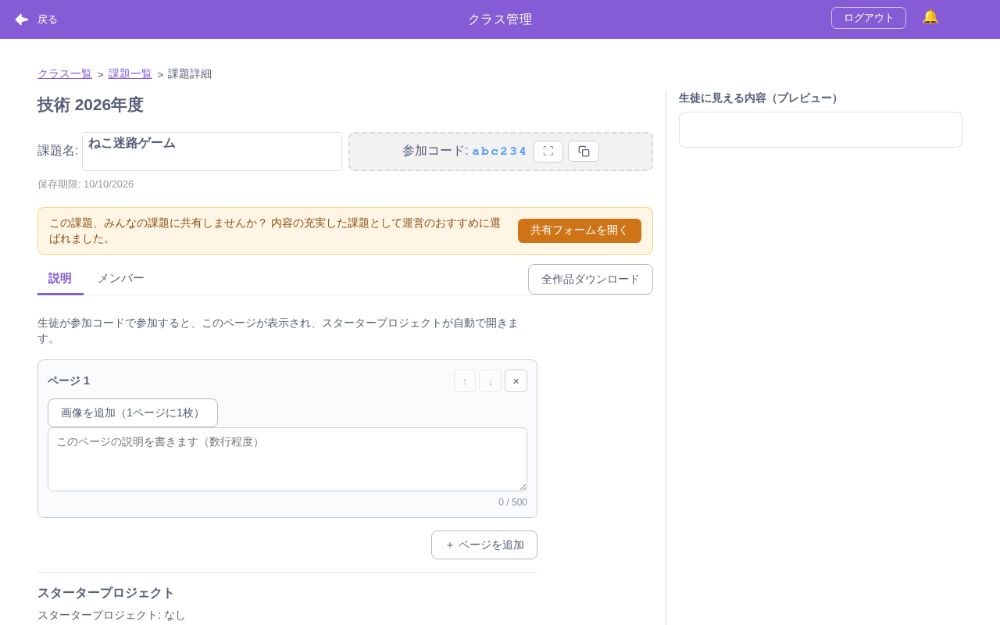

運営（Admin）が「みんなの課題に共有する価値がある」と判断した課題には、課題詳細の上部に「**この課題、みんなの課題に共有しませんか？**」バナーが出る。「共有フォームを開く」でボードの共有ステップ（既存の共有フロー）が開く。公開はあくまで CC BY 同意を伴う**先生本人の共有操作のみ**（運営による代理公開はしない）。

- 推奨と同時に運営からのお知らせ（🔔・`share_suggestion`）も届き、クリックでこの課題の詳細へジャンプする
- 課題一覧（ボード）の該当行には「**共有おすすめ**」マークが付く
- フラグは admin が取り消すまで表示される（先生側から消す操作は無い）

| 要素 | 操作 |
|------|------|
| バナー | — |
| 共有フォームを開く | ボードへ戻って共有ステップを開く |
| ボード行のマーク | — |

## 4. 先生: 課題詳細のメンバータブ (`teacher-detail`)

1 つの課題（1 授業）の参加状況と提出を管理する画面。画面のタイトルには、その課題が属する**クラス（学級）名**が出る。モーダルが**ワイド表示 (968px)** に広がります。

### 空席のみの状態

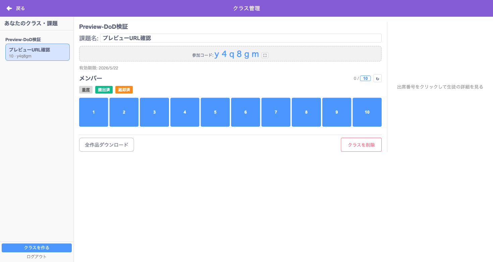

### 提出・着席・退室依頼がある状態

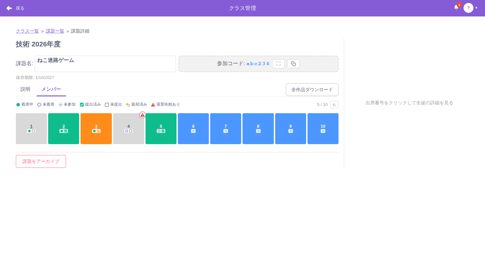

### メンバー詳細パネル（右側）

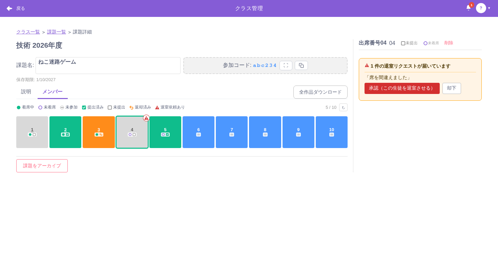

**左カラム パーツ:**

| 要素 | テキスト例 | 操作 |
|------|----------|------|
| 戻るリンク | 「< 戻る」 | → teacher-dashboard |
| クラス（学級）名 | 「技術 2026年度 / 2年1組」 | 課題が属するクラスの表示ラベル（`formatClassLabel(group)`。v2 以前のデータでは `Classrooms.className`） |
| 課題名入力 | 課題名（編集可） | blur で保存 |
| 課題配信ボタン | 「課題を配信」 | → teacher-post-assignment。**未配信のとき**表示 |
| 共有できない理由 | 「このクラスの Google Classroom は ◯◯ 先生が連携しています。…」 | 連携した先生以外に表示（配信ボタンは `disabled`） |
| GC 教師の確認ボタン | 「自分もこの Google Classroom のクラスの先生です（確認する）」 | 上の理由表示の中。押すと同意を求めて判定し、GC 教師なら共有が解禁される |
| 課題確認リンク | 「課題を確認」 | 配信済みのとき表示（新しいタブ） |
| 参加コード表示 | 「参加コード: 3cexm5」 | 大きなフォントで中央表示 |
| コード拡大ボタン | ⛶ アイコン（ツールチップ: 「全画面表示」） | 全画面コード表示 |
| 保存期限 | 「保存期限: 2026/4/6」 | 自動削除の期日（TTL）。30 日以下になると下に警告バナー（`classroom-retention-banner`）が出て「全作品ダウンロード」を促す（下図） |

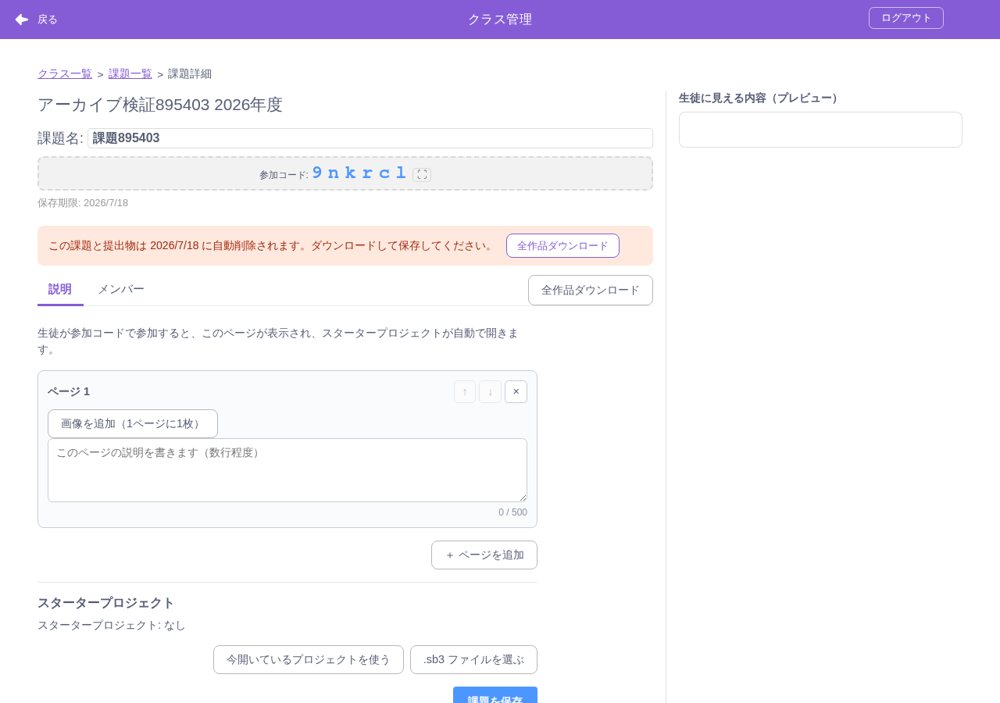
| メンバー見出し | 「メンバー」 | — | — |
| メンバー数 | 「1 / 35」 | `classroom-members-count` | 参加人数 / 最大人数 |
| 更新ボタン | ↻ アイコン | `classroom-refresh` | メンバー・提出を再取得 |
| 凡例 | 状態アイコン + ラベル | `classroom-status-legend` | — |
| 座席グリッド | — | `classroom-members-grid` | — |
| 全作品ダウンロード | 「全作品ダウンロード」 | `classroom-download-all` | 左寄せ |
| 課題アーカイブボタン | 「課題をアーカイブ」 | `classroom-delete-classroom` | 赤枠ボタン、右寄せ。soft-delete（復元可能） |

**課題配信ボタンの表示条件:** Google Classroom 連携はクラス（group）単位に移行したため、配信ボタン（`classroom-post-assignment`）は **クラスが GC 連携済み（`group.googleClassroomCourseId`）** であれば、その課題自体に courseId が無くても表示されます（課題の投稿先はクラスのコース）。課題単位の `googleClassroomCourseId`（v2 以前のフォールバック）が有る場合も表示されます。どちらの courseId も無い（非連携クラス）ときは表示されません。配信済み（課題に `googleClassroomAlternateLink` が保存済み）になると「Google Classroom で確認」リンク（`classroom-view-assignment`）に切り替わります。

**課題配信ボタンを押せる条件 (#1184):** 配信は**押した先生自身の Google アカウント**で行われるため、
紐付け先の Google Classroom コースの教師でなければ Google に拒否されます。**連携した先生以外は
既定で `disabled`** にし、`classroom-post-assignment-blocked` に誰に依頼すればよいかを表示します
（別ワークスペースの個人アカウントの共同担当は、そのコースの教師に**なれない**ため、押させてから
失敗を説明しても出口がありません）。

同じコースの GC 共同教師は、ブロック表示の中の「自分もこの Google Classroom のクラスの先生です
（確認する）」（`classroom-post-assignment-verify`）を 1 回押せば共有できます。押したときだけ
Google の同意を求め、`teacher` と確認できればボタンが有効になります（クラスを開いただけでは
同意ポップアップは出ません）。確認できなかったときはエラーバナーではなく、ブロック表示が
「…先生であることを確認できませんでした。共有は ◯◯ 先生に依頼してください。」に変わります。

**連携した先生本人**は確認導線を経ずに従来どおり共有でき、コースが削除・到達不能で失敗した
ときの文言も「連携し直してください」になります（自分に依頼させない）。

**座席グリッド:**

座席番号が格子状に並び（1行 10列）、各セルは**出席番号 + 状態アイコン**（[状態アイコン](#状態アイコン)）と背景色で状態を表します。色だけに頼らず、アイコンの形と `title` / `aria-label` でも区別できます。出席番号・アイコン・退室依頼バッジはセルの大きさに合わせて拡大縮小します（CSS の container query 単位 `cqi`。狭い画面でも読めるよう下限、広い画面で大きくなりすぎないよう上限を `clamp()` で設定）。

| セル内のアイコン | 状態 |
|---------|------|
| 着席系（左） | 着席中 / 未着席 / 未参加 のいずれか |
| 提出系（右） | 提出済み / 未提出 / 返却済み のいずれか（未参加の席には出さない） |
| 右上バッジ（`classroom-seat-kick-request-{n}`） | 退室依頼あり |

| セルの色 | 状態 |
|---------|------|
| 青 (`#4c97ff`) | 未参加（空席） |
| グレー (`#d9d9d9`) | 参加中（未提出） |
| 緑 (`#0fbd8c`) | 提出済み |
| オレンジ (`#ff8c1a`) | 返却済み |

色は生徒側の出席番号選択画面と統一されている: 青 = 「空き / 選択可能 (生徒視点では選べる席、先生視点では未参加)」、灰色 = 「使用中」。着席判定は `lastActiveAt` が 1 時間以内かどうか。

セルをクリックすると右カラムに詳細パネルが表示されます。

**右カラム — メンバー詳細パネル:**

メンバー未選択時は「出席番号をクリックして生徒の詳細を見る」と表示。

| 要素 | テキスト例 | 操作 |
|------|----------|------|
| パネル全体 | — | — |
| 席番号ヘッダー | 「出席番号05」 | — |
| ニックネーム | 「- 」(未設定時) | — |
| 提出時刻 | 提出済み / 返却済みアイコン + 「19:11:54」 | 緑（返却済みはオレンジ）テキスト |
| 未提出 | 未提出アイコン + 「未提出」 | 提出が無いときのみ |
| 着席状態 | 着席中 / 未着席アイコン + 「着席中」/「未着席」 | — |
| 削除リンク | 「削除」 | 赤色テキスト |
| サムネイル画像 | — | プロジェクトのサムネイル |
| プロジェクト名 | 「第１回チャットアプリを作ろう」 | サムネイル下 |
| 「スモウルビーで開く」 | — | 青色ボタン、全幅 |
| コメント入力 | textarea (placeholder: 「...」) | — |
| 返却ボタン | 「返却する」 | オレンジ色ボタン、全幅 |

スクリーンショットが複数枚ある場合:

| 要素 | 操作 |
|------|------|
| 画像インデックス | 「1/3」等 |
| 前の画像ボタン | — |
| 次の画像ボタン | — |

**説明 / メンバータブ:**

課題詳細はタブ切替（「メンバー」がデフォルト = 出席・提出の座席グリッド、「説明」= 課題編集フォーム + 生徒視点プレビュー。新しく作った課題をはじめてひらいたときだけ「説明」が先）。共同管理者は**クラス設定（クラス一覧）**に移動した。タブ行の右端に「全作品ダウンロード」。

| 要素 | テキスト | 操作 |
|------|---------|------|
| メンバータブ | 「メンバー」 | 凡例 + 人数 + 更新 + 座席グリッド（表示中のみ 30 秒ポーリング・既定） |
| 説明タブ | 「説明」 | 課題編集フォーム + 右ペインの生徒視点プレビュー（作成直後の初回のみ既定） |

課題を切り替えるとメンバータブに戻る。

**共同管理者セクション (課題単位・現在の UI には無い):**

> ⚠️ 画面上の共同管理者の追加・解除は **クラス（学級）設定**（「1.5 先生: クラス一覧」のカードの「設定」）に移動済み。以下は移動前の課題詳細タブの構成で、課題単位の共同管理は API（`/classrooms/{id}/co-teachers`）としてのみ後方互換で残っている。

owner または co-teacher が、別の先生を **email で招待**して共同管理できる（→ [architecture.md の共同管理](architecture.md#共同管理co-teacher)）。

| 要素 | テキスト例 | 操作 |
|------|----------|------|
| セクション全体 | — | co-teachers タブ選択時のみ描画 |
| 未登録表示 | 「まだ共同管理者がいません。」 | co-teacher が0件時 |
| 一覧の各項目 | 「co@example.com」 | — |
| 解除ボタン | 「解除」 | 共同管理者を解除 |
| 招待入力 | email 入力 (placeholder: teacher@example.com) | Enter でも招待 |
| 招待ボタン | 「招待」 | email 未入力時は disabled |

招待された先生は次回ログイン時、**クラス一覧に該当クラス（学級）が「共同管理」バッジ**付きで表示され、その中のすべての課題を管理できる（即時反映・承認不要）。

**コード表示 (全画面):**

コード拡大ボタン (⛶) をクリックすると、参加コードが全画面表示されます (Portal 使用)。タイトルは「参加コード」、フッターにクラス（学級）名・人数・課題名・日付が表示されます。

| 要素 | 操作 |
|------|------|
| 招待リンクコピー | クリップボードにコピー |
| 全画面表示 | — |
| 全画面解除 | — |
| 閉じる | — |

**削除確認ダイアログ:**

「課題をアーカイブ」ボタンを押すと確認ダイアログが表示されます。

| 要素 | テキスト | 操作 |
|------|---------|------|
| 確認ボタン | 「アーカイブする」 | 課題のアーカイブ（soft-delete）を実行 |
| キャンセルボタン | 「キャンセル」 | ダイアログを閉じる |

---

## 5. 生徒: 参加コード入力 (`student-join`)

6文字の参加コードを入力する画面。生徒がモーダルを開いたときの初期画面です。

生徒が既に課題に参加している場合（localStorage にセッション情報あり）は、この画面をスキップして**ステータス**画面に直接遷移します。

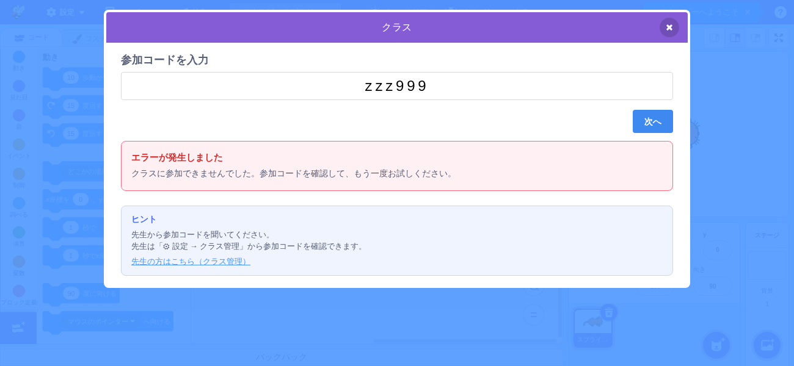

**パーツ:**

| 要素 | テキスト/内容 | 操作 |
|------|-------------|------|
| 見出し | 「参加コードを入力」 | — |
| コード入力 | 6文字入力欄 (placeholder: ○○○○○○) | 自動大文字変換 |
| 次へボタン | 「次へ」 | コード未入力/不正時は disabled |
| ヒントボックス | — | 青系背景のボックス |
| ヒントタイトル | 「ヒント」 | 青色太字 |
| ヒント1行目 | 「先生から参加コードを聞いてください。」 | — |
| ヒント2行目 | 「先生は「⚙ 設定 → クラス管理」から参加コードを確認できます。」 | — |

**レイアウト:** 入力欄は中央寄せ、幅広のテキスト入力。「次へ」ボタンは右寄せ。ヒントボックスはフォーム下部に表示。

---

## 6. 生徒: 出席番号選択 (`student-seat`)

課題の座席がグリッド表示され、空いている出席番号を選択します。番号を入力して選ぶこともできます。

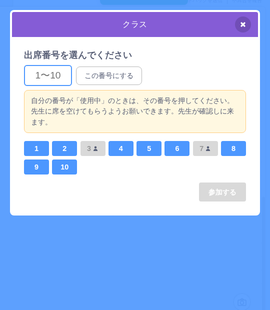

**パーツ:**

| 要素 | テキスト/内容 | 操作 |
|------|-------------|------|
| 見出し | 「出席番号を選んでください」 | — |
| 番号入力欄 | プレースホルダ「1〜定員」 | 全角数字も可。入力中の番号のセルを強調 |
| 番号決定ボタン | 「この番号にする」 | 空席 → その席を選んで確認へ / 使用中 → 退室依頼ダイアログ |
| 入力エラー | 「1から N までの数字を入れてください」 | — |
| 案内文 | 「自分の番号が『使用中』のときは、その番号を押してください。先生に席を空けてもらうようお願いできます。先生が確認しに来ます。」 | 最初から表示。30 秒席が選ばれないと強調（`data-idle="1"`） |
| 座席グリッド | — | — |
| 各席番号ボタン | 「1」〜「35」等。使用中の席は「使用中」アイコン付き | 空席 → 選択状態に / 使用中 → 退室依頼ダイアログ |
| 選択中の席番号 | — | hidden要素、値取得用 |
| 参加確認 | 大きな文字で「出席番号 NN で参加します」 | 席を選んだときだけ表示（他の生徒の席を誤って取らないため） |
| 参加ボタン | 「参加する」 | 席未選択時は disabled |

**座席グリッドの色:**

| ボタンの色 | 状態 |
|----------|------|
| 青 (`#4285f4`) | 空席（選択可能） |
| グレー + 使用中アイコン | 使用中（タップで退室依頼） |
| 濃い青 (selected) | 選択中 |
| オレンジの枠 | 番号入力欄に入れた番号 |

**レイアウト:** 2 列（左 = 番号入力 → 案内文 → 座席グリッド → エラー、右 = バナー（kick された / 退室依頼の待機中・却下）→ 参加確認 → 「参加する」）。エラーを左に置くのは、右の列がバナーと参加確認で埋まっていて、長いエラー（ネットワークにつながらないときのホスト名入りの文など）を足すと 600px を超えるため。座席グリッドは 1 行 10 席なので、40 席でも 4 行に収まる。画面の幅が 1023px 以下（iPad の縦向き・スマホ）では「バナー → 番号入力・案内文・座席グリッド → 参加確認・参加ボタン」の順に縦に積む（席を選ぶ前に、なぜこの画面に戻ってきたかを読めるように、バナーを先頭にする）。

### 番号入力で選んだとき

空いている番号なら、その席を選んだ状態で大きな参加確認が出ます。

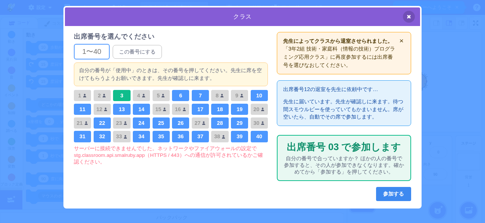

使用中の番号なら、そのまま退室依頼ダイアログが開きます。

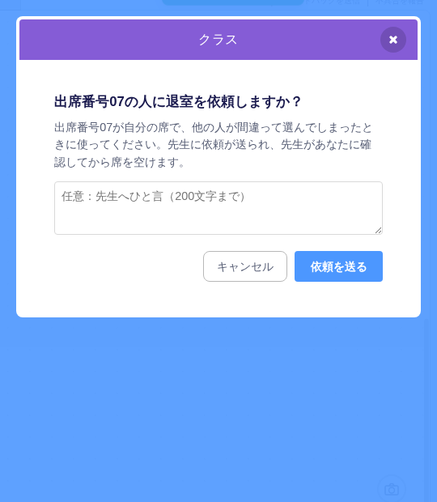

### 30 秒たっても席が選ばれないとき

画面を開いてから 30 秒（`SEAT_IDLE_HINT_MS`）席が選ばれなければ、案内文を太字・オレンジ枠にし、軽く揺らして目立たせます。`prefers-reduced-motion` のときは揺らさず色だけ変えます。

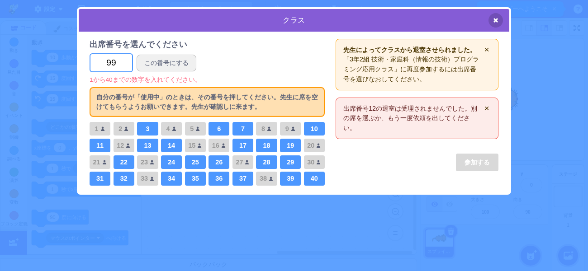

### 退室依頼の承認を待っている間

依頼中バナーに「先生に届いています。先生が確認しに来ます。待つ間スモウルビーを使っていてもかまいません。席が空いたら、自動でその席で参加します。」を表示します。先生が教室で本人に確かめてから承認し、席が空いたことをポーリングで検知すると、**その席で自動的に参加**します（選び直しは不要）。

- モーダルを閉じても、依頼が生きていれば（localStorage `smalruby:classroom:kickRequest`）裏で見張りを続け、承認・却下を検知するとモーダルを開き直します。モーダルを開き直したときも席画面の依頼中表示に戻ります。
- 承認待ちのポーリング（5 秒間隔・`KICK_REQUEST_POLL_INTERVAL_MS`）は**依頼が生きている間（最長 1 時間の TTL）・タブが表示されている間・未参加の間だけ**動きます。タブが非表示の間は止め、表示に戻ったときに 1 回だけすぐ確認します。依頼していない生徒の通信は増えません。

---

## 7. 生徒: 参加完了 (`student-joined`)

参加が成功したときの確認画面。メニューバーにも参加中であることが表示されます。
プロジェクト名が課題名に自動変更されます。

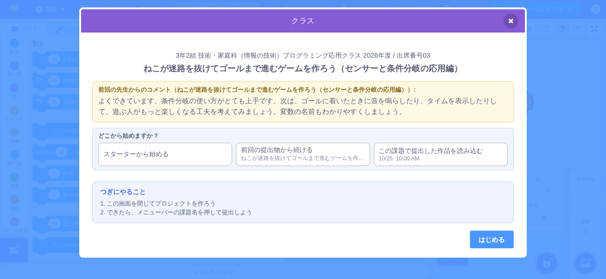

**パーツ:**

| 要素 | テキスト例 | 操作 |
|------|----------|------|
| 詳細 | 「テスト8年1組 / 出席番号03」 | — |
| クラス（学級）名 | 「テスト8年1組」 | — |
| 出席番号 | 「出席番号03」（0埋め2桁） | — |
| 課題名 | 「第１回チャットアプリを作ろう」 | 課題名がある場合のみ表示 |
| つぎにやること（ヒント） | 「1. この画面を閉じてプロジェクトを作ろう / 2. できたら、メニューバーの課題名を押して提出しよう」 | 青系背景のヒントボックス |
| はじめるボタン | 「はじめる」 | モーダルを閉じる |

**レイアウト:** クラス（学級）名と出席番号は中央表示。課題名はその下にやや小さいフォントで表示。前回のコメントがあればその下に表示。続きに使える提出物があれば「どこから始めますか？」の選択肢（下記）を表示。「つぎにやること」ヒントボックスがその下に表示され、参加後の次のアクションを案内する。「はじめる」ボタンは青色、右寄せ。

### どこから始めるかの選択（続きから始める・Issue #1201）

参加した席に**続きに使える提出物**があるとき、参加完了画面・課題パネルに「どこから始めますか？」の選択肢を 1 行で並べます（1300×600 の授業 PC でスクロールなしに収まるよう、縦に積まず横に並べる）。

| ボタン | 表示する条件 | 押したとき |
|------|------------|----------|
| 「スターターから始める」 | 課題にスターターがある | スターターを開く（従来どおり） |
| 「前回の提出物から続ける」（下に課題名・提出日時） | 同じクラスの前の課題（最大3回分遡る）に同じ席番号の提出物がある | その提出物を開く |
| 「この課題で提出した作品を読み込む」（下に提出日時） | この課題で自分の席がすでに提出している | その提出物を開く |

- 続きに使える提出物が**無い**ときは選択肢を出さず、従来どおりスターターを自動で開く
- 有るときは**勝手に開かない**（どれを開くかは生徒が選ぶ）。選ばずに「はじめる」を押すと、いま開いているプロジェクトのまま始める
- どれを開くときも、編集中のプロジェクトがあれば確認ダイアログを挟む（勝手に上書きしない）
- ダウンロード URL は押した時点で取り直す（課題を読んでいる間に期限が切れても開ける）。取り直したら無くなっていた（期限切れ）ときはエラーを表示する
- 開いたボタンには ✓ が付く
- ステータス画面にも「提出した作品を読み込む」として同じボタン（スターター以外）を出し、あとから読み込める
- 席番号は匿名なので、同じクラスの次の課題で同じ席を選んだ別の生徒も前回の提出物を開ける（[architecture.md](architecture.md) の「プライバシーの前提」）

---

## 8. 生徒: ステータス (`student-status`)

参加中の生徒がモーダルを開いたときに表示される画面。提出状況を確認し、提出/退出ができます。

### 未提出の状態

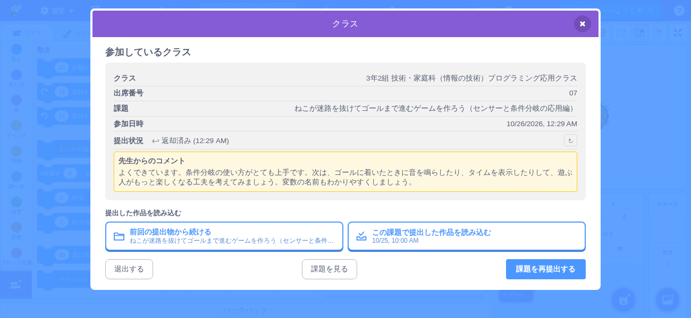

### 提出済みの状態

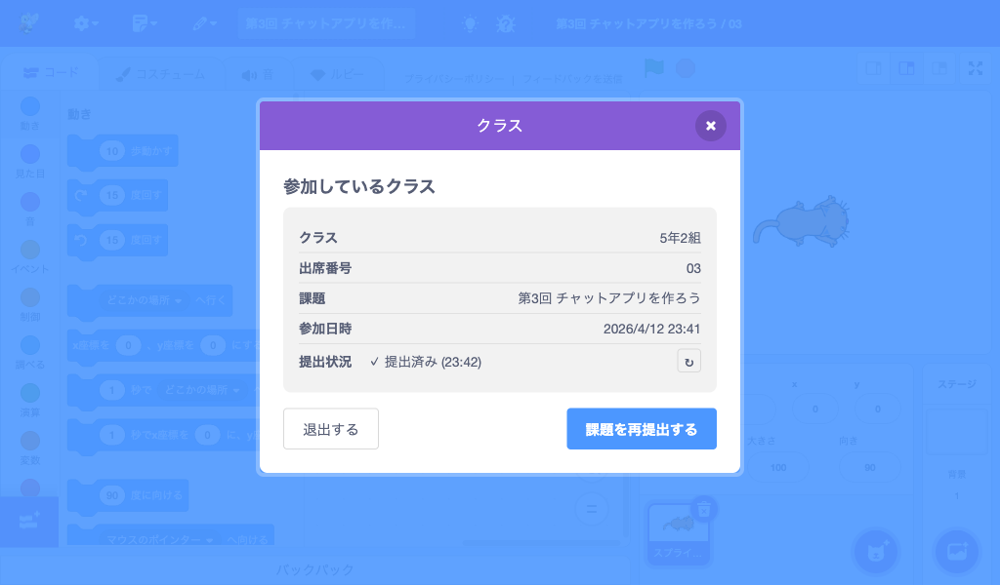

**情報テーブル:**

| 行ラベル | 値の例 |
|---------|-------|
| 「クラス」 | 「テスト8年1組」 |
| 「出席番号」 | 「03」（0埋め2桁） |
| 「課題」 | 「第１回チャットアプリを作ろう」 |
| 「参加日時」 | 「2026/4/8 00:07」（秒なし） |
| 「提出状況」 | 「未提出」or「✓ 提出済み (00:08)」 |

続きに使える提出物があれば、情報テーブルの下に「提出した作品を読み込む」として「前回の提出物から続ける」「この課題で提出した作品を読み込む」を表示します（[参加完了](#7-生徒-参加完了-student-joined) の「どこから始めるかの選択」と同じ）。

提出状況行の右端に更新ボタンがあります:

| 要素 | 操作 |
|------|------|
| 更新ボタン (↻) | 最新の提出状況を取得 |

返却済みの場合、先生からのコメントが表示されます:

| 要素 |
|------|
| 先生からのコメント |

**未提出時ヒント:**

未提出の場合、フッターの上に以下のヒントが表示されます:

| 要素 | テキスト | 備考 |
|------|---------|------|
| 提出ヒント | 「プロジェクトが完成したら「課題を提出する」を押してください。」 | 未提出時のみ表示 |

**フッターボタン (左右に配置):**

| 要素 | テキスト (未提出時) | テキスト (提出済み) | 操作 |
|------|-------------------|-------------------|------|
| 退出ボタン | 「退出する」 | 「退出する」 | → student-join |
| 提出ボタン | 「課題を提出する」 | 「課題を再提出する」 | → submit-confirm |

**レイアウト:** 情報テーブルは白背景のカード内。フッターは `[退出する]` が左、`[課題を提出する]` が右。

**セッション切れ時:**

セッションが無効になった場合、エラーメッセージと「参加画面を表示」リンクが表示されます。

---

## 9. 生徒: 提出確認 (`submit-confirm`)

提出前の確認画面。プロジェクトのサムネイルがプレビュー表示されます。

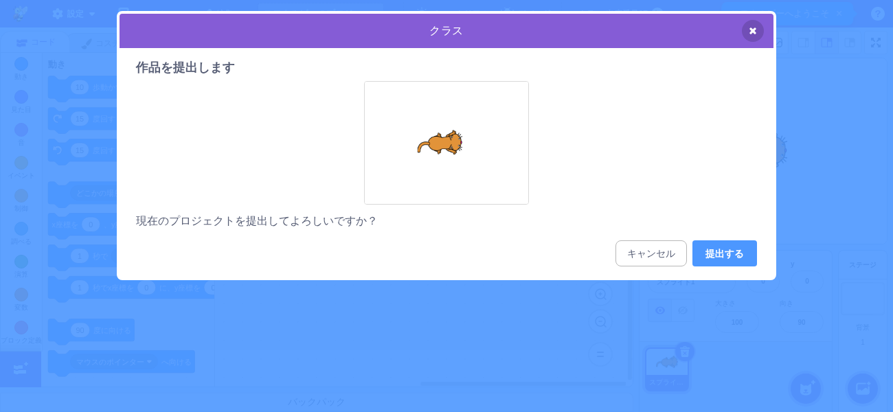

> **提出サムネイルの事前設定** (issue #631): 課題に参加中の生徒は、ステージ右上の
> 「提出サムネイルを設定」ボタン（✓ アイコン）を押すと、その瞬間のステージ画面を
> 提出サムネイルとして事前に決めておけます。設定するとそのフレームが提出時に使われ、
> プレビュー (`classroom-submit-preview`) にも反映されます。未設定のまま提出した場合は
> 従来どおり提出ボタンを押した瞬間のフレームが自動キャプチャされます。ボタンは課題
> 未参加時は表示されません（`state.scratchGui.classroom` の生徒セッション有無で判定）。

**提出サムネイルを設定ボタンの表示ゲート:**

課題に未参加のときはステージ右上に「提出サムネイルを設定」ボタンは表示されません。

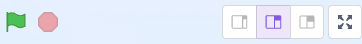

課題に参加中の生徒のときだけ、ステージ右上の左端に ✓ アイコンのボタンが表示されます。

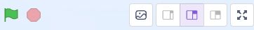

ボタンを押すと確認ポップオーバー「いまの実行画面を提出サムネイルにしますか？」が表示され、「はい」でその瞬間のステージ画面が提出サムネイルとしてキャッシュされます。

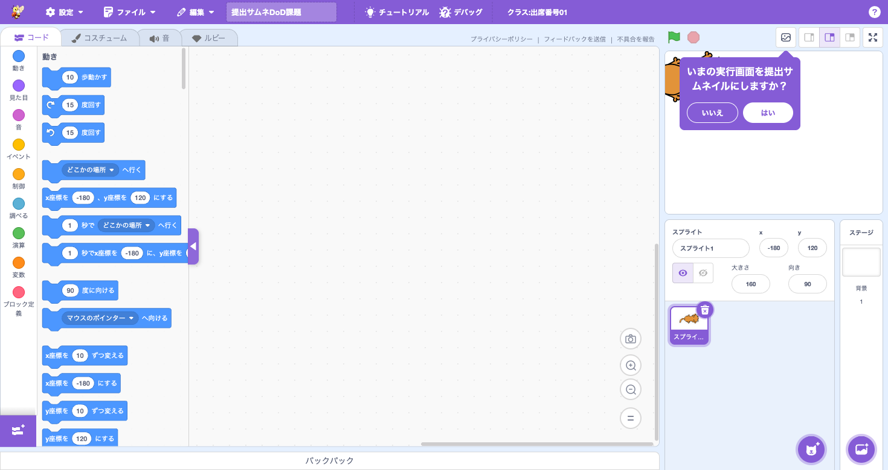

事前に設定したサムネイルは、その後ステージの内容を変えても提出確認のプレビューと実際の提出に使われます（下図は事前設定したフレーム＝左上の大きいネコがプレビューに表示され、背後の現在のステージ＝右下の小さいネコとは異なる様子）。

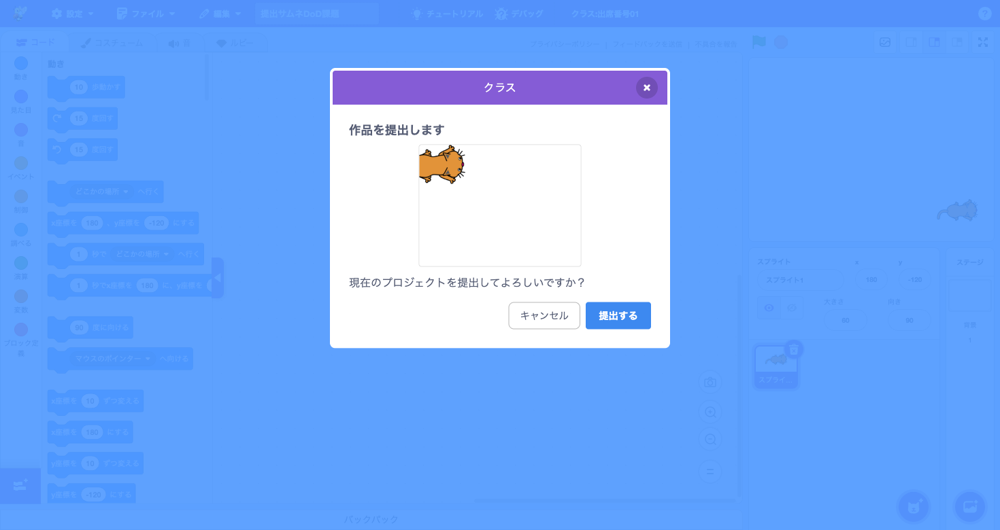

**パーツ:**

| 要素 | テキスト/内容 | 操作 |
|------|-------------|------|
| 見出し | 「作品を提出します」 | — |
| サムネイルプレビュー | ステージのスクリーンショット画像 | — |
| 確認メッセージ | 「現在のプロジェクトを提出してよろしいですか？」 | — |
| キャンセルボタン | 「キャンセル」 | → student-status |
| 提出ボタン | 「提出する」 | 送信中は「提出中...」に変化 |

**レイアウト:** サムネイルは中央の白枠内に表示。ボタンは横2列、右に「提出する」(青色)、左に「キャンセル」(白色ボーダー)。

「提出する」を押すと:
1. プロジェクトファイル (.sb3) を保存（ファイル名はプロジェクト名 = 課題名）
2. サムネイルを生成（事前設定済みの提出サムネイルがあればそれを使用、無ければ自動キャプチャ）
3. ステージのスクリーンショットを撮影
4. Presigned URL 経由で S3 にアップロード
5. 完了後 → student-status に遷移

---

## 課題配信（課題エディタ + 生徒の課題パネル）

課題（1 授業）には任意で**課題コンテンツ**（(数行テキスト + 画像1枚) × 最大10ページ + スタータープロジェクト1つ）を持たせられます。生徒は参加コードで参加した瞬間に課題ページが表示され、スタータープロジェクトが自動で開きます（プログラム配付の手作業をなくす機能）。

### 課題の編集（先生: 課題詳細の「説明」タブ）

課題詳細の「説明」タブが編集フォームです（新しく作った課題をはじめてひらいたときは、このタブが最初に表示されます）（旧 teacher-assignment-edit フェーズは廃止）。右ペインに生徒視点プレビュー（sticky・ページャ上部）。

- ページの追加・削除・並べ替え（↑↓）、1ページ500文字 + 画像1枚（png/jpeg・**画像が上、テキストが下**）
- スターターは「今開いているプロジェクトを使う」（保存時に `vm.saveProjectSb3()` で生成）か「.sb3 ファイルを選ぶ」
- 保存すると画像・スターターは Presigned URL で S3 に直接アップロードされる
- data-testid 一覧は [testing.md](testing.md) の「課題エディタ」参照

### 課題パネル（生徒: student-assignment フェーズ）

join 完了直後に自動で開きます（課題コンテンツが設定されている課題のみ）。ステータス画面の「課題を見る」（`classroom-view-assignment-button`）からいつでも開き直せます。

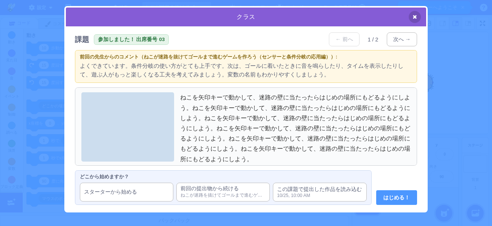

- 1300×600 に収まるよう、見出し「課題」・「参加しました！」・ページ送りを 1 行に、ページは**画像が左・テキストが右**に並べる。長いページはページの枠の中でスクロールする
- スターターの自動ロードは**編集中のプロジェクトを勝手に上書きしない**（未編集なら自動、編集ありなら confirm）。続きに使える提出物があるときは自動ロードせず、「どこから始めますか？」の選択肢を「はじめる！」の左に並べる（[参加完了](#7-生徒-参加完了-student-joined) の「どこから始めるかの選択」）
- 「スタータープロジェクトを開く」で明示的に開き直せる（同じく confirm あり。選択肢を出しているときは「スターターから始める」がその役）
- 「はじめる！」でモーダルを閉じて作業開始
- data-testid 一覧は [testing.md](testing.md) の「課題パネル（生徒）」参照

---

## 10. 先生: Google Classroom コース一覧 (`teacher-google-courses`)

Google Classroom のアクティブなコース一覧を表示し、インポートするコースを選択します。課題作成画面の「Google Classroom からクラス名と人数をインポート」リンクから遷移します。

**パーツ:**

| 要素 | テキスト/内容 | 操作 |
|------|-------------|------|
| 戻るリンク | 「< 戻る」 | → teacher-create |
| 見出し | 「Google Classroom のクラス一覧」 | — |
| 説明文 | 「インポートするクラスを選択して「インポート」ボタンを押してください。」 | — |
| コースなし表示 | 「クラスが見つかりません」 | コースが0件時 |
| ローディング | スピナー | 読み込み中に表示 |
| インポートボタン | 「インポート」 | 未選択時は disabled。→ teacher-create（コース情報付き） |

**レイアウト:** 各コースは **タイルグリッド** (300×84px) で表示されます。クラス名とセクション名が表示されます。画面幅に応じてタイルの列数が変わります（レスポンシブ）。

**認可ヒント:** 初回インポート時、コース一覧画面上にオーバーレイで「Google Classroom からインポートする前に」チュートリアルが表示されます（チェックボックス確認の見本画像付き）。

---

## 11. 先生: 課題配信 (`teacher-post-assignment`)

Google Classroom にリンクしたクラス（学級）の課題で、課題リンクを投稿する画面。課題詳細の「課題を配信」ボタンから遷移します。

**パーツ:**

| 要素 | テキスト/内容 | 操作 |
|------|-------------|------|
| 戻るリンク | 「< 戻る」 | → teacher-detail |
| ページタイトル | 「Google Classroom に課題を配信します」 | — |
| 対象 | 「対象: {クラス名}」 | — |
| タイトル入力 | テキスト入力（デフォルト: 課題名） | — |
| 説明入力 | テキストエリア | 任意 |
| ヒント | 「配信後、課題の詳細の装飾、割当先、点数などの設定は Google Classroom で行えます。…」 | — |
| 配信ボタン | 「Google Classroom に配信する」 | — |

**配信後:** 成功すると「Google Classroom で確認する」リンクが表示されます。課題詳細画面の「課題を配信」ボタンは「課題を確認」リンク（新しいタブで Google Classroom を開く）に変わります。二重配信を防止するため、配信済み状態は DynamoDB に永続化されます。
| 成功メッセージ | 「配信しました！」 | `classroom-post-assignment-success` | 配信成功時に表示 |

---

## モーダルサイズ

| モーダル | 幅 |
|---------|------|
| 生徒の「クラス」（`classroom-modal`） | 960px（ビューポートの 95% まで）。上下の余白は 1rem |
| 先生のクラス管理（`classroom-teacher-modal`） | フルスクリーン |

生徒用を 960px にしたのは、座席選択の 2 列（左に 10 列の座席グリッド、右に 360px のバナーと参加ボタン）に必要な幅だからです。1300px の画面の 95vw にも、iPad の横向き（1024px）にも収まります。

## 画面サイズの基準（1300×600）

授業で使う PC の画面は **1300×600px**（ブラウザのメニューやタブを除いたビューポート）です。高さが少ないので、次を基準にします。

| 対象 | 基準 |
|---|---|
| 生徒の「クラス」（メニューバーの「クラス」から開くもの） | **スクロールなし**。モーダルの外形がビューポートに収まり、本文もページも縦にスクロールしない |
| 先生のクラス管理 | 本文の中のスクロールは可。モーダル自体はビューポートからはみ出さない。見出しと主な操作ボタンはスクロールしなくても見える |
| 先生のメニュー・トースト・フローティングパネル | 600px の中に収まる |

- 横幅には余裕があるので、縦に積まずに**横に並べて**縦を詰めます（座席選択の 2 列など）。
- 生徒の本文の `max-height` は `calc(100vh - 5.125rem - 8px)`（上下の余白 1rem×2 + ヘッダー 3.125rem + 枠 8px）です。
- 確認は `tools/playwright-verify/verify-classroom-viewport.mjs`（headless・スタブ式）で行います。生徒の各画面を一番長い状態（40 席・kick されたバナー + 退室依頼の待機中 + エラー、30 秒後の強調、長いクラス名・課題名・コメントなど）で開いて測り、1 つでも超えたら失敗します。クラスの画面を変える Issue では、この確認を DoD に含めます。
- スマホ / iPad 向けのレイアウト（743px 未満）はこの基準の対象外ですが、崩さないこと。

## 自動更新

先生の課題詳細画面では、メンバーと提出情報が **30秒ごと** に自動更新されます（`CLASSROOM_REFRESH_INTERVAL_MS` で設定可能）。

「着席中」は生徒の最後の操作（参加、またはクラスのモーダルを開いたとき）から **1 時間以内**かどうかで判定する目安です。通信量を抑えるため定期的な生存通知は送らないので、エディタを閉じた生徒もしばらくは「着席中」に見えます。席を空ける依頼を承認するときは、教室で本人に確かめてから承認してください。

## localStorage 永続化

| キー | 内容 |
|------|------|
| `smalruby:classroom` | 生徒のセッション情報 (JSON) |

生徒が課題に参加すると、以下の情報が localStorage に保存されます:
- `role`, `classroomId`, `className`, `assignmentName`, `joinCode`
- `seatNumber`, `memberId`, `sessionToken`
- `joinedAt`, `submissionStatus`, `lastSubmittedAt`

ブラウザを閉じて再度開いても、セッションが有効であれば自動的に復帰します。

## classcode URL パラメータ

`?classcode=XXXXXX` で参加コード入力をスキップして自動参加フローに入ります。このパラメータは**初回のモーダルオープン時のみ有効**で、消費後はキャッシュからも削除されます。再度モーダルを開いた場合は通常のフローになります。

## レスポンシブ対応

現在の実装はデスクトップ向けです。タブレット (iPad) での利用も想定していますが、スマートフォンでの利用は想定外です。

---

## 状態アイコン

着席・提出などの状態は共通部品 `classroom-status-icon.jsx` のアイコンで表す（先生のメンバーグリッド・凡例・メンバー詳細、生徒の座席選択、メニューバーで共通）。
各アイコンは**状態ごとに形が違う** inline SVG で、`role="img"` と `title` / `aria-label`（下表のラベル）を持つ。

| 状態 (`data-status`) | 形 | ラベル |
|------|----|--------|
| `seated` | 塗りつぶしの円（緑） | 着席中 |
| `notSeated` | 中抜きの円（紫） | 未着席 |
| `notJoined` | 点線の円 + 横線（灰） | 未参加 |
| `submitted` | チェック入りの四角（緑） | 提出済み |
| `notSubmitted` | 空の四角（灰） | 未提出 |
| `returned` | 戻り矢印（オレンジ） | 返却済み |
| `kickRequested` | 三角 + 「!」（赤） | 退室依頼あり |
| `occupied` | 人のシルエット | 使用中 |

着席系と提出系を 1 セルに並べるときは `ClassroomStatusIcons`（`classroom-status-icons`）、凡例は `ClassroomStatusLegend`（`classroom-status-legend` / 各項目 `classroom-status-legend-{status}`）を使う。

