# UI/UX

> 各画面の data-testid はここには書かず、[testing.md の data-testid 一覧](testing.md#data-testid-一覧)に一元化しています。

## 画面遷移図

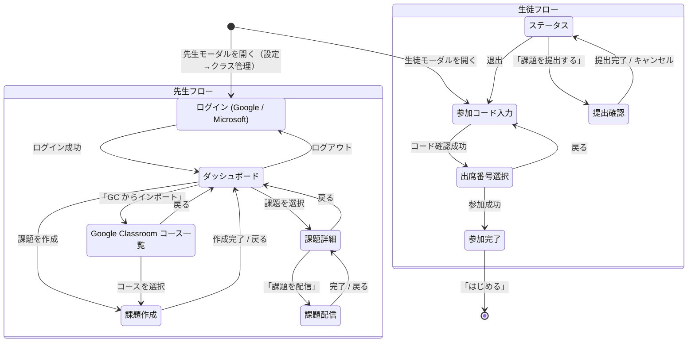

---

## メニューバー

メニューバーの右端に「クラス」ボタンが表示されます（`CLASSROOM_API_ENDPOINT` 環境変数が設定されている場合）。

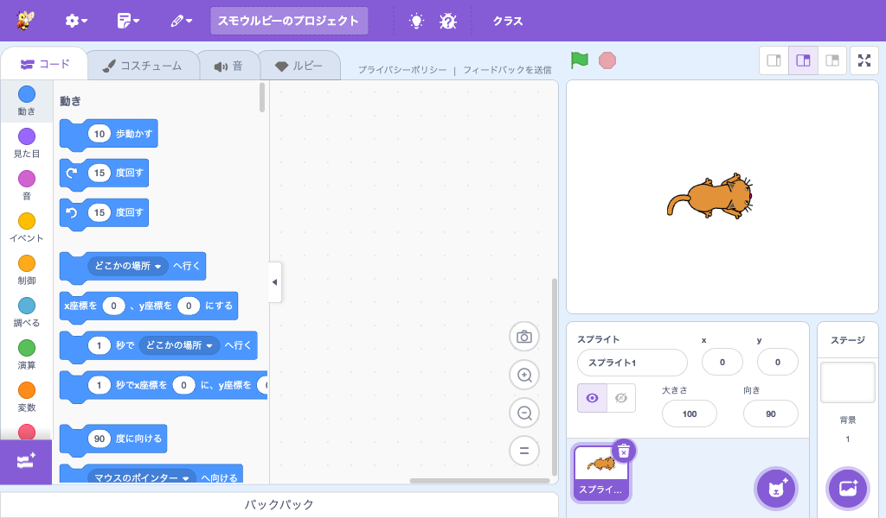

**パーツ:**

| 要素 | テキスト/内容 |
|------|-------------|
| 設定メニュー | ⚙ アイコン |
| クラス管理メニュー | 「クラス管理...」（設定メニュー内） |
| クラスボタン | 「クラス」（未参加時） |
| ラベル | — |

生徒が課題に参加中の場合、ボタンのテキストは固定の「クラス:出席番号NN」表記に変わります (NN は 0 埋め 2 桁):

| 要素 | テキスト/内容 |
|------|-------------|
| ラベル全体 | 例: 「クラス:出席番号03」 |
| 出席番号 (内側 span) | 例: 「03」 |
| 提出状態アイコン | 未提出 / 提出済み / 返却済み のアイコン（[状態アイコン](#状態アイコン)） |

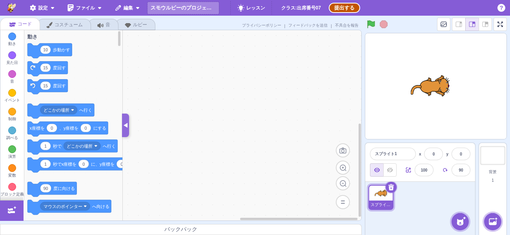

レッスンの課題では、提出状態アイコンの代わりにレッスンの進み具合の印（○ / 2/4 / ✓）を出す（[レッスンの課題](#レッスンの課題)）。

未参加時はラベルが「クラス」のみになる。 課題名 / クラス（学級）名はメニューに表示せず、モーダル内でのみ確認する設計。なお、生徒が参加するのは課題（1 授業）だが、メニューバーのラベル自体は「クラス」のまま（授業で「上の『クラス』を押して」と全員に同じ説明ができるように、先生がログインしていても場所・見た目を変えない。[言葉の対応表](#言葉の対応表google-classroom-にそろえる)の「生徒向け UI の例外」）。

### 先生メニュー（クラス管理）

先生がログインしている間は、生徒用の「クラス」ボタンに加えて **「クラス管理」メニュー**が表示されます。未読のお知らせがあるとメニューボタンと「お知らせ」項目に「!」バッジが付きます。

「クラス管理」は生徒用の「クラス」と隣に並べず、**メニューバーの右端（「?」の左）**に置き、白い枠とアイコンのボタン［🎓 クラス管理 ▾］にする。生徒として参加して見せるときに、どちらを押すか迷わないようにするため。ドロップダウンは左へ開く。1300px 幅でもチュートリアル・デバッグ・プロジェクト名などと重ならない。先生がログインしている間は、「?」の左に出るウェルカムの吹き出し（初回から 5 日間）を出さない（「クラス管理」を覆って押せなくなるため）。

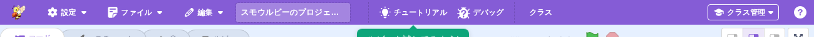

| 項目 | 表示条件 | 動作 | data-testid |
|------|---------|------|-------------|
| メニューボタン「クラス管理」 | 先生ログイン中 | ドロップダウンを開く | `classroom-teacher-menu-button` / `classroom-teacher-menu-label` |
| 未読バッジ「!」 | 未読のお知らせ、または未処理の退室依頼あり | — | `classroom-teacher-menu-badge` |
| 退室依頼（N件） | 未処理の退室依頼がある（先頭に表示・バッジ付き） | 画面下部に依頼の一覧を開く（モーダルは開かない） | `classroom-teacher-menu-kick-requests` |
| いまの課題を開く | 最後に開いた課題がある | クラス管理モーダルでその課題の詳細を開く | `classroom-teacher-menu-current-assignment` |
| いまの課題の状況 | 常に | 着席・提出状況のフローティングパネルを開く（モーダルは開かない） | `classroom-teacher-menu-status-panel` |
| クラス一覧を開く | 常に | クラス一覧（ダッシュボード）を開く | `classroom-teacher-menu-class-list` |
| お知らせ | 常に（未読時はバッジ `classroom-teacher-menu-notifications-badge`） | お知らせセンターを開く | `classroom-teacher-menu-notifications` |
| ログアウト | 常に | 先生をログアウトし、保存したログイン記録も消す | `classroom-teacher-menu-logout` |

### 退室依頼のトースト（先生）

先生がログインしている間は、クラス管理モーダルを閉じていても 10 秒ごとに未処理の退室依頼を確かめ、新しい依頼が来ると**画面下部にトースト**を 30 秒表示します（タブが非表示の間は止め、戻ったらすぐ確かめます）。

| 部品 | 内容 | data-testid |
|------|------|-------------|
| 見出し | 「退室依頼（N件）」 | `classroom-teacher-kick-toast` |
| 依頼 | 「出席番号Nの席を空けてほしいという依頼」・組 / 課題名・**いまの席の人のニックネーム**・依頼のひと言 | `classroom-teacher-kick-toast-request` / `classroom-teacher-kick-toast-reason` |
| 注意書き | 「承認する前に、教室で本人たちに確かめてください。」 | — |
| 承認 / 却下 | 既存の承認・却下 API をそのまま使う | `classroom-teacher-kick-toast-approve` / `classroom-teacher-kick-toast-reject` |
| 課題を開く | 「いまの課題を開く」と同じ導線でその課題を開く | `classroom-teacher-kick-toast-open` |
| ほかN件 | 複数あるときは重ねず 1 件だけ出し、ここから全件の一覧に切り替える | `classroom-teacher-kick-toast-show-all` |
| あとで | トーストを閉じる。件数はメニューに残る | `classroom-teacher-kick-toast-later` |

- 席を空けるかは先生が教室で本人に確かめてから決める前提です。「着席中」表示（1 時間の目安）は承認してよい根拠ではないため、トーストには出しません。
- 授業用 PC（1300×600）でも邪魔にならないよう、幅は約 26rem に収めています。

### いまの課題の状況（先生のフローティングパネル）

クラス管理はフルスクリーンなので、開いている間はスモウルビーを操作できません。先生メニューの「いまの課題の状況」は、**着席・提出状況を出したまま操作を続けられる**ドラッグ可能なパネルです。オーバーレイはクリックを素通しするので、パネルの外ではステージ・ブロック・メニューバーをそのまま使えます。

| 部品 | 内容 | data-testid |
|------|------|-------------|
| ヘッダー | ドラッグで移動。位置は localStorage `smalruby:classroomTeacherPanelPosition` に記憶し、画面外にはみ出す位置は画面内に戻す | `classroom-teacher-panel-header` |
| 更新 / 最小化 / 閉じる | 手動更新（メンバー・提出と課題の一覧を取り直す）。最小化するとヘッダーだけになり、`着席/定員 · 提出/参加` と退室依頼の有無をヘッダーに出す | `classroom-teacher-panel-refresh` / `classroom-teacher-panel-minimize` / `classroom-teacher-panel-close` |
| 課題 | 最近の課題（アーカイブを除く・新しい順に 8 件）から切り替える。選んだ課題は「いまの課題を開く」と同じ「いまの課題」になる | `classroom-teacher-panel-assignment` |
| 着席（目安） / 提出 | 「着席（目安） N / 定員」「提出 N / 参加数」。着席は `isMemberSeated()`（直近 1 時間にクラスの画面を開いた）の目安で、tooltip でそう説明する | `classroom-teacher-panel-seated` / `classroom-teacher-panel-submitted` |
| 座席ミニグリッド | 8 列。#1196 の状態アイコン（着席・提出・退室依頼）。セルを押すと、クラス管理でその課題のメンバー詳細を開く（パネルは最小化） | `classroom-teacher-panel-seat-<N>` |
| 退室依頼 | この課題の未処理の依頼。席番号・いまの席の人のニックネーム・ひと言・「承認する前に、教室で本人たちに確かめてください。」と承認 / 却下 | `classroom-teacher-panel-kick-request` / `-kick-approve` / `-kick-reject` |

- **取得はパネルを開いている間だけ・30 秒ごと**（メンバータブ表示中だけ取得する既存の費用方針と同じ）。最小化中も続け、閉じる・タブ非表示で止め、開いた / 課題を切り替えた / タブに戻ったときはすぐ 1 回取得する。取得するのはメンバーと提出（レッスンの課題では進み具合も・[レッスンの課題](#レッスンの課題)）。
- **退室依頼はパネルでは問い合わせない**。先生ログイン中に 10 秒ごとに動いている退室依頼の見張り（上記トースト）の結果を共有する。
- **ログインの有効期限切れ**: 先生の ID トークン（約 1 時間）が切れて取得が 401 になると、「状況を取得できませんでした。自動で再試行します。」ではなく「ログインの有効期限が切れました。」と「再認証する」リンクを出し、**再認証するまで取得を止める**（401 を撃ち続けない）。401 以外の失敗は従来どおり自動で再試行する。
  - 「再認証する」を押すと、ログイン中のプロバイダ（Google / Microsoft）で再認証する（ブラウザの確認はクリックの中でないと出せないため、自動では行わない）。押している間はリンクを無効にする。
  - 成功したら新しいトークンをタブのキャッシュと sessionStorage に入れ、エラーを消してすぐ取り直す。クラス管理はこのキャッシュから始まるので、あとで開いても古いトークンで 401 → 再認証を繰り返さない。
  - 失敗したら（確認を閉じた・タイムアウト・`?devlogin=`）、**クラス管理を開いて**そこでの再認証・ログインに任せる。パネルの文言は残し、クラス管理を閉じたときにもう一度取得する。
  - 退室依頼の見張り・通知バッジは期限切れでも文言を出さない（見張りは失敗のたびに間隔を空ける・バッジはヒントだけ）。期限切れはパネルかクラス管理で気付き、どちらかで再認証すれば見張りも新しいトークンで続く。
- レッスンの課題では「課題クリア」「止まっている」の数とチャレンジごとの横棒を足す（[レッスンの課題](#レッスンの課題)の「パネル・詳細」）。
- 授業用 PC（1300×600）で 40 席・退室依頼が複数ある状態でも画面内に収まる大きさ（幅 17.5rem）。初期位置は画面右下（ステージの上半分と旗・停止ボタンを隠さない位置）。

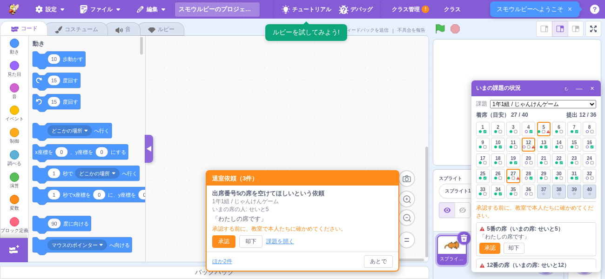

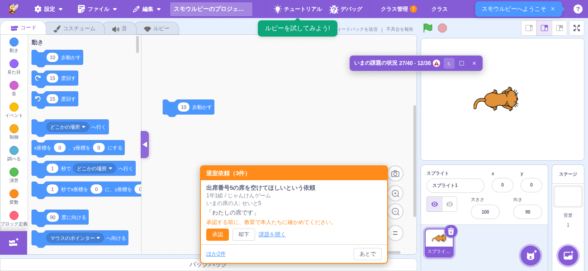

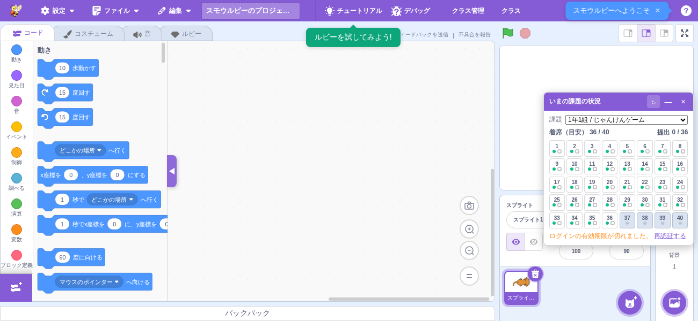

**表示ルール:**

- 生徒用「クラス」ボタンは先生のログイン状態にかかわらず**常に表示**する。先生も、生徒に説明するときに自分でクラス（課題）に参加することがあるため。
- 先生ログイン中は、その左に「クラス管理」メニューを並べて表示する（ログアウト中は表示しない）。

**「クラス」メニューとの連動:**

クラス管理で選んだ課題と、生徒用「クラス」メニューの参加コードは連動する（`decideTeacherSelectionSync` / `resolveAutoJoinCode`、`src/containers/classroom-classcode-utils.js`）。

- クラス管理で課題を選ぶと、その後「クラス」メニューを開いたときに**その課題の参加コードで出席番号の選択画面**から始まる（参加コードの入力は不要）。
- 生徒として別の課題（出席番号まで選択済み）に参加している状態でクラス管理から課題を選ぶと、**いったん今のクラスから退出する**（サーバーの席も解放。失敗しても先へ進む）。同じ課題を選んだときは参加したまま。
- 「クラス」メニューを開いただけでは、参加中のクラスから退出させない。`?classcode=` URL パラメータがあるときはそちらを優先する。

**リロード時のログイン復元:**

- ページをリロードしても先生のログイン状態を復元する。保存先は 2 つ:
  - localStorage `smalruby:classroomTeacher`: **プロバイダ（google / microsoft）と最後に開いたクラス・課題の ID だけ**（トークンなし）。
  - sessionStorage `smalruby:classroomTeacherToken`: **ID トークン本体**。タブ単位で、タブを閉じると消える（共有 PC で次の人に残さないため）。トークン自身の有効期限（約 1 時間、残り 1 分を切ったものは使わない）までだけ使う。`?devlogin=` のような期限の無いトークンは保存しない。
- 起動時はまずこのタブに残っている有効なトークンを使う。無い・期限切れのとき（新しいタブ、1 時間以上たった後）は各プロバイダのサイレント再認証を試み、失敗したら黙ってログアウト状態にする（エラーは出さない）。サイレント再認証だけでは、Google の FedCM 自動再認証の回数制限などで、単なるリロードでもログアウトしてしまうことがあったため、トークンを残す形にした。
- XSS でトークンを読まれるリスクはあるが、同じ XSS はメモリ上のトークンでも API を呼べるので、リスクは増えない。期限はトークンの `exp` で区切られる。
- `?devlogin=<token>` の開発用バイパスは読み取った直後に URL から取り除き、記録には残さない（再読み込みするとログインが外れる。もう一度 `?devlogin=` を付けて開く）。

---

### みんなの作品を見る（生徒の他者参照パネル）

生徒が課題の進め方に迷ったとき・提出した作品をよりよくしたいときに、提出済みのクラスメイトの作品を**画像だけ**で見られるパネルです。作品ファイル（`.sb3`）は読み込ませません（そのまま読み込めると単なる写しになるため）。ステータス画面の「みんなの作品を見る」で開きます（クラスのモーダルは閉じます）。

- 先生の「いまの課題の状況」パネルと同じ**非モーダル・ドラッグ可能**なフローティングパネル（枠・ヘッダー・座席グリッドの見た目は共通）。表示したまま自分のブロックを編集できる。
- 上に「**まねするのではなく、よいところを見つけて自分の作品に生かそう。**」と表示。
- 座席ミニグリッド: 提出済みのクラスメイトの席だけ押せる（提出アイコン付き）。未提出の席・自分の席（点線）は押せない。生徒は課題の定員を知らないので、グリッドは提出済みの席と自分の席の大きい方まで。着席アイコンは出さない（他者参照に要るのは提出の有無だけ）。
- 席を押すと**画像ビューア**（#1209 の共通ビューア）を別のウィンドウで開く: ステージのサムネイル → スプライトごとのブロック画像（スプライト名付き。名前の無い古い提出は「スプライト 1, 2…」）。ビューアも非モーダルでドラッグでき、右下の角で**大きさを変えられる**（Chromebook の小さな画面向け）。ズーム・パン・ピンチはビューアの中だけで、ページやパネルは縦にスクロールしない。
- 見られないとき: `しない` →「この課題では、ほかの人の作品は見られません。」、`自分が提出したら` で未提出 →「提出すると、みんなの作品が見られます。」。
- 取得は**パネルを開いたときと更新ボタン（↻）だけ**（定期ポーリングしない。最大 40 人の生徒が開くため）。画像の URL は 1 時間で切れるので、取得から 50 分以上たってから席を押したときは一覧を取り直してから表示する。

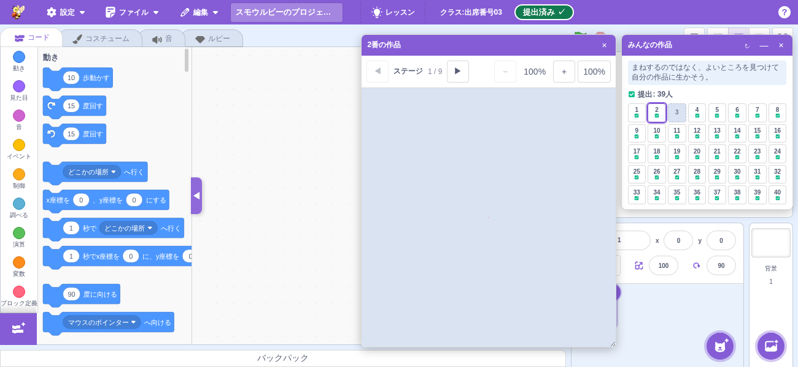

---

## 言葉の対応表（Google Classroom にそろえる）

画面の言葉は Google Classroom（GC）にそろえる。以降の画面の変更もこの表に合わせる。言葉の正は「クラス = 学級（`ClassroomGroups`）」「課題 = 1 授業（`Classrooms`）」（[`docs/admin/README.md`](../admin/README.md) の用語辞典）。

| 以前の言葉 | いまの言葉 | 使う場所 |
|---|---|---|
| 評価 | **採点** | クラスカードのボタン・採点画面のパンくず・課題ボードの説明 |
| クラスを作る | **クラスを作成** | クラス一覧のボタン・空のときの案内・初回チュートリアル |
| 課題を作る | **［＋ 作成 ▾］→ 課題** | 課題一覧の作成メニュー・空のときの案内（課題の作成画面の見出しは「課題を作成」） |
| レッスンの課題を作る | **［＋ 作成 ▾］→ レッスン** | 課題一覧の作成メニュー（「課題」のすぐ下。作成画面の見出しは「レッスンの課題を作成」） |
| 新しいトピック（一覧の上の入力欄） | **［＋ 作成 ▾］→ トピック／トピックを追加** | 課題一覧の作成メニューと、その小さな画面 |
| 課題管理ボード | **［授業］のタブ**（隣に［ストリーム］。クラスを開くと最初は［ストリーム］） | クラスの画面 |
| このクラスは現在利用できません。 | **この課題は現在利用できません。** | 生徒が参加しようとした課題が使えないとき |
| 参加しているクラス | **参加している課題** | 生徒のステータス画面の見出し（下の行の「クラス」= 学級名と区別する） |
| 先生によってクラスから退室させられました。 | **先生によって課題から退室させられました。** | 生徒の退室バナー |

そのまま使う言葉:

- **セクション / メンバー / トピック** — GC と同じ。
- **参加コード** — スモウルビーの正式名称（GC の「クラスコード」には変えない）。
- **採点画面の中の言葉** — 下の「1.10 先生: 採点」の表のとおり。

生徒向け UI の例外:

- メニューバーの **「クラス」**（生徒が課題に参加する入口）— 生徒が参加するのは課題だが、授業で全員に同じ説明ができるように「クラス」のまま残す。
- 生徒のステータス画面の **「クラス」** 行 — 学級名を指しているので正しい。

## 共通: モーダル構造

すべてのフェーズは `classroom-modal` モーダル内に表示されます。

| 要素 | 備考 |
|------|------|
| モーダル全体 |  |
| ヘッダー | 紫色、「クラス」タイトル |
| 閉じるボタン (×) | ヘッダー右端 |
| ローディング表示 | API 通信中に表示 |
| エラー表示 | エラーメッセージ |
| エラーアクションリンク | セッション切れ時に「参加画面を表示」等 |
| セッション切れ Alert | Alert バナー（オレンジ帯）がモーダルの上に表示。「参加しなおす」ボタン付き |

---

## 1. 先生: ログイン (`teacher-login`)

Google または Microsoft アカウントでサインインする画面。先生は「設定 → クラス管理」メニューからアクセスします。

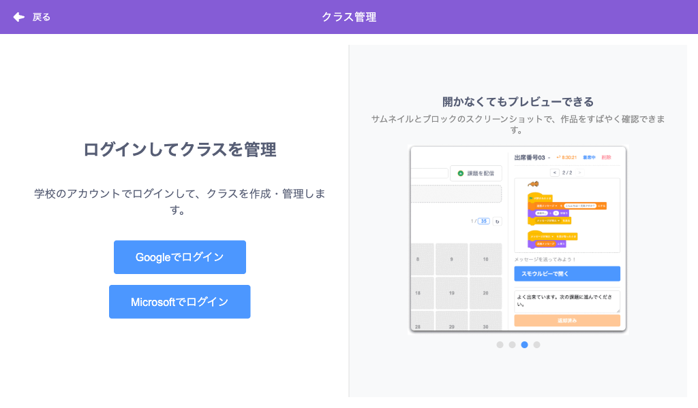

**パーツ:**

| 要素 | テキスト/内容 | 操作 |
|------|-------------|------|
| 戻るリンク | 「< 戻る」 | → teacher-dashboard |
| 見出し | 「ログイン」 | — |
| 説明文 | 「アカウントでログインして、クラスを管理します。」 | — |
| ヒント | 「学校の Google Workspace for Education のアカウントで…」 | — |
| Google ログインボタン | 「Googleでログイン」 | Google 認証画面を開く |
| Google サインインスロット | ログイン開始後に GIS の「Sign in with Google」ボタンが入る（未開始時は空で非表示） | GIS ボタンのホスト。内側の生成ノードは `google-signin-button` |
| Microsoft ログインボタン | 「Microsoftでログイン」 | Microsoft 認証ポップアップを開く |
| カルーセル | 右ペインに機能紹介画像（4枚、5秒ごと自動切替） | ドットクリックで手動切替 |

**レイアウト:** 左右分割レイアウト。左ペイン: ログインフォーム（Google / Microsoft の2つのログインボタン）、右ペイン: 画像カルーセル（薄いグレー背景）。1024x600 の画面でもスクロールなしで表示。

**セッション管理:** Google / Microsoft ID Token（1時間有効）。期限切れ時はプロバイダーに応じたサイレント再認証を試行し、透過的にトークンを更新。失敗時のみ Alert バナーを表示。詳細は [Microsoft 認証](microsoft-authentication.md) を参照。

---

## 1.5 先生: クラス一覧 (`teacher-class-list`) — ログイン後の入口

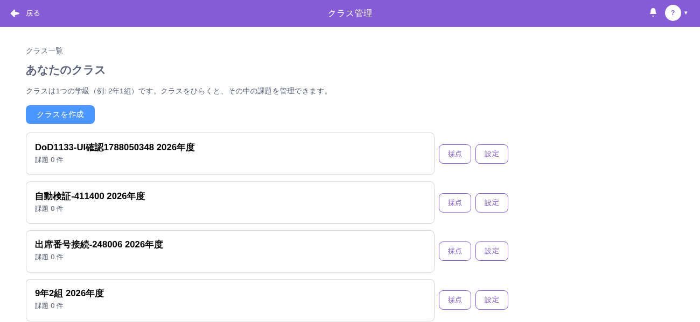

ログイン直後に表示される v2 の入口。Google Classroom の「クラス」に相当するクラス（学級）のカードが並ぶ。初回表示時に v1→v2 の冪等 migration（`POST /classroom-groups/migrate`）を自動実行する。

クラスのプロパティは GC 準拠: **クラス名（必須）/ セクション / 年度（必須・現在年度デフォルト）/ 人数（出席番号の数）**。どの入力欄も上に**常に見えるラベル**を出し、プレースホルダーは入力例だけ（「例: 技術」「例: 1組、A コース（なくてもよい）」「例: 40」）。カードの「設定」で編集（名前・年度・セクション・人数・**クラス単位の共同管理者**・**生成AI・ルビティー**・アーカイブ）。設定画面の名前・セクション・年度・人数にも作成と同じラベルが付く。表示形式は「%クラス名% %年度%年度 / %セクション%」。**ログアウトはタイトルバー右端に常時表示**。

- 主ボタン「＋ クラスを作成」は通常の青（共通の主ボタン）。処理中は押せない代わりに、横に「読み込み中…」と出す
- カード: クラス名（通常の濃さ。処理中も薄くしない）・年度・GC/共同管理/アーカイブバッジ・「採点」「設定」ボタン。名前の下に小さな要約「課題 2 件・生徒 8 人・生成AI: Gemini」を出す（生成AI は使うときだけ。名前は Gemini / ChatGPT / その他）
- 「クラスを作成」: Google Classroom の「クラスを作成」と同じ**小さな画面（ダイアログ）**をクラス一覧の上に開く。欄は「クラス名（必須）・セクション・年度・人数（出席番号の数）」の 4 つ、ボタンは［キャンセル］［作成］に固定（入力しだいで名前が変わらない）。Esc でも閉じ、閉じると入力は既定値に戻る。作成後は新しいクラスの中（課題ボード）に着地し、課題はそこで作る（最初の課題名の欄は無い）

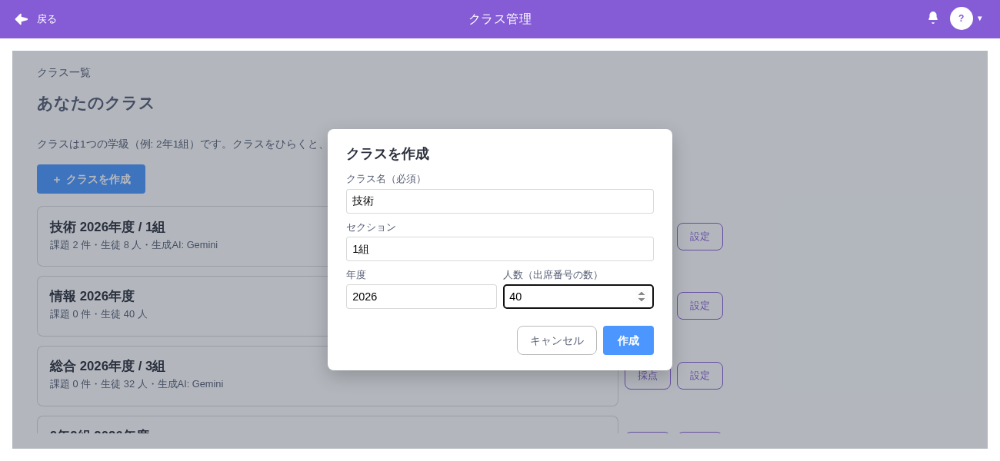

- 「Google Classroom からインポート」（Google ログイン時のみ）: コースを選ぶとクラスを作成（コース名→クラス名・生徒数→人数・courseId をクラスへ）
- クラスをひらくとサイドバーがそのクラスの課題にスコープされる（「‹ クラス一覧」で戻る）
- **アーカイブ済みのクラス**: 一覧の下部に「アーカイブ済みのクラス（{count}）」トグル（1 件以上のとき表示）。展開するとアーカイブ済みカード（アーカイブバッジ + 「元に戻す」ボタン）が並び、ワンクリックで復元できる。設定からのアーカイブは **2 段階確認**（1 回目で警告メッセージ、2 回目で実行）

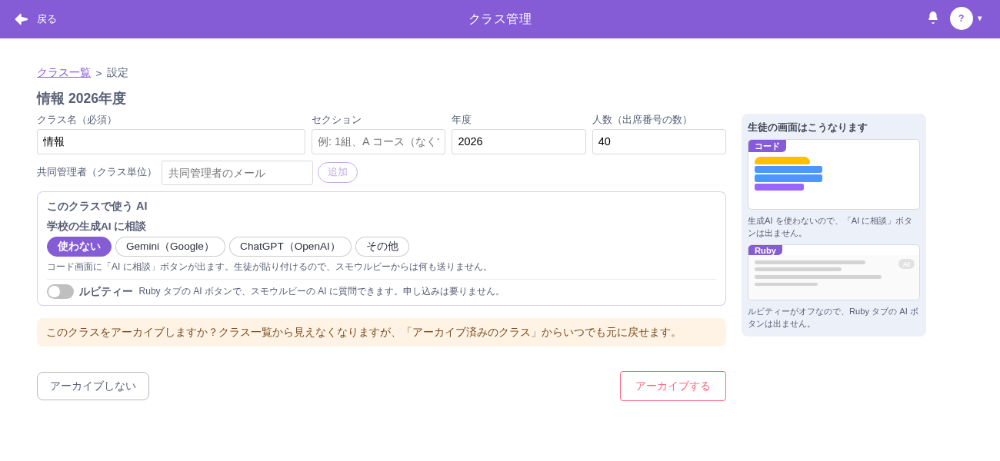

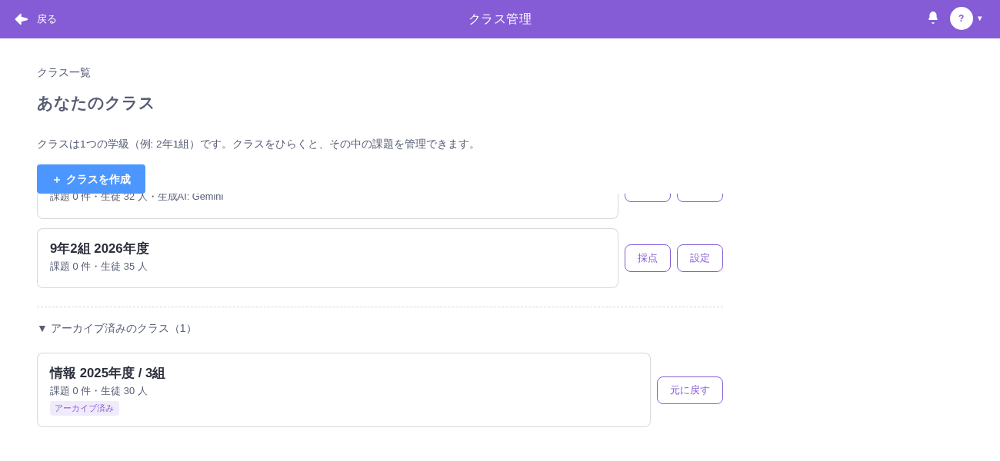

**このクラスで使う AI（クラス単位）**: クラス設定の中ほどに「このクラスで使う AI」の枠があり、独立した 2 つの設定を常に表示する。見出し「このクラスで使う AI」は枠の上の線に載せ（凡例の形）、見出しだけの行を作らない（1300×600 で生成AI とルビティーの両方の確認を開いても本文がスクロールしないように）。先生が**何を決めるのか**と、**それで生徒の画面に何が起こるのか**を同じ行に書く。保存はほかの項目と同じ「保存」ボタンで行い、変わった項目だけ API に送る。

- **学校の生成AI に相談** — 「使わない / Gemini（Google） / ChatGPT（OpenAI） / その他」をラベルと同じ行に一列に並べる（幅が足りないときは次の行へ折り返す）。説明「コードタブと Ruby タブの両方に『生成AI に相談』ボタンが出ます。生徒が貼り付けるので、スモウルビーからは何も送りません。」。Claude（Anthropic）は 18 歳以上だけが使えるので選択肢に出さない（「その他」に Claude の URL を入れたときは URL のエラーで止める）
- **ルビティー** — オン/オフのトグル（既定オフ）。同じ行に「生成AI の答えが使えないとき、［ルビティーにまかせる］でスモウルビーの AI（Claude）が直します。申し込みは要りません。」。生徒の画面では同意を取らない（オンにするときに先生が条件を確かめる。下記）。生成AI の選択によって居場所は変わらない

生成AI を選ぶと、その行の下にだけ確認を開く:

- 選んだサービスの条件
  - Gemini（Google）: 学校の Google アカウントで使う。学校（自治体）が児童・生徒の利用を認めていること
  - ChatGPT（OpenAI）: 13 歳以上。18 歳未満は保護者の同意が必要
  - その他: URL を入れる。利用条件は学校で確認
- 必須のチェック「このクラスは条件を満たしています（必須）」。チェックしないと保存できない。保存できない理由は［保存］の左の「生成AI の条件にチェックすると保存できます」が言うので、確認の中には書かない
- 生徒が開くページの URL。Gemini（`https://gemini.google.com/app`）と ChatGPT（`https://chatgpt.com/`）は既定値のままでよいので、「生徒が開くページを変える（いまは gemini.google.com/app）」を押したときだけ入力欄を出す。畳んでいる間、このリンクと「試す（別タブ）」は必須のチェックと同じ行の右に置く（ルビティーの「利用規約 / プライバシーポリシー」と同じ形）。「その他」は URL が必須なので最初から入力欄を出す。https のみ・18 歳以上限定サービスは不可。誤りは「試す（別タブ）」と同じ場所に出す

ルビティーをオンにすると、その行の下にだけ確認を開く（以前は生徒の同意画面に書いていた注意を、先生が確かめる形にしたもの）:

- 条件は 1 行の要約「条件: 答えのまちがい・個人情報・18 歳未満の保護者の許可」に畳み（R3）、［詳しく］を押したときだけ箇条書きを開く（［閉じる］で畳む）
  - ルビティーは AI（Anthropic の Claude）で、答えがまちがっていることがある
  - 生徒が名前や住所などの個人情報を入れないよう指導する
  - 18 歳未満の生徒は保護者の許可が必要（学校で確認している）
- 「利用規約 / プライバシーポリシー」へのリンク（別タブ）
- 必須のチェック「このクラスは上の条件を満たしています（必須）」。チェックしないと保存できない。保存すると API に `rubytee: {enabled, confirmed}` を送る
- オフにすると確認は外れ（オフで保存すると `confirmed: false`）、もう一度オンにしたときは確認からやり直す
- 確認の仕組みより前にルビティーを有効にしたクラス（`rubytee.confirmed` が無い）は**有効のまま動く**。設定画面では確認の上に「まだ確認されていません。ルビティーはこのまま使えます。次に保存するときに下のチェックを入れてください。」を出し、次に保存するとき（名前だけ変えるときも）チェックを求める

サービスを選び直すと、条件の確認は外れ、URL はそのサービスの既定値に戻る（API 側も同じ規則）。「使わない」を選ぶと選んだサービス・URL・確認を消し、「使わない」で保存すると確認も消える。もう一度選んだときは確認からやり直す。

保存済みの値から変わった行には、行ごとに小さな「未保存」の印を付ける。［キャンセル / アーカイブ / 保存］の行は**本文の下端に留める**（`position: sticky`）。確定のボタンはいつも見えるので、別の「下の［保存］で確定します」は出さない。必須のチェックが足りなくて［保存］が押せないときは、［アーカイブ］の左に「生成AI の条件にチェックすると保存できます」/「ルビティーの条件にチェックすると保存できます」（上にある生成AI を先に）を出し、押すとそのチェックまでスクロールしてフォーカスする。チェックが確認の折り返しの下に隠れていても、なぜ保存できないかが分かる。

**生徒の画面の見本**: フォームの右（1300px 幅で空いている所）に「生徒の画面はこうなります」の小さな見本を出す。見本は**まだ保存していない入力**に合わせてその場で変わる。

- 「コード」「Ruby」: ブロックの絵とコードの絵。生成AI を使うときは、どちらも左下に「AI に相談」の顔（実際の生徒の画面と同じ位置）。使わないときは顔を描かず「生成AI を使わないので、コードタブにも Ruby タブにも『AI に相談』の顔は出ません。」
- 顔のパネル: 生成AI を使うときは、コードの絵の右上に顔のパネルを開いた形で［ルビティーにまかせる］を描く。ルビティーがオフのときは薄く表示し「ルビティーがオフなので、顔のパネルに［ルビティーにまかせる］は出ません。」。ルビティーには専用のボタンが無く顔のパネルからしか使えないので、生成AI を使わずルビティーだけオンのときは「ルビティーは『AI に相談』のパネルから使うので、生成AI を使わないと出ません。」
- CSS と簡単な要素で描く（画像やスクリーンショットは使わない）。生徒の画面の顔やパネルの見た目が変わったら `class-ai-student-preview.jsx` を合わせる
- 幅 1100px 未満の画面では出さない（フォームの説明文だけで足りる）

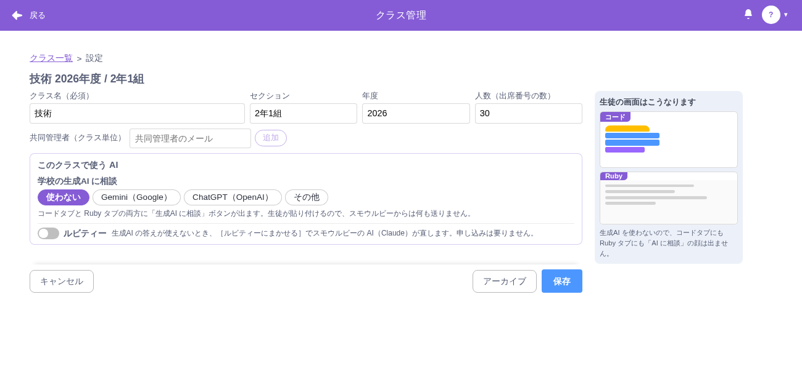

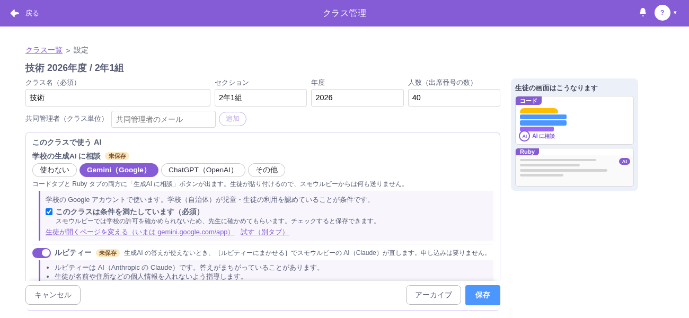

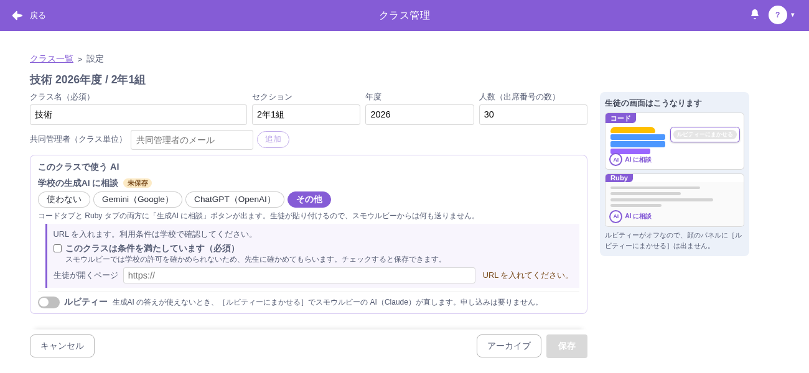

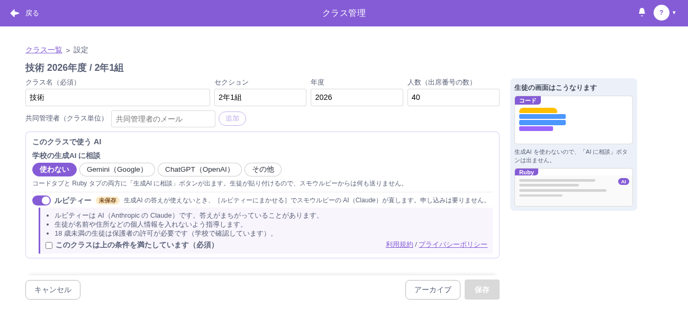

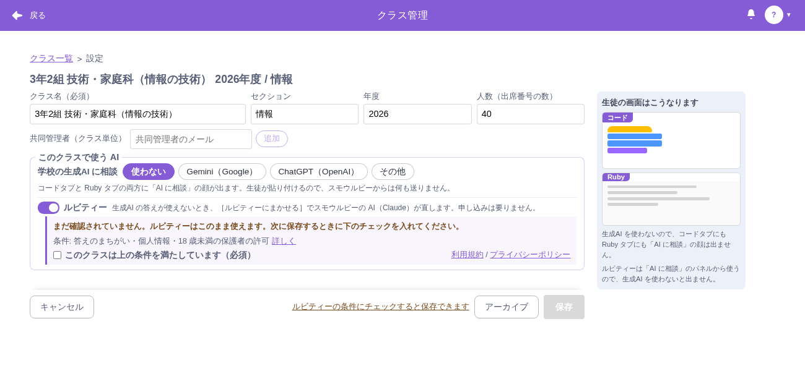

## 1.6 先生: クラスの画面（［ストリーム］［授業］のタブ・`teacher-dashboard`）

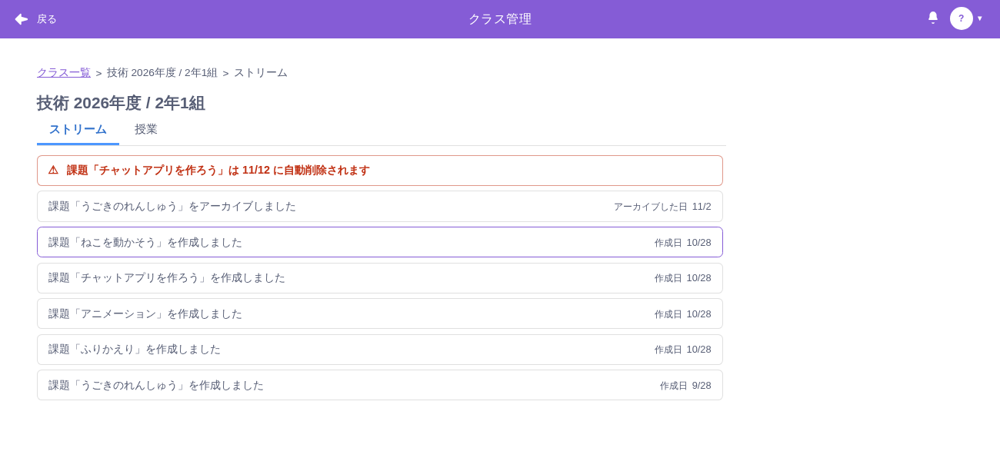

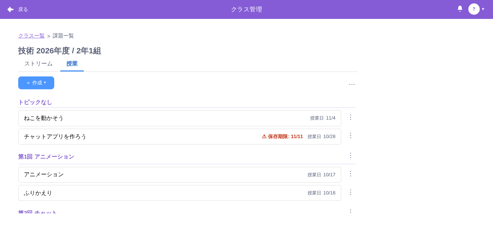

クラスをひらいたときのメイン領域。Google Classroom と同じく、クラス名の下に **［ストリーム］［授業］のタブ**がある。最初に開くのは［ストリーム］。［授業］が課題一覧（課題管理ボード）にあたる。課題を開いてから同じクラスへ戻ったときは、離れたときのタブ（たいてい［授業］）に戻る。別のクラスやクラス一覧から開いたときは［ストリーム］から。

- **［ストリーム］**: 先生が課題を**作成・アーカイブ**したことを新しい順に 1 行ずつ並べる（Google Classroom のストリームの「新しい課題を投稿しました」に合わせ、説明の変更・返却・生徒の提出は出さない。提出状況は［授業］で見る）
  - 「課題「〜」を作成しました」（右に「作成日 10/20」）／「課題「〜」をアーカイブしました」（右に「アーカイブした日 10/10」。`archivedAt` が無い古いデータは API が返す更新日）。右端の日付にも何の日付かのラベルを付ける（R1）
  - 「⚠ 課題「〜」は 11/1 に自動削除されます」: 保存期限が**残り 7 日以内**の課題だけ、赤で**いちばん上**に（期限の近い順）。いま対処が必要な行なので赤（R4）。期限を過ぎて消えた課題はデータごと無いので出さない
  - 行を押すとその課題へ: アクティブな課題は［授業］でその行を開いた状態、アーカイブ済みは［授業］のアーカイブ済みの一覧を開いて［元に戻す］の行へ
  - 主な操作は無い画面なので、件数が多いときは**ストリームの枠の中だけ**スクロールする（R6 の一覧の例外）。参加コードは課題ごとなので、Google Classroom のような「クラスコード」のカードは置かない

- **サイドバーは無い**。ナビは**パンくず**。クラスの画面では「クラス一覧 > {クラス名} > ストリーム｜授業」（末尾はいま開いているタブ）、作成・再利用などの画面では「クラス一覧 > {クラス名} > 課題を作成」のようにクラス名がクラスの画面へ戻るリンクになる。課題詳細は「クラス一覧 > {クラス名} > 課題詳細」（クラス名で、離れたときのタブへ戻る）。クラスに属さない古い課題だけクラス名の代わりに「課題一覧」
- **作る操作は［＋ 作成 ▾］の 1 つだけ**（主ボタン・R2）。開くと「課題／レッスン／課題を再利用／みんなの課題からさがす／合言葉で取り込み」、線で区切って「トピック」。いちばんよい作り方を決めず、毎回選んでもらう（先生によって使う作り方が違うため）
  - 「課題」: **課題名だけ**を聞く作成画面（クラス名・人数はクラスから）。メッシュのグループの人数は既定の「6人まで」で作り、変えたいときは説明タブの「詳しい設定」で変える（下記「課題の編集」）

    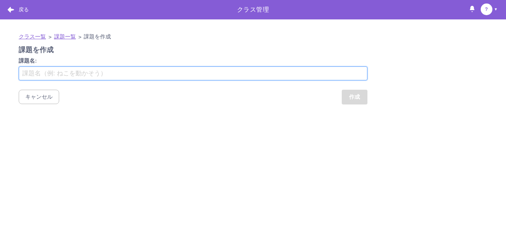
  - 「レッスン」: 「課題」と同じ、課題名だけを聞く作成画面（見出しは「レッスンの課題を作成」）。［作成］すると、作った課題を
    **すぐ開き**（説明タブ）、**レッスン欄が開いた状態**で、**最初のコースの最初のレッスン（中のチャレンジ全部）が選ばれている**。
    空のページにはレッスンの説明文が入る（[レッスンの説明文](#先生-レッスンの説明文をページに入れる)）。どちらも
    ［課題を保存］するまでは保存されない。先生に「レッスンってなんだろう？」と思ってもらう入口
    （「課題」のときのように一覧に戻さず、すぐ開くのは推奨で決めた）
  - 「課題を再利用」: 全クラスの課題を日付降順に表示し、クラスフィルタ → 「このクラスに複製」（説明・スターター・トピックごと複製。同一クラスは「のコピー」付き）
  - 「みんなの課題からさがす」（EPIC #1066）: 全国の先生が共有した課題のカタログをボード内に展開。学校種・教科・学年・タグで絞り込み → 詳細プレビュー（説明ページ・「© 表示名 / CC BY 4.0」クレジット・補足資料リンクは外部ドメイン名付き確認を挟んで新規タブ）→「このクラスに取り込む」でスターターごと課題として複製（新しい参加コードが発行される）。「自分の投稿」タブから取り下げ / 再公開。他人の投稿には通報（理由必須）
  - 「トピック」: 「**トピックを追加**」の小さな画面（名前 1 つと［キャンセル］［追加］）
- **まれな操作は右上の「…」**: 「全課題の提出物をダウンロード」= クラス内の全課題（アーカイブ済み含む — どちらも保存期限で消えるため）の提出物を 1 つの zip（`課題名/席番号_名前/作品.sb3` + サムネ/スクショ + `提出状況.csv`）でダウンロード。進捗は「n/m」表示
- **課題はトピックの見出しの下にまとめて並ぶ**。トピックなしの課題も「トピックなし」の見出し 1 つにまとまり最上部、以下クラスのトピック順。各セクションは授業日（`sortDate`、既定=作成日・並び順キー・生徒非表示）降順。トピックの見出しの ⋮ から「名前を変更」（クラス内の課題へ一括追従）・「削除」（課題はトピックなしへ）
- **課題の行（アコーディオン）**: ふだんは「課題名・授業日・⋮」だけ。押すとその場で開く（開く行は 1 つだけ）。
  - 開いた中: **参加コード**、保存期限、説明の 1 行目、「提出済み N ・ 参加済み N（N 人中）」、［**課題を開く**］（課題詳細へ。Google Classroom の「手順を表示」にあたる）。数と説明は**行を開いたときに読み込む**（一覧の表示を遅くしない。`listMembers` + `listSubmissions` + `getAssignment`）
  - 表示だけの値にもラベル（「参加コード」「授業日」）を付ける（R1）
  - 行の ⋮: 「トピック」「授業日」の変更と「共有」（中身＝説明ページかスターターがある課題だけ）
  - レッスンの課題: 開いた中に「課題クリア N」、閉じた行に「レッスン」の印（[レッスンの課題](#レッスンの課題)）
- **保存期限**: 残り **7 日以内**のときだけ赤（R4）。閉じた行に小さな赤い印（⚠ と「保存期限: 11/11」の文字。印の意味をその場で読めるように・R5）、開いた中に自動削除の警告と「全作品ダウンロード」。それより先は開いた中に灰色で「保存期限: 11/1」
- **アーカイブ済みの課題**: 一覧の最下部に「アーカイブ済みの課題（{count}）」トグル（1 件以上のとき表示）。展開すると課題名・保存期限（TTL 由来の `expiresAt`）・「元に戻す」ボタンの行が日付降順に並ぶ。アーカイブしても保存期限は延長されない

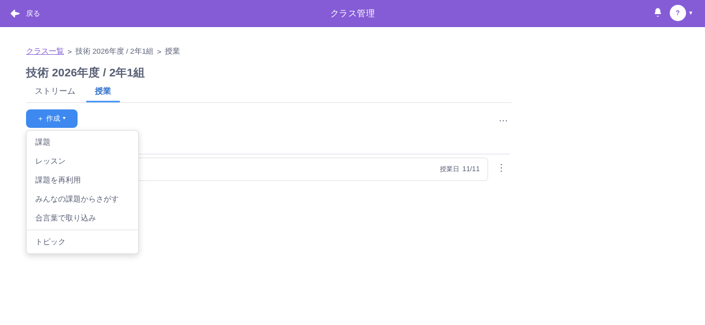

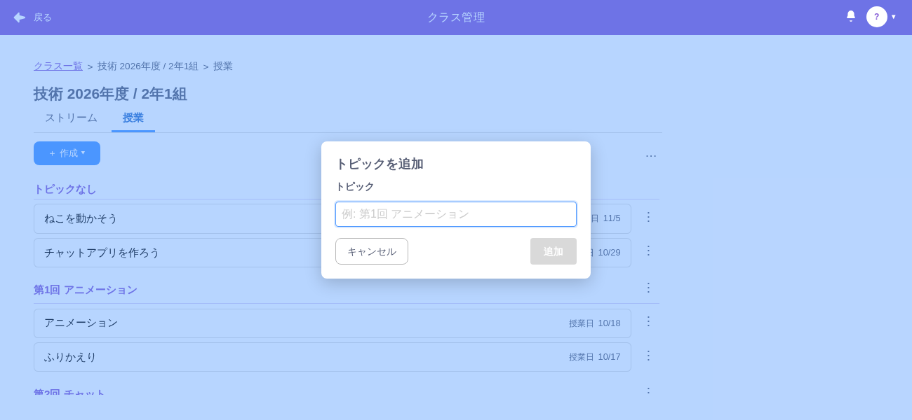

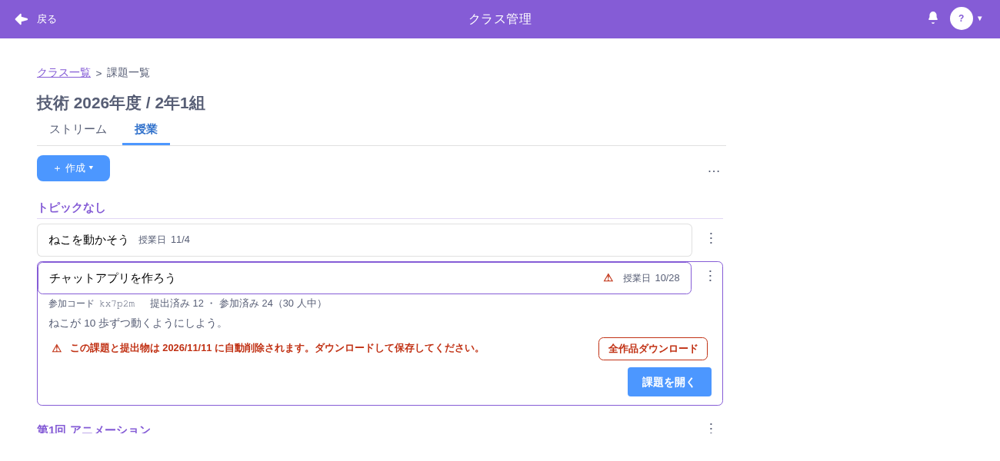

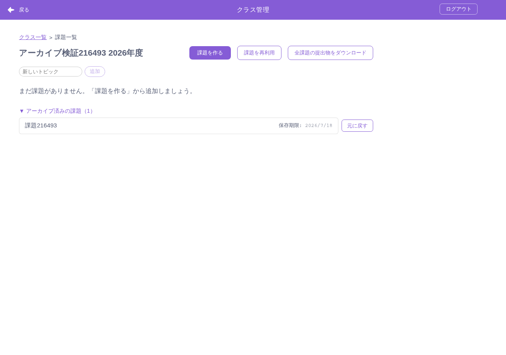

## 1.7 先生: 課題詳細の「説明」タブ

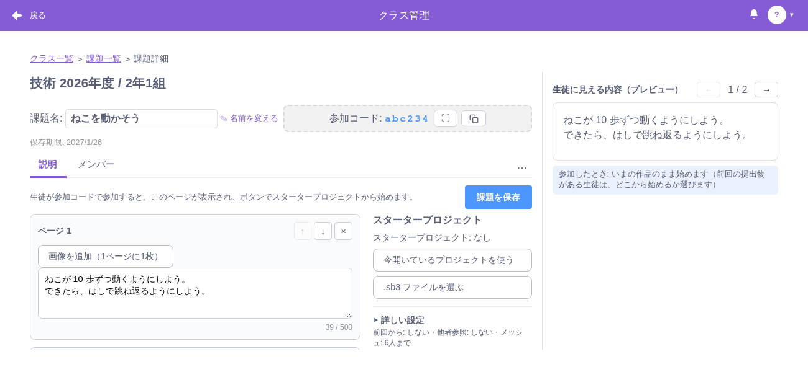

課題をひらくと、ふだんは「メンバー」タブが最初に表示される。「説明」タブが最初に出るのは、**このセッションで新しく作った課題をはじめてひらいたときだけ**（説明を書くのは作った直後なので。そこで書かなかった課題は、説明が要らない課題とみなす）。メニューバーの「いまの課題を開く」は常に「メンバー」タブでひらく。「説明」タブでは左に生徒へ表示する説明・画像・スターターの編集フォーム、**右ペインに生徒視点プレビュー**（編集内容をライブ表示・ページ送り。生徒への反映は保存時のみ）。

- **1300×600 で縦スクロールしない**（R6）。［課題を保存］は説明 1 行の右（タブのすぐ下）に置き、スクロールせずに見える（Google Classroom の［割り当て］と同じく上）。ページの編集欄は先生が数を決める一覧なので、その**枠の中だけ**がスクロールする。スターターと「詳しい設定」はページの右の列
- **詳しい設定**（R3）: 「前回の提出物から始めさせる」「他者参照」「メッシュのグループの人数」は「詳しい設定」1 つに畳む。閉じた状態でも「前回から: しない・他者参照: しない・メッシュ: 6人まで」と**いまの値**（保存前の選択も含む）を出す。保存した値から変えた設定は、要約の値と開いた中の欄をオレンジ色にし、見出しの横に「保存していません」を出す（［課題を保存］で保存すると元の色に戻る。色だけに頼らない・赤は使わない）。開くとページ欄の上に重ねて出し（［課題を保存］は隠さない）、右上の **✕（閉じる）**・外を押す・Escape キーのどれかで閉じる（✕ はほかのモーダルの見出しの ✕ と同じ見た目。閉じたら開閉ボタンにフォーカスを戻す）
- **プレビューが空のとき**（どのページにも文字も画像も無い）は「ページを書くとここに出ます」の 1 行だけ
- **レッスン**欄: コース・チャレンジ・必須（★）・完了の条件・作品の提出・採点の点を選ぶ（[レッスンの課題](#レッスンの課題)の「課題の「説明」タブのレッスン欄」）

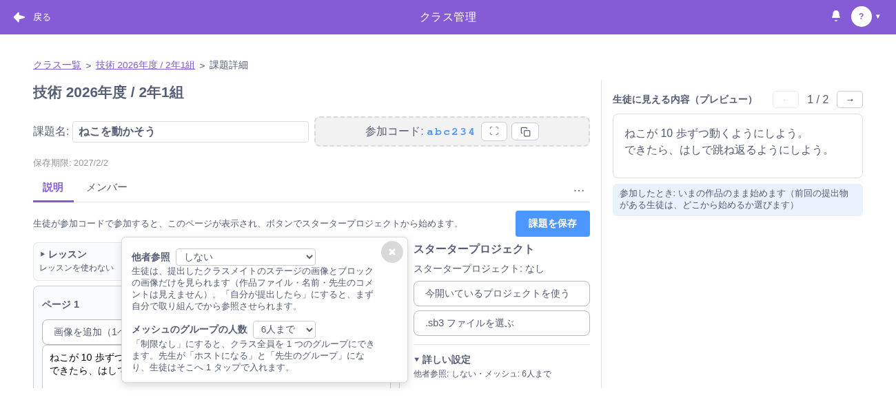

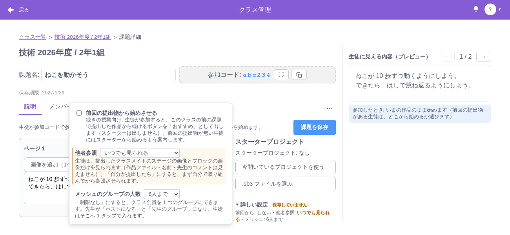

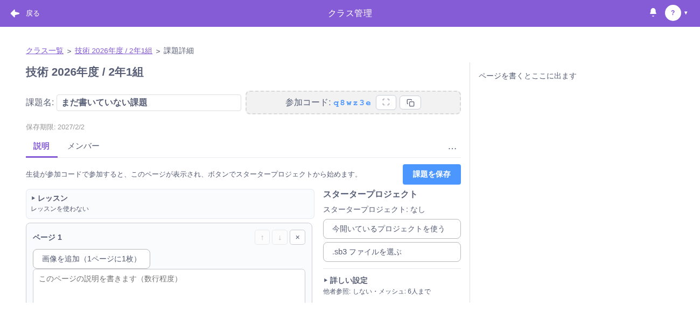

- 出席・提出のポーリング（30秒）は**メンバータブ表示中のみ**（費用抑制）
- **この課題を共有**（`classroom-share-assignment`）: 課題（説明ページ + スターター）を「みんなの課題」（全国の先生の共有ライブラリ、EPIC #1066）に公開するフォームを開く。属性（学校種・学年・教科・タグ・コマ数）、補足資料 URL（https のみ + 期待内容のガイダンス表示）、表示名・所属（localStorage 記憶）、**CC BY 4.0 同意チェック必須**。公開後は「© 表示名 / CC BY 4.0」付きの完了メッセージを表示
- 課題の所属クラス変更・人数編集・課題単位の共同管理者・複製は**できない**（クラス設定 / 課題一覧の再利用へ集約）。「**課題をアーカイブ**」はタブの行の右端の「…」の中（soft-delete。ボードの「アーカイブ済みの課題」からいつでも復元可能。testid は歴史的経緯で `classroom-delete-classroom` のまま）。押すと座席・説明の下に確認が出る

## 1.8 先生: お知らせセンター（タイトルバー・EPIC #1111）

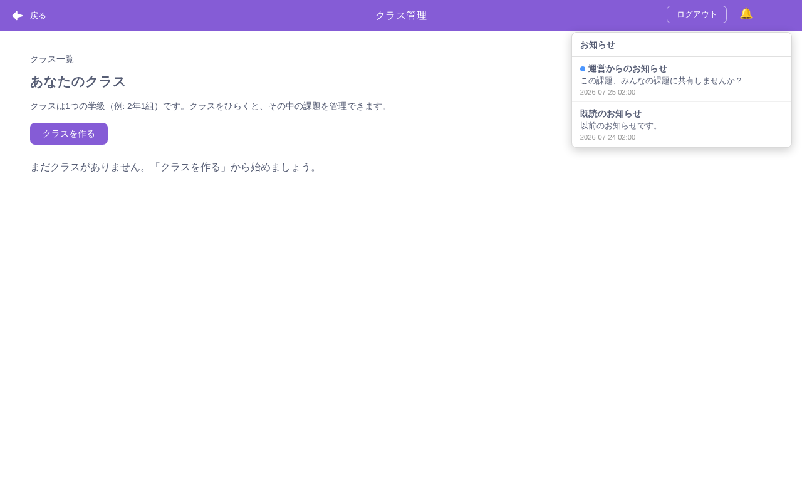

クラス管理のタイトルバー右上（× の左隣）は **アバターメニュー**（メール頭文字 + ▼）に固定。その左に **白一色のベル**（お知らせ）を置く。運営（Admin）からのお知らせが届くと未読数バッジが付く。

- **アバターメニュー**: メール頭文字（`kouji@…`→`K` / `kouji.takao@…`→`KT`）の丸アイコン + ▼。クリックでポップアップ（メール表示 + ログアウト。将来の設定項目もここに集約）。紫背景で視認できる白丸 + 紫文字
- ベルのクリックで一覧パネルを開閉。**開くだけでは既読にしない**（バッジは残る）。既読はパネルヘッダーの **⋯ メニュー**から明示的に行う
- パネルは **先頭 5 件**のみプレビュー表示。ヘッダーの **⋯ メニュー**に「**すべて既読にする**」「**お知らせを開く**（全件一覧ページ・`teacher-notifications` フェーズ・**10 件/ページ**）」。一覧は件数に関係なく開ける
- お知らせ本文をクリックすると、`link` の種類に応じて該当画面へジャンプ（`kind: 'classroom'` → そのクラスを選択して課題詳細へ / `kind: 'shared-mine'` → みんなの課題の自分の投稿へ）。未知の kind は無視（前方互換）
- **全件一覧ページ**は「**クラス管理 > お知らせ**」パンくず（先頭「クラス管理」でトップ=クラス一覧へ戻れる）+ **左下に「戻る」ボタン**（キャンセルが不適切な画面のポリシー）
- **取得は 1 日 1 回**（コスト削減）: その日はじめてクラス管理を開いたときだけ `GET /notifications` を 1 回呼び、localStorage に日付つきでキャッシュ。同じ日の再オープンは API を叩かない（旧 60 秒ポーリングは廃止）。共有 PC 対策として先生メールでキャッシュを識別。取得エラーはクラス管理本体に影響させない（表示しない）。※その日の初回取得後に届いたお知らせは翌日反映（運営連絡は多くて週 1 回程度の前提）
- 送信側は Admin SPA（課題詳細の「先生へのお知らせ」フォーム → `POST /admin/notifications`）。`docs/admin/README.md` を参照

| 要素 | 操作 |
|------|------|
| アバターボタン | クリックでアカウントメニュー開閉 |
| イニシャル丸 | メール頭文字（1〜2 文字） |
| メニューのメール | ポップアップ内のメール表示 |
| ログアウト | アカウントメニュー内 |
| ベルボタン | クリックでパネル開閉 |
| 未読バッジ | 未読数（10 以上は「9+」）。未読 0 で非表示 |
| 一覧パネル | 先頭 5 件プレビュー |
| ⋯ メニューボタン | パネルヘッダー右の三点 |
| ⋯ メニュー | — |
| すべて既読にする | 全件既読（未読 0 で無効） |
| お知らせを開く | 全件一覧ページへ（件数不問） |
| お知らせ 1 件（パネル） | クリックでリンク先へジャンプ + パネルを閉じる |
| 未読ドット | 未読アイテムのみ |
| 空メッセージ | お知らせ 0 件のとき |
| 全件一覧ページ | `teacher-notifications` フェーズ |
| パンくず先頭 | 「クラス管理」→ トップ（クラス一覧）へ |
| 左下戻る | トップ（クラス一覧）へ戻る |
| ページ内 1 件 | クリックでリンク先へジャンプ |
| ページャ | 10 件/ページ |

## 1.9 先生: 共有推奨バナー（#1106）

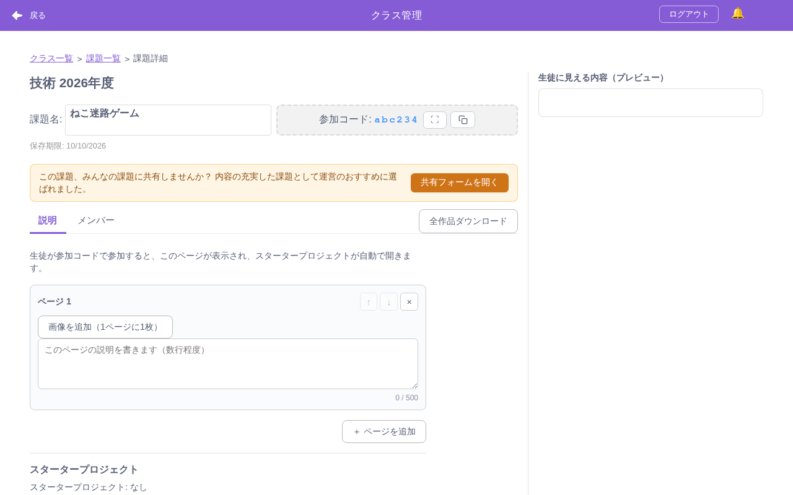

運営（Admin）が「みんなの課題に共有する価値がある」と判断した課題には、課題詳細の上部に「**この課題、みんなの課題に共有しませんか？**」バナーが出る。「共有フォームを開く」でボードの共有ステップ（既存の共有フロー）が開く。公開はあくまで CC BY 同意を伴う**先生本人の共有操作のみ**（運営による代理公開はしない）。

- 推奨と同時に運営からのお知らせ（🔔・`share_suggestion`）も届き、クリックでこの課題の詳細へジャンプする
- 課題一覧（ボード）の該当行には「**共有おすすめ**」マークが付く
- フラグは admin が取り消すまで表示される（先生側から消す操作は無い）

| 要素 | 操作 |
|------|------|
| バナー | — |
| 共有フォームを開く | ボードへ戻って共有ステップを開く |
| ボード行のマーク | — |

## 1.10 先生: 採点 (`teacher-evaluation`)

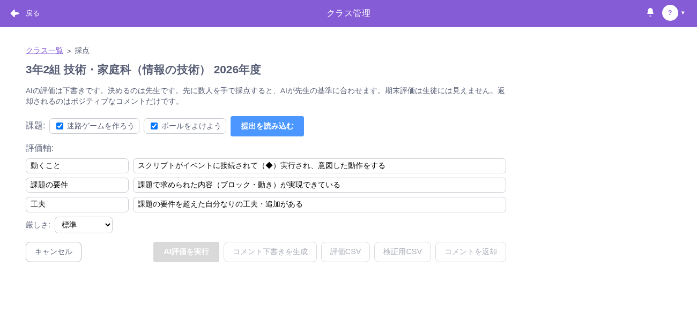

クラス一覧のクラスカードの「採点」から開く。クラスの課題（複数可）の提出物を、席 × 課題の表で採点する。

- **手順は 4 つ**。フッターに「① 提出を読み込む → ② AIで採点 → ③ コメントを下書き → ④ コメントを返却」と並べ、**いまの手順だけを主ボタン（青）**にする（R2）。読み込む前は ①、読み込んだら ②、採点が 1 つでも入ったら ③、コメントの下書きが 1 つでもあれば ④。前の手順のボタンもそのまま押せる（やり直し・飛ばし）。
- レッスンの課題では、作品の点とは別に、進み具合から出す**レッスンの点**がある（[レッスンの課題](#レッスンの課題)の「採点」）。
- **CSV は「書き出し ▾」**にまとめる（採点結果 / 検証用データ）。読み込む前は押せない。フッターにあるので上に開く。
- **説明は 1 行**（「AIの採点は下書きです。決めるのは先生です。」）。手で数人採点すると AI が合わせること・期末の成績は生徒に見えないこと・返却されるのはポジティブなコメントだけであることは「詳しく」で開く（R3）。
- **採点の設定**（観点・採点の厳しさ）はあまり変えないので、いまの値を 1 行で出し（「採点の観点: 動くこと・課題の要件・工夫　採点の厳しさ: 標準　［変える］」）、［変える］で欄を開く。欄の上には「観点」「どこを見るか」の見出しを出す（R1）。
- **1300×600 で縦スクロール無し**（R6）。表は 40 人で長くなるので、**表の枠の中だけ**スクロールし（見出しの行は上に留まる）、フッターの手順のボタンは常に見える。

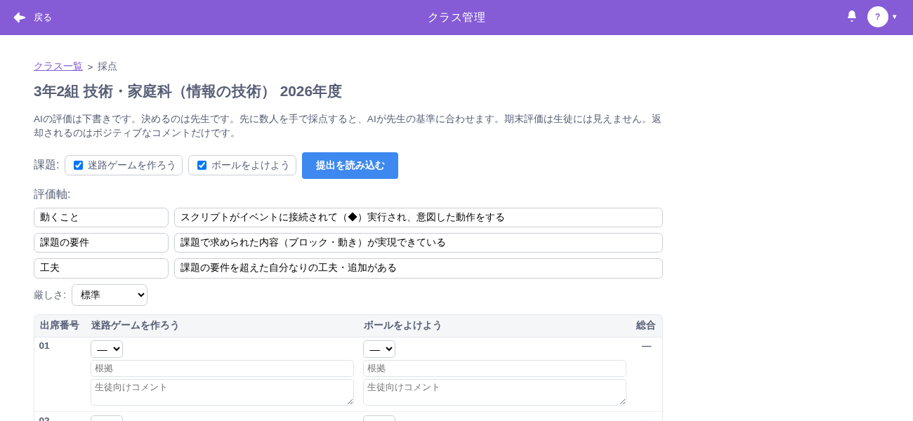

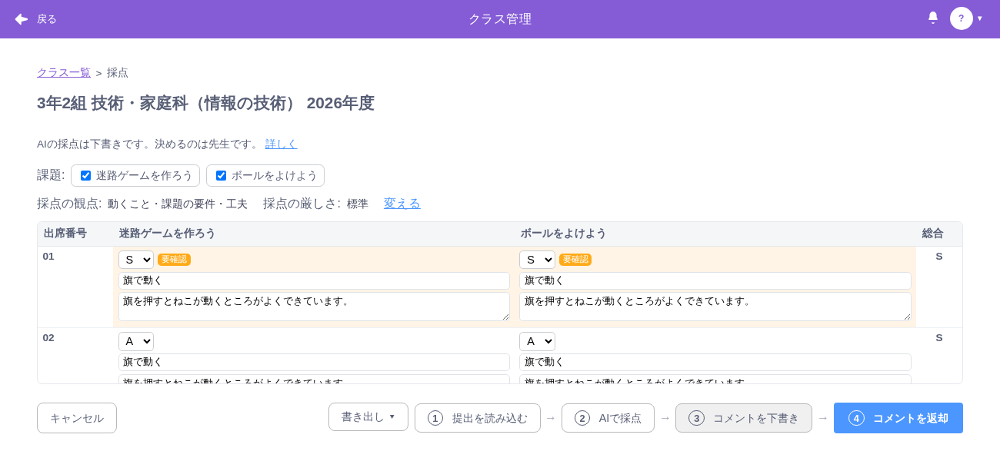

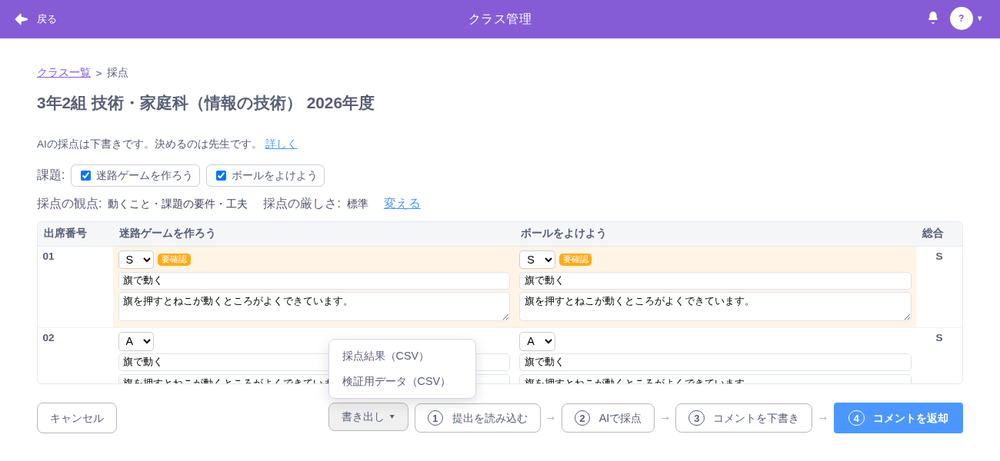

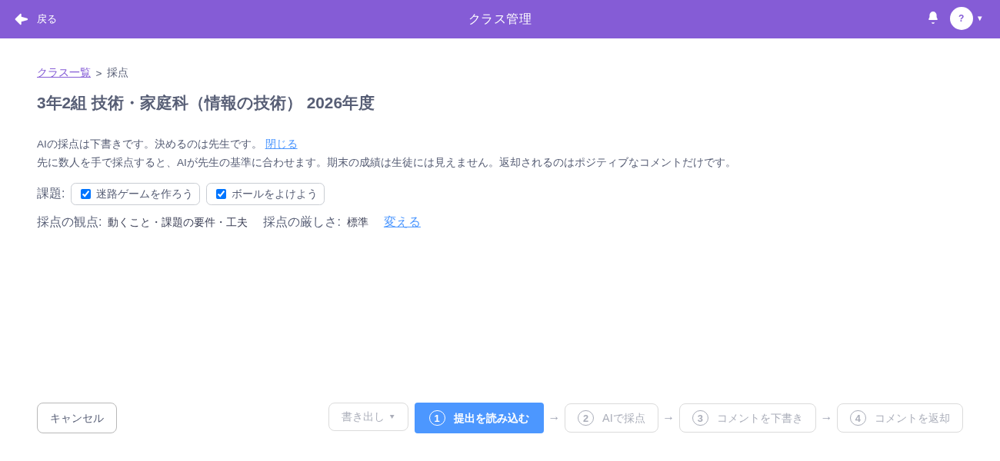

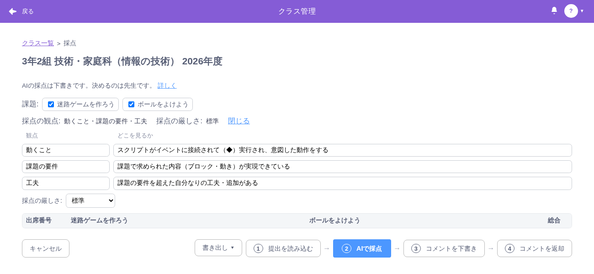

画面の中の言葉（K4 で「評価」→「採点」に決めたものを、画面の中にも当てはめた）:

| 以前 | いま | 理由 |
|---|---|---|
| AI評価を実行 | **AIで採点** | 画面名・パンくず（採点）とそろえる |
| コメント下書きを生成 | **コメントを下書き** | 手順の名前として短く |
| 評価軸 | **採点の観点**（欄の見出しは「観点」「どこを見るか」） | 学校では「観点（観点別評価）」が通じる。Google Classroom のルーブリックの「基準」は S/A/B/C のレベルの説明まで含むので、名前と説明だけのこの欄とは意味がずれる |
| 厳しさ | **採点の厳しさ** | 何の厳しさかを 1 語で分かるように |
| 評価CSV | **採点結果（CSV）**（ファイル名も `<クラス名>_採点結果.csv`） | 画面名とそろえる |
| 検証用CSV | **検証用データ（CSV）** | 中身（解析の数値と AI の根拠）が分かるように |
| 期末評価（説明文） | **期末の成績** | 「評価」と「採点」が混ざらないように。生徒に見えないのは学期の成績 |

## 4. 先生: 課題詳細のメンバータブ (`teacher-detail`)

1 つの課題（1 授業）の参加状況と提出を管理する画面。画面のタイトルには、その課題が属する**クラス（学級）名**が出る。モーダルが**ワイド表示 (968px)** に広がります。

### メンバータブ（座席の色の凡例・「…」）

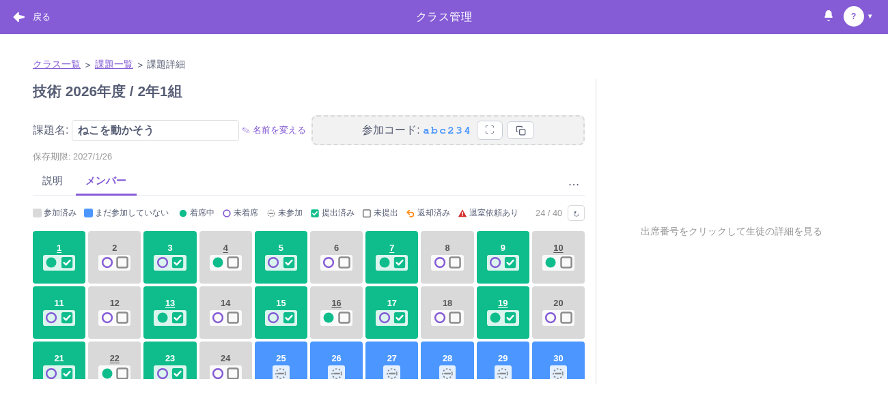

### 課題名の保存（カーソルがある間の案内・保存しました）

課題名の欄にカーソルがある間だけ、欄の下に保存のしかたを出します（「名前を変える」のような押せそうなラベルは置きません）。保存できたら欄の横に「✓ 保存しました」を 2 秒ほど出します。

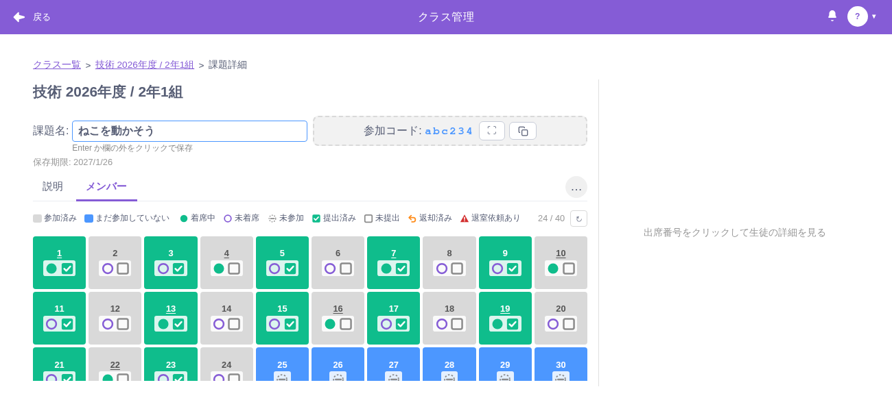

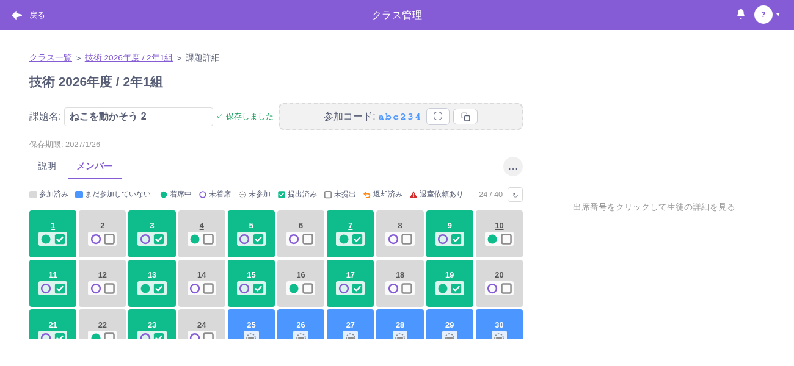

### 提出・着席・退室依頼がある状態

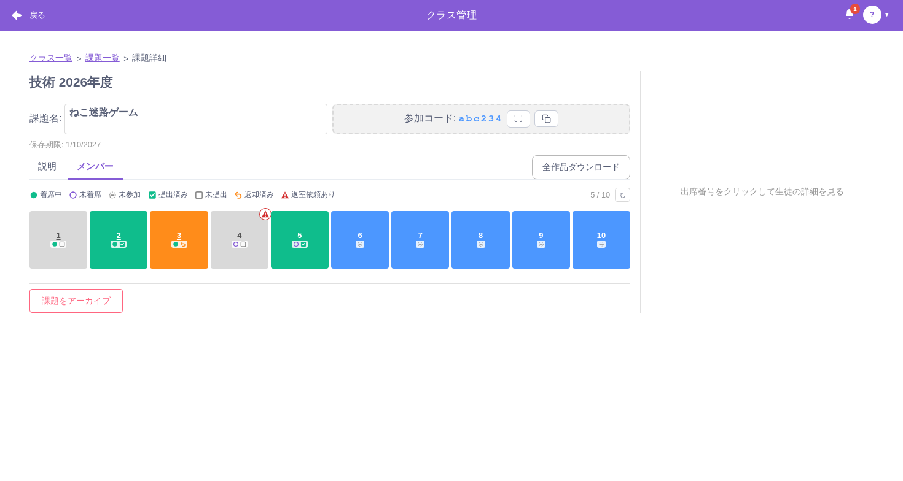

### メンバー詳細パネル（右側）

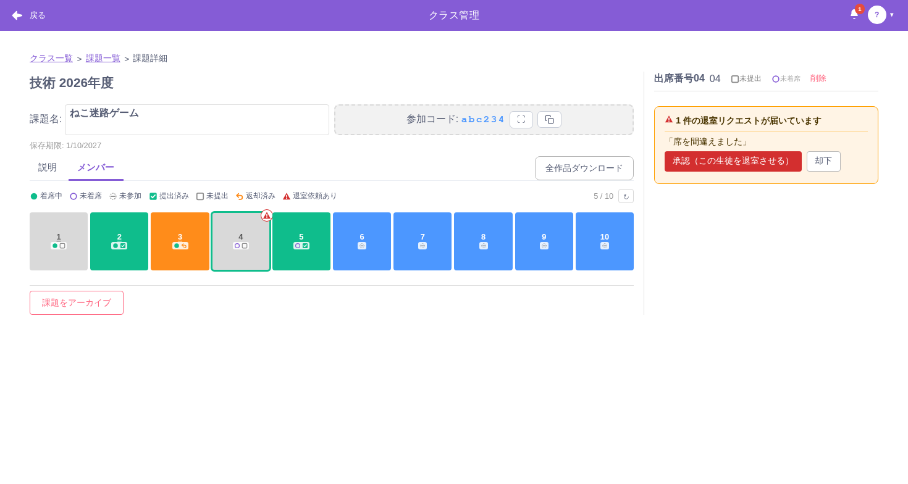

**左カラム パーツ:**

| 要素 | テキスト例 | 操作 |
|------|----------|------|
| 戻るリンク | 「< 戻る」 | → teacher-dashboard |
| クラス（学級）名 | 「技術 2026年度 / 2年1組」 | 課題が属するクラスの表示ラベル（`formatClassLabel(group)`。v2 以前のデータでは `Classrooms.className`） |
| 課題名入力 | 「課題名: [ねこを動かそう]」 | 1 行の入力欄。欄から離れる（blur）か Enter で保存。カーソルがある間だけ、欄の下に灰色の小さな字で「Enter か欄の外をクリックで保存」。保存できたら欄の横に「✓ 保存しました」を 2 秒ほど、失敗したら赤で「保存できませんでした」（次に入力すると消える）。名前が変わっていないときは何も出さない |
| 課題配信ボタン | 「課題を配信」 | → teacher-post-assignment。**未配信のとき**表示 |
| 共有できない理由 | 「このクラスの Google Classroom は ◯◯ 先生が連携しています。…」 | 連携した先生以外に表示（配信ボタンは `disabled`） |
| GC 教師の確認ボタン | 「自分もこの Google Classroom のクラスの先生です（確認する）」 | 上の理由表示の中。押すと同意を求めて判定し、GC 教師なら共有が解禁される |
| 課題確認リンク | 「課題を確認」 | 配信済みのとき表示（新しいタブ） |
| 参加コード表示 | 「参加コード: 3cexm5」 | 大きなフォントで中央表示 |
| コード拡大ボタン | ⛶ アイコン（ツールチップ: 「全画面表示」） | 全画面コード表示 |
| 保存期限 | 「保存期限: 2026/4/6」 | 自動削除の期日（TTL）。ふだんは灰色の小さな 1 行。**残り 7 日以内**のときだけ右に赤い警告（`classroom-retention-banner`）と「全作品ダウンロード」が出る（R4・課題一覧の行と同じ扱い・下図） |
| 「…」メニュー | 「…」 | タブの行の右端。「全作品ダウンロード」「課題をアーカイブ」（まれな操作・R2）。ダウンロード中は「…」の左に進み具合「n/m」 |

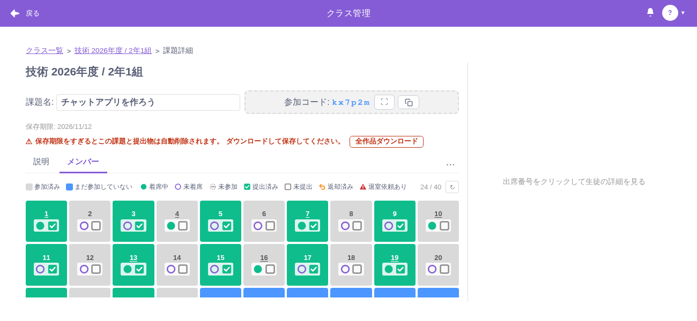

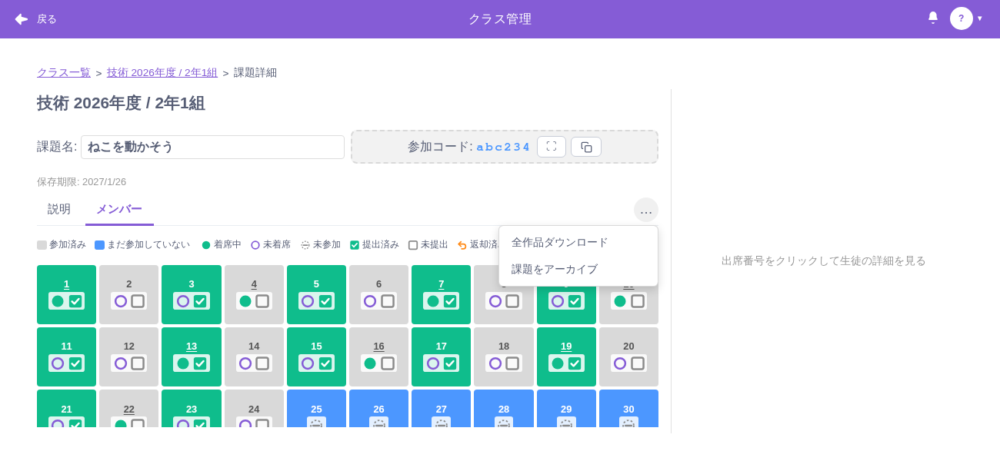
| メンバー見出し | 「メンバー」 | — | — |
| メンバー数 | 「1 / 35」 | `classroom-members-count` | 参加人数 / 最大人数 |
| 更新ボタン | ↻ アイコン | `classroom-refresh` | メンバー・提出を再取得 |
| 座席の色の凡例 | 「■ 参加済み ■ まだ参加していない」 | `classroom-seat-color-legend` | 凡例の先頭。灰色＝参加済み・青＝まだ参加していない（R5） |
| 凡例 | 状態アイコン + ラベル | `classroom-status-legend` | — |
| 座席グリッド | — | `classroom-members-grid` | 座席（最大 40）は一覧なので、この枠の中だけスクロールする（ページはスクロールしない・R6） |
| 全作品ダウンロード | 「全作品ダウンロード」 | `classroom-download-all` | 「…」メニューの中 |
| 課題アーカイブ | 「課題をアーカイブ」 | `classroom-delete-classroom` | 「…」メニューの中。押すと確認（赤は確認の［アーカイブ］だけ）。soft-delete（復元可能） |

**課題配信ボタンの表示条件:** Google Classroom 連携はクラス（group）単位に移行したため、配信ボタン（`classroom-post-assignment`）は **クラスが GC 連携済み（`group.googleClassroomCourseId`）** であれば、その課題自体に courseId が無くても表示されます（課題の投稿先はクラスのコース）。課題単位の `googleClassroomCourseId`（v2 以前のフォールバック）が有る場合も表示されます。どちらの courseId も無い（非連携クラス）ときは表示されません。配信済み（課題に `googleClassroomAlternateLink` が保存済み）になると「Google Classroom で確認」リンク（`classroom-view-assignment`）に切り替わります。

**課題配信ボタンを押せる条件 (#1184):** 配信は**押した先生自身の Google アカウント**で行われるため、
紐付け先の Google Classroom コースの教師でなければ Google に拒否されます。**連携した先生以外は
既定で `disabled`** にし、`classroom-post-assignment-blocked` に誰に依頼すればよいかを表示します
（別ワークスペースの個人アカウントの共同担当は、そのコースの教師に**なれない**ため、押させてから
失敗を説明しても出口がありません）。

同じコースの GC 共同教師は、ブロック表示の中の「自分もこの Google Classroom のクラスの先生です
（確認する）」（`classroom-post-assignment-verify`）を 1 回押せば共有できます。押したときだけ
Google の同意を求め、`teacher` と確認できればボタンが有効になります（クラスを開いただけでは
同意ポップアップは出ません）。確認できなかったときはエラーバナーではなく、ブロック表示が
「…先生であることを確認できませんでした。共有は ◯◯ 先生に依頼してください。」に変わります。

**連携した先生本人**は確認導線を経ずに従来どおり共有でき、コースが削除・到達不能で失敗した
ときの文言も「連携し直してください」になります（自分に依頼させない）。

**座席グリッド:**

座席番号が格子状に並び（1行 10列）、各セルは**出席番号 + 状態アイコン**（[状態アイコン](#状態アイコン)）と背景色で状態を表します。色だけに頼らず、アイコンの形と `title` / `aria-label` でも区別できます。出席番号・アイコン・退室依頼バッジはセルの大きさに合わせて拡大縮小します（CSS の container query 単位 `cqi`。狭い画面でも読めるよう下限、広い画面で大きくなりすぎないよう上限を `clamp()` で設定）。

| セル内のアイコン | 状態 |
|---------|------|
| 着席系（左） | 着席中 / 未着席 / 未参加 のいずれか |
| 提出系（右） | 提出済み / 未提出 / 返却済み のいずれか（未参加の席には出さない） |
| 右上バッジ（`classroom-seat-kick-request-{n}`） | 退室依頼あり |

| セルの色 | 状態 |
|---------|------|
| 青 (`#4c97ff`) | 未参加（空席） |
| グレー (`#d9d9d9`) | 参加中（未提出） |
| 緑 (`#0fbd8c`) | 提出済み |
| オレンジ (`#ff8c1a`) | 返却済み |

レッスンの課題では、色を進み具合（灰 = まだ・青 = とちゅう・緑 = 課題クリア）で決める（[レッスンの課題](#レッスンの課題)の「メンバータブの座席の色」）。

色は生徒側の出席番号選択画面と統一されている: 青 = 「空き / 選択可能 (生徒視点では選べる席、先生視点では未参加)」、灰色 = 「使用中」。着席判定は `lastActiveAt` が 1 時間以内かどうか。

セルをクリックすると右カラムに詳細パネルが表示されます。

**右カラム — メンバー詳細パネル:**

メンバー未選択時は「出席番号をクリックして生徒の詳細を見る」と表示。

| 要素 | テキスト例 | 操作 |
|------|----------|------|
| パネル全体 | — | — |
| 席番号ヘッダー | 「出席番号05」 | — |
| ニックネーム | 「- 」(未設定時) | — |
| 提出時刻 | 提出済み / 返却済みアイコン + 「19:11:54」 | 緑（返却済みはオレンジ）テキスト |
| 未提出 | 未提出アイコン + 「未提出」 | 提出が無いときのみ |
| 着席状態 | 着席中 / 未着席アイコン + 「着席中」/「未着席」 | — |
| 削除リンク | 「削除」 | 赤色テキスト |
| サムネイル画像 | — | プロジェクトのサムネイル |
| プロジェクト名 | 「第１回チャットアプリを作ろう」 | サムネイル下 |
| 「スモウルビーで開く」 | — | 青色ボタン、全幅 |
| コメント入力 | textarea (placeholder: 「...」) | — |
| 他の生徒に見せない | チェックボックス「他の生徒に見せない」 | 提出があるときだけ。ON にするとその提出を他者参照から外す（不適切な内容など）。切り替えるとすぐ保存し、再提出しても引き継ぐ |
| 返却ボタン | 「返却する」 | オレンジ色ボタン、全幅 |

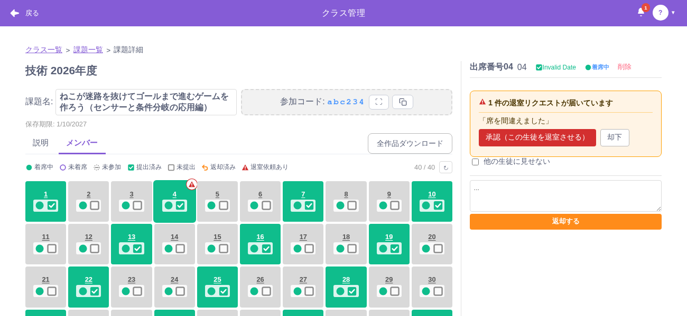

スクリーンショットが複数枚ある場合:

| 要素 | 操作 |
|------|------|
| 画像インデックス | 「1/3」等 |
| 前の画像ボタン | — |
| 次の画像ボタン | — |

**説明 / メンバータブ:**

課題詳細はタブ切替（「メンバー」がデフォルト = 出席・提出の座席グリッド、「説明」= 課題編集フォーム + 生徒視点プレビュー。新しく作った課題をはじめてひらいたときだけ「説明」が先）。共同管理者は**クラス設定（クラス一覧）**に移動した。タブ行の右端に「…」（全作品ダウンロード・課題をアーカイブ）。

| 要素 | テキスト | 操作 |
|------|---------|------|
| メンバータブ | 「メンバー」 | 凡例 + 人数 + 更新 + 座席グリッド（表示中のみ 30 秒ポーリング・既定） |
| 説明タブ | 「説明」 | 課題編集フォーム + 右ペインの生徒視点プレビュー（作成直後の初回のみ既定） |

課題を切り替えるとメンバータブに戻る。

**共同管理者セクション (課題単位・現在の UI には無い):**

> ⚠️ 画面上の共同管理者の追加・解除は **クラス（学級）設定**（「1.5 先生: クラス一覧」のカードの「設定」）に移動済み。以下は移動前の課題詳細タブの構成で、課題単位の共同管理は API（`/classrooms/{id}/co-teachers`）としてのみ後方互換で残っている。

owner または co-teacher が、別の先生を **email で招待**して共同管理できる（→ [architecture.md の共同管理](architecture.md#共同管理co-teacher)）。

| 要素 | テキスト例 | 操作 |
|------|----------|------|
| セクション全体 | — | co-teachers タブ選択時のみ描画 |
| 未登録表示 | 「まだ共同管理者がいません。」 | co-teacher が0件時 |
| 一覧の各項目 | 「co@example.com」 | — |
| 解除ボタン | 「解除」 | 共同管理者を解除 |
| 招待入力 | email 入力 (placeholder: teacher@example.com) | Enter でも招待 |
| 招待ボタン | 「招待」 | email 未入力時は disabled |

招待された先生は次回ログイン時、**クラス一覧に該当クラス（学級）が「共同管理」バッジ**付きで表示され、その中のすべての課題を管理できる（即時反映・承認不要）。

**コード表示 (全画面):**

コード拡大ボタン (⛶) をクリックすると、参加コードが全画面表示されます (Portal 使用)。タイトルは「参加コード」、フッターにクラス（学級）名・人数・課題名・日付が表示されます。

| 要素 | 操作 |
|------|------|
| 招待リンクコピー | クリップボードにコピー |
| 全画面表示 | — |
| 全画面解除 | — |
| 閉じる | — |

**削除確認ダイアログ:**

「課題をアーカイブ」ボタンを押すと確認ダイアログが表示されます。

| 要素 | テキスト | 操作 |
|------|---------|------|
| 確認ボタン | 「アーカイブする」 | 課題のアーカイブ（soft-delete）を実行 |
| キャンセルボタン | 「キャンセル」 | ダイアログを閉じる |

---

## 5. 生徒: 参加コード入力 (`student-join`)

6文字の参加コードを入力する画面。生徒がモーダルを開いたときの初期画面です。

生徒が既に課題に参加している場合（localStorage にセッション情報あり）は、この画面をスキップして**ステータス**画面に直接遷移します。

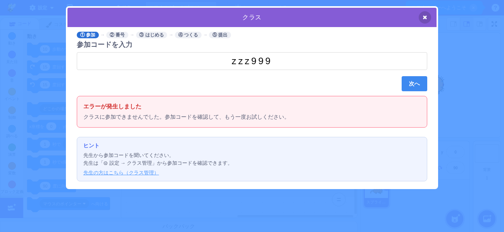

**パーツ:**

| 要素 | テキスト/内容 | 操作 |
|------|-------------|------|
| 見出し | 「参加コードを入力」 | — |
| コード入力 | 6文字入力欄 (placeholder: ○○○○○○) | 自動大文字変換 |
| 次へボタン | 「次へ」 | コード未入力/不正時は disabled |
| ヒントボックス | — | 青系背景のボックス |
| ヒントタイトル | 「ヒント」 | 青色太字 |
| ヒント1行目 | 「先生から参加コードを聞いてください。」 | — |
| ヒント2行目 | 「先生は「⚙ 設定 → クラス管理」から参加コードを確認できます。」 | — |

**レイアウト:** 入力欄は中央寄せ、幅広のテキスト入力。「次へ」ボタンは右寄せ。ヒントボックスはフォーム下部に表示。

---

## 6. 生徒: 出席番号選択 (`student-seat`)

課題の座席がボタンで並び、自分の出席番号を押します。**番号ボタンを押すとすぐ確認に進み**、確認の下にある［参加する］で参加します。番号を入れる欄は、ボタンの中に自分の番号が見つからないときだけ開きます（席を選ぶ方法を 1 つにして、主な操作を 1 画面に 1 つにするため）。

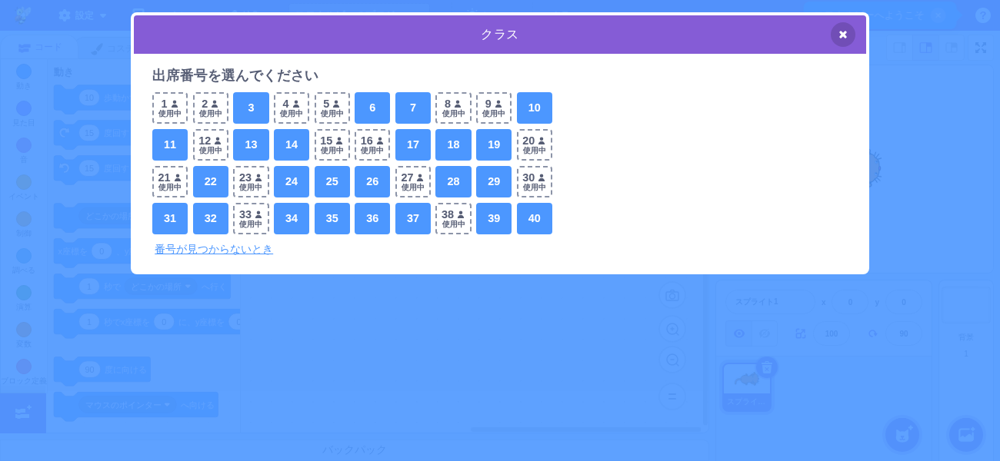

**パーツ（席を選ぶ前）:**

| 要素 | テキスト/内容 | 操作 |
|------|-------------|------|
| 見出し | 「出席番号を選んでください」 | — |
| 案内文 | 「自分の番号が『使用中』のときは、その番号を押してください。先生に席を空けてもらうようお願いできます。先生が確認しに来ます。」 | 最初から表示。30 秒席が選ばれないと強調（`data-idle="1"`） |
| 座席グリッド | — | — |
| 各席番号ボタン | 「1」〜「35」等。使用中の席は「使用中」アイコン付き | 空席 → 確認へ / 使用中 → 退室依頼ダイアログ |
| 「番号が見つからないとき」 | リンク風のボタン（グリッドの下） | 押すと番号入力欄が開く |
| 番号入力欄 | プレースホルダ「1〜定員」 | 「番号が見つからないとき」を押したときだけ表示。全角数字も可 |
| 番号決定ボタン | 「この番号にする」 | 空席 → 確認へ / 使用中 → 退室依頼ダイアログ（入れた番号のセルを強調） |
| 入力エラー | 「1から N までの数字を入れてください」 | — |

**パーツ（席を選んだあとの確認）:**

| 要素 | テキスト/内容 | 操作 |
|------|-------------|------|
| 参加確認 | 大きな文字で「出席番号 NN で参加します」と「自分の番号で合っていますか？…」 | 他の生徒の席を誤って取らないための確認 |
| 選び直すボタン | 「選び直す」 | 座席グリッドに戻る |
| 参加ボタン | 「参加する」（青い主ボタン） | その席で参加する |
| 選択中の席番号 | — | hidden要素、値取得用 |

確認の間は座席グリッドと番号入力欄を出しません（［参加する］を確認のすぐ下に置き、押す操作を 1 つにする）。

**座席グリッドの色:**

| ボタンの色 | 状態 |
|----------|------|
| 青 (`#4c97ff`) | 空席（選択可能） |
| グレー + 使用中アイコン | 使用中（タップで退室依頼） |
| オレンジの枠 | 番号入力欄に入れた番号 |

**レイアウト:** 2 列（左 = 見出し → 案内文 → 座席グリッド → 「番号が見つからないとき」→ エラー、席を選んだあとは左が参加確認 → ［選び直す］［参加する］→ エラーに替わる。右 = バナー（kick された / 退室依頼の待機中・却下））。エラーを左に置くのは、右の列がバナーで埋まっていて、長いエラー（ネットワークにつながらないときのホスト名入りの文など）を足すと 600px を超えるため。座席グリッドは 1 行 10 席なので、40 席でも 4 行に収まる。画面の幅が 1023px 以下（iPad の縦向き・スマホ）では「バナー → 左の列」の順に縦に積む（席を選ぶ前に、なぜこの画面に戻ってきたかを読めるように、バナーを先頭にする）。

### 席を選んだとき

番号ボタン（または番号入力欄）で空いている席を選ぶと、大きな参加確認と［参加する］が出ます。

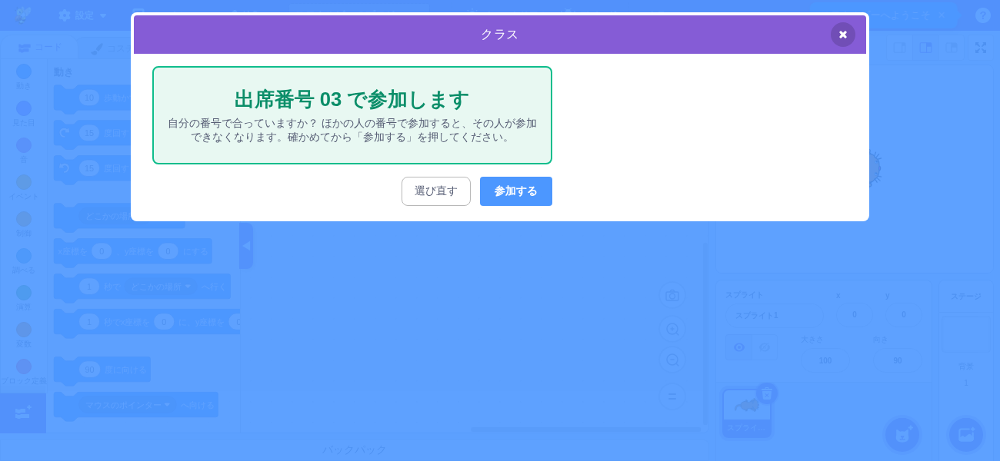

番号入力欄で使用中の番号を入れたときは、そのまま退室依頼ダイアログが開きます。

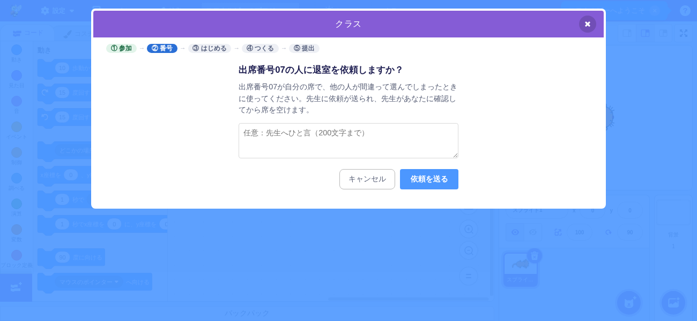

### 30 秒たっても席が選ばれないとき

画面を開いてから 30 秒（`SEAT_IDLE_HINT_MS`）席が選ばれなければ、案内文を太字・オレンジ枠にし、軽く揺らして目立たせます。`prefers-reduced-motion` のときは揺らさず色だけ変えます。

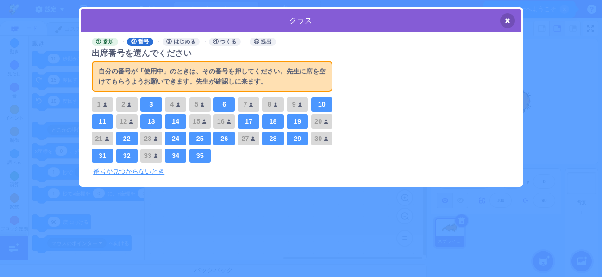

### 退室依頼の承認を待っている間

依頼中バナーに「先生に届いています。先生が確認しに来ます。待つ間スモウルビーを使っていてもかまいません。席が空いたら、自動でその席で参加します。」を表示します。先生が教室で本人に確かめてから承認し、席が空いたことをポーリングで検知すると、**その席で自動的に参加**します（選び直しは不要）。


- モーダルを閉じても、依頼が生きていれば（localStorage `smalruby:classroom:kickRequest`）裏で見張りを続け、承認・却下を検知するとモーダルを開き直します。モーダルを開き直したときも席画面の依頼中表示に戻ります。
- 承認待ちのポーリング（5 秒間隔・`KICK_REQUEST_POLL_INTERVAL_MS`）は**依頼が生きている間（最長 1 時間の TTL）・タブが表示されている間・未参加の間だけ**動きます。タブが非表示の間は止め、表示に戻ったときに 1 回だけすぐ確認します。依頼していない生徒の通信は増えません。

---

## 7. 生徒: 参加完了 (`student-joined`)

参加が成功したときの確認画面。メニューバーにも参加中であることが表示されます。
プロジェクト名が課題名に自動変更されます。


**パーツ:**

| 要素 | テキスト例 | 操作 |
|------|----------|------|
| 詳細 | 「テスト8年1組 / 出席番号03」 | — |
| クラス（学級）名 | 「テスト8年1組」 | — |
| 出席番号 | 「出席番号03」（0埋め2桁） | — |
| 課題名 | 「第１回チャットアプリを作ろう」 | 課題名がある場合のみ表示 |
| つぎにやること（ヒント） | 「1. この画面を閉じてプロジェクトを作ろう / 2. できたら、メニューバーの課題名を押して提出しよう」 | 青系背景のヒントボックス |
| はじめるボタン | 「はじめる」 | モーダルを閉じる（「どこから始めますか？」の選択肢を出しているときは出さない） |

レッスンの課題では「つぎにやること」の文をレッスン用にかえる（[レッスンの課題](#レッスンの課題)の「参加完了の画面の説明」）。

**レイアウト:** クラス（学級）名と出席番号は中央表示。課題名はその下にやや小さいフォントで表示。前回のコメントがあればその下に表示。続きに使える提出物があれば「どこから始めますか？」の選択肢（下記）を表示。「つぎにやること」ヒントボックスがその下に表示され、参加後の次のアクションを案内する。「はじめる」ボタンは青色、右寄せ（選択肢を出しているときは、選択肢のボタンが「はじめる」を兼ねるので出さない）。

### どこから始めるかの選択（続きから始める・Issue #1201）

**参加しただけでは何も読み込みません。** 課題にスターターがあるとき、または参加した席に**続きに使える提出物**があるとき、参加完了画面・課題パネルに「どこから始めますか？」の選択肢を 1 行で並べます（1300×600 の授業 PC でスクロールなしに収まるよう、縦に積まず横に並べる）。**どのボタンも押すとその作品で始まる**（読み込んでモーダルを閉じる）ので、別の「はじめる」ボタンは出しません。押す場所が 1 種類なので、生徒が「どちらを押せばいいか」で迷いません。

| ボタン | 下の行 | 表示する条件 | 押したとき |
|------|------|------------|----------|
| 「スターターから始める」 | 先生が用意した作品から作る | 課題にスターターがある | スターターを開いて始める |
| 「前回の提出物から続ける」 | 課題名・提出日時 | 同じクラスの前の課題（最大3回分遡る）に同じ席番号の提出物がある | その提出物を開いて始める |
| 「この課題で提出した作品を読み込む」 | 提出日時 | この課題で自分の席がすでに提出している | その提出物を開いて始める |
| 「いまの作品のまま始める」（灰色） | 何も読み込まずに作る | 常に（参加完了画面・課題パネルのみ） | 何も読み込まずにモーダルを閉じる |

- **見た目**: 入力欄や案内枠と見分けがつくよう、白地に青い枠（2px）・青い太字・下に濃い青の影を付けたボタンにする（押すと沈む）。先頭に種類ごとのアイコン（SVG）を付ける。「いまの作品のまま始める」だけは灰色の枠で、読み込む選択肢と区別する。ラベルは折り返し、下の行（課題名など）は長ければ「…」で切る
- スターターも続きに使える提出物も**無い**ときは選択肢を出さず、「はじめる」だけを出す
- **勝手に開かない**（どれで始めるかは生徒が選ぶ）。自動で開いたうえで同じ選択肢を出すと、どちらを押せばよいか迷い、押すと同じ作品を上書き確認つきでもう一度読み込んでしまうため
- 課題パネルを「課題を見る」から開き直したとき（作業の途中）は選択肢を出さず、「スタータープロジェクトを開く」と「はじめる！」を出す
- どれを開くときも、編集中のプロジェクトがあれば確認ダイアログを挟む（勝手に上書きしない）。文言は開くものに合わせる（「前回の提出物を開きますか？」「この課題で提出した作品を開きますか？」「課題のスタータープロジェクトを開きますか？」）。断ったときはモーダルを閉じない
- ダウンロード URL（スターター / 前回 / この課題）は押した時点で取り直す（課題を読んでいる間に期限が切れても開ける）。取り直したら無くなっていた（期限切れ・スターター削除）ときはエラーを表示する
- ステータス画面にも「提出した作品を読み込む」として同じボタン（スターターと「いまの作品のまま」以外）を出し、あとから読み込める。押すと読み込んでモーダルを閉じる
- 席番号は匿名なので、同じクラスの次の課題で同じ席を選んだ別の生徒も前回の提出物を開ける（[architecture.md](architecture.md) の「プライバシーの前提」）

### 先生の設定で前回の提出物から始める（Issue #1202）

先生が課題の「説明」タブで「前回の提出物から始めさせる」を ON にすると、生徒が誤ってスターターを選んで前回の作業が見えなくなるのを防ぐため、「前回の提出物から続ける」を**おすすめ**にします。設定 ON でも**自動では開きません**（押したときに 1 回だけ読み込む）。

| 生徒の状態 | 選択肢 | 選択肢の見出しの横のお知らせ |
|----------|-------|------------------------|
| 前回の提出物がある | 「前回の提出物から続ける」（青く塗り、「おすすめ」バッジ）＋「いまの作品のまま始める」。スターターは出さない | 「先生のおすすめ: 前回の提出物から続けよう」 |
| 前回の提出物が無い・スターターあり | 「スターターから始める」（おすすめ）＋「いまの作品のまま始める」 | 「前回の提出物が見つからなかったので、スターターから始めよう」 |
| 前回の提出物もスターターも無い | 選択肢なし（「はじめる」だけ） | 「前回の提出物が見つかりませんでした」 |
| この課題で提出済み | 設定 OFF と同じ（おすすめを付けない。今回の作業を前回の作品で上書きしないため） | なし |

- お知らせは見出しと同じ行に出すので、1300×600 で高さは増えない
- 設定 OFF のときは上記「どこから始めるかの選択」のまま


---

## 8. 生徒: ステータス (`student-status`)

参加中の生徒がモーダルを開いたときに表示される画面。提出状況を確認し、提出/退出ができます。

### 未提出の状態


### 提出済みの状態


**情報テーブル:**

| 行ラベル | 値の例 |
|---------|-------|
| 「クラス」 | 「テスト8年1組」 |
| 「出席番号」 | 「03」（0埋め2桁） |
| 「課題」 | 「第１回チャットアプリを作ろう」 |
| 「参加日時」 | 「2026/4/8 00:07」（秒なし） |
| 「提出状況」 | 「未提出」or「✓ 提出済み (00:08)」 |

レッスンの課題では「提出状況」の行を「進み具合」にかえ、主ボタンを「レッスンを続ける」にする（[レッスンの課題](#レッスンの課題)の「クラスの画面の進み具合」）。

続きに使える提出物があれば、情報テーブルの下に「提出した作品を読み込む」として「前回の提出物から続ける」「この課題で提出した作品を読み込む」を表示します（[参加完了](#7-生徒-参加完了-student-joined) の「どこから始めるかの選択」と同じ）。

提出状況行の右端に更新ボタンがあります:

| 要素 | 操作 |
|------|------|
| 更新ボタン (↻) | 最新の提出状況を取得 |

返却済みの場合、先生からのコメントが表示されます:

| 要素 |
|------|
| 先生からのコメント |

**未提出時ヒント:**

未提出の場合、フッターの上に以下のヒントが表示されます:

| 要素 | テキスト | 備考 |
|------|---------|------|
| 提出ヒント | 「プロジェクトが完成したら「課題を提出する」を押してください。」 | 未提出時のみ表示 |

**フッターボタン (左右に配置):**

| 要素 | テキスト (未提出時) | テキスト (提出済み) | 操作 |
|------|-------------------|-------------------|------|
| 退出ボタン | 「退出する」 | 「退出する」 | → student-join |
| 課題ボタン | 「課題を見る」 | 「課題を見る」 | → student-assignment（課題の中身があるときだけ） |
| みんなの作品ボタン | 「みんなの作品を見る」/「提出すると見られます」 | 「みんなの作品を見る」 | モーダルを閉じて [みんなの作品パネル](#みんなの作品を見る生徒の他者参照パネル) を開く |
| 提出ボタン | 「課題を提出する」 | 「課題を再提出する」 | → submit-confirm |

「みんなの作品を見る」は課題の「他者参照」の設定で出し分けます: `しない` なら出さない、`いつでも見られる` なら出す、`自分が提出したら見られる` で未提出なら代わりに「提出すると見られます」と案内します。設定は課題の取得（参加時・「課題を見る」）の応答から覚えるので、出し分けのための通信は増やしません（まだ分からないときはボタンを出し、開いたときのサーバーの答えで出し分けを覚え直します）。

**レイアウト:** 情報テーブルは白背景のカード内。フッターは `[退出する]` が左、`[課題を提出する]` が右。

**セッション切れ時:**

セッションが無効になった場合、エラーメッセージと「参加画面を表示」リンクが表示されます。

ただし、行き先がはっきりしているときはアラートを出しません（いま必要なのは前のセッションではないため）:

| 場面 | ふるまい |
|------|---------|
| 別のクラスの参加 URL（`?classcode=`）を開いた | 前のクラスの席を空けて、URL のクラスの座席選択から始める。前のセッションは確かめない（空けた直後に確かめると 401 になり、関係のないアラートが出ていた） |
| 同じクラスの参加 URL を開いたが、セッションが切れていた | アラートを出さずに、そのクラスの座席選択からやり直す |
| 確かめている間に別のクラスへ移った・退出した | 古いセッションの確認結果は捨てる（新しいセッションを消さない・アラートを出さない） |
| URL なしで「クラス」メニューを開き、セッションが切れていた | アラートを出す（本当に切れたことを知らせる） |

---

## 9. 生徒: 提出確認 (`submit-confirm`)

提出前の確認画面。プロジェクトのサムネイルがプレビュー表示されます。


> **提出サムネイルの事前設定** (issue #631): 課題に参加中の生徒は、ステージ右上の
> 「提出サムネイルを設定」ボタン（✓ アイコン）を押すと、その瞬間のステージ画面を
> 提出サムネイルとして事前に決めておけます。設定するとそのフレームが提出時に使われ、
> プレビュー (`classroom-submit-preview`) にも反映されます。未設定のまま提出した場合は
> 従来どおり提出ボタンを押した瞬間のフレームが自動キャプチャされます。ボタンは課題
> 未参加時は表示されません（`state.scratchGui.classroom` の生徒セッション有無で判定）。

**提出サムネイルを設定ボタンの表示ゲート:**

課題に未参加のときはステージ右上に「提出サムネイルを設定」ボタンは表示されません。


課題に参加中の生徒のときだけ、ステージ右上の左端に ✓ アイコンのボタンが表示されます。


ボタンを押すと確認ポップオーバー「いまの実行画面を提出サムネイルにしますか？」が表示され、「はい」でその瞬間のステージ画面が提出サムネイルとしてキャッシュされます。


事前に設定したサムネイルは、その後ステージの内容を変えても提出確認のプレビューと実際の提出に使われます（下図は事前設定したフレーム＝左上の大きいネコがプレビューに表示され、背後の現在のステージ＝右下の小さいネコとは異なる様子）。


**パーツ:**

| 要素 | テキスト/内容 | 操作 |
|------|-------------|------|
| 見出し | 「作品を提出します」 | — |
| サムネイルプレビュー | ステージのスクリーンショット画像 | — |
| 確認メッセージ | 「現在のプロジェクトを提出してよろしいですか？」 | — |
| キャンセルボタン | 「キャンセル」 | → student-status |
| 提出ボタン | 「提出する」 | 送信中は「提出中...」に変化 |

**レイアウト:** サムネイルは中央の白枠内に表示。ボタンは横2列、右に「提出する」(青色)、左に「キャンセル」(白色ボーダー)。

「提出する」を押すと:
0. Ruby タブで書きかえたコードがまだブロックに直っていなければ、先にブロックに直す（保存や実行と同じ）。Ruby のコードにエラーがあってブロックに直せないときは、**提出せずに**モーダルを閉じ、Ruby タブでそのスプライトのエラー（アラートとエディタの印）を見せる
1. プロジェクトファイル (.sb3) を保存（ファイル名はプロジェクト名 = 課題名）
2. サムネイルを生成（事前設定済みの提出サムネイルがあればそれを使用、無ければ自動キャプチャ）
3. ステージのスクリーンショットと、ブロックがあるスプライトごとのブロック画像を撮影（ブロック画像と同じ順で**スプライト名**も送る。他者参照のビューアで「どのスプライトのプログラムか」を出すため。各 100 文字まで）
4. Presigned URL 経由で S3 にアップロード
5. 完了後 → student-status に遷移

---

## 課題配信（課題エディタ + 生徒の課題パネル）

課題（1 授業）には任意で**課題コンテンツ**（(数行テキスト + 画像1枚) × 最大10ページ + スタータープロジェクト1つ）を持たせられます。生徒は参加コードで参加した瞬間に課題ページが表示され、「スターターから始める」を押すとスタータープロジェクトが開きます（プログラム配付の手作業をなくす機能）。

### 課題の編集（先生: 課題詳細の「説明」タブ）

課題詳細の「説明」タブが編集フォームです（新しく作った課題をはじめてひらいたときは、このタブが最初に表示されます）（旧 teacher-assignment-edit フェーズは廃止）。右ペインに生徒視点プレビュー（ページャ上部。どのページも空のときは「ページを書くとここに出ます」の 1 行だけ）。［課題を保存］はフォームの最上段（説明 1 行の右）にあります。


- ページの追加・削除・並べ替え（↑↓）、1ページ500文字 + 画像1枚（png/jpeg・**画像が上、テキストが下**）
- スターターは「今開いているプロジェクトを使う」（保存時に `vm.saveProjectSb3()` で生成）か「.sb3 ファイルを選ぶ」
- 保存すると画像・スターターは Presigned URL で S3 に直接アップロードされる
- 次の 3 つの設定は、スターター欄の下の「**詳しい設定**」に畳まれています（閉じた状態でも「前回から: しない・他者参照: しない・メッシュ: 6人まで」といまの値を表示。保存した値から変えたものはオレンジ色＋「保存していません」で、［課題を保存］まで残る。各設定の説明は開いたときだけ出る。右上の ✕・外を押す・Escape キーで閉じる）
- 「**前回の提出物から始めさせる**」（チェックボックス・既定 OFF・Issue #1202）。続きもの授業（製作の 2 時間目など）向けで、ON にすると生徒は参加した直後に前回の提出物が開く（下記「先生の設定で前回の提出物から始める」）。ページもスターターも無い課題でも設定できる。右ペインのプレビューの下に「参加したとき: …」として、生徒がどう始まるかを表示する（ON = 前回の提出物 / OFF = スターター・スターターが無ければいまの作品のまま）
- 「**他者参照**」（プルダウン・既定「しない」）。`しない` / `いつでも見られる` / `自分が提出したら見られる`。生徒に、提出済みのクラスメイトの**ステージの画像とブロックの画像だけ**を見せる（作品ファイル `.sb3`・ニックネーム・先生のコメントは見せない。作品をそのまま読み込めると単なる写しになるため）。「自分が提出したら」は、まず自分で取り組んでから参照させたい先生向け。保存で反映。特定の提出だけを外すにはメンバー詳細の「他の生徒に見せない」を使う

  
- 「**メッシュのグループの人数**」（プルダウン）。`6人まで` / `制限なし`。出席番号でメッシュに接続するときのグループの人数の上限で、課題（`meshGroupLimit`）に保存する（`6` / `0` = 制限なし）。**新しく作る課題は「6人まで」で作られる**（作成画面では聞かない。変えるのはここ）。この設定より前に作った課題は値を持たないので「制限なし」と表示され、ここで「6人まで」に変えられる。「制限なし」はクラス全員を 1 つのグループにでき、先生が「ホストになる」と「先生のグループ」になって、生徒はそこへ 1 タップで入れる。保存で反映（値を変えたときだけ `PATCH /classrooms/{id}` を送る）
- data-testid 一覧は [testing.md](testing.md) の「課題エディタ」参照

### 課題パネル（生徒: student-assignment フェーズ）

join 完了直後に自動で開きます（課題コンテンツが設定されている課題のみ）。ステータス画面の「課題を見る」（`classroom-view-assignment-button`）からいつでも開き直せます。


- 1300×600 に収まるよう、見出し「課題」・「参加しました！」・ページ送りを 1 行に、ページは**画像が左・テキストが右**に並べる。長いページはページの枠の中でスクロールする
- スターターの自動ロードは**編集中のプロジェクトを勝手に上書きしない**（未編集なら自動、編集ありなら confirm）。続きに使える提出物があるときは自動ロードせず、「どこから始めますか？」の選択肢をパネルの下に横幅いっぱいで並べる。選択肢がそのまま「はじめる」を兼ねるので、「はじめる！」は出さない（[参加完了](#7-生徒-参加完了-student-joined) の「どこから始めるかの選択」）
- 「スタータープロジェクトを開く」で明示的に開き直せる（同じく confirm あり。選択肢を出しているときは「スターターから始める」がその役）
- 「はじめる！」でモーダルを閉じて作業開始（選択肢を出していないとき）
- data-testid 一覧は [testing.md](testing.md) の「課題パネル（生徒）」参照

---

## レッスンの課題

課題にレッスン（コース › レッスン › チャレンジ）を紐付けたときの画面。レッスンの側の決まり（入口・必須・完了の条件・
課題の帯・課題クリア・本人の確認・進み具合の送り方・GA）は [`docs/lessons/design.md`](../lessons/design.md) の
「段 2: クラスの課題とレッスン」が正で、ここには先生の画面・生徒のクラスの画面・CSV・採点を書く。
画面のモックは設計のページにある（data-testid は実装のときに [testing.md](testing.md) に足す）。

> 「（推奨で決めた）」と書いたものは、設計の相談で決まっていない細かいところを、推奨の案で決めたもの。
> develop へのマージの前に人間と確かめる。「未定」は、書いてある sub-issue で決める。

レッスンを紐付けない課題は、ここまでの画面のまま変わらない。

### 先生: 課題の「説明」タブのレッスン欄

いまの課題に「**レッスン**」欄を足す（新しい課題の種類は作らない）。[1.7 先生: 課題詳細の「説明」タブ](#17-先生-課題詳細の説明タブ)
と同じく、**1300×600 で縦スクロールしない**・［課題を保存］はいつも見える（R6）。

| 決めること | 選び方 | 既定 |
|---|---|---|
| コース | 1 課題にコース 1 つ。「レッスンを使わない」も選べる | 使わない |
| レッスン・チャレンジ | レッスンにチェックすると中のチャレンジが全部入る。チャレンジごとに外せる。レッスンは複数選べる。順番はレッスンの順のまま（並べかえない） | — |
| 必須（★） | 選んだチャレンジにだけ付けられる。0 個でもよい | 0 個 |
| 完了の条件 | 「全部」か「n つ（必須をふくむ）」。n は必須の数から選んだ数まで（推奨で決めた） | 全部 |
| 作品の提出もする | 「提出しない（レッスンだけ）」/「最後に作品も提出する」。後者なら、条件を満たしたあとに作品を 1 回提出する（課題につき最後の 1 回） | 提出しない（推奨で決めた） |
| 採点の点 | 満点・必須を全部こなしたときの点（下の「採点」） | 満点 100（推奨で決めた）・必須の点 70 |

- **置き場所**: 左の列の、ページの枠のすぐ上に「**レッスン**」欄を置く（右の列は 1300×600 でスターターと
  「詳しい設定」で埋まっているため。推奨で決めた）。
  閉じた状態でも「コース: きょうからプログラマー・6 つ（★ 2）・条件: 全部・提出: しない」のように
  **いまの値を 1 行で**出す（レッスンを紐付けていなければ「レッスンを使わない」）（R3）。
- **開いた中身**は、「詳しい設定」と同じくページの列の上に重ねて出す（右の列と［課題を保存］は隠さない・右上の ✕・
  外を押す・Escape キーのどれかで閉じる）。高さは中身に合わせ、チャレンジが多くてもページの列の下端までに収める。上から「コース」の選択・レッスンとチャレンジの一覧・完了の条件（その場で
  「生徒に出る文: 6 つのうち 4 つ（★ 2 つをふくむ）」を出す）・作品の提出（推奨で決めた）。チャレンジの一覧は件数で長さが
  変わるので、その枠の中だけスクロールする（R6 の一覧の例外）。
- レッスンの行のチェックは、中のチャレンジが一部だけ選ばれているとき「一部」（indeterminate）にする。押すと全部入る。
  チャレンジの行の右に ★「必須にする」のボタン（選んだチャレンジだけ押せる）。コースを選び直すと、チャレンジ・★・
  完了の条件・作品の提出・採点の点は既定に戻す。完了の条件を「全部」と「n つ」で切りかえたときも n は既定（選んだ数）に戻す（推奨で決めた）。
- チャレンジを 1 つも選ばずに保存しようとしたら、保存せずに「レッスンのチャレンジを 1 つ以上選んでください」を出す（推奨で決めた）。
- **採点の点**は「詳しい設定」の中に置く（D10）。レッスンを紐付けた課題だけ、「満点」「必須（★）を全部こなしたときの点」の
  欄と、1 つの点（「必須 1 つ 35 点・必須でない 1 つ 7.5 点」）を出し、閉じた要約に「レッスンの点: 100 点（★ 70）」を足す。
  必須が 0 個か全部必須のときは、必須の点の欄は押せない（下の「採点」の特別な場合で決まるため）（推奨で決めた）。
  満点・必須の点を変えていなければ `scoring: null`（既定のまま）で保存する。**既定と同じ値は既定として扱う**:
  満点 100・必須の点 = 満点の 70%（切り上げ）なら `scoring: null` で送る。必須の点が満点の 70% と同じなら、保存したあとも
  満点に追従する（満点を 200 にすると 140 になる）（推奨で決めた）。
  数の欄（満点・必須の点・「n つ」の n）は、打っている途中では範囲に直さず、欄を出る・Enter のときに範囲へ収める
  （空のまま確定すると、満点と n は前の値・必須の点は既定に戻る）（推奨で決めた）。
- 右の生徒視点プレビューに、「レッスン: 6 つのうち 4 つ（★ 2 つをふくむ）」と丸（★ = 必須）を出す。生徒の画面の
  課題の帯の形そのものは #1599 で作る（推奨で決めた）。
- 保存した値から変えたものは、「詳しい設定」と同じくオレンジ色＋「保存していません」（推奨で決めた）。
- **生徒が進み具合を送ったあとにチャレンジや条件を変えてもよい**（推奨で決めた）。送られた記録はサーバーに残し、
  表と数え方はいまの設定で読みかえる。保存したチャレンジを外したときは、開いた欄の下に
  「生徒がすでに送った進み具合は残りますが、選ばなくなったチャレンジは数えません」を出す。
- **このスモウルビーに無いコース**（みんなの課題のコピーで来た、古い・消えたコースなど）のレッスンは、要約を
  「コース: 見つからないコース」にし、欄の下に「このコースは、このスモウルビーにはありません。設定はそのまま残ります。…」
  の警告を出す。変えなければ保存してもそのまま残す（`lesson` を送らない）。別のコースか「レッスンを使わない」を選べば
  変えられる（推奨で決めた）。
- **コースにもう無いチャレンジ**（保存したあとにコースのデータが変わったとき）は、数えない（要約の数・完了の条件・得点）。
  欄の下に「保存したチャレンジのうち N 個は、このスモウルビーにはありません。数えずに、保存すると設定から外れます。」を出し、
  保存すると設定から外す（推奨で決めた）。

- **レッスン欄を閉じても**（✕・外・Escape）、**選んだレッスンはそのまま残る**。外したいときはコースの選択で
  「レッスンを使わない」を選ぶ（推奨で決めた）。


### 先生: レッスンの説明文をページに入れる

レッスンを選ぶと、課題のページに**生徒向けの説明文**を入れる（レッスンの課題を保存すると空のページが 1 枚できる、
をなくすため）。中身は、コース名とそのコースで学べること（コースのデータの説明）・完了の条件（「6 つのうち 4 つ」）・
必須（★）の数・進める順番は自由・作品の提出が ON なら「おわったら、学んだことをつかって作品をつくって提出しよう」。

- **いつ入れるか**:
  - ページに文字が無いとき（どのページも空。画像だけのページは空とみなす）は、レッスンを選んだ・変えたその場で 1 ページめに入れる。
  - 1 ページめがまだ**入れた説明文のまま**なら、レッスン（チャレンジ・★・条件・提出）を変えるたびに作り直す。
    「レッスンを使わない」にすると、入れた説明文を消して空に戻す（推奨で決めた）。
  - 先生が書いた文があるときは、勝手に変えない。**レッスン欄を閉じたとき**（✕・外・Escape・欄の見出し）に、開いていた間に
    レッスンを変えていて、1 ページめが説明文と違えば、ページの上に「**ページの説明をレッスンの説明で上書きしますか？**
    ［はい］［いいえ］」を出す（`confirm()` は使わない）。［はい］で 1 ページめの**文だけ**を説明文にする（画像とほかのページは
    そのまま・推奨で決めた）。［いいえ］でそのまま。開いて何も変えずに閉じたときは聞かない（推奨で決めた）。
  - どれも［課題を保存］するまでは保存されない。
- **言葉**: ページは 1 つの言葉で書くもの（公式のテンプレートと同じ）なので、**先生の画面の言葉**で書く。ja は漢字まじりの
  やさしい文、ja-Hira はひらがなだけの文、それ以外は英語（推奨で決めた）。ひらがなの文を生徒に出したいときは、
  先生の画面を ja-Hira にしてからレッスンを選ぶ。
- 文は `src/lib/classroom-lesson-description.js` の `buildLessonDescription` が作る（どのコースでも 1 ページの上限 500 字に収まる）。
  コースの「学べること」は `lessons.locale.js` の `gui.lessons.course.<id>.description`。

ja の例（チャレンジ 6 つ・★ 2・条件 4 つ・作品の提出あり）:

```text
「きょうからプログラマー」のレッスンにチャレンジしよう！
キーやクリックでネコを動かしたり、音を鳴らしたり、質問したりしながら、くり返し・もし〜なら・変数・メッセージ・リストといったプログラムの基本を学べるよ。

・チャレンジは 6 つ。そのうち 4 つできたら課題クリア！
・★ のついたチャレンジ 2 つは、かならずやろう。
・やる順番は自由！ 好きなチャレンジからはじめよう。
・おわったら、学んだことをつかって作品をつくって提出しよう。
```


### 生徒: 参加完了の画面の説明

[7. 生徒: 参加完了](#7-生徒-参加完了-student-joined) の「つぎにやること」を、レッスンの課題では次の文にかえる。
生徒の「提出ボタンがありません」という質問を減らすため、参加した直後に、提出のタイミングを先に伝える。

| 課題 | 文 |
|---|---|
| 作品の提出もする | 「この課題はレッスンの課題です。レッスンを進めて、条件を満たしたら自由にプログラムをつくって作品を提出します」 |
| 作品の提出はしない | 「この課題はレッスンの課題です。レッスンを進めて、条件を満たしたら課題クリアです」（推奨で決めた） |

- 「はじめる」は、レッスン表を課題のコースで開き、課題のチャレンジだけを出す（design.md の「入口」）。
- レッスン表の上の**課題の帯**は 1 行の文「［課題］<課題名>　条件: 6 つ　あと 5 つ（★ 5 つ）で課題クリア」（人間が決めた）。
  「あと N つ」は下の「あと n つ」と同じ数え方、「★ R つ」は残っている必須の数で、0 なら出さない。課題クリアのあとは
  「✓ 課題クリア」。チャレンジごとの丸は帯に出さない（カードの ✓ と ★ で分かる・推奨で決めた）。課題のチャレンジだけの
  レッスン表ではコース名の横の進み具合（バーと「n / 全部」）を出さない（帯がその役目をする・推奨で決めた）。


- スターターの無いレッスンの課題では「どこから始めますか？」（スターター・前回の提出物）を出さず、主ボタンは
  「はじめる」だけ。スターターもある課題は、いままでの選択肢と「はじめる」を並べる（推奨で決めた）。
- 課題のページがある課題は、課題のページ（[課題パネル](#課題パネル生徒-student-assignment-フェーズ)）の下にも同じ説明と「はじめる」を出す（推奨で決めた）。

### 生徒: クラスの画面の進み具合

[8. 生徒: ステータス](#8-生徒-ステータス-student-status) の「提出状況」の行を、レッスンの課題では「**進み具合**」にかえる。

| 行ラベル | 値の例 |
|---|---|
| 「進み具合」 | 丸（チャレンジごと・★ は必須）＋「4 / 6 できた」＋「★ あと 1」＋「あと 2 つで課題クリア」。課題クリアのあとは「✓ 課題クリア」 |
| 「提出状況」 | 作品も提出する課題だけ、いまの「提出状況」の行も残す（推奨で決めた） |


「あと n つ」は **max（条件の数 − できた数, 残っている必須の数）**。条件が「n つ（必須をふくむ）」で、必須でないものだけ多くできても、必須が残っていれば「あと 0」にしない。課題クリアは、できた数が条件の数以上で、必須が全部できたとき。

- 主ボタンは「**レッスンを続ける**」（レッスン表を課題のコースで開き、次にやるカードに「次はこれ！」）（開く先は推奨で決めた）。
- 作品も提出する課題で条件を満たしたら、主ボタンを「**課題を提出する**」にし、案内「レッスンで学んだことをつかって、
  自由にプログラムをつくろう。できたら作品を提出しよう」を出す。「レッスンを続ける」は白地のボタンに下げる（推奨で決めた）。
- 作品を提出しない課題では「課題を提出する」は出さない（推奨で決めた）。
- 作品も提出する課題でも、条件を満たすまでは「課題を提出する」を出さない（推奨で決めた）。ただし、この版のコースに無い
  チャレンジが課題にあるときは、条件を満たす前でも出し、「進み具合」の行の「あと n つで課題クリア」の代わりに
  「新しいレッスンがあります。ページを読み込み直してね」と書く（1 行のまま 1300×600 に収める）
  （design.md の「この版に無いチャレンジ」）（推奨で決めた）。
- クラスの画面の提出の案内は、いままでの「できたら『課題を提出する』を押そう」と同じく、はじめて提出するまで出す
  （提出したあと・返却されたあとは出さない。1300×600 に収めるため）（推奨で決めた）。
- 課題の「レッスン」の設定は、参加したときと、この画面を開いたときに課題を取り直して読む（先生があとから紐付けた・
  変えたときに追いつくため）。読んだ設定は端末のセッションに残し、メニューバーの印とレッスン表の帯に使う。
- レッスン表・「課題クリア！」の［課題を提出する］は、この画面を開いて提出の確認へそのまま進む。
- **1300×600 でスクロールなし**（[画面サイズの基準](#画面サイズの基準1300600)）。丸は 1 行に収める。
- 進み具合は、この画面を開いたときに端末の記録から作る（送るのも開いたとき・design.md の「進み具合の送り方」）。

**本人の確認:** その課題ではじめて進み具合を送るとき、端末に課題のチャレンジの記録があれば、送る前に一度だけ
確認のダイアログを出す（決まりは design.md の「本人の確認」）。クラスの画面・レッスンの上に重ねて出す。

| 段 | 文 | ボタン |
|---|---|---|
| 1 つめ | 「このパソコンには、この課題のチャレンジのうち n つが『できた』と記録されています。」＋記録の一覧（名前・できた日、2 列）＋「あなたがやった記録ですか？」 | ［ちがう（記録を消す）］［わたしの記録です］（主ボタン） |
| 2 つめ | 「レッスンの記録を消しますか？」「自分のパソコンなら、消さずに戻って『わたしの記録です』を選ぼう。みんなで使うパソコンなら、消そう。」「消した記録は、もとにもどせません。」 | ［戻る］［消す］ |

- 答えたあとに、先生が課題にチャレンジを足して、端末にそのチャレンジの前からの記録があったときは、その記録だけの一覧で
  もう一度聞く（design.md の「同意していない記録は送らない」）（推奨で決めた）。
- 開いたとき・段が変わったとき、その段の最初のボタン（［ちがう（記録を消す）］／［戻る］）にフォーカスを置く（推奨で決めた）。
- ×（閉じる）は答えなかったことにする。送らずに閉じ、次に送るとき（できた・課題のチャレンジを開いた・クラスの画面を
  開いた）にもう一度聞く（推奨で決めた）。
- **1300×600 でスクロールなし**。記録の一覧は 2 列で、一覧が枠（高さ 12rem・約 16 個）に入りきらないときだけ
  一覧の枠の中をスクロールする（推奨で決めた）。11 個全部の記録があるときで高さ 390px。


**メニューバーの印:** 参加中のラベル「クラス:出席番号NN」の横（いまの提出状態アイコンの場所）に、レッスンの進み具合の
印を出す（場所は推奨で決めた）。

| 状態 | 印 |
|---|---|
| まだ 1 つもできていない | ○ |
| とちゅう | 「2/4」（できた数 / 条件の数。できた数は条件の数で止める） |
| 課題クリア | ✓ |

作品も提出する課題で、課題クリアのあとに提出したときは、✓ の横に提出済みのアイコンを並べる（推奨で決めた）。
返却されたときも提出済みのアイコンにする。作品を提出しない課題では提出状態のアイコンは出さない。

### 先生: メンバータブの座席の色

レッスンの課題では、[座席グリッド](#4-先生-課題詳細のメンバータブ-teacher-detail)のタイルの色を進み具合で決める。

| タイルの色 | 状態 |
|---|---|
| 灰 | まだ（1 つもできていない） |
| 青 | とちゅう |
| 緑 | 課題クリア |

- タイルに「**できた数 / 条件の数**」と細いバー、**★ の残り**（「★ あと 1」）を出す。できた数は条件の数で止める
  （「5/4」にしない。必須が残っていれば「4/4 ★1」になり、緑にはならない）。
- 同じチャレンジに **10 分以上**いる子には「**!**」を出す（開いた時刻から数える）。
  ▶ と ! は**目安**（着席と同じ）。進み具合は定期的に送らないので、エディタを閉じた子や課題の外を開いた子も
  そのまま残る。そのため、その席の最後の送信が **1 時間より前**なら ▶ と ! を出さない（着席の目安と同じ 1 時間・推奨で決めた）。
- 「!」はタイルの**左上**に出す（右上は退室依頼の印のため。推奨で決めた）。
- ▶ と ! は、**まだできていない**チャレンジを開いているときだけ出す。できたチャレンジを開き直している子は
  止まっているとみなさない（推奨で決めた）。
- **課題クリアした子には「!」を付けない**（発展のチャレンジに 10 分以上いても ▶ のまま。表のセルも ▶ で、
  何分いるかはセルに乗せたときに出す）。「!」は先生が助けに行く子の印なので、クリア後の子で埋もれないようにする
  （推奨で決めた）。
- 進み具合は、タブを開いてはじめの取得が終わるまで「進み具合を読み込み中…」を出す（灰色の「0 / n」を出さない）。
  取得に失敗したときは前の進み具合を残す（一時的なエラーで全員がリセットされたように見せない）。はじめの取得から
  失敗したときは、いまの座席の色で出し「進み具合を読み込めませんでした。30 秒ごとに読み込み直します。」を添える
  （推奨で決めた）。
- 着席・退室依頼の印はいまのまま（着席の印は席番号の横に小さく出す）。作品の提出の印は**右下に重ねる**
  （作品も提出する課題だけ）。
- 色の凡例を同じ画面に置く（R5）。「■ まだ ■ とちゅう ■ 課題クリア ▢ 未参加 ! 同じチャレンジに 10 分以上」。
  右上の数の横に「**クリア N / 参加 N**」を出す。
- **未参加の席**は、白地に点線の枠と未参加のアイコン（点線の丸）にする（「青 = 未参加」は「青 = とちゅう」と重なるため。
  推奨で決めた）。退出した席・kick した席も未参加として出す（最後の人の記録は「進み具合」タブに残る）。
- このスモウルビーに無いコースの課題では、いまの座席の色のまま出す（推奨で決めた）。


### 先生: 「進み具合」タブ

課題詳細に新しく「**進み具合**」タブを足す（「メンバー」「説明」と並べる。レッスンの課題だけ出す）。
席 × チャレンジの表で、だれがどこで止まっているかを見る。

| 記号 | 意味 |
|---|---|
| ✓ | できた |
| 前 | 課題の前からできていた |
| ▶ | いまやっている |
| ! | 同じチャレンジに 10 分以上 |
| ・ | まだ |
| ★（見出し） | 必須 |

- **高さ 600px なので、見出しは上に固定し、席の行だけがスクロールする**。固定する見出しは、上から
  縦書きのチャレンジ名・「**できた人**」の行（列ごとのできた人の数と、右肩に小さく青でいまやっている人の数）。
  チャレンジの色は「できた人」の行の上の線、レッスンの区切りは列の左の線で示し、レッスン名はチャレンジ名に乗せたときに出す
  （推奨で決めた）。**1300×600 で席の行が 12 行以上見える**ようにする。
- このタブを開いている間は、課題名の欄と保存期限の行を畳み（課題名は「説明」タブで直す）、参加コードは小さな 1 行
  （全画面表示のボタンだけ）にする。保存期限が残り 7 日以内のときだけは警告を出したままにする（推奨で決めた）。
  記号の凡例は並べ方と同じ行に、短い言葉（「✓できた 前から ▶いま !10分以上 ・まだ ★必須」）で置く。
- 「できた人」の行は**下に固定しない**。プロジェクターでは画面の下が見えにくく、高さも足りないので、有益な情報は
  できるだけ**上**に置く。
- **固定する見出しの高さはできるだけ低く**する（チャレンジ名の縦書きを短く・行を詰める）。名前が長いときは
  省略し、全文は見出しに乗せたときに出す（推奨で決めた）。
- **席の列は左に固定**（横にスクロールしても席番号が見える）。
- 並べ方: **席**・**進んでいる順**（できた数の多い順）・**止まっている順**（いまのチャレンジにいる時間の長い順）
  （「止まっている順」の数え方は推奨で決めた）。同じときは席の順。止まっている順では、いまやっていない席と課題クリアの席は後ろ
  （推奨で決めた）。並べ方は「並べ方:」のラベル付きの選択で選ぶ（R1）。
- 表に出す行は、いま参加している席と、記録の残っている席（退出・kick のあと、最後の人の記録）。だれも来ていない席は
  出さない。退出した席の行は席番号の横に「退出」（推奨で決めた）。
- 列の並び: 席・チャレンジ（レッスンの順。見出しは縦書きのチャレンジ名、全文とレッスンは見出しに乗せたとき）・
  「できた」（できた数 / 条件の数）・「状態」（クリア / とちゅう / まだ）（推奨で決めた）。
- 「できた人」の行は 1 行で、列ごとのできた人の数（「前」もふくむ）と、その右肩に小さく青でいまやっている人の数。
  席の列には「クリア N」（推奨で決めた）。
- 「CSV」で表を書き出す（列は下の「CSV の列」）。置き場所は、まれな操作なのでタブの行の右端の「…」（R2）（推奨で決めた）。
  「進み具合」タブを開いているときだけ「…」に「進み具合を CSV でダウンロード」が出る。ファイル名は
  `進み具合_<課題名>.csv`、行は画面の並べ方によらず席の順（推奨で決めた）。
  CSV（この表と `提出状況.csv`）では、`=` `+` `-` `@` タブ・改行で始まる文字列の前に `'` を付ける（生徒が入れた名前が
  表計算ソフトで数式として動かないように）。
- 記号の凡例を表の上に置く（R5）。
- 取得は**このタブを表示している間だけ・30 秒ごと**（メンバータブと同じ費用の方針）（推奨で決めた）。
  メンバータブ（座席の色）でも同じく取る。レッスンの無い課題では取りに行かない。
- 席を押すと、右に詳細を出す（下の「パネル・詳細」の「席の詳細」）。
- このスモウルビーに無いコースの課題では、表の代わりに「このコースは、このスモウルビーにはありません。…」を出す
  （推奨で決めた）。


### 先生: パネル・詳細

**いまの課題の状況（[フローティングパネル](#いまの課題の状況先生のフローティングパネル)）:**

- 「着席（目安）」と並べて、「**課題クリア N**」「**止まっている N**」（10 分以上の子）の数を出す。
- チャレンジごとの**横棒**: できた人 = 緑・いまやっている人 = 青。
- 座席ミニグリッドは、メンバータブと同じ色（灰・青・緑）にする（推奨で決めた）。
- 幅 17.5rem・40 席でも 600px の中に収める。詰め方（推奨で決めた）:
  - 数は 2 行にする。1 行目はいまの「着席（目安）」「提出」（作品を提出しない課題では「提出」を出さない）、
    2 行目に「課題クリア N / 参加 N」「止まっている N」（1 人以上いるときは橙）。
  - 座席のミニグリッドはいまの大きさ（8 列）のまま、色だけメンバータブと同じにする。止まっている席は左上に「!」。
    すぐ下に 1 行の凡例「■まだ ■とちゅう ■課題クリア ! 10 分以上」（R5）。
  - チャレンジの横棒は 1 本 1 行（チャレンジ名・棒・できた人の数。★ は必須。乗せると「できた N 人・いまやっている N 人」）。
    凡例「■できた ■いまやっている」を上に置く。棒の長さは「進み具合」タブの「できた人」と同じ行（参加中の席と、
    記録の残っている席）を分母にする。チャレンジが 12 を超えると、**横棒の枠の中だけ**スクロールする（座席と数は動かない）。
  - 最小化したときのヘッダーの数は「着席/席 · ✓課題クリア/参加」にする。
  - このスモウルビーに無いコースの課題では、いままでのパネルのまま出す。
- 取得はいまのパネルと同じ（開いている間だけ・30 秒ごと）。メンバー・提出に加えて進み具合も同じ周期で取る
  （タイマーは増やさない）。課題の一覧が届いてレッスンの課題だと分かったときは、その場で 1 回取り直す。
  進み具合の取得だけが失敗したときは、前の進み具合を残す。

**席の詳細（右のパネル）:** メンバータブ・「進み具合」タブで席を押すと、右に出す。チャレンジごとに次のどれかを出す。

| 状態 | 表示の例 |
|---|---|
| できた | 「10:23」（できた時刻） |
| 前からできた | 「前 11/10」（できた日） |
| いまやっている | 「▶ いまやっている（12 分）」 |
| まだ | 「・」 |

- 上に「レッスン」と「できた数 / 条件の数」（課題クリアなら「課題クリア」）・「★ あと n」を出し、その下にチャレンジの一覧
  （レッスンの順・★ は必須・レッスンの区切りに線）。一覧は件数で長さが変わるので、**一覧の枠の中だけ**スクロールする
  （推奨で決めた）。
- できた時刻は、今日なら「10:23」、別の日なら「11/14 10:23」（推奨で決めた）。10 分以上いるときは「! いまやっている（12 分）」。
  ▶ と ! の決まりは座席の色と同じ（最後の送信が 1 時間より前なら出さない・課題クリアした子に ! を付けない）。
- 作品も提出する課題では、いまのメンバー詳細（サムネイル・コメント・返却）をその下に続ける（推奨で決めた）。
  作品を提出しない課題では、提出の印（未提出など）と作品の詳細を出さない（推奨で決めた）。
- 退出した席（「進み具合」タブの記録の残っている行）を押したときも、残っている記録で一覧を出す（推奨で決めた）。


### 先生: ［授業］の行

[1.6 クラスの画面](#16-先生-クラスの画面ストリーム授業のタブteacher-dashboard)の課題の行:

- 開いた中に「**課題クリア N**」を出す（「提出済み N ・ 参加済み N」と並べる）。行を開いたときに、ほかの数と一緒に
  進み具合を 1 回取る。数えられないとき（取得に失敗した・このスモウルビーに無いコース）は「課題クリア -」（推奨で決めた）。
- 閉じた行の課題名の横に、レッスンの課題であることの小さな印「レッスン」（緑の文字のラベル・R5）（形は推奨で決めた）。

### CSV の列

`提出状況.csv`（「全課題の提出物をダウンロード」「全作品ダウンロード」に入るもの）と、「進み具合」タブの CSV に、
次の列を足す。レッスンを紐付けない課題では空にする（推奨で決めた）。

| 列 | 中身 |
|---|---|
| 課題クリア | 「○」か空（推奨で決めた） |
| できた数 | 「前」もふくむ数 |
| チャレンジごとの列（1 列 = 1 チャレンジ、チャレンジ名） | できた時刻（例: `2026/11/15 10:23`）か「前」か空（形は推奨で決めた） |
| 得点 | 下の「採点」の得点（レッスンの点） |

「進み具合」タブの CSV は「出席番号・名前・課題クリア・できた数・チャレンジごとの列・得点」（推奨で決めた）。

`提出状況.csv` の細かいところ（推奨で決めた）:

- 列の並びは、いまの列（課題名・出席番号・名前・作品名・提出日時・状態）のあとに「**課題クリア・できた数・得点**」、
  最後にチャレンジごとの列。1 つのファイルに複数の課題が入り、チャレンジの列の数が課題によって変わるので、
  決まった列の位置が変わらないようにチャレンジの列を最後にした。
- チャレンジの列は、ファイルに入る全部の課題のチャレンジを、課題の順・レッスンの順に重ねずに並べる。
  ほかの課題のチャレンジの列と、レッスンの無い課題の行は空にする。
- クラスにレッスンの課題が 1 つも無いときは、レッスンの列を足さない（いままでと同じ CSV）。
- 提出の無い退出した席でも、進み具合の記録が残っていれば行にする（「進み具合」タブと同じ）。行は席の順。
- 課題詳細の「全作品ダウンロード」の zip には、**レッスンの課題のときだけ**、その課題だけの `提出状況.csv` を入れる。
  レッスンの無い課題の zip はいままでどおり（席のフォルダだけ）。作品を出さないレッスンの課題（提出が 0 件）でも、
  押すと `提出状況.csv` だけの zip を作る（進み具合を保存できるように）。
- 進み具合の取得に失敗した課題は、レッスンの列を空にして zip は作る。

### 採点

**採点は進み具合から機械的に出す**。先生が点を決め、できたチャレンジの点を足すだけ。作品の採点（AI 採点）とは
**別々に出す**（レッスンの点・作品の点の 2 列）。

先生が決めるもの:

- **満点** n 点。
- **必須を全部こなしたときの点**（必須の点）。既定は**満点の 70%**（切り上げ。満点 100 なら 70 点）（推奨で決めた。満点が 70 より小さいときに既定が範囲の外にならないように）。

1 つの点:

- 必須 1 つの点 = 必須の点 ÷ 必須の数
- 必須でない 1 つの点 = （n − 必須の点） ÷ 必須でない数

得点:

- 得点 = **できたチャレンジの点の合計**（「前」も入れる）。
- **必須が終わっていない子も、できた分の合計のまま**（必須の未達は表で別に見える）。
- 合計を**小数第 6 位で丸めてから切り上げ**て整数にし、**満点を超えたら満点**にする。
  割り切れない点を足すと小数の誤差が出て、そのまま切り上げると 1 点ずれることがあるため
  （例: 満点 50・7 つ（★ 1）・必須の点 30 で、★ 1 つと必須でないもの 3 つは 40 点。誤差で 40.00000000000001 になり、
  そのまま切り上げると 41 点になる）。

例: 満点 100・選んだチャレンジ 6 つ（★ 2）・必須の点 70。

- 必須 1 つ = 70 ÷ 2 = 35 点。必須でない 1 つ = （100 − 70） ÷ 4 = 7.5 点。
- 必須 2 つと必須でないもの 1 つ → 35 + 35 + 7.5 = 77.5 → 切り上げて **78 点**。
- 必須 1 つと必須でないもの 3 つ → 35 + 22.5 = 57.5 → **58 点**。
- 全部 → 70 + 30 = **100 点**。

特別な場合:

| 場合 | 1 つの点 |
|---|---|
| 必須が 0 個 | 全部同じ点 = n ÷ 選んだ数（必須の点は使わない） |
| 必須でないものが 0 個（全部必須） | 必須の点 = n（必須 1 つ = n ÷ 必須の数） |

- 満点は 1 から 1000 まで、必須の点は 0 から n までだけ入れられる（推奨で決めた）。
- 完了の条件（課題クリア）と得点は別のもの。条件が「n つ」でも、得点はできた分の合計。
- [1.10 先生: 採点](#110-先生-採点-teacher-evaluation) の表では、レッスンの課題の作品の列のすぐ右に「**レッスン**」の列を足し、
  席ごとのレッスンの点を出す（見出しに乗せると「<課題名>: 進み具合から出すレッスンの点（満点 n）」）（推奨で決めた）。
  - 作品を提出しない課題は、作品の列を出さずに「レッスン」の列だけにする。
  - ①「提出を読み込む」でレッスンの課題の進み具合も取り、記録のある席も表の行に入れる。記録の無い席は「—」
    （0 点と区別する）。このスモウルビーに無いコースの課題・進み具合の取得に失敗した課題も「—」。
    取得に失敗しても課題の設定は読み直すので、作品を出さない課題に作品の列は出ない。
  - 採点結果（CSV）も、ほかの CSV と同じく `=` `+` `-` `@` などで始まる文字列の前に `'` を付ける。
  - 総合評価は、いままでどおり作品の評価だけで出す（レッスンの点は混ぜない）。
  - 「採点結果（CSV）」には、作品の列（提出・評価・評価理由）のあとに「<課題名>:レッスンの点」の列を足す（記録の無い席は空）。


### みんなの課題・課題の再利用

- 「この課題を共有」で、**レッスンの設定**（コース・チャレンジ・必須・完了の条件・作品の提出・採点の点）も
  いっしょに共有する。「このクラスに取り込む」で、その設定ごとコピーする。生徒の進み具合は共有しない。
- 「課題を再利用」で複製するときも、レッスンの設定をコピーする（推奨で決めた）。
- 共有したときに見えるコースが、取り込む先のスモウルビーに無いとき（古い・消えたコース）は、取り込んだ課題の説明タブで
  警告を出し、設定はそのまま残す（「課題の「説明」タブのレッスン欄」・推奨で決めた）。

### Google Classroom

- 進み具合・課題クリア・レッスンの点は、**Google Classroom へ書き戻さない**（成績を送らない）。
  課題のリンクを配信する（[11. 課題配信](#11-先生-課題配信-teacher-post-assignment)）のは、いまのまま。

---

## 10. 先生: Google Classroom コース一覧 (`teacher-google-courses`)

Google Classroom のアクティブなコース一覧を表示し、インポートするコースを選択します。課題作成画面の「Google Classroom からクラス名と人数をインポート」リンクから遷移します。

**パーツ:**

| 要素 | テキスト/内容 | 操作 |
|------|-------------|------|
| 戻るリンク | 「< 戻る」 | → teacher-create |
| 見出し | 「Google Classroom のクラス一覧」 | — |
| 説明文 | 「インポートするクラスを選択して「インポート」ボタンを押してください。」 | — |
| コースなし表示 | 「クラスが見つかりません」 | コースが0件時 |
| ローディング | スピナー | 読み込み中に表示 |
| インポートボタン | 「インポート」 | 未選択時は disabled。→ teacher-create（コース情報付き） |

**レイアウト:** 各コースは **タイルグリッド** (300×84px) で表示されます。クラス名とセクション名が表示されます。画面幅に応じてタイルの列数が変わります（レスポンシブ）。

**認可ヒント:** 初回インポート時、コース一覧画面上にオーバーレイで「Google Classroom からインポートする前に」チュートリアルが表示されます（チェックボックス確認の見本画像付き）。

---

## 11. 先生: 課題配信 (`teacher-post-assignment`)

Google Classroom にリンクしたクラス（学級）の課題で、課題リンクを投稿する画面。課題詳細の「課題を配信」ボタンから遷移します。

**パーツ:**

| 要素 | テキスト/内容 | 操作 |
|------|-------------|------|
| 戻るリンク | 「< 戻る」 | → teacher-detail |
| ページタイトル | 「Google Classroom に課題を配信します」 | — |
| 対象 | 「対象: {クラス名}」 | — |
| タイトル入力 | テキスト入力（デフォルト: 課題名） | — |
| 説明入力 | テキストエリア | 任意 |
| ヒント | 「配信後、課題の詳細の装飾、割当先、点数などの設定は Google Classroom で行えます。…」 | — |
| 配信ボタン | 「Google Classroom に配信する」 | — |

**配信後:** 成功すると「Google Classroom で確認する」リンクが表示されます。課題詳細画面の「課題を配信」ボタンは「課題を確認」リンク（新しいタブで Google Classroom を開く）に変わります。二重配信を防止するため、配信済み状態は DynamoDB に永続化されます。
| 成功メッセージ | 「配信しました！」 | `classroom-post-assignment-success` | 配信成功時に表示 |

---

## モーダルサイズ

| モーダル | 幅 |
|---------|------|
| 生徒の「クラス」（`classroom-modal`） | 960px（ビューポートの 95% まで）。上下の余白は 1rem |
| 先生のクラス管理（`classroom-teacher-modal`） | フルスクリーン |

生徒用を 960px にしたのは、座席選択の 2 列（左に 10 列の座席グリッド、右に 360px のバナーと参加ボタン）に必要な幅だからです。1300px の画面の 95vw にも、iPad の横向き（1024px）にも収まります。

## 画面サイズの基準（1300×600）

授業で使う PC の画面は **1300×600px**（ブラウザのメニューやタブを除いたビューポート）です。高さが少ないので、次を基準にします。

| 対象 | 基準 |
|---|---|
| 生徒の「クラス」（メニューバーの「クラス」から開くもの） | **スクロールなし**。モーダルの外形がビューポートに収まり、本文もページも縦にスクロールしない |
| 先生のクラス管理 | 本文の中のスクロールは可。モーダル自体はビューポートからはみ出さない。見出しと主な操作ボタンはスクロールしなくても見える（採点の画面は表の枠の中だけスクロールし、手順のボタンは常に見える。`verify-classroom-grading.mjs` で測る） |
| 先生のメニュー・トースト・フローティングパネル | 600px の中に収まる |

- 横幅には余裕があるので、縦に積まずに**横に並べて**縦を詰めます（座席選択の 2 列など）。
- 生徒の本文の `max-height` は `calc(100vh - 5.125rem - 8px)`（上下の余白 1rem×2 + ヘッダー 3.125rem + 枠 8px）です。
- 確認は `tools/playwright-verify/verify-classroom-viewport.mjs`（headless・スタブ式）で行います。生徒の各画面を一番長い状態（40 席・kick されたバナー + 退室依頼の待機中 + エラー、30 秒後の強調、長いクラス名・課題名・コメントなど）で開いて測り、1 つでも超えたら失敗します。クラスの画面を変える Issue では、この確認を DoD に含めます。
- スマホ / iPad 向けのレイアウト（743px 未満）はこの基準の対象外ですが、崩さないこと。

## 自動更新

先生の課題詳細画面では、メンバーと提出情報が **30秒ごと** に自動更新されます（`CLASSROOM_REFRESH_INTERVAL_MS` で設定可能）。

「着席中」は生徒の最後の操作（参加、またはクラスのモーダルを開いたとき）から **1 時間以内**かどうかで判定する目安です。通信量を抑えるため定期的な生存通知は送らないので、エディタを閉じた生徒もしばらくは「着席中」に見えます。席を空ける依頼を承認するときは、教室で本人に確かめてから承認してください。

## localStorage 永続化

| キー | 内容 |
|------|------|
| `smalruby:classroom` | 生徒のセッション情報 (JSON) |

生徒が課題に参加すると、以下の情報が localStorage に保存されます:
- `role`, `classroomId`, `className`, `assignmentName`, `joinCode`
- `seatNumber`, `memberId`, `sessionToken`
- `joinedAt`, `submissionStatus`, `lastSubmittedAt`

ブラウザを閉じて再度開いても、セッションが有効であれば自動的に復帰します。

## classcode URL パラメータ

`?classcode=XXXXXX` で参加コード入力をスキップして自動参加フローに入ります。このパラメータは**初回のモーダルオープン時のみ有効**で、消費後はキャッシュからも削除されます。再度モーダルを開いた場合は通常のフローになります。

## レスポンシブ対応

現在の実装はデスクトップ向けです。タブレット (iPad) での利用も想定していますが、スマートフォンでの利用は想定外です。

---

## 状態アイコン

着席・提出などの状態は共通部品 `classroom-status-icon.jsx` のアイコンで表す（先生のメンバーグリッド・凡例・メンバー詳細、生徒の座席選択、メニューバーで共通）。
各アイコンは**状態ごとに形が違う** inline SVG で、`role="img"` と `title` / `aria-label`（下表のラベル）を持つ。

| 状態 (`data-status`) | 形 | ラベル |
|------|----|--------|
| `seated` | 塗りつぶしの円（緑） | 着席中 |
| `notSeated` | 中抜きの円（紫） | 未着席 |
| `notJoined` | 点線の円 + 横線（灰） | 未参加 |
| `submitted` | チェック入りの四角（緑） | 提出済み |
| `notSubmitted` | 空の四角（灰） | 未提出 |
| `returned` | 戻り矢印（オレンジ） | 返却済み |
| `kickRequested` | 三角 + 「!」（赤） | 退室依頼あり |
| `occupied` | 人のシルエット | 使用中 |

着席系と提出系を 1 セルに並べるときは `ClassroomStatusIcons`（`classroom-status-icons`）、凡例は `ClassroomStatusLegend`（`classroom-status-legend` / 各項目 `classroom-status-legend-{status}`）を使う。

