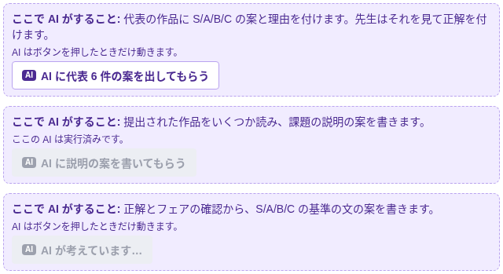

# 「AI に相談」

> **🆕 Smalruby 独自** — 上流に無い部品。押したときだけ AI を動かす所の見た目

部品は `packages/scratch-gui/src/components/ask-ai/ask-ai.jsx`（`AskAi` と `AskAiButton`）。見本: [`0511-ask-ai.png`](../screenshots/0511-ask-ai.png)（上から: 押せる・一度実行した・動いている）。



## いつ使うか

- 先生（や生徒）が**ボタンを押したときだけ AI を動かす**所。AI は費用がかかるので、ひとりでに動かさない。
- 「AI に相談といえばこの見た目」として、どの画面でもこの部品を使う。AI のボタンを、ふつうの主ボタン・副ボタンの形で作らない。
- 置き場所は、その手順（小手順）の**中の上のほう**。プログラミングに詳しくない人が、まず AI を押したくなる場所に置く。

## 形のきまり

| きまり | 中身 | 理由 |
|---|---|---|
| 紫の囲み | 淡い紫の地・紫の点線の枠・濃い紫の文字 | AI の所がひと目で分かる。クラス管理の操作の青・済んだ緑・注意のオレンジとぶつからない |
| 「ここで AI がすること」を 1 文で | 囲みの先頭に「ここで AI がすること:」に続けて 1 文（`description`） | なぜそこに AI のボタンがあるのかが、押す前に分かる |
| 押したときだけ動く、と添える | 「AI はボタンを押したときだけ動きます。」（部品が出す） | 費用の心配を減らし、押さずに自分で書いても進めることを伝える |
| ボタンに「AI」の印 | ボタンの文字の前に、濃い紫の地に白い「AI」の札 | AI を使うボタンと、ふつうのボタンを見分ける |
| 一度実行したら押せない | `used` のとき、ボタンは押せない見た目（灰色）になり、添え書きが「ここの AI は実行済みです。」に変わる | 費用。二重に呼ばない |
| 動いている間も押せない | `running` のとき、ボタンの文字が「AI が考えています…」になり押せない（`aria-busy`） | 二重に呼ばない |
| 結果は囲みの中に | AI の案などは `children` でボタンの下に出す | どこの AI の結果かが分かる |

## 色と大きさ

| もの | 値 | トークン |
|---|---|---|
| 囲みの地 | `#f1ecff` | `$color-ai-background` |
| 文字・印の地・ホバーの枠・フォーカスの輪 | `#4b2a91`（地に 9:1 以上・白に 10:1） | `$color-ai-text` |
| 囲みの点線・ボタンの枠 | `#b9a3ef` | `$color-ai-border` |
| ボタンの地 | 白 | `$color-surface` |
| 押せないボタン | クラス管理の押せないボタンと同じ地と文字。印の地も淡い灰色 | `$color-disabled`・`$color-disabled-text` |
| ボタンの高さ | 36px | `$size-button-height` |
| 囲みの角丸・ボタンの角丸 | 0.5rem・0.25rem | `$radius-medium`・`$radius-small` |
| 文字 | 14px（添え書きは 12px・印は 10px） | `$font-size-medium`・`$font-size-small`・`$font-size-xsmall` |

## 使い方

```jsx
import AskAi from '../ask-ai/ask-ai.jsx';

<AskAi
    testId="grading-rubric-examples-ai"
    description="代表の作品に S/A/B/C の案と理由を付けます。先生はそれを見て正解を付けます。"
    buttonLabel="AI に代表 6 件の案を出してもらう"
    running={running === 'examples'}
    used={Boolean(proposals)}
    onClick={handleProposeAll}
>
    {proposals && <ProposalList proposals={proposals} />}
</AskAi>;
```

| prop | 中身 |
|---|---|
| `description` | ここで AI がすること（1 文・必須） |
| `buttonLabel` | ボタンの文字。「AI に〜してもらう」の形にそろえる（必須） |
| `used` | 一度実行した（もう押せない） |
| `running` | AI が動いている |
| `disabled` | 画面の都合で押せない（材料がそろっていないなど） |
| `children` | ボタンの下に出すもの（AI の結果など） |
| `testId` | `data-testid`。ボタンは `<testId>-button` |

囲みの外でボタンだけを使いたいとき（ツールバーなど、説明を置く場所が別にあるとき）は `AskAiButton` を使う。その場合も、AI が何をするかと押したときだけ動くことを、近くに書く。
