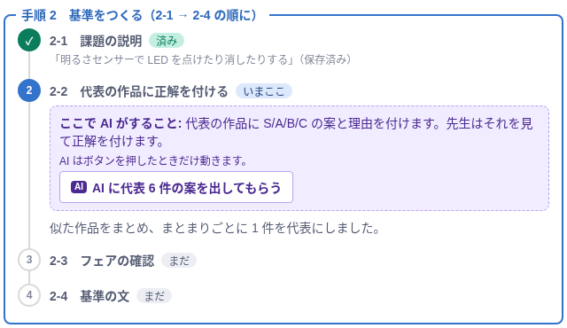

# 縦のステッパー（中の手順）

> **🆕 Smalruby 独自** — 上流に無い部品。外の手順（横の帯）の中にもう一段の手順があるときの形

部品は `packages/scratch-gui/src/components/inner-stepper/inner-stepper.jsx`（`InnerStepper`）。見本: [`0510-inner-stepper.png`](../screenshots/0510-inner-stepper.png)。



## いつ使うか

- 画面の手順（横に並ぶ帯。採点の「1 読み込む → 2 基準をつくる → …」など）の **1 つの手順の中に、順番に進む小手順がある**とき。
- 小手順が順番に進むものなのに、区切り線だけで並べると「ステップ」だと感じない（採点の［基準］タブへの先生の意見）。中の手順をこの部品にする。
- 手順が 1 段だけなら使わない（横の帯だけでよい）。小手順が 2 つ以下・順番の無い入力の集まりにも使わない。

## 形のきまり

| きまり | 中身 | 理由 |
|---|---|---|
| 向きと番号で段を分ける | 外の手順は横の帯、中の手順は縦の並び。番号は外が「2」、中が「2-1」「2-2」… | 2 重の手順でも、どの段の手順かが向きと番号で分かる |
| 枠で囲む | 中の手順全体を太い枠（`$size-stepper-line` = 2px・`$color-step-now`）で囲み、題（「手順 2　基準をつくる（2-1 → 2-4 の順に）」）を枠の上の線に重ねる | 外の手順の 1 つの中にあることを見せる |
| いまの小手順だけ開く | はじめは `now` の小手順を開く（無ければ済んでいない最初のもの・全部済めば閉じる。`initialOpenStepId`）。開くのはいつも 1 つまで | 授業 PC の 600px の高さに収める |
| 済んだ小手順はたたむ | 閉じた小手順は、`summary` があれば 1 行で出す（「説明を保存した」など） | 開かずに、何を決めたかが分かる |
| 見出しを押すと開く | 見出しはボタン（`aria-expanded`）。押すとその小手順を開き、開いていたものは閉じる。もう一度押すと閉じる | 前の小手順を見返せる |
| 状態は文字でも伝える | 番号の丸の色に加え、見出しに「済み」「いまここ」「まだ」の札を付ける。いまの小手順は `aria-current="step"` | 色だけで伝えない |
| 済んだ丸は ✓ | 番号の丸は、済んだら ✓、それ以外は小手順の番号（`2-2` なら `2`） | |

## 状態と色

| 状態（`state`） | 番号の丸 | 札 | トークン |
|---|---|---|---|
| `done`（済み） | 緑の塗りに白い ✓ | 淡い緑の地に緑の文字「済み」 | `$color-step-done`（= `$color-seat-submitted`・白い文字が 5.1:1）・`$color-success-background` |
| `now`（いまここ） | 青の塗りに白い番号 | 淡い青の地に濃い青の文字「いまここ」 | `$color-step-now`（= `$color-action`・白に 4.7:1）・`$color-seat-joined` / `$color-seat-joined-text` |
| `todo`（まだ） | 白地に枠線の色の輪・淡い番号 | 灰色の地「まだ」 | `$color-step-todo`（= `$color-border`）・`$color-disabled` |

色は既存のクラス管理の意味に合わせた（青 = いま・操作、緑 = 済んだ。座席の色と同じ）。赤は使わない（クラス管理の R4）。

## 大きさ

| もの | 値 | トークン |
|---|---|---|
| 番号の丸 | 26px（`1.625rem`）。左の列の幅も同じ | `$size-stepper-marker` |
| 枠・丸の輪・縦の線 | 2px | `$size-stepper-line` |
| 枠の角丸 | 0.5rem | `$radius-medium` |
| 見出しの文字 | 14px・太字 | `$font-size-medium`・`$font-weight-bold` |
| 札・まとめの文字 | 12px | `$font-size-small` |

## 使い方

```jsx
import InnerStepper from '../inner-stepper/inner-stepper.jsx';

<InnerStepper
    testId="grading-rubric-steps"
    title="手順 2　基準をつくる（2-1 → 2-4 の順に）"
    steps={[
        { id: 'describe', number: '2-1', title: '課題の説明', state: 'done', summary: '説明を保存した', content: <Describe /> },
        { id: 'examples', number: '2-2', title: '代表の作品に正解を付ける', state: 'now', content: <Examples /> },
        { id: 'fairness', number: '2-3', title: 'フェアの確認', state: 'todo', content: <Fairness /> },
    ]}
/>;
```

| prop | 中身 |
|---|---|
| `title` | 枠の題（必須） |
| `steps` | 小手順 `{id, number, title, state, summary?, content}` の配列（必須） |
| `openStepId` / `onToggleStep` | 開く小手順を使う側が決めるとき（「次へ」で次の小手順を開くなど）。`openStepId` を渡すと部品は自分で開閉せず、見出しを押すと `onToggleStep(id)` を呼ぶ。渡さなければ部品の中で開閉する |
| `testId` | `data-testid`。小手順は `<testId>-step-<id>`（`data-state` 付き）、見出しは `<testId>-head-<id>`、まとめは `<testId>-summary-<id>` |

小手順の中で AI を使うときは、中の上のほうに [「AI に相談」](ask-ai.md) を置く。
