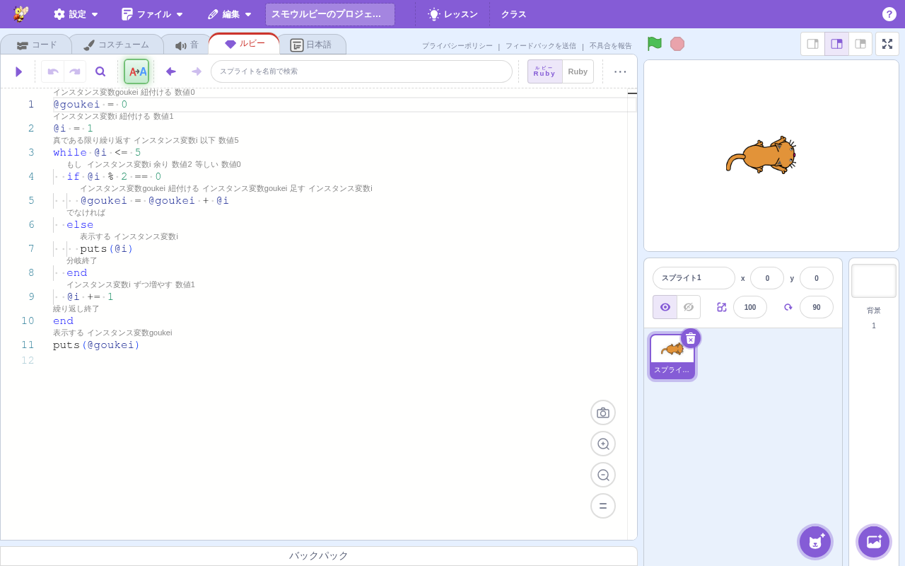
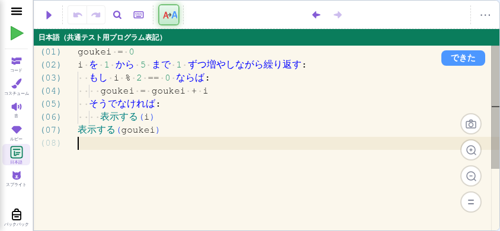
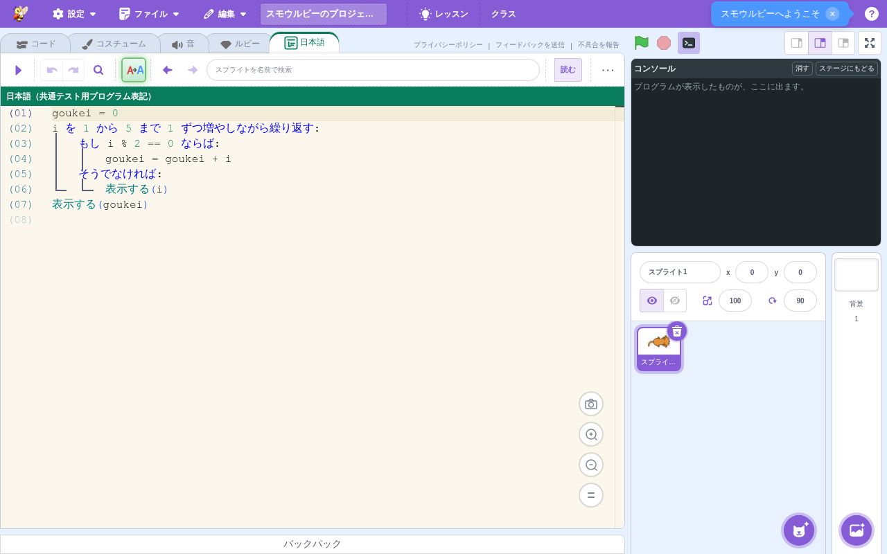
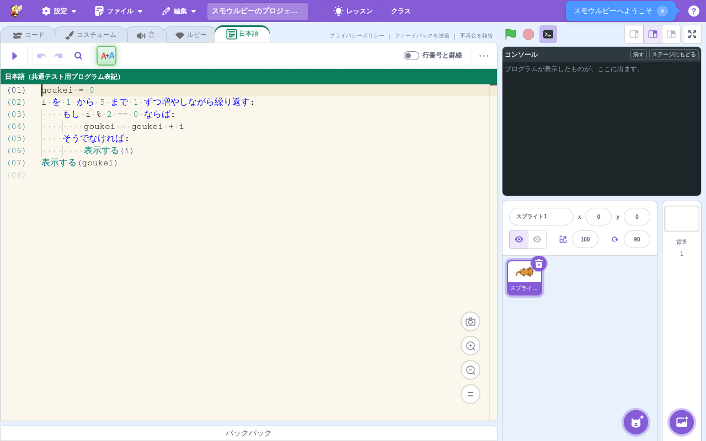
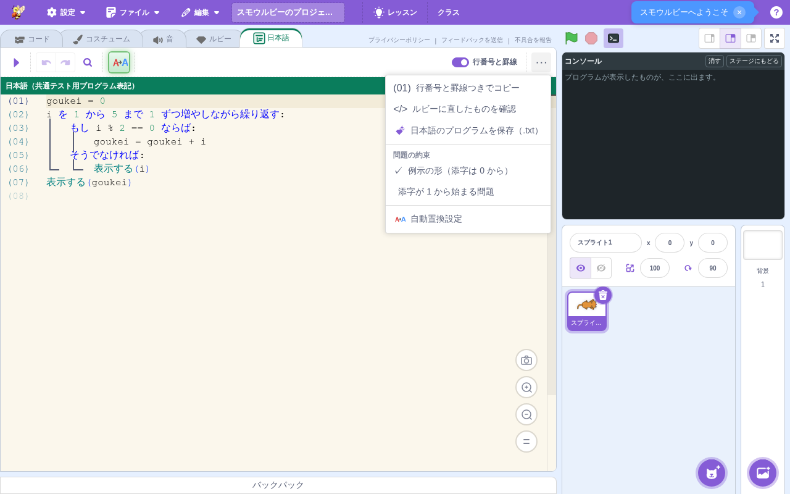
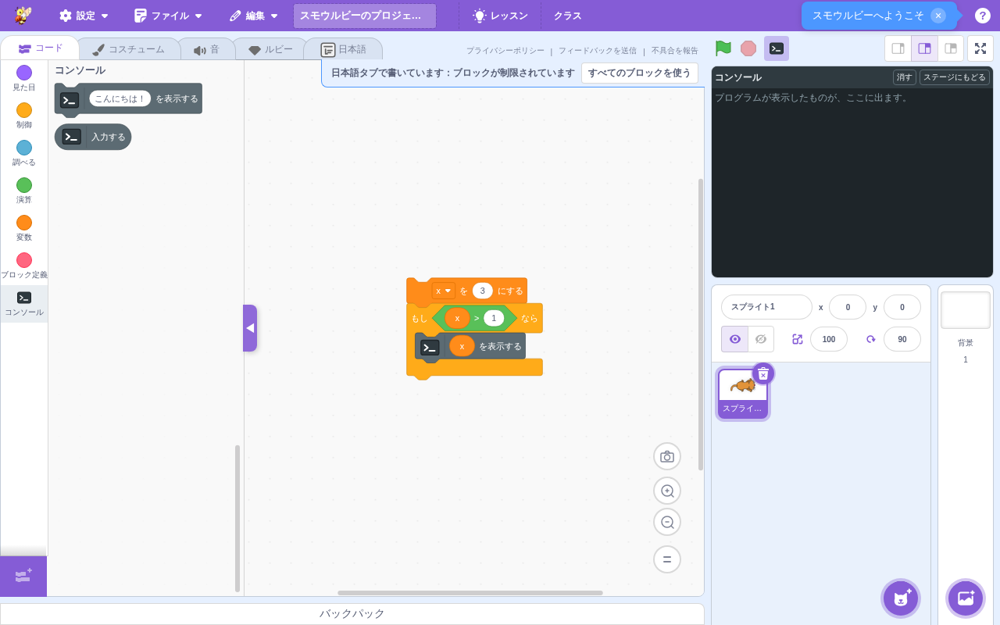

# 日本語モード（共通テスト用プログラム表記）

> **🆕 Smalruby 独自** — upstream に存在しない、Smalruby のために新規追加された機能

> **方針**: 日本語モードが対応するのは、共通テスト「情報I」の**共通テスト用プログラム表記**（情報関係基礎の DNCL とは別物）。文法の決め方と目指す形は [方針](./policy.md) を先に読む。

## 概要

**日本語タブ**で **日本語のプログラミング言語**（コードでは「DNCL モード」と呼んでいる）を使えるようにする機能。`if`, `while` ではなく `もし x > 0 ならば:`, `x > 0 の間繰り返す:` のように、共通テストの問題と同じ日本語の書き方でプログラムを書いて動かせる。

日本語モードが対応するのは、共通テスト「情報I」の共通テスト用プログラム表記で、その例題に合わせた書き方を**標準の形**、`を実行する` で閉じる・`かつ` を使う以前の書き方を **DNCL 風の形**と呼ぶ（[方針](./policy.md)）。Smalruby はこれを内部的に Ruby コードにトランスパイルしてから Scratch ブロックに変換して実行する。

```
日本語のコード → (ja-notation: 日本語の構文木 → Ruby の構文木) → Ruby コード → Scratch ブロック → 実行
```

**標準の形の貼り付け**: 共通テスト用プログラム表記の形のプログラム（非公式の例題集 [nodai2hitc.github.io/ictl_example](https://nodai2hitc.github.io/ictl_example/) などの形も）を **そのままコピペして実行** できる。`(N) ` 行番号、`｜` / `⎿` インデントマーカー、`もし ... ならば:` 末尾コロン、`の間繰り返す:` / `増やしながら繰り返す:` 形式、`hidari = 0 , migi = kazu - 1` のような同一行複数代入、`and` / `or` / `not`、`NAME(ARGS) を定義する` 形式の関数定義などをサポート。詳細は「標準の形の読み込み」セクション参照。

ブロック → Ruby → DNCL の逆方向変換にも対応しているため、ビジュアルブロックで作った作品を日本語コードで読むことも可能。書き出しは**標準の形**（字下げと行末の `:`、`and` / `or` / `not`。下の「書き出しの形」）で、DNCL 風の形（`を実行する` で閉じる・`かつ`）は読み込みだけ受け付ける。

## ユーザーストーリー

- **小学校高学年**として、英語を覚えなくても本格的なプログラミングをしたい
- **共通テスト対策中の高校生**として、問題文の共通テスト用プログラム表記のプログラムを、そのまま動かして読み解く練習をしたい
- **教師**として、英語キーワードに躓く生徒に「日本語でプログラミングできる」段階的な学習体験を提供したい
- **プログラミング初心者**として、`if (x > 0) { ... }` のような記号より「もし x > 0 ならば」のように母国語で読みたい

## UI / 操作フロー

日本語は「Ruby の表し方の 1 つ」ではなく**別の言葉**なので、ルビータブとは別の **日本語タブ**（`gui-tab-japanese`。ルビータブ `gui-tab-ruby` の右）で書く（設計は [`design.md`](./design.md) の 1 章）。ルビータブはふりがな・Ruby の 2 つだけになり、ツールバーに「日本語」のボタンは無い。

日本語タブの見た目は下の「読むモード」の画像（緑のタブと帯・紙の色）。ルビータブ（赤のタブ。ツールバーはふりがな・Ruby の 2 つ）:



スマホ（MobileGui）では、左のサイドレールのルビーの次に「日本語」:



| タブ | 表示内容 | 見た目 |
|---|---|---|
| ルビー | `if x > 0`（ふりがな・Ruby の 2 つ） | 選ばれたタブの文字と上の線が赤（`$color-language-ruby`）。エディタの地は白 |
| 日本語 | `もし x > 0 ならば:` | 選ばれたタブの文字と上の線が緑（`$color-language-japanese`）。エディタの上に緑の帯「日本語（共通テスト用プログラム表記）」（`ruby-tab-language-band`）。エディタの地は淡い紙の色（`$color-japanese-paper`。Monaco のテーマ `smalruby-japanese-paper`）。行番号は `(01)` |

- 2 つのタブは**同じエディタ**を使う（日本語タブは自分のパネルを持たず、ルビータブのパネルを出す）。プログラムの正はいつもブロック（とその Ruby）で、日本語のテキストは保存しない。
- **日本語タブを開くと**: いまの Ruby を日本語にしてから見せる。日本語にできない Ruby（`move(10)` のような日本語に無い命令、後判定の繰り返しなど）のときは日本語にせず、**ルビータブに移って** Ruby の行にエラーを出す（日本語にして Ruby に戻し、ブロックにできるかまで試してから切りかえる）。調べているあいだは帯が出て、ルビータブのふりがな・Ruby のボタンは押せない。
- **コンソール**: 日本語タブで日本語を見せているあいだは、ステージの代わりにコンソールを出す（出すのは画面だけ。コンソール拡張機能は、日本語 → Ruby の変換で `表示する` / `【外部からの入力】` が出たときに初めて作品に足す。`src/lib/smalruby-console.js` の `showSmalrubyConsole`。[`docs/extension-smalruby-console/`](../extension-smalruby-console/)）。日本語にできずルビータブへ戻ったときは出さない。ルビータブを開くとステージに戻す（`hideSmalrubyConsole`）。日本語タブからコード・コスチューム・音のタブへ移ったときはそのまま。
- **ルビータブを開くと**: いつも Ruby で見える（日本語タブで書いたプログラムは Ruby になる）。ふりがなは、ルビータブの設定（`smalruby:furiganaEnabled`）のまま。
- **日本語タブからコード・コスチューム・音のタブに移っても**、日本語で書いている続きとして扱い、コードタブのブロックは日本語で書けるものだけに絞る（下の「ブロック制限の通知」）。ルビータブを開くか、コードタブの通知の「すべてのブロックを使う」を押すと戻る。日本語タブを開くと、また絞る。
- 日本語タブは**日本語の表示（`ja` / `ja-Hira`）のときだけ**出す。ほかの言葉の表示では隠し、日本語タブにいたらルビータブに移る。
- **レッスン**: レッスンの `allowDnclMode`（既定 false）が false のあいだは、日本語タブを押せない（薄く出し、ツールチップで「このレッスンでは日本語タブを使えません」）。日本語タブにいるときにそういうレッスンが始まったら、ルビータブに移る。DNCL のコースのチャレンジは日本語タブで始まる（`setupForChallenge` の既定が `tab: 'japanese'`。前の形の setup `tab: 'ruby', rubyMode: 'dncl'` も日本語タブを開く）。
- **スマホ（MobileGui）**: 左のサイドレールのルビーの次に「日本語」を出す（日本語の表示のときだけ。レッスンで使えないときは押せない）。中身は PC と同じ。
- 日本語タブとふりがなは別もの（日本語タブではふりがなを描かない）。

### 読むモードと書くモード（行番号と罫線）

共通テストの問題と同じ見た目で読めるように、エディタは 2 つのモードで見せる（設計は [`design.md`](./design.md) の 2 章）。

- **読むモード**: 行番号 `(01)` と罫線（縦線と L 字）で、問題と同じ形に見せる。先生が「読むモードにして、行番号 3 を見て」と言える名前にした（日本語モードはプログラムを読む力をつける機能。[`policy.md`](./policy.md)）。
- **書くモード**: 打った文字のまま見せる（空白の点と字下げのガイドも見える）。罫線は打たずに、字下げの空白で書く。

| | 中身 | 保存されるか |
|---|---|---|
| テキスト | エディタの文字。字下げ（と見出しの `:`）でブロックを表す。行番号と罫線は書かない | ブロックに直して作品に保存される |
| 行番号 `(01)` | 日本語モードのあいだは、行の左の欄にいつも `(01)` の形で出す（2 けた。100 行をこえたら 3 けた。最後の改行の後ろの空の行は数えない。コピーと同じ数え方）。欄の幅は桁に合わせる。エラーの印も同じ行番号の隣に出る | 見た目だけ |
| 罫線（縦線と L 字） | **読むモード**のときだけ、字下げの空白の上に重ねて描く。文字の位置は動かない（モードを切りかえても、文字もカーソルも動かない） | 見た目だけ |





- **読むモードになるとき**（スイッチを押さなくても切りかわる）:
  - 書いている途中で **5 秒、入力が無い**とき（`dncl-problem-form-view.js` の `READ_MODE_IDLE_MS`。考えるために手を止めたくらいでは切りかわらず、手を離したらすぐ罫線が見える長さ）。キーを押す・クリックするたびに数え直す。
  - **実行したとき**（緑の旗、ルビーツールバーの実行ボタン）。行番号を見ながら動きを追えるように。
  - **貼り付けた直後**（貼り付けた問題を、罫線で確かめられるように）。
  - エディタの**フォーカスが外れたとき**（検索などでフォーカスが外れたときも）。
- **書くモードにもどるとき**: エディタを**クリックしたとき**・エディタに**フォーカスが移ったとき**・読むモードのまま**文字を打ったとき**（打った文字はそのまま入る）。ブロックや別のスプライトからテキストが変わったときは、モードはそのままで罫線を描き直す。
- **切りかえのスイッチ**: ツールバーの「行番号と罫線」のスイッチ（`ruby-toolbar-rules`・`role="switch"`。日本語タブのときだけ出る。読むモードのあいだは ON で `aria-checked="true"`）。ツールチップは「行番号と罫線を表示して、問題と同じ形で読む」。押してもエディタのフォーカスは動かない（カーソルはそのまま）。書くモードにもどすときは、エディタにフォーカスを移す。形はデザインシステムの「スイッチ」（[`../design-system/components/buttons.md`](../design-system/components/buttons.md)）。
- **罫線は打たない**: テキストでは字下げを空白で書く（罫線の文字 `│` `└` などは打たなくてよい）。キーボードでは、`:` で終わる行（`もし … ならば:`・`… の間繰り返す:`・`… ずつ増やしながら繰り返す:`・`関数 名前(引数):`・`そうでなければ:`）で Enter を押すと次の行が 4 空白字下げされ、中の行で Enter を押すと同じ字下げが続く。`そうでなければ:` / `そうでなくもし … ならば:` は打つと 1 段もどる。ブロックを出るときは、字下げの直後で Backspace（1 回で 1 段もどる）か Shift+Tab。Tab は 4 空白。補完のスニペット（`もし...ならば` など）も 4 空白で入る。罫線の付いた問題をコピーして貼り付けたときは、罫線を読み飛ばして読み込む。
- 罫線は字下げから決める（`dncl-problem-form.js` の `layoutProblemForm`）。字下げの幅の数え方（タブは 4 桁、全角空白は 2 桁）は読み込みと共通（`dncl-indent.js`）。字下げの幅は 2 空白でも 4 空白でもよい。ブロックの最後の行は L 字、それ以外は縦線。
  - **if/else は最後の枝だけ L 字**（次の行が同じ深さの `そうでなくもし` / `そうでなければ` なら縦線のまま）。
  - **DNCL 風の形**（`を実行する` / `を繰り返す` / `と定義する` で閉じる）は、縦線を閉じの行の手前まで引き、L 字にしない。閉じのことばがブロックの終わりを示すので、L 字を足すと終わりが 2 つになり、コピーを読み込むと `end` が 1 つ余る。
  - 空の行と、コメントだけの行は、ブロックを開きも閉じもしない（読み込みと同じ）。前後でつづくブロックの縦線を通す。字下げの無い空の行には、テキストに無い空白を見た目だけ足して縦線を描く。字下げより左に書いたコメントの行は、その行の縦線を省く（文字の位置を動かさない）。
- **コピー**: ふつうのコピーはテキストのまま。`⋯` メニューの **「行番号と罫線つきでコピー」**（`ruby-toolbar-menu-copy-problem-form`。日本語タブのときだけ）は、行番号と罫線（`｜` / `⎿`）を文字で付けた形をクリップボードに入れる（行の終わりの空白は落とす）。これを日本語モードに貼り付けると、同じプログラムとして読み込める。


### 日本語タブのツールバーとメニュー

ツールバーはルビータブと同じ並び・大きさ・ツールチップで、日本語タブに要らないものを出さない。

| 部分 | 日本語タブ | ルビータブ |
|---|---|---|
| 実行・元に戻す / やり直す・検索・自動置換 | 同じ | 同じ |
| スプライトを選ぶ ◀ ▶ と入力欄（`ruby-toolbar-prev-sprite` など） | **出さない**（スプライトはスプライトのペインで選ぶ） | 出す |
| ふりがな / Ruby | 出さない | 出す |
| 「行番号と罫線」のスイッチ（`ruby-toolbar-rules`） | 出す（上の「読むモードと書くモード」） | 出さない |

`⋯` メニュー（日本語タブ。上から）:



| 項目 | data-testid | 動き |
|---|---|---|
| 行番号と罫線つきでコピー | `ruby-toolbar-menu-copy-problem-form` | 上の「コピー」 |
| ルビーに直したものを確認 | `ruby-toolbar-menu-preview` | ルビータブの「ルビースクリプトを確認」と同じ画面 |
| 日本語のプログラムを保存（.txt） | `ruby-toolbar-menu-download-japanese` | エディタのテキスト（行番号と罫線を付けない形）を、**UTF-8** のテキストファイル `<作品の名前>_<スプライトの名前>_japanese.txt` に保存する。読み込みなおせるように、行番号と罫線は付けない |
| 見出し「問題の約束」 | `ruby-toolbar-menu-settings-heading` | — |
| 例示の形（添字は 0 から） | `ruby-toolbar-menu-settings-pattern-example` | 下の「設定（冒頭の説明文）」 |
| 添字が 1 から始まる問題 | `ruby-toolbar-menu-settings-pattern-index-from-one` | 同上 |
| 自動置換設定 | `ruby-toolbar-menu-auto-correct-settings` | ルビータブと同じ |

「ルビースクリプトを保存」と「クラスを挿入」は Ruby のための項目なので、日本語タブには出さない。ルビータブのメニューは変わらない。

### ブロック制限の通知と、すべてのブロックに戻す導線

日本語で書いているあいだ（日本語タブを開いてから、ルビータブを開くまで）はコードタブのブロックが制限される（後述の「関連ブロック」参照）ため、「ブロックが少ない・拡張機能が選べない」状態に気づけるよう、2 つの導線を用意している。

**通知バナー（コードタブ）**: ワークスペース右上に「日本語タブで書いています：ブロックが制限されています」バナー（`data-testid: dncl-mode-notice`）を常時表示する。見た目はデザインシステムのお知らせの色（`$color-info-background`・`$color-info`。[`../design-system/components/alerts.md`](../design-system/components/alerts.md)）で、ボタンは小さい副ボタンの形。



「すべてのブロックを使う」ボタン（`data-testid: dncl-mode-notice-exit-button`）を押すと confirm ダイアログを表示し、OK でタブ切り替えなしで全ブロックを即時復元する。

**拡張機能ボタンの confirm ダイアログ**: 日本語で書いているあいだに拡張機能ボタン（`data-testid: extension-button`）を押すと、「日本語タブで書いているあいだは、拡張機能と一部のブロックは使えません。すべてのブロックと拡張機能を使えるようにしますか？（日本語タブに戻ると、また制限されます）」の confirm ダイアログを表示する。OK で全ブロックに戻して拡張機能ライブラリを開く。キャンセルでは何も変わらない。

どちらの導線も Redux signal パターンで実装している:

```
バナー / 拡張機能ボタン (OK)
  → dispatch(setDnclMode(false))             ← blocks.jsx が即座に全ブロック表示に更新
  → dispatch(requestExternalExitDnclMode())  ← ruby-tab へのシグナル（日本語タブにいればルビータブへ）
```

エディタはこのあと開いたタブに従う（ルビータブなら Ruby、日本語タブならまた日本語にしてブロックを絞る）。レッスンが日本語を許さないとき（`lesson-mode.jsx`）も同じシグナルを使う。

### 生成AI に相談

日本語タブでも、クラスで生成AI を使う生徒にはエディタの左下にルビティーの顔が出て、生成AI（Gemini など）に
相談できる。質問文はエディタの日本語のまま作り、答えは**標準の形**（字下げと行末の `:`、`=`、`and` / `or` / `not`、
`表示する(…)`・`【外部からの入力】` はコンソール。添字は冒頭の説明文が無ければ 0 から）でもらう。行番号・罫線の付いた
答えや DNCL 風の形の答えも読む。貼り戻した答えは、エディタと同じ変換（ja-notation）で Ruby に直してから確かめ、
エラーはソースマップで日本語の行に戻して見せる。詳しくは [`docs/genai-consult/README.md`](../genai-consult/README.md) の
「日本語 (DNCL) モード」。

## 主要ファイル

### scratch-gui

#### DNCL ↔ Ruby トランスパイラ

`packages/scratch-gui/src/lib/dncl/`:

| ファイル | 役割 |
|---|---|
| `dncl-to-ruby.js` | 日本語 → Ruby 変換のエントリポイント（`dnclToRuby`）。ja-notation（下の「日本語 → Ruby の変換（ja-notation）」）で読んで Ruby と行の対応を作り、誤りを `ja-notation-errors.js` で日本語モードの文言にする |
| `ja-notation-table.js` | ja-notation に渡すスモウルビーの表（`表示する` → `console.puts`、大文字の名前 → `@_var_X_` / `@_array_X_`、入力 → `console.gets` など。`console` はコンソールの拡張機能のブロック）と、その逆向きの表（`SMALRUBY_RUBY_TO_JA`: `console.puts` / `puts` / `say` / `p` / `print` → `表示する`、`.to_i` → `整数` など、`@_array_X_` → `X`、`console.gets` の代入と、`ask("")` と次の行の `answer` → 入力）。組み込み関数の一覧 `DNCL_BUILTIN_NAMES`（生成AI に相談の質問文の命令の例にも使う） |
| `ja-notation-errors.js` | **ja-notation の誤りを、日本語モードで見せる文言にする対応表**（日本語 → Ruby の `jaNotationErrors`、Ruby → 日本語の `rubyErrorWords`）。下の「誤りの文言」 |
| `dncl-indent.js` | **字下げの幅の数え方**（`indentWidth`: タブは 4 桁・全角空白は 2 桁、`indentOffset`: ある幅の位置の字下げの文字）。読むモードが使う（ja-notation の読み方も同じ数え方） |
| `dncl-problem-form.js` | **読むモードの配置**（`layoutProblemForm`: 行ごとの行番号 `(01)` と罫線の位置・種類、`problemFormText`: 行番号と罫線を文字で付けた形）。エディタの描画（`dncl-problem-form-view.js`）と「行番号と罫線つきでコピー」が使う |
| `dncl-line-number.js` | **行番号と本文の間の区切り**（`lineNumberSeparator`）。行番号の後ろの空白のうち、どこまでが区切りでどこからが字下げかを決める。`dncl-paste-tidy.js` が使う |
| `dncl-paste-tidy.js` | **貼り付け時の整形**（日本語モードのエディタに貼り付けた行番号付きのテキストの行番号を消し、`//` コメントを `#` に直す。下の「貼り付け時の整形」）と、`//` のある行の変換エラーに「`//` はコメントではない」と添える `withDoubleSlashHint` |
| `dncl-string-arithmetic-hint.js` | **文字列と `-` `*` `/` の警告**（`stringArithmeticRows`）。文字列を `+` でつないだ後の `-` や、文字列に `-` `*` `/` を使う行を見つける。`ruby-tab.jsx` が警告マーカー（`gui.rubyTab.dnclStringArithmeticHint`）にして、数の計算をかっこで囲むよう表示する。下の「文字列と数の計算」 |
| `dncl-array-index-hint.js` | **範囲外の添字の警告**（`findArrayIndexHints`）。1 から始まる添字で書いたときのように配列の範囲外を読む `X[i]` / `X[3]` を見つける。ja-notation の `parse` で読んだ構文木を見る（読めないプログラムには出さない）。`ruby-tab.jsx` が警告マーカー（`gui.rubyTab.dnclArrayIndexHint`）にして、添字が 0 から始まることと直し方を表示する。下の「配列の添字は 0 から」 |
| `dncl-index-note.js` | **貼り付けたテキストの「添字は 1 から始まる」の注釈を見つける**（`hasOneBasedIndexNote`）。コメントだけを見る。下の「貼り付け時の添字の設定」 |
| `dncl-settings.js` | **設定のパターン**（`dnclSettingsPatternId` / `dnclWithSettingsPattern` / `dnclWithIndexFromOne`）。冒頭の説明文からいまのパターンを読み、パターンの説明文を書いてプログラムをその設定で表し直す（Ruby を通るので意味は変わらない）。下の「設定（冒頭の説明文）」 |
| `dncl-keywords.js` | DNCL キーワード定義（`もし`, `ならば`, `を繰り返す` など）|
| `dncl-validator.js` | 日本語モードに無いことばの判定（`findUnsupportedCommands` / `isPostTestLoopLine`）と、その文言・id。ja-notation が読めない行の言いかえ（`ja-notation-errors.js`）が使う。文言と id は Ruby → 日本語の誤りにも使う |
| `dncl-source-map.js` | DNCL 行 ↔ Ruby 行のマッピング（エラー位置表示用。詳細は下の「エラー行の対応（ソースマップ）」）|
| `dncl-block-filter.js` | DNCL モードで使えるブロックのフィルタ |
| `paren-utils.js` | 括弧と名前の文字の判定（`findMatchingClose` / `skipString` / `isNameChar` / `isWholeWordAt`、名前の正規表現の `NAME_PATTERN` / `NAME_CHAR_PATTERN`）。名前の文字は ja-notation の判定をそのまま使う（下の「名前に使える文字」）。`dncl-validator.js`・`dncl-paste-tidy.js`・`dncl-index-note.js` と文字列の計算の警告が使う |
| `dncl-trailing-comment.js` | **行末の `# コメント` の切り分け**（`splitTrailingComment` / `codeOfLine`）。日本語の行の判定（貼り付けの整形、文字列の計算の警告、読めない行の言いかえ）が、行末のコメントを外してから行を見る。文字列（`"..."` / `'...'` / `「...」`）の中の `#` はコメントにしない |
| `ruby-to-dncl.js` | Ruby → 日本語変換のエントリポイント（`rubyToDncl`）。prism で解析し、ja-notation（下の「Ruby → 日本語の変換」）で読んで標準の形で書き、誤りを `ja-notation-errors.js` で日本語モードの文言にする。prism を先に読みこんでおく（`loadPrism()`） |

#### 日本語 → Ruby の変換（ja-notation）

日本語 → 日本語の構文木（JaAST）→ Ruby の構文木 → Ruby のテキストと行の対応、の順に変換するライブラリ。
設計は [`../ruby-editor/converter-roadmap.md`](../ruby-editor/converter-roadmap.md) の 2 章・4 章。**標準の形と DNCL 風の形を同じ解析で読み**、
JaAST では 1 つの形にする。エディタの日本語 → Ruby（`dnclToRuby`）はこれだけを使う（行ごとに書きかえる前の変換は残していない）。
切りかえる前の変換と同じ Ruby（prism の構文木で比べる）・同じ行の対応になることを、コーパスのゴールデンで確かめている。

DNCL 風の形の読み方（切りかえる前の変換に合わせたもの）:

- `:` の無い開く行（`もし … ならば`、`… の間`、`… ずつ増やしながら`、`関数 名前(引数)`、`名前(引数) を定義する`）のブロックは、閉じる行
  （`を実行する` / `を繰り返す` / `と定義する`。`end` も）か `⎿` で終わる。中の字下げは見ない。閉じる言葉はブロックの種類に合わせる（`もし` は `を実行する`、`〜の間` と数える繰り返しは `を繰り返す`、関数は `と定義する`）。
  合わない言葉で閉じると、初心者に少しでも多く指摘するため誤りにする（下の「閉じ忘れのエラー」）。`end` は Ruby と同じく、どのブロックも閉じる。
  標準の形（字下げ）では閉じる言葉を書かないので関係しない。
- `:` のある行のブロックは字下げで終わる。同じ字下げの閉じる行はそのブロックを閉じる。`:` があっても次の行が深くないときは、閉じる行で終わるブロックになる。2 つの形は混ぜてよい。
- `←` は `=`、`かつ` / `または` は `and` / `or`、後ろに付く `でない` は、前の `かつ` / `または`・`(`・`,`・`=` までをまとめて否定する（`a > 10 でない` は `not (a > 10)`）。
  `でない` の後に演算子が続くときは、否定したものがその左側になる（`a でない == b` は Ruby の `!a == b`）。
- 「...」は `"..."` の文字列（中の `"` と `\` は文字のまま）。`X を返す` は `返す X`。
- 閉じる行で閉じたブロックの `end` は、その行に置く（行の対応・行末のコメントもその行）。

| ファイル | 役割 |
|---|---|
| `packages/ja-notation/`（ワークスペースのパッケージ `@smalruby/ja-notation`。MIT。`LICENSE` あり） | ライブラリ。依存は無く、`src/` の外を import しない（`packages/ja-notation/test/boundary.test.js`）。使い方・JaAST の形・テストのデータは `packages/ja-notation/README.md`。下の `ja-notation/<ファイル>` は `packages/ja-notation/src/<ファイル>` |
| `ja-notation/lexer.js` | 1 行を字句に分ける。文字列とコメントの外の全角英字・全角数字（`ｘ１` `１２`）はまず半角にし（`halfWidthAlphanumerics`）、全角の演算子・`≦` など、コメントの `＃` は半角のものとして読み、`“…”` は文字列として読む。名前の文字の判定（`isName` / `isNameHead` / `isNameChar`。下の「名前に使える文字」）もここにあり、エディタの判定（`paren-utils.js`）も同じものを使う |
| `ja-notation/parse.js` | 日本語を読む。標準の形（行番号・`｜` `⎿`・字下げ・`ならば:`・`and` / `or` / `not`）と DNCL 風の形（閉じる行・`←`・`かつ`・`でない`・「...」）。JaAST の形は `ja-notation/ja-ast.js` |
| `ja-notation/build-ruby.js` | JaAST → Ruby の構文木（prism のノード名を使う小さな形）。変数の名前・関数・入力は外から受けとる表で決める |
| `ja-notation/write-ruby.js` | Ruby のテキストと、Ruby の行ごとの日本語の行を書く |
| `ja-notation/run.js` | 構文木をたどる処理（ジェネレーター）を自前のスタックで動かす（`run`・`each`）。深い構文木で呼び出しのスタックが尽きないように |

名前に使える文字（`ja-notation/lexer.js` の `NAME_HEAD_RE` / `NAME_TAIL_RE`。Issue #1714）:

- 1 文字目: 英字・`_`・どの文字体系の文字（Unicode の `\p{L}`。かな・漢字（CJK 拡張 A〜と BMP の外の `𠮷` も）・`々`・`〆`・`ヵ` `ヶ`・`ー`・ギリシャ文字など）・
  文字としての数字（`\p{Nl}`。`〇` `Ⅱ`）と、ひらがな・カタカナの区画の記号（`゛` `・` など。前から読めていたもの）
- 2 文字目から: 上に加えて、数字（`\p{Nd}`）と結合文字（`\p{M}`。`か` + `゙`）
- Ruby はこれらをどれも名前に使えて、Ruby → 日本語は名前をそのまま書く（`@佐々木` → `佐々木`）。日本語 → Ruby が同じ範囲を名前として読むので、書いた名前は読み戻せる。
- 全角英字・全角数字は、文字列（`"…"` `'…'` `「…」`）とコメントの外では、読む前にすべて半角にする（`ｘ１` は `x1`、`ａｎｄ` は `and`）。見た目だけの揺れで（`policy.md`）、Ruby モードの自動置換も半角にするのと同じ考え。
  文字列とコメントの中は書いたとおりに残す（`表示する("ＡＢＣ")` は `"ＡＢＣ"` のまま）。全角と半角は 1 字ずつ同じ長さなので、誤りの列は変わらない。
  Ruby → 日本語は Ruby の名前をそのまま書く（`@ｘ` → `ｘ`）ので、日本語から Ruby に戻すと `@x` になる。
- `☆` `①` `😀` のような記号は名前に使えず、「「☆」が読めません」の誤りになる（BMP の外の文字も 1 文字として示す）。

誤りは `{code, message, line, column}` に、日本語モードの文言を作るための `name`（字句）・`opener` / `direction` / `colon` / `word`（ブロック）・`block`（`stray-closer` / `closer-indent` / `closer-kind` / `stray-branch`）・`expected`（`closer-kind` のブロックの閉じのことば）を添えて返す。

テスト: ライブラリだけのもの（表なし・ほかの処理系の表）は `packages/ja-notation/test/`（データは `test/data/*.json`。`node --test`）。スモウルビーの表を通したものは scratch-gui の `test/unit/lib/ja-notation/corpus.test.js`（コーパスのゴールデンとの比較）と `build-and-write-ruby.test.js`。

#### Ruby → 日本語の変換（ja-notation）

Ruby → prism の構文木 → JaAST → 日本語（標準の形）、の順に変換する（設計の d・e）。行ごとの文字列の置きかえ（切りかえる前の変換）は残していない。
prism の解析の関数は外から受けとり（`rubyToJa(source, { parse, ...表 })`）、prism のノードは `prism-reader.js` だけが読む（ノードの種類は `toJSON().type`、使う欄だけ）。

- 読み方（`read-ruby.js`）: 組み立て（`build-ruby.js`）が書く Ruby をそのまま JaAST に戻す。`@i = 1` の次の行の `while @i <= 10`（`>=` も）は、本体の最後の文が
  `@i += 1` / `@i -= 1` / `@i += -1` / `@i = @i + 1` のように増分を足し、増分の向きが条件（`<=` は増やす、`>=` は減らす）と合い、増分が数とインスタンス変数（`.to_i` などを含む）だけの式で、
  本体のほかの文が変数も増分も変えないときだけ `〜ずつ増やしながら繰り返す` にする。それ以外は `i = 1` と `i <= 10 の間繰り返す:` のまま。
  `(a / b).to_i` は `a ÷ b`、`-((a / b).to_i)` は `-a ÷ b`（日本語では `-(a ÷ b)` と読むので、符号を `÷` の左に置く）。`((-a) / b).to_i` は `÷` にしない（`整数(-a / b)`）。
  `!(...)` のかっこは残す（`not (a > 10)`）。`until 条件` は `not 条件 の間繰り返す:`、`wait until 条件` は中身の無い繰り返し。
- 日本語に書きかえるものが無い Ruby（`with_screen_refresh do` / `loop do` / `list.each do |x|` などの `xxx do`、`unless`、後置の `if`、`begin … end while`、`nil` など）は、
  **書いてあるとおりの Ruby のまま**（`end` も）残す（JaAST の `RubyCode`）。中の命令と数の誤りは、そのまま Ruby の行に出す（日本語モードはこうした Ruby を切りかえで受け付けない）。
  それ自体が誤りでない Ruby（`case` / `when`、ハッシュ `{}`、シンボル `:a`、後置の `unless` / `if`、三項演算子、`nil` など）も、黙って残さずに `no-ja-form` の誤りにする
  （黙って残すと、日本語に戻したときに「「@」は使えません」「「{」が読めません」のような見当違いの誤りになるため）。誤りは残した Ruby のいちばん外のものに 1 つだけ出し、
  キーワードで始まるものはキーワードの位置にキーワードの名前で（`unless`）、それ以外は先頭の位置に Ruby の字（1 行目の 20 字まで。長いものは `…`）で出す。
  その Ruby に命令や `break` の誤りがすでに出ているときは足さない。prism が文法の誤りを出したときは足さない（立て直しのノードの誤りを並べないため）。
  ステージの変数・リスト（`$g`）は、日本語モードが想定しない（[`design.md`](design.md) の「ステージの変数は書かない」）ので、
  書いてあるとおりに残したうえで、`$g` の名前の位置（読むところ・代入・`+=`・多重代入の左辺・`$g.push(1)` の受け手）に `stage-variable` の誤りを出す
  （`no-ja-form` や `push` の命令の誤りは足さない）。
  表を渡さないとき（ほかの処理系）は、大文字の名前（Ruby の定数 `A`）も名前として読む（`buildRuby` がそう書くため）。
  `N.times do` と `(a..b).step(s) do |i|` / `a.step(b, -s) do |i|` は `〜ずつ増やしながら繰り返す` にする。
- 書き方（`write-ja.js`）: 下の「書き出しの形」。演算子は日本語の読み方（`parse.js`）の強さで、要るところだけかっこを付ける（Ruby に書いてあったかっこは残さない。`not` の後ろは上のとおり）。
  空行は Ruby の空行の位置に残す（読み手が JaAST に `blankLines` を付ける）。行末のコメントは、その Ruby の行から作った日本語の行の末尾に付け直す。
- 誤り: 日本語モードに無い命令（`unknown-command`。`(` の付いた名前、括弧の無いメソッド、受け手のあるメソッド、`xxx do` の `xxx`、`break` / `next` / `redo` / `retry`）、
  数の書き方（`bad-number`）、後判定の繰り返し（`post-test-loop`。`begin` と `end while` の行）、日本語に無い書き方（`no-ja-form`。上の `RubyCode`）、ステージの変数（`stage-variable`）、Ruby の文法の誤り（`ruby-syntax`）。行と列は Ruby の行。
  命令と取らないのは、表にある呼び出し、プログラムで `def` した名前、`dncl-keywords.js` の `RUBY_LITERALS`（`answer` / `ask` など）。ローカル変数は prism が変数と分かるので取らない。
- 構文木をたどる処理（日本語の読み方・Ruby の組み立てと書き出し・prism の構文木の読み方・日本語の書き出し）は、再帰ではなく自前のスタックでたどる
  （`ja-notation/run.js`。処理はジェネレーターで書き、子をたどるところで `yield` する）。項が数千ある式、数千重ねたかっこ・符号・呼び出し、深く入れ子にしたブロックでも、
  JavaScript の呼び出しのスタックが尽きない。prism 自身は構文木を JavaScript に読み出すところが再帰なので、数千項の `+` などは解析できず、
  Ruby → 日本語ではその式を誤り（「プログラムが長すぎて日本語にできません」）にする（`ruby-to-dncl.js`）。

| ファイル | 役割 |
|---|---|
| `ja-notation/prism-reader.js` | prism のノードを読むただ 1 つの場所（種類・欄・フラグ、バイト位置 → 行と列） |
| `ja-notation/read-ruby.js` | prism の構文木 → JaAST（`readRuby`）。Ruby の名前と呼び出しが日本語で何になるかは外から受けとる表で決める |
| `ja-notation/write-ja.js` | JaAST → 標準の形の日本語（`writeJa`） |
| `ja-notation/settings.js` | 設定（添字の始まり・コメントの記号・論理演算子の説明）。冒頭のコメントの決まった文から読み（`readSettings`）、添字を組み立てで 1 ずらし・読むときに戻す（`indexToRuby` / `indexToJa`）。説明文を書く `settingsSentences`、テキストの冒頭から読む `settingsOfSource`、冒頭の説明文を書きかえる `withSettings`、よくある設定のパターン `SETTINGS_PATTERNS`。下の「設定（冒頭の説明文）」 |

テスト: ライブラリだけのもの（表なしの読み方・書き方、式の括弧、設定の読み書きと両向き）は `packages/ja-notation/test/`（データは `test/data/*.json`）。スモウルビーの表を通したものは scratch-gui の `test/unit/lib/ja-notation/read-ruby-write-ja.test.js`（日本語 → Ruby → 日本語が安定すること）、`golden.test.js`（コーパスの出力）、`settings.test.js`（設定ごとの表。両向きと往復、ブロックを通ったとき）。

#### 誤りの文言

ja-notation の誤りは `ja-notation-errors.js` が、生徒に見えている文言にする（ことばは ja-notation ではなくスモウルビー側が持つ）。

| ja-notation の誤り | 日本語モードの文言（id） |
|---|---|
| `forbidden`（`@` / `$`） | 「日本語モードでは変数に「@」は使えません」 |
| `bad-number` | 「「0x5」は日本語モードでは書けない数の書き方です（…）」（`unsupportedNumber`） |
| `post-test-loop` | 後判定の繰り返しの文（`postTestLoop`） |
| `unknown-command` | 「「move」は日本語モードでは書けない命令です。Ruby モードでは書けます。」、日本語の名前は「「差分」は定義されていない関数です。「関数 差分(…):」で定義してください。」（`unsupportedCommand`） |
| `no-ja-form` | 「「case」は日本語モードでは書けません。Ruby モードでは書けます。」（`unsupportedNotation`。Ruby → 日本語だけ） |
| `stage-variable` | 「ステージの変数（$a）は日本語モードでは書けません。Ruby モードでは書けます。」（`stageVariable`。Ruby → 日本語だけ） |
| `unclosed` / `empty-block` / `block`（閉じのことば・`そうでなければ`） | 下の「閉じ忘れのエラー」の文 |
| そのほか（読めない字句・式が要る など） | ja-notation の文のまま（「「//」が読めません」など） |

- ことばの誤り（上の表の上 4 つ）があれば、それだけを出す（ブロックの誤りは出さない。切りかえる前と同じ）。
- 読めない行があるときは、Ruby → 日本語と同じ判定（`findUnsupportedCommands`）で Ruby の命令（`with_screen_refresh do`・`[1, 2].each do |x|`・`break if …`・`range(…)` など）を探し、あればその行に「書けない命令」を出す。読めない行が後判定の繰り返しの行なら後判定の文を出す。
- 文言の列は 1 から数える（ブロックの誤りは 1）。


#### エラー行の対応（ソースマップ）

DNCL モードでは、DNCL を Ruby に変換してからブロックに変換するため、変換エラーは **Ruby の行番号**で返ってくる。DNCL と Ruby の行は 1:1 に対応しないので、`DnclSourceMap` で DNCL の行に戻してからエディタにエラーマーカーを表示する（`ruby-tab.jsx` の `showErrors`）。Ruby の桁は DNCL の桁と対応しないため、マーカーは **DNCL の行全体**に付ける（付け替えは `DnclSourceMap#rubyErrorsToDncl`）。Ruby の最終行より後ろ（または 1 行目より前）を指すエラーは、Ruby の最終行（1 行目）に対応する DNCL の行に寄せる。Ruby の方が行数が多いのが普通なので、行番号をそのまま使うと無関係な DNCL の行や存在しない行を指してしまうため。

変換器のエラーの文は、Ruby の文を `"…"` / `「…」` で引用する（`"@a, @b = @b, @a" is the wrong instruction.`）。日本語モードの生徒は書いていない `@` や Ruby の名前を探して見つけられないので、`rubyErrorsToDncl` は、引用がその行の Ruby（文、行、変換器と同じく 40 字で切ったもの）のときだけ、日本語の行に置きかえる（`「a, b = b, a」は命令がまちがっています。`）。置きかえる日本語の行は、行番号・左の罫線（`｜` `⎿`）・行末のコメントを除いたもの。ほかの引用（ヒントの例など）はそのまま残す。

行数が変わる変換と、対応させる DNCL の行:

| 変換 | 行数の変化 | 対応させる DNCL の行 |
|---|---|---|
| 行番号付きの行の継続行を連結（括弧が閉じるまで） | 複数行 → 1 行 | 連結した**先頭の行**（継続行から Ruby の行を引くと、連結後の行） |
| `a = 0 , b = 1` の複数代入を分割 | 1 行 → 複数行 | 元の行 |
| `⎿` からブロックの終了行（`を実行する` など）を追加 | +1 行 | `⎿` のある行 |
| インデントだけで書いたブロックに終了行を自動で追加 | +1 行 | 閉じるブロックの**最後のコード行**（空行・コメントは除く） |
| `増やしながら` / `減らしながら` を初期化 + `while`、終了行を加算 + `end` に展開 | 1 行 → 2 行 | それぞれ元の行 |

対応表は**変換しながら記録する**（行数の比較から推定しない）。ja-notation の `writeRuby` が Ruby の各行の日本語の行（`jaLines`）を書き、`dnclToRuby` がそれを `sourceMap` として返す。日本語の誤りは、はじめから日本語の行で出る。

#### 閉じ忘れのエラー

閉じ忘れや閉じすぎがあるプログラムは ja-notation が読めないので Ruby を作らず、その行に DNCL のことばで誤りを出す（`ja-notation-errors.js`）。Ruby の変換器の「`end` が足りません」のような **Ruby のことば**は出さない。日本語モードの生徒にも、答えを書き直す生成AI にも `end` は関係が無いため。

| 書き方 | エラー（その行に付く） |
|---|---|
| 標準の形（開始の行の終わりが `:`）のブロックの中を字下げしていない | 開いた行に「「もし〜ならば:」の中の行を字下げしてください」（`「〜の間繰り返す:」` / `「〜ずつ増やしながら繰り返す:」` / `「〜ずつ減らしながら繰り返す:」` / `「関数 〜(…):」` も同じ） |
| DNCL 風の形の `もし〜ならば` / `〜の間` / `〜ずつ増やしながら` / `〜ずつ減らしながら` / `関数` / `〜 do` を閉じていない | 開いた行に「「もし〜ならば」を「を実行する」で閉じてください」など |
| 閉じるブロックが無いのに `を実行する` などがある | 「「を実行する」で閉じるものがありません」 |
| `もし` の外の `そうでなければ` / `そうでなくもし` | 「「そうでなければ」の前に「もし〜ならば」がありません」。標準の形（行の終わりが `:`）では、`もし` と字下げが違うとき（浅くても深くても。`｜` の後ろの空白が 1 つ違うだけでも）にこうなるので「「そうでなければ:」は、「もし〜ならば:」と同じ字下げで書いてください」。字下げの違いを同じ深さとみなしたり、近い `もし` に付けたりはしない（黙って別のプログラムにするより、行のわかる誤りのほうが安全なため） |
| 種類の違う閉じのことば（`もし … を繰り返す`・数える繰り返しを `を実行する` で閉じるなど） | 閉じのことばの行に「「もし〜ならば」は「を繰り返す」ではなく「を実行する」で閉じてください」。`:` で開いたブロックを同じ字下げの閉じの行で閉じたときは「「〜の間繰り返す:」は…」（ja-notation の `closer-kind`） |

- 標準の形か DNCL 風の形かは、開いた行の終わりに `:` / `：` があるか（行末のコメントを除く）で決める（ja-notation の誤りの `colon`）。標準の形は字下げでブロックを示すので、閉じのことばを書くようには言わない。
- 標準の形（`:` で開いたブロック）の終わりに書いた閉じのことば（`を実行する` など）は誤りにしない。字下げがどこでも、いちばん内側の開いているブロックを閉じる。`⎿` で閉じたブロックのすぐ後（`⎿` の行も）の閉じのことばは、同じ終わりをもう一度書いたものとして読む（後ろのコメントは残す）。字下げが合わないことを理由に誤り（`closer-indent`）にするのは、`:` で開いたブロックの中の `end` だけ。
- ja-notation は閉じのことばとブロックの種類を照らし合わせ、合わなければ誤りにする（`closer-kind`。数が合っていて Ruby が作れるときも）。`end` はどのブロックも閉じる（Ruby と同じ）。
- 内側のブロックを閉じ忘れて外側の閉じのことばが来たとき（`〜の間` の中の `もし` を閉じ忘れて `を繰り返す`）は、外側ではなく**閉じ忘れた内側**の行に付ける（ja-notation の `unclosed`。間のブロックがすべて DNCL 風の形のとき）。
  ブロックがすべて DNCL 風の形のときは、エディタも閉じのことばの種類を見て同じことを言う（`ja-notation-errors.js` の `closerFormBlockErrors`）。
- `with_screen_refresh do` / `loop do` / `when_flag_clicked do` / `list.each do |x|` など、日本語に書きかえるものが無い `xxx do`（`|x|` 付きも）は Ruby → 日本語で書いてあるとおりの Ruby のまま（`end` も）残す（`N.times do` と `(a..b).step(s) do |i|` は `〜ずつ増やしながら` に、`while x do` / `until x do` は `〜の間` になる）。構文木で読むので、外側のブロックの閉じ方は変わらない。日本語の中にそうした行があるときの判定は `dncl-validator.js` の `isDoBlockLine`（行末のコメントを除いてから行末の `do` だけを見るので、文字列やコメントの中の `do` は数えない）。日本語モードにはこうした命令が無いので、ほかの対応していない命令と同じくその行に「「with_screen_refresh」は日本語モードでは書けない命令です。…」を出し、Ruby には変換しない（下の「日本語モードに無い命令」）。
- `dnclToRuby` はこのエラーを `errors`（日本語の行）として返し、Ruby は作らない。エディタは Ruby を送らず、エラーの印（`ruby-tab.jsx` の日本語の誤りのマーカー。owner は `DNCL_UNSUPPORTED_OWNER`）をその行に出し、前の変換の印（`smalruby`）は消す。生成AI に相談の確かめ（`genai-dncl-answer.js`）も、この誤りを問題として返す。
- 誤りのある日本語は Redux に送らないのでエディタの中にしか無い。そのため、誤りがあるあいだは**日本語タブを離れられず、スプライト（ステージ）も切りかわらない**。
  ルビータブ・コードタブなどを押すと日本語タブに戻り、スプライトを選ぶと前のスプライトに戻って、警告「日本語のプログラムに読めない行があります。印のある行を直してください！」
  （`convertJapaneseError`）を出す。ルビータブが変換できない Ruby で移らないのと同じ。黙って Ruby から書き直すと、生徒の書いた行が消えるため。
  レッスンの設定や言語の切りかえなど、エディタの外から日本語タブを離れるときは止めない。作品を読みこんで元のスプライトが無くなったときも止めない
  （`ruby-tab.jsx` の `dnclEditErrorRef`）。

#### Monaco Editor 言語定義

- `packages/scratch-gui/src/containers/ruby-tab/dncl-mode.js` — Monaco の DNCL 言語定義（トークナイザ、シンタックスハイライト）
- `packages/scratch-gui/src/containers/ruby-tab/dncl-snippets.js` — DNCL コード補完スニペット。ブロックは標準の形（`もし 条件 ならば:` / `〜の間繰り返す:` / `関数 名前(引数):` と字下げ 4 つ。閉じのことばの行は入れない）で入れる
- `packages/scratch-gui/src/containers/ruby-tab/dncl-problem-form-view.js` — 読むモードを Monaco に描く（罫線のデコレーション、行番号 `(01)` の `lineNumbers`、読むモードと書くモードの切りかえ `createProblemFormView`: フォーカス・クリック・入力・5 秒の待ち・貼り付け・`showReadMode` / `toggle`）
- `packages/scratch-gui/src/containers/ruby-tab/dncl-index-setting.js` — 貼り付け時の添字の設定の確認ダイアログと、冒頭への説明文の書きこみ（1 回の Undo。違うところだけを書きかえる `replaceEditorText`。設定のパターンのメニューも使う）（`offerDnclIndexSetting`）
- `packages/scratch-gui/src/components/ruby-toolbar/ruby-toolbar.jsx` — 日本語タブのツールバー（上の「日本語タブのツールバーとメニュー」）。その他メニューの設定のパターン（`ruby-toolbar-menu-settings-pattern-example` / `ruby-toolbar-menu-settings-pattern-index-from-one`。見出し「問題の約束」の下。いまのパターンに ✓）
- `packages/scratch-gui/src/lib/dncl/dncl-download.js` — 「日本語のプログラムを保存（.txt）」のファイル名（`dnclTextFilename`）と中身（`dnclTextBlob`。UTF-8 のテキスト）

#### UI / 状態管理

- `packages/scratch-gui/src/components/gui/gui.jsx` / `src/containers/gui.jsx` — 日本語タブ（`gui-tab-japanese`）。ルビータブのパネルを共有し、日本語タブのパネルは空で隠す。日本語の表示のときだけ出し、日本語を使わないレッスンでは押せない（upstream ファイル、Smalruby マーカー付き）
- `packages/scratch-gui/src/components/gui/language-tabs.css` / `icon--japanese.svg` — タブの言葉の色（ルビーは赤・日本語は緑）と日本語タブのアイコン
- `packages/scratch-gui/src/reducers/editor-tab.js` — `JAPANESE_TAB_INDEX`（4）と `isTextTabIndex`（ルビータブか日本語タブか）
- `packages/scratch-gui/src/components/ruby-toolbar/ruby-toolbar.jsx` — ルビータブのふりがな・Ruby の切替（日本語タブでは出さない）
- `packages/scratch-gui/src/containers/ruby-tab.jsx` — タブに合わせてエディタの言葉を切りかえる（`switchLanguage` / `enterJapaneseTab`。日本語にできなければルビータブへ）、緑の帯（`ruby-tab-language-band`）、外部からの終了要求
- `packages/scratch-gui/src/containers/ruby-tab/editor-themes.js` — 日本語タブの紙の色の Monaco テーマ（色は `constants.js` の `JAPANESE_PAPER_COLOR` = トークン `$color-japanese-paper`）
- `packages/scratch-gui/src/components/mobile-side-rail/mobile-side-rail.jsx` — スマホのサイドレールの「日本語」
- `packages/scratch-gui/src/reducers/dncl-mode.js` — 日本語で書いているかの Redux state（`dnclMode` + `exitDnclModeExternallyRequested` シグナル）と、始めの値（`getInitialDnclMode`）
- `packages/scratch-gui/src/lib/locale-utils.js` — `isJapaneseLocale` (DNCL は日本語ロケール限定)
- `packages/scratch-gui/src/components/dncl-mode-notice/` — コードタブの「日本語タブで書いています：ブロックが制限されています」通知バナー
- `packages/scratch-gui/src/components/extension-button/extension-button.jsx` — DNCL モード時の confirm ダイアログ（upstream ファイル、Smalruby マーカー付き）
- `packages/scratch-gui/src/components/gui/gui.jsx` / `src/containers/gui.jsx` — DnclModeNotice の配置と `onRequestExitDnclMode` の Redux 配線（upstream ファイル、Smalruby マーカー付き）
- `packages/scratch-gui/src/containers/blocks.jsx` — DNCL モードのブロックフィルタ適用と即時再レンダリング（upstream ファイル、Smalruby マーカー付き）

### scratch-vm

なし（GUI 側のトランスパイルで完結）。

### infra

なし。

## 関連ブロック

DNCL モードは特定のブロックに紐づくものではなく、**Ruby に変換できるすべてのブロックを DNCL でも書ける**。ただし dncl-block-filter.js により、DNCL モードでは表示しないブロック（class 定義など Ruby 高度機能）がある。

## 設定・データ永続化

### 設定（冒頭の説明文）

日本語のプログラムの設定は、別の場所に保存せず、**プログラムの冒頭のコメントの決まった文**から読む（`ja-notation/settings.js`。
設計は [`design.md`](design.md) の 4 章）。最初のコードの行より前のコメントだけを見る。決まった文以外は普通のコメント。
説明文はコメントなので Ruby・ブロックに残り、ブロックから日本語に戻しても設定が戻る。

| 設定 | 冒頭の説明文 | 既定 | 変換での表し方 |
|---|---|---|---|
| 添字の始まり（`indexBase`） | `# すべての配列の添字は 1 から始まる。`（`添え字`・全角数字・`すべての` 無しも読む） | 0 から | 1 からのとき、Ruby を組み立てるときに添字の構文木を 1 ずらす: `A[i]` → `@A[i - 1]`、`A[1]` → `@A[0]`、`A[i + 1]` → `@A[i]`、ほかの式は `- 1` を付ける。Ruby から日本語にするときはその逆（`@A[i]` → `A[i + 1]`）。文字列の添字は変えない。式の中のどこにあっても同じ（代入の左辺、`+=`、入れ子の添字） |
| コメントの記号（`commentMarker`） | `// 「//」から行の終わりまでは，処理の対象とならない。` | `#` | `//` のとき、`//` はコメント（整数の商は `÷`）。`#` もコメントとして読む。Ruby では `#`、日本語に戻すときは `//` で書く |
| 論理演算子の説明（`logicNote`） | `# 「and」は「かつ」を意味する論理演算子であり，…` の型の文 | 書かない | 変換は変えない（書き方はいつも `and` / `or` / `not`）。説明文があるかどうかだけを持つ |

- 説明文は手で書いてもよいし、その他メニュー（⋯）の**設定のパターン**（見出し「問題の約束」の下）から選んでもよい（日本語タブのときだけ出る）。

  | パターン（メニュー） | 添字 | コメント | 論理演算子の説明 | data-testid |
  |---|---|---|---|---|
  | 例示の形（添字は 0 から） | 0 から | `#` | 書かない | `ruby-toolbar-menu-settings-pattern-example` |
  | 添字が 1 から始まる問題 | 1 から | `#` | 書く（`and` / `or` / `not` の 3 文） | `ruby-toolbar-menu-settings-pattern-index-from-one` |

  選ぶと、冒頭の設定の文を消してパターンの文を先頭に書き（ほかのコメントは残す）、プログラムを Ruby にしてからその設定で日本語に戻す（`dnclWithSettingsPattern`）。意味は変わらないので、添字は書きかわる（0 からで `A[0]` のプログラムを 1 からにすると `A[1]`）。Ruby にできないプログラムは、冒頭の文だけを書きかえる。1 回の Undo で戻る。メニューの ✓ は、冒頭の文がどちらかのパターンにちょうど合うときに付く（`//` をコメントにしたときなどはどちらにも付かない）。
- 自動置換（既定でオン）はコメントの中を変えないので、説明文の `，` は `，` のまま残る（`#` と、設定で `//` をコメントにしたときの `//` の後ろ。`「…」` の中の `#` はコメントにしない）。`,` で書いた文も同じ設定として読む。
- 作品を保存して開き直しても設定は残る: 冒頭の文は Ruby のコメントになり、最初のブロックのコメントとして作品に保存される（`test/unit/lib/dncl/dncl-settings-project.test.js` が、ブロックにして保存し、開き直して日本語に戻すと同じ文と設定になることを確かめる）。
- 添字が 1 から始まる設定のプログラムには、範囲外の添字の警告（`dncl-array-index-hint.js`）を出さない。

### localStorage

- `smalruby:dnclMode` — 最後に日本語で書いていたか（日本語タブを開くと `'true'`、ルビータブを開く・バナーで全ブロックに戻すと `'false'`）
  - 値が `'true'` のときのみ ON（デフォルト OFF）。日本語以外のロケールでは無視される
  - `'true'` で開き直すと、コードタブのブロックを絞った状態（バナーあり）で始まる。最初のタブはこれまでどおりコードタブで、日本語タブを開けば続きを日本語で書ける
  - 日本語タブができる前は「ルビータブを日本語モードで開くか」の意味だった。同じ「最後に日本語で書いていた」の意味として読み続ける（移しかえはしない）。ただしルビータブはいつも Ruby で開く
- `smalruby:furiganaEnabled` — ルビータブのふりがな（日本語タブを開いても変えない）

### URL パラメータ

- `?tab=japanese`（`ja` / `dncl` も同じ）— 日本語タブで開く
- `?rubyMode=dncl`（`dnclv2` / `ja` / `japanese` も同じ）— 日本語で書いている状態で始める。`?tab=ruby&rubyMode=dncl`（日本語タブができる前のリンク）は日本語タブで開く。`tab` が無いときはコードタブでブロックを絞って始める
- `?rubyMode=furigana` / `?rubyMode=ruby`、`?tab=ruby` — Ruby で始める（ふりがなはルビータブの表し方）

## Block ↔ Ruby ↔ DNCL の変換マトリクス

Smalruby のルビータブ（Ruby / ふりがな）と日本語タブ（DNCL）は、それぞれが内部の Ruby 表現を異なる形式で表示します。さらに **Scratch ブロックタブ** とも双方向変換します。

ほとんどの構文は **3 方向すべてが round-trip 安定** ですが、いくつかの **意図的に不可逆な変換** があり、設計の根拠とともに本セクションで明示します。

### `表示する` (display) と入力の変換マトリクス

`表示する` と `【外部からの入力】` は、**コンソールの拡張機能**のブロックで表す（[`docs/extension-smalruby-console/`](../extension-smalruby-console/README.md)、設計は [`design.md`](./design.md) の 5 章）。

| 方向 | 変換結果 | 備考 |
|---|---|---|
| **DNCL** `表示する(args)` → Ruby | `console.puts(args)` | コンソールの拡張機能の形 |
| **DNCL** `表示する(args)` → Block | `smalrubyConsole_print`（`(args) を表示する`） | Ruby に戻すと `console.puts(args)` |
| **DNCL** `x = 【外部からの入力】` → Ruby / Block | `@x = console.gets` / `x を (入力する) にする` | `【整数を入力】` は `console.gets.to_i`（`入力する` の切り捨て） |
| Block `smalrubyConsole_print` / `smalrubyConsole_input` → **DNCL** | `表示する(...)` / `【外部からの入力】` | |
| Block `looks_sayforsecs(msg, n)` → **Ruby** | `say(msg, n)` | 秒数を保持 |
| Block `looks_sayforsecs(msg, n)`（Ruby の `puts` / `say`）→ **DNCL** | `表示する(msg)` | **秒数 n は無視**。もう一度日本語から変換すると、コンソールのブロックになる |
| Block `sensing_askandwait("")` + 次の `答え` の代入 → **DNCL** | `【外部からの入力】` | コンソールの前の日本語のプログラム。もう一度日本語から変換すると、コンソールのブロックになる |

### 不可逆な変換とその理由

#### 1. Block `say(msg, n)` → DNCL `表示する(msg)` （秒数喪失）

**理由**: 日本語の `表示する` は「コンソールに値を表示する」という操作で、秒数 (Scratch の吹き出し表示時間) は概念として持っていません。

**結果**: Block で秒数を 2 にしても DNCL では `表示する(msg)` (秒数情報なし) になります。

#### 2. DNCL `表示する` → コンソールのブロック（`say` / `puts` には戻さない）

**理由**: 日本語の `表示する` はキャラクターの吹き出しではなく、コンソールへの出力を意味します。`say` は Scratch の吹き出し演出を含むため、日本語の「表示」とは概念的に異なります。

**結果**: 「言う」のブロック（Ruby の `say` / `puts`）や「聞いて待つ」と「答え」で作ったプログラムを日本語タブで編集すると、**コンソールのブロックに変わったまま戻らない**。秒数情報も失われます。
Ruby の `puts` / `gets` は、いままでどおりコンソールのブロックにはしません（ルビータブは Scratch の部分集合。`design.md` の 5 章）。

### 変換マトリクスを lock-in するテスト

このマトリクスを保証する単体テスト: `packages/scratch-gui/test/unit/lib/dncl/dncl-say-block-roundtrip.test.js`

## 書き出しの形（Ruby → 日本語）

ブロックや Ruby から日本語にするときは**標準の形**で書く（`ruby-to-dncl.js` の `rubyToDncl`。記法ごとの決め方は [基本設計](./design.md) の 3 章）。DNCL 風の形も読み込みは続ける。

| 記法 | 書く形 |
|---|---|
| ブロック | 字下げ（1 段 = 空白 4 つ。Ruby の字下げではなくブロックの深さから作る）。開始の行の終わりに `:`、繰り返しは `繰り返す:` |
| 分岐 | `もし 条件 ならば:` / `そうでなくもし 条件 ならば:` / `そうでなければ:` |
| 繰り返し | `i を 1 から n まで 1 ずつ増やしながら繰り返す:` / `条件 の間繰り返す:` / `not 条件 の間繰り返す:`（Ruby の `until`） |
| 論理 | `and` / `or` / `not`。`not` は後ろの `and` / `or` までを否定するので、項の途中では `(not a) == b` のようにかっこを付ける |
| 余り | `％`（全角） |
| 関数と戻り値 | `関数 名前(引数):` と字下げ、`値 を返す` |
| 要素の追加 | `A に 値 を追加する`（Ruby の `push` / `<<`。ブロックは「(値) を (A) に追加する」） |
| 表示・入力 | `表示する(a, b)`、`a = 【外部からの入力】` / `n = 【整数を入力】` |

字下げだけでは閉じる位置が読み取れないときは、DNCL 風の形の終端の行を残す（読み込みは両方の形を受け付ける）:

- 中身の無いブロック、または中身の無い枝のあるブロック（`もし a > 0 ならば:` の次に `を実行する`、`もし a ならば:` の次にすぐ `そうでなければ:`）。中身の無い枝は次の枝で終わるので、字下げではブロックの終わりが分からない
- Ruby の `end` に行末のコメントがある（`end # c`）
- ブロックの直後がコメントの行（字下げだけのブロックはコメントの行では閉じないため）

日本語にしない Ruby の `unless`（日本語から戻すと `@unless` になる不具合は未解決）は、`xxx do` と同じく、書いてあるとおりの Ruby のまま（`end` も）残す。

書くのは標準の形だけ（DNCL 風の形では書かない）。テストは `test/unit/lib/dncl/dncl-standard-form.test.js`（Ruby ⇔ 標準の形の表。往復で同じテキストに戻ること、DNCL 風の形も読むこと）と、`dncl-roundtrip.test.js`（日本語 → Ruby → 日本語）。

## 標準の形の読み込み

Smalruby は **共通テスト用プログラム表記の形のプログラムをそのまま実行** できる（行番号・罫線・全角の記号など、見た目だけの揺れも読む）。ja-notation の `parse` が標準の形と DNCL 風の形を同じ解析で読む（`packages/ja-notation/src/parse.js`）。下の表の右の列は、同じ意味の DNCL 風の形（または Ruby）。

### 読む書き方

| 書き方 | 例 | 同じ意味の書き方 |
|---|---|---|
| 行番号 | `(1) Data = [1, 2, 3]` / `(00-1) Data = [1]` | `Data = [1, 2, 3]` / `Data = [1]` |
| 末尾コロン（半角 `:` / 全角 `：`） | `もし a > 0 ならば:` | `もし a > 0 ならば` |
| 条件の括弧がキーワードに密着 | `もし( a < b ) and ( c == 0 )ならば:` | `もし ( a < b ) かつ ( c == 0 ) ならば` |
| 行番号の無い継続行 | `(10) 表示する(i, "人目",`<br>`      ⎿ x, "分間")` | `表示する(i, "人目", x, "分間")`（行番号付きの行の続きのみ。継続行の `⎿` も end として数える。各行の `# コメント` は連結した行の末尾にまとめ、コメントの中の括弧は数えない） |
| `/` / `÷` | `a = 合計 / 個数` / `aida = (hidari + migi) ÷ 2` | 共通テスト用プログラム表記と同じ。`/` はふつうの割り算（`@a = @合計 / @個数`）、`÷` は商の整数値（`(... / 2).to_i`） |
| `//` | `a = 合計 // 個数` | 常に整数除算（`÷` と同じ。行番号付きの行でも）。スモウルビーでは `//` はコメントではない。行番号付きで貼り付けた共通テストの `//` コメントは、下の「貼り付け時の整形」で `#` に直す |
| 配列の初期化 | `配列変数 Hirabun を初期化する` | `Hirabun = []` |
| 入力（整数 / 文字列） | `n =【整数を入力】` / `s =【文字列を入力】` | `@n = console.gets.to_i` / `@s = console.gets` |
| `の間繰り返す` | `a > 0 の間繰り返す:` | `a > 0 の間` |
| `増やしながら繰り返す` | `i を ... 増やしながら繰り返す:` | `i を ... 増やしながら` |
| `減らしながら繰り返す` | `i を ... 減らしながら繰り返す:` | `i を ... 減らしながら` |
| ブロックの行の読点（`，` / `、` / `,`。前後の空白も） | `a > 0 の間，繰り返す:` / `i を ... 1 ずつ増やしながら、繰り返す:` / `もし a > 0 ならば，` / `そうでなければ，` / `a > 0 の間，`（DNCL 風の形） | 読点の無い形（`a > 0 の間繰り返す:` など）。読点を読み飛ばすのは `の間` / `ならば` / `なら` / `そうでなければ` / `増やしながら` / `減らしながら` の直後で、その後ろが `繰り返す`・`:`・行の終わりのときだけ（`もし a > 0 ならば，b = 1` や `a > 0，の間繰り返す:` は読めない）。見た目だけの揺れなので、書くときは読点を入れない |
| 関数の定義（標準の形） | `関数 twice(x):` | `関数 twice(x)`（字下げだけのブロックとして閉じる） |
| 戻り値（標準の形） | `x * 2 を返す` | `return x * 2`（`返す x * 2` も読む） |
| 要素の追加 | `Data に 3 を追加する` | `@_array_Data_.push(3)`（ブロックは「(3) を (Data) に追加する」。Ruby の `<<` も `を追加する` に戻す） |
| 余り（全角） | `a ％ 3` | `a % 3` |
| 全角英字・全角数字 | `ａ = １２` | `@a = 12`（見た目だけの揺れとして半角で読む。名前の中も `ｘ１` → `x1`。文字列とコメントの中は変えない） |
| インデントマーカー (`｜`) | `  ｜ a = 1` | `  a = 1`（2 スペース/marker）。`|` `│` も同じ |
| 暗黙の `end` (`⎿`) | `  ⎿ a = 1` (1 marker) | `  a = 1` + 自動で `を実行する` 追加。`└` も同じ（英字の `L` は貼り付けで `⎿` に直す） |
| 同一行複数 `⎿` | `  ⎿  ⎿ a = 1` | 2 個の `end` を一度に追加 |
| インデントだけのブロック（`｜` / `⎿` も終了行も無し） | `もし a > 0 ならば:`<br>`    a = 1`<br>`b = 2` | 末尾コロンの行の後にインデントした本体があれば、インデントが開始行と同じか浅い行の前（またはプログラム末尾）で `を実行する` / `を繰り返す` を自動で追加。同じ深さの `そうでなくもし` / `そうでなければ` は `もし` の続き。空行・コメント行では閉じない。閉じる行は本体の最後の空行でない行の後に入れる（本体の後の空行は閉じた後に残る）。明示の終了行・`⎿` と二重には閉じない。字下げの幅は 2・3・4 空白・全角空白・タブのどれでもよく（タブは 4 桁、全角空白は 2 桁として比べる）、Ruby の字下げは元の字下げを残さずブロックの深さから作る（1 段 = 2 空白）。行番号付きの行（`(1) もし x > 0 ならば:` / `(2)     y = 1`）は、行番号の後ろの字下げで判定する。行番号と本文の間の区切りを除いた残りを字下げとみなす。区切りは、行番号の幅ごとに最も浅い行で本文の始まる桁がそろっていれば（`(9)  x` / `(10) x` のように幅をそろえるため空白を足した書き方）その桁まで、そろっていなければ字下げの最も浅い行の空白（ふつう 1 空白）。そのため `(00-1)` と `(01)` のように行番号の幅が違っても、桁をそろえて書いても深さはずれない（`dncl-line-number.js`）。字下げを作り直しても、エラーの位置（列）は書いた DNCL の上の位置で示す |
| 同一行複数代入 | `a = X , b = Y` | 2 行に分割 |
| 多重代入（入れかえ） | `a, b = b, a` / `A[0], A[1] = A[1], A[0]` | `@a, @b = @b, @a` / `@_array_A_[0], @_array_A_[1] = @_array_A_[1], @_array_A_[0]`（添字の要素も左辺に書ける。Ruby → 日本語も同じ形に戻す。値が数・文字列だけでない多重代入はブロックに無いので、ブロックにするときは「間違った命令」の誤り） |
| `and` / `or` | `a > 0 and b == 1` | `a > 0 かつ b == 1` |
| `not`（前置の否定） | `not a > 10` / `x and not y` / `not (a or b)` | `a > 10 でない` / `x かつ y でない` / `(a または b) でない`。`not` は比較演算より弱く `and` / `or` より強い（Python と同じ。`でない` と同じ範囲を否定する）。文字列・コメントの中と、名前の一部（`nothing`・`knot`）は変えない |
| 関数定義 | `calc(x) を定義する:` | `関数 calc(x)` |
| `表示する` 多引数 | `表示する(a, "は", b)` | `console.puts(@a.to_s + "は" + @b.to_s)`（コンソールの 1 行）|

### 貼り付け時の整形

スモウルビーの日本語では、冒頭の説明文でコメントの記号を `//` にしない（`# 「//」から行の終わりまでは，処理の対象とならない。` を書かない）かぎり、`//` は**整数除算**（`合計 // 個数`）で、コメントではない。コメントと整数除算を同じ記号から確実に見分ける方法は無いため、説明文の無いプログラムでは `//` コメント（`n = 1 // 生徒番号`）を扱わない（下の「設定（冒頭の説明文）」）。

ただし、**行番号付きのテキスト**（例題サイトからコピーしたことが明らかなもの）を日本語モードの Ruby タブのエディタに**貼り付けたとき**（Ctrl+V / ⌘V と右クリックメニューの「貼り付け」の両方）だけ、貼り付けるテキストを 1 回だけ整形する（`dncl-paste-tidy.js` の `tidyPastedDncl`。エディタ側は `src/containers/ruby-tab/editor-setup.js` の `registerCustomPasteAction` / `setupPasteTransform`）。

- 行番号（`(00)` / `(00-1)` / `1:`）が 1 行でもあるときだけ整形する。行番号の無いテキストは `//` も含めて何も変えない（`n = 1 // 生徒番号` を行番号なしで貼るとそのまま残り、`1 ÷ 生徒番号` の商として読まれる）
  - `1:` は後ろに空白（または行末）があるときだけ行番号とみなす（`10:30` は行番号ではない）
  - ほかのテキストの行番号の書き方も受け付ける（見た目だけの揺れ）。かっこの中に空白のある `( 1 )` と、かっこの無い `01` / `1` は、`(1)` と同じに扱う。かっこの無い番号は、**すべての行**（空の行と、上の行の続きの継続行を除く）が番号で始まるときだけ行番号とみなす。番号の後ろが演算子のとき（`1 + 2`）は番号ではない
- 行番号を消す。行番号付きの行の続き（継続行）は、行番号を消す前に 1 行に結合する（各行の `# コメント` は結合した行の末尾にまとめる）
  - 行番号の後ろの字下げは残す（区切りの空白だけを消す。区切りの決め方は上の「インデントだけのブロック」と同じ）。`｜` / `⎿` を使わずに字下げだけで書いたブロックを貼っても閉じられるようにするため。`｜` / `⎿` で始まる行は、その前の空白をすべて消す
- `//` がプログラムに見えれば整数除算として残し、**後ろが変数でも数でもなく、演算子が 1 つも無い**ときだけコメントとして `#` に直す（`n = 1 // 生徒番号` → `n = 1 # 生徒番号`）。プログラムに見えるのは次のとき:
  - 後ろが数か英字の名前で始まる（`10 // 3`、`x // y`）
  - 後ろの日本語の語が、貼り付けたテキストかエディタの既存コードの中で変数として使われている（`合計 // 個数` と `個数 = 3`）
  - 後ろに演算子がある（`+ - * / % = < > ! & |`、`÷ × ≦ ≧ ≠`、空白で区切った `かつ` / `または`。例: `合計 // 個数 + 1`）。文字列と `#` コメントの中の演算子は数えない。釣り合った括弧は演算子ではない（`n = 1 // 生徒番号 (1から)` はコメント）
  - `//` が括弧の中にある（`表示する(合計 // 個数)`）
- `//` の後ろに何も無いときはコメント
- `a = 合計 // 個数` と `n = 1 // 生徒番号` は字面では区別できないため、`個数` がどこにも変数として出てこないとき（空のエディタに行番号付きで `a = 合計 // 個数` だけを貼るなど）はコメントになる（`a = 合計 # 個数`）。整数除算にしたいときは、変数を使うコードと一緒に貼るか、貼り付けた後で `#` を `//` に戻す
- 文字列リテラルの中の `//`（`表示する("http://...")`）には触らない
- 罫線の L 字を英字の `L` で書いたもの（`| y = 1` の次の `L z = 2`）は `⎿` に直す。`L` を L 字とみなすのは、上の行の縦線（`｜` `|` `│`）の真下か、上の行がブロックを開く行（`:` で終わる）でその本文の始まる位置にあるときだけ。変数の `L`（`L = 1`、`L を 1 から …`）はそのまま。これは行番号の無いテキストでも行う
- 罫線の `│`（罫線素片）と `└` は、読み込み（ja-notation）が `｜` と `⎿` と同じに読むので直さない。`|`（半角）も同じ
- Ruby モード・ふりがなモードでは整形しない

`//` をコメントのつもりで書いた行（行番号なしで貼った例題など）は、`//` が商なのでエラーにならずに別のプログラムになる（`n = 1 // 生徒番号` は `(1 / @生徒番号).to_i`）。そこで日本語モードのエディタは、`//` がコメントに見える行（上の整形でコメントとみなす条件と同じ。`dncl-paste-tidy.js` の `slashCommentRows`）に「スモウルビーでは // はコメントではありません（整数の割り算です）。コメントには # をつかってください。」（`gui.rubyTab.dnclDoubleSlashHint`）の警告マーカーを出す。警告は変換を止めない。マーカーの owner は `smalruby-dncl-slash-comment`（`ruby-tab/constants.js` の `DNCL_SLASH_COMMENT_OWNER`）。`//` のある行が変換エラーになったときは、エラーマーカーの先頭にも同じ文を添える（`ruby-tab.jsx` の `showErrors` が `withDoubleSlashHint` を呼ぶ）。生成AI に相談の答えの確認では、`slashCommentRows` の行を問題として返し、AI に `#` を使うよう伝える（`genai-dncl-answer.js`）。

### 文字列と数の計算

`+` は文字列をつなぎ、`-` `*` `/` は数を計算する。どちらも左から順に計算するので、`表示する("残り" + a - 1 + "日")` は、文字列 `"残り" + a` から 1 を引くことになり、数だけが表示される（Ruby でも同じ順に読む。本物の Ruby では文字列に `-` が無いのでエラーになる）。計算の順番は変えない。代わりに日本語モードのエディタは、次の行に「数の計算はかっこで囲む」警告マーカー（`gui.rubyTab.dnclStringArithmeticHint`）を出す（`dncl-string-arithmetic-hint.js` の `stringArithmeticRows`）。警告は変換を止めない。マーカーの owner は `smalruby-dncl-string-arithmetic`（`ruby-tab/constants.js` の `DNCL_STRING_ARITHMETIC_OWNER`）。

- 文字列（`"..."`・`'...'`・`「...」`・`文字列(...)`・`... .to_s`）を `+` でつないだ後の `-`（`"a" + x - 1`）
- 文字列のすぐ隣の `-` `*` `/` `%` `÷`（`"a" * 2`、`x - 文字列(1)`）
- 全角の `＋` `－` `＊` `／` `％` も、半角と同じに見る
- かっこの中は別の式として見る（`"a" + (x - 1)` は警告しない）。`,`・比較・`かつ` / `または` の後も新しい式として見る
- 関数の呼び出しの値（`整数(文字列(a) + "0")`・`要素数("abc")`）と、`.to_s` 以外のメソッドの値（`"12".to_i`・`s.length`）は文字列とみなさない（文字列かどうかが分からないので警告しない）

### 配列の添字は 0 から

スモウルビーとスモウルビーの日本語は、配列の添字を 0 から始める（共通テストのプログラム表記の既定と同じ）。プログラムの冒頭に `# すべての配列の添字は 1 から始まる。` と書いたときだけ 1 から始まる（上の「設定（冒頭の説明文）」。Ruby は 0 から数えるので、Ruby にするときに添字を 1 ずらす）。

冒頭の説明文を書かずに、問題文が「添字は 1 から始まる」と指定するプログラムを写すときは、冒頭に説明文を書くか（メニューの「添字が 1 から始まる問題」でも書ける）、添字を 1 ずらして書く（そのような注釈付きのプログラムを貼り付けたときは、下の「貼り付け時の添字の設定」で説明文を書くことを提案する）。ずらさずに書くと配列の範囲外を読むが、Scratch VM は範囲外の要素を空の値として返すだけでエラーにならず、結果だけがずれる。そこで日本語モードのエディタは、範囲外になることが確実に分かる添字に警告マーカーを出す（`dncl-array-index-hint.js`。条件は [`docs/smalruby-dncl-spec.ja.md`](../smalruby-dncl-spec.ja.md) の「配列アクセス」）。警告は変換を止めない。マーカーの owner は `smalruby-dncl-index`（`ruby-tab/constants.js` の `DNCL_INDEX_HINT_OWNER`）で、変換エラーのマーカー（`smalruby`）を消しても残る。実行時（VM）で検知しないのは、upstream の VM の挙動を変えずに済ませるため。

### 貼り付け時の添字の設定

日本語モードのエディタに貼り付けた（Ctrl+V / ⌘V と右クリックメニューの「貼り付け」の両方）テキストの**コメント**に、配列の添字が 1 から始まるという注釈（`# 配列の添字は1から始まる`、`# 添字は１から`、`#（添字は1から始まる．）`、`# 添え字は 1 から`、`# インデックスは1から` など。全角数字も可）があり、プログラムの冒頭がまだ添字 1 からの設定でないときだけ、貼り付けたあとに確認ダイアログを出す（`gui.rubyTab.dnclIndexSettingConfirm`）。行番号付きのテキストは、先に上の「貼り付け時の整形」をしてから調べる。Ruby モード・ふりがなモードでは出さない。

- **「はい」**: プログラムの冒頭に `# すべての配列の添字は 1 から始まる。` を書く（`dnclWithIndexFromOne`。ほかの設定はそのまま）。貼り付けた添字は**書きかえない**（設定で、問題文と同じ意味になる）。1 回の Undo で戻る。
- **「いいえ」**: 貼り付けたまま何もしない。
- 冒頭に `# 配列の添字は1から始まる` のような決まった文があるときは、それがもう設定なので、何も聞かない。

### 対応しない書き方

以下は **未対応**（必要なら別 issue で対応）:

- `要素数 N の配列 A` 形式の配列宣言
- `配列 A のすべての要素に 0 を代入する`（要素数が書かれないため、生成する Ruby の配列サイズが決まらない）
- 例題中で定義されていない関数の呼び出し（`差分(...)` / `最大値(...)` / `枚数(...)` など。問題文で「用意されている」とされる関数）。下の「日本語モードに無い命令」と同じエラーになる
- `変数 に 式 を入れる` 形式の自然言語代入
- 全角ブラケット `［］`
- 後判定の繰り返し（Ruby の `begin ... end while / until`、旧 DNCL の `繰り返し` … `を 〜 になるまで実行する`）。共通テスト用プログラム表記には前判定の繰り返し（`〜の間繰り返す` と `〜ずつ増やしながら繰り返す`）しか無く、後判定は旧課程「情報関係基礎」の旧 DNCL にしかないため、**対応しないことに決めている**（できないことはできないと伝える）。切りかえ・表示・入力のときにその行へエラー（`gui.rubyTab.dnclPostTestLoopError`）を出し、Ruby には変換しない。判定は、Ruby → 日本語では ja-notation の `post-test-loop`（`begin` と `end while` の行）、日本語 → Ruby では `dncl-validator.js` の `isPostTestLoopLine`（ja-notation が読めない行の言いかえ）。書き直し方は最初の 1 回をループの前に書いて `〜の間` にする（`docs/smalruby-dncl-spec.ja.md`「後判定の繰り返しは書けない」）

- **日本語モードに無い命令**（Ruby の命令やメソッド呼び出し）。`move(2)` / `bounce_if_on_edge` / `with_screen_refresh do` / `[1, 2].each do |x|` のような名前は、DNCL → Ruby で変数と取られて `@move(2)` のような壊れた Ruby になっていたので、その行と名前を示すエラー（id は `unsupportedCommand`）を出して Ruby には変換しない。文言は名前で分ける（`dncl-validator.js` の `isRubyCommandName`）。英字で始まる名前（`move`）は Ruby の命令なので「Ruby モードでは書けます」（`gui.rubyTab.dnclUnsupportedCommandError`）、日本語の名前（定義し忘れた関数や、共通テストで「用意されている」とされる `差分(...)` など）は「「関数 名前(…)」で定義してください」（`gui.rubyTab.dnclUndefinedFunctionError`）にする。切りかえ（Ruby の行に出す）・表示（ブロックのタブからの同期）・入力のどれでも同じ。Ruby → 日本語では ja-notation が構文木で判定する（上の「Ruby → 日本語の変換」の「誤り」）。日本語の中の判定は `dncl-validator.js` の `findUnsupportedCommands`（ja-notation が読めない行の言いかえが使う。ja-notation の `unknown-command` も同じ文言になる）で、命令と取るのは (1) `(` の付いた名前（`.` の後のメソッドは除く）、(2) 1 行に名前だけで、大文字始まりでも、その日本語の中で代入・繰り返し・関数の引数として宣言された変数でもないもの、(3) `xxx do` の `xxx`、(4) 行の先頭の `break` / `next` / `redo` / `retry`（`break if i == 5` のような後置の `if` / `unless` 付きも。変数と取られて `@break if @i == 5` のように動きの変わる Ruby になっていたため。`next = 1` への代入・`next < 10 の間` のように演算子が続く形・`next を 1 から …` の数える繰り返しのように、同じ名前の変数は命令と取らない）。日本語モードにある名前（`dncl-keywords.js` の `DNCL_KEYWORDS` / `RUBY_LITERALS` と、その日本語の中の `関数` で定義した名前）は命令と取らない。変数は呼び出されない限り命令と取らないので、`move = 1` のように命令と同じ名前の変数は書ける
  - **式の中の括弧の無いメソッド**（`@a = 1 + x_position`、`puts(costume_number)`）。日本語では変数と同じ形になり、Ruby に戻すと `@x_position` という変数になって、エラーにならないまま動きが変わっていた。日本語の側では変数と区別できないので、Ruby → 日本語（切りかえ・表示）のときだけ同じエラー（`unsupportedCommand`）にする。prism が括弧の無いメソッドの呼び出し（variable call）と分かるので、その名前を取る。Ruby のローカル変数と `def` で定義したメソッド、日本語モードにある名前（`answer` / `rand` など）は取らない
- **日本語モードに無い数の書き方**（`0x5` / `0b101` / `0o17` の 16 進・2 進・8 進、`1_000` の `_` の区切り、`1e3` / `1.5e-3` の指数表記、`3r` / `2i`）。共通テストの例題は数を `123` / `0.5` の形でしか書かず、読むための日本語モードには要らないので受け付けない。数の中の英字が名前と取られて `0@x5` のような壊れた Ruby になっていたので、その行と数を示すエラー（id は `unsupportedNumber`、文言は `gui.rubyTab.dnclUnsupportedNumberError`）を出して Ruby には変換しない。Ruby → 日本語（切りかえ）でも同じエラーを Ruby の行に出す。判定は、Ruby → 日本語では ja-notation が prism の数のノードの書いてあるとおりの字で見る（`bad-number`）。日本語 → Ruby では ja-notation の字句の読み方の `bad-number` を同じ文言にする。名前の変換（`@` を付ける処理）も、数字で始まる並びは英字ごと数として写すので、数の中に `@` は入らない
  - **0 で始まる整数**（`017`）。日本語では 10 進の 17 と読むが、Ruby では 8 進（15。`08` は文法エラー）になる。日本語 → Ruby では先頭の 0 を外して `17` にする（行番号の形と同じ見た目だけの揺れとして受け付け、書くときにそろえる）。`0` と `0.5` はそのまま。Ruby → 日本語では、Ruby の `017` は 8 進で値が変わるので同じエラー（`unsupportedNumber`）にする。`08` は Ruby の文法の誤りとして出す
  - **数のすぐ後の名前**（`2倍`・`10回`）。掛け算（`2 * 倍`）とは読みかえず、その名前の位置に「「2倍」は読めません。数と名前の間には、「2 * 倍」のように演算子を書いてください」のエラーを出して Ruby には変換しない（ja-notation の `parse.js` の `fail`）

### Smalruby 独自の差分

- **中身が空の `〜の間` は「〜まで待つ」になる**。DNCL → Ruby は中身が空の `条件 の間` ～ `を繰り返す` を `do` の無い `until` / `while` ～ `end` にし、Ruby → ブロックはそれを「〜まで待つ」（`control_wait_until`）にする。中身が空の「〜まで繰り返す」（Ruby の `until 条件 do` ～ `end`）も DNCL では同じ形になるので、日本語モードを通すと「〜まで待つ」に変わる。どちらも条件が成り立つまで何もしないで待つので動きは同じで、共通テスト用プログラム表記に無い書き方（「〜まで待つ」専用の書き方など）を足さないために、こう決めている（`docs/smalruby-dncl-spec.ja.md`「条件の間繰り返す」）。テストは `test/unit/lib/dncl/dncl-empty-loop-wait-until.test.js`
- **書き出しは標準の形**。ブロックは字下げで表し、終端の行（`を実行する`, `を繰り返す`, `と定義する`）は書かない（下の「書き出しの形」）。DNCL 風の形の終端の行も読む
- Scratch ブロックに変換されるため、**使える機能が Scratch の範囲に限定される**
- 変数に `@`, `$` プレフィックスは使えない（Ruby の変数記法は自動処理）。書いている間も、その `@` / `$` の文字にエラーの印（`gui.rubyTab.dnclForbiddenPrefixError`。id は `forbiddenPrefix`、`dncl-validator.js` の `FORBIDDEN_PREFIX_ERROR_ID`）を出し、Ruby には変換しない。文字列（`"..."` / `'...'` / `「...」`）と `#` コメントの中の `@` / `$` は数えない。文字列の中の `#` はコメントではないので、`x ← "#" + @y` の `@` もエラーになる

### 動作確認用例題

非公式の例題集の形のプログラム（線形探索）の round-trip テスト: `test/unit/lib/dncl/dncl-v2-example.test.js`

## 言語仕様

完全な構文・機能リストは **[`docs/smalruby-dncl-spec.ja.md`](../smalruby-dncl-spec.ja.md)** を参照。以下の要素を網羅：

- プログラム構造（文、コメント）
- 変数と代入
- リテラル（数値、文字列、真偽値、配列、ハッシュ）
- 演算子
- 制御構造（条件分岐、繰り返し）
- 関数定義
- 共通テスト用プログラム表記との違い

## テスト

- ライブラリ（`packages/ja-notation/`）: `npm run test:unit --workspace=packages/ja-notation`（`node --test`。CI では `unit-test-ja-notation` のジョブで流れる）。テストのデータは言語に依らない JSON（`packages/ja-notation/test/data/`）で、のちの Ruby の実装も同じデータを流す
- 変換の作り直し（`ja-notation`）のための安全網:
  - `test/unit/lib/ruby-roundtrip/japanese-table.test.js` — 日本語 ⇔ Ruby ⇔ ブロックの表（表のテストの日本語の列。[`bridging-patterns.md`](../ruby-editor/bridging-patterns.md) の「表のテスト」）
  - `test/unit/lib/ja-notation/golden.test.js` — 日本語のプログラムのコーパスについて、`dnclToRuby` / `rubyToDncl` の出力（Ruby・日本語・ブロック・誤りの文と行）がゴールデンと同じこと。データと集め方は `packages/scratch-gui/test/fixtures/ja-notation/README.md`
- 単体テスト: `packages/scratch-gui/test/unit/lib/dncl/`
  - `dncl-v2-example.test.js` — 非公式の例題集の形のプログラムの end-to-end 変換テスト
  - `dncl-v2-ictl-samples.test.js` — 共通テスト例題で使われる記法（`もし(`・`(00-1)`・全角コロン・継続行・`//` が常に整数除算であること・入力形式・インデントだけのブロック）と、例題プログラムが prism で構文エラーにならないことの検証
  - `dncl-v2-indent-only-blocks.test.js` — 字下げだけで書いたブロック（字下げの幅・全角空白・タブ・入れ子・`そうでなければ`・空行・行末コメント・日本語の関数名・行番号付き・桁をそろえた行番号）の Ruby の字下げと終了行、エラーの列が書いた DNCL の位置を指すこと、変換した Ruby がブロックに変換できること
  - `dncl-problem-form.test.js` — 読むモードの行番号と罫線（ブロックの最後の L 字・入れ子・if/else は最後の枝だけ L 字・DNCL 風の閉じの行・中身の無い if・続けて並ぶブロック・2 空白の字下げ・空行・字下げの無いコメント・CRLF・タブ）、行番号の桁、文字で付けた形、それを貼り付けると同じ Ruby になること（DNCL 風の形も）
  - `dncl-indent.test.js` — 字下げの幅の数え方
  - `dncl-line-number.test.js` — 行番号と本文の間の区切りの決め方（1 空白・幅の違う行番号・桁をそろえた行番号・全部の行が字下げされている場合）
  - `dncl-array-index-hint.test.js` — 範囲外の添字の警告（1 から数えたループ・数の添字・0 から数えたループは警告しない・二度代入した配列・要素を追加/削除する配列・関数の引数と同じ名前は推測しない）
  - `dncl-string-arithmetic-hint.test.js` — 文字列と `-` `*` `/` の警告（`+` でつないだ後の `-`・文字列の隣の `*` `/`・かっこの中・`,` や比較の後・符号・添字・文字列やコメントの中は警告しない）
  - `dncl-paste-tidy.test.js` — 貼り付け時の整形（行番号の削除と字下げの保持・`//` コメント → `#`・整数除算と文字列の `//` は不変）
  - `dncl-index-note.test.js` — 貼り付けたテキストの「添字は 1 から始まる」の注釈の検出と表記の揺れ
  - `dncl-settings.test.js` — 設定のパターン（いまのパターンの判定・パターンでの表し直し・Ruby にできないときは冒頭の文だけ・貼り付けの設定）、`dncl-settings-project.test.js` — 設定が作品の保存と開き直しで残ること
  - `dncl-display-multi-arg.test.js` — `表示する` 多引数 / `puts(... + ...)` round-trip
  - `dncl-to-ruby.test.js` — DNCL → Ruby 変換ユニットテスト
  - `dncl-japanese-quotes-in-string.test.js` — `"..."` / `'...'` の中の `「」` はそのまま残し、`「...」` の文字列だけを `"..."` に直すこと（round-trip を含む）
  - `dncl-validator.test.js` — 閉じ忘れ・閉じすぎを DNCL のことばで言うこと（ブロックの種類ごとの閉じのことば・閉じ忘れた内側の行・`end` が合うときはエラーにしない・標準の形の `⎿` / インデントの形）と、文字列の中の `#` の後の `@` / `$`
  - `ruby-to-dncl.test.js` — Ruby → 日本語（標準の形）の単体テスト
  - `dncl-ruled-line-spaces.test.js` — `｜` の後ろの空白が `もし` と 1 つ違う `そうでなければ:` / `そうでなくもし … ならば:` が、その行の誤りになること（空白をそろえた形・読むモードの形は `while` の中の `if/else` になる）
  - `dncl-block-errors-standard-form.test.js` — 標準の形で書いたブロックの閉じ忘れが字下げのことばで出ること（`ならば:` / `繰り返す:` / `関数 〜(…):`・全角の `：`・行末コメント・行番号・浅く書いた `そうでなければ:`）と、DNCL 風の形では閉じのことばのままであること
  - `dncl-standard-form.test.js` — 書き出しの標準の形（字下げと `:`・`and` / `or` / `not`・`％`・`を返す`・終端の行を残す場合）と、DNCL 風の形も読むこと
  - `dncl-loop-jump.test.js` — 繰り返しの中の `break` / `next`（後置の `if` / `unless` 付き・1 行だけ・`redo` / `retry`）がその行のエラーで止まり、`@break` のような Ruby にならないこと。同じ名前の変数は往復できること
  - `dncl-no-ja-form.test.js` — 日本語に無い書き方（`case` / `when`・ハッシュ・シンボル・後置の `unless` / `if`・三項演算子）が Ruby → 日本語でその場所の誤り（`unsupportedNotation`）になり、日本語モードにある Ruby は誤りにならないこと
  - `dncl-stage-variable.test.js` — ステージの変数・リスト（`$a`）が Ruby → 日本語でその名前の位置の誤り（`stageVariable`）になり、スプライトの変数（`@a`）は日本語になること
  - `dncl-long-program.test.js` — 項が数千ある式・数千重ねたかっこ・深いブロックが日本語 → Ruby で変換でき、1000 項の Ruby が日本語になること（ライブラリの `packages/ja-notation/test/deep.test.js` も）
  - `dncl-unsupported-command.test.js` — 日本語モードに無い命令（引数あり・なし・変数と同じ名前・式や条件の中・`xxx do` と `|x|`）がその行のエラーで止まり、定義した関数の呼び出しや組み込み関数は往復できること（DNCL → Ruby と Ruby → DNCL の両方）
  - `dncl-do-block.test.js` — 日本語にしない `xxx do ... end` が `を実行する` で閉じ、外側の `〜の間` / `もし` / `関数` の閉じのことばがずれないこと（入れ子・`until x do`・後判定の中・文字列やコメントの中の `do`）
  - `dncl-roundtrip.test.js` — DNCL ↔ Ruby round-trip 安定性
- エディタ側の単体テスト: `packages/scratch-gui/test/unit/containers/ruby-tab/dncl-index-setting.test.js`（注釈なし・設定済みでは聞かない・「いいえ」で何も変えない・「はい」で冒頭に 1 回の編集、違うところだけの書きかえ）、`test/unit/components/ruby-toolbar-settings-pattern.test.jsx`（メニューのパターン・✓・選んだときの呼び出し）、`dncl-problem-form-view.test.js`（罫線のデコレーションの位置・タブの字下げ・空の行の縦線・行番号の桁と欄の幅・読むモードと書くモードの切りかえ: フォーカス・クリック・入力・5 秒の待ち・貼り付け・ボタン・日本語モードの出入り）、`test/unit/components/ruby-toolbar-rules-switch.test.jsx`（日本語タブにスプライトを選ぶ部品が無い・スイッチは日本語タブだけ・`role="switch"` と `aria-checked`・フォーカスを動かさない・その他メニューの項目と並び・.txt の保存）、`test/unit/lib/dncl/dncl-download.test.js`（.txt のファイル名と UTF-8）。統合テスト `test/integration/dncl-problem-form.test.js`（スイッチ・入力・5 秒の待ち・クリック・貼り付け・緑の旗での切りかえ、Ruby に戻すと行番号と空白の点が戻ること）
- 補完と色分けの単体テスト: `packages/scratch-gui/test/unit/containers/ruby-tab/dncl-snippets.test.js`（スニペットが標準の形（`:` と字下げ 4 つ・閉じのことばの行なし・`繰り返す:`）で、場所を埋めて入れたものがそのまま Ruby とブロックになり、Ruby から同じ日本語に戻ること）、`dncl-mode.test.js`（開始の行の後の字下げ・`and` / `or` / `not`・`繰り返す` の付いたことば・`を返す`・全角の `％` の色分け）
- Round-trip テスト (左結合演算子の括弧除去): `packages/scratch-gui/test/unit/lib/ruby-roundtrip-puts-concat.test.js`
- ブロック制限 UX の単体テスト:
  - `packages/scratch-gui/test/unit/reducers/dncl-mode-reducer.test.js` — `exitDnclModeExternallyRequested` シグナル
  - `packages/scratch-gui/test/unit/components/extension-button-dncl.test.jsx` — 拡張機能ボタンの confirm フロー
  - `packages/scratch-gui/test/unit/components/dncl-mode-notice.test.jsx` — 通知バナー
- 結合テスト: `packages/scratch-gui/test/integration/dncl-mode-validation.test.js`（DNCL バリデーション + 通知バナー/confirm フロー）

## 関連ドキュメント

- [`docs/smalruby-dncl-spec.ja.md`](../smalruby-dncl-spec.ja.md) — DNCL 言語仕様完全版
- [`docs/ruby-editor/`](../ruby-editor/) — Ruby エディタ全般（DNCL の親機能）
- [`docs/furigana/`](../furigana/) — ふりがなモード（DNCL とは排他）

## 関連 Issue / PR

主要 PR は履歴を参照（`feat:.*dncl` で grep）。
