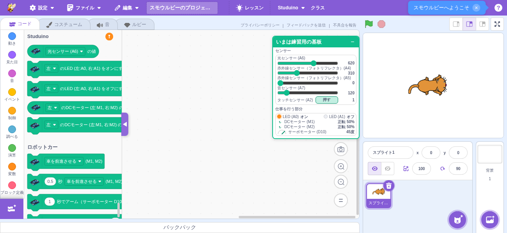
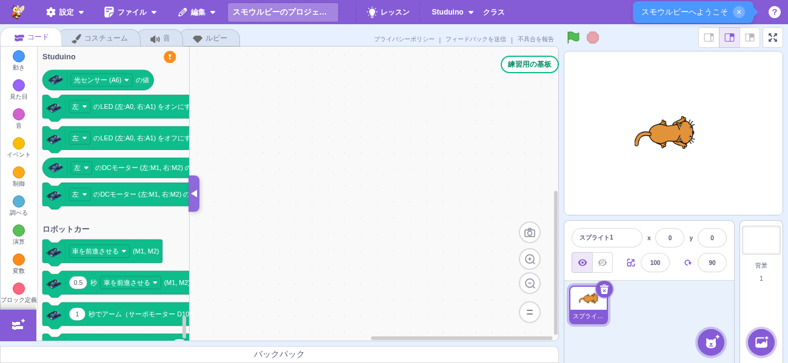
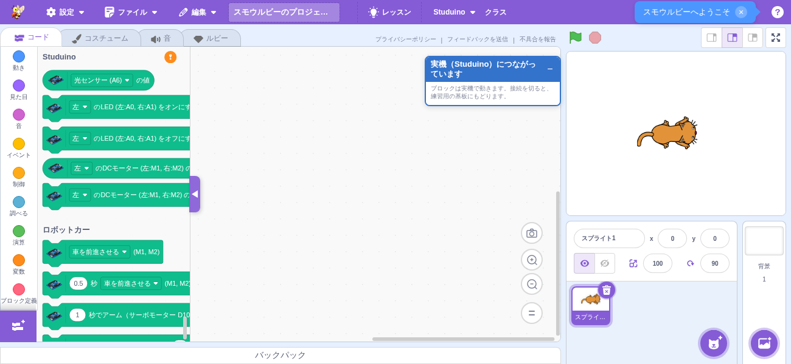
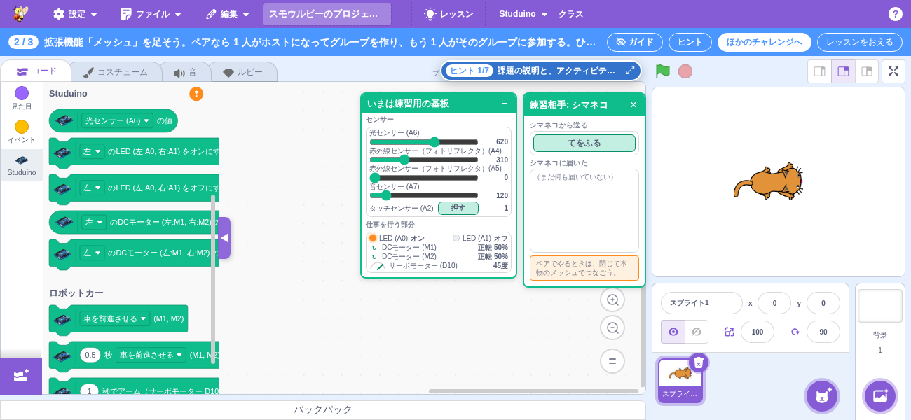
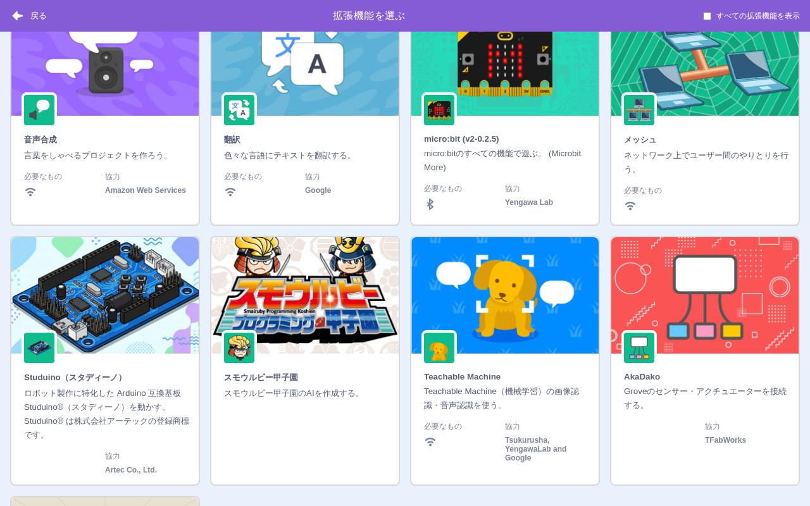
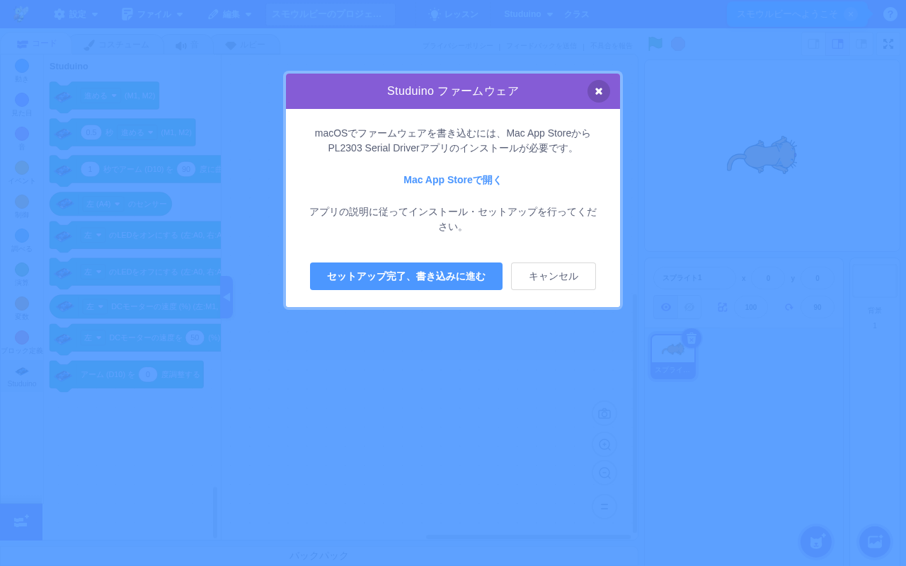

# 拡張機能: Studuino（スタディーノ）／旧 スモウルボットS1

> **🆕 Smalruby 独自** — upstream に存在しない、Smalruby のために新規追加された拡張機能

- **Smalruby ランタイム対応**: ❌（smalruby3 gem は未対応。WebSerial API 経由でハードウェアと通信するためブラウザ専用）
- **デフォルト表示**: ✅（拡張機能ライブラリにデフォルトで表示される）

> **いまの状態とこれから**: この拡張機能は、**同じ拡張機能のまま「Studuino（スタディーノ）」の名前に変えた**（前の名前は「スモウルボットS1」）。
> ブロックの表示は一般的な名前にし、実機が無くても動かせる **練習用の基板**（VM の中のしくみと、ステージの横のパネル）を入れた。
> このページは、いまの挙動と、リニューアルで決まった方針の両方を書く。
> 見分けがつくように、まだ実装していないことには **🚧 これから** と付ける（印の無いことは、いまの挙動）。

## 概要

株式会社アーテックの、ロボット製作に特化した Arduino 互換基板 **Studuino®（スタディーノ）** を Smalruby から制御する拡張機能（前の名前は、この基板を使ったロボット「スモウルボットS1」から取った「スモウルボットS1」）。Web Serial API を使ってブラウザから USB 経由で基板と通信し、DC モーター・サーボモーター・LED・センサーを操作する。

ファームウェアの書き込みも内蔵（**WebSerial STK500v1 実装**、`smalrubot-firmware-flasher.js`）しており、初回利用時にブラウザから基板へファームウェアを転送できる（macOS は PL2303 Serial Driver が別途必要）。

### リニューアルのねらい

- 中学校技術・家庭科の「計測・制御」の授業で、**Studuino で授業ができる** と先生に伝わるようにする（スモウルボットは名前が知られていない）。
- 教科書は「光センサー」「仕事を行う部分」のような一般的な言葉で書かれているので、ブロックの表示も一般的な名前にする（いまは「左のセンサー」のようなロボットの部品の名前）。
- 実機がつながっていないと、センサーの値は 0 のままで、LED・モーター・サーボの命令は何もしない。そのため、2 人で 1 台・自宅・欠席の補習では進められず、レッスンの「できた」の判定もできない。これを **練習用の基板** で解決する。

## ユーザーストーリー

- **Studuino（スモウルボットS1）を持っている小学生・中学生**として、Smalruby のブロックでロボットを動かしたい
- **「計測・制御」を教える先生**として、教科書と同じ言葉（光センサー、DC モーターなど）で Studuino を扱わせたい
- **基板が足りない教室・自宅で学ぶ生徒**として、実機が無くても練習用の基板でプログラムを動かして確かめたい（センサーの値はパネルのスライダーとボタンで変える）
- **教師**として、複数台のロボットを生徒それぞれに渡して、教室全体でロボットプログラミングをさせたい
- **保護者**として、子どもが自分のノート PC から直接ロボットを動かせる（追加アプリのインストール不要）状態にしたい
- **初めて使う子**として、自分のロボットにファームウェアを書き込む手順を Smalruby の中で完結させたい

## 名前の変更と互換の方針

**同じ拡張機能のまま、表示の名前だけを「Studuino（スタディーノ）」にした**。前の作品（sb3・Ruby）はそのまま開けて、そのまま動く。

### 変えたもの

| 対象 | 前 | いま |
|---|---|---|
| 拡張機能の名前（ライブラリ・カテゴリ・メニューバー・接続モーダル・ファームウェアのモーダル） | スモウルボットS1 | **Studuino（スタディーノ）**（ひらがなの表示では「Studuino (スタディーノ)」、文の中は「スタディーノ」） |
| ライブラリの絵（カード・接続モーダル・カテゴリの絵） | スモウルボットS1 のロボットの写真 | **自分たちで用意した基板の絵**（アーテック社の写真・ロゴは使わない。下の「ライブラリの絵と商標の表記」） |
| ライブラリのカードの説明 | スモウルボットS1を制御する。 | アーテック社の表記に合わせた紹介と、登録商標の一文（下の「ライブラリの絵と商標の表記」） |
| Ruby タブのふりがな（`studuino` / `smalrubot_s1` の上に出る名前） | スモウルボットS1 | スタディーノ |
| Ruby の書き出し | `smalrubot_s1.` | **`studuino.`**（読みこみは `smalrubot_s1.` も受けつける。下の「Ruby の書き方」） |
| ブロック・選択肢の表示 | ロボットの部品の名前（「左のセンサー」など） | 一般的な名前（下の「ブロックと選択肢」）。センサーの選択肢を足し、ロボットのブロックを「ロボットカー」の見出しの下にまとめた |

### ライブラリの絵と商標の表記

- **絵**: 人間が Gemini で描いた、青い基板を斜めから見たイラストを **もとにして** 作った。アーテック社の製品の写真やロゴは使っていない。基板の上の文字（「STUDY」「EDU」「Servo」「Sensor」「POWER」「ANALOG IN」「Reset」）は、アーテック社の製品やロゴに見えないように消した。
  - カード（600×372）は背景ごと切り出して縮小した。接続モーダルの絵（95×95）とカテゴリ・カードの小さい絵（40×40）は、基板だけを切り抜いて背景を透明にした。カテゴリの絵（VM の `blockIconURI`）は 40×40 と同じ絵。
- **商標の表記**: アーテック社の表記「ロボット製作に特化した Arduino 互換基板 Studuino®（スタディーノ）」に合わせる。アーテック社の製品だとわかるように、ライブラリのカードの説明に「**Studuino® は株式会社アーテックの登録商標です。**」を入れた（カードには前から「協力: Artec Co., Ltd.」も出る）。紹介ページ（`pages/about.html`）の Studuino の紹介にも同じ一文を入れた。

### 変えないもの

前の作品を開けるように、次のものは **変えない**:

- 拡張機能の ID: `smalrubotS1`
- ブロックの opcode（`smalrubotS1_action` など。下の表）
- メニューの名前（`actions` / `sensorPositions` / `positions`）と、メニューの **値**（`forward` / `left` / `touch` など）。選択肢を増やすときは値を **足すだけ** にして、既存の値の意味を変えない
- Ruby のメソッド名（`action` / `bend_arm` / `sensor_value` など）と、`smalrubot_s1.` の **読みこみ**
- ファームウェア（`smalrubot-firmware.hex.js`）と基板との通信のしかた
- 翻訳メッセージのキー（`smalrubotS1.*` / `gui.smalruby3.extension.smalrubotS1.*` など）。変えるのは値（表示の文字）だけ
- ソースのファイル名・ディレクトリ名（`scratch3_smalrubot_s1/`、`smalrubot-s1-*-step.jsx` など）と、計測イベント名（`smalrubot_s1`。[`docs/analytics/`](../analytics/)）
- このドキュメントの置き場所（`docs/extension-smalrubot-s1/`）。ID を変えない方針に合わせる

## ポートの配置

ポートの配置は、いまのスモウルボットS1 の配置のまま変えない。既存のブロックは、部品ごとに挿すポートが決まっているので、それに従う。

| ポート | 部品 | 使うブロック |
|---|---|---|
| A0 / A1 | LED（左 / 右） | `turnLedOn` / `turnLedOff` |
| A2 | タッチセンサー | `getSensorValue`（`touch`） |
| A4 / A5 | 赤外線センサー（フォトリフレクタ）（左 / 右） | `getSensorValue`（`left` / `right`） |
| A6 | 光センサー | `getSensorValue`（`light`） |
| A7 | 音センサー | `getSensorValue`（`sound`） |
| M1 / M2 | DC モーター（左 / 右） | `action` / `actionAndStopAfter` / `getMotorSpeed` / `setMotorSpeed` |
| D10 | サーボモーター（アーム） | `bendArm` / `setArmCalibration` |

ポートの割り当てを変えられる形は、この拡張機能の通常の使い方には入れない（下の「Studuino モードとの境目」）。

## ブロックと選択肢

### 方針

- **通常の拡張機能には、できる限りブロックを足さない**。そのかわり **ドロップダウンの選択肢を増やして**、一般的な名前でも選べるようにした。例: センサーのブロックで「左のセンサー (A4)」も「赤外線センサー（フォトリフレクタ）(A4)」も選べる。
- センサーの名前は、**教科書の一般的な名前を先に、部品名をかっこで** 書く:「光センサー (A6)」「赤外線センサー（フォトリフレクタ）(A4)」「タッチセンサー (A2)」「音センサー (A7)」。
- 教科書の例にある部品のうち Studuino に無いもの（超音波センサーなど）は扱わない。
- LED と DC モーターは同じメニュー（`positions`）を使うので、片方だけの選択肢は足せない。ブロックの文言にポートを書く（「[左▼] のLED (左:A0, 右:A1) をオンにする」）。

### ブロックの一覧

パレットの上から順に並べた。「ロボットカー」の見出しより下が、ロボットとして動かすブロック。

| opcode | 表示（日本語） | ポート |
|---|---|---|
| `getSensorValue` | `[光センサー (A6)▼] の値` | A2 / A4 / A5 / A6 / A7 |
| `turnLedOn` / `turnLedOff` | `[左▼] のLED (左:A0, 右:A1) をオン（オフ）にする` | A0 / A1 |
| `getMotorSpeed` | `[左▼] のDCモーター (左:M1, 右:M2) の速度 (%)` | M1 / M2 |
| `setMotorSpeed` | `[左▼] のDCモーター (左:M1, 右:M2) の速度を (50) (%) にする` | M1 / M2 |
| （見出し） | **ロボットカー** | — |
| `action` | `[車を前進させる▼] (M1, M2)` | M1 / M2 |
| `actionAndStopAfter` | `(0.5) 秒 [車を前進させる▼] (M1, M2)` | M1 / M2 |
| `bendArm` | `(1) 秒でアーム（サーボモーター D10）を (90) 度に曲げる` | D10 |
| `setArmCalibration` | `アーム（サーボモーター D10）を (0) 度調整する` | D10 |

### センサーの選択肢（`sensorPositions` メニュー）

上から並べた順。新しいブロックを出したときは、いちばん上の「光センサー (A6)」が選ばれている（前は「左」）。保存してある作品の値は変わらない。

| 値 | 表示 | 読むポート |
|---|---|---|
| `light` | 光センサー (A6) | A6 |
| `ir_a4`（新しい値） | 赤外線センサー（フォトリフレクタ）(A4) | A4（`left` と同じ） |
| `ir_a5`（新しい値） | 赤外線センサー（フォトリフレクタ）(A5) | A5（`right` と同じ） |
| `touch` | タッチセンサー (A2) | A2 |
| `sound` | 音センサー (A7) | A7 |
| `left` | 左のセンサー (A4) | A4 |
| `right` | 右のセンサー (A5) | A5 |

既存の値（`left` / `right` など）は残してあるので、前の作品はそのまま動く。

### 動きの選択肢（`actions` メニュー）

| 値 | 表示 |
|---|---|
| `forward` | 車を前進させる |
| `backward` | 車を後退させる |
| `left` | 車を左に曲げる |
| `right` | 車を右に曲げる |
| `stop` | 車を止める |

### 「ロボットカー」の見出し

ロボットとして動かすブロック（前進・後退・回転、アームを曲げる、アームを調整する）は **残したまま**、パレットの後ろの方に「**ロボットカー**」の見出しをつけてまとめた。ブロックは足さず、opcode とメニューの値も変えていない（並べる順番と表示だけが変わった）。

見出しは、拡張機能のブロックの情報に `blockType: BlockType.LABEL` を書くと出る（Smalruby が scratch-vm に足した種類。Blockly のフライアウトの見出し `<label>` になる）。ブロックではないので、作品には保存されない。

## Ruby の書き方

**書き出しは全部 `studuino.`**。**読みこみは `studuino.` と `smalrubot_s1.` の両方を受けつける**ので、前に書いた Ruby のプログラムや教材もそのままブロックにできる（ブロックにしてから書き出すと `studuino.` になる）。変わったのはレシーバーの名前だけで、メソッド名と引数の形は前と同じ。

| ブロック | Ruby |
|---|---|
| `action` | `studuino.action("forward")` |
| `actionAndStopAfter` | `studuino.action("forward", 0.5)` |
| `bendArm` | `studuino.bend_arm(90, 1)` |
| `getSensorValue` | `studuino.sensor_value("light")` |
| `turnLedOn` / `turnLedOff` | `studuino.led("left", true)` / `studuino.led("left", false)` |
| `getMotorSpeed` | `studuino.get_motor_speed("left")` |
| `setMotorSpeed` | `studuino.set_motor_speed("left", 50)` |
| `setArmCalibration` | `studuino.arm_calibration = 0` |

引数の文字列はメニューの値（`forward` / `backward` / `left` / `right` / `stop`、`light` / `ir_a4` / `ir_a5` / `touch` / `sound` / `left` / `right`）。

```ruby
# 前の書き方（読みこめる）
smalrubot_s1.sensor_value("ir_a4")
# ブロックにしてから書き出すと
studuino.sensor_value("ir_a4")
```

- 変換器は、同じ表（メソッドと引数のチェック）を `studuino` と `smalrubot_s1` の 2 つのレシーバーで登録している。Ruby タブのふりがな（「スタディーノ」）と補完も両方のレシーバーで同じ。補完は `studuino.` を入れ、`smalrubot` と打っても見つかる。
- `studuino` は、ほかの拡張機能のレシーバー（`mesh` / `koshien` など）やスプライトのメソッドと名前がぶつからない。同じ名前のローカル変数を作ると、Ruby のふつうの決まりどおりそちらが先になる（`smalrubot_s1` のときと同じ）。
- Studuino モード（`docs/studuino-mode/`）も、同じ `studuino.` の書き方を使う前提（ポートの設定の書き方はそちらで決める）。

## 練習用の基板

実機の基板が無くてもプログラムを動かして確かめられるように、ブラウザの中に **練習用の基板**（ソフトウェアの基板）を入れた。考え方は、チャットのレッスンの「練習相手」（ブラウザの中で折り返すメッシュの相手）と同じ。実装は `packages/scratch-vm/src/extensions/scratch3_smalrubot_s1/practice-board.js`。

### 自動切りかえ

- **実機がつながっていなければ（接続の状態が `connected` でなければ）、自動で練習用の基板** を使う。LED・モーター・サーボの命令は練習用の基板に届き、センサーのブロックは練習用の基板の値を返す。シリアルには何も書かない。Web Serial の無いブラウザ（iPad など）でも、接続のエラーを出さずに練習用の基板で動く。
- **実機がつながったら（`connected` になったら）、実機** を使う。切れたら（`disconnecting` / `disconnected`）練習用の基板にもどる。つないでいる途中（`scanned` / `connecting`）は、まだ練習用の基板。
- 実機につながっているときにシリアルへ出すコマンドは、練習用の基板を入れる前と同じ。
- 作品を止める（止めるボタン）と、実機（つながっていれば）と練習用の基板の両方で、LED を消してモーターを止める。
- モーターの速さ（`setMotorSpeed`）は設定なので、両方の基板に入れる。つなぐ前に決めた速さも、つないだあとに使われる。
- いまどちらを使っているかは、状態の `mode` でわかる（パネルの「いまは練習用の基板」の表示に使う）。

### 状態の形

練習用の基板は、次の形の状態を持つ。変わるたびに、ランタイムのイベント **`STUDUINO_PRACTICE_BOARD_STATE`**（`Scratch3SmalrubotS1Blocks.PRACTICE_BOARD_STATE_EVENT`）で状態のコピーを送り、最新の状態を **`runtime.studuinoPracticeBoardState`** にも置く（拡張機能を読みこんだときにも 1 回送る）。

```js
{
    mode: 'practice',            // 'practice'（練習用の基板を使っている）/ 'device'（実機につながっている）
    leds: { A0: false, A1: false },                 // 左（A0）・右（A1）の LED。true = オン
    motors: {
        M1: { direction: 'stop', speed: 50 },       // 左のモーター
        M2: { direction: 'stop', speed: 50 },       // 右のモーター
    },
    servo: { D10: { degree: 90, calibration: 0 } }, // アームのいまの角度（0〜180）と調整（-15〜15）
    sensors: { A2: 0, A4: 0, A5: 0, A6: 0, A7: 0 }, // タッチ・赤外線 A4・赤外線 A5・光・音
}
```

- `direction` は `'normal'`（正転）・`'reverse'`（逆転）・`'stop'`（停止）。前進 = M1/M2 とも正転、後退 = とも逆転、左に回る = M1 逆転・M2 正転、右に回る = M1 正転・M2 逆転。
- `speed` は、最後に動かしたときの速さ（%）。実機と同じく、速さのブロックは次に動かしたときから使われる。止めても `speed` は残る。
- `bendArm` は実機と同じく、秒数のあいだ角度を少しずつ変える（`degree` がフレームごとに変わる）。

### 初期値

| もの | 初期値 | 理由 |
|---|---|---|
| センサー（A2 / A4 / A5 / A6 / A7） | すべて `0` | 実機なしで動かしていた作品は、これまでセンサーが 0 だった。同じ値から始める |
| LED（A0 / A1） | オフ | 実機の初期化のあとと同じ |
| モーター（M1 / M2） | 停止・速さ 50 | 速さは実機の既定値（50%）と同じ |
| サーボ（D10） | 90 度・調整 0 | 実機をつないだときの角度と同じ |

センサーの値は数で受け取り、範囲は制限しない（パネルのスライダーの範囲はパネルで決める）。

### GUI から使う入口

拡張機能のインスタンス（`vm.runtime.peripheralExtensions.smalrubotS1`）のメソッド:

| メソッド | 説明 |
|---|---|
| `getPracticeBoardState()` | 状態のコピーを返す |
| `setPracticeSensorValue(portOrPosition, value)` | センサーの値を変える。ポート（`'A6'`）か、センサーの選択肢の値（`'light'` / `'ir_a4'` / `'left'` など）で指定する。知らないポート・数でない値は `false` を返して変えない |

GUI は、イベントを聞いて表示し、センサーの値はこのメソッドで変える（ほかの値は書きかえない）。

### パネル

Studuino の拡張機能を読みこむと、**コードエリアの右上（ステージの列のすぐ左）** に練習用の基板のパネルが出る。たためる。
実装は `packages/scratch-gui/src/containers/studuino-practice-board.jsx`（状態を読む・センサーの値を変える）と
`packages/scratch-gui/src/components/studuino-practice-board/`（表示）。



- **見出し**: 「いまは練習用の基板」（見出しにマウスを乗せると「実機がつながっていないので、ブロックはこの練習用の基板で動きます。」）。実機につながっているあいだ（`mode` が `'device'`）は
  「実機（Studuino）につながっています」に変わり、センサーの操作と部品の表示を消す（命令は実機に届き、練習用の基板は使わないため）。
- **センサー**（拡張機能の選択肢と同じ名前）:
  - 光センサー (A6)・赤外線センサー（フォトリフレクタ）(A4) / (A5)・音センサー (A7) は **スライダー（0〜1023）と数字**。
    範囲は Studuino のアナログの値（`analogRead`）と同じ。
  - タッチセンサー (A2) は **押しているあいだだけ押した値になるボタン**（マウス・タッチ・スペース / Enter キー）。
    Studuino のタッチセンサーと同じく **押すと 0、はなすと 1**。拡張機能を読みこんだ直後の練習用の基板は 0（押した）なので、
    パネルは最初に 1 回だけ 1（はなした）にそろえる。
- **仕事を行う部分**: LED (A0) / (A1) のオン・オフ（ランプの印）、DC モーター (M1) / (M2) の正転 ↻ / 逆転 ↺ / 停止 ■ と速さ (%)、
  サーボモーター (D10) のいまの角度（数字と簡単な針）。
- **たたむ / ひらく**: 見出しの「−」でたたむと、同じ場所に小さな「練習用の基板」のボタンが残る。たたんだかどうかは端末に覚える。





#### 置き場所と出す条件

- **コードエリアの右上**に重ねる（コードのタブと Ruby のタブ）。ステージの列は動かさない。ステージの列の下（スプライトの情報）は
  レッスンのヒントが指す場所なので使わない。
- レッスンのチャットの「練習相手のパネル」も同じ場所（ステージの列のすぐ左）に出る。**練習相手のパネルが出ているときは、その左に並べる**
  （レッスン 4 の IoT で両方が同時に出ても重ならない）。練習相手のパネルをたたむと、そのボタンの左に並ぶ。
  チャレンジを始めたときに自動で開くヒントの吹き出しは、どちらのパネルよりも手前に出る（ヒントを小さくすると見える。練習相手のパネルと同じ）。

  
- 1300×600（ステージが中サイズ）では、パネルの高さは画面に収まる（ひらいたときの下端がコードエリアの右下のズームのボタンにかからない）。
- コスチューム・音のタブ、ステージを全画面にしたとき、プレイヤーだけの表示では出さない。スマホの小さい画面（MobileGui）にも出さない。
- 拡張機能を一度読みこむと、ほかの作品を開いても出たまま（拡張機能のカテゴリが残るのと同じ）。

#### data-testid

| data-testid | 要素 | 説明 |
|---|---|---|
| `studuino-practice-board` | section | パネル（`data-mode` = `practice` / `device`） |
| `studuino-practice-board-mode` | span | 見出し（「いまは練習用の基板」/「実機につながっています」） |
| `studuino-practice-board-close` | button | たたむ |
| `studuino-practice-board-open` | button | たたんだときの「練習用の基板」のボタン（ひらく） |
| `studuino-practice-board-device-note` | p | 実機につながっているときの説明 |
| `studuino-practice-board-sensor-A6` / `-A4` / `-A5` / `-A7` | input (range) | センサーのスライダー |
| `studuino-practice-board-sensor-value-<port>` | span | センサーの値の数字（A2 も） |
| `studuino-practice-board-touch-A2` | button | タッチセンサーのボタン（`aria-pressed`） |
| `studuino-practice-board-led-A0` / `-A1` | span | LED（`data-on` = `true` / `false`） |
| `studuino-practice-board-motor-M1` / `-M2` | div | DC モーター（`data-direction` = `normal` / `reverse` / `stop`） |
| `studuino-practice-board-servo-D10` | div | サーボモーター |
| `studuino-practice-board-servo-degree` | span | サーボの角度の数字 |

## 命令とセンサーの値の記録（🚧 これから）

レッスンで「できた」を判定するために、拡張機能が **出した命令**（LED のオン／オフ、モーターの向きと速度、サーボの角度）と **読んだセンサーの値** を記録する。

- **実機でも練習用の基板でも、同じ記録で判定する**（どちらを使ったかで判定を変えない）。
- 手元に無いセンサーがあるときは、**代わりのセンサーを使っても「できた」** にする（判定はセンサーの種類にしばりすぎない）。
- 記録の形とレッスンからの読み方は実装で決める。

## Studuino モードとの境目

ポートの割り当てを変えられ、プログラムを Studuino 単体で動かす「Studuino モード」は、別の EPIC で設計中（新しいブロックは基本的にそちらで足す）。

## UI / 操作フロー



### 接続

1. ブロックパレットの「拡張機能を追加」から **Studuino（スタディーノ）** を選ぶ
2. 接続モーダルが専用フローで開く（`smalrubot-s1-*-step.jsx` 系）。**生徒用 (接続) / 先生用 (ファームウェア書き込み)** のいずれかを選択

   

3. 「接続する（生徒用）」→ Web Serial のデバイス選択ダイアログ
4. 基板を選んで承認
5. 接続完了

### ファームウェアフラッシュ

1. 接続モーダルの「ファームウェアを書き込む（先生用）」 もしくはメニューバーの「Studuino」メニューから起動
2. ファームウェアフラッシュモーダル (`smalrubot-firmware-modal`) が開く。**macOS では PL2303 Serial Driver アプリのインストール案内** が先に表示される

   

3. 「セットアップ完了、書き込みに進む」→ 基板を選んで書き込み開始
4. 進捗表示の後、完了

### ブロックパレット

接続後はブロックパレットの **Studuino** カテゴリに専用ブロックが表示される（ブロックの一覧は上の「ブロックと選択肢」）：


## 主要ファイル

### scratch-gui

#### コンポーネント / コンテナ

- `packages/scratch-gui/src/components/smalrubot-firmware-modal/` — ファームウェアフラッシュモーダル
- `packages/scratch-gui/src/containers/smalrubot-firmware-modal.jsx`
- `packages/scratch-gui/src/components/studuino-practice-board/` — 練習用の基板のパネル（表示）
- `packages/scratch-gui/src/containers/studuino-practice-board.jsx` — 練習用の基板のパネルのコンテナ（状態を読む・センサーの値を変える・置き場所を測る）
- `packages/scratch-gui/src/components/connection-modal/smalrubot-s1-*-step.jsx` × 5 — 専用接続ステップ（initial / connecting / connected / error / unsupported）

#### ライブラリ

| ファイル | 役割 |
|---|---|
| `packages/scratch-gui/src/lib/smalrubot-firmware-flasher.js` | WebSerial 経由の STK500v1 ファームウェアフラッシュ実装 |
| `packages/scratch-gui/src/lib/smalrubot-firmware.hex.js` | ファームウェアバイナリ (HEX 形式) |

#### Ruby Generator / Converter

| ファイル | 役割 |
|---|---|
| `packages/scratch-gui/src/lib/ruby-generator/smalrubot_s1.js` | ブロック → Ruby（`studuino.` で書き出す） |
| `packages/scratch-gui/src/lib/ruby-to-blocks-converter/smalrubot_s1.js` | Ruby → ブロック（`studuino.` と `smalrubot_s1.` を読みこむ） |

#### Redux

- `packages/scratch-gui/src/reducers/smalrubot-firmware.js` — フラッシュ進捗 state
- `packages/scratch-gui/src/reducers/modals.js` — ファームウェアモーダル開時に接続モーダルを自動で閉じる

#### 翻訳

- `packages/scratch-gui/src/locales/ja.js` / `ja-Hira.js` / `en.js` — 拡張機能の名前・ブロック・選択肢の表示（`smalrubotS1.*`）

#### Smalruby マーカー (upstream への埋め込み)

- `src/components/menu-bar/menu-bar.jsx` — Smalrubot ファームウェアメニュー
- `src/components/connection-modal/connection-modal.jsx` — 専用フロー振り分け
- `src/containers/connection-modal.jsx` — ファームウェアフラッシュ起動
- `src/components/connection-modal/error-step.jsx` — エラーステップでのファームウェアボタン
- `src/components/gui/gui.jsx` — 練習用の基板のパネルの配置

詳細マーカー一覧: `docs/maintenance/smalruby-markers-gui.md`

### scratch-vm

- `packages/scratch-vm/src/extensions/scratch3_smalrubot_s1/index.js` — 拡張機能本体（Web Serial 通信、コマンド送受信、センサー値ポーリング、ポートの初期化、実機と練習用の基板の切りかえ）
- `packages/scratch-vm/src/extensions/scratch3_smalrubot_s1/practice-board.js` — 練習用の基板（状態と、実機と同じ操作）
- `packages/scratch-vm/src/extension-support/block-type.js` / `extension-manager.js` / `src/engine/runtime.js` — 見出し（`BlockType.LABEL`）の Smalruby マーカー（`docs/maintenance/smalruby-markers-vm.md`）

### infra / ruby

なし。

## 設定・データ永続化

| 置き場所 | キー | 内容 |
|---|---|---|
| localStorage | `smalruby:studuinoPracticeBoardOpen` | 練習用の基板のパネルをひらいているか（`'false'` でたたむ。既定はひらく） |

接続情報は揮発的（リロードで切断される）。練習用の基板の値（センサーなど）も保存しない。

## 動作環境

- **対応 OS**: Windows, ChromeOS, macOS（macOS は PL2303 Serial Driver 必要）
- **対応ブラウザ**: Chrome / Edge（Web Serial API サポート必要）
- **iPad / Android**: 実機は非対応（Web Serial 未サポート）。練習用の基板は実機を使わないので、これらでも動く（iPad はパネルも出る。スマホの小さい画面（MobileGui）にはパネルを出さない）

## テスト

- 単体テスト: `packages/scratch-gui/test/unit/lib/smalrubot-firmware-flasher.test.js`, `packages/scratch-gui/test/unit/containers/studuino-practice-board.test.jsx`（パネル）
- 結合テスト: `packages/scratch-gui/test/integration/smalrubot-firmware.test.js`, `smalrubot-s1-connection-flow.test.js`
- VM 単体テスト: `packages/scratch-vm/test/unit/extension_smalrubot_s1.js`

## 関連ドキュメント

- [`docs/smalruby-language-spec-extensions.ja.md`](../smalruby-language-spec-extensions.ja.md) — 拡張機能の Ruby 表現
- [`docs/device-connection/`](../device-connection/) — connection-modal 共通基盤
- `docs/maintenance/smalruby-markers-gui.md` — upstream マーカー一覧
