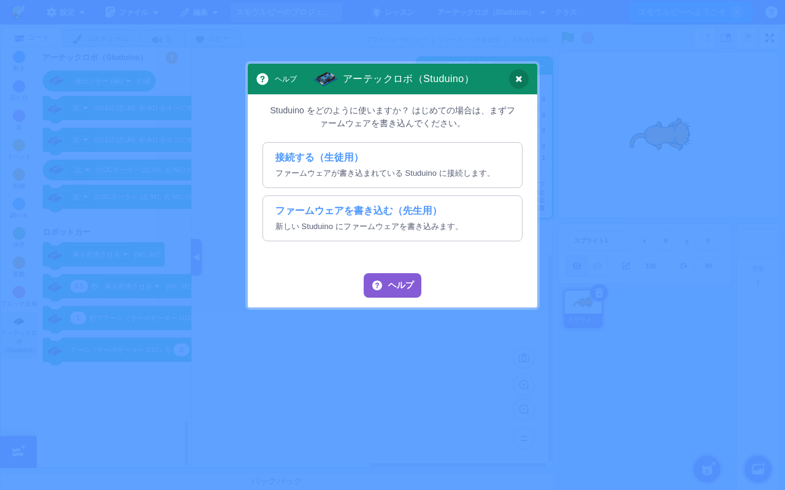
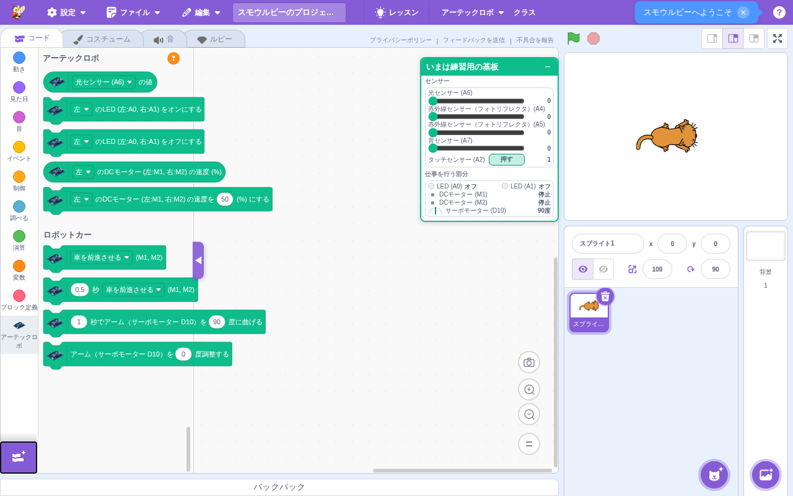

# 拡張機能: Studuino（スタディーノ）／旧 スモウルボットS1

> **🆕 Smalruby 独自** — upstream に存在しない、Smalruby のために新規追加された拡張機能

- **Smalruby ランタイム対応**: ❌（smalruby3 gem は未対応。WebSerial API 経由でハードウェアと通信するためブラウザ専用）
- **デフォルト表示**: ✅（拡張機能ライブラリにデフォルトで表示される）

> **いまの状態とこれから**: この拡張機能は、いまは「**スモウルボットS1**」の名前で出ている。
> これから **同じ拡張機能のまま「Studuino（スタディーノ）」にリニューアル** し、実機が無くても動かせる
> **練習用の基板** を入れる。このページは、いまの挙動と、リニューアルで決まった方針の両方を書く。
> 見分けがつくように、まだ実装していないことには **🚧 これから** と付ける（印の無いことは、いまの挙動）。

## 概要

アーテック社の **Studuino（スタディーノ）基板** を使ったロボット「スモウルボットS1」を Smalruby から制御する拡張機能。Web Serial API を使ってブラウザから USB 経由で基板と通信し、DC モーター・サーボモーター・LED・センサーを操作する。

ファームウェアの書き込みも内蔵（**WebSerial STK500v1 実装**、`smalrubot-firmware-flasher.js`）しており、初回利用時にブラウザから基板へファームウェアを転送できる（macOS は PL2303 Serial Driver が別途必要）。

### リニューアルのねらい

- 中学校技術・家庭科の「計測・制御」の授業で、**Studuino で授業ができる** と先生に伝わるようにする（スモウルボットは名前が知られていない）。
- 教科書は「光センサー」「仕事を行う部分」のような一般的な言葉で書かれているので、ブロックの表示も一般的な名前にする（いまは「左のセンサー」のようなロボットの部品の名前）。
- 実機がつながっていないと、センサーの値は 0 のままで、LED・モーター・サーボの命令は何もしない。そのため、2 人で 1 台・自宅・欠席の補習では進められず、レッスンの「できた」の判定もできない。これを **練習用の基板** で解決する。

## ユーザーストーリー

- **Studuino（スモウルボットS1）を持っている小学生・中学生**として、Smalruby のブロックでロボットを動かしたい
- **「計測・制御」を教える先生**として、教科書と同じ言葉（光センサー、DC モーターなど）で Studuino を扱わせたい
- **基板が足りない教室・自宅で学ぶ生徒**として、実機が無くても練習用の基板でプログラムを動かして確かめたい（🚧 これから）
- **教師**として、複数台のロボットを生徒それぞれに渡して、教室全体でロボットプログラミングをさせたい
- **保護者**として、子どもが自分のノート PC から直接ロボットを動かせる（追加アプリのインストール不要）状態にしたい
- **初めて使う子**として、自分のロボットにファームウェアを書き込む手順を Smalruby の中で完結させたい

## 名前の変更と互換の方針

**同じ拡張機能のまま、表示の名前だけを「Studuino（スタディーノ）」にする**（🚧 これから）。前の作品（sb3・Ruby）はそのまま開けて、そのまま動く。

### 変えるもの（🚧 これから）

| 対象 | いま | これから |
|---|---|---|
| 拡張機能の名前（ライブラリ・カテゴリ・メニューバー・接続モーダル） | スモウルボットS1 | **Studuino（スタディーノ）** |
| ライブラリの絵 | スモウルボットS1 の絵 | **自分たちで描いた基板の絵**（アーテック社の写真・ロゴは使わない） |
| ブロック・選択肢の表示 | ロボットの部品の名前（「左のセンサー」など） | 一般的な名前（下の「ブロックと選択肢」） |
| Ruby の書き出し | `smalrubot_s1.` | `studuino.`（下の「Ruby の書き方」） |

### 変えないもの

前の作品を開けるように、次のものは **変えない**:

- 拡張機能の ID: `smalrubotS1`
- ブロックの opcode（`smalrubotS1_action` など。下の表）
- メニューの名前（`actions` / `sensorPositions` / `positions`）と、メニューの **値**（`forward` / `left` / `touch` など）。選択肢を増やすときは値を **足すだけ** にして、既存の値の意味を変えない
- Ruby のメソッド名（`action` / `bend_arm` / `sensor_value` など）と、`smalrubot_s1.` の **読みこみ**
- ファームウェア（`smalrubot-firmware.hex.js`）と基板との通信のしかた
- 翻訳メッセージのキー（`smalrubotS1.*` / `gui.smalruby3.extension.smalrubotS1.*` など）。変えるのは値（表示の文字）だけ
- ソースのファイル名・ディレクトリ名（`scratch3_smalrubot_s1/`、`smalrubot-s1-*-step.jsx` など）と、計測イベント名（`smalrubot_s1`。[`docs/analytics/`](../analytics/)）
- このドキュメントの置き場所（`docs/extension-smalrubot-s1/`）。ID を変えない方針に合わせる

## ポートの配置

ポートの配置は、いまのスモウルボットS1 の配置のまま変えない。既存のブロックは、部品ごとに挿すポートが決まっているので、それに従う。

| ポート | 部品 | 使うブロック |
|---|---|---|
| A0 / A1 | LED（左 / 右） | `turnLedOn` / `turnLedOff` |
| A2 | タッチセンサー | `getSensorValue`（`touch`） |
| A4 / A5 | 赤外線センサー（フォトリフレクタ）（左 / 右） | `getSensorValue`（`left` / `right`） |
| A6 | 光センサー | `getSensorValue`（`light`） |
| A7 | 音センサー | `getSensorValue`（`sound`） |
| M1 / M2 | DC モーター（左 / 右） | `action` / `actionAndStopAfter` / `getMotorSpeed` / `setMotorSpeed` |
| D10 | サーボモーター（アーム） | `bendArm` / `setArmCalibration` |

ポートの割り当てを変えられる形は、この拡張機能の通常の使い方には入れない（下の「Studuino モードとの境目」）。

## ブロックと選択肢

### 方針

- **通常の拡張機能には、できる限りブロックを足さない**。そのかわり **ドロップダウンの選択肢を増やして**、一般的な名前でも選べるようにする（🚧 これから）。例: センサーのブロックで「左のセンサー」も「赤外線センサー（フォトリフレクタ）(A4)」も選べる。
- センサーの名前は、**教科書の一般的な名前を先に、部品名をかっこで** 書く:「光センサー (A6)」「赤外線センサー（フォトリフレクタ）(A4)」「タッチセンサー (A2)」「音センサー (A7)」（🚧 これから）。
- 教科書の例にある部品のうち Studuino に無いもの（超音波センサーなど）は扱わない。

### ブロックの一覧

| opcode | いまの表示（日本語） | ポート | これから（🚧） |
|---|---|---|---|
| `getSensorValue` | `[POSITION] のセンサー` | A2 / A4 / A5 / A6 / A7 | 選択肢を一般的な名前にし、足す（下の表） |
| `turnLedOn` / `turnLedOff` | `[POSITION] のLEDをオン（オフ）にする (左:A0, 右:A1)` | A0 / A1 | 一般的な名前にする |
| `getMotorSpeed` / `setMotorSpeed` | `[POSITION] DCモーターの速度 (%) (左:M1, 右:M2)` | M1 / M2 | 一般的な名前にする |
| `action` | `[ACTION] (M1, M2)` | M1 / M2 | 「ロボットカー」の見出しの下へ |
| `actionAndStopAfter` | `[SECS] 秒 [ACTION] (M1, M2)` | M1 / M2 | 「ロボットカー」の見出しの下へ |
| `bendArm` | `[SECS] 秒でアーム (D10) を [DEGREE] 度に曲げる` | D10 | 「ロボットカー」の見出しの下へ |
| `setArmCalibration` | `アーム (D10) を [DEGREE] 度調整する` | D10 | 「ロボットカー」の見出しの下へ |

### センサーの選択肢（`sensorPositions` メニュー）

| 値 | いまの表示 | これからの表示（🚧） |
|---|---|---|
| `left` | 左 (A4) | 左のセンサー（そのまま残す） |
| `right` | 右 (A5) | 右のセンサー（そのまま残す） |
| `touch` | タッチ (A2) | タッチセンサー (A2) |
| `light` | 光 (A6) | 光センサー (A6) |
| `sound` | 音 (A7) | 音センサー (A7) |
| （新しい値） | — | 赤外線センサー（フォトリフレクタ）(A4) |
| （新しい値） | — | 赤外線センサー（フォトリフレクタ）(A5) |

新しい選択肢の値の名前は実装で決める。既存の値（`left` / `right` など）は残すので、前の作品はそのまま動く。

### 「ロボットカー」の見出し（🚧 これから）

ロボットとして動かすブロック（前進・後退・回転、アームを曲げる、アームを調整する）は **残したまま**、パレットの後ろの方に「**ロボットカー**」の見出しをつけてまとめる。表示は「車を前進させる」のような一般的な言葉にする。ブロックは足さず、opcode とメニューの値も変えない（並べる順番と表示だけが変わる）。

## Ruby の書き方

### いま

書き出しも読みこみも `smalrubot_s1.` を使う。

| ブロック | Ruby |
|---|---|
| `action` | `smalrubot_s1.action("forward")` |
| `actionAndStopAfter` | `smalrubot_s1.action("forward", 0.5)` |
| `bendArm` | `smalrubot_s1.bend_arm(90, 1)` |
| `getSensorValue` | `smalrubot_s1.sensor_value("left")` |
| `turnLedOn` / `turnLedOff` | `smalrubot_s1.led("left", true)` / `smalrubot_s1.led("left", false)` |
| `getMotorSpeed` | `smalrubot_s1.get_motor_speed("left")` |
| `setMotorSpeed` | `smalrubot_s1.set_motor_speed("left", 50)` |
| `setArmCalibration` | `smalrubot_s1.arm_calibration = 0` |

引数の文字列はメニューの値（`forward` / `backward` / `left` / `right` / `stop`、`touch` / `light` / `sound`）。

### これから（🚧）

- **書き出しは全部 `studuino.`** にする（例: `studuino.action("forward")`、`studuino.sensor_value("light")`）。メソッド名と引数は上の表と同じ。
- **読みこみは `studuino.` と `smalrubot_s1.` の両方を受けつける**。前に書いた Ruby のプログラムもブロックにできる（ブロックにしてから書き出すと `studuino.` になる）。
- 選択肢を増やしたときは、新しいメニューの値を同じ形で文字列として書き、読みこめるようにする。

## 練習用の基板（🚧 これから）

実機の基板が無くてもプログラムを動かして確かめられるように、ブラウザの中に **練習用の基板**（ソフトウェアの基板）を入れる。考え方は、チャットのレッスンの「練習相手」（ブラウザの中で折り返すメッシュの相手）と同じ。

### 自動切りかえ

- **実機がつながっていなければ、自動で練習用の基板** を使う。LED・モーター・サーボの命令は練習用の基板に届き、センサーのブロックは練習用の基板の値を返す。
- **実機がつながったら、実機** を使う。
- いまどちらを使っているかは、パネルに「いまは練習用の基板」と出してわかるようにする。

いま（リニューアル前）は、つながっていないときはセンサーの値が 0 のままで、命令は何もしない。

### パネル

- ステージの下（または横）に出す、**たためるパネル**。
- 見た目は重要ではない。次のことがわかる程度でよい:
  - 各センサー（タッチ・赤外線（フォトリフレクタ）左右・光・音）の値。**スライダーとボタンで変えられる**
  - LED のオン／オフ
  - DC モーター（M1 / M2）の **正転／逆転／停止** と速度
  - サーボモーター（D10）の **いまの角度**
- 値は数字と簡単な印で出す。

## 命令とセンサーの値の記録（🚧 これから）

レッスンで「できた」を判定するために、拡張機能が **出した命令**（LED のオン／オフ、モーターの向きと速度、サーボの角度）と **読んだセンサーの値** を記録する。

- **実機でも練習用の基板でも、同じ記録で判定する**（どちらを使ったかで判定を変えない）。
- 手元に無いセンサーがあるときは、**代わりのセンサーを使っても「できた」** にする（判定はセンサーの種類にしばりすぎない）。
- 記録の形とレッスンからの読み方は実装で決める。

## Studuino モードとの境目

ポートの割り当てを変えられ、プログラムを Studuino 単体で動かす「Studuino モード」は、別の EPIC で設計中（新しいブロックは基本的にそちらで足す）。

## UI / 操作フロー

> スクリーンショットはリニューアル前（スモウルボットS1 の名前）のもの。

### 接続

1. ブロックパレットの「拡張機能を追加」から **スモウルボットS1**（🚧 これから: **Studuino**）を選ぶ
2. 接続モーダルが専用フローで開く（`smalrubot-s1-*-step.jsx` 系）。**生徒用 (接続) / 先生用 (ファームウェア書き込み)** のいずれかを選択

   

3. 「接続する（生徒用）」→ Web Serial のデバイス選択ダイアログ
4. 基板を選んで承認
5. 接続完了

### ファームウェアフラッシュ

1. 接続モーダルの「ファームウェアを書き込む（先生用）」 もしくはメニューバーの「スモウルボットS1」メニューから起動
2. ファームウェアフラッシュモーダル (`smalrubot-firmware-modal`) が開く。**macOS では PL2303 Serial Driver アプリのインストール案内** が先に表示される

   

3. 「セットアップ完了、書き込みに進む」→ 基板を選んで書き込み開始
4. 進捗表示の後、完了

### ブロックパレット

接続後はブロックパレットの **スモウルボットS1** カテゴリに専用ブロックが表示される（ブロックの一覧は上の「ブロックと選択肢」）：

## 主要ファイル

### scratch-gui

#### コンポーネント / コンテナ

- `packages/scratch-gui/src/components/smalrubot-firmware-modal/` — ファームウェアフラッシュモーダル
- `packages/scratch-gui/src/containers/smalrubot-firmware-modal.jsx`
- `packages/scratch-gui/src/components/connection-modal/smalrubot-s1-*-step.jsx` × 5 — 専用接続ステップ（initial / connecting / connected / error / unsupported）

#### ライブラリ

| ファイル | 役割 |
|---|---|
| `packages/scratch-gui/src/lib/smalrubot-firmware-flasher.js` | WebSerial 経由の STK500v1 ファームウェアフラッシュ実装 |
| `packages/scratch-gui/src/lib/smalrubot-firmware.hex.js` | ファームウェアバイナリ (HEX 形式) |

#### Ruby Generator / Converter

| ファイル | 役割 |
|---|---|
| `packages/scratch-gui/src/lib/ruby-generator/smalrubot_s1.js` | ブロック → Ruby（いまは `smalrubot_s1.` で書き出す） |
| `packages/scratch-gui/src/lib/ruby-to-blocks-converter/smalrubot_s1.js` | Ruby → ブロック（いまは `smalrubot_s1.` を読みこむ） |

#### Redux

- `packages/scratch-gui/src/reducers/smalrubot-firmware.js` — フラッシュ進捗 state
- `packages/scratch-gui/src/reducers/modals.js` — ファームウェアモーダル開時に接続モーダルを自動で閉じる

#### 翻訳

- `packages/scratch-gui/src/locales/ja.js` / `ja-Hira.js` / `en.js` — 拡張機能の名前・ブロック・選択肢の表示（`smalrubotS1.*`）

#### Smalruby マーカー (upstream への埋め込み)

- `src/components/menu-bar/menu-bar.jsx` — Smalrubot ファームウェアメニュー
- `src/components/connection-modal/connection-modal.jsx` — 専用フロー振り分け
- `src/containers/connection-modal.jsx` — ファームウェアフラッシュ起動
- `src/components/connection-modal/error-step.jsx` — エラーステップでのファームウェアボタン

詳細マーカー一覧: `docs/maintenance/smalruby-markers-gui.md`

### scratch-vm

- `packages/scratch-vm/src/extensions/scratch3_smalrubot_s1/index.js` — 拡張機能本体（Web Serial 通信、コマンド送受信、センサー値ポーリング、ポートの初期化）

### infra / ruby

なし。

## 設定・データ永続化

なし（接続情報は揮発的、リロードで切断される）。

## 動作環境

- **対応 OS**: Windows, ChromeOS, macOS（macOS は PL2303 Serial Driver 必要）
- **対応ブラウザ**: Chrome / Edge（Web Serial API サポート必要）
- **iPad / Android**: 実機は非対応（Web Serial 未サポート）。練習用の基板は実機を使わないので、これらでも動かせるようにする（🚧 これから）

## テスト

- 単体テスト: `packages/scratch-gui/test/unit/lib/smalrubot-firmware-flasher.test.js`
- 結合テスト: `packages/scratch-gui/test/integration/smalrubot-firmware.test.js`, `smalrubot-s1-connection-flow.test.js`
- VM 単体テスト: `packages/scratch-vm/test/unit/extension_smalrubot_s1.js`

## 関連ドキュメント

- [`docs/smalruby-language-spec-extensions.ja.md`](../smalruby-language-spec-extensions.ja.md) — 拡張機能の Ruby 表現
- [`docs/device-connection/`](../device-connection/) — connection-modal 共通基盤
- `docs/maintenance/smalruby-markers-gui.md` — upstream マーカー一覧
