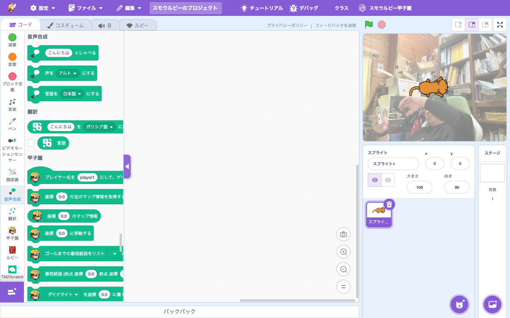

# 拡張機能: 音声合成 (Text to Speech)

> **🔧 upstream 改良** — upstream にあるが Smalruby で機能を改良・拡張している
> 改良点: 音声合成リクエストを Smalruby の**汎用** CORS 回避プロキシ (`<SCRATCH_API_PROXY_ENDPOINT>/cors-proxy`) 経由に切り替え。Scratch の音声合成サービスは CORS を scratch.mit.edu 限定にしたため、smalruby.app からの直叩きが CORS で失敗する。

- **Smalruby ランタイム対応**: ❌（smalruby3 gem 未対応。AWS Polly API + ブラウザ音声再生）
- **デフォルト表示**: ✅（拡張機能ライブラリにデフォルトで表示される）
- **collaborator**: Amazon Web Services

## 概要

入力したテキストを**音声で読み上げる**拡張機能。AWS Polly を使った音声合成（複数の声・言語対応）。upstream Scratch 標準。

### Smalruby 独自: 汎用 CORS 回避プロキシ経由

Scratch の音声合成サービス (`synthesis-service.scratch.mit.edu`) は `Access-Control-Allow-Origin` を
`scratch.mit.edu` 限定に締めたため、`smalruby.app` から直接叩くと CORS でブロックされる。
そこで VM 実装 `scratch3_text2speech/index.js` では、合成 URL (`${SERVER_HOST}/synth?...`) を
Smalruby の**汎用** CORS プロキシで包む（`=== Smalruby: Start/End of synthesis CORS proxy ===`
マーカーで囲む）:

```
<SCRATCH_API_PROXY_ENDPOINT>/cors-proxy?url=<encodeURIComponent(合成URL)>
```

プロキシの URL はビルド値 `SCRATCH_API_PROXY_ENDPOINT`（既定 `https://api.smalruby.app`。末尾の `/` は
取り除く）から組み立てる（`packages/scratch-vm/src/util/cors-proxy-url.js`。翻訳と共通）。ブランチ
プレビューは stg の API を見るので、prod の API（CORS がプレビューのオリジンを許可しない）を呼ばない。

`SERVER_HOST` は upstream の値 (`https://synthesis-service.scratch.mit.edu`) のまま維持し、URL 組み立て
箇所だけをラップするので upstream との差分が最小になる（upstream マージ時の silent revert 検知は
`test/unit/extension_text2speech_proxy.js` が担保）。

汎用 `cors-proxy` はサーバ側で対象 URL を fetch し、`audio/*` をバイナリと判定して mp3 を Base64 で返却
（`isBase64Encoded: true`。API Gateway HTTP API v2 がクライアントへバイト列にデコード）、built-in CORS で
レスポンスを返す（`infra/smalruby-api` の `GET /cors-proxy`）。translate と同じ根本原因で、どちらも同じ汎用プロキシを使う。

## ユーザーストーリー

- **小学生**として、自分の作ったキャラクターに「しゃべらせたい」
- **物語作品を作る子**として、ナレーションを音声で入れたい
- **多言語学習中の子**として、英語など他言語の発音を聞きたい

## 主要ファイル

- 拡張機能登録: `packages/scratch-gui/src/lib/libraries/extensions/index.jsx` の `extensionId: 'text2speech'`
- VM 実装: `packages/scratch-vm/src/extensions/scratch3_text2speech/`
- CORS プロキシの URL: `packages/scratch-vm/src/util/cors-proxy-url.js`

## ブロックパレット



## 関連ブロック（主要 opcode）

| opcode | 説明 |
|---|---|
| `text2speech_speakAndWait` | テキストを話して終わるまで待つ |
| `text2speech_setVoice` | 声を選ぶ（Alto, Tenor, Squeak, Giant, Kitten など）|
| `text2speech_setLanguage` | 言語を選ぶ |

## 関連ドキュメント

- 上流: [scratch-vm のドキュメント](https://github.com/scratchfoundation/scratch-vm)
- [AWS Polly](https://aws.amazon.com/polly/)
