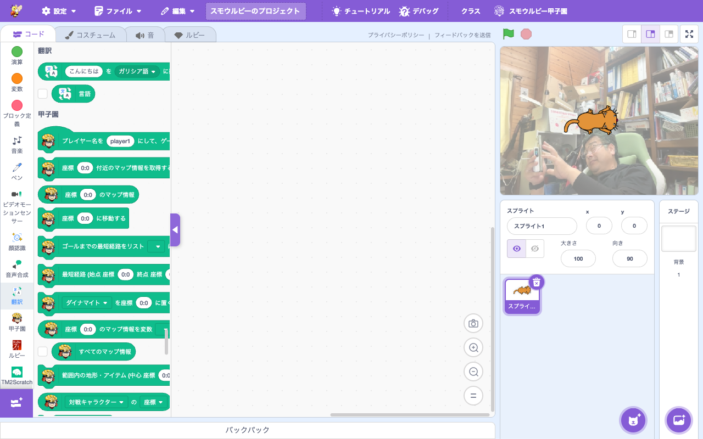

# 拡張機能: 翻訳 (Translate)

> **🔧 upstream 改良** — upstream にあるが Smalruby で機能を改良・拡張している
> 改良点: 翻訳リクエストを Smalruby の**汎用** CORS 回避プロキシ (`<SCRATCH_API_PROXY_ENDPOINT>/cors-proxy`) 経由に切り替え。Scratch の翻訳サービスは CORS を scratch.mit.edu 限定にしたため、smalruby.app からの直叩きが CORS で失敗する。

- **Smalruby ランタイム対応**: ❌（smalruby3 gem 未対応。Google Translate API 経由）
- **デフォルト表示**: ✅（拡張機能ライブラリにデフォルトで表示される）
- **collaborator**: Google

## 概要

テキストを Google Translate 経由で**他言語に翻訳**する拡張機能。upstream Scratch 標準。

### Smalruby 独自: CORS 回避プロキシ経由

Scratch の翻訳サービス (`translate-service.scratch.mit.edu`) は `Access-Control-Allow-Origin` を
`scratch.mit.edu` 限定に締めたため、`smalruby.app` から直接叩くと CORS でブロックされる。
そこで VM 実装 `scratch3_translate/index.js` では、翻訳 URL (`${serverURL}translate?...`) を
Smalruby の**汎用** CORS プロキシで包む（`=== Smalruby: Start/End of translate CORS proxy ===`
マーカーで囲む）:

```
<SCRATCH_API_PROXY_ENDPOINT>/cors-proxy?url=<encodeURIComponent(翻訳URL)>
```

プロキシの URL はビルド値 `SCRATCH_API_PROXY_ENDPOINT`（既定 `https://api.smalruby.app`。末尾の `/` は
取り除く）から組み立てる（`packages/scratch-vm/src/util/cors-proxy-url.js`。音声合成と共通）。ブランチ
プレビューは stg の API を見るので、prod の API（CORS がプレビューのオリジンを許可しない）を呼ばない。
`serverURL` は upstream の値 (`https://translate-service.scratch.mit.edu/`) のまま維持し、URL 組み立て
箇所だけをラップするので upstream との差分が最小になる（upstream マージ時の silent revert 検知は
`test/unit/extension_translate_proxy.js` が担保）。プロキシはサーバ側で対象 URL を fetch し、テキスト応答を
built-in CORS で返す（`infra/smalruby-api` の `GET /cors-proxy`）。

## ユーザーストーリー

- **多言語に興味がある小学生**として、自分の作品を多言語対応させたい
- **語学学習中の子**として、英語の文を入れて翻訳結果を確認したい
- **国際交流したい子**として、海外の友達向けに翻訳機能を組み込んだ作品を作りたい

## 主要ファイル

- 拡張機能登録: `packages/scratch-gui/src/lib/libraries/extensions/index.jsx` の `extensionId: 'translate'`
- VM 実装: `packages/scratch-vm/src/extensions/scratch3_translate/`
- CORS プロキシの URL: `packages/scratch-vm/src/util/cors-proxy-url.js`

## ブロックパレット



## 関連ブロック（主要 opcode）

| opcode | 説明 |
|---|---|
| `translate_getTranslate` | テキストを指定言語に翻訳 |
| `translate_getViewerLanguage` | 閲覧者の言語を取得 |

## 関連ドキュメント

- 上流: [scratch-vm のドキュメント](https://github.com/scratchfoundation/scratch-vm)
- [Google Translate](https://translate.google.com/)
