# 生成AI への相談

> **🆕 Smalruby 独自** — upstream に存在しない、Smalruby のために新規追加された機能
> ブロックで作品を作っている生徒が、学校で使っている生成AI（Gemini / ChatGPT など）に相談するのを手伝う。

## 概要

スクリプトエリアの左下（ブロックパレットの右）に **丸い顔と「AI に相談」の吹き出し** が出る。生徒は顔か
吹き出しを押して（または手が止まったときの声かけから）次の順に進む。

1. **困りごと** — 「どんなことで困っている？」の 1 行と 5 種類のボタン。種類を選ぶと、書き出しの例が
   入った入力欄が開く。自分のことばで書く（必須。書き出しの例のままでは進めない）
2. **コピーして相談** — 作品全体のブロックを Ruby にした相談文ができる。やることは
   「コピーして Gemini を開く → Gemini の入力らんに貼りつけて送る → 答えが来たら次へ」のチェックリストで
   見せる（スモウルビーには生成AI のタブが見えないので、チェックが付くのはコピーだけ）。
   相談文の本文はふだんは畳んで文字数だけを出し、［中身を見る・直す］で開いて書き足せる
   （コピーできなかったときは、手でコピーできるように開く）。
   ［コピーして Gemini を開く］（ボタンの名前に相談先が入る）でクリップボードにコピーし、クラスで決めた
   生成AI を別タブで開く。生成AI を開くのは最初の 1 回だけで、2 回目からはコピーだけして
   「生成AI のタブにもどって貼りつけてね」と出す（タブを閉じてしまったときのために
   ［Gemini をもう一度開く］も出す）。Gemini や ChatGPT は Cross-Origin-Opener-Policy でスモウルビーの
   タブから切り離されるので、開いたタブを名前で探したり前に出したりできないため。タブは `noopener` で
   開き、開いた先からスモウルビーのタブを操作させない。長すぎて貼れないときは 2〜4 つに分けてコピーできる。
3. **答えを貼る** — 「Gemini の答えを、まるごと貼りつけよう」（「▼▼」〜「▲▲」はスモウルビーが探すので
   全部貼ってよい）。［ブロックにできるか調べる］を押すと貼りつけ欄を畳み（［答えを見る］で開ける。
   プログラムが見つからなかったときは貼りなおせるように開いたまま）、
   ✔／✗ の結果と次のボタンをその場所に出す（調べている間はスピナー）。
4. **ブロックにする** — 下の「ブロックにできるか」の決まりで調べる。✔ なら、**増える・変わるブロック**
   （下の「増える・変わるブロック」）をブロックの言葉で見せ、どこが変わるのかを
   自分のことばで 1 行書いてから（必須・5 文字以上。足りない間は、いつも見えるボタンの下に「あと N 文字書くと、［このブロックを入れる］を押せます」と出す）［このブロックを入れる］（または［自分で組む］で閉じる）。
   ✗ なら、ブロックにできなかったところ（最大 5 つ）と［書き直しのお願いをコピー］を出す。
   その下に、生成AI の書き直した答えを貼る **空の欄** を出す（「［書き直しのお願いをコピー］して Gemini に
   送ろう。Gemini が答えなおしたら、新しい答えをここに貼りつけよう」）。貼ると［ブロックにできるか調べる］が
   出て、新しい答えが前の答えに置きかわって調べられる（畳んだ前の答えを探して貼りなおさなくてよい）。
   ✗ が 2 回になったら、ルビティーが有効なクラス（`selectRubyteeAvailable`）では
   ［ルビティーにまかせる］も出す（下の「ルビティーにまかせる」。Ruby タブは「Ruby タブ」の節）。
5. **切りかえて比べる** — 入れたあとは［元のプログラム］⇔［生成AI の案］を何度でも切りかえられる。
   答えに入っていたスプライト（複数あれば全部）がいっしょに切りかわる。それぞれの側で生徒が変えた
   ところは、切りかえても残る（切りかえる直前のブロックをその側の内容として覚える）。途中で消した
   スプライトは切りかえの対象から外れる。［生成AI の案］が入っている間は、増えた・変わったブロックに
   エディタで **印** を付け、パネルにも一覧を出す（［元のプログラム］の間は印も一覧も出さない）。
6. **おわる** — ［これで閉じる］で、いま入っている方に決めてパネルを閉じる（次に開くと最初から）。
   ［もう一度相談する］は最初の段階にもどる。

### ブロックにできるか（✔ にしてよい範囲）

答えの ▼▼〜▲▲（なければ最後の ` ```ruby `、それも無ければ ` ``` `）からプログラムを取り出し、
`# 「スプライト名」` の行でスプライトごとに分けて（無ければ今のスプライト）、スモウルビーが次を直す。

- `play(name: "x")` / `play_sound` / `start_sound` / `switch_costume_to` / `wait(1)` などの書き方の揺れ
- 音・コスチュームの名前を、そのスプライトにある名前へ（大文字小文字・空白・一部一致まで）

直したところは「スモウルビーが直したところ」として見せる。そのうえで、**すべての行がふつうの
ブロックになり、書いたスプライトに入るときだけ ✔** にする。次の場合は ✗:

| ✗ になる場合 | 理由 |
|---|---|
| プログラムが見つからない | 貼りなおすしかないので、答えの欄は開いたまま |
| そのスプライトに無い音・コスチュームの名前 | 似た名前が無いのに、1 つしか無い音で黙って代用しない（ちがう音が鳴るより、生成AI に選びなおしてもらう方がよい）。使える名前を見せ、書き直しのお願いにも入れる |
| `class Foo < Bar` / `module` の定義 | 変換器は class を外して中身を今のスプライトに入れてしまうので、✔ に見えて別のスプライトに入る。スプライトは `# 「名前」` の行で分けてもらう |
| 「Ruby のまま」のブロック（`ruby_statement` / `ruby_expression`）になる行 | ブロックとして動かないので、成功とは言えない |
| 変換器のエラー（命令のまちがい・文法） | 変換器のメッセージをそのまま見せる |

書き直しのお願いは、エディタの言語にかかわらず日本語（`problemToJapanese`）。

### 増える・変わるブロック

生徒が「何が増えるのか」をブロックで分かるように、今のプログラムと生成AI の案をブロックで比べる
（`src/lib/genai-block-diff.js`。純粋関数）。

- **比べ方**: スクリプトごとに、上から順に並んだブロック（「もし」「くり返す」の中も含む。ブロックに
  はめた値のブロックは、はめた先のブロックの一部として扱う）を、種類・欄の値・はめた値（中まで）で
  比べる。同じブロックは、同じスクリプトの中 → 別のスクリプトの順に対応させ、印を付けない（並べ替えた
  だけ・別のスクリプトへ移しただけでは印が付かない）。残りのうち、同じスクリプトに同じ種類のブロックが
  残っていれば **変わる**、無ければ **増える**、生成AI の案に無いブロックは **なくなる**。
  同じブロックが 1 つから 2 つになったら、後ろの方が増えたブロック。
- **説明の文**: ブロックの言葉で、用意した文に当てはめる。「「[メッセージ1] を受け取ったとき」の中に
  「(ニャー) の音を鳴らす」が増えます」「「(1) 秒待つ」が「(2) 秒待つ」に変わります」
  「「…」がなくなります」。ブロックの言葉はエディタのブロックの定義（`ScratchBlocks.Blocks` の
  `jsonInit` に渡す文。エディタの言語になる）から作り、はめた値は ( )、ブロックのメニュー
  （変数・メッセージ）は [ ] で囲む。メニューは表示名（「端」「幽霊」）にする。スプライトが複数のときは
  行の頭にスプライト名を付ける。6 行を超えた分は「ほかに N か所」。生成AI の説明文をかみくだく
  のはルビティーの担当（別の Issue）で、ここでは用意した文だけを使う。
- **見せる場所**: 入れる前の確認（✔ の下）と、入れたあとのパネルの両方。入れたあとは、増えた
  ブロックに **ピンクの枠**、変わったブロックに **ピンクの点線の枠** を付ける（ブロックの SVG に
  `genaiMarkAdded` / `genaiMarkChanged` クラス）。エディタで別のスプライトを開いたときも、そのスプライトの
  印を付け直す。印は［元のプログラム］に切りかえる・［これで閉じる］・［もう一度相談する］で消える。
  パネルを × で閉じたときも消え、もう一度開くと付け直す（一覧はパネルに残っている）。別のスプライトの
  印は、エディタがそのスプライトに切りかわり（`workspaceUpdate`）、Blockly がブロックを描き終えてから
  付ける（決まった時間だけ待つのでは、遅い PC で間に合わない）。
- **パネルに隠れないように**: 入れたあと（と［生成AI の案］に切りかえたあと）は、印の付いたブロックが
  スクリプトエリアの左上に来るように画面を動かす（横に長いスクリプトでも、パネルは右端にあるので
  印のブロックには重ならない）。今エディタで開いているスプライトに印が無ければ、印のあるスプライトを
  開く。一覧の行を押すと、そのブロックのスプライトを開いて、そのブロックを左上へ動かす
  （印が多くて全部は見えないとき・パネルの下に隠れたとき用）。動かすのも、スプライトの切りかえ
  （`workspaceUpdate`）と描き終わりを待ってから。

### ルビティーにまかせる

生成AI に書き直しをお願いしても 2 回ブロックにできなかったとき、ルビティー（Claude Sonnet）が作品を
書き直す（`src/lib/genai-takeover.js`）。ルビティーが有効なクラス（`selectRubyteeAvailable`）の生徒だけ。

1. ［ルビティーにまかせる］を押すと、すぐに始まる。生徒の画面では同意を取らない（先生がクラス管理で
   ルビティーを有効にするときに条件を確かめているため）。
2. ルビティーに渡すもの: 困りごと（種類と自分のことば）、作品全体の Ruby（スプライトごとに `# 「名前」` と
   音・コスチュームの名前）、生成AI に渡した質問文（最初の相談文と、コピーした書き直しのお願い）と
   貼りもどした答えのすべて、それぞれブロックにできなかった理由。relay の上限（1 万字）に収まらないときは
   **古い相談から** 短くし、それでも入らないものは省く（困りごとと作品は必ず全部入れる。作品だけで
   入らないときは「作品が長すぎて、ルビティーにまかせられません」）。
3. ルビティーの答えを、貼りつけた答えと同じ決まり（上の「ブロックにできるか」）でブラウザが調べる。
   ✗ なら、理由を付けて作り直してもらう。生徒の手を借りずに **最大 3 回**（1 回目 + 作り直し 2 回。
   1 回が 1〜2 分かかることがあり、席ごとの回数の上限（40 回 / 35 分）にも数えられるため）。
   作り直しでは、最初に送った内容とルビティーの直前の答えだけを履歴として送る（リクエストを小さく保つ）。
4. ✔ になったものだけを「ルビティー（AI）が作った案です」とルビティーの短い説明と一緒に、増える・変わる
   ブロック（ブロックの言葉）で見せる。以降は通常の［このブロックを入れる］/ 切りかえの流れ。
   3 回とも ✗ なら、最後の理由を見せて「自分で組むか、もう一度相談してみよう」と出す（もう一度まかせることもできる）。
5. 書き直している間はスピナーと「（N / 3 回目）」を出し、［やめる］で止められる。

ブロックそのものは AI に作らせない（答えは Ruby で、ブロックにするのはスモウルビーの変換）。

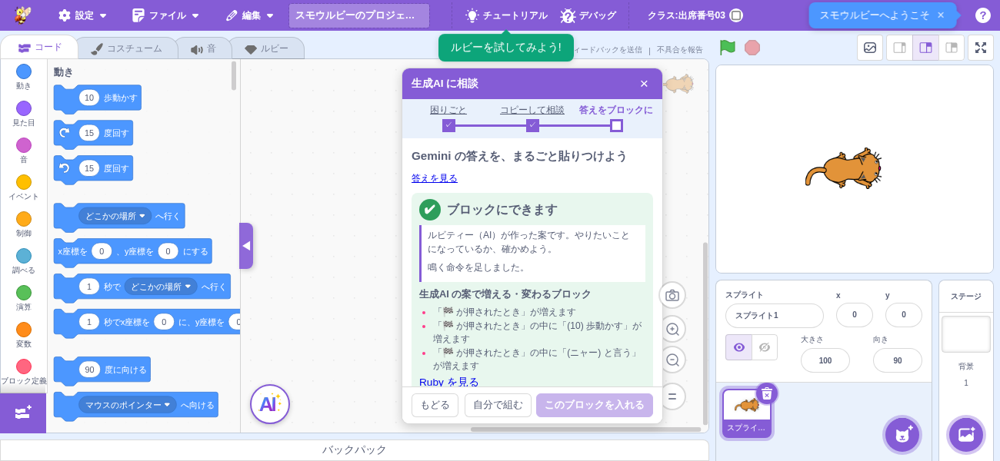

relay の呼び方: `POST /generate` に `purpose: "genai-takeover"` と、クラスに参加していれば生徒の
`sessionToken`（relay が席を確かめる。`classroom` / `seat`・メールアドレス・名前は送らない）→
`202 { jobId }` → `GET /jobs/{jobId}` を 3 秒から 1 秒ずつ伸ばして最大 10 秒間隔で問い合わせる。
ブラウザは 300 秒で待つのをやめる。エラーは、回数の上限（429）なら「N 分ほど待ってから」、
送れない言葉（`INVALID_INPUT`）・長すぎ（`INPUT_TOO_LONG` など）・それ以外（つながらない・AI のエラー）を
分けて出す。

### パネルを閉じた・タブを移ったとき

**状態を保つ**。パネルを一度開いたら、閉じても中身は隠すだけで残すので、切りかえの途中で閉じたり、
ルビータブ・コスチュームタブへ移ったりしても、もどれば同じ所から続けられる（その間に生徒が変えた
ブロックは、いま入っている側の内容になる）。確定したいときは［これで閉じる］を押す。
ただし、別の作品を読み込んだときは最初から（貼った答えも切りかえも、前の作品のものなので消す）。

### パネルの形（どの段階も共通）

- **1 画面に、次にやることは 1 つ**。主ボタン（紫）は 1 つだけで、問いかけは 1 行。
- ボタンの帯（［もどる］と主ボタン）は **パネルの下端に固定** し、中身だけがスクロールする。
  1300×600 で、どの段階もパネルの中をスクロールせずに主ボタンまで見える。
- 段階を移ったとき・分けたときは、前のお知らせ（「コピーしました」など）を消す。
- ヘッダーの下は **進み具合の表示**（タブではない）。ラベルは「困りごと」「コピーして相談」「答えをブロックに」（Ruby タブは「答えをコードに」）の
  3 つで、3 つ目が上の段階 3〜6（相談の答えを自分のプログラムに入れて比べる）をまとめて表す。
  生徒が読んで何をする段階か分かるように、ラベルは「答えをどうするのか」を書く。
  ラベルの下に丸い点を並べて線でつなぐ（通販の配送状況のようなステップ表示。チェックボックスに見えて
  押せると思わせないよう、四角や枠だけの点にしない）。
  終わった段階は紫の丸に白い ✓（線もそこまで紫）、いまの段階は ✓ の無い紫の丸に薄い紫のリングと太字、
  まだの段階は灰色の丸。
  ブロックを入れる前なら、終わった段階のラベルを押してもどれる（押せる段階は hover で点が少し濃くなる）。
- **顔と吹き出し**: 顔は目と口のある丸い顔（SVG・`$looks-secondary` の枠）。右に、顔を指すしっぽの
  付いた「AI に相談」の吹き出しを出し、押すと顔と同じくパネルを開く。パネルを開いている間と声かけの間は
  吹き出しを出さない（顔だけ）。顔の右の空き（右端のズームの列を除く）が 300px より狭いとき（iPad の
  縦向きのコードタブなど）は「AI」だけに短くし、それも入らないときは出さない（判定は `faceLabel`）。
  吹き出しのボタンは、見た目より大きい 44×44px 以上の押せる範囲を持つ（スマホで押しやすいように）。顔と吹き出しはパネル側
  （`genai-face.jsx`）だけで描くので、コードタブと Ruby タブで同じ。
- パネルは **スクリプトエリアの右端** に出す（顔は左下のまま）。スクリプトエリアが狭くて顔と並ばない
  ときは顔の上に出す。高さは、パネルを切り取る枠（Ruby タブはタブの下のエディタ、コードタブは
  メニューバーの下の画面）の上端まで伸ばせる。ヘッダー（× と動かすところ）がメニューバーやタブに
  隠れないように、ドラッグしてもパネルはその枠の中に止まる（下へ動かしたときはボタンが見える高さまで、
  上へ動かしたときは上端に当たって縮む。判定は `panelFrame`）。ブロックを入れたあとは、
  印の付いたブロック（無ければ入れたブロック全体）がスクリプトエリアの左上に来るように画面を動かす
  （パネルに重ならない）。

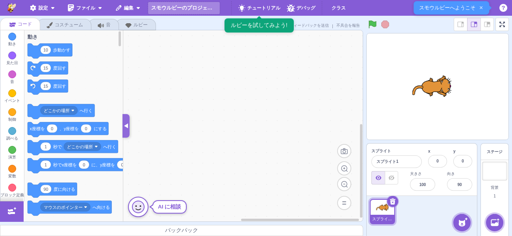
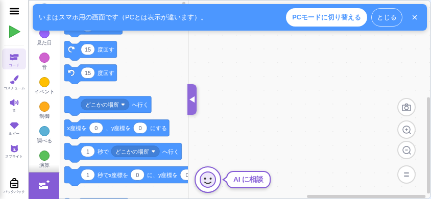
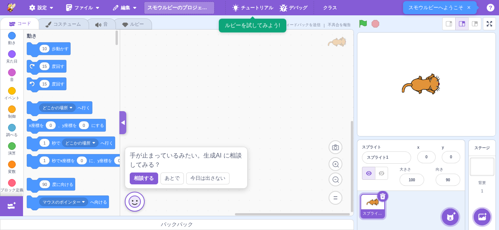
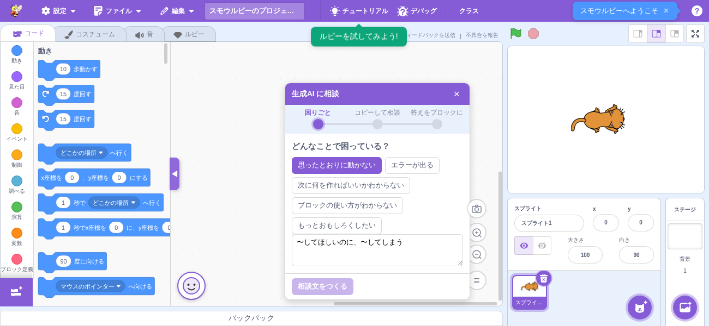
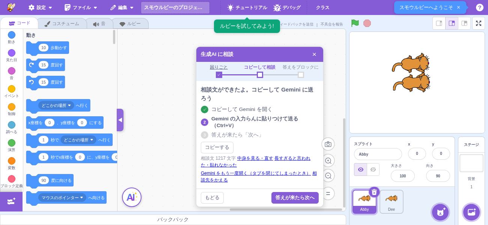
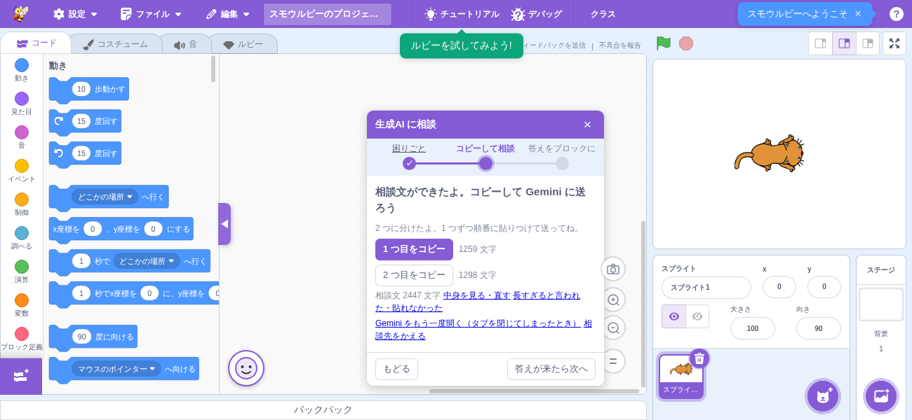
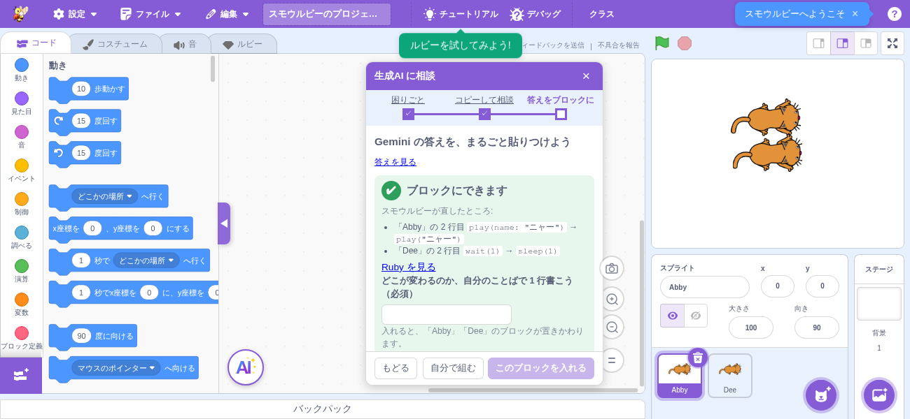
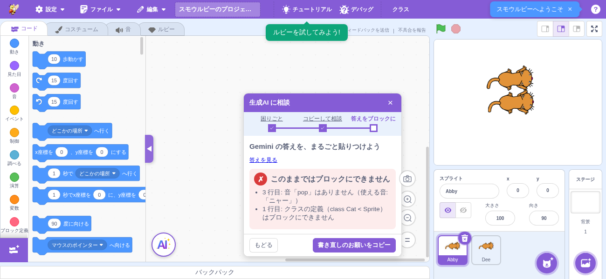
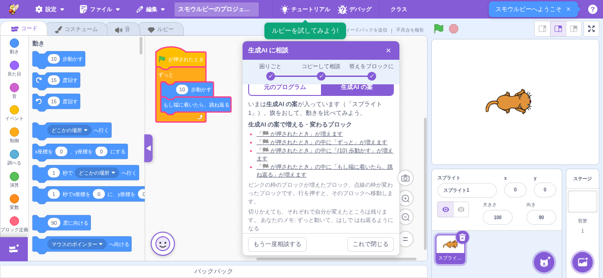

スモウルビーは生成AI と直接は通信しない。生徒が自分でコピー・貼りつけをする（学校が契約・許可して
いる生成AI を、学校のアカウントのまま使うため）。

## 表示条件

| 条件 | 顔 |
|------|----|
| 生徒としてクラス（課題）に参加していて、そのクラスで先生が生成AI を「使う」にしている | 出る |
| 参加しているクラスで生成AI を使わない / クラスに参加していない / 先生 | 出ない |
| `?features=genai`（開発用） | dev server（`npm start`）とブランチプレビュー（`preview.smalruby.app`）では、クラスの外でも出る。本番（smalruby.app）では効かない |

クラスの設定（`genai.enabled` / `service` / `url`）は、参加（`/classrooms/join`）とセッション確認
（`/classrooms/verify-session`）の応答で受け取り、Redux（`state.scratchGui.classroom.studentGenai`）に
入れる。セッション確認は **ページを開いたとき**（`src/containers/use-student-class-settings-refresh.js`。
ルビティーの設定もあわせて読み直す）と、クラスのモーダルを開いたときに行う。そのため先生が授業中に
「使わない」に変えると、生徒がページを再読み込みするかクラスの画面を開いたときに顔が消える（定期的な
問い合わせはしない）。セッションが無効（401 / 410）なら顔を消す。通信できないときは localStorage に
残した前の設定のまま出す。別のクラスに移る・退室すると消える。https 以外の URL は「使わない」と
同じ扱いにする。先生側の設定画面は `docs/classroom/ui-ux.md` の「生成AI・ルビティー（クラス単位）」。

### 生成AI の種類と URL

**クラスの設定が決める**。生徒は変えられない（「相談先: Gemini」のように名前だけ出す。ほかの
生成AI は URL のホスト名を出す）。

プロトタイプにあった「1 回だけ聞いてブラウザに覚える」画面は、**`?features=genai` でクラスの外に
いるときだけ**残している（開発・試用用。dev server とプレビューだけ）。クラスに参加していれば出ない（クラスで生成AI を使わない
なら顔そのものが出ないため、保険として残す必要がない）。

## 声かけ

- 操作（クリック・キー・ホイール・作品の変更）が **2 分 30 秒** 無いと「手が止まっているみたい。
  生成AI に相談してみる？」を出す。
- 1 回出したら **10 分** あける。
- **出さないとき**: プログラムが動いている間（動かして見ている・止めた直後は数え直す）、タブが裏に
  あるとき、パネルを開いているとき。
- お知らせ（メッシュの接続が切れた、など）が出ていても声かけは出す。コードタブにはルビータブのような
  文法エラーが無いので、エラーかどうかは見ない。
- ［今日は出さない］は **その日だけ**（ローカルの日付で記録し、翌日にはまた出る）。

## 質問文

文面は `src/lib/genai-prompt.js`（純粋関数）。生徒が Ruby を知らなくても使えるように、生成AI に
次を頼んでいる: 質問を返さずすぐ直したプログラムを出す / 変えるスプライトごとに `# 「名前」` の
1 行から全部書く / 命令は今のプログラムか「使える命令の例」の書き方で書く / 音・コスチュームは
一覧の名前から選ぶ / 直したプログラムは全部「▼▼」〜「▲▲」の行のあいだの 1 つのコード枠に入れる。
質問文はエディタの言語にかかわらず日本語（困りごとの種類も日本語の名前で入る）。

「使える命令の例」は、イベント・繰り返し・条件・クローン・質問・タイマーなど、生徒の困りごとで
よく要る命令をひととおり載せている。例が少ないと、慎重な生成AI は「使える命令に無い」と考えて
プログラムを出さずに断る（キー入力やメッセージが要る困りごとで実際に起きた）。また「例だけを
使う」と書くと同じ理由で断るので、「例に無い命令が要るときも、出すのをやめずにスモウルビーの
書き方で書く」と頼んでいる。例はすべて変換器でふつうのブロックになることを unit テスト
（`genai-prompt.test.js`）で確かめている。

### 自動で直す書き方

生成AI がよく間違える書き方は、貼った答えをブロックにする前に `src/lib/genai-repair.js` が直す
（直したところは「直したこと」として生徒に見せる）。文字列とコメントの中は変えない。

| 生成AI の書き方 | 直した書き方 |
|---|---|
| `play(name: "pop")` / `play_sound("pop")` / `start_sound(...)` | `play("Pop")`（名前は一覧の表記にそろえる） |
| `play_sound_until_done(...)` | `play_until_done(...)` |
| `switch_costume_to(name: "b")` | `switch_costume("B")` |
| `wait(1)` / `wait 1` | `sleep(1)` |
| `when_green_flag_clicked` | `when_flag_clicked` |
| `when_this_sprite_clicked` / `when_sprite_clicked` | `when_clicked` |
| `when_broadcast_received(...)` / `when_i_receive(...)` | `when_receive(...)` |
| `when_start_as_clone` | `when_start_as_a_clone` |
| `forever do` | `loop do` |
| `touched?(...)` | `touching?(...)` |
| `key_pressed?(...)` | `keyboard.pressed?(...)` |
| `point_in_direction(90)` | `self.direction = 90` |
| `create_clone`（引数なし） | `create_clone("_myself_")` |
| `stop_all` | `stop("all")` |
| `rand(1, 10)` / `pick_random(1, 10)` / `random(1, 10)` | `rand(1..10)` |

一覧に無い音・コスチュームの名前は、ほかの名前に置きかえず、生徒に選んでもらう。

### 質問文の検証（プロンプト・ラボ）

質問文と自動修正は、`packages/scratch-gui/test/genai-lab/` で検証する（CI では動かさない）。
生徒の困りごとと作品の場面（`scenarios.js`）ごとに、本物の質問文をモデルに送り、答えを本物の
判定（`checkAnswer`）と変換器で採点する。さらに採点役のモデルが、貼りつけたあとのプログラムで
困りごとが解決するかを判定する。学校の生成AI（Gemini）で試す前に、Claude（Sonnet と、誤りの
出やすい Haiku）で質問文を詰めるための道具。

```bash
cd packages/scratch-gui
GENAI_LAB=1 GENAI_LAB_RUN=<名前> GENAI_LAB_MODELS=sonnet,haiku GENAI_LAB_REPEAT=3 \
  npx jest test/genai-lab/lab.test.js
# → <repo>/tmp/genai-lab/<名前>/summary.md（表）と grades.json、答え・判定の生ファイル
```

- モデルはコンテナ内の `claude -p`（道具なし・学校の生成AI に近い素の会話）で呼ぶ。
- 同じ `GENAI_LAB_RUN` の答えは再利用するので、質問文以外（自動修正・採点）を変えたときは
  モデルに聞き直さずに採点だけやり直せる。
- `GENAI_LAB_ONLY` で場面を絞る。`GENAI_LAB_JUDGE=none` で採点役を使わない。
- 場面の作品がブロックになることは `fixtures.test.js` で確かめる。

## Ruby タブ

Ruby タブの **Ruby モード・ふりがなモード・日本語 (DNCL) モード** でも同じパネルで相談できる（`src/lib/genai-ruby-adapter.js`
のアダプタを `ruby-tab.jsx` が渡す）。段階はコードタブと同じで、変わるのは「何を渡し、何で答えさせ、
どう確かめ、どう入れるか」だけ。

- **顔**: エディタの左下（行番号の上）。右下はズームと画像保存のボタンなので空いている。パネルは
  エディタの右側に開く。出す条件はコードタブと同じで、さらに **Ruby のバージョンが 2 のときだけ**
  （`ruby_version=1` では出さない）。日本語 (DNCL) モードでも出す（下の「日本語 (DNCL) モード」）。
- **困りごと**: 種類は「思ったとおりに動かない / エラーが出る / 次に何を作ればいいかわからない /
  命令の書き方がわからない / もっとおもしろくしたい」。エディタにエラーの印があるときに顔を押すと、
  「エラーが出る」を選び、エラー文（「N 行目: …」）を入れた状態で始まる。
- **直すのは今のスプライトだけ**: 質問文には、エディタにいま出ている Ruby（ブロックにまだ反映して
  いない編集も含む）を「直すプログラム」として入れ、ほかのスプライトのコードは合図や変数の名前を
  合わせるための **参考**（直さないと明記）として付ける。答えは今のスプライトの分だけを 1 つの
  `ruby` のコード枠で書いてもらい、`# 「名前」` の見出しは書かないよう頼む。
- **説明のことば**: Ruby モードは Ruby の書き方で「何を変えたか」を 1〜3 行。ふりがなモードは
  やさしいことばで、命令に日本語の意味を添える（`loop`（ずっと））。どちらも **答えのコードは Ruby のまま**。
  命令の例と、音・コスチュームの名前はコードタブと同じ。
- **確かめる**: コードタブと同じ判定。答えが別のスプライトまで直している（`# 「名前」` が今の
  スプライト以外）ときは ✗ にし、書き直しのお願いに「『<今のスプライト>』の分だけにしてください」を入れる。
- **確かめたことの言い方**: 判定はコードタブと同じく答えを試しにブロックに直して行うが、Ruby タブで
  ブロックに直すのは動かすためなので、**画面にはブロックの話を出さない**（3 モードとも）。ボタンは
  ［プログラムを確かめる］、✔ は「問題は見つかりませんでした（このまま動かせます）」、✗ は「このプログラムには
  問題があります」、問題の説明は「N か所に、スモウルビーで使えない書き方があります」「クラスの定義（…）は、
  スモウルビーでは使えません」、ルビティーで直らなかったときは「…書き直しても、問題が残りました」
  （`messages.js` の `*Code` のキー。`putsCode` で出し分ける）。生成AI・ルビティーに送る文（質問文・書き直しの
  お願い・ルビティーへの文）は「ブロックに直せる書き方で」と頼むので変えない。
- **［Ruby を見る］は出さない**（Ruby・ふりがなモード）: 答えそのものが Ruby で、✔ の下の行の差分に
  コードが出ているため。日本語 (DNCL) モードは答えを DNCL のまま見られる［プログラムを見る］を残す。
- **入れる前に比べる**: ✔ の下に、今のコード（エディタにいま出ているもの）と生成AI の案の **行の差分**
  を Monaco の差分表示（インライン。`createDiffEditor`）で見せ、「N 行増える・M 行変わる・K 行なくなる」を
  出す（コードタブの「増える・変わるブロック」の代わり）。コードタブと同じく「どこが変わるか」を自分の
  ことばで書いてから［このコードにする］。
- **入れる**: ［このコードにする］で、エディタのコードを丸ごと置きかえる（`executeEdits`。
  Ctrl+Z で元にもどせる）。ブロックへの反映は、生徒が自分で書いたときと同じ流れで行われる。
  確かめたあとに生徒がほかのスプライトに切りかえていたら、エディタには入れず、確かめたスプライトの
  ブロックに入れる（切りかえと同じ。ブロックにできないときは入れない）。
- **入れたあとの印**: 増えた行・変わった行に、エディタの decoration で印を付ける（行全体をうすいピンク、
  行番号の横に線。増えた行は実線・変わった行は点線。なくなった行は印を付けようがないので数だけ）。
  パネルにも「N 行増えた・M 行変わった」を出す。印は生徒が書き足すと行といっしょに動く。
  自動置換や Ctrl+Z でコードが丸ごと入れなおされたときは、直前に印のあった行（の位置）にだけ印を残す
  （生徒が書いた行には付けない。答えを Ctrl+Z で取り消せば印も消える）。
- **切りかえ**: ［元のプログラム］⇔［生成AI の案］を何度でも切りかえられ、それぞれの側で生徒が変えた
  ところは残る（`switchSnapshots`）。エディタに出ているスプライトはエディタのコードを置きかえ、
  ほかのスプライトに移ったあとはそのスプライトのブロックを置きかえる。印は［生成AI の案］の間だけ出す。
- **印を消す・付け直す**: ［これで閉じる］・［元のプログラム］・［もう一度相談する］で消す。× で閉じたら消し、
  開き直したら付け直す。別のスプライトに切りかえている間は出さず、相談したスプライトに戻ったら
  （そのときのコードと元のコードを比べ直して）付け直す。
- **ルビティーにまかせる**: コードタブと同じく、✗ が 2 回になったらルビティーが有効なクラスでは
  ［ルビティーにまかせる］を出す（同意画面は出さない。判定は `isTakeoverAvailable`）。ルビティーに渡すのは
  「今のスプライトだけを直すこと」、今のスプライトのコード（エディタにいま出ている Ruby）、参考のほかの
  スプライト（コードのあるものだけ。直さないと明記）、困りごと、生成AI とのやりとり
  （`buildRubyTabTakeoverMessage`）。1 万字に収まらないときは古いやりとりから短くし、それでも
  今のスプライトと参考が入りきらないときは参考を省く（今のスプライトだけで入らないときは
  「作品が長すぎて…」）。ふりがなモードでは、説明をやさしいことばで書き、命令に日本語の意味を添えるよう頼む
  （コードは Ruby のまま）。答えはコードタブと同じくブラウザで確かめ、ほかのスプライトまで直していたら
  理由を付けて作り直してもらう。✔ になった案は、上の行の差分・［このコードにする］・切りかえの流れに乗る。
  relay は同じ `purpose: "genai-takeover"` を使う（relay のプロンプトは変えていない）。
  ルビティーは 1 回に 1〜2 分かかるので、その間に生徒がほかのスプライトに切りかえることがある。
  確かめ・行の差分・入れるは **［ルビティーにまかせる］を押したときのスプライト** に対して行う
  （アダプタの `takeoverScope()` を始めたときに覚え、`check(text, scope)` に渡す）。そのスプライトが
  エディタに出ていなければ、行の差分はそのスプライトのブロックのコードと比べ、［このコードにする］は
  そのスプライトのブロックに入れる（切りかえと同じ。ブロックにできないときは入れない）。
  途中でそのスプライトを消したときは、エディタに出ているスプライトに対して確かめる。
- **エディタに出ているスプライト**: 上の「今のスプライト」「エディタに出ているスプライト」は、VM の
  `editingTarget` ではなく Ruby タブがエディタに出しているスプライト（`rubyCode.target`）を指す。
  エディタのコードがブロックにできないままスプライトを切りかえると、Ruby タブはエディタに前のスプライトの
  コードを出したままにするので、そのあいだは質問文・確かめ・行の差分・［このコードにする］・印も
  前のスプライト（生徒が見ているコード）に対して行う。アダプタは `getEditorTarget` で読み、
  切りかえは `onEditorTargetChange`（エディタに新しいコードが入ったあとに知らされる）で知る。

### 日本語 (DNCL) モード

共通テストの DNCL を練習する高校生向け。段階・行の差分・入れたあとの印・切りかえは Ruby モードと同じで、
質問文・答えのことば・確かめ方が DNCL になる（`src/lib/genai-dncl-prompt.js` と `src/lib/genai-dncl-answer.js`）。

- **困りごと**: 「答えが合わない / エラーが出る / どう書けばいいかわからない / 問題の考え方がわからない」。
  エディタにエラーの印があれば「エラーが出る」とエラー文（DNCL の行番号）を入れて始める。
- **質問文**: エディタにいま出ている DNCL をそのまま入れる。答えも DNCL で（共通テストの形の行番号・`｜` `⎿`・
  末尾の `:` でもよい）、**配列の添字は 0 から**（問題文が 1 からでも 1 ずらして書く）、代入は `←` か `=`、
  関数の引数には代入できない（ほかの変数に写してから変える）、
  ブロックの終わりは「を実行する」「を繰り返す」「と定義する」、コメントは `#`（`//` は整数の割り算）、
  説明は DNCL のことばで、と頼む。「書き方と使える命令の例」は、書き方（代入・配列・入力・もし・の間・
  増やしながら・減らしながら・関数）と、`src/lib/dncl/dncl-builtins.js` の組み込み関数（`DNCL_BUILTIN_NAMES`）
  1 つずつの例で作る（組み込み関数を足すと例も要る。unit テストで抜けと、どの例もふつうのブロックになることを確かめる）。
  イベント・拡張機能・音・コスチュームの命令は使えないと書き、音・コスチュームの名前とほかのスプライトの
  プログラムは入れない。
- **確かめる**: 答えから DNCL を取り出し（印のあいだのコード枠。コード枠の言語名は問わない）、エディタに
  貼りつけたときと同じ整形（行番号を消す・`//` のコメントを `#` に）をしてから、DNCLv2 の pre-processor を通して
  Ruby に直し、Ruby モードと同じ判定（変換器のエラー・「Ruby のまま」のブロックが無ければ ✔）。エラーは
  source map（`dncl-source-map.js`）で **DNCL の行** に戻して見せる。`//` のある行のエラーには「// は
  コメントではない」を添える。閉じ忘れ・閉じすぎ（`を実行する` などが足りない・多い）は変換器の「`end` が
  足りません」ではなく DNCL のことば（「「もし〜ならば」を「を実行する」で閉じてください」など）で言う
  （AI に `end` を書き足させないため。[`docs/dncl/README.md`](../dncl/README.md) の「閉じ忘れのエラー」）。
  書き直しのお願いも DNCL で頼む。
- **添字の注意**: 答えの DNCL にもエディタの添字の警告と同じ判定（`findArrayIndexHints`）をかけ、配列の
  範囲外を読むところ（1 から数えた添字）があれば、✔ のまま、✔ の下（行の差分の上）に「注意: 添字が 1 から
  始まっているかもしれません…」と行ごとの説明（「◯ 行目: Data[i] は配列の範囲外になります…」）を出す
  （`genai-index-hints`）。共通テストの問題は 1 から数えることもあるので ✗ にはしない（判定と
  ［このコードにする］は変わらない）。Ruby・ふりがなモードでは出さない。
- **入れる・比べる**: エディタに入れるのは DNCL（整形したもの）。行の差分は DNCL どうしで比べる。
  ほかのスプライトに移ったあとの切りかえは、DNCL を Ruby に直してブロックを置きかえる。
- **ルビティーにまかせる**: 出さない（#1396 決定 3。relay が DNCL で答えられるようになるまで）。
- モードを日本語 (DNCL) と Ruby・ふりがなのあいだで切りかえると、相談は最初からになる（質問文・答え・
  2 つの版がモードの言語で書かれているため）。エディタのコードはそのまま。

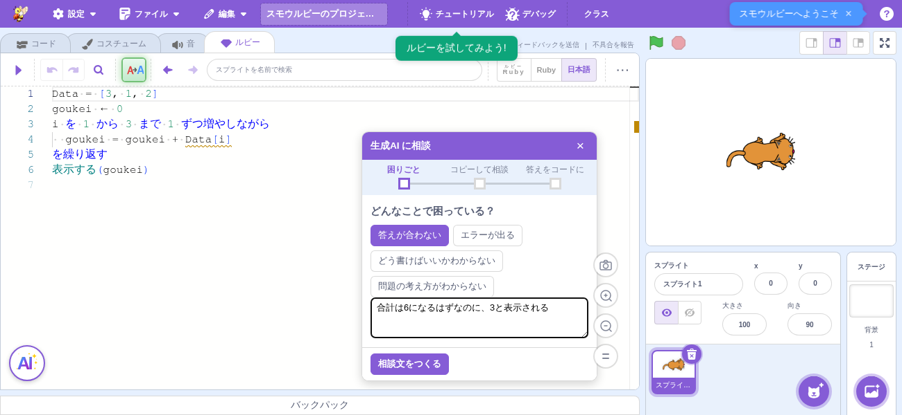
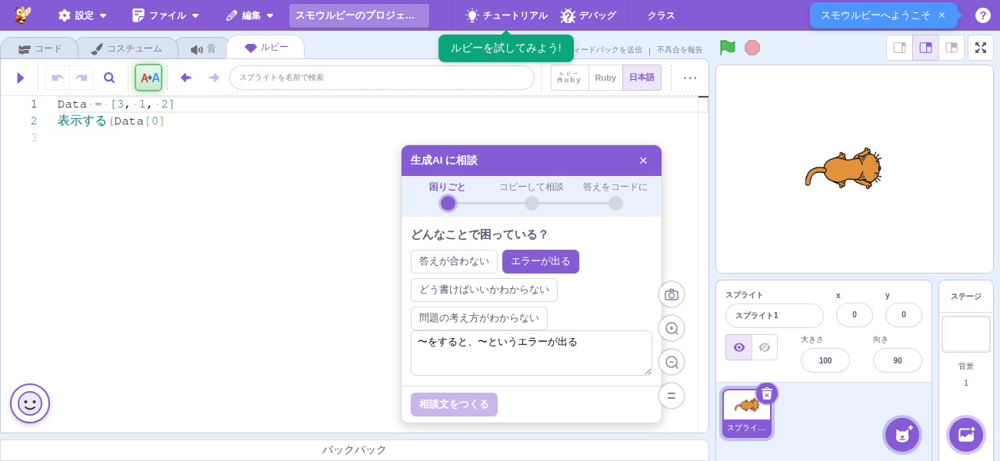
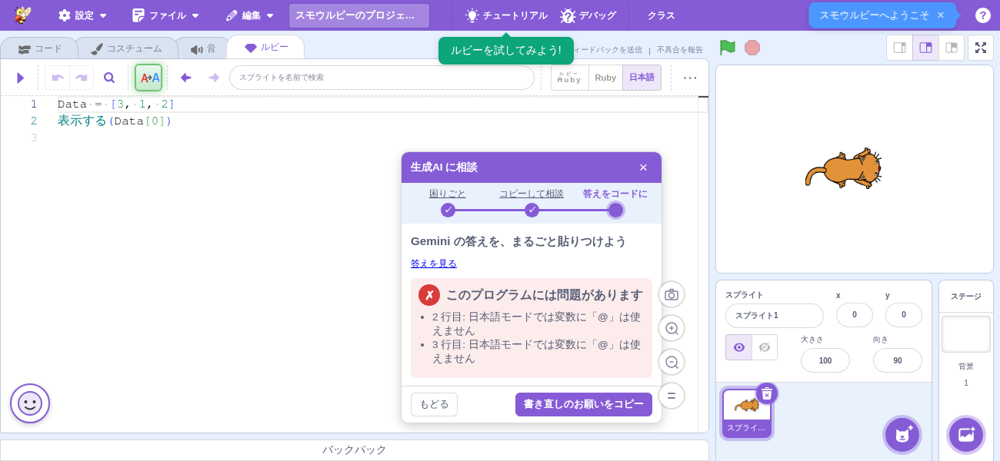
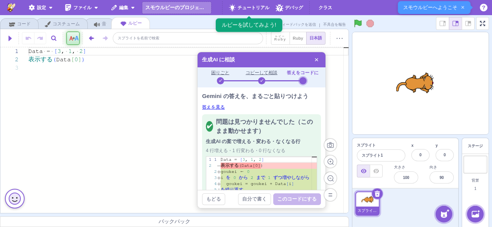
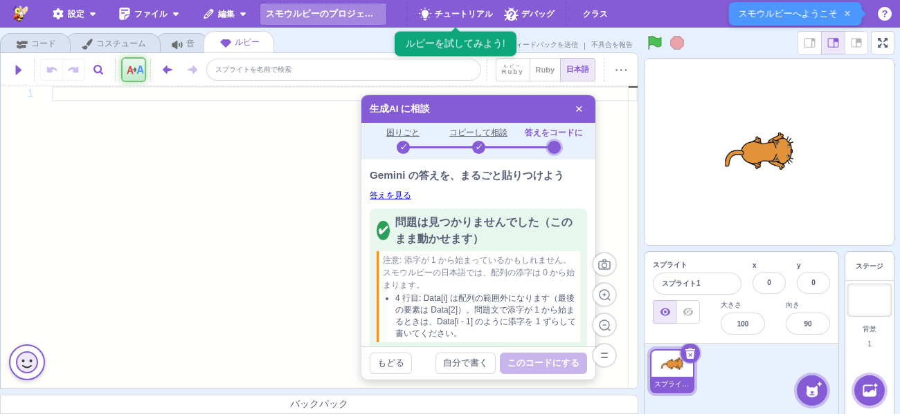
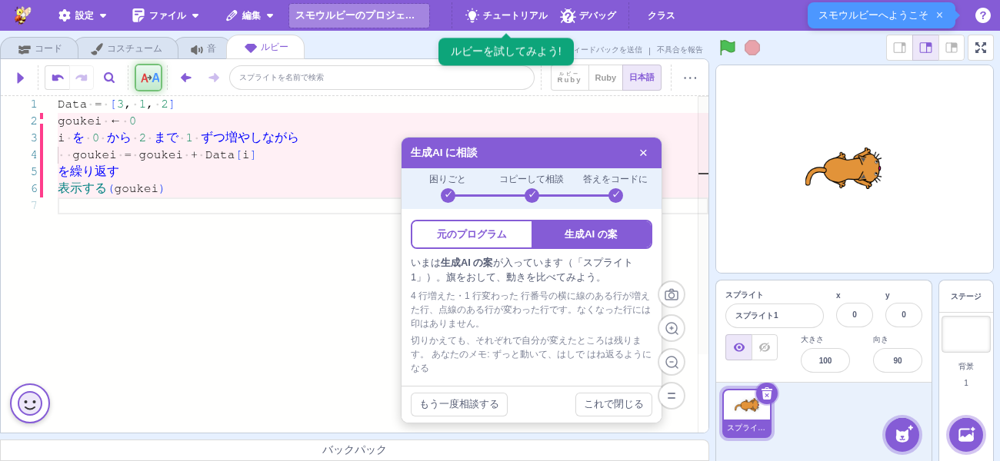

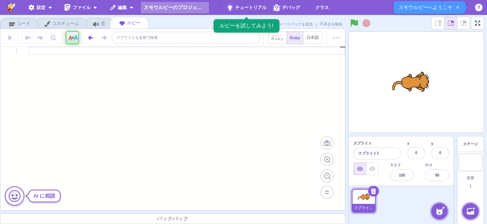
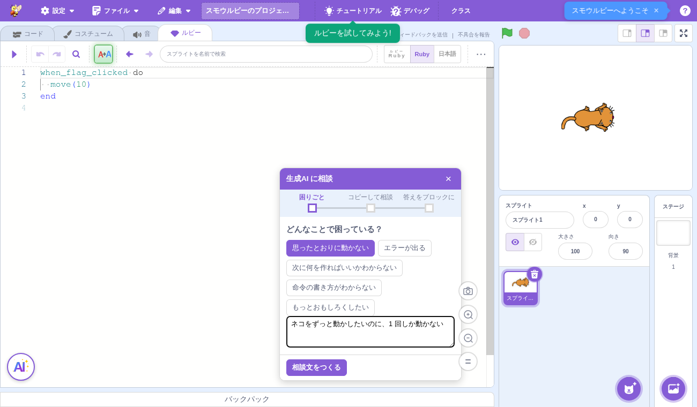
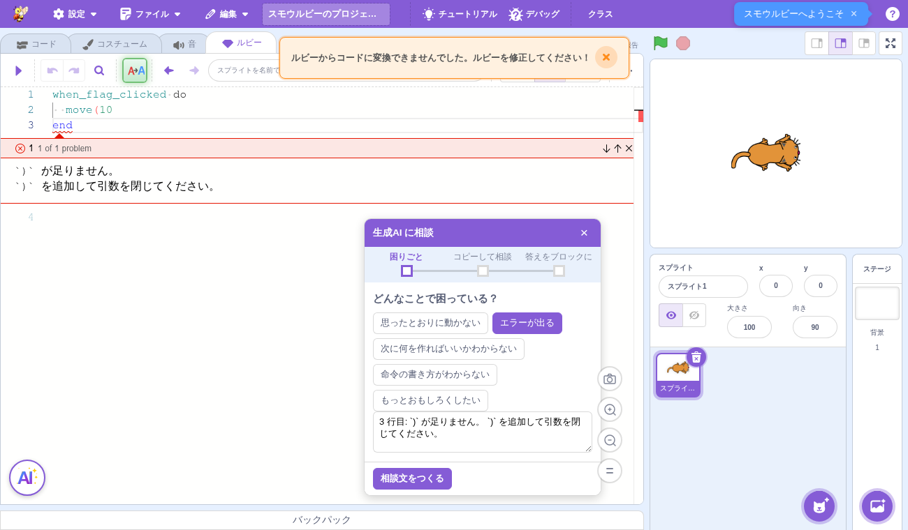
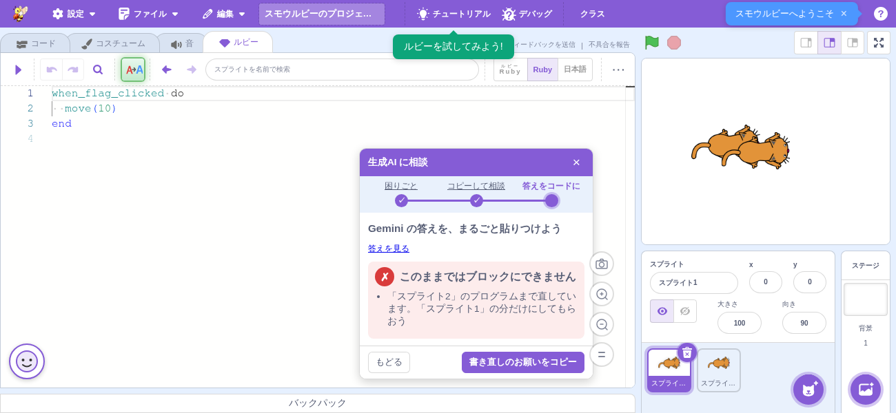
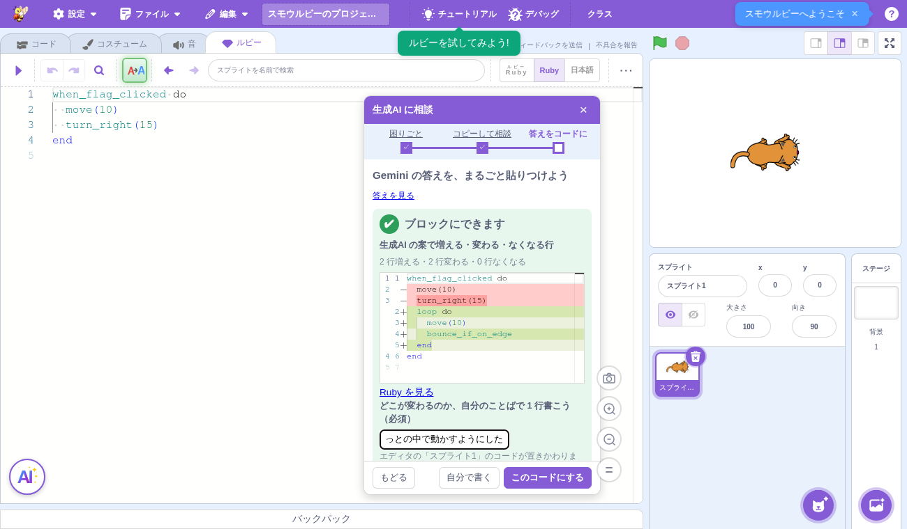
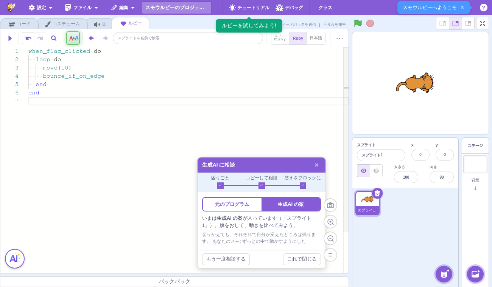
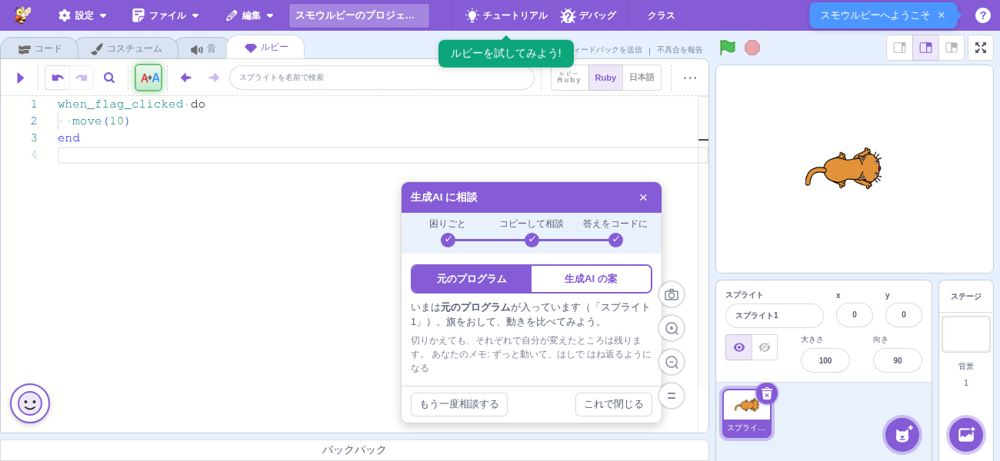

## 設定・データ永続化

| キー | 場所 | 内容 |
|------|------|------|
| `smalruby:classroom` の `studentGenai` | localStorage | クラスの生成AI 設定（`{enabled, service, url}`） |
| `smalruby:genaiNudgeOff` | localStorage | ［今日は出さない］を押した日付（`YYYY-MM-DD`）。プロトタイプの `'true'` は無効扱い |
| `smalruby:genaiService` | localStorage | 開発用（`?features=genai` でクラス外）に選んだ生成AI |
| `?features=genai` | URL | クラスの外でも顔を出す（開発用。dev server とプレビューだけで効き、本番では無視する。判定は `isGenaiDevFlag`。Ruby タブは `ruby_version=2` のときだけ） |
| `?genai_idle=<秒>` | URL | 声かけまでの秒数を短くする（テスト用。あける時間も秒数の 4 倍までに縮む） |

## 主要ファイル

| ファイル | 役割 |
|---------|------|
| `packages/scratch-gui/src/containers/genai-concierge.jsx` | 顔・パネル・声かけ・コピーと生成AI のタブ（表示条件は Redux から）。タブごとに違うところはアダプタ（`createAdapter`、既定はコードタブ用）に任せる |
| `packages/scratch-gui/src/containers/use-student-class-settings-refresh.js` | ページを開いたときにクラスの AI 設定（生成AI・ルビティー）を verify-session で読み直す |
| `packages/scratch-gui/src/components/genai-concierge/genai-face.jsx` | 顔と「AI に相談」の吹き出し（両方のタブで同じ） |
| `packages/scratch-gui/src/components/genai-concierge/genai-nudge.jsx` | 声かけの吹き出し |
| `packages/scratch-gui/src/components/genai-concierge/genai-stepper.jsx` | 進み具合の表示 |
| `packages/scratch-gui/src/components/genai-concierge/genai-trouble-step.jsx` | 段階 1: 困りごと |
| `packages/scratch-gui/src/components/genai-concierge/genai-copy-step.jsx` | 段階 2: 質問文のコピー・分割（開発用の生成AI 選択を含む） |
| `packages/scratch-gui/src/components/genai-concierge/genai-answer-steps.jsx` | 段階 3〜6: 答えを貼る・ブロックにする・切りかえ（確かめる・入れる・印はアダプタを呼ぶ） |
| `packages/scratch-gui/src/components/genai-concierge/messages.js` | 文言（`gui.genaiConcierge.*`） |
| `packages/scratch-gui/src/lib/genai-concierge-state.js` | 表示条件・相談先・声かけ・進み具合・パネルの位置・見せる印の選び方の判定（純粋関数。どのタブでも同じ） |
| `packages/scratch-gui/src/lib/genai-prompt.js` | 質問文の組み立て・分割・答えからの Ruby 取り出し（純粋関数） |
| `packages/scratch-gui/src/lib/genai-repair.js` | 生成AI の Ruby の自動修正・スプライトごとの分割（純粋関数） |
| `packages/scratch-gui/test/genai-lab/` | 質問文の検証（プロンプト・ラボ。CI では動かさない） |
| `packages/scratch-gui/src/lib/genai-block-diff.js` | 今のプログラムと生成AI の案をブロックで比べる・ブロックの言葉にする（純粋関数。ブロックの定義は引数で受ける） |
| `packages/scratch-gui/src/lib/genai-takeover.js` | ルビティーにまかせる: ルビティーに送る文の組み立て・作り直しのくり返し・relay の呼び出し（ジョブの問い合わせ） |
| `packages/scratch-gui/src/lib/genai-code-adapter.js` | コードタブ用のアダプタ。パネルがタブごとに差し替える点（質問文を作る・答えを確かめる・入れる／切りかえる／印を付ける・増える／変わるものの見せ方・顔の置き場所の測り方）をまとめる。差し替え点の説明はファイル冒頭 |
| `packages/scratch-gui/src/lib/genai-ruby-adapter.js` | Ruby タブ（Ruby・ふりがな・日本語 (DNCL) モード）用のアダプタ。エディタのコードで質問文とルビティーに送る文（Ruby・ふりがなモード）を作る・今のスプライトだけを確かめる・エディタに入れる・エディタのエラーから困りごとを始める・行の差分の表示（Monaco）・入れたあとの行の印（decoration） |
| `packages/scratch-gui/src/lib/genai-dncl-prompt.js` | 日本語 (DNCL) モードの質問文・困りごとの種類・命令の例・書き直しのお願い・答えからの DNCL 取り出し（純粋関数） |
| `packages/scratch-gui/src/lib/genai-dncl-answer.js` | 日本語 (DNCL) モードの答えを調べる（DNCL → Ruby → 変換。エラーを DNCL の行に戻す。変換器は引数で受ける） |
| `packages/scratch-gui/src/lib/genai-line-diff.js` | Ruby タブの行の差分（増える・変わる・なくなる行）と、その数・印を付ける行（純粋関数） |
| `packages/scratch-gui/src/lib/genai-answer.js` | 貼った答えを調べる（✔ / ✗ の判定）・書き直しのお願いの文・切りかえ（純粋関数。変換器は引数で受ける） |
| `packages/scratch-gui/src/reducers/classroom.js` | `studentGenai` と `setStudentGenai` |

## data-testid

| data-testid | 要素 | 説明 |
|------------|------|------|
| `genai-face` | button | 丸い顔（押すとパネルを開く/閉じる）。コードタブとルビータブの両方にあるので、ルビータブのものはエディタの中（`[class*="editorWrapper"] [data-testid="genai-face"]`）で探す |
| `genai-face-label` | button | 顔の右の「AI に相談」（狭い画面では「AI」）の吹き出し。押すと顔と同じ。パネルを開いている間・声かけの間は無い |
| `genai-nudge` | div | 声かけの吹き出し |
| `genai-nudge-open` / `genai-nudge-later` / `genai-nudge-off` | button | 相談する / あとで / 今日は出さない |
| `genai-panel` | div | パネル全体（一度開いたら閉じても消さず、`display: none` と `aria-hidden` で隠す） |
| `genai-drag-handle` | div | パネルのヘッダー（ドラッグで動かせる） |
| `genai-stepper` | ol | 進み具合の表示 |
| `genai-step-<id>` | li | 各段階（`trouble` / `copy` / `paste`）。`data-status` は `done` / `current` / `todo`。終わった段階は中のボタンでもどれる |
| `genai-close` | button | 閉じる（×） |
| `genai-kind-<id>` | button | 困りごとの種類（`not-working` / `error` / `next` / `how` / `more-fun`。Ruby タブは `how` の代わりに `how-command`。日本語 (DNCL) モードは `wrong-answer` / `error` / `how-write` / `how-think`） |
| `genai-trouble-text` | textarea | 困りごとを自分のことばで書く欄（種類を選ぶと出る） |
| `genai-make-prompt` | button | 相談文をつくる |
| `genai-service-gemini` / `genai-service-chatgpt` / `genai-service-url` / `genai-service-change` | button / input / a | 開発用（`?features=genai` でクラス外）の生成AI 選択 |
| `genai-checklist` | ol | 段階 2 のやること（各 `li` の `data-status` は `done` / `next` / `wait`） |
| `genai-prompt-toggle` | a | 相談文の中身を見る・直す / 閉じる |
| `genai-prompt` | textarea | 相談文（開いたときだけ。書き足せる） |
| `genai-copy-open` | button | コピーして（相談先）を開く（開いたあとは「コピーする」） |
| `genai-reopen` | a | （相談先）をもう一度開く（開いたあとだけ） |
| `genai-split` | a | 「長すぎると言われた・貼れなかった」（分けてコピーする） |
| `genai-copy-part-<n>` | button | 分けた n つ目をコピー |
| `genai-notice` | p | コピーした / できなかったのお知らせ |
| `genai-to-paste` | button | 答えが来たら次へ |
| `genai-answer-toggle` | a | 調べたあとに畳んだ答えを見る / 閉じる |
| `genai-reflection-hint` | p | 1 行の振り返りが 5 文字に足りない間の「あと N 文字」（ボタンの下） |
| `genai-answer-next` | textarea | ✗ の下の、書き直した答えを貼る欄（プログラムが見つからなかったときは出さない） |
| `genai-answer` / `genai-convert` / `genai-checking` / `genai-convert-ok` / `genai-convert-ng` / `genai-fixes` / `genai-index-hints` / `genai-problems` / `genai-ruby-toggle` / `genai-reflection` / `genai-apply` / `genai-self` / `genai-copy-rewrite` | — | 段階 3〜4（答えを貼る・ブロックにする） |
| `genai-takeover` | button | ルビティーにまかせる（✗ が 2 回・ルビティーが有効なクラスだけ） |
| `genai-takeover-running` / `genai-takeover-cancel` | div / button | ルビティーが書き直している間（N / 3 回目）と［やめる］ |
| `genai-takeover-by` / `genai-takeover-explanation` | div / p | ルビティーが作った案であることと、ルビティーの説明（✔ の中） |
| `genai-takeover-failed` / `genai-takeover-error` | p | 3 回ともブロックにできなかった / relay のエラー |
| `genai-switch-before` / `genai-switch-after` / `genai-switch-state` / `genai-again` / `genai-finish` | — | 入れたあとの切りかえ |
| `genai-changes` | div | 増える・変わるブロックの一覧（入れる前の確認と、［生成AI の案］が入っている間） |
| `genai-lines` / `genai-lines-count` / `genai-line-diff` | div / p / div | Ruby タブ: 入れる前の行の差分（数と Monaco の差分表示） |
| `genai-lines-done` | p | Ruby タブ: 入れたあとの「N 行増えた・M 行変わった」 |
| `genai-change` | li | 一覧の 1 行。`data-kind` は `added` / `changed` / `removed`。入れたあとは中のリンクでそのブロックへ移動 |

## 画面の大きさ

授業 PC の 1300×600 で、顔と吹き出し（ブロックパレットの右・左下）とパネル（右端）はスクリプトエリアの中に収まり、
スクリプトエリアの下のバックパックの帯とは重ならない。パネルが邪魔なときはヘッダーをドラッグして
動かせる。
