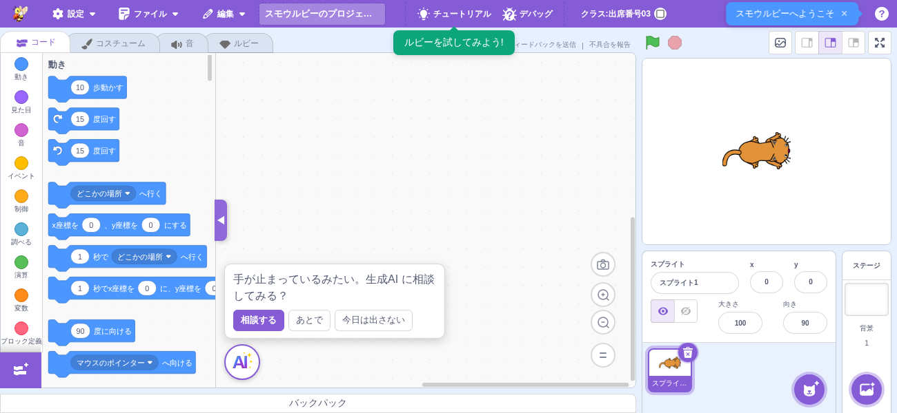
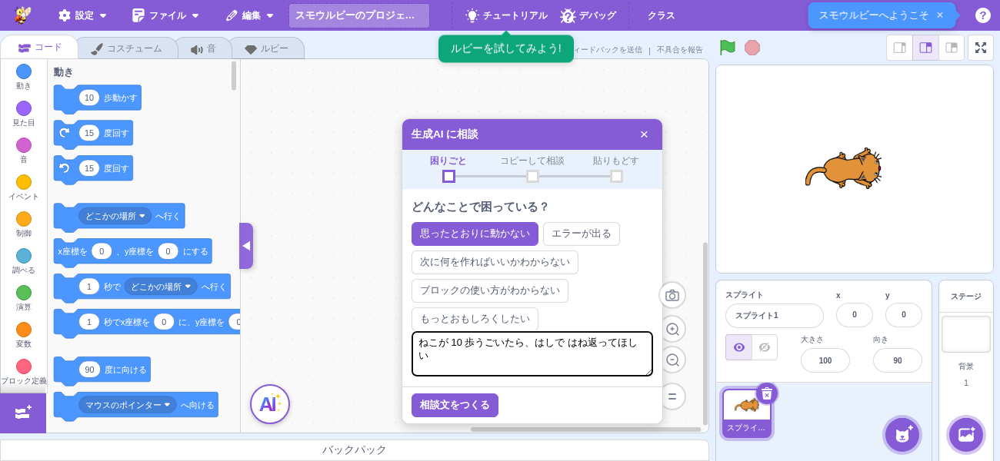
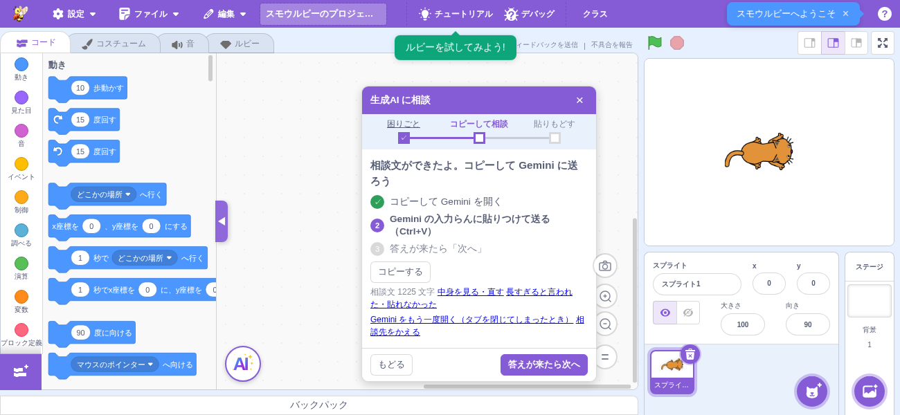
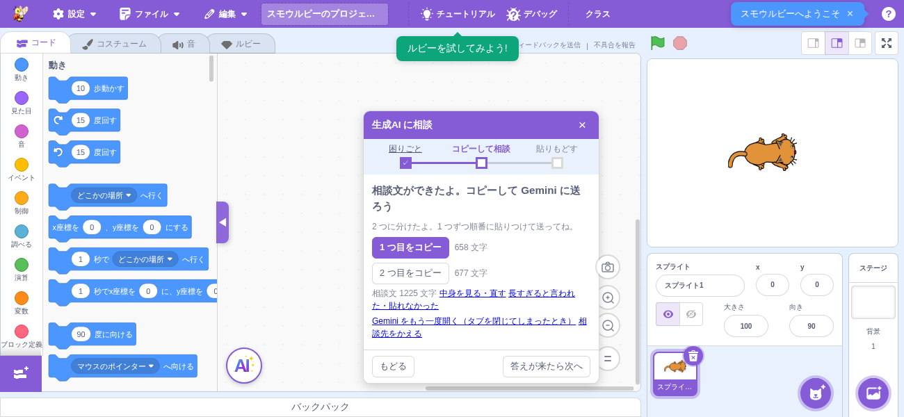
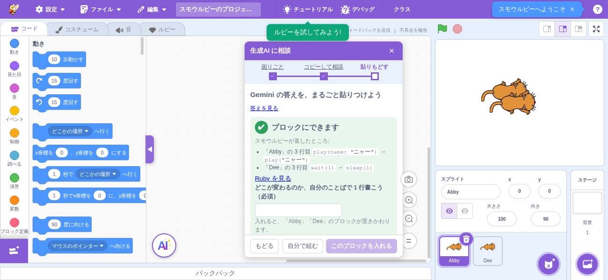
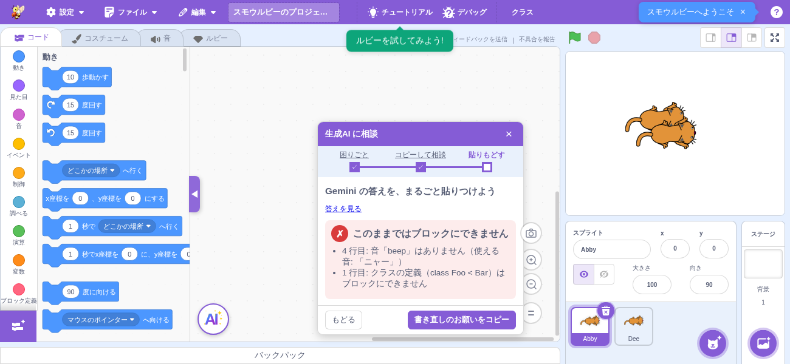
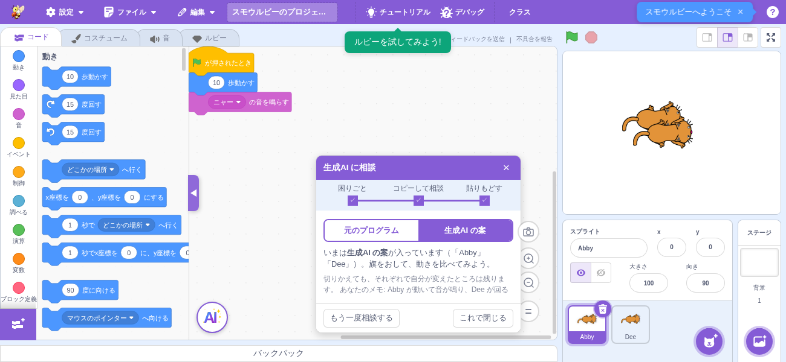

# 生成AI への相談

> **🆕 Smalruby 独自** — upstream に存在しない、Smalruby のために新規追加された機能
> ブロックで作品を作っている生徒が、学校で使っている生成AI（Gemini / ChatGPT など）に相談するのを手伝う。

## 概要

スクリプトエリアの左下（ブロックパレットの右）に **ルビティーの顔** が出る。生徒は顔を押して
（または手が止まったときの声かけから）次の順に進む。

1. **困りごと** — 「どんなことで困っている？」の 1 行と 5 種類のボタン。種類を選ぶと、書き出しの例が
   入った入力欄が開く。自分のことばで書く（必須。書き出しの例のままでは進めない）
2. **コピーして相談** — 作品全体のブロックを Ruby にした相談文ができる。やることは
   「コピーして Gemini を開く → Gemini の入力らんに貼りつけて送る → 答えが来たら次へ」のチェックリストで
   見せる（スモウルビーには生成AI のタブが見えないので、チェックが付くのはコピーだけ）。
   相談文の本文はふだんは畳んで文字数だけを出し、［中身を見る・直す］で開いて書き足せる
   （コピーできなかったときは、手でコピーできるように開く）。
   ［コピーして Gemini を開く］（ボタンの名前に相談先が入る）でクリップボードにコピーし、クラスで決めた
   生成AI を別タブで開く。生成AI を開くのは最初の 1 回だけで、2 回目からはコピーだけして
   「生成AI のタブにもどって貼りつけてね」と出す（タブを閉じてしまったときのために
   ［Gemini をもう一度開く］も出す）。Gemini や ChatGPT は Cross-Origin-Opener-Policy でスモウルビーの
   タブから切り離されるので、開いたタブを名前で探したり前に出したりできないため。タブは `noopener` で
   開き、開いた先からスモウルビーのタブを操作させない。長すぎて貼れないときは 2〜4 つに分けてコピーできる。
3. **貼りもどす** — 「Gemini の答えを、まるごと貼りつけよう」（「▼▼」〜「▲▲」はスモウルビーが探すので
   全部貼ってよい）。［ブロックにできるか調べる］を押すと貼りつけ欄を畳み（［答えを見る］で開ける。
   プログラムが見つからなかったときは貼りなおせるように開いたまま）、
   ✔／✗ の結果と次のボタンをその場所に出す（調べている間はスピナー）。
4. **ブロックにする** — 下の「ブロックにできるか」の決まりで調べる。✔ なら、どこが変わるのかを
   自分のことばで 1 行書いてから（必須）［このブロックを入れる］（または［自分で組む］で閉じる）。
   ✗ なら、ブロックにできなかったところ（最大 5 つ）と［書き直しのお願いをコピー］を出す。
   ✗ が 2 回になったら、ルビティーが有効なクラス（`selectRubyteeAvailable`）では
   ［ルビティーにまかせる］も出す（いまは入口だけで、押すと「もうすぐ使えるようになります」と出す）。
5. **切りかえて比べる** — 入れたあとは［元のプログラム］⇔［生成AI の案］を何度でも切りかえられる。
   答えに入っていたスプライト（複数あれば全部）がいっしょに切りかわる。それぞれの側で生徒が変えた
   ところは、切りかえても残る（切りかえる直前のブロックをその側の内容として覚える）。途中で消した
   スプライトは切りかえの対象から外れる。
6. **おわる** — ［これで閉じる］で、いま入っている方に決めてパネルを閉じる（次に開くと最初から）。
   ［もう一度相談する］は最初の段階にもどる。

### ブロックにできるか（✔ にしてよい範囲）

答えの ▼▼〜▲▲（なければ最後の ` ```ruby `、それも無ければ ` ``` `）からプログラムを取り出し、
`# 「スプライト名」` の行でスプライトごとに分けて（無ければ今のスプライト）、スモウルビーが次を直す。

- `play(name: "x")` / `play_sound` / `start_sound` / `switch_costume_to` / `wait(1)` などの書き方の揺れ
- 音・コスチュームの名前を、そのスプライトにある名前へ（大文字小文字・空白・一部一致まで）

直したところは「スモウルビーが直したところ」として見せる。そのうえで、**すべての行がふつうの
ブロックになり、書いたスプライトに入るときだけ ✔** にする。次の場合は ✗:

| ✗ になる場合 | 理由 |
|---|---|
| プログラムが見つからない | 貼りなおすしかないので、答えの欄は開いたまま |
| そのスプライトに無い音・コスチュームの名前 | 似た名前が無いのに、1 つしか無い音で黙って代用しない（ちがう音が鳴るより、生成AI に選びなおしてもらう方がよい）。使える名前を見せ、書き直しのお願いにも入れる |
| `class Foo < Bar` / `module` の定義 | 変換器は class を外して中身を今のスプライトに入れてしまうので、✔ に見えて別のスプライトに入る。スプライトは `# 「名前」` の行で分けてもらう |
| 「Ruby のまま」のブロック（`ruby_statement` / `ruby_expression`）になる行 | ブロックとして動かないので、成功とは言えない |
| 変換器のエラー（命令のまちがい・文法） | 変換器のメッセージをそのまま見せる |

書き直しのお願いは、エディタの言語にかかわらず日本語（`problemToJapanese`）。

### パネルを閉じた・タブを移ったとき

**状態を保つ**。パネルを一度開いたら、閉じても中身は隠すだけで残すので、切りかえの途中で閉じたり、
ルビータブ・コスチュームタブへ移ったりしても、もどれば同じ所から続けられる（その間に生徒が変えた
ブロックは、いま入っている側の内容になる）。確定したいときは［これで閉じる］を押す。
ただし、別の作品を読み込んだときは最初から（貼った答えも切りかえも、前の作品のものなので消す）。

### パネルの形（どの段階も共通）

- **1 画面に、次にやることは 1 つ**。主ボタン（紫）は 1 つだけで、問いかけは 1 行。
- ボタンの帯（［もどる］と主ボタン）は **パネルの下端に固定** し、中身だけがスクロールする。
  1300×600 で、どの段階もパネルの中をスクロールせずに主ボタンまで見える。
- 段階を移ったとき・分けたときは、前のお知らせ（「コピーしました」など）を消す。
- ヘッダーの下は **進み具合の表示**（タブではない）。ラベルの下に四角い点を並べて線でつなぎ、
  終わった段階は点を塗りつぶして ✓（線もそこまで塗る）、いまの段階は太い枠と太字、まだの段階は灰色。
  ブロックを入れる前なら、終わった段階のラベルを押してもどれる。
- パネルは **スクリプトエリアの右端** に出す（顔は左下のまま）。スクリプトエリアが狭くて顔と並ばない
  ときは顔の上に出す。高さはスクリプトエリアに収まるように決める。ブロックを入れたあとは、
  入れたブロックがスクリプトエリアの左上に来るように画面を動かす（パネルに重ならない）。









スモウルビーは生成AI と直接は通信しない。生徒が自分でコピー・貼りつけをする（学校が契約・許可して
いる生成AI を、学校のアカウントのまま使うため）。

## 表示条件

| 条件 | 顔 |
|------|----|
| 生徒としてクラス（課題）に参加していて、そのクラスで先生が生成AI を「使う」にしている | 出る |
| 参加しているクラスで生成AI を使わない / クラスに参加していない / 先生 | 出ない |
| `?features=genai`（開発用） | クラスの外でも出る |

クラスの設定（`genai.enabled` / `service` / `url`）は、参加（`/classrooms/join`）とセッション確認
（`/classrooms/verify-session`）の応答で受け取り、Redux（`state.scratchGui.classroom.studentGenai`）に
入れる。セッション確認は **ページを開いたとき**（`src/containers/use-student-class-settings-refresh.js`。
ルビティーの設定もあわせて読み直す）と、クラスのモーダルを開いたときに行う。そのため先生が授業中に
「使わない」に変えると、生徒がページを再読み込みするかクラスの画面を開いたときに顔が消える（定期的な
問い合わせはしない）。セッションが無効（401 / 410）なら顔を消す。通信できないときは localStorage に
残した前の設定のまま出す。別のクラスに移る・退室すると消える。https 以外の URL は「使わない」と
同じ扱いにする。先生側の設定画面は `docs/classroom/ui-ux.md` の「生成AI・ルビティー（クラス単位）」。

### 生成AI の種類と URL

**クラスの設定が決める**。生徒は変えられない（「相談先: Gemini」のように名前だけ出す。ほかの
生成AI は URL のホスト名を出す）。

プロトタイプにあった「1 回だけ聞いてブラウザに覚える」画面は、**`?features=genai` でクラスの外に
いるときだけ**残している（開発・試用用）。クラスに参加していれば出ない（クラスで生成AI を使わない
なら顔そのものが出ないため、保険として残す必要がない）。

## 声かけ

- 操作（クリック・キー・ホイール・作品の変更）が **2 分 30 秒** 無いと「手が止まっているみたい。
  生成AI に相談してみる？」を出す。
- 1 回出したら **10 分** あける。
- **出さないとき**: プログラムが動いている間（動かして見ている・止めた直後は数え直す）、タブが裏に
  あるとき、パネルを開いているとき。
- お知らせ（メッシュの接続が切れた、など）が出ていても声かけは出す。コードタブにはルビータブのような
  文法エラーが無いので、エラーかどうかは見ない。
- ［今日は出さない］は **その日だけ**（ローカルの日付で記録し、翌日にはまた出る）。

## 質問文

文面は `src/lib/genai-prompt.js`（純粋関数）。生徒が Ruby を知らなくても使えるように、生成AI に
次を頼んでいる: 質問を返さずすぐ直したプログラムを出す / 変えるスプライトごとに `# 「名前」` の
1 行から全部書く / 使える命令の例だけを使う / 音・コスチュームは一覧の名前から選ぶ /
「▼▼」〜「▲▲」の行でコードを囲む。質問文はエディタの言語にかかわらず日本語（困りごとの種類も
日本語の名前で入る）。

## 設定・データ永続化

| キー | 場所 | 内容 |
|------|------|------|
| `smalruby:classroom` の `studentGenai` | localStorage | クラスの生成AI 設定（`{enabled, service, url}`） |
| `smalruby:genaiNudgeOff` | localStorage | ［今日は出さない］を押した日付（`YYYY-MM-DD`）。プロトタイプの `'true'` は無効扱い |
| `smalruby:genaiService` | localStorage | 開発用（`?features=genai` でクラス外）に選んだ生成AI |
| `?features=genai` | URL | クラスの外でも顔を出す（開発用） |
| `?genai_idle=<秒>` | URL | 声かけまでの秒数を短くする（テスト用。あける時間も秒数の 4 倍までに縮む） |

## 主要ファイル

| ファイル | 役割 |
|---------|------|
| `packages/scratch-gui/src/containers/genai-concierge.jsx` | 顔・パネル・声かけ・コピーと生成AI のタブ（表示条件は Redux から） |
| `packages/scratch-gui/src/containers/use-student-class-settings-refresh.js` | ページを開いたときにクラスの AI 設定（生成AI・ルビティー）を verify-session で読み直す |
| `packages/scratch-gui/src/components/genai-concierge/genai-nudge.jsx` | 声かけの吹き出し |
| `packages/scratch-gui/src/components/genai-concierge/genai-stepper.jsx` | 進み具合の表示 |
| `packages/scratch-gui/src/components/genai-concierge/genai-trouble-step.jsx` | 段階 1: 困りごと |
| `packages/scratch-gui/src/components/genai-concierge/genai-copy-step.jsx` | 段階 2: 質問文のコピー・分割（開発用の生成AI 選択を含む） |
| `packages/scratch-gui/src/components/genai-concierge/genai-answer-steps.jsx` | 段階 3: 貼りもどし・切りかえ |
| `packages/scratch-gui/src/components/genai-concierge/messages.js` | 文言（`gui.genaiConcierge.*`） |
| `packages/scratch-gui/src/lib/genai-concierge-state.js` | 表示条件・相談先・声かけ・進み具合・パネルの位置の判定（純粋関数） |
| `packages/scratch-gui/src/lib/genai-prompt.js` | 質問文の組み立て・分割・答えからの Ruby 取り出し（純粋関数） |
| `packages/scratch-gui/src/lib/genai-repair.js` | 生成AI の Ruby の自動修正・スプライトごとの分割（純粋関数） |
| `packages/scratch-gui/src/lib/genai-answer.js` | 貼った答えを調べる（✔ / ✗ の判定）・書き直しのお願いの文・切りかえ（純粋関数。変換器は引数で受ける） |
| `packages/scratch-gui/src/reducers/classroom.js` | `studentGenai` と `setStudentGenai` |

## data-testid

| data-testid | 要素 | 説明 |
|------------|------|------|
| `genai-face` | button | ルビティーの顔（押すとパネルを開く/閉じる） |
| `genai-nudge` | div | 声かけの吹き出し |
| `genai-nudge-open` / `genai-nudge-later` / `genai-nudge-off` | button | 相談する / あとで / 今日は出さない |
| `genai-panel` | div | パネル全体（一度開いたら閉じても消さず、`display: none` と `aria-hidden` で隠す） |
| `genai-drag-handle` | div | パネルのヘッダー（ドラッグで動かせる） |
| `genai-stepper` | ol | 進み具合の表示 |
| `genai-step-<id>` | li | 各段階（`trouble` / `copy` / `paste`）。`data-status` は `done` / `current` / `todo`。終わった段階は中のボタンでもどれる |
| `genai-close` | button | 閉じる（×） |
| `genai-kind-<id>` | button | 困りごとの種類（`not-working` / `error` / `next` / `how` / `more-fun`） |
| `genai-trouble-text` | textarea | 困りごとを自分のことばで書く欄（種類を選ぶと出る） |
| `genai-make-prompt` | button | 相談文をつくる |
| `genai-service-gemini` / `genai-service-chatgpt` / `genai-service-url` / `genai-service-change` | button / input / a | 開発用（`?features=genai` でクラス外）の生成AI 選択 |
| `genai-checklist` | ol | 段階 2 のやること（各 `li` の `data-status` は `done` / `next` / `wait`） |
| `genai-prompt-toggle` | a | 相談文の中身を見る・直す / 閉じる |
| `genai-prompt` | textarea | 相談文（開いたときだけ。書き足せる） |
| `genai-copy-open` | button | コピーして（相談先）を開く（開いたあとは「コピーする」） |
| `genai-reopen` | a | （相談先）をもう一度開く（開いたあとだけ） |
| `genai-split` | a | 「長すぎると言われた・貼れなかった」（分けてコピーする） |
| `genai-copy-part-<n>` | button | 分けた n つ目をコピー |
| `genai-notice` | p | コピーした / できなかったのお知らせ |
| `genai-to-paste` | button | 答えが来たら次へ |
| `genai-answer-toggle` | a | 調べたあとに畳んだ答えを見る / 閉じる |
| `genai-answer` / `genai-convert` / `genai-checking` / `genai-convert-ok` / `genai-convert-ng` / `genai-fixes` / `genai-problems` / `genai-ruby-toggle` / `genai-reflection` / `genai-apply` / `genai-self` / `genai-copy-rewrite` | — | 段階 3〜4（貼りもどし・ブロックにする） |
| `genai-takeover` | button | ルビティーにまかせる（✗ が 2 回・ルビティーが有効なクラスだけ） |
| `genai-switch-before` / `genai-switch-after` / `genai-switch-state` / `genai-again` / `genai-finish` | — | 入れたあとの切りかえ |

## 画面の大きさ

授業 PC の 1300×600 で、顔（ブロックパレットの右・左下）とパネル（右端）はスクリプトエリアの中に収まり、
スクリプトエリアの下のバックパックの帯とは重ならない。パネルが邪魔なときはヘッダーをドラッグして
動かせる。
