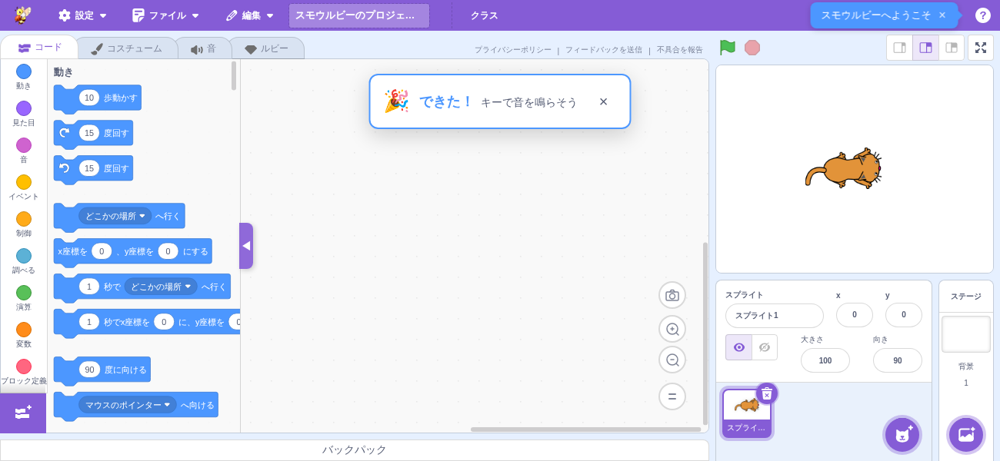
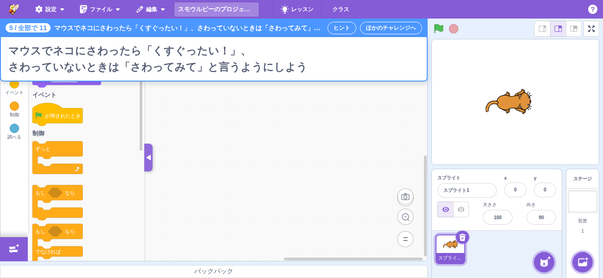
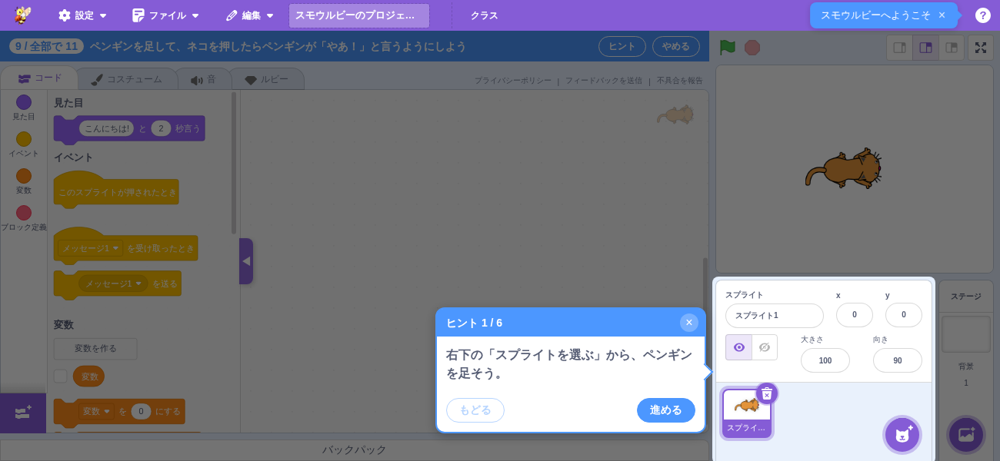

# レッスン（コース › レッスン › チャレンジ）

> **🆕 Smalruby 独自** — upstream に存在しない、Smalruby のために新規追加された機能

## 概要

いまのチュートリアル（`docs/tutorial/`）を、**コース › レッスン › チャレンジ** の形に作り直す機能。
探すための一覧ではなく、「何をやって、何ができるようになったか」が見えるレッスンにして、先生の
説明がなくてもスモウルビーでのプログラミングのやり方が身につくようにする。

このドキュメントは仕組みの全体像（データの形・記録の形・状態・レッスン表・レッスンモード・主要ファイル）をまとめる。
ヒントの吹き出しと判定は、それぞれの実装に合わせて追記する。

## ユーザーストーリー

- **はじめてスモウルビーを使う子**として、先生がいなくても、順番にやれば基本の操作が身につくようにしたい
- **学習者**として、どのチャレンジができたか・何ができるようになったかを見たい
- **先生**として、授業の前に生徒がやっていた分も、あとでクラスの課題に引き継ぎたい

## 階層

| 階層 | 説明 | 例 |
|------|------|----|
| 言語 | ブロック／Ruby／日本語（DNCL）。言語の中にコースが並ぶ | `blocks` |
| コース | レッスンの並び。全部のレッスンをクリアするとクリアの印がもらえる | 「きょうからプログラマー」（印: 「プログラマー デビュー！」） |
| レッスン | チャレンジの並びとクリア条件（n 個と必須） | レッスン 1「ブロックのなかま」（11 個のうち、必須の 3・6・8・9・11 をふくめて 7 個） |
| チャレンジ | いまの deck 1 本に当たる。毎回、新しい作品から始める | 「押したら話そう」 |
| できること | チャレンジで身につくもの。できたチャレンジから一覧にする | — |

## データの形

データは `packages/scratch-gui/src/lib/lessons/courses.js`。文言は message descriptor（`{id, defaultMessage}`）
で持ち、文字列は `lessons.locale.js`（en / ja / ja-Hira）に置く。id は
`gui.lessons.<course|lesson|challenge>.<id>.<field>`。

### コース

| 項目 | 型 | 説明 |
|------|----|------|
| `id` | string | 例: `kyou-kara-programmer` |
| `language` | `blocks` \| `ruby` \| `dncl` | `LANGUAGES` |
| `name` | message | コースの名前 |
| `badge` | message | クリアの印の名前 |
| `lessons` | レッスン[] | 並び順 |

### レッスン

| 項目 | 型 | 説明 |
|------|----|------|
| `id` | string | 例: `blocks-l1` |
| `name` | message | レッスンの名前 |
| `challenges` | チャレンジ[] | 並び順 |
| `clear` | `{count, required}` | クリア条件。`count` = できた数、`required` = 必須のチャレンジ id |

`clear.required` はチャレンジの `required: true` から作る（必須は 1 か所にだけ書く）。

### チャレンジ

いまの deck の項目（`allowedBlocks`・`setup`・`steps`・`code`）をそのまま持ち、レッスン用の項目を足す。
定義で省いた項目は `defineChallenge` が既定値で埋めるので、読む側は有無を確かめなくてよい。

| 項目 | 型 | 既定 | 説明 |
|------|----|------|------|
| `id` | string | — | **記録のキー**。並びを変えても変わらないよう番号を入れない（例: `blocks-l1-click-say`） |
| `number` | number | 並びから | レッスンの中で何個めか（表示用）。`defineLesson` が並びから付ける |
| `name` | message | id から | チャレンジの名前 |
| `task` | message \| null | null | 課題の 1 行 |
| `category` | string \| null | null | なかま（パレットの色）。`CATEGORIES` の値（`motion` / `looks` / `sound` / `events` / `control` / `sensing` / `operators` / `variables` / `lists` / `extensions`）。レッスン表が色の丸で見せる |
| `skills` | `{id, name}`[] | [] | できること。id で重ねる（別のチャレンジで同じものが身についても 1 つ） |
| `goal` | 条件[] \| null | null | できた の判定。条件の配列で、全部を満たしたら「できた」（下の「できた の判定」）。null なら判定しない |
| `required` | boolean | false | レッスンの必須か |
| `allowedBlocks` | object \| null | null | パレットに出すブロック（deck と同じ形） |
| `setup` | object \| null | null | 始めるときの準備（deck と同じ形。`lib/deck-setup.js`） |
| `steps` | ヒント[] | [] | ヒント（下の表） |
| `code` | string \| null | null | ヒントの最後の手段「プログラムを入れる」（Ruby。deck の `code` と同じ） |
| `codeTarget` | `'stage'` \| null | null | `code` を入れる相手。null はいま編集中のスプライト。`'stage'` はステージのプログラムのチャレンジ（入れる前にステージをえらぶ） |
| `spriteCodes` | `{sprite, code}`[] | [] | `code` のほかに、名前で決めたスプライトに入れるプログラム（2 つのスプライトでやりとりするチャレンジ用）。`sprite` はライブラリのスプライトの名前。下の「最後の手段」 |
| `debug` | message[] | [] | うまく動かないときは |

ヒント（`steps` の要素）。deck の step と同じ `title` を文言にし、吹き出しのための項目を足す。
省いた項目は `defineChallenge` が既定値で埋める。

| 項目 | 型 | 既定 | 説明 |
|------|----|------|------|
| `title` | message \| null | null | 吹き出しの文言 |
| `target` | string \| null | null | 指す場所（`lib/lessons/hint-targets.js` の `HINT_TARGETS`）: `palette`（パレット）・`code-area`（コードエリア）・`stage`（ステージ）・`sprite-list`（スプライトリスト）・`sounds-tab`（音タブ）・`costumes-tab`（コスチュームタブ）・`backdrop`（背景を選ぶ）・`extension-button`（拡張機能のボタン）・`green-flag`（旗）・`keyboard`（場所の無いもの。画面の真ん中に出す） |
| `blocks` | string \| null | null | 吹き出しに描くブロック（Ruby。`code` と同じ変換でブロックにする） |
| `spotlight` | boolean | false | はじめて開いたチャレンジだけ、周りを暗くして `target` を照らす |

`steps` の後ろには、`debug` か `code` があれば**最後の手段のページ**（「うまく動かないときは」と「プログラムを入れる」）が
1 つ付く（`getCurrentHint` の `count` はこのページを含む）。

記録（下の「記録の形」）は **できたチャレンジだけ**を持つ。「はじめて開いたか」（`spotlight` の判定）は
記録には入れず、**`smalruby:lessonSpotlightSeen`**（`lib/lessons/spotlight-seen.js`。チャレンジ id → 開いた日時）に
残す。チャレンジを開いた時点でそのチャレンジを「見た」と記録し、開いているあいだは照らし続ける。2 回目からは
吹き出しだけ。「できた」の有無は見ない（できていなくても 2 回目は照らさない。別のチャレンジは、それをはじめて
開くときに照らす）。

文言の message id の付け方: `gui.lessons.course.<id>.{name,badge}`・`gui.lessons.lesson.<id>.name`・
`gui.lessons.challenge.<id>.name`。`task` / `steps[].title` / `debug[]` / できること（`skills[].name`）も
同じ `gui.lessons.` の下に置き、3 locale（en / ja / ja-Hira）にそろえる（テストが解決できることを確かめる）。

`defineCourse` / `defineLesson` / `defineChallenge` は export してあるので、コースやレッスンが増えて
ファイルを分けるときも同じ形で定義できる。

レッスン 1 の 11 のチャレンジは、どれも中身（課題・できること・パレット・ヒント・判定・Ruby）が
入っている（下の「レッスン 1 のチャレンジ」）。

### レッスン 1 のチャレンジ

1 つのチャレンジは 5 分・3〜5 ブロック。どれも「キーかスプライトを押したら、何かが起きる」形で、毎回
新しい作品（ネコ）から始める。文言は `lessons.locale.js`（ja / ja-Hira / en）。

| # | id | 課題 | できること | パレット（`allowedBlocks`） | できた の条件（`goal`） |
|---|----|------|-----------|---------------------------|------------------------|
| 1 | `blocks-l1-key-sound` | スペースキーを押したら、ネコが「ニャー」と鳴いたあと、「Owl」の音が鳴る | キーで動かす・音を鳴らす・音を足す | `event_whenkeypressed` / `sound_playuntildone` / `sound_play` | スペースキーのスクリプトで `sound_playuntildone` → `sound_play` の順に動いた |
| 2 | `blocks-l1-arrow-move` | 上向き矢印キーで上へ、下向き矢印キーで下へ、ネコを動かす | 座標で動かす・ブロックを複製する | `event_whenkeypressed` / `motion_changeyby` | 上向き矢印キーのスクリプトで `DY > 0`、下向き矢印キーのスクリプトで `DY < 0` の `motion_changeyby` が動いた |
| 3（必須） | `blocks-l1-click-say` | コスチュームを足して、押したら「こんにちは！」と言って、見た目がかわる | 押したら動く・セリフを言う・コスチュームを足す | `event_whenthisspriteclicked` / `looks_sayforsecs` / `looks_nextcostume` | コスチュームが始めより 1 つ以上増え、スプライトを押したスクリプトで `looks_sayforsecs` と `looks_nextcostume` が動いた |
| 4 | `blocks-l1-repeat` | 1 のキーを押したら、背景が「Canyon」と「Arctic」に 3 回かわる（**ステージのプログラム**） | くり返し・背景を足す・ステージのプログラム | `event_whenkeypressed` / `control_repeat` / `control_wait` / `looks_switchbackdropto` | ステージの 1 のキーのスクリプトで `control_repeat` が動き、`looks_switchbackdropto` が 6 回動いた |
| 5 | `blocks-l1-if` | マウスでネコにさわったら「くすぐったい！」、さわっていないときは「さわってみて」と言う | もし〜なら・ずっと・さわったか調べる | `event_whenflagclicked` / `control_forever` / `control_if` / `control_if_else` / `sensing_touchingobject` / `looks_say` | 旗のスクリプトで `sensing_touchingobject` が動き、ちがうセリフ（`MESSAGE`）の `looks_say` が 2 種類動いた |
| 6（必須） | `blocks-l1-ask-answer` | ネコを押したら名前を聞いて、答えた名前と、答えるまでにかかった秒数を言う | 聞いて答える・タイマー・ことばをつなぐ | `event_whenthisspriteclicked` / `sensing_resettimer` / `sensing_askandwait` / `sensing_answer` / `sensing_timer` / `operator_join` / `looks_sayforsecs` | スプライトを押したスクリプトで `sensing_resettimer` → `sensing_askandwait` の順に動き、`sensing_answer`・`sensing_timer`・`looks_sayforsecs` 2 回が動いた。答えと同じことばを言った |
| 7 | `blocks-l1-quiz` | ネコを押したら「4＋3＝？」と聞いて、7 なら「正解です」、ちがえば「ちがいます」と言う | くらべる・もし〜なら | `event_whenthisspriteclicked` / `sensing_askandwait` / `sensing_answer` / `control_if` / `control_if_else` / `operator_equals` / `looks_sayforsecs` | 答えが 7 のときに「正解です」（ja-Hira の「せいかいです」も可）、7 でないときに「ちがいます」を言った（両方） |
| 8（必須） | `blocks-l1-count` | ネコを押した回数を数えて、その数を言う。3 回押す | 変数を作る・変数 | `event_whenflagclicked` / `event_whenthisspriteclicked` / `data_setvariableto` / `data_changevariableby` / `data_variable` / `looks_say` | 変数「回数」（ja-Hira の「かいすう」も可）が 3 以上になり、その値を言った |
| 9（必須） | `blocks-l1-broadcast` | ペンギンを足して、ネコを押したらペンギンが「やあ！」と言う（**2 つのスプライト**） | スプライトを足す・合図（メッセージ）・スプライトごとのプログラム | `event_whenthisspriteclicked` / `event_broadcast` / `event_whenbroadcastreceived` / `looks_sayforsecs` | スプライト 2 つ以上・押されたときで送る・**別のスプライト**が受け取ったときに言う（`sentBy: 'other'`） |
| 10 | `blocks-l1-speak` | 拡張機能「音声合成」を足して、ネコを押したら「ボタンが押されました」としゃべる | 拡張機能を足す・音声合成 | `event_whenthisspriteclicked` / `text2speech_speakAndWait` | 拡張機能 `text2speech` が読み込まれている・押されたときで `text2speech_speakAndWait` |
| 11（必須） | `blocks-l1-message-list` | ネコを押したら「メッセージは？」と聞いて、答えをリスト「トーク」にためる。3 つためる | リストを作る・リストに追加する | `event_whenflagclicked` / `event_whenthisspriteclicked` / `data_deletealloflist` / `data_addtolist` / `sensing_askandwait` / `sensing_answer` | リスト「トーク」の長さ 3 以上・中身が答えから（`itemsFromAnswers`） |

ヒントは、音タブ・コスチュームタブ・背景を選ぶ・スプライトリストのように「足す・えらぶ」場所を指すものと、
パレット・コードエリアを指して**本物のブロック**を描くもの、ステージ・キーボードを指して「動かしてみよう」と
言うものの並び。スポットライト（はじめて開いたときだけ）は基本操作（出す・くっつける・押す・消す）のヒントに
だけ付けている（チャレンジ 1 のパレットとキーボード、チャレンジ 3 のパレット・ステージ・コードエリア）。

作るときの注意:

- **ヒントに描くブロックは、まだ足していない音・背景でもよい**。吹き出しの変換（`hint-blocks.js`）は
  converter の `validateAssets: false` で音・コスチューム・背景の存在を確かめない（「Owl の音を鳴らす」は
  Owl を足す前から描く）。**`code` を入れるときの変換は従来どおり確かめる**ので、チャレンジ 1 の `code`
  （`play("Owl")`）はヒント 1 のとおり Owl を足してから、チャレンジ 4 の `code` は背景を足してから入れる
  （足していなければ入れずに、吹き出しの中に「まだプログラムを入れられないよ。先にヒントのとおりに足そう。」と
  変換のエラー（「音「Owl」は存在しません。…先に音を追加してください。」）を出す）。
- 中身の無い「繰り返す」を描くときは **`3.times`**（ブロック無し）と書く。`3.times do ... end` は中身が
  無いと変換できない。
- `self.y += -10` は「y座標を -10 ずつ変える」になる（チャレンジ 2 の下向き矢印）。
- チャレンジ 1 の `code` の `play_until_done("ニャー")` は**日本語の作品の音の名前**。英語の作品ではネコの音は
  "Meow" なので、英語で開いたときはプログラムを入れようとすると吹き出しに「sound "ニャー" does not exist.」が出て入らない（コースは日本語を
  前提にしている。`goal` は音の名前を見ないので、手で作れば英語でも「できた」になる）。
- ライブラリの音「Owl」・背景「Canyon」「Arctic」の表示名は日本語でも英語のまま（ライブラリの名前は
  翻訳されない）。ヒントの文言もそのまま "Owl" / "Canyon" / "Arctic" と書く。
- チャレンジ 4 のように**ステージのプログラム**のチャレンジは `codeTarget: 'stage'` にする。
  「プログラムを入れる」がステージをえらんで（`vm.setEditingTarget`）Ruby タブの相手（`rubyCode.target`）も
  ステージにしてから入れるので、スプライトを編集中に押してもステージに入る。
- **5 もし〜なら**: パレットには「もし <> なら」と「もし <> なら でなければ」の両方を出す（ヒント 2 は
  「でなければ」のほう）。ヒント 2 の吹き出しは `if false\nelse\nend` で、空の穴の「もし <  > なら でなければ」を描く。
- **6 聞いて答えよう**: `code` とヒント 4 の吹き出しは `timer.value + "秒でした"`（「(タイマー) と (秒でした)」の
  「と」1 つ。子どもが作ったブロックから生成される Ruby も同じ形）。仕様の `timer.value.to_s + "秒でした"` は、
  `.to_s` も「(タイマー) と ()」の「と」になるので、入れると「と」2 つの入れ子になり子どもが作るものと見た目が
  ちがう。秒数は 3.217 のような小数のまま言う（四捨五入は入れない）。
- **7 クイズを作ろう**: 比べ方は Scratch と同じなので、全角の「７」は 7 と等しくない（「ちがいます」になる）。
  ヒントの「うまく動かないときは」で半角の 7 を案内し、判定は `answer: {eq: 7}` と `{ne: 7}` の両方を見る。
- **8 数えよう**: Ruby の `$回数` はステージの変数（ブロックの「すべてのスプライト用」）で、「変数を作る」の
  既定と同じ。先に「変数を作る」で「回数」を作ってから「プログラムを入れる」でも、変数は 1 つのまま
  （integration テストで確かめている）。日本語の変数名も Ruby ⇔ ブロックで行き来できる。
  パレットを絞っても変数のカテゴリは全部出る（`make-toolbox-xml.js`）。ja-Hira のヒントは「かいすう」という
  変数を作ろうと書くので、`goal` は「回数」「かいすう」のどちらでもよい（7 の「せいかいです」も同じ）。
- エディタ（コードエリア）にフォーカスがあってもキーはステージに届く（`vm-listener-hoc` は SVG への
  keydown を VM に渡す）。`integration` テストはコードエリアをクリックしてからキーを押して確かめている。

## 記録の形（端末）

`packages/scratch-gui/src/lib/lessons/lesson-progress.js`。localStorage の **`smalruby:lessonProgress`** に、
クラスに関係ない形で残す。

```json
{
  "version": 1,
  "challenges": {
    "blocks-l1-click-say": {
      "completedAt": "2026-11-10T01:02:03.000Z",
      "courseId": "kyou-kara-programmer",
      "lessonId": "blocks-l1"
    }
  }
}
```

- 同じチャレンジをもう一度できても、**最初にできた日時を残す**（クラスの課題に引き継ぐとき、
  課題の前からできていたものを分けるため）。
- localStorage が使えない・例外になる・中身が壊れているときは空の記録として扱い、落ちない。
- `exportProgress` が送るための形（`{challengeId, courseId, lessonId, completedAt}` の並び、できた順）を返す。

| 関数 | 説明 |
|------|------|
| `loadProgress(storage?)` / `saveProgress(progress, storage?)` | 読み書き（例外を出さない） |
| `markChallengeCompleted(progress, challengeId, completedAt)` | 「できた」にした新しい記録を返す |
| `mergeProgress(progress, other)` | 2 つの記録を合わせる（同じチャレンジは早い日時を残す） |
| `isChallengeCompleted(progress, challengeId)` | できたか |
| `lessonClearStatus(lesson, progress)` | `{cleared, completedCount, count, missingRequired}` |
| `completedSkills(progress)` | できることの一覧 |
| `exportProgress(progress)` | 送るための形 |

## できた の判定（`goal`）

レッスンモードのあいだ、エディタは VM の実行を見張り、チャレンジの `goal` を満たしたら記録に「できた」と
書いて「できた！」（身についた「できること」の一覧つき）を出す。**プログラムの形は見ない**（ブロックの
並び・個数は条件にしない。いろいろな作り方を認めるため）。ヒントの最後の手段「プログラムを入れる」で入れた
プログラムでも、動けば「できた」になる。

判定は `packages/scratch-gui/src/lib/lessons/goal.js`（純粋関数）、VM との接続は `goal-monitor.js`。

### `goal` の形

`goal` は **条件の配列**。全部を満たしたら「できた」。条件は `type` で分かれる。

| `type` | 見るもの | 項目 |
|--------|---------|------|
| `uses` | 決めたきっかけ（`trigger`）から始まったスクリプトで、決めたブロックが動いた | `trigger`（省略可）, `blocks`（必須）, `order` |
| `said` | 言った（考えた）文字 | `text`, `equalsAnswer`, `equalsVariable`, `answer`, `target` |
| `variable` | 変数の値（ステージの変数を先に探す） | `name`, `value` |
| `list` | リストの中身 | `name`, `length`, `itemsFromAnswers` |
| `sprites` | スプライトの数（クローンを除く） | `min` |
| `costumes` | コスチューム（`target: 'stage'` なら背景）の数が、チャレンジを開いたときより増えた。後から足したスプライトは数えない | `added`（既定 1）, `target` |
| `extension` | 拡張機能を読み込んだ | `id`（例: `text2speech`） |

**`uses` の項目**

- `trigger`: `{hat, key, message, target, sentBy}`。`hat` はハットの opcode（`event_whenkeypressed` /
  `event_whenflagclicked` / `event_whenthisspriteclicked` / `event_whenbroadcastreceived` など）。
  `key` はキー（`space` / `up arrow` / `1` ...。「どれかのキー」のスクリプトも合格）、`message` はメッセージ名、
  `target` は `'stage'` / `'sprite'`、`sentBy: 'other'` は「メッセージを別のスプライト（ステージ）が送った」。
  省くとどのハットから始まったスクリプトでもよい。コードエリアでスクリプトをクリックして動かしたものは
  数えない（きっかけが違う）。
- `blocks`: 動いたブロックの一覧。要素は opcode の文字列か `{opcode, count, args, distinct}`。
  - `count`: **1 回のスクリプトの実行（スレッド 1 本）の中で** その回数以上動いた（例: 背景を 6 回かえた）。
    「待つ」「繰り返す」のように待ちながら何度も呼ばれるブロックは、呼ばれた回数になる
  - `args`: 引数の条件（引数名 → 値の条件。例: `{DY: {gt: 0}}`）。条件に合う実行を数える
  - `distinct`: その引数の **ちがう値** が `count` 種類以上あった（例: `{opcode: 'looks_say', distinct: 'MESSAGE', count: 2}` =
    2 種類のセリフを言った）
  - 要素ごとに「きっかけに合うどれかのスクリプトの実行で満たした」を見るので、同じキーのスクリプトが 2 本に
    分かれていてもよい
- `order`: opcode の並び。1 回のスクリプトの実行の中で、それぞれの **最初の実行** がこの順だった
  （例: `['sensing_resettimer', 'sensing_askandwait']`）

**値の条件（matcher）**: 値そのもの（等しい）・RegExp（`test`）・`{eq, ne, gt, gte, lt, lte, includes, matches}`。
比べ方は Scratch と同じで、両方が数なら数として、そうでなければ文字（大文字小文字を区別しない）として比べる
（全角の「７」と 7 は等しくない）。

**`said` の項目**: `text`（matcher）、`equalsAnswer: true`（最後に「聞いて待つ」で入力した答えと同じ文字を言った）、
`equalsVariable: '<変数名>'`（言った時点のその変数の値と同じ。名前の配列ならどれか 1 つ）、`answer`（言った時点の最後の答えの条件。
例: `{eq: 7}` / `{ne: 7}`。まだ答えていなければ合わない）、`target`（`'stage'` / `'sprite'`）。
吹き出しを消す（空の文字）は記録しない。

**変数・リストの名前**（`variable` / `list` の `name`、`said` の `equalsVariable`）は、文字列か名前の配列
（どれか 1 つの名前の変数を見る）。ja-Hira のヒントは変数名をひらがなで書く（「かいすう」）ので、
`['回数', 'かいすう']` のように両方を書く。言う文字も同じで、ja-Hira の課題がひらがなで書く文字は
RegExp で両方を許す（例: `/^(正解です|せいかいです)$/`）。

**`list` の項目**: `length`（matcher。例: `{gte: 3}`）、`itemsFromAnswers: true`（中身が全部「聞いて待つ」に
入力した答え）。

`validateGoal(goal)` が形を確かめる（courses.js に入れる前のテスト用）。

### レッスン 1 の 11 のチャレンジの `goal`（例）

1-g で courses.js に入れるときの形。「できた の条件」（各 Issue の仕様）をこの形で書いたもの。

```js
// 1 キーで音を鳴らそう: スペースキーで、2 つの音が順に鳴った
[{ type: 'uses', trigger: { hat: 'event_whenkeypressed', key: 'space' }, blocks: ['sound_playuntildone', 'sound_play'], order: ['sound_playuntildone', 'sound_play'] }]

// 2 矢印キーで動かそう: 上と下の矢印キーで、ネコが上と下の両方に動いた
[
    { type: 'uses', trigger: { hat: 'event_whenkeypressed', key: 'up arrow' }, blocks: [{ opcode: 'motion_changeyby', args: { DY: { gt: 0 } } }] },
    { type: 'uses', trigger: { hat: 'event_whenkeypressed', key: 'down arrow' }, blocks: [{ opcode: 'motion_changeyby', args: { DY: { lt: 0 } } }] },
]

// 3 押したら話そう: コスチュームを 1 つ以上足し、ネコを押して、セリフが出て、コスチュームがかわった
[
    { type: 'costumes', added: 1 },
    { type: 'uses', trigger: { hat: 'event_whenthisspriteclicked' }, blocks: ['looks_sayforsecs', 'looks_nextcostume'] },
]

// 4 くり返そう: ステージの 1 のキーで、背景が 6 回かわった
[{ type: 'uses', trigger: { hat: 'event_whenkeypressed', key: '1', target: 'stage' }, blocks: ['control_repeat', { opcode: 'looks_switchbackdropto', count: 6 }] }]

// 5 もし〜なら: さわったときのセリフと、さわっていないときのセリフの両方が出た
[{ type: 'uses', trigger: { hat: 'event_whenflagclicked' }, blocks: ['sensing_touchingobject', { opcode: 'looks_say', distinct: 'MESSAGE', count: 2 }] }]

// 6 聞いて答えよう: リセット → 聞く の順で、入力した答えと、かかった秒数を言った
[
    {
        type: 'uses',
        trigger: { hat: 'event_whenthisspriteclicked' },
        blocks: ['sensing_resettimer', 'sensing_askandwait', 'sensing_answer', 'sensing_timer', { opcode: 'looks_sayforsecs', count: 2 }],
        order: ['sensing_resettimer', 'sensing_askandwait'],
    },
    { type: 'said', equalsAnswer: true },
]

// 7 クイズを作ろう: 7 を入れたら「正解です」、ほかの数で「ちがいます」と言った
[
    { type: 'said', text: /^(正解です|せいかいです)$/, answer: { eq: 7 } },
    { type: 'said', text: 'ちがいます', answer: { ne: 7 } },
]

// 8 数えよう: 変数「回数」が 3 以上になり、その数を言った
[
    { type: 'variable', name: ['回数', 'かいすう'], value: { gte: 3 } },
    { type: 'said', equalsVariable: ['回数', 'かいすう'] },
]

// 9 なかまに合図しよう: スプライト 2 つ以上。ネコを押して送ったメッセージで、別のスプライトがセリフを言った
[
    { type: 'sprites', min: 2 },
    { type: 'uses', trigger: { hat: 'event_whenthisspriteclicked' }, blocks: ['event_broadcast'] },
    { type: 'uses', trigger: { hat: 'event_whenbroadcastreceived', sentBy: 'other' }, blocks: ['looks_sayforsecs'] },
]

// 10 しゃべらせよう: 音声合成を足して、しゃべるブロックが動いた
[
    { type: 'extension', id: 'text2speech' },
    { type: 'uses', trigger: { hat: 'event_whenthisspriteclicked' }, blocks: ['text2speech_speakAndWait'] },
]

// 11 メッセージをためよう: リスト「トーク」に、入力したメッセージが 3 つ以上たまった
[{ type: 'list', name: 'トーク', length: { gte: 3 }, itemsFromAnswers: true }]
```

これらが形として書けて、意図したプログラムで満たされることは `test/unit/lib/lessons/goal.test.js` で確かめている。

### VM の見張り方（scratch-vm は変えない）

scratch-vm には「ブロックが動いた」を知らせるイベントが無い（`BLOCK_GLOW_ON` はクリックしたスクリプトだけ、
`SCRIPT_GLOW_ON` は編集中のスプライトだけ、Profiler は opcode ごとの回数だけでスレッドが分からない）。
そこで `vm-execution-hook.js` が **runtime インスタンスの `getOpcodeFunction` を包む**。execute.js がブロックの
関数（primitive）を取りに来たときに、呼び出しを記録してから元の関数へ渡すラッパーを返す。ラッパーは
`(args, util)` をそのまま受けるので、`util.thread` から **どのスレッド（＝どのハットから始まったスクリプト）か**
（`thread.topBlock` のブロック・`thread.target`・クリックで動かしたか `thread.stackClick`）と、引数の値が分かる。

| 事実 | 取り方 |
|------|--------|
| ブロックの実行（opcode・引数・スレッド） | 上のフック。スレッドの最初の実行で run（1 回のスクリプトの実行）を作る。モニター用のスレッド（`thread.updateMonitor`）は除く |
| きっかけ（ハット） | `thread.topBlock` のブロックの opcode とフィールド（`KEY_OPTION` / `BROADCAST_OPTION`） |
| 誰がメッセージを送ったか | `event_broadcast` / `event_broadcastandwait` の実行を記録（メッセージ名 → ターゲット id）。受け取ったスクリプトの run に送り主を持つ |
| 言った文字 | runtime の `SAY` イベント（`say` / `think` も。空の文字は吹き出しを消すだけなので記録しない）。言った時点の変数の値も一緒に持つ |
| 答え | runtime の `ANSWER` イベント |
| 変数・リスト・スプライト数・コスチューム数・拡張機能 | 判定のたびに VM を読む（`takeSnapshot`）。コスチューム数は見張りを始めたときの数と比べる |

注意:

- execute.js は取った関数を **ブロックごとの cache**（`BlockCached`）に持つので、見張りを始めるとき全ターゲットの
  `blocks.resetCache()` を呼んで、包む前に取られた関数を作り直させる。一度包んだら runtime の間は包んだまま
  （listener が無いときは元の関数を呼ぶだけ）。
- primitive の中から別の primitive を呼ぶもの（mesh v2 の broadcast など）は外側だけ記録する。
- 判定は、何か記録があったあとの次の step（runtime の `BEFORE_STEP`）で 1 回だけ行う（1 step に何度も判定しない）。
  スプライト・コスチューム・拡張機能の変化は `PROJECT_CHANGED` / `targetWasCreated` / `EXTENSION_ADDED` で判定を
  予約する。
- 記録は上限つき（run 200 本・言った文字 500・答え 500・1 ブロックの引数の組み合わせ 50 種）。ずっと動く
  プログラムでも増え続けない。
- 満たしたら見張りをやめる（1 チャレンジにつき「できた」は 1 回。同じチャレンジを開き直せばまた見張る）。

### 「できた！」の表示

`containers/lesson-goal-watcher.jsx`（gui.jsx に常時マウント）が、レッスンモードのあいだだけ見張りをつなぎ、
満たしたら `markChallengeCompleted` を dispatch して `components/lesson-completed-toast/` を出す。
記録にすでにある（前にできた）チャレンジでも「できた！」は出す（記録の日時は最初のまま）。

| data-testid | 要素 | 説明 |
|------------|------|------|
| `lesson-completed-toast` | div | 「できた！」の toast |
| `lesson-completed-toast-title` | span | 「できた！」 |
| `lesson-completed-toast-challenge` | span | チャレンジの名前 |
| `lesson-completed-toast-skills` | div | できることの一覧（`skills` が無いチャレンジでは出ない） |
| `lesson-completed-toast-close` | button | 閉じる |



デバッグ・テスト用に `window.smalruby.lessonGoal` を出している（integration テスト
`test/integration/lesson-goal.test.js` と pw-check が使う。レッスン表・レッスンモードの UI ができるまでの入口）:

| 関数 | 説明 |
|------|------|
| `attach(goal, onSatisfied)` | チャレンジを開かずに、いまの VM に goal をつないで試す。見張りをやめる関数を返す |
| `evaluateGoal` / `validateGoal` | goal.js の関数そのもの |
| `openChallenge(id)` / `closeLesson()` | チャレンジを開く / レッスンモードを抜ける（Redux の action） |
| `markCompleted(id)` | 「できた」にする（記録 + 「できた！」） |

## 状態（Redux）

`packages/scratch-gui/src/reducers/lesson-mode.js`（`state.scratchGui.lessonMode`）。

| 項目 | 説明 |
|------|------|
| `courseId` / `lessonId` / `challengeId` | いま開いているチャレンジ。`challengeId` が null ならレッスンモードではない |
| `pendingChallengeId` | 開こうとしているチャレンジ（新しい作品ができるまでの間だけ入る。下の「レッスンモード」） |
| `hintVisible` / `hintIndex` | ヒントの吹き出しを出しているか・何番めのヒントか（チャレンジを開く・閉じるたびに最初にもどる） |
| `hintSpotlight` | はじめて開いたチャレンジか（`spotlight` のヒントで周りを暗くする）。`openChallenge` で `smalruby:lessonSpotlightSeen` を見て決め、同時に「見た」と記録する |
| `progress` | 記録の写し（起動時に localStorage から読む） |
| `justCompletedId` | 「できた！」を出しているチャレンジ id（null なら出していない） |

| action / selector | 説明 |
|------|------|
| `startChallenge(challengeId)` | **チャレンジを開く入口**（レッスン表が呼ぶ）。新しい作品 → setup → `openChallenge` の順にコンテナが進める（知らない id は無視） |
| `cancelStartChallenge()` | 開こうとしていたチャレンジを取り消す（「保存しますか」で取りやめたとき） |
| `openChallenge(challengeId)` | レッスンモードに入る（作品の準備は済んでいる前提。知らない id は無視）。「できた！」は消す |
| `closeLesson()` | レッスンモードを抜ける（記録は残す） |
| `showHint()` / `hideHint()` / `nextHint()` / `prevHint()` | ヒントの吹き出しの出し入れと「進める・もどる」（ヒントが無いチャレンジでは出ない。両端で止まる） |
| `markChallengeCompleted(challengeId, completedAt?)` | 「できた」にして localStorage にも書く。書く前に localStorage の最新と合わせる（別のタブが書いた分を消さない）。`justCompletedId` をそのチャレンジにする（すでにできていても） |
| `dismissCompleted()` | 「できた！」を閉じる |
| `reloadProgress()` | localStorage の最新を写しに取り込む（別のタブが書いた分を、レッスン表を開くときなどに反映する。書かない） |
| `isLessonMode(state)` / `getCurrentChallenge(state)` | レッスンモードか / `{course, lesson, challenge}` |
| `getLessonAllowedBlocks(state)` | パレットに出すブロック（チャレンジの `allowedBlocks`。無ければ null）。Blocks コンテナがチュートリアルの `tutorialAllowedBlocks` より優先して使う |
| `getCurrentHint(state)` | `{visible, index, count, step, spotlight, lastResort, debug, code}`（レッスンモードでなければ null）。`count` は最後の手段のページを含む。`step` はいまのヒント（最後の手段のページでは null）、`spotlight` はこのページで周りを暗くするか、`lastResort` は最後の手段のページか。吹き出しのコンテナ（`containers/lesson-hint.jsx`）はこれを読む |

## レッスン表

メニューバーの「レッスン」ボタン（upstream の「チュートリアル」ボタンがあった場所）を押すと開くモーダル
（`components/lessons-library/`。フルスクリーン、本文は不透明な白）。SP / iPad の `MobileGui` ではドロワーの
「レッスン」から開く。


- **言語のタブ**: ブロック／Ruby／日本語。コースが無い言語は「準備中」と出す（いまはブロックだけ中身がある）。
- **コース › レッスン › チャレンジ**: コース名の次に、レッスンごとに「レッスン n」と名前、
  進み具合「**m / 全部で何個 できた（必須 x / y）**」、クリアしていれば「クリア！」。
  コースの全レッスンをクリアすると、コース名の横にクリアの印（「プログラマー デビュー！」）が付く。
- **チャレンジ**: 番号・なかまの色の丸（`category`。名前は `title` / `aria-label`）・名前・「必須」の印・
  「できた」の印（できたものは緑の背景）。押すと `startChallenge(id)` を呼んでレッスン表を閉じ、
  レッスンモードに入る。
- **できること**: コースの全チャレンジの `skills` を並び順に（同じ id は 1 つ）。できたチャレンジのものは
  色つき、まだのものは点線。どのチャレンジにも `skills` が無いあいだは出さない。
- **記録の取り込み**: 開くたびに `reloadProgress()` を呼び、別のタブで書いた記録も反映する。
- **やめる → もどる**: レッスンモードの「やめる」は `closeLesson()` のあとレッスン表を開く（次のチャレンジを
  すぐ選べる）。
- **はじめての人向けの吹き出し**: 「レッスン」ボタンの下に「レッスンをはじめよう！」（`menu-bar/lessons-tooltip.jsx`）。
  `tutorial-onboarding` reducer の `shouldShowTooltip` を流用し、レッスン表を一度開く（`markTutorialSeen`）と出ない。
  同じ reducer の印を見るので、**以前のチュートリアルの吹き出しを消した端末（`smalruby:tutorialSeen`）や、
  Ruby タブを使った端末（`smalruby:rubyTabUsed`）にも出ない**（「一度レッスン表を開いたら出さない」より広い条件。
  レッスン表専用の印にするかは未決）。

状態は `modals.lessonsLibrary`（`openLessonsLibrary` / `closeLessonsLibrary`）。コンテナは
`containers/lessons-library.jsx`（`gui.jsx` に常時マウントし、`modals.lessonsLibrary` が true の間だけ描く）。

1300×600（授業のパソコン）ではチャレンジ 11 個が 4 列・3 段に収まりスクロールしない。375 幅（SP 縦）では
1 列になり本文がスクロールする。

### data-testid（レッスン表）

| data-testid | 要素 | 説明 |
|------------|------|------|
| `menu-bar-lessons` | div | メニューバーの「レッスン」ボタン |
| `lessons-tooltip` | div | 「レッスン」ボタンの下の、はじめての人向けの吹き出し（押すとレッスン表が開く） |
| `mobile-drawer-lessons` | button | SP のドロワーの「レッスン」 |
| `lessons-library` | div | レッスン表の本文（開いているときだけある） |
| `lessons-library-tab-<blocks\|ruby\|dncl>` | button | 言語のタブ（`aria-selected`） |
| `lessons-library-coming-soon` | p | コースが無い言語の「準備中」 |
| `lessons-library-course-<courseId>` | section | コース |
| `lessons-library-badge` | span | コースのクリアの印（全レッスンをクリアしたときだけ） |
| `lessons-library-lesson-<lessonId>` | section | レッスン |
| `lessons-library-progress` | span | 「m / n できた（必須 x / y）」 |
| `lessons-library-lesson-cleared` | span | レッスンの「クリア！」（クリアしたときだけ） |
| `lessons-library-challenge-<challengeId>` | button | チャレンジ（`data-completed="true\|false"`） |
| `lessons-library-challenge-required` | span | 「必須」の印 |
| `lessons-library-challenge-done` | span | 「できた」の印 |
| `lessons-library-skills` | div | できること（skills があるときだけ） |
| `lessons-library-skill-<skillId>` | li | できることの 1 つ（`data-done="true\|false"`） |

## レッスンモード

チャレンジを開いたときの画面。ふだんのエディタはそのまま使い、次を足す。

- **新しい作品から始める**: `startChallenge(id)` → いまの作品に変更があればメニューの「新規」と同じ
  「保存しますか」の確認（取りやめると `cancelStartChallenge`）→ 新しい作品（Google Drive のファイルとの
  結び付きも切る）→ 作品ができたらチャレンジの setup を適用 → `openChallenge(id)`。
  この流れは `containers/lesson-mode.jsx` が進める（作成中 → 表示中の遷移で「できた」を検出する）。
- **setup**: `lib/lessons/challenge-setup.js` の `setupForChallenge(course, challenge)` が
  `lib/deck-setup.js` に渡す形を作る。コースの言語から既定（ブロック = コードタブ、Ruby = Ruby タブ・Ruby
  モード、DNCL = Ruby タブ・DNCL モード）を決め、チャレンジの `setup` で上書きする。
- **課題バー**（`components/lesson-task-bar/`）: エディタ列（タブの上）に 1 行・40px で出す。
  「何個め / 全部で何個」・課題の 1 行（`task`。無ければチャレンジの名前）・ヒント・やめる。
  stage の列には掛からないので、1300×600 の授業のパソコンでもコードエリアは 40px 縮むだけ。
  課題の文は長くてもエディタ列を広げない（広げるとステージが画面の右にはみ出す）。入りきらない分は
  … で切る（全文は `title` にもある）。
- **課題の全文**: 課題の文が … で切れているときだけ、バーに「全文」ボタンが出る。ボタンか課題の文を押すと、
  課題バーのすぐ下に全文を折り返して出すパネルを開く（もう一度押す・外を押す・Esc で閉じる）。`title` は
  タッチ端末や子どもには気づきにくいため。切れているかは課題の文の `scrollWidth > clientWidth` で決め、
  窓の大きさ（`resize`）と課題の文の幅（`ResizeObserver`）が変わるたびに測り直す（全部入るようになれば
  ボタンは消え、パネルも閉じる）。パネルは `position: absolute` でエディタの列に重ねるので、エディタの列の
  幅も高さも変えない（ステージは押し出さない）。「できた！」の toast とヒントの吹き出しも課題バーの下に
  出るので重ねない: パネルを開くとその 2 つを閉じ、どちらかが出たらパネルを閉じる（z-index もパネルの
  470 より toast の 480・吹き出しの 490 が上）。文言は `gui.lessonTaskBar.fullText`（全文 / ぜんぶ / Read all）と
  `gui.lessonTaskBar.fullTextLabel`（ボタンの aria-label）。

  
  SP（MobileGui）でも同じ場所に出る。
- **パレットを絞る**: チャレンジの `allowedBlocks`（deck と同じ形）。Blocks コンテナの `tutorialAllowedBlocks`
  にレッスンの分を優先して渡すので、仕組みはチュートリアルと同じ（`allowedBlocks` が null なら絞らない）。
- **ヒント**: 「ヒント」ボタンで `showHint` / `hideHint`。吹き出し（下の「ヒントの吹き出し」）は
  `containers/lesson-mode.jsx` の `<LessonTaskBar>` の次に置いた `containers/lesson-hint.jsx` が出す。
  ヒントが無いチャレンジではボタンが無効。
- **やめる**: `closeLesson()` のあとレッスン表を開く。課題バーが消え、パレットが元にもどる（作品はそのまま）。
- **いまのチュートリアル（カード）との関係**: 両方が同時に開くと、カードの `allowedBlocks` / setup と
  レッスンのものが食い違うので、どちらか一方だけにする。チャレンジを開くときは開いていたカードを閉じ
  （`closeCards`）、レッスンモード中に「?」メニューなどからチュートリアルを開く（`activateDeck`）と
  レッスンモードを抜ける（開こうとしていたチャレンジも取り消す）。

レッスン表のほかに、コンテナがマウント中は `window.smalruby.startChallenge(id)` で
`startChallenge` を呼べる（Playwright / Selenium から使う）。URL パラメータは作らない。

### ヒントの吹き出し

`components/lesson-hint/`（見た目）と `containers/lesson-hint.jsx`（状態と変換）。`document.body` に portal で出すので、
エディタの列のレイアウトには影響しない。

- **見た目の土台は共通の吹き出し**（`components/balloon/`）: 枠・角丸・影・しっぽ・ヘッダー（色の帯 + 閉じる）・
  もどる / 進めるのボタン・色と文字のトークンは、ほかの吹き出し（「レッスン」ボタンの下の案内・ウェルカムバルーン）と
  同じ部品を使う（下の「吹き出しの共通の土台」）。ヒントの吹き出しが持つのは置き方・スポットライト・本物のブロック・
  最後の手段の中身だけ。

- **本物のブロックを描く**: ヒントの `blocks`（Ruby）を、いまの `code` と同じ Ruby → ブロック変換
  （`lib/ruby-to-blocks-converter`）でブロックにし、VM の target には入れずに Blockly の XML
  （`lib/lessons/blocks-xml.js`。scratch-vm の `Blocks#toXML` と同じ形）にして、吹き出しの中の
  **scratch-blocks の読み取り専用ワークスペース**（`lesson-hint-blocks.jsx`。`inject` に `readOnly: true`、
  エディタより大きい 0.8 倍）に描く。スクリーンショットは使わない。言語・色のモードはエディタと同じ
  （Blocks コンテナが Redux に置いた ScratchBlocks を使う）。inject は main workspace を差し替えるので、
  描いたあとにエディタのワークスペースを `setMainWorkspace` で戻す。変換した XML は Ruby ごとに覚える。
  変換できない Ruby は「（このブロックは描けませんでした）」を出す（文言は出る）。
  条件の穴に入った `false` は空の穴として描く（`if false` = 「もし <  > なら」。ブロック → Ruby が空の穴を
  `if false` と書くのに合わせる。`blocks-xml.js` の `emptyFalseConditions`）。
- **指す場所**: `target` の場所を DOM から探し（`lib/lessons/hint-targets.js` の `findHintTargetRect`。
  Smalruby の部品は data-testid（SP のサイドレール `mobile-side-rail-*`・拡張機能のボタン `extension-button`）、
  upstream の部品は data-testid を持たないので CSS Modules のクラス名の接頭辞 `<css ファイル名>_<クラス名>_`
  — `blocks_blocks_`・`gui_tab_`（タブは並び順で選ぶ）・`stage_stage-wrapper_`・`sprite-selector_sprite-selector_`・
  `stage-selector_stage-selector_`・`green-flag_green-flag_` — で探す）、そのそばに出す（`computeHintPlacement`）。
  **upstream がクラス名を変えると静かに壊れる**（見つからず画面の真ん中に出る）ので、使っている接頭辞と
  そのクラスが css に残っていることを `test/unit/lib/lessons/hint-targets.test.js` が見張る（upstream マージで
  落ちたら接頭辞を直す）。置く側は場所ごとに決めてある（パレット = 右、
  ステージ・スプライトリスト・背景 = 左、タブ・旗 = 下、…）。画面幅で収まらないときは下（→ 上）にずらし、
  それも収まらなければ指す場所の中に置く。場所が無い（`keyboard`）・いまのタブに無いときは画面の真ん中。
  タブの切り替えで場所が現れたり消えたりするので、resize のほかに短い間隔（300ms）でも測り直す。
- **スポットライト**: `spotlight: true` のヒントで、かつ `hintSpotlight`（はじめて開いたチャレンジ）のときだけ、
  指す場所の矩形に穴を開けた巨大な box-shadow で周りを暗くする。`pointer-events: none` なので、照らした
  パレットやステージはそのまま操作できる（ドラッグ中のブロックは吹き出しより上を通る）。
- **進める・もどる・閉じる**: `nextHint` / `prevHint` / `hideHint`。最初で「もどる」、最後で「進める」が無効。
- **最後の手段**: 最後のページは「うまく動かないときは」（`debug` の箇条書き）と「プログラムを入れる」
  （`code`）。「プログラムを入れる」はチュートリアルのカードの `insertCodeButton` と同じ仕組み
  （`updateRubyCode(code)` → ブロックのコースではコードタブ、Ruby / DNCL のコースでは Ruby タブを出す。
  コードタブでは Ruby タブが変換してブロックにする）。チャレンジの `codeTarget` が `'stage'` なら、入れる前に
  ステージをえらび、Ruby タブの相手（`rubyCode.target`）もステージにする（ステージのプログラムのチャレンジ）。
  入れる前に同じ変換を音・コスチューム・背景の確かめ込みで試し（`rubyToBlocksXml` の `validateAssets: true`）、
  失敗するとき（ヒントの「Owl を足そう」をまだしていない等）は入れずに、ボタンの下にわけを出す
  （`lesson-hint-insert-code-error`。入れると Ruby タブに切りかわってエラーになり、ブロックのコースの子どもには
  何が起きたかわかりにくいため）。入れると吹き出しは閉じる。入れて動かしても「できた」になる（判定側は区別しない）。
- **ほかのスプライトのプログラム（`spriteCodes`）**: Ruby タブは編集中のスプライト 1 つに向けて変換するので、
  `spriteCodes` のプログラムは Ruby タブを通さず、それぞれのスプライトへ直接変換して入れる
  （`lib/lessons/insert-sprite-code.js`。「生成AI に相談」と同じ `targetCodeToBlocks` → `apply`）。そのスプライトが
  いなければ（子どもがヒントの途中で押したとき）ライブラリから足す（ネコと重ならないようにステージの右 x=150, y=0 に
  置く）。そのあと残りのスプライト（`spriteCodes` に名前の無い最初のスプライト = ネコ）をえらび、Ruby タブの相手も
  そのスプライトにしてから `code` を入れる。入れる前の確かめ（`validateAssets: true`）は `spriteCodes` の全部と `code`
  に対して行い、1 つでも失敗したら何も入れない（まだいないスプライトは target なしで確かめる）。
- **文言**: `gui.lessonHint.*`（`src/locales/{en,ja,ja-Hira}.js`）。

### 吹き出しの共通の土台

吹き出し・ツールチップ・はじめての案内の**見た目**（枠・角丸・影・しっぽの向きと位置・色・閉じるボタン・ボタン・文字）は
`components/balloon/` にまとめてある。**いつ出すか・どこに置くか・中身**は使う側が持つ。

| 部品 | 役割 |
|---|---|
| `balloon.jsx`（`Balloon`） | 吹き出しの枠。`variant` = `callout`（色で塗った小さな案内）/ `panel`（白地に色の枠、中に操作を持つ）、`color` = `blue` / `green`、`arrowSide` = 吹き出しが指す場所のどちら側にあるか（`bottom` なら上の辺にしっぽ。`null` でしっぽなし）、`arrowStyle` = しっぽの辺に沿った位置（`{left}` / `{top}`。無ければ真ん中）。ref と残りの props（`data-testid`・`role`・`style`・`onClick` など）はそのまま根の要素に渡す |
| `balloon-header.jsx`（`BalloonHeader`） | panel のヘッダー（色の帯 + 見出し + 閉じる） |
| `balloon-close-button.jsx`（`BalloonCloseButton`） | 閉じる（×）。色の上に置く半透明の丸 |
| `balloon-button.jsx`（`BalloonButton`） | 吹き出しの中のボタン。`primary` は塗り、そうでなければ枠だけ |
| `balloon-tokens.css` | 色・角丸・影・文字・しっぽ・ボタンの変数。`Balloon` を使わない部品もこれを `@import` してそろえる |

しっぽは `position: absolute` なので、使う側は吹き出しに `position`（relative / absolute / fixed）を付ける。

| 使っているところ | 形 |
|---|---|
| ヒントの吹き出し（`lesson-hint/`） | `panel` + `BalloonHeader` + `BalloonButton`。置き方は `computeHintPlacement`（`position: fixed`） |
| 「レッスン」ボタンの下の案内（`menu-bar/lessons-tooltip.jsx`） | 緑の `callout`、しっぽは上 |
| ウェルカムバルーン（`welcome-tooltip/`。`docs/welcome/`） | 青の `callout` + `BalloonCloseButton`、しっぽは右 |
| クラス管理のツールチップ（`classroom-tutorial/`。`docs/tutorial/`） | 画面の真ん中のカードで吹き出しとは形が違うので `Balloon` は使わず、`balloon-tokens.css`（白地・角丸・影・文字色）と `BalloonButton`（OK）だけを使う |

### data-testid

| data-testid | 要素 | 説明 |
|------------|------|------|
| `lesson-task-bar` | div | 課題バー全体（レッスンモードのときだけある） |
| `lesson-task-bar-position` | span | 「何個め / 全部で何個」 |
| `lesson-task-bar-task` | span | 課題の 1 行（長いときは省略記号。全文は `title`）。`data-truncated="true\|false"` = 切れているか。切れているときは押すと全文のパネルを開閉する |
| `lesson-task-bar-full-text-toggle` | button | 「全文」（切れているときだけある。`aria-expanded` / `aria-controls`） |
| `lesson-task-bar-full-text` | div | 課題の全文のパネル（開いているときだけある） |
| `lesson-task-bar-hint` | button | ヒントの吹き出しの出し入れ（ヒントが無ければ disabled） |
| `lesson-task-bar-quit` | button | やめる |
| `lesson-hint` | div | ヒントの吹き出し（`data-side` = 置いた側 `right` / `left` / `bottom` / `top` / `inside` / `center`、`data-target` = 指す場所） |
| `lesson-hint-spotlight` | div | スポットライトの穴（照らしているときだけある） |
| `lesson-hint-position` | span | 「ヒント n / N」 |
| `lesson-hint-title` | p | ヒントの文言 |
| `lesson-hint-blocks` | div | 本物のブロックを描く読み取り専用ワークスペース（`.blocklyBlockCanvas g[data-id]` がブロック） |
| `lesson-hint-blocks-error` | p | ブロックを描けなかったときの注意 |
| `lesson-hint-debug-title` / `lesson-hint-debug` | div / ul | 「うまく動かないときは」と箇条書き（最後のページ） |
| `lesson-hint-insert-code` | button | プログラムを入れる（最後のページ。`code` があるときだけ） |
| `lesson-hint-insert-code-error` | div | プログラムを入れられないときのわけ（音・背景をまだ足していない等） |
| `lesson-hint-prev` / `lesson-hint-next` / `lesson-hint-close` | button | もどる / 進める / 閉じる |

### スクリーンショット

| ファイル | 説明 |
|---------|------|
| `screenshots/0201-lesson-mode-1300x600.png` | 授業のパソコン（1300×600）でチャレンジ 3「押したら話そう」を開いたところ |
| `screenshots/0202-lesson-mode-667x375.png` | SP 横（MobileGui）で同じチャレンジを開いたところ |
| `screenshots/0203-lesson-task-full-text-1300x600.png` | 1300×600 でチャレンジ 5「もし〜なら」の課題の全文を開いたところ |
| `screenshots/0204-lesson-task-full-text-667x375.png` | SP 横（MobileGui）で同じ全文を開いたところ |
| `screenshots/0401-lesson-hint-1300x600.png` | ヒント 2（パレットを指す・はじめてなのでスポットライト・本物のブロック）を 1300×600 で開いたところ |
| `screenshots/0402-lesson-hint-667x375.png` | 同じヒントを SP 横（667×375）で開いたところ（パレットの右に収まる） |
| `screenshots/0403-lesson-hint-375x667.png` | 同じヒントを SP 縦（375×667。縦持ちゲートを閉じたあと）で開いたところ（収まらないのでパレットの中） |
| `screenshots/0404-lesson-hint-last-resort-1300x600.png` | 最後の手段のページ（うまく動かないときは・プログラムを入れる） |
| `screenshots/0301-lessons-button-1300x600.png` | メニューバーの「レッスン」ボタンと、はじめての人向けの吹き出し（1300×600） |
| `screenshots/0302-lessons-library-1300x600.png` | レッスン表（1300×600）。2 つできた状態 |
| `screenshots/0303-lessons-library-375x667.png` | レッスン表（SP 縦 375×667。1 列） |
| `screenshots/0304-lessons-library-cleared-1300x600.png` | レッスン 1 をクリアした状態（「クリア！」と「プログラマー デビュー！」） |
| `screenshots/0501-challenge1-key-sound-hint1-1300x600.png` | チャレンジ 1「キーで音を鳴らそう」の最初のヒント（音タブを指す） |
| `screenshots/0502-challenge2-arrow-move-hint1-1300x600.png` | チャレンジ 2「矢印キーで動かそう」の最初のヒント（パレットを指し「y座標を 10 ずつ変える」を描く） |
| `screenshots/0503-challenge3-click-say-hint1-1300x600.png` | チャレンジ 3「押したら話そう」の最初のヒント（コスチュームタブを指す） |
| `screenshots/0504-challenge4-repeat-hint1-1300x600.png` | チャレンジ 4「くり返そう」の最初のヒント（背景を選ぶを指す） |
| `screenshots/0505-challenge5-if-hint1-1300x600.png` | チャレンジ 5「もし〜なら」のヒント 1（「ずっと」を描く） |
| `screenshots/0506-challenge6-ask-answer-hint1-1300x600.png` | チャレンジ 6「聞いて答えよう」のヒント 1（「なまえは？ と聞いて待つ」を描く） |
| `screenshots/0507-challenge7-quiz-hint1-1300x600.png` | チャレンジ 7「クイズを作ろう」のヒント 1 |
| `screenshots/0508-challenge8-count-hint1-1300x600.png` | チャレンジ 8「数えよう」のヒント 1（「変数を作る」） |

### チャレンジ 9〜11 のメモ

レッスン 1 のチャレンジ 9〜11 の中身を入れたときに決めたこと・確かめたこと。

- **9 なかまに合図しよう**: ペンギンはライブラリの **`Penguin`**（「スプライトを2つ使ってみよう」の操作 GIF で
  えらんでいるもの。`Penguin 2` ではない）。`code` はネコのプログラム、ペンギンのプログラムは `spriteCodes` で持つ。
  「プログラムを入れる」はペンギンがいればそこに、いなければライブラリから足して入れ、最後にネコをえらんで
  ネコのプログラムを入れる（上の「最後の手段」）。判定は「スプライト 2 つ以上・ネコの押されたときで送った・
  別のスプライトが受け取ったときに言った（`sentBy: 'other'`）」。
- **10 しゃべらせよう**: ブロックは `text2speech_speakAndWait`（ja「[WORDS]としゃべる」、ja-Hira も同じ、
  Ruby は `text2speech.speak("...")`）。拡張機能は子どもがヒント 1 で足す（`setup.extensions` では入れない）。
  足す前に「プログラムを入れる」を押しても、Ruby → ブロックの変換が音声合成を読み込む（`target-applier.js`）ので
  失敗しない。音声の取得（インターネット）に失敗しても、ブロックの実行は記録されるので「できた」になる
  （headless の integration テストで確かめている）。拡張機能のカテゴリはパレットを絞っても全部出る
  （`allowedBlocks` の `text2speech` は使うブロックの記録）。
- **11 メッセージをためよう**: Ruby の `$トーク` はステージのリスト（「リストを作る」の既定 = すべてのスプライト用）。
  先に「リストを作る」で「トーク」を作ってから「プログラムを入れる」でも、リストは 1 つのまま（integration テスト）。
  日本語のリスト名も Ruby ⇔ ブロックで行き来できる（`$トーク.clear` = 「トーク のすべてを削除する」、
  `$トーク.push(answer)` = 「(答え) を トーク に追加する」）。

| ファイル | 説明 |
|---------|------|
| `screenshots/0509-challenge9-hint-1300x600.png` | チャレンジ 9「なかまに合図しよう」のヒント 1（スプライトリストを照らす） |
| `screenshots/0510-challenge10-hint-1300x600.png` | チャレンジ 10「しゃべらせよう」のヒント 1（拡張機能のボタンを照らす） |
| `screenshots/0511-challenge11-hint-1300x600.png` | チャレンジ 11「メッセージをためよう」のヒント 1（「リストを作る」） |



## いまのチュートリアルの入口

レッスン機能がチュートリアルの役目を引き継ぐため、従来の **「チュートリアル」「デバッグ」のボタンはメニューバーから外し、右上の「?」メニューの項目**にした（ふだんは目に入らないようにする。そろったら消す）。

- 「?」メニュー › チュートリアル → チュートリアル一覧（`tips-library`）
- 「?」メニュー › デバッグ → デバッグ画面（`debug-modal`）
- `?tutorial=<urlId>` で直接開く経路はそのまま動く（教科書や授業資料のリンク用）
- はじめての人向けの吹き出し（旧 `tutorial-tooltip`）は出さない。代わりに「レッスン」ボタンの下に吹き出しを出す（上の「レッスン表」）

詳細は [`docs/menu-bar/`](../menu-bar/) の「「?」メニュー（ヘルプ）」と [`docs/tutorial/`](../tutorial/) を参照。

## 主要ファイル

| ファイル | 説明 |
|---------|------|
| `packages/scratch-gui/src/lib/lessons/courses.js` | コース・レッスン・チャレンジのデータと検索 |
| `packages/scratch-gui/src/lib/lessons/lessons.locale.js` | 文言（en / ja / ja-Hira。`src/locales/*.js` に spread） |
| `packages/scratch-gui/src/lib/lessons/lesson-progress.js` | 端末への記録・クリア判定・できること |
| `packages/scratch-gui/src/lib/lessons/challenge-setup.js` | チャレンジを開くときの setup（言語の既定 + チャレンジの `setup`） |
| `packages/scratch-gui/src/components/balloon/` | 吹き出し・ツールチップの見た目の土台（`Balloon` / `BalloonHeader` / `BalloonCloseButton` / `BalloonButton` / `balloon-tokens.css`。上の「吹き出しの共通の土台」） |
| `packages/scratch-gui/src/components/lesson-hint/` | ヒントの吹き出し（`lesson-hint.jsx` = 中身・置き方・スポットライト（枠は `balloon/`）、`lesson-hint-blocks.jsx` = 読み取り専用ワークスペースに本物のブロックを描く） |
| `packages/scratch-gui/src/containers/lesson-hint.jsx` | 吹き出しのコンテナ（`getCurrentHint` を読み、`blocks` を XML にし、「プログラムを入れる」を dispatch） |
| `packages/scratch-gui/src/lib/lessons/hint-targets.js` | 指す場所の名前（`HINT_TARGETS`）・DOM の探し方・置き方（純粋関数） |
| `packages/scratch-gui/src/lib/lessons/hint-blocks.js` / `blocks-xml.js` | Ruby → ブロック → Blockly の XML |
| `packages/scratch-gui/src/lib/lessons/insert-sprite-code.js` | 「プログラムを入れる」で `spriteCodes` をそれぞれのスプライトに入れる（いなければライブラリから足す） |
| `packages/scratch-gui/src/lib/lessons/spotlight-seen.js` | スポットライトを見せたチャレンジの記録（`smalruby:lessonSpotlightSeen`） |
| `packages/scratch-gui/test/unit/components/lesson-hint.test.jsx` / `test/unit/containers/lesson-hint.test.jsx` | 吹き出しとコンテナの unit テスト |
| `packages/scratch-gui/test/unit/components/balloon.test.jsx` | 吹き出しの共通の土台の unit テスト |
| `packages/scratch-gui/test/integration/smalruby-lessons-hint.test.js` | ヒントを開く → 本物のブロック・指す場所・初回だけのスポットライト → 進める → プログラムを入れる → 2 回目はスポットライト無し（Selenium） |
| `packages/scratch-gui/test/integration/smalruby-lesson1-challenges-1-4.test.js` | レッスン 1 のチャレンジ 1〜4 を開く → ヒントを最後まで進めて「プログラムを入れる」→ 課題の操作（実際のキー入力・ステージのネコをクリック）→「できた！」（Selenium） |
| `packages/scratch-gui/test/integration/smalruby-lesson1-challenges-5-8.test.js` | チャレンジ 5〜8 を開く → プログラムを入れる → 旗・マウス・ネコを押す・答えを入力する →「できた！」（Selenium・1300×600） |
| `packages/scratch-gui/test/integration/smalruby-lesson1-challenges-9-11.test.js` | チャレンジ 9〜11 を開く → ペンギン・リストを足す → プログラムを入れる → ネコを押す・旗・答えを入力する →「できた！」（Selenium・1300×600） |
| `packages/scratch-gui/test/integration/smalruby-lesson1-clear.test.js` | レッスン 1 の全体: レッスン表から 11 個すべてが開ける → 必須 5 つ（3・6・8・9・11）+ 2 つ（7・10）を「プログラムを入れる」→ 操作 →「できた！」→ レッスン表に「クリア！」・「プログラマー デビュー！」・できることの印（Selenium・1300×600） |
| `packages/scratch-gui/src/lib/lessons/goal.js` | できた の判定（`goal` の形・事実の記録・判定の純粋関数・`validateGoal`） |
| `packages/scratch-gui/src/lib/lessons/vm-execution-hook.js` | ブロックの実行をスレッドつきで取るフック（runtime の `getOpcodeFunction` を包む） |
| `packages/scratch-gui/src/lib/lessons/goal-monitor.js` | VM を見張って goal を判定する（`attachGoalMonitor` / `takeSnapshot`） |
| `packages/scratch-gui/src/containers/lesson-goal-watcher.jsx` | レッスンモードのあいだ見張りをつなぎ、できたら記録して「できた！」を出す（gui.jsx に常時マウント） |
| `packages/scratch-gui/src/components/lesson-completed-toast/` | 「できた！」の表示 |
| `packages/scratch-gui/src/reducers/lesson-mode.js` | いま開いているチャレンジ・開こうとしているチャレンジ・ヒント・「できた！」・記録の写し |
| `packages/scratch-gui/src/containers/lesson-mode.jsx` | チャレンジを開く流れ（新しい作品 → setup → レッスンモード）と課題バーのマウント。`gui.jsx` のエディタ列の先頭に常時マウント |
| `packages/scratch-gui/src/components/lesson-task-bar/` | 課題バー（1 行・40px） |
| `packages/scratch-gui/src/components/lessons-library/` | レッスン表（モーダル） |
| `packages/scratch-gui/src/containers/lessons-library.jsx` | レッスン表のコンテナ（開くたびに記録を取り込む・チャレンジを押したら `startChallenge` + 閉じる）。`gui.jsx` に常時マウント（Smalruby マーカー `lessons library`） |
| `packages/scratch-gui/src/components/menu-bar/lessons-tooltip.jsx` | 「レッスン」ボタンの下の、はじめての人向けの吹き出し（緑の `Balloon`） |
| `packages/scratch-gui/src/reducers/modals.js` | `lessonsLibrary` モーダルの開閉（Smalruby マーカー `lessons library`） |
| `packages/scratch-gui/src/components/mobile-drawer/mobile-drawer.jsx` | SP のドロワーの「レッスン」 |
| `packages/scratch-gui/src/containers/blocks.jsx` | `getLessonAllowedBlocks` でパレットを絞る（Smalruby マーカー `lesson mode`） |
| `packages/scratch-gui/test/unit/lib/lessons/` | データの形・記録・クリア判定・setup・できた の判定・見張りの unit テスト |
| `packages/scratch-gui/test/unit/reducers/lesson-mode-reducer.test.js` | reducer の unit テスト |
| `packages/scratch-gui/test/unit/components/lesson-completed-toast.test.jsx` / `test/unit/containers/lesson-goal-watcher.test.jsx` | 「できた！」と見張りのコンテナの unit テスト |
| `packages/scratch-gui/test/integration/lesson-goal.test.js` | 本物の VM に Ruby のプログラムを入れて動かし、判定が true になる integration テスト |
| `packages/scratch-gui/src/components/menu-bar/menu-bar.jsx` | 「レッスン」ボタンと吹き出し（`lessons button` マーカー）、「?」メニューのチュートリアル / デバッグ項目（`help menu` マーカー） |
| `packages/scratch-gui/src/containers/menu-bar-hoc.jsx` | `onOpenLessonsLibrary` / `showLessonsTooltip`（`lessons button` マーカー）と `onOpenTipsLibrary`（`help menu` マーカー）の供給 |
| `packages/scratch-gui/test/unit/components/lesson-task-bar.test.jsx` / `test/unit/containers/lesson-mode.test.jsx` | 課題バーとチャレンジを開く流れの unit テスト |
| `packages/scratch-gui/test/integration/smalruby-lessons.test.js` | チャレンジを開く → 課題バー・絞ったパレット → やめる → 元にもどる（Selenium） |
| `packages/scratch-gui/test/unit/components/lessons-library.test.jsx` / `test/unit/containers/lessons-library.test.jsx` / `test/unit/components/menu-bar-lessons.test.jsx` | レッスン表（できた印・進み具合・クリア表示・できること）、コンテナ、「レッスン」ボタンと吹き出しの unit テスト |
| `packages/scratch-gui/test/integration/smalruby-lessons-library.test.js` | メニューから開く → チャレンジを押す → レッスンモード → やめる → レッスン表にもどる・記録に合わせた「できた」と進み具合（Selenium） |

## 設定・データ永続化

| 種類 | キー | 説明 |
|------|------|------|
| localStorage | `smalruby:lessonProgress` | チャレンジ ID → できた日時（とコース・レッスン） |
| localStorage | `smalruby:lessonSpotlightSeen` | チャレンジ ID → はじめて開いた日時（ヒントのスポットライトを 2 回目から出さないため） |
| localStorage | `smalruby:tutorialSeen` | `true` なら「レッスン」ボタンの下の吹き出しを出さない（`tutorial-onboarding` reducer。レッスン表を一度開くと書く。以前のチュートリアルの吹き出しが書いたものも同じ） |
| localStorage | `smalruby:rubyTabUsed` | `true` でも吹き出しを出さない（`tutorial-onboarding` reducer。Ruby タブを使うと書く） |
