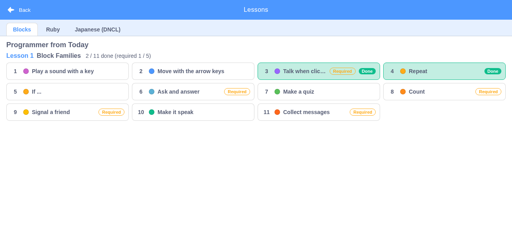

# レッスン（コース › レッスン › チャレンジ）

> **🆕 Smalruby 独自** — upstream に存在しない、Smalruby のために新規追加された機能

## 概要

いまのチュートリアル（`docs/tutorial/`）を、**コース › レッスン › チャレンジ** の形に作り直す機能。
探すための一覧ではなく、「何をやって、何ができるようになったか」が見えるレッスンにして、先生の
説明がなくてもスモウルビーでのプログラミングのやり方が身につくようにする。

このドキュメントは仕組みの全体像（データの形・記録の形・状態・レッスン表・レッスンモード・主要ファイル）をまとめる。
ヒントの吹き出しと判定は、それぞれの実装に合わせて追記する。

## ユーザーストーリー

- **はじめてスモウルビーを使う子**として、先生がいなくても、順番にやれば基本の操作が身につくようにしたい
- **学習者**として、どのチャレンジができたか・何ができるようになったかを見たい
- **先生**として、授業の前に生徒がやっていた分も、あとでクラスの課題に引き継ぎたい

## 階層

| 階層 | 説明 | 例 |
|------|------|----|
| 言語 | ブロック／Ruby／日本語（DNCL）。言語の中にコースが並ぶ | `blocks` |
| コース | レッスンの並び。全部のレッスンをクリアするとクリアの印がもらえる | 「きょうからプログラマー」（印: 「プログラマー デビュー！」） |
| レッスン | チャレンジの並びとクリア条件（n 個と必須） | レッスン 1「ブロックのなかま」（11 個のうち、必須の 3・6・8・9・11 をふくめて 7 個） |
| チャレンジ | いまの deck 1 本に当たる。毎回、新しい作品から始める | 「押したら話そう」 |
| できること | チャレンジで身につくもの。できたチャレンジから一覧にする | — |

## データの形

データは `packages/scratch-gui/src/lib/lessons/courses.js`。文言は message descriptor（`{id, defaultMessage}`）
で持ち、文字列は `lessons.locale.js`（en / ja / ja-Hira）に置く。id は
`gui.lessons.<course|lesson|challenge>.<id>.<field>`。

### コース

| 項目 | 型 | 説明 |
|------|----|------|
| `id` | string | 例: `kyou-kara-programmer` |
| `language` | `blocks` \| `ruby` \| `dncl` | `LANGUAGES` |
| `name` | message | コースの名前 |
| `badge` | message | クリアの印の名前 |
| `lessons` | レッスン[] | 並び順 |

### レッスン

| 項目 | 型 | 説明 |
|------|----|------|
| `id` | string | 例: `blocks-l1` |
| `name` | message | レッスンの名前 |
| `challenges` | チャレンジ[] | 並び順 |
| `clear` | `{count, required}` | クリア条件。`count` = できた数、`required` = 必須のチャレンジ id |

`clear.required` はチャレンジの `required: true` から作る（必須は 1 か所にだけ書く）。

### チャレンジ

いまの deck の項目（`allowedBlocks`・`setup`・`steps`・`code`）をそのまま持ち、レッスン用の項目を足す。
定義で省いた項目は `defineChallenge` が既定値で埋めるので、読む側は有無を確かめなくてよい。

| 項目 | 型 | 既定 | 説明 |
|------|----|------|------|
| `id` | string | — | **記録のキー**。並びを変えても変わらないよう番号を入れない（例: `blocks-l1-click-say`） |
| `number` | number | 並びから | レッスンの中で何個めか（表示用）。`defineLesson` が並びから付ける |
| `name` | message | id から | チャレンジの名前 |
| `task` | message \| null | null | 課題の 1 行 |
| `category` | string \| null | null | なかま（パレットの色）。`CATEGORIES` の値（`motion` / `looks` / `sound` / `events` / `control` / `sensing` / `operators` / `variables` / `lists` / `extensions`）。レッスン表が色の丸で見せる |
| `skills` | `{id, name}`[] | [] | できること。id で重ねる（別のチャレンジで同じものが身についても 1 つ） |
| `goal` | object \| null | null | できた の判定（`uses` / `result`）。形は判定の実装で決める |
| `required` | boolean | false | レッスンの必須か |
| `allowedBlocks` | object \| null | null | パレットに出すブロック（deck と同じ形） |
| `setup` | object \| null | null | 始めるときの準備（deck と同じ形。`lib/deck-setup.js`） |
| `steps` | ヒント[] | [] | ヒント（下の表） |
| `code` | string \| null | null | ヒントの最後の手段「プログラムを入れる」（Ruby。deck の `code` と同じ） |
| `debug` | message[] | [] | うまく動かないときは |

ヒント（`steps` の要素）。deck の step と同じ `title` を文言にし、吹き出しのための項目を足す。
省いた項目は `defineChallenge` が既定値で埋める。

| 項目 | 型 | 既定 | 説明 |
|------|----|------|------|
| `title` | message \| null | null | 吹き出しの文言 |
| `target` | string \| null | null | 指す場所。パレット・コードエリア・ステージ・スプライトリスト・音タブ・コスチュームタブ・背景を選ぶ・拡張機能のボタン・旗・キーボード（場所の無いもの）。値の名前は吹き出しの実装で決める |
| `blocks` | string \| null | null | 吹き出しに描くブロック（Ruby。`code` と同じ変換でブロックにする） |
| `spotlight` | boolean | false | はじめて開いたチャレンジだけ、周りを暗くして `target` を照らす |

記録（下の「記録の形」）は **できたチャレンジだけ**を持つ。「はじめて開いたか」（`spotlight` の判定）は
記録には入れず、吹き出しの実装で別のキーに残す。

文言の message id の付け方: `gui.lessons.course.<id>.{name,badge}`・`gui.lessons.lesson.<id>.name`・
`gui.lessons.challenge.<id>.name`。`task` / `steps[].title` / `debug[]` / できること（`skills[].name`）も
同じ `gui.lessons.` の下に置き、3 locale（en / ja / ja-Hira）にそろえる（テストが解決できることを確かめる）。

`defineCourse` / `defineLesson` / `defineChallenge` は export してあるので、コースやレッスンが増えて
ファイルを分けるときも同じ形で定義できる。

レッスン 1 の 11 のチャレンジは、いまは `id`・名前・なかま（`category`）だけが入っている（中身は後から入れる）。

## 記録の形（端末）

`packages/scratch-gui/src/lib/lessons/lesson-progress.js`。localStorage の **`smalruby:lessonProgress`** に、
クラスに関係ない形で残す。

```json
{
  "version": 1,
  "challenges": {
    "blocks-l1-click-say": {
      "completedAt": "2026-11-10T01:02:03.000Z",
      "courseId": "kyou-kara-programmer",
      "lessonId": "blocks-l1"
    }
  }
}
```

- 同じチャレンジをもう一度できても、**最初にできた日時を残す**（クラスの課題に引き継ぐとき、
  課題の前からできていたものを分けるため）。
- localStorage が使えない・例外になる・中身が壊れているときは空の記録として扱い、落ちない。
- `exportProgress` が送るための形（`{challengeId, courseId, lessonId, completedAt}` の並び、できた順）を返す。

| 関数 | 説明 |
|------|------|
| `loadProgress(storage?)` / `saveProgress(progress, storage?)` | 読み書き（例外を出さない） |
| `markChallengeCompleted(progress, challengeId, completedAt)` | 「できた」にした新しい記録を返す |
| `mergeProgress(progress, other)` | 2 つの記録を合わせる（同じチャレンジは早い日時を残す） |
| `isChallengeCompleted(progress, challengeId)` | できたか |
| `lessonClearStatus(lesson, progress)` | `{cleared, completedCount, count, missingRequired}` |
| `completedSkills(progress)` | できることの一覧 |
| `exportProgress(progress)` | 送るための形 |

## 状態（Redux）

`packages/scratch-gui/src/reducers/lesson-mode.js`（`state.scratchGui.lessonMode`）。

| 項目 | 説明 |
|------|------|
| `courseId` / `lessonId` / `challengeId` | いま開いているチャレンジ。`challengeId` が null ならレッスンモードではない |
| `pendingChallengeId` | 開こうとしているチャレンジ（新しい作品ができるまでの間だけ入る。下の「レッスンモード」） |
| `hintVisible` / `hintIndex` | ヒントの吹き出しを出しているか・何番めのヒントか（チャレンジを開く・閉じるたびに最初にもどる） |
| `progress` | 記録の写し（起動時に localStorage から読む） |

| action / selector | 説明 |
|------|------|
| `startChallenge(challengeId)` | **チャレンジを開く入口**（レッスン表が呼ぶ）。新しい作品 → setup → `openChallenge` の順にコンテナが進める（知らない id は無視） |
| `cancelStartChallenge()` | 開こうとしていたチャレンジを取り消す（「保存しますか」で取りやめたとき） |
| `openChallenge(challengeId)` | レッスンモードに入る（作品の準備は済んでいる前提。知らない id は無視） |
| `closeLesson()` | レッスンモードを抜ける（記録は残す） |
| `showHint()` / `hideHint()` / `nextHint()` / `prevHint()` | ヒントの吹き出しの出し入れと「進める・もどる」（ヒントが無いチャレンジでは出ない。両端で止まる） |
| `markChallengeCompleted(challengeId, completedAt?)` | 「できた」にして localStorage にも書く。書く前に localStorage の最新と合わせる（別のタブが書いた分を消さない） |
| `reloadProgress()` | localStorage の最新を写しに取り込む（別のタブが書いた分を、レッスン表を開くときなどに反映する。書かない） |
| `isLessonMode(state)` / `getCurrentChallenge(state)` | レッスンモードか / `{course, lesson, challenge}` |
| `getLessonAllowedBlocks(state)` | パレットに出すブロック（チャレンジの `allowedBlocks`。無ければ null）。Blocks コンテナがチュートリアルの `tutorialAllowedBlocks` より優先して使う |
| `getCurrentHint(state)` | `{visible, index, count, step}`（レッスンモードでなければ null）。吹き出しの実装はこれを読む |

## レッスン表

メニューバーの「レッスン」ボタン（upstream の「チュートリアル」ボタンがあった場所）を押すと開くモーダル
（`components/lessons-library/`。フルスクリーン、本文は不透明な白）。SP / iPad の `MobileGui` ではドロワーの
「レッスン」から開く。



- **言語のタブ**: ブロック／Ruby／日本語。コースが無い言語は「準備中」と出す（いまはブロックだけ中身がある）。
- **コース › レッスン › チャレンジ**: コース名の次に、レッスンごとに「レッスン n」と名前、
  進み具合「**m / 全部で何個 できた（必須 x / y）**」、クリアしていれば「クリア！」。
  コースの全レッスンをクリアすると、コース名の横にクリアの印（「プログラマー デビュー！」）が付く。
- **チャレンジ**: 番号・なかまの色の丸（`category`。名前は `title` / `aria-label`）・名前・「必須」の印・
  「できた」の印（できたものは緑の背景）。押すと `startChallenge(id)` を呼んでレッスン表を閉じ、
  レッスンモードに入る。
- **できること**: コースの全チャレンジの `skills` を並び順に（同じ id は 1 つ）。できたチャレンジのものは
  色つき、まだのものは点線。どのチャレンジにも `skills` が無いあいだは出さない。
- **記録の取り込み**: 開くたびに `reloadProgress()` を呼び、別のタブで書いた記録も反映する。
- **やめる → もどる**: レッスンモードの「やめる」は `closeLesson()` のあとレッスン表を開く（次のチャレンジを
  すぐ選べる）。
- **はじめての人向けの吹き出し**: 「レッスン」ボタンの下に「レッスンをはじめよう！」（`menu-bar/lessons-tooltip.jsx`）。
  `tutorial-onboarding` reducer の `shouldShowTooltip` を流用し、レッスン表を一度開く（`markTutorialSeen`）と出ない
  （Ruby タブを使った人にも出ない）。

状態は `modals.lessonsLibrary`（`openLessonsLibrary` / `closeLessonsLibrary`）。コンテナは
`containers/lessons-library.jsx`（`gui.jsx` に常時マウントし、`modals.lessonsLibrary` が true の間だけ描く）。

1300×600（授業のパソコン）ではチャレンジ 11 個が 4 列・3 段に収まりスクロールしない。375 幅（SP 縦）では
1 列になり本文がスクロールする。

### data-testid（レッスン表）

| data-testid | 要素 | 説明 |
|------------|------|------|
| `menu-bar-lessons` | div | メニューバーの「レッスン」ボタン |
| `lessons-tooltip` | div | 「レッスン」ボタンの下の、はじめての人向けの吹き出し（押すとレッスン表が開く） |
| `mobile-drawer-lessons` | button | SP のドロワーの「レッスン」 |
| `lessons-library` | div | レッスン表の本文（開いているときだけある） |
| `lessons-library-tab-<blocks\|ruby\|dncl>` | button | 言語のタブ（`aria-selected`） |
| `lessons-library-coming-soon` | p | コースが無い言語の「準備中」 |
| `lessons-library-course-<courseId>` | section | コース |
| `lessons-library-badge` | span | コースのクリアの印（全レッスンをクリアしたときだけ） |
| `lessons-library-lesson-<lessonId>` | section | レッスン |
| `lessons-library-progress` | span | 「m / n できた（必須 x / y）」 |
| `lessons-library-lesson-cleared` | span | レッスンの「クリア！」（クリアしたときだけ） |
| `lessons-library-challenge-<challengeId>` | button | チャレンジ（`data-completed="true\|false"`） |
| `lessons-library-challenge-required` | span | 「必須」の印 |
| `lessons-library-challenge-done` | span | 「できた」の印 |
| `lessons-library-skills` | div | できること（skills があるときだけ） |
| `lessons-library-skill-<skillId>` | li | できることの 1 つ（`data-done="true\|false"`） |

## レッスンモード

チャレンジを開いたときの画面。ふだんのエディタはそのまま使い、次を足す。

- **新しい作品から始める**: `startChallenge(id)` → いまの作品に変更があればメニューの「新規」と同じ
  「保存しますか」の確認（取りやめると `cancelStartChallenge`）→ 新しい作品（Google Drive のファイルとの
  結び付きも切る）→ 作品ができたらチャレンジの setup を適用 → `openChallenge(id)`。
  この流れは `containers/lesson-mode.jsx` が進める（作成中 → 表示中の遷移で「できた」を検出する）。
- **setup**: `lib/lessons/challenge-setup.js` の `setupForChallenge(course, challenge)` が
  `lib/deck-setup.js` に渡す形を作る。コースの言語から既定（ブロック = コードタブ、Ruby = Ruby タブ・Ruby
  モード、DNCL = Ruby タブ・DNCL モード）を決め、チャレンジの `setup` で上書きする。
- **課題バー**（`components/lesson-task-bar/`）: エディタ列（タブの上）に 1 行・40px で出す。
  「何個め / 全部で何個」・課題の 1 行（`task`。無ければチャレンジの名前）・ヒント・やめる。
  stage の列には掛からないので、1300×600 の授業のパソコンでもコードエリアは 40px 縮むだけ。
  SP（MobileGui）でも同じ場所に出る。
- **パレットを絞る**: チャレンジの `allowedBlocks`（deck と同じ形）。Blocks コンテナの `tutorialAllowedBlocks`
  にレッスンの分を優先して渡すので、仕組みはチュートリアルと同じ（`allowedBlocks` が null なら絞らない）。
- **ヒント**: 「ヒント」ボタンで `showHint` / `hideHint`。吹き出しの見た目と「進める・もどる」の操作は
  吹き出しの実装が `getCurrentHint` と `nextHint` / `prevHint` を使って作る（置き場所は
  `containers/lesson-mode.jsx` の `<LessonTaskBar>` の次）。ヒントが無いチャレンジではボタンが無効。
- **やめる**: `closeLesson()` のあとレッスン表を開く。課題バーが消え、パレットが元にもどる（作品はそのまま）。

レッスン表のほかに、コンテナがマウント中は `window.smalruby.startChallenge(id)` で
`startChallenge` を呼べる（Playwright / Selenium から使う）。URL パラメータは作らない。

### data-testid

| data-testid | 要素 | 説明 |
|------------|------|------|
| `lesson-task-bar` | div | 課題バー全体（レッスンモードのときだけある） |
| `lesson-task-bar-position` | span | 「何個め / 全部で何個」 |
| `lesson-task-bar-task` | span | 課題の 1 行（長いときは省略記号。全文は `title`） |
| `lesson-task-bar-hint` | button | ヒントの吹き出しの出し入れ（ヒントが無ければ disabled） |
| `lesson-task-bar-quit` | button | やめる |

### スクリーンショット

| ファイル | 説明 |
|---------|------|
| `screenshots/0201-lesson-mode-1300x600.png` | 授業のパソコン（1300×600）でチャレンジ 3「押したら話そう」を開いたところ |
| `screenshots/0202-lesson-mode-667x375.png` | SP 横（MobileGui）で同じチャレンジを開いたところ |
| `screenshots/0301-lessons-button-1300x600.png` | メニューバーの「レッスン」ボタンと、はじめての人向けの吹き出し（1300×600） |
| `screenshots/0302-lessons-library-1300x600.png` | レッスン表（1300×600）。2 つできた状態 |
| `screenshots/0303-lessons-library-375x667.png` | レッスン表（SP 縦 375×667。1 列） |
| `screenshots/0304-lessons-library-cleared-1300x600.png` | レッスン 1 をクリアした状態（「クリア！」と「プログラマー デビュー！」） |

## いまのチュートリアルの入口

レッスン機能がチュートリアルの役目を引き継ぐため、従来の **「チュートリアル」「デバッグ」のボタンはメニューバーから外し、右上の「?」メニューの項目**にした（ふだんは目に入らないようにする。そろったら消す）。

- 「?」メニュー › チュートリアル → チュートリアル一覧（`tips-library`）
- 「?」メニュー › デバッグ → デバッグ画面（`debug-modal`）
- `?tutorial=<urlId>` で直接開く経路はそのまま動く（教科書や授業資料のリンク用）
- はじめての人向けの吹き出し（旧 `tutorial-tooltip`）は出さない。代わりに「レッスン」ボタンの下に吹き出しを出す（上の「レッスン表」）

詳細は [`docs/menu-bar/`](../menu-bar/) の「「?」メニュー（ヘルプ）」と [`docs/tutorial/`](../tutorial/) を参照。

## 主要ファイル

| ファイル | 説明 |
|---------|------|
| `packages/scratch-gui/src/lib/lessons/courses.js` | コース・レッスン・チャレンジのデータと検索 |
| `packages/scratch-gui/src/lib/lessons/lessons.locale.js` | 文言（en / ja / ja-Hira。`src/locales/*.js` に spread） |
| `packages/scratch-gui/src/lib/lessons/lesson-progress.js` | 端末への記録・クリア判定・できること |
| `packages/scratch-gui/src/lib/lessons/challenge-setup.js` | チャレンジを開くときの setup（言語の既定 + チャレンジの `setup`） |
| `packages/scratch-gui/src/reducers/lesson-mode.js` | いま開いているチャレンジ・開こうとしているチャレンジ・ヒント・記録の写し |
| `packages/scratch-gui/src/containers/lesson-mode.jsx` | チャレンジを開く流れ（新しい作品 → setup → レッスンモード）と課題バーのマウント。`gui.jsx` のエディタ列の先頭に常時マウント |
| `packages/scratch-gui/src/components/lesson-task-bar/` | 課題バー（1 行・40px） |
| `packages/scratch-gui/src/components/lessons-library/` | レッスン表（モーダル） |
| `packages/scratch-gui/src/containers/lessons-library.jsx` | レッスン表のコンテナ（開くたびに記録を取り込む・チャレンジを押したら `startChallenge` + 閉じる）。`gui.jsx` に常時マウント（Smalruby マーカー `lessons library`） |
| `packages/scratch-gui/src/components/menu-bar/lessons-tooltip.jsx` | 「レッスン」ボタンの下の、はじめての人向けの吹き出し |
| `packages/scratch-gui/src/reducers/modals.js` | `lessonsLibrary` モーダルの開閉（Smalruby マーカー `lessons library`） |
| `packages/scratch-gui/src/components/mobile-drawer/mobile-drawer.jsx` | SP のドロワーの「レッスン」 |
| `packages/scratch-gui/src/containers/blocks.jsx` | `getLessonAllowedBlocks` でパレットを絞る（Smalruby マーカー `lesson mode`） |
| `packages/scratch-gui/test/unit/lib/lessons/` | データの形・記録・クリア判定・setup の unit テスト |
| `packages/scratch-gui/test/unit/reducers/lesson-mode-reducer.test.js` | reducer の unit テスト |
| `packages/scratch-gui/src/components/menu-bar/menu-bar.jsx` | 「レッスン」ボタンと吹き出し（`lessons button` マーカー）、「?」メニューのチュートリアル / デバッグ項目（`help menu` マーカー） |
| `packages/scratch-gui/src/containers/menu-bar-hoc.jsx` | `onOpenLessonsLibrary` / `showLessonsTooltip`（`lessons button` マーカー）と `onOpenTipsLibrary`（`help menu` マーカー）の供給 |
| `packages/scratch-gui/test/unit/components/lesson-task-bar.test.jsx` / `test/unit/containers/lesson-mode.test.jsx` | 課題バーとチャレンジを開く流れの unit テスト |
| `packages/scratch-gui/test/integration/smalruby-lessons.test.js` | チャレンジを開く → 課題バー・絞ったパレット → やめる → 元にもどる（Selenium） |
| `packages/scratch-gui/test/unit/components/lessons-library.test.jsx` / `test/unit/containers/lessons-library.test.jsx` / `test/unit/components/menu-bar-lessons.test.jsx` | レッスン表（できた印・進み具合・クリア表示・できること）、コンテナ、「レッスン」ボタンと吹き出しの unit テスト |
| `packages/scratch-gui/test/integration/smalruby-lessons-library.test.js` | メニューから開く → チャレンジを押す → レッスンモード → やめる → レッスン表にもどる・記録に合わせた「できた」と進み具合（Selenium） |

## 設定・データ永続化

| 種類 | キー | 説明 |
|------|------|------|
| localStorage | `smalruby:lessonProgress` | チャレンジ ID → できた日時（とコース・レッスン） |
| localStorage | `smalruby:tutorialSeen` | `true` なら「レッスン」ボタンの下の吹き出しを出さない（`tutorial-onboarding` reducer。レッスン表を一度開くと書く） |
