# レッスン（コース › レッスン › チャレンジ）

> **🆕 Smalruby 独自** — upstream に存在しない、Smalruby のために新規追加された機能

## 概要

いまのチュートリアル（`docs/tutorial/`）を、**コース › レッスン › チャレンジ** の形に作り直す機能。
探すための一覧ではなく、「何をやって、何ができるようになったか」が見えるレッスンにして、先生の
説明がなくてもスモウルビーでのプログラミングのやり方が身につくようにする。

**設計の方針（決まったこと・入れないと決めたこと・その理由）は [`design.md`](design.md)**。コースやチャレンジを足す・画面を直すときは、先にそちらを読む。

このドキュメントは仕組みの全体像（データの形・記録の形・状態・レッスン表・レッスンモード・主要ファイル）をまとめる。
ヒントの吹き出しと判定は、それぞれの実装に合わせて追記する。

## ユーザーストーリー

- **はじめてスモウルビーを使う子**として、先生がいなくても、順番にやれば基本の操作が身につくようにしたい
- **学習者**として、どのチャレンジができたか・何ができるようになったかを見たい
- **先生**として、授業の前に生徒がやっていた分も、あとでクラスの課題に引き継ぎたい

## 階層

| 階層 | 説明 | 例 |
|------|------|----|
| 言語 | ブロック／Ruby／日本語（DNCL）。言語の中にコースが並ぶ | `blocks` |
| コース | レッスンの並び。コースのチャレンジが全部できると、レッスン表のコース名の前に ✓ が付く | 「きょうからプログラマー」 |
| レッスン | チャレンジの並び | レッスン 1「うごかしてみよう」（4 個）・2「えらんで たずねよう」（3 個）・3「おぼえて つたえよう」（4 個） |
| チャレンジ | いまの deck 1 本に当たる。毎回、新しい作品から始める | 「押したら話そう」 |

段 1 には**「必須」も「できること」も無い**。レッスンやコースの「全部できた」は、そのチャレンジが全部できたとき。
先生が必須にするチャレンジは、段 2 でクラス管理の「レッスンの課題」の側に持つ（レッスンのデータには持たない）。
「できること」はバッジなどを考えるときにあらためて作る。

## データの形

データは `packages/scratch-gui/src/lib/lessons/courses.js`。文言は message descriptor（`{id, defaultMessage}`）
で持ち、文字列は `lessons.locale.js`（en / ja / ja-Hira）に置く。id は
`gui.lessons.<course|lesson|challenge>.<id>.<field>`。

### コース

| 項目 | 型 | 説明 |
|------|----|------|
| `id` | string | 例: `kyou-kara-programmer` |
| `language` | `blocks` \| `ruby` \| `dncl` | `LANGUAGES` |
| `name` | message | コースの名前 |
| `lessons` | レッスン[] | 並び順 |

### レッスン

| 項目 | 型 | 説明 |
|------|----|------|
| `id` | string | 例: `blocks-l1` |
| `name` | message | レッスンの名前 |
| `challenges` | チャレンジ[] | 並び順 |
| `allowDnclMode` | boolean | レッスンのあいだ Ruby タブを日本語モードに切りかえてよいか。**書いていなければ不可**（`false`）。下の「日本語モードの切りかえ」 |

クリア条件（n 個・必須）は持たない。

#### 日本語モードの切りかえ（`allowDnclMode`）

日本語モードでは、パレットが日本語で書けるブロックに絞られる。レッスン中にこれが重なると、チャレンジの
パレットの絞り込み（`allowedBlocks`）とあわせてチャレンジで使うブロックが消える。そこでレッスンごとに
切りかえてよいかを持ち、既定は不可にしている。

- **不可のレッスンのあいだ**: Ruby タブのツールバーの「日本語」ボタン（`ruby-toolbar-mode-dncl`）を押せない
  （薄く表示し、title に「このレッスンでは日本語モードに切りかえられません」）。ふりがな・Ruby のボタンは押せる。
  レッスンをおえる（`closeLesson`）と元どおり押せる。
- **ほかの入口**:
  - Ruby タブを開き直したときに日本語モードへ戻す処理・日本語の locale に戻したときに保存済みの日本語モードを
    戻す処理も、不可のレッスンのあいだは日本語モードに入らない（`containers/ruby-tab.jsx` の
    `handleToggleDnclMode` と locale の切りかえ）。
  - URL の `rubyMode=dncl` は起動時の初期値だけで、レッスンに入るとき（`startChallenge`）にふりがなモードへ戻すので
    塞がない。
  - SP（MobileGui）のメニューには日本語モードの切りかえが無い（Ruby タブのツールバーは同じものを使う）。
  - レッスンの setup の `rubyMode: 'dncl'`（DNCL のコースの既定を含む）: **setup で日本語モードにするレッスンは
    `allowDnclMode: true` にする**。不可のままだと、日本語モードで始まったあとにふりがな・Ruby へ切りかえると
    日本語に戻れなくなる。`test/unit/lib/lessons/courses.test.js` が、チャレンジの setup が日本語モードになる
    レッスンはすべて `allowDnclMode: true` かを確かめる。
- 将来の日本語のレッスン（DNCL のコース）は `allowDnclMode: true` にし、パレットの絞り込みは日本語モードの
  絞り込みと重ねても使うブロックが残るように `allowedBlocks` を決める。

### チャレンジ

いまの deck の項目（`allowedBlocks`・`setup`・`steps`・`code`）をそのまま持ち、レッスン用の項目を足す。
定義で省いた項目は `defineChallenge` が既定値で埋めるので、読む側は有無を確かめなくてよい。

| 項目 | 型 | 既定 | 説明 |
|------|----|------|------|
| `id` | string | — | **記録のキー**。並びを変えても変わらないよう番号を入れない（例: `blocks-l1-click-say`）。`blocks-l1-` は 11 のチャレンジが 1 つのレッスンだったころの名残で、レッスン 2・3 のチャレンジも `blocks-l1-…` のまま（記録を引き継ぐため変えない） |
| `number` | number | 並びから | レッスンの中で何個めか（表示用。課題バーの「3 / 4」）。`defineLesson` が並びから付ける |
| `name` | message | id から | チャレンジの名前 |
| `task` | message \| null | null | 課題の 1 行。全文では改行（`\n`）をそのまま出す（バーの 1 行ではつなぐ） |
| `image` | `{src, alt}` \| null | null | 課題の全文といっしょに出す画像（任意）。`src` は import した画像の URL、`alt` は message |
| `card` | `{category, main}` \| null | null | レッスン表のカード。`category` = 左の帯の色のなかま、`main` = そのチャレンジで覚えるメインのなかま（同じ数で並んだときの色）。どちらも `CATEGORIES` の値（`motion` / `looks` / `sound` / `events` / `control` / `sensing` / `operators` / `variables` / `lists` / `extensions`）。決め方は下の「カードの色」 |
| `goal` | 条件[] \| null | null | できた の判定。条件の配列で、全部を満たしたら「できた」（下の「できた の判定」）。null なら判定しない |
| `allowedBlocks` | object \| null | null | パレットに出すブロック（deck と同じ形）。項目は opcode か、初期値を持つ `{opcode, fields, inputs}`（下の「パレットのブロックの初期値」） |
| `setup` | object \| null | null | 始めるときの準備（deck と同じ形。`lib/deck-setup.js`） |
| `steps` | ヒント[] | [] | ヒント（下の表） |
| `code` | string \| `{ja, 'ja-Hira', en}` \| null | null | ヒントの最後の手段「プログラムを入れる」（Ruby。deck の `code` と同じ）。作品の中の名前が locale で変わるときは locale ごとに書く（下の「英語の UI でも使う（locale ごとの `code`）」） |
| `codeTarget` | `'stage'` \| null | null | `code` を入れる相手。null はいま編集中のスプライト。`'stage'` はステージのプログラムのチャレンジ（入れる前にステージをえらぶ） |
| `spriteCodes` | `{sprite, code}`[] | [] | `code` のほかに、名前で決めたスプライトに入れるプログラム（2 つのスプライトでやりとりするチャレンジ用）。`sprite` はライブラリのスプライトの名前。`code` は `code` と同じく locale ごとにも書ける。下の「最後の手段」 |
| `debug` | message[] | [] | うまく動かないときは |
| `activityDiagram` | boolean | false | 答えのプログラム（`code` と `spriteCodes`）から描くアクティビティ図を、課題の全文とヒントの 1 ページ目に出すか。答えが無いチャレンジでは true でも出さない。描き方は下の「アクティビティ図（答えから描く）」 |
| `partner` | object \| null | null | メッシュの練習相手の定義 `{name, buttons: [{label, set, broadcast}], replies: [{onBroadcast, set, broadcast}]}`（`set` = `{variable, value}` か、その配列）。あればチャレンジ中に練習相手のパネルを出す（下の「メッシュの練習相手」）。図では相手のスイムレーンになる。無ければ自分のプログラムだけを描く |
| `quiz` | `{question, choices, answer, explanation}` \| null | null | ふりかえりのクイズ（3 択）。「できた！」の表示の中に出す（下の「ふりかえりのクイズ」）。`question` / `choices`（3 つ）/ `explanation` は message、`answer` は正解が `choices` の何番目か（0 から）。ふつうは `challengeQuiz(id, answer)` で書く |

ヒント（`steps` の要素）。deck の step と同じ `title` を文言にし、吹き出しのための項目を足す。
省いた項目は `defineChallenge` が既定値で埋める。

| 項目 | 型 | 既定 | 説明 |
|------|----|------|------|
| `title` | message \| null | null | 吹き出しの文言 |
| `target` | string \| null | null | 指す場所（`lib/lessons/hint-targets.js` の `HINT_TARGETS`）: `palette`（パレット）・`code-area`（コードエリア）・`stage`（ステージ）・`sprite-list`（スプライトリスト）・`sounds-tab`（音タブ）・`costumes-tab`（コスチュームタブ）・`backdrop`（背景を選ぶ）・`extension-button`（拡張機能のボタン）・`green-flag`（旗）・`keyboard`（場所の無いもの。画面の真ん中に出す） |
| `blocks` | string \| `{ja, 'ja-Hira', en}` \| null | null | 吹き出しに描くブロック（Ruby。`code` と同じ変換でブロックにする）。`code` と同じく locale ごとにも書ける |
| `spotlight` | boolean | false | はじめて開いたチャレンジだけ、周りを暗くして `target` を照らす |

`steps` の後ろには、`debug` か `code` があれば**最後の手段のページ**（「うまく動かないときは」と「プログラムを入れる」）が
1 つ付く（`getCurrentHint` の `count` はこのページを含む）。

記録（下の「記録の形」）は **できたチャレンジだけ**を持つ。「はじめて開いたか」（`spotlight` の判定）は
記録には入れず、**`smalruby:lessonSpotlightSeen`**（`lib/lessons/spotlight-seen.js`。チャレンジ id → 開いた日時）に
残す。チャレンジを開いた時点でそのチャレンジを「見た」と記録し、開いているあいだは照らし続ける。2 回目からは
吹き出しだけ。「できた」の有無は見ない（できていなくても 2 回目は照らさない。別のチャレンジは、それをはじめて
開くときに照らす）。

文言の message id の付け方: `gui.lessons.course.<id>.name`・`gui.lessons.lesson.<id>.name`・
`gui.lessons.challenge.<id>.name`。`task` / `steps[].title` / `debug[]` / `quiz` も
同じ `gui.lessons.` の下に置き（`quiz` は `gui.lessons.challenge.<id>.quiz.question` / `.quiz.choice1`〜`3` /
`.quiz.explanation`。`challengeQuiz` がこの id で作る）、3 locale（en / ja / ja-Hira）にそろえる（テストが解決できることを確かめる）。

`defineCourse` / `defineLesson` / `defineChallenge` は export してあるので、コースやレッスンが増えて
ファイルを分けるときも同じ形で定義できる。

### 英語の UI でも使う（locale ごとの `code`）

コースは日本語の UI だけでなく、**英語の UI（en）でも使える**（英語の生徒もいるため）。文言は 3 locale
（ja / ja-Hira / en）にそろえ、作品の中の名前に依存する Ruby（`code`・`spriteCodes[].code`・ヒントの `blocks`）は
locale ごとに書ける:

```js
code: {
    ja: 'when_key_pressed("space") do\n  play_until_done("ニャー")\n  play("Owl")\nend\n',
    'ja-Hira': 'when_key_pressed("space") do\n  play_until_done("Meow")\n  play("Owl")\nend\n',
    en: 'when_key_pressed("space") do\n  play_until_done("Meow")\n  play("Owl")\nend\n',
},
```

- 文字列はそのまま全 locale で使う。オブジェクトはいまの UI の locale（`intl.locale`）のものを使い、キーが
  無い locale は **en**、en も無ければ **ja** に戻る（`courses.js` の `localizeCode`）。ja-Hira を ja と同じに
  したいときも、en に戻らないよう **ja-Hira のキーを省かずに書く**。
- 新しい作品の名前は作品を作ったときの locale で決まる。ネコの音は ja が「ニャー」、en と ja-Hira が "Meow"
  （scratch-l10n に ja-Hira の訳が無い）。スプライト名（「スプライト1」/ "Sprite1"）・コスチューム名・背景名も
  locale で変わるので、`code` で名前を使うときは locale ごとに書く（いまのレッスン 1 で名前を使うのはチャレンジ 1 の
  ネコの音だけ。スプライトは名前でなく「`spriteCodes` に名前の無い最初のスプライト」で探す）。ライブラリの名前
  （"Owl" / "Canyon" / "Arctic" / "Penguin"）は locale で変わらない。
- **「プログラムを入れる」は作品に合う組を探す**: いまの locale の `code`（と `spriteCodes`）を音・背景の確かめ込みで
  試し、作品に合わない（日本語の作品を英語の UI で開いた、先生が配った日本語の作品を英語の生徒が開いた等）ときは、
  ほかの locale の組を順に試して、合った組を入れる（`challengeCodeCandidates`）。試すのは変換だけで、作品に
  入れるのは選んだ 1 組だけ。どれも合わなければ、わけのいちばん少ない組（同じならいまの locale の組）のわけを出す
  （Owl をまだ足していない等。日本語の作品を英語の UI で開いたときに、作品に無い "Meow" を探させない）。
- セリフ・変数名・リスト名は、その locale の課題とヒントの文言に合わせる。レッスン 1 では en の課題が
  "Hello!" / "That tickles!" / "Touch me" / "What's your name?" / " seconds" / "Correct" / "Wrong" と書くので en の
  `code` もそれを言う。
- **子どもが作る名前は en では英語**（Ruby の変数名に使える小文字の英語）。英語の生徒に日本語を入力させないため。
  en の課題・ヒント・`code`（とヒントの `blocks`）は次の名前を使い、ja / ja-Hira は日本語の名前のまま:

  | チャレンジ | ja | ja-Hira | en |
  |---|---|---|---|
  | 8 変数 | 回数 | かいすう | `count` |
  | 9 メッセージ / セリフ | あいさつ / やあ！ | あいさつ / やあ！ | `hello` / "Hi!" |
  | 10 しゃべることば | ボタンが押されました | ボタンがおされました | "The button was clicked" |
  | 11 リスト / 質問 | トーク / メッセージは？ | トーク / メッセージは？ | `talk` / "Message?" |

  ja-Hira はほかにヒントのとおり「せいかいです」・「びょうでした」。
- **`goal` は全 locale の `code` が言うものを許す**: 名前は配列（`['回数', 'かいすう', 'count']` / `['トーク', 'talk']`）、
  言う文字は RegExp（チャレンジ 7 の `/^(正解です|せいかいです|correct)$/i` と `/^(ちがいます|wrong)$/i`）。
  9〜10 の判定はメッセージ名・ことばを見ない。
- **locale をまたいだ作品**（日本語の UI で「回数」を作った作品を英語の UI で開いた、先生が日本語で配った作品を
  英語の生徒が開いた等）: 判定はどの locale の名前でも通る。同じ判定に複数の名前の変数・リストがある（「回数」と
  `count` の両方がある）ときは、どれか 1 つが条件に合えばよい（`goal.js` の `findVariables`）。「プログラムを入れる」は
  いまの UI の locale の名前で入れる（変数・リストは変換で足されるので作品に合わないことはない。英語の UI なら `$count`
  が新しく作られ、子どもが作った「回数」はそのまま残る）。名前を作品に合わせて読みかえることはしない。
- ja-Hira の新しい作品のネコの音は "Meow" なので、ja-Hira のチャレンジ 1 の課題は「ネコが「Meow」（ニャー）とないたあと」と
  書く（ブロックの ▼ に出る名前と合わせる）。
- テスト: `courses.test.js` が全チャレンジの `code` を ja / ja-Hira / en それぞれの新しい作品の名前で（音・背景の
  確かめ込みで）ブロックに変換できることを確かめる。`challenge-goals-per-locale.test.js` は、その `code` を
  それぞれの locale の新しい作品に入れて本物の VM で動かし、課題の操作（キー・クリック・答えの入力）をすると
  `goal` を満たす（「できた」になる）ことを、全 11 チャレンジ × 3 locale で確かめる。integration は `smalruby-lessons-en.test.js`（en で
  チャレンジ 1・8・9 を開いて「プログラムを入れる」→ 操作 →「できた」）。

コース「きょうからプログラマー」の 11 のチャレンジは、どれも中身（課題・パレット・ヒント・判定・Ruby）が
入っている（下の「コース「きょうからプログラマー」のチャレンジ」）。

### コース「きょうからプログラマー」のチャレンジ

11 のチャレンジを 3 つのレッスンに分ける（順番と中身は 1 つのレッスンだったころと同じ）。下の表の # は
コースの通し番号で、課題バーやレッスン表の番号はレッスンの中の番号（例: 6 は レッスン 2 の 2 個め）。

| レッスン | id | 名前（ja / ja-Hira / en） | チャレンジ（通し番号） |
|---------|----|------------------------|---------------------|
| 1 | `blocks-l1` | うごかしてみよう / うごかしてみよう / Let's Move | 1〜4 |
| 2 | `blocks-l2` | えらんで たずねよう / えらんで たずねよう / Choose and Ask | 5〜7 |
| 3 | `blocks-l3` | おぼえて つたえよう / おぼえて つたえよう / Remember and Tell | 8〜11 |

1 つのチャレンジは 5 分・3〜5 ブロック。どれも「キーかスプライトを押したら、何かが起きる」形で、毎回
新しい作品（ネコ）から始める。文言は `lessons.locale.js`（ja / ja-Hira / en）。

| # | id | 課題 | パレット（`allowedBlocks`） | できた の条件（`goal`） |
|---|----|------|---------------------------|------------------------|
| 1 | `blocks-l1-key-sound` | スペースキーを押したら、ネコが「ニャー」と鳴いたあと、「Owl」の音が鳴る | `event_whenkeypressed` / `sound_playuntildone` / `sound_play` | スペースキーのスクリプトで `sound_playuntildone` → `sound_play` の順に動いた |
| 2 | `blocks-l1-arrow-move` | 上向き矢印キーで上へ、下向き矢印キーで下へ、ネコを動かす | `event_whenkeypressed` / `motion_changeyby` | 上向き矢印キーのスクリプトで `DY > 0`、下向き矢印キーのスクリプトで `DY < 0` の `motion_changeyby` が動いた |
| 3 | `blocks-l1-click-say` | コスチュームを足して、押したら「こんにちは！」と言って、見た目がかわる | `event_whenthisspriteclicked` / `looks_sayforsecs` / `looks_nextcostume` | コスチュームが始めより 1 つ以上増え、スプライトを押したスクリプトで `looks_sayforsecs` と `looks_nextcostume` が動いた |
| 4 | `blocks-l1-repeat` | 1 のキーを押したら、背景が「Canyon」と「Arctic」に 3 回かわる（**ステージのプログラム**） | `event_whenkeypressed` / `control_repeat` / `control_wait` / `looks_switchbackdropto` | ステージの 1 のキーのスクリプトで `control_repeat` が動き、`looks_switchbackdropto` が 6 回動いた |
| 5 | `blocks-l1-if` | マウスでネコにさわったら「くすぐったい！」、さわっていないときは「さわってみて」と言う | `event_whenflagclicked` / `control_forever` / `control_if` / `control_if_else` / `sensing_touchingobject` / `looks_say` | 旗のスクリプトで `sensing_touchingobject` が動き、ちがうセリフ（`MESSAGE`）の `looks_say` が 2 種類動いた |
| 6 | `blocks-l1-ask-answer` | ネコを押したら名前を聞いて、答えた名前と、答えるまでにかかった秒数を言う | `event_whenthisspriteclicked` / `sensing_resettimer` / `sensing_askandwait` / `sensing_answer` / `sensing_timer` / `operator_join` / `looks_sayforsecs` | スプライトを押したスクリプトで `sensing_resettimer` → `sensing_askandwait` の順に動き、`sensing_answer`・`sensing_timer`・`looks_sayforsecs` 2 回が動いた。答えと同じことばを言った |
| 7 | `blocks-l1-quiz` | ネコを押したら「4＋3＝？」と聞いて、7 なら「正解です」、ちがえば「ちがいます」と言う | `event_whenthisspriteclicked` / `sensing_askandwait` / `sensing_answer` / `control_if` / `control_if_else` / `operator_equals` / `looks_sayforsecs` | 答えが 7 のときに「正解です」（ja-Hira の「せいかいです」、en の "Correct" も可）、7 でないときに「ちがいます」（en の "Wrong" も可）を言った（両方） |
| 8 | `blocks-l1-count` | ネコを押した回数を数えて、その数を言う。3 回押す | `event_whenflagclicked` / `event_whenthisspriteclicked` / `data_setvariableto` / `data_changevariableby` / `data_variable` / `looks_say` | 変数「回数」（ja-Hira の「かいすう」、en の `count` も可）が 3 以上になり、その値を言った |
| 9 | `blocks-l1-broadcast` | ペンギンを足して、ネコを押したらペンギンが「やあ！」と言う（**2 つのスプライト**） | `event_whenthisspriteclicked` / `event_broadcast` / `event_whenbroadcastreceived` / `looks_sayforsecs` | スプライト 2 つ以上・押されたときで送る・**別のスプライト**が受け取ったときに言う（`sentBy: 'other'`） |
| 10 | `blocks-l1-speak` | 拡張機能「音声合成」を足して、ネコを押したら「ボタンが押されました」としゃべる | `event_whenthisspriteclicked` / `text2speech_speakAndWait` | 拡張機能 `text2speech` が読み込まれている・押されたときで `text2speech_speakAndWait` |
| 11 | `blocks-l1-message-list` | ネコを押したら「メッセージは？」と聞いて、答えをリスト「トーク」にためる。3 つためる | `event_whenflagclicked` / `event_whenthisspriteclicked` / `data_deletealloflist` / `data_addtolist` / `sensing_askandwait` / `sensing_answer` | リスト「トーク」（en の `talk` も可）の長さ 3 以上・中身が答えから（`itemsFromAnswers`） |

ヒントは、音タブ・コスチュームタブ・背景を選ぶ・スプライトリストのように「足す・えらぶ」場所を指すものと、
パレット・コードエリアを指して**本物のブロック**を描くもの、ステージ・キーボードを指して「動かしてみよう」と
言うものの並び。スポットライト（はじめて開いたときだけ）は基本操作（出す・くっつける・押す・消す）のヒントに
だけ付けている（チャレンジ 1 のパレットとキーボード、チャレンジ 3 のパレット・ステージ・コードエリア）。

どのチャレンジも、できあがりのプログラムの帽子のブロックを置くページがあり、ブロックを描くページは
そのページで置いてほしいブロックを置いてほしい並びのまま描く（決まりは [`design.md`](design.md) の「ヒント」）。
帽子のブロックが描かれていることは `courses.test.js`（`every hat block of the answer is drawn in a hint`）が
3 locale で確かめる。
文言がつなげる相手・置く位置を言うページ（「〜の下に」「〜の上に」「〜の中に」「穴に」「つなげ」「くっつけ」など）は、
置くブロックを**相手のブロックとつないだ 1 つのかたまり**で描く（例: 「その下に『y座標を 10 ずつ変える』を
くっつけよう」は帽子のブロック＋「y座標を 10 ずつ変える」、「『ずっと』の中に『もし〜なら でなければ』を入れよう」は
「ずっと」に入れた「もし〜なら でなければ」）。描くのは相手（すぐ上のブロック・入れる先のブロック）と置くブロックで、
スクリプト全体ではない。これは `hint-pictures.test.js`（`a hint that names where to put a block draws it connected
with its partner`）が、文言の言い方（正規表現 `NAMES_A_PARTNER`）と描いたかたまりの数で 3 locale とも確かめる。
手順の最後のヒント（「うまく動かないときは」のページの前）は、どのチャレンジも「できた」になる操作を促すページ（ステージ・キーボード・旗を指す）で、
それより前のページはステージ・キーボード・旗を指さない（できたら吹き出しが閉じて、そのあとのページは
見られないため）。これは `courses.test.js`（`the hint that asks to try it out is the last one`）が確かめる。
チャレンジ 3 は、ブロックの消し方（コードエリアを指す）を、ステージのスプライトを押すページの前に置く。

作るときの注意:

- **ヒントに描くブロックは、まだ足していない音・背景でもよい**。吹き出しの変換（`hint-blocks.js`）は
  converter の `validateAssets: false` で音・コスチューム・背景の存在を確かめない（「Owl の音を鳴らす」は
  Owl を足す前から描く）。**`code` を入れるときの変換は従来どおり確かめる**ので、チャレンジ 1 の `code`
  （`play("Owl")`）はヒント 1 のとおり Owl を足してから、チャレンジ 4 の `code` は背景を足してから入れる
  （足していなければ入れずに、吹き出しの中に「まだプログラムを入れられないよ。先にヒントのとおりに足そう。」と
  変換のエラー（「音「Owl」は存在しません。…先に音を追加してください。」）を出す）。
- 中身の無い「繰り返す」を描くときは **`3.times`**（ブロック無し）と書く（帽子のブロックの下なら
  `when_key_pressed("1") do\n  3.times\nend\n`）。`3.times do ... end` は中身が無いと変換できない。帽子のブロックだけを描くときは `when_key_pressed("1") do\nend\n` のように中身の無い
  `do ... end` でよい（帽子のブロックは中身が無くても変換できる）。
- チャレンジ 4 のヒント 5 は、「繰り返す」の中に入れる 4 つ（`switch_backdrop("Canyon")` / `sleep(1)` /
  `switch_backdrop("Arctic")` / `sleep(1)`）を、「繰り返す」に入れた 1 つのかたまり（`3.times do ... end`）として描く。
- `self.y += -10` は「y座標を -10 ずつ変える」になる（チャレンジ 2 の下向き矢印）。
- チャレンジ 1 の `code` とヒント 3 のネコの音は locale ごとに書く（ja は「ニャー」、en / ja-Hira は "Meow"。上の
  「英語の UI でも使う」）。`goal` は音の名前を見ない。
- ライブラリの音「Owl」・背景「Canyon」「Arctic」の表示名は日本語でも英語のまま（ライブラリの名前は
  翻訳されない）。ヒントの文言もそのまま "Owl" / "Canyon" / "Arctic" と書く。
- チャレンジ 4 のように**ステージのプログラム**のチャレンジは `codeTarget: 'stage'` にする。
  「プログラムを入れる」がステージをえらんで（`vm.setEditingTarget`）Ruby タブの相手（`rubyCode.target`）も
  ステージにしてから入れるので、スプライトを編集中に押してもステージに入る。
- **5 もし〜なら**: パレットには「もし <> なら」と「もし <> なら でなければ」の両方を出す（ヒント 3 は
  「でなければ」のほう）。ヒント 2（「旗のブロックの下に『ずっと』をつなげよう」）の吹き出しは
  `when_flag_clicked do\n  loop do\n  end\nend` で、旗のブロックとつないだ「ずっと」を描く（「ずっと」だけだと、
  旗とつなげることが伝わらない）。ヒント 3 の吹き出しは `loop do\n  if false\n  else\n  end\nend` で、「ずっと」に
  入れた空の穴の「もし <  > なら でなければ」を描く（Ruby → ブロックの変換は中身の無い `else` も「でなければ」として
  残す）。ヒント 4 は「調べる」の六角形を穴に入れた「もし〜なら でなければ」。
  チャレンジ 7 のヒント 3 も `if false` で、「聞いて待つ」の下につないで、中に「言う」2 つを入れた
  「もし <  > なら でなければ」を描く。ヒント 4 はその穴に「=」を入れたもの。
- **ヒントの絵は本番のビルドでも同じブロックになること**を `hint-pictures.test.js` が確かめる。本番のビルドは
  @ruby/prism のノードのクラス名を縮めるので、`constructor.name` でノードの種類を見る変換は、開発のビルドと
  本番のビルドで絵が変わる（中身の無い `else` が消えて「もし〜なら」になっていた）。テストはクラス名を縮めた
  状態でも全ヒントの絵の opcode が同じこと、Ruby の `else` の数だけ「もし〜なら でなければ」があることを見る。
- **6 聞いて答えよう**: ヒント 4（「『聞いて待つ』の上に『タイマーをリセット』を入れよう」）の吹き出しは
  `timer.reset` の下に `ask("なまえは？")`（en は "What's your name?"）をつないだ 2 つで描き、「聞いて待つ」の
  上に置くことを見せる。`code` とヒント 5 の吹き出しは `timer.value + "秒でした"`（ヒントは「言う」に入れた形の `say(timer.value + "秒でした", 2)`）（「(タイマー) と (秒でした)」の
  「と」1 つ。子どもが作ったブロックから生成される Ruby も同じ形）。仕様の `timer.value.to_s + "秒でした"` は、
  `.to_s` も「(タイマー) と ()」の「と」になるので、入れると「と」2 つの入れ子になり子どもが作るものと見た目が
  ちがう。秒数は 3.217 のような小数のまま言う（四捨五入は入れない）。
- **7 クイズを作ろう**: 比べ方は Scratch と同じなので、全角の「７」は 7 と等しくない（「ちがいます」になる）。
  ヒントの「うまく動かないときは」で半角の 7 を案内し、判定は `answer: {eq: 7}` と `{ne: 7}` の両方を見る。
- **8 数えよう**: Ruby の `$回数` はステージの変数（ブロックの「すべてのスプライト用」）で、「変数を作る」の
  既定と同じ。先に「変数を作る」で「回数」を作ってから「プログラムを入れる」でも、変数は 1 つのまま
  （integration テストで確かめている）。日本語の変数名も Ruby ⇔ ブロックで行き来できる。
  `allowedBlocks` に変数のブロックを書いたので「変数」のカテゴリと「変数を作る」が出る（下の「パレットを絞る」）。ja-Hira のヒントは「かいすう」という
  変数を作ろうと書き、en は `count` と書くので、`goal` は「回数」「かいすう」「count」のどれでもよい（7 の「せいかいです」も同じ）。
- エディタ（コードエリア）にフォーカスがあってもキーはステージに届く（`vm-listener-hoc` は SVG への
  keydown を VM に渡す）。`integration` テストはコードエリアをクリックしてからキーを押して確かめている。

## 記録の形（端末）

`packages/scratch-gui/src/lib/lessons/lesson-progress.js`。localStorage の **`smalruby:lessonProgress`** に、
クラスに関係ない形で残す。

```json
{
  "version": 1,
  "challenges": {
    "blocks-l1-click-say": {
      "completedAt": "2026-11-10T01:02:03.000Z",
      "courseId": "kyou-kara-programmer",
      "lessonId": "blocks-l1"
    }
  }
}
```

- 同じチャレンジをもう一度できても、**最初にできた日時を残す**（クラスの課題に引き継ぐとき、
  課題の前からできていたものを分けるため）。
- localStorage が使えない・例外になる・中身が壊れているときは空の記録として扱い、落ちない。
- `exportProgress` が送るための形（`{challengeId, courseId, lessonId, completedAt}` の並び、できた順）を返す。
- **記録の主はチャレンジ id**。`courseId` / `lessonId` は書いたときの定義の写しなので、`loadProgress` が
  **いまの定義（`courses.js`）から読みかえる**（古い記録の `lessonId` を信じない）。11 のチャレンジが 1 つの
  レッスンだったころの記録（どれも `lessonId: 'blocks-l1'`）も、そのまま 3 つのレッスンの進み具合になる。
  `completedAt` だけの記録も読める。知らないチャレンジ（ほかの版で足されたもの）の記録は、`courseId` /
  `lessonId` がそろっていれば書いてあるとおりに残す。

| 関数 | 説明 |
|------|------|
| `loadProgress(storage?)` / `saveProgress(progress, storage?)` | 読み書き（例外を出さない） |
| `markChallengeCompleted(progress, challengeId, completedAt)` | 「できた」にした新しい記録を返す |
| `mergeProgress(progress, other)` | 2 つの記録を合わせる（同じチャレンジは早い日時を残す） |
| `isChallengeCompleted(progress, challengeId)` | できたか |
| `lessonProgress(lesson, progress)` | `{completedCount, total, allCompleted}`（レッスンの進み具合） |
| `courseProgress(course, progress)` | `{completedCount, total, allCompleted, lessons}`。`lessons` はレッスンごとの `{lesson, number, completedCount, total, allCompleted, challenges: [{challenge, completed}]}`（レッスン表が見せるもの） |
| `exportProgress(progress)` | 送るための形 |

## できた の判定（`goal`）

レッスンモードのあいだ、エディタは VM の実行を見張り、チャレンジの `goal` を満たしたら記録に「できた」と
書いて「できた！」を出す。**プログラムの形は見ない**（ブロックの
並び・個数は条件にしない。いろいろな作り方を認めるため）。ヒントの最後の手段「プログラムを入れる」で入れた
プログラムでも、動けば「できた」になる。

判定は `packages/scratch-gui/src/lib/lessons/goal.js`（純粋関数）、VM との接続は `goal-monitor.js`。

### `goal` の形

`goal` は **条件の配列**。全部を満たしたら「できた」。条件は `type` で分かれる。

| `type` | 見るもの | 項目 |
|--------|---------|------|
| `uses` | 決めたきっかけ（`trigger`）から始まったスクリプトで、決めたブロックが動いた | `trigger`（省略可）, `blocks`（必須）, `order` |
| `said` | 言った（考えた）文字 | `text`, `equalsAnswer`, `equalsVariable`, `answer`, `target` |
| `variable` | 変数の値（ステージの変数を先に探す） | `name`, `value` |
| `list` | リストの中身 | `name`, `length`, `itemsFromAnswers` |
| `sprites` | スプライトの数（クローンを除く） | `min` |
| `costumes` | コスチューム（`target: 'stage'` なら背景）の数が、チャレンジを開いたときより増えた。後から足したスプライトは数えない | `added`（既定 1）, `target` |
| `extension` | 拡張機能を読み込んだ | `id`（例: `text2speech`） |

**`uses` の項目**

- `trigger`: `{hat, key, message, target, sentBy}`。`hat` はハットの opcode（`event_whenkeypressed` /
  `event_whenflagclicked` / `event_whenthisspriteclicked` / `event_whenbroadcastreceived` など）。
  `key` はキー（`space` / `up arrow` / `1` ...。「どれかのキー」のスクリプトも合格）、`message` はメッセージ名、
  `target` は `'stage'` / `'sprite'`、`sentBy: 'other'` は「メッセージを別のスプライト（ステージ）が送った」。
  省くとどのハットから始まったスクリプトでもよい。コードエリアでスクリプトをクリックして動かしたものは
  数えない（きっかけが違う）。
- `blocks`: 動いたブロックの一覧。要素は opcode の文字列か `{opcode, count, args, distinct}`。
  - `count`: **1 回のスクリプトの実行（スレッド 1 本）の中で** その回数以上動いた（例: 背景を 6 回かえた）。
    「待つ」「繰り返す」のように待ちながら何度も呼ばれるブロックは、呼ばれた回数になる
  - `args`: 引数の条件（引数名 → 値の条件。例: `{DY: {gt: 0}}`）。条件に合う実行を数える
  - `distinct`: その引数の **ちがう値** が `count` 種類以上あった（例: `{opcode: 'looks_say', distinct: 'MESSAGE', count: 2}` =
    2 種類のセリフを言った）
  - 要素ごとに「きっかけに合うどれかのスクリプトの実行で満たした」を見るので、同じキーのスクリプトが 2 本に
    分かれていてもよい
- `order`: opcode の並び。1 回のスクリプトの実行の中で、それぞれの **最初の実行** がこの順だった
  （例: `['sensing_resettimer', 'sensing_askandwait']`）

**値の条件（matcher）**: 値そのもの（等しい）・RegExp（`test`）・`{eq, ne, gt, gte, lt, lte, includes, matches}`。
比べ方は Scratch と同じで、両方が数なら数として、そうでなければ文字（大文字小文字を区別しない）として比べる
（全角の「７」と 7 は等しくない）。

**`said` の項目**: `text`（matcher）、`equalsAnswer: true`（最後に「聞いて待つ」で入力した答えと同じ文字を言った）、
`equalsVariable: '<変数名>'`（言った時点のその変数の値と同じ。名前の配列ならどれか 1 つ）、`answer`（言った時点の最後の答えの条件。
例: `{eq: 7}` / `{ne: 7}`。まだ答えていなければ合わない）、`target`（`'stage'` / `'sprite'`）。
吹き出しを消す（空の文字）は記録しない。

**変数・リストの名前**（`variable` / `list` の `name`、`said` の `equalsVariable`）は、文字列か名前の配列
（見つかった変数のどれか 1 つが合えばよい）。ja-Hira のヒントは変数名をひらがなで書き（「かいすう」）、en は英語で
書く（`count`）ので、`['回数', 'かいすう', 'count']` のように全部を書く。言う文字も同じで、ja-Hira の課題がひらがなで書く文字は
RegExp で両方を許す（例: `/^(正解です|せいかいです|correct)$/i`。en の `code` が言う文字も許す）。

**`list` の項目**: `length`（matcher。例: `{gte: 3}`）、`itemsFromAnswers: true`（中身が全部「聞いて待つ」に
入力した答え）。

`validateGoal(goal)` が形を確かめる（courses.js に入れる前のテスト用）。

### レッスン 1 の 11 のチャレンジの `goal`（例）

1-g で courses.js に入れるときの形。「できた の条件」（各 Issue の仕様）をこの形で書いたもの。

```js
// 1 キーで音を鳴らそう: スペースキーで、2 つの音が順に鳴った
[{ type: 'uses', trigger: { hat: 'event_whenkeypressed', key: 'space' }, blocks: ['sound_playuntildone', 'sound_play'], order: ['sound_playuntildone', 'sound_play'] }]

// 2 矢印キーで動かそう: 上と下の矢印キーで、ネコが上と下の両方に動いた
[
    { type: 'uses', trigger: { hat: 'event_whenkeypressed', key: 'up arrow' }, blocks: [{ opcode: 'motion_changeyby', args: { DY: { gt: 0 } } }] },
    { type: 'uses', trigger: { hat: 'event_whenkeypressed', key: 'down arrow' }, blocks: [{ opcode: 'motion_changeyby', args: { DY: { lt: 0 } } }] },
]

// 3 押したら話そう: コスチュームを 1 つ以上足し、ネコを押して、セリフが出て、コスチュームがかわった
[
    { type: 'costumes', added: 1 },
    { type: 'uses', trigger: { hat: 'event_whenthisspriteclicked' }, blocks: ['looks_sayforsecs', 'looks_nextcostume'] },
]

// 4 くり返そう: ステージの 1 のキーで、背景が 6 回かわった
[{ type: 'uses', trigger: { hat: 'event_whenkeypressed', key: '1', target: 'stage' }, blocks: ['control_repeat', { opcode: 'looks_switchbackdropto', count: 6 }] }]

// 5 もし〜なら: さわったときのセリフと、さわっていないときのセリフの両方が出た
[{ type: 'uses', trigger: { hat: 'event_whenflagclicked' }, blocks: ['sensing_touchingobject', { opcode: 'looks_say', distinct: 'MESSAGE', count: 2 }] }]

// 6 聞いて答えよう: リセット → 聞く の順で、入力した答えと、かかった秒数を言った
[
    {
        type: 'uses',
        trigger: { hat: 'event_whenthisspriteclicked' },
        blocks: ['sensing_resettimer', 'sensing_askandwait', 'sensing_answer', 'sensing_timer', { opcode: 'looks_sayforsecs', count: 2 }],
        order: ['sensing_resettimer', 'sensing_askandwait'],
    },
    { type: 'said', equalsAnswer: true },
]

// 7 クイズを作ろう: 7 を入れたら「正解です」、ほかの数で「ちがいます」と言った
[
    { type: 'said', text: /^(正解です|せいかいです|correct)$/i, answer: { eq: 7 } },
    { type: 'said', text: /^(ちがいます|wrong)$/i, answer: { ne: 7 } },
]

// 8 数えよう: 変数「回数」（en は count）が 3 以上になり、その数を言った
[
    { type: 'variable', name: ['回数', 'かいすう', 'count'], value: { gte: 3 } },
    { type: 'said', equalsVariable: ['回数', 'かいすう', 'count'] },
]

// 9 なかまに合図しよう: スプライト 2 つ以上。ネコを押して送ったメッセージで、別のスプライトがセリフを言った
[
    { type: 'sprites', min: 2 },
    { type: 'uses', trigger: { hat: 'event_whenthisspriteclicked' }, blocks: ['event_broadcast'] },
    { type: 'uses', trigger: { hat: 'event_whenbroadcastreceived', sentBy: 'other' }, blocks: ['looks_sayforsecs'] },
]

// 10 しゃべらせよう: 音声合成を足して、しゃべるブロックが動いた
[
    { type: 'extension', id: 'text2speech' },
    { type: 'uses', trigger: { hat: 'event_whenthisspriteclicked' }, blocks: ['text2speech_speakAndWait'] },
]

// 11 メッセージをためよう: リスト「トーク」に、入力したメッセージが 3 つ以上たまった
[{ type: 'list', name: ['トーク', 'talk'], length: { gte: 3 }, itemsFromAnswers: true }]
```

これらが形として書けて、意図したプログラムで満たされることは `test/unit/lib/lessons/goal.test.js` で確かめている。

### VM の見張り方（scratch-vm は変えない）

scratch-vm には「ブロックが動いた」を知らせるイベントが無い（`BLOCK_GLOW_ON` はクリックしたスクリプトだけ、
`SCRIPT_GLOW_ON` は編集中のスプライトだけ、Profiler は opcode ごとの回数だけでスレッドが分からない）。
そこで `vm-execution-hook.js` が **runtime インスタンスの `getOpcodeFunction` を包む**。execute.js がブロックの
関数（primitive）を取りに来たときに、呼び出しを記録してから元の関数へ渡すラッパーを返す。ラッパーは
`(args, util)` をそのまま受けるので、`util.thread` から **どのスレッド（＝どのハットから始まったスクリプト）か**
（`thread.topBlock` のブロック・`thread.target`・クリックで動かしたか `thread.stackClick`）と、引数の値が分かる。

| 事実 | 取り方 |
|------|--------|
| ブロックの実行（opcode・引数・スレッド） | 上のフック。スレッドの最初の実行で run（1 回のスクリプトの実行）を作る。モニター用のスレッド（`thread.updateMonitor`）は除く |
| きっかけ（ハット） | `thread.topBlock` のブロックの opcode とフィールド（`KEY_OPTION` / `BROADCAST_OPTION`） |
| 誰がメッセージを送ったか | `event_broadcast` / `event_broadcastandwait` の実行を記録（メッセージ名 → ターゲット id）。受け取ったスクリプトの run に送り主を持つ |
| 言った文字 | runtime の `SAY` イベント（`say` / `think` も。空の文字は吹き出しを消すだけなので記録しない）。言った時点の変数の値も一緒に持つ |
| 答え | runtime の `ANSWER` イベント |
| 変数・リスト・スプライト数・コスチューム数・拡張機能 | 判定のたびに VM を読む（`takeSnapshot`）。コスチューム数は見張りを始めたときの数と比べる |

注意:

- execute.js は取った関数を **ブロックごとの cache**（`BlockCached`）に持つので、見張りを始めるとき全ターゲットの
  `blocks.resetCache()` を呼んで、包む前に取られた関数を作り直させる。一度包んだら runtime の間は包んだまま
  （listener が無いときは元の関数を呼ぶだけ）。
- primitive の中から別の primitive を呼ぶもの（mesh v2 の broadcast など）は外側だけ記録する。
- 判定は、何か記録があったあとの次の step（runtime の `BEFORE_STEP`）で 1 回だけ行う（1 step に何度も判定しない）。
  スプライト・コスチューム・拡張機能の変化は `PROJECT_CHANGED` / `targetWasCreated` / `EXTENSION_ADDED` で判定を
  予約する。
- 記録は上限つき（run 200 本・言った文字 500・答え 500・1 ブロックの引数の組み合わせ 50 種）。ずっと動く
  プログラムでも増え続けない。
- 満たしたら見張りをやめる（1 チャレンジにつき「できた」は 1 回。同じチャレンジを開き直せばまた見張る）。

### 「できた！」の表示

`containers/lesson-goal-watcher.jsx`（gui.jsx に常時マウント）が、レッスンモードのあいだだけ見張りをつなぎ、
満たしたら `markChallengeCompleted` を dispatch して `components/lesson-completed-toast/` を出す。
記録にすでにある（前にできた）チャレンジでも「できた！」は出す（記録の日時は最初のまま）。

| data-testid | 要素 | 説明 |
|------------|------|------|
| `lesson-completed-toast` | div | 「できた！」の toast。`data-action` が場面（`next` / `otherLessons` / `library`）、`data-challenge-id` ができたチャレンジ（名前は出さないので、テストはこれで見る） |
| `lesson-completed-toast-title` | div | 「できた！」／「レッスン n ぜんぶできた！」 |
| `lesson-completed-toast-dots` | span | レッスンの中のできた数の丸 |
| `lesson-completed-toast-dot` | span | 丸 1 つ（`data-completed` = できたか、`data-current` = いまできたものか） |
| `lesson-completed-toast-remaining` | span | 「このレッスンは、あと n つ」（レッスンの途中だけ） |
| `lesson-completed-toast-detail` | span | 2 行目「「レッスン名」の n つ、全部できました」／「「コース名」のレッスンは、これで全部です」（レッスンのチャレンジが全部できたときだけ） |
| `lesson-completed-toast-next` | button | 「次のチャレンジへ」／「次のレッスンへ」／「レッスン表へ」。`data-action` が `next` / `otherLessons` / `library`（`COMPLETED_ACTIONS`） |
| `lesson-completed-toast-close` | button | 「もう少し見る」（閉じるだけ） |
| `lesson-completed-toast-submit` | button | 「課題を提出する」（クラスの課題がはじめて課題クリアになり、作品も提出する課題のときだけ。主ボタン） |
| `lesson-quiz` | div | ふりかえりのクイズ（チャレンジに `quiz` があるときだけ）。`lesson-completed-toast` の `data-has-quiz` が `true` / `false` |
| `lesson-quiz-label` | div | 「ふりかえりクイズ」 |
| `lesson-quiz-question` | div | 問い |
| `lesson-quiz-choice` | button | 選択肢 1 つ（3 つ並ぶ・`role="radio"`）。`data-index` = 何番目か（0 から）、`aria-checked` = 選んでいるか、`data-result` = 選んでいるものだけ `correct` / `wrong` |
| `lesson-quiz-result` | div | 「2: 正解！」／「3: はずれ。もう一度選んでみよう」（選んだあとだけ。前に選んだ番号）。`data-correct` が `true` / `false` |
| `lesson-quiz-explanation` | div | 解説（選んだあとだけ。正解でもはずれでも出す） |

クラスの課題に参加しているとき、その課題の条件をはじめて満たしたチャレンジでは、`lesson-completed-toast` の
`data-assignment-cleared="true"` で、タイトルが「課題クリア！」、丸が課題のチャレンジ（★ は必須）になる
（design.md の「課題クリア」）。

**3 つの場面**（方針は `design.md` の「「できた！」のあと」）。チャレンジの名前は出さない（課題バーに出ている）。
× は置かず、2 つめのボタン「もう少し見る」（白地に枠）で閉じる。

| 場面（`completedAction`） | タイトル | 2 行目 | ボタン | 色・アイコン |
|---|---|---|---|---|
| `next`（レッスンの途中） | できた！ | 丸＋「このレッスンは、あと n つ」 | 次のチャレンジへ ／ もう少し見る | 青・🎉 |
| `otherLessons`（レッスンが全部できた・まだ全部できていないレッスンがある） | レッスン n ぜんぶできた！ | 丸（全部塗り）＋「「レッスン名」の n つ、全部できました」 | 次のレッスンへ ／ もう少し見る | オレンジ・🏆 |
| `library`（レッスンが全部できた・後ろに残っているレッスンが無い） | レッスン n ぜんぶできた！ | 丸（全部塗り）＋「「コース名」のレッスンは、これで全部です」（コースのチャレンジが全部できたとき。前のレッスンを飛ばしているときは「「レッスン名」の n つ、全部できました」） | レッスン表へ ／ もう少し見る | オレンジ・🏆 |

丸はレッスンのチャレンジの並び順で、できたもの = 塗り、いまできたもの = 塗り＋外側の輪。数（レッスン番号・
レッスン名・コース名・できたかどうか）は `containers/lesson-goal-watcher.jsx` が `findChallenge` と記録
（`isChallengeCompleted`）から渡す。コースが全部できたかは `courseProgress` で決める（「次のレッスンへ」を出すかは
`completedAction` が後ろのレッスンだけを見るので、前のレッスンを飛ばした生徒に「これで全部です」と言わないため）。
オレンジの場面の字は読みやすさ（WCAG AA の 4.5:1）のため、明るいオレンジのボタンの上は濃い茶色、白地の上は
濃いオレンジにする。

**次のチャレンジへ**: 「できた！」のあと何をすればよいかがわかるように、「次のチャレンジへ」を置く。押すと「できた！」を
閉じ、**レッスン表をいまのレッスンで開く**（`lib/lessons/open-lessons-library.js` の `openLessonsLibraryAt`。
レッスンモードは抜けない。レッスン表を閉じれば、いまのチャレンジにもどる）。レッスン表は、そのレッスンへ
スクロールして囲み、**次のまだできていないチャレンジ**に「次はこれ！」の印を付ける（下の「レッスン表」）。

- ボタンは `completedAction(challengeId, progress)`（`lesson-progress.js`）で決める:
  - レッスンにまだできていないチャレンジがある →「次のチャレンジへ」（並び順で最後のチャレンジでも。
    途中を飛ばした生徒に「おわり」と言わないため）。
  - レッスンのチャレンジが全部できた → コースの後ろにまだ全部はできていないレッスンがあれば「次のレッスンへ」
    （レッスン表でそのレッスンを見せる。全部できているレッスンは飛ばす）、無ければ「レッスン表へ」。
- レッスンが 3 つあるので、レッスン 1・2 のチャレンジが全部できると「次のレッスンへ」（レッスン表で次の
  レッスンを見せる）、レッスン 3 のチャレンジが全部できると「レッスン表へ」になる。


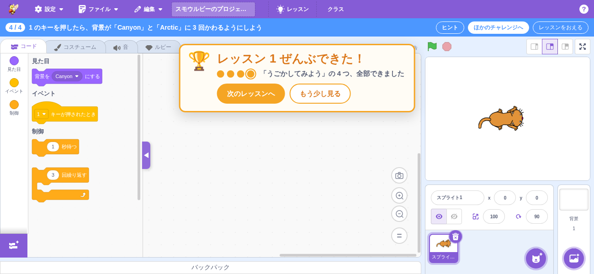

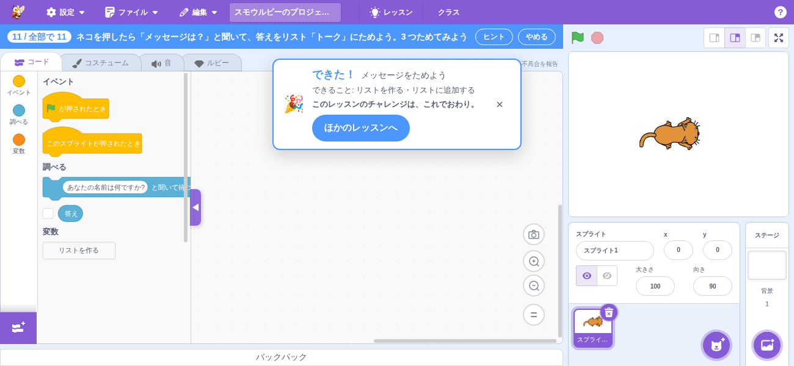

#### ふりかえりのクイズ

チャレンジの定義に `quiz` があれば、「できた！」の表示の中（丸の行とボタンのあいだ）に **3 択のクイズ**を出す
（`components/lesson-completed-toast/lesson-completed-quiz.jsx`。方針は `design.md` の「ふりかえりのクイズ」）。
`quiz` の無いチャレンジは、これまでどおりクイズを出さない。

- 3 つの場面（`next` / `otherLessons` / `library`）でも「課題クリア！」でも同じように出す。
- 選ぶと、選んだ選択肢に ○（正解）／×（はずれ）を付け、「正解！」／「はずれ。もう一度選んでみよう」と解説を出す。
  **何度でも選び直せる**（正解のあとも）。選択肢の並びは定義のまま（混ぜない）。
- 選んだものは記録しない（「できた」の判定にも記録にも入れない）。答えなくても「次のチャレンジへ」などで先へ進める。
  別のチャレンジの「できた！」では選んだものを消す（`key` = チャレンジ id）。
- **見られるのは「できた！」が出ているあいだだけ**。「もう少し見る」で閉じたら、そのチャレンジではクイズをもう出さない
  （もう一度「できた」にすれば出る）。閉じるまでに生徒はクイズを見ている。
- **課題バーの全文をタップで開いても閉じない**。全文を開いているあいだだけ隠し（`lessonMode.completedHidden`。
  reducer の `hideCompleted` / `showCompleted`）、全文を閉じたら出し直す。toast は描いたまま `hidden` にするので、
  選んだ答えは残る。隠しているあいだは、課題バーから見て toast は出ていない扱い（`toastVisible` が false）。
  閉じる・チャレンジを開き直す・もう一度「できた」になると、隠したのは解ける。クイズの無い「できた！」は、全文を
  開くとこれまでどおり閉じる。
- 読み上げ: クイズは `role="radiogroup"`（問いを `aria-labelledby`）、選択肢は `role="radio"` + `aria-checked`。
  結果の文の前に選んだ番号を付ける（「3: はずれ。もう一度選んでみよう」）ので、はずれを続けて選んでも字が変わって
  読み上げられる。live region は toast の `role="status"` だけ（クイズの中には置かない）。
- 文言は、クイズの部品の言葉（`gui.lessons.completed.quizLabel` / `quizCorrect` / `quizWrong`）と、チャレンジごとの
  問い・選択肢・解説（上の「チャレンジ」の message id）。どれも en / ja / ja-Hira にそろえる（ja-Hira は漢字なし）。
- クイズがあるときは toast の幅を 560px に決める（選んで解説が出ても横幅が変わらない）。**文言の長さの目安**は
  問い 2 行・選択肢 1 行・解説 3 行（ja で問い 50 字・選択肢 20 字・解説 75 字くらいまで）。この長さで 1300×600 の
  画面に収まる（解説まで出して toast の下の端が 560px くらい）。目安を超えたときだけ、画面の外に出さずに toast の
  中をスクロールする（保険）。

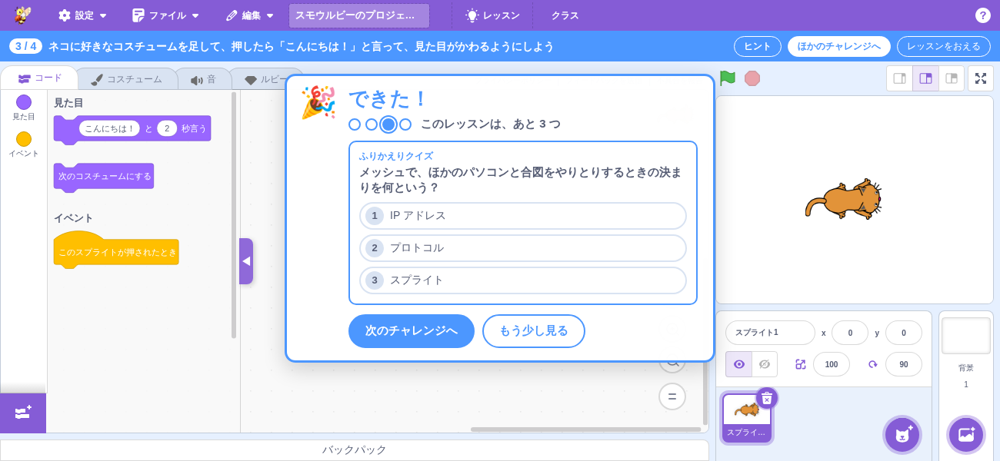

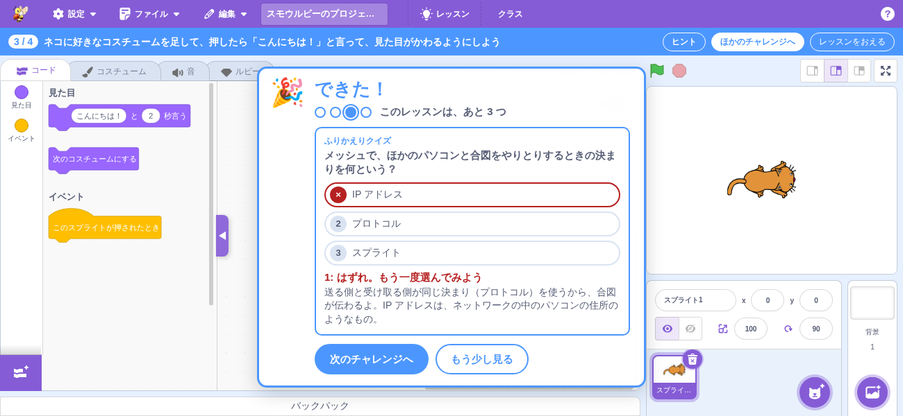

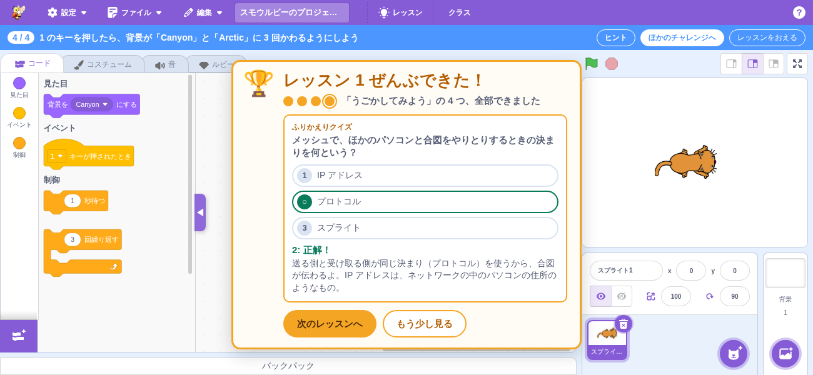

デバッグ・テスト用に `window.smalruby.lessonGoal` を出している（integration テスト
`test/integration/lesson-goal.test.js` と pw-check が使う。レッスン表・レッスンモードの UI ができるまでの入口）:

| 関数 | 説明 |
|------|------|
| `attach(goal, onSatisfied)` | チャレンジを開かずに、いまの VM に goal をつないで試す。見張りをやめる関数を返す |
| `evaluateGoal` / `validateGoal` | goal.js の関数そのもの |
| `openChallenge(id)` / `closeLesson()` | チャレンジを開く / レッスンモードを抜ける（Redux の action） |
| `markCompleted(id)` | 「できた」にする（記録 + 「できた！」） |

## メッシュの練習相手

> 方針は [design.md の「メッシュの練習相手」](design.md#メッシュの練習相手)。ここは定義の形と動き方。

メッシュのチャレンジをひとりでもできるように、チャレンジの `partner` に相手を**データだけ**で書く。チャレンジごとに
コードは書かない。

```js
partner: {
    name: 'ロボ',
    buttons: [
        // パネルのボタン。押すと set → broadcast の順に起きる
        { label: 'あいさつする', set: { variable: 'へんじ', value: 'こんにちは' }, broadcast: 'へんじ' },
    ],
    replies: [
        // 自動の返事。生徒の作品が onBroadcast の合図を送ったら、少しあと（0.5 秒）に set → broadcast
        { onBroadcast: 'メッセージ', set: [{ variable: 'へんじ', value: 'やあ' }], broadcast: 'へんじ' },
    ],
}
```

- `set` は共有する変数を変える `{ variable, value }`（複数なら配列）。`broadcast` / `onBroadcast` は合図の名前
  （大文字小文字は区別しない）。`name` / `label` / `variable` / `broadcast` / `onBroadcast` は、作品の中の名前が
  locale で変わるときは `code` と同じく `{ja, 'ja-Hira', en}` でも書ける。
- アクティビティ図（相手のスイムレーン）も同じ定義から描く。

### 動き方（ブラウザの中で折り返す・scratch-vm は変えない）

`lib/lessons/practice-loopback.js` が、メッシュの拡張の受け取り口に、相手の分を入れる。サーバーには何も出さない。

| 向き | 本物のメッシュ | 練習相手 |
|---|---|---|
| 相手の変数 → 生徒 | ほかのノードの値を `meshService.remoteData[ノード]` に入れ、「〜のセンサー値」が読む | 同じ置き場の `remoteData['smalruby-lesson-practice-partner']` に入れる |
| 相手の合図 → 生徒 | 「〜を受け取ったとき」のハットを動かす（作品にその合図が無ければ何もしない） | 同じ（`runtime.startHats`） |
| 生徒の合図 → 相手 | サーバーへ送る | 「〜を送る」「〜を送って待つ」が動いたのを `vm-execution-hook.js` で見て、自動の返事を返す |
| 生徒の変数 | 自分のノードの値として `remoteData[自分]` にも入れる（自分の変数の「〜のセンサー値」も読める） | 同じ（ブロックで変えたときに入れる） |

- 「できた」の判定（`goal`）は変えない。相手の合図で動いたスクリプトは、本物のメッシュで受け取ったときと同じ事実
  （「〜を受け取ったとき」から始まった）として数える。どちらも届いた合図の送り手は記録しないので、メッシュの合図を
  受け取るスクリプトの条件に `sentBy` を使わない（design.md の「メッシュの練習相手」）。
- 自動の返事は、同じ合図の返事が待っているあいだは新しく積まない（本物のメッシュの `fireEvent` が、まだ送っていない
  同じ合図をまとめるのと同じ）。「ずっと『メッセージ』を送る」でも、返事は 0.5 秒ごとに 1 回まで。待っている返事は
  合図の名前ごとに 1 つで、全部で 100 まで（本物のメッシュの送るキューの上限と同じ）。
- **本物のメッシュでつながっている・つなごうとしているあいだは何もしない**（`practiceAllowed`）。つながるとパネルを
  閉じ、切れたら小さな「練習相手」のボタンを出す（自分で開き直す）。
  - メッシュの拡張は「つないでいる途中」になったことを知らせないので、折り返しは毎フレームの最初（`BEFORE_STEP`。
    スクリプトが動く前）に接続のようすを見て、つなぎ始めていたら入れた値をその場で消す。そのあとに押されたボタン・
    発火した返事のタイマーは何もしない。
- パネルを閉じる・チャレンジを変える・レッスンを出ると、折り返しを外し、入れた値を `remoteData` から消す
  （あとから本物のメッシュが入れた値は消さない）。自分の変数の値は、書いたときのノード ID から消す（つながっていない
  あいだにも出席番号で `meshId` が変わるため）。
- × で閉じると「練習相手」のボタンへ、開き直すと最初のボタンへフォーカスを移す（チャレンジを開いたときは動かさない）。
- チャレンジを開くとパネルは開いた状態で出る（本物のメッシュでつながっていれば出さない）。
- 置き場所はコードエリアの右上（ステージの列のすぐ左。`stage_stage-wrapper_` の位置から測り、window の resize と
  ステージの列の大きさの変化で測り直す）。ステージの列は動かさない。

### data-testid（練習相手）

| data-testid | 要素 | 説明 |
|------------|------|------|
| `lesson-practice-partner` | section | 練習相手のパネル（開いているときだけある） |
| `lesson-practice-partner-name` | span | 「練習相手: 名前」 |
| `lesson-practice-partner-button` | button | 相手のボタン（`data-index` = 定義の何番目か） |
| `lesson-practice-partner-note` | p | 「ペアでやるときは、閉じて本物のメッシュでつなごう。」 |
| `lesson-practice-partner-close` | button | パネルを閉じる（本物のメッシュに切りかえる） |
| `lesson-practice-partner-open` | button | 閉じたあとの小さな「練習相手」ボタン（押すとパネルをもう一度出す） |

### スクリーンショット（練習相手）

コースにはまだ練習相手のあるチャレンジが無いので、チャレンジ 9 に仮の `partner` を実行時に足して撮った。

| ファイル | 説明 |
|---------|------|
| `screenshots/0601-practice-partner-1300x600.png` | 1300×600 で、パネルの「あいさつする」を押し、ネコが相手の変数（センサー値）を言ったところ |
| `screenshots/0602-practice-partner-closed-1300x600.png` | パネルを閉じたところ（小さな「練習相手」のボタンだけ残る） |

## 状態（Redux）

`packages/scratch-gui/src/reducers/lesson-mode.js`（`state.scratchGui.lessonMode`）。

| 項目 | 説明 |
|------|------|
| `courseId` / `lessonId` / `challengeId` | いま開いているチャレンジ。`challengeId` が null ならレッスンモードではない |
| `pendingChallengeId` | 開こうとしているチャレンジ（新しい作品ができるまでの間だけ入る。下の「レッスンモード」） |
| `hintVisible` / `hintIndex` | ヒントの吹き出しを出しているか・何番めのヒントか（チャレンジを開く・閉じるたびに最初にもどる。開いたときはヒントがあれば出す） |
| `hintSession` | チャレンジを開いた回数（`openChallenge` のたびに増える。同じチャレンジを開き直しても増える）。吹き出しの `key` にして、開き直したらドラッグした位置・確認・入れられなかったわけを持ち越さない（吹き出しは開いたまま次のチャレンジに移ることがあり、そのときは作り直されないため） |
| `hintSpotlight` | はじめて開いたチャレンジか（`spotlight` のヒントで周りを暗くする）。`openChallenge` で `smalruby:lessonSpotlightSeen` を見て決め、同時に「見た」と記録する |
| `progress` | 記録の写し（起動時に localStorage から読む） |
| `justCompletedId` | 「できた！」を出しているチャレンジ id（null なら出していない） |
| `libraryFocusChallengeId` | レッスン表を開いたときに見せるチャレンジ（「次のチャレンジ」で開いたとき）。レッスン表はこれから見せるレッスンと次のチャレンジを決める（`lessonsLibraryFocus`）。レッスンを閉じても消さず、レッスン表が閉じるときに消す |

| action / selector | 説明 |
|------|------|
| `startChallenge(challengeId)` | **チャレンジを開く入口**（レッスン表が呼ぶ）。新しい作品 → setup → `openChallenge` の順にコンテナが進める（知らない id は無視）。日本語モードのときは、作品の置きかえが決まってから、ふりがなモードに戻す（日本語モードのパレットの絞り込みとチャレンジの絞り込みが重なってブロックが出なくなるため。置きかえを断ったときは変えない） |
| `cancelStartChallenge()` | 開こうとしていたチャレンジを取り消す（「保存しますか」で取りやめたとき） |
| `openChallenge(challengeId)` | レッスンモードに入る（作品の準備は済んでいる前提。知らない id は無視）。「できた！」は消す |
| `closeLesson()` | レッスンモードを抜ける（記録は残す） |
| `showHint()` / `hideHint()` / `nextHint()` / `prevHint()` | ヒントの吹き出しの出し入れと「進める・もどる」（ヒントが無いチャレンジでは出ない。両端で止まる）。`hideHint` はページを保つ |
| `finishHint()` | 「おわり」で閉じる（次に開くときは 1 ページ目から） |
| `markChallengeCompleted(challengeId, completedAt?)` | 「できた」にして localStorage にも書く。書く前に localStorage の最新と合わせる（別のタブが書いた分を消さない）。`justCompletedId` をそのチャレンジにする（すでにできていても）。いま開いているチャレンジなら、ヒントの吹き出しを閉じる（ページは保つ） |
| `dismissCompleted()` | 「できた！」を閉じる |
| `focusLessonsLibrary(challengeId)` / `clearLessonsLibraryFocus()` | レッスン表で見せるチャレンジを入れる / 消す（知らない id は無視）。開くのは modals の `openLessonsLibrary`。2 つをまとめて出すのは `openLessonsLibraryAt(dispatch, challengeId)` |
| `reloadProgress()` | localStorage の最新を写しに取り込む（別のタブが書いた分を、レッスン表を開くときなどに反映する。書かない） |
| `isLessonMode(state)` / `getCurrentChallenge(state)` | レッスンモードか / `{course, lesson, challenge}` |
| `getLessonDnclModeAllowed(state)` | Ruby タブを日本語モードに切りかえてよいか（レッスンモードでなければ true、レッスンモードならいまのレッスンの `allowDnclMode`）。`containers/ruby-tab.jsx` が読んで「日本語」ボタンを押せなくする |
| `getLessonAllowedBlocks(state)` | パレットに出すブロック（チャレンジの `allowedBlocks`。無ければ null）。Blocks コンテナがチュートリアルの `tutorialAllowedBlocks` より優先して使う |
| `getCurrentHint(state)` | `{visible, index, count, step, spotlight, lastResort, debug, code, session}`（レッスンモードでなければ null）。`count` は最後の手段のページを含む。`step` はいまのヒント（最後の手段のページでは null）、`spotlight` はこのページで周りを暗くするか、`lastResort` は最後の手段のページか。吹き出しのコンテナ（`containers/lesson-hint.jsx`）はこれを読む |

## レッスン表

メニューバーの「レッスン」ボタン（upstream の「チュートリアル」ボタンがあった場所）を押すと開くモーダル
（`components/lessons-library/`。フルスクリーン）。SP / iPad の `MobileGui` ではドロワーの「レッスン」から開く。

見た目はスモウルビーの「スプライトを選ぶ」画面（`components/library/`）や Scratch の「チュートリアルを選ぶ」
画面に近い形にそろえる（児童・生徒が見慣れているため）。部品も同じもの（`Filter` / `Divider` / `TagButton`）を使う。


- **上の帯**: 紫のヘッダー（← 戻る ／ 「レッスンを選ぶ」）、その下の薄い紫の帯に**検索ボックス** ＋ 区切り ＋
  **言語のボタン**（選んでいるものはオレンジ・`aria-pressed`）。言語のボタンは**コースがある言語だけ**出す
  （いまは「ブロック」だけ。Ruby・日本語のコースができたら自然に出る。`libraryLanguages`）。
  帯は 1 行に収め、はみ出すボタンは横にスクロールする（SP）。
- **コースのボタン（増えたとき）**: 1 ページに縦に並べる。いま選んでいる言語のコースが **4 つを超えたら**、帯の
  2 段目にコースのボタン（押すとそのコースまでスクロール）を出す（`showCourseNav` / `COURSE_NAV_THRESHOLD`。
  いまは 1 コースなので出ない）。
- **コース** = 大きい見出し。右に**プログレスバー**と「**5 / 11**」（コース全体のできた数 / 全部の数。
  `courseProgress`）。コースのチャレンジが**全部できたら名前の前に ✓**。
- **レッスン** = コースの中の小さい見出し（「レッスン 1」＋ 名前）。
- **チャレンジ** = カード（左にブロックの色の帯 ＋ 右に名前。白地で横長・背が低い）。できたら右上に ✓。
  1300×600 で 4 列、SP 横で 3 列、SP 縦で 2 列。授業のパソコン（1300×600）では 3 つのレッスンの 11 枚が
  スクロールなしで見える。押すと `startChallenge(id)` を呼んでレッスン表を閉じ、レッスンモードに入る
  （作品を置きかえる確認を含む）。カードの絵（イラスト・絵文字）は使わない（描き続けるのが難しいため。`design.md` の「カード」）。
- **カードの色**: そのチャレンジで多く使うブロックのなかまの色（`card.category`。なかまの名前は帯の `aria-label`）。
  決め方（`design.md` の「カード」）:
  - 「プログラムを入れる」で入るできあがりのプログラム（`code` と `spriteCodes`、ja）をブロックにして、
    形のあるブロック（帽子・値のブロックを含む。shadow は数えない）をなかまごとに数える。なかまは opcode の
    接頭辞（`data_` は名前に `list` があればリスト、無ければ変数。分からない接頭辞は拡張機能）。
  - いちばん多いなかま。同じ数で並んだら `card.main`。
  - 色はいまの色のモード（`lib/settings/color-mode`）のブロックの色（`colourPrimary`。ダークはブロックの地がほぼ黒でなかまの色が縁に出るので、縁の `colourTertiary`）。拡張機能は拡張の緑（`pen`）。

  数えるのは重い（Ruby → ブロックの変換）ので実行時にはせず、結果を `card.category` に書いておく。
  決め方どおりかは `test/unit/lib/lessons/card-color.test.js` が本物の `RubyToBlocksConverter` で数えて確かめる
  （チャレンジを足したり中身を変えたりして外れたら落ちる）。判定は `lib/lessons/card-color.js`（純粋関数）。
  いまの 11 枚:

  | チャレンジ | 数 | 色 |
  |---|---|---|
  | key-sound | サウンド 2・イベント 1 | サウンド |
  | arrow-move | 動き 2・イベント 2（同数） | 動き（メイン） |
  | click-say | 見た目 2・イベント 1 | 見た目 |
  | repeat | 制御 3・見た目 2・イベント 1 | 制御 |
  | if | 制御 2・見た目 2（同数）・調べる 1・イベント 1 | 制御（メイン） |
  | ask-answer | 調べる 4・見た目 2・演算 1・イベント 1 | 調べる |
  | quiz | 調べる 2・見た目 2（同数）・演算 1・制御 1・イベント 1 | 調べる（メイン） |
  | count | 変数 3・イベント 2・見た目 1 | 変数 |
  | broadcast | イベント 3・見た目 1 | イベント |
  | speak | 音声合成 1・イベント 1（同数） | 拡張機能（メイン） |
  | message-list | リスト 2・イベント 2・調べる 2（同数） | リスト（メイン） |
- **出さないもの**: 「クリア！」「プログラマー デビュー！」、必須のマーク・必須のバー、「できること」の一覧。
  （段 2 で先生が必須にしたときだけ、バーを「必須」と「そのほか」の 2 本にする予定。今は作らない）
- **検索**: チャレンジの名前（いまの locale の文言）の部分一致。前後の空白は無視し、大文字・小文字、全角・半角、カタカナ・ひらがなは
  区別しない（`normalizeQuery`）。合うチャレンジだけ出し、合うものが無いレッスン・コースは隠す。コースの
  バーと「n / m」は絞り込みで変えない。1 つも無いときは「『○○』に合うチャレンジはありません」。
  判定は `lib/lessons/library-filter.js` の `filterCourseStatuses`（純粋関数）。
- **記録の取り込み**: 開くたびに `reloadProgress()` を呼び、別のタブで書いた記録も反映する。
- **ほかのチャレンジへ → もどる**: レッスンモードの「ほかのチャレンジへ」は `closeLesson()` のあとレッスン表を開く（次のチャレンジを
  すぐ選べる）。
- **いまのレッスンを見せて開く**: 「できた！」の「次のチャレンジ」で開いたときは、いまのチャレンジから
  `lessonsLibraryFocus(challengeId, progress)`（`lesson-progress.js`）で見せるものを決める:
  - レッスンにまだできていないチャレンジがある: いまのレッスン。次は、いまの次から並び順にさがした
    まだできていないチャレンジ（最後まで行ったら先頭にもどる。いまのチャレンジは選ばない）。
  - 全部できていて、コースに次のレッスンがある: 次のレッスンの、まだできていない最初のチャレンジ。
  - 全部できていて、次のレッスンが無い（レッスン 3）: いまのレッスンを見せ、「次はこれ！」は付けない。

  そのレッスンの言語を選び、レッスンへスクロールして（`scrollIntoView`）薄い紫で囲み
  （`data-focused="true"`）、次のチャレンジのカードをオレンジの太い枠と右下の「次はこれ！」で目立たせる
  （`data-next="true"`・`lessons-library-challenge-next`）。メニューから開いたときは、どれも付けない。

  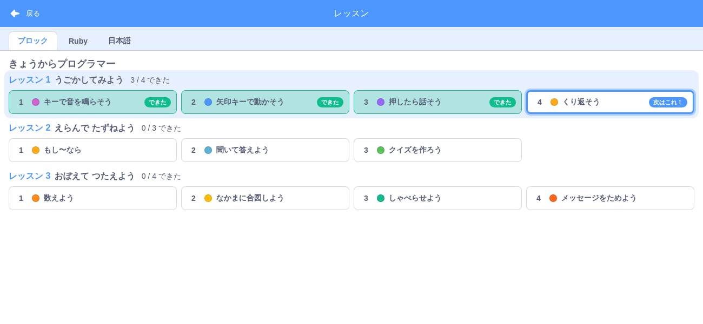
- **はじめての人向けの吹き出しは出さない**: 「レッスン」ボタンの下に吹き出しで誘うことはしない（どの端末でも）。
  レッスンに入る道は、メニューの「レッスン」（SP はドロワーの「レッスン」）と、段 2 のクラス管理との統合
  （課題にレッスンを紐付けたときだけ、クラスに参加して「はじめる」を選ぶとそのコースを開く）にする。
- **レッスンモードのあいだはウェルカムバルーンを出さない**（課題バーに重なるため）。ウェルカムバルーンの記録は
  変えないので、レッスンモードを抜ければ元どおり出る。判定は `menu-bar-hoc.jsx` の `isLessonMode(state)`
  （`lessonModeActive`）。

状態は `modals.lessonsLibrary`（`openLessonsLibrary` / `closeLessonsLibrary`）。コンテナは
`containers/lessons-library.jsx`（`gui.jsx` に常時マウントし、`modals.lessonsLibrary` が true の間だけ描く）。

| SP 横（667×375） | SP 縦（375×667） |
|---|---|
| 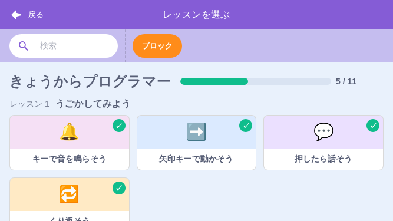 | 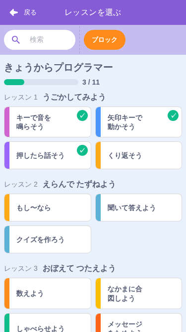 |

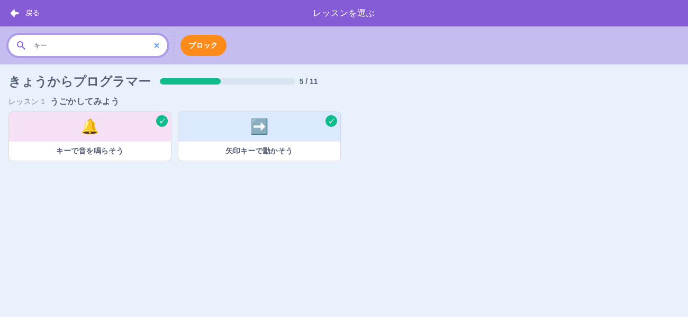

ひらがな表示で確かめるときは URL に `?locale=ja-Hira` を付ける（大文字・小文字は区別しない。`ja-hira` でもよい）。

### data-testid（レッスン表）

| data-testid | 要素 | 説明 |
|------------|------|------|
| `menu-bar-lessons` | div | メニューバーの「レッスン」ボタン |
| `mobile-drawer-lessons` | button | SP のドロワーの「レッスン」 |
| `lessons-library` | div | レッスン表の本文（開いているときだけある） |
| `lessons-library-search` | div | 検索ボックス（中の `input` に入力する。`button` は消すボタン） |
| `lessons-library-no-match` | p | 検索に合うチャレンジが無いときの文 |
| `lessons-library-tab-<blocks\|ruby\|dncl>` | button | 言語のボタン（コースがある言語だけ。`aria-pressed`） |
| `lessons-library-course-nav` | div | コースのボタンの段（コースが 4 つを超えたときだけ） |
| `lessons-library-course-nav-<courseId>` | button | コースのボタン（押すとそのコースまでスクロール） |
| `lessons-library-course-<courseId>` | section | コース |
| `lessons-library-course-done` | span | コース名の前の ✓（コースのチャレンジが全部できたときだけ） |
| `lessons-library-course-progress` | div | コースのプログレスバー（`role="progressbar"`）と数（課題のチャレンジだけのレッスン表では出さない） |
| `lessons-library-course-progress-text` | span | 「m / n」（コース全体） |
| `lessons-library-lesson-<lessonId>` | section | レッスン（`data-focused`） |
| `lessons-library-challenge-<challengeId>` | button | チャレンジのカード（`data-completed="true\|false"`・`data-next`） |
| `lessons-library-card-band` | span | カードの左の色の帯（`data-category` = なかま） |
| `lessons-library-challenge-done` | span | カードの右上の ✓ |
| `lessons-library-challenge-next` | span | 「次はこれ！」 |
| `lessons-library-challenge-required` | span | カードの右の ★（クラスの課題で先生が必須にしたチャレンジ・課題に参加しているときだけ）。カードにも `data-required` |
| `lesson-assignment-band` | div | クラスの課題の帯（課題に参加しているときだけ。`data-cleared`） |
| `lesson-assignment-band-name` / `lesson-assignment-band-condition` | span | 帯の課題名・条件（「条件: 全部（6 つ）」） |
| `lesson-assignment-dot` | span | クラスの画面の進み具合の丸 1 つ（`data-challenge-id` / `data-completed` / `data-required`）。課題の帯には出さない |
| `lesson-assignment-remaining` | span | 帯の文「あと N つ（★ R つ）で課題クリア」（小さな帯は「あと N つ（★ R つ）」。`data-count` = N・`data-required` = R）。クラスの画面では「あと n つで課題クリア」 |
| `lesson-assignment-required-remaining` | span | クラスの画面の進み具合の「★ あと n」 |
| `lesson-assignment-cleared` | span | 「✓ 課題クリア」 |
| `lesson-assignment-band-submit-guide` / `lesson-assignment-band-submit` | span / button | 作品も提出する課題で課題クリアのあと（または、この版に無いチャレンジがあるとき）の案内と「課題を提出する」。はじめて提出するまで |
| `lesson-assignment-band-unknown` | span | 「新しいレッスンがあります。ページを読み込み直してね」（この版のコースに無いチャレンジがあるとき） |
| `lesson-task-bar-assignment` | span | 課題バーの同じ行の小さな帯（課題のチャレンジのときだけ） |

## レッスンモード

チャレンジを開いたときの画面。ふだんのエディタはそのまま使い、次を足す。

- **新しい作品から始める**: `startChallenge(id)` → いまの作品に変更があればメニューの「新規」と同じ
  「保存しますか」の確認（取りやめると `cancelStartChallenge`）→ 新しい作品（Google Drive のファイルとの
  結び付きも切る）→ 作品ができたらチャレンジの setup を適用 → `openChallenge(id)`。
  この流れは `containers/lesson-mode.jsx` が進める（作成中 → 表示中の遷移で「できた」を検出する）。
- **setup**: `lib/lessons/challenge-setup.js` の `setupForChallenge(course, challenge)` が
  `lib/deck-setup.js` に渡す形を作る。コースの言語から既定（ブロック = コードタブ、Ruby = Ruby タブ・Ruby
  モード、DNCL = Ruby タブ・DNCL モード）を決め、チャレンジの `setup` で上書きする。
- **課題バー**（`components/lesson-task-bar/`）: メニューバーのすぐ下に、**画面の幅いっぱい**（エディタの列と
  ステージの列の両方の上）で 1 行・40px で出す（`gui.jsx` がメニューバーと本体のあいだに置き、本体は
  `.body-wrapper-with-lesson-task-bar` でその分だけ縮む）。
  「何個め / レッスンの中の数」（例: 「3 / 4」）・課題の 1 行（`task`。無ければチャレンジの名前）・ヒント・ほかのチャレンジへ・
  レッスンをおえる。課題の文が残りの幅を取るので、「ヒント」「ほかのチャレンジへ」「レッスンをおえる」は**画面の右端**に
  寄る（ステージの列の上）。
  ステージの列（旗・止める・ステージの大きさのボタン）は帯の下に 40px 下がり、そのまま押せる。
  課題バーが出る・消えるとき、`containers/lesson-mode.jsx` は window に `resize` を送る。ステージ
  （`containers/stage.jsx`）は canvas の位置を resize / scroll のときにしか測り直さないので、送らないと
  マウスの位置が課題バーの高さの分ずれ、「マウスのポインターに触れた」がネコに重ねても真にならない
  （ネコを押す操作は押すたびに測り直すので困らない）。ブロックの作業場所も同じ resize で高さを合わせ直す。
  1300×600 の授業のパソコンでは、エディタの列もステージの列も縦が 40px 減る。中サイズのステージ（既定）の
  ステージ（360×270）は小さくならず、スプライトの情報を 2 行に詰めて（`docs/sprite/README.md`）スプライトの
  一覧が隠れないようにし、右下のステージの列は見出し「ステージ」を出さずに背景の番号が「背景を選ぶ」ボタンと
  重ならないようにしている（`docs/stage/README.md`。ページはスクロールしない）。大きいステージ（480×360）を選んだときは、
  レッスンモードでなくても 600px の縦に収まらず、スプライトの情報の下が画面の外に出る（upstream の形のまま）。
  課題の文は長くてもバーを広げない（`width: 0`）。入りきらない分は
  … で切る（全文は下のパネルで読む）。課題の文の改行（下の「課題の全文」）は、バーの 1 行ではつなぐ
  （前後が両方とも半角なら空白でつなぎ、日本語は空白を入れない）。
  SP（MobileGui）にはステージの列が無いので、これまでどおり編集エリアの上（サイドレールの右）に出す
  （`mobile-gui.css` の 5b。バーの左に 56px の余白を取り、本体を 2.5rem 縮める）。
- **はじめての人向けの表示と重ねない**: ウェルカムバルーンはレッスンモードのあいだ
  出さない（抜けたら元どおり）。SP の「スマホ用の画面です」の案内（`MobileModeNotice`、画面の上に `fixed` で
  出る）は、レッスンモードに入ったら閉じて、閉じたことを記録する（一度きりの案内で、レッスンを始めた人は
  もう画面を使えているため。課題バーの下へずらすと、課題バーの下に出る全文パネル・ヒント・「できた！」と重なる）。
- **課題の全文**: 課題バーにマウスを乗せているあいだ、課題が短くても長くても、課題バーのすぐ下に全文を
  出す（バーから離れるとすぐ消える）。出すのは乗せてから 300ms たってから（`HOVER_DELAY_MS`。バーはタブと
  コードエリアのあいだにあるので、横切っただけでパネルがちらつかないように）。先生がプロジェクターに映して「今日の課題は〜です」と説明する場面を想定し、
  字は大きめ（`clamp(1rem, 1.8vw, 1.5rem)`。1300px 幅で約 23px、SP では 16px まで小さく）。課題の文は
  チャレンジの定義（`lessons.locale.js`）で読みやすいところに改行（`\n`）を入れておき、パネルでは
  その改行どおりに出す（`white-space: pre-line`）。チャレンジに `image` があれば、文の下に画像も出す
  （縦は 10rem まで）。
  - **SP・タッチ**: タッチでは乗せる操作が無いので、課題の文（`button`）のタップで開き、もう一度のタップで
    閉じる。開いているあいだは外（コードエリアも含む）を押す・Esc でも閉じる。キーボードでも課題の文に
    フォーカスして Enter で開閉できる。乗せて出すのはポインタの種類が `mouse` のときだけ（タッチでも
    `pointerover` が来るため）で、マウスで課題の文を押しても開いたままにはしない（離せば消える）。
  - **パネルの置き方**: `position: absolute` でバーの下に、バーと同じ幅（画面の幅）で重ねるので、エディタの列・
    ステージの列の幅も高さも変えない（ステージは押し出さない）。マウスで出しているときは `pointer-events: none`（パネルの上へ動かしても
    バーから離れたことになり消える）、タップで開いたときだけ中をスクロールできる。
  - **ヒントの吹き出しが出ていても、マウスを乗せれば全文を出す**: チャレンジを始めるとヒントが自動で開くので、
    吹き出しが出ているあいだ止めると、先生がプロジェクターで課題を説明する前にまず吹き出しを閉じる操作が要る。
    乗せて出す全文は一時的なものなので、吹き出しの状態（ページ・ドラッグした位置）は変えずに、パネルを吹き出しの
    上に重ねる（z-index は `$z-index-menu-bar` = 491。吹き出しの 490 より上。メニューバーと同じ層で DOM では
    後ろにあるので、メニューバーのメニュー（ファイルなど）が開いているあいだは乗せても出さない）。バーの「ヒント」を押して吹き出しを出したときは、乗せたままでもパネルを引っ込める（出したばかりの
    吹き出しを隠さない。乗せ直せばまた出る）。
  - **「できた！」・タップで開いたパネルは重ねない**: 「できた！」の toast が出ているあいだは、乗せても全文を
    出さない。タップで開いたまま（pinned）のパネルは、吹き出し・toast のどちらかが出ると閉じ、タップで開くと
    その 2 つを閉じる（z-index は 470。toast の 480・吹き出しの 490 より下）。ただし**クイズのある「できた！」は
    閉じずに隠す**（`hideCompleted`。toast は描いたまま `hidden`）。全文のパネルが閉じたら（タップ・外を押す・Esc・
    吹き出しが出る、のどれでも。課題バーの `onCloseFullText`）、`showCompleted` で出し直す（下の「ふりかえりのクイズ」）。

  

  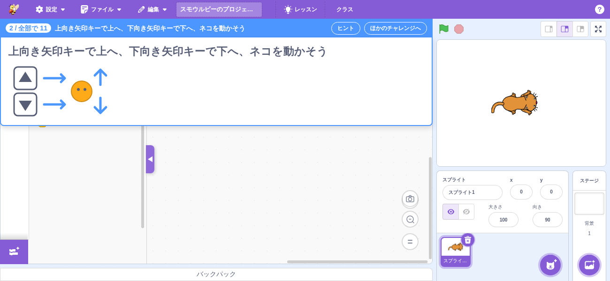
- **チャレンジの画像**（`image`。任意）: `{src, alt}`。`src` は `src/lib/lessons/images/` に置いた画像を
  `courses.js` で import した URL（webpack の asset。チュートリアルの deck の画像
  `src/lib/libraries/decks/steps/` と同じ扱いで、バンドルに入るので file:// の integration テストでもそのまま
  読める）。`alt` は message descriptor（`gui.lessons.challenge.<id>.image`）。画像の文字は言語で変わるので、
  画像の中には字を入れない（言葉は課題の文と `alt` に書く）。例: チャレンジ 2「矢印キーで動かそう」の
  `images/arrow-keys.svg`（上・下の矢印キーとネコの動く向き）。
- **パレットを絞る**: チャレンジの `allowedBlocks`（deck と同じ形）。Blocks コンテナの `tutorialAllowedBlocks`
  にレッスンの分を優先して渡すので、仕組みはチュートリアルと同じ（`allowedBlocks` が null なら絞らない）。
  - **「変数」「ブロック定義」も絞る**: この 2 つは scratch-blocks が flyout を開くたびに中身を作る動的カテゴリ
    （toolbox XML では `custom="VARIABLE"` / `custom="PROCEDURE"` の空の category）なので、ふつうのカテゴリの
    絞り込み（`only_blocks`）が効かない。`allowedBlocks` があるときは `src/lib/lesson-dynamic-categories.js` で
    次のように決める（チュートリアルのカードの `allowedBlocks` にも同じように効く）。
    - カテゴリを出すか: そのカテゴリの opcode（`data_*` / `procedures_*`）が `allowedBlocks` に 1 つも無ければ
      出さない（`make-toolbox-xml.js` の最後の引数。Smalruby マーカー `lesson dynamic category filtering`）。
    - 中身: `allowedBlocks` にあるブロックだけ（`blocks.jsx` で登録するカテゴリのコールバックで絞る）。
      「変数を作る」は変数のブロック（`data_variable` など）が、「リストを作る」はリストのブロック
      （`data_addtolist` など）が、「ブロックを作る」は `procedures_*` が 1 つでもあれば出す。
      変数・リストのレポーター（`data_variable` / `data_listcontents`）も同じ条件で出す。モニターの
      チェックボックスを持ち、作った変数・リストをステージに出すのはこのチェックボックスなので、
      残さないと「リストを作る」で作ったリストの箱がステージに出ない。
    - 変数を使うチャレンジ・チュートリアルは、`allowedBlocks` に `data: [...]`（ブロック定義なら
      `procedures: [...]`）を書く。キー名は自由（中の opcode だけを見る）。チャットのチュートリアルと
      Ruby の基本 3・4・6 には書いてある。deck とチャレンジのプログラム（`code`・ヒントのブロック）が使う
      変数・リスト・ブロック定義の opcode が `allowedBlocks` に入っているかは
      `test/unit/lib/lesson-dynamic-categories-decks.test.js` が Ruby をブロックに変換して確かめる。
    - `?only_blocks=`・ステージのコメント・ブロックの選択（`selectedBlocks`）で絞るときは、これまでどおり
      2 つとも出る。
- **パレットのブロックの初期値**: `allowedBlocks` の項目は opcode の文字列のほかに
  `{opcode, fields: {名前: 値}, inputs: {名前: 値}}` と書ける。仕様のパレットの表記（`[1 ▼]`・`(3)`）の初期値を
  ここに書く（`src/lib/lessons/block-defaults.js`。Blocks コンテナがツールボックスの XML と「変数」「ブロック
  定義」の flyout に入れる。チュートリアルのカードの `allowedBlocks` にも効く）。
  - `fields` はブロックそのもののフィールド（「キーが押されたとき」の `KEY_OPTION` など。ツールボックスの XML に
    書いていないフィールドは足す）。`inputs` は入力の影のフィールド（数・文字・音や背景のメニュー）。影の無い
    入力（「もし」の六角形の穴など）には入れられない。
  - 値は文字列・数か、locale ごとの `{ja, 'ja-Hira', en}`（`code` と同じ選び方。無い locale は en → ja）。作品の
    中の名前（ネコの音「ニャー」/ "Meow"）は作品を作った locale で変わるので locale ごとに書く。▼ に無い名前
    （足す前の背景「Canyon」など）も、そのまま ▼ に出る。
  - 書かないブロックはツールボックスの初期値のまま。メッセージ（「あいさつ」）・変数（「回数」）・リスト
    （「トーク」）の ▼ は子どもが作るものなので書かない（無い名前を入れると flyout が作ってしまう）。
  - レッスン 1 で書いている初期値: 1 = キー「スペース」・音 2 つとも「ニャー」（Owl を足したあとも）、
    2 = キー「上向き矢印」、3・6・8 = 言う「こんにちは！」（en "Hello!"。ツールボックスの初期値は半角の
    「こんにちは!」なので書く）、4 = キー「1」・繰り返す 3・背景「Canyon」、5 = 言う「くすぐったい！」、
    6 = 聞く「なまえは？」、7 = 聞く「4+3=?」・`=` の右 7・言う「正解です」、9 = 言う「やあ！」、
    10 = しゃべる「ボタンが押されました」、11 = 聞く「メッセージは？」。ほか（「(1) 秒待つ」、変数の 0・1、
    「なにか」を追加など）はツールボックスの初期値が仕様と同じ。
    初期値で済むようになったヒント（▼で「上向き矢印」をえらぶ・「こんにちは！」と書く・「なまえは？」と書く・
    右に 7 を入れる・ことばを書く）は、「なっているか見よう」「のままでいいよ」の文言にしている。
- **ヒント**: チャレンジを始めると（`openChallenge`）ヒントの 1 ページ目が**自動で開く**（ヒントボタンに
  気づかない子でも、何から始めるかがわかるように）。閉じたあとは「ヒント」ボタンで `showHint` / `hideHint`。
  吹き出し（下の「ヒントの吹き出し」）は `containers/lesson-mode.jsx` の `<LessonTaskBar>` の次に置いた
  `containers/lesson-hint.jsx` が出す。ヒントが無いチャレンジでは自動で開かず、ボタンも無効。
  自動で開くのはレッスンモードに入ったあとなので、「保存しますか」の確認・レッスン表とは重ならない。
  ウェルカムバルーンはレッスンモードのあいだ出さず、SP の「スマホ用の画面です」の案内は
  閉じる（上の「はじめての人向けの表示と重ねない」）。SP 縦の「横向きにしてください」は吹き出しより上に出て、
  「このまま使う」で閉じると吹き出しが見える。スポットライトは 1 ページ目が `spotlight` のときだけ（レッスン 1 の
  1 ページ目はどれも照らさない）。
- **ほかのチャレンジへ**（いまのチャレンジを終える）: `closeLesson()` のあとレッスン表を開く。課題バーが消え、パレットが元にもどる（作品はそのまま）。
- **レッスンをおえる**（課題バーの右端）: `closeLesson()` だけ（レッスン表は開かない・確認も出さない）。課題バー・
  ヒント・「できた！」が消え、`getLessonAllowedBlocks` が null になってパレットは全部のブロックにもどる。作品
  （プログラム）はそのまま残る（チャレンジは毎回新しい作品から始めるので、残しても前の作品とまざらない）。
  レッスンにもどるのはメニューの「レッスン」から。「ほかのチャレンジへ」（白地）より目立たせない（透明地に白い枠）。
- **いまのチュートリアル（カード）との関係**: 両方が同時に開くと、カードの `allowedBlocks` / setup と
  レッスンのものが食い違うので、どちらか一方だけにする。チャレンジを開くときは開いていたカードを閉じ
  （`closeCards`）、レッスンモード中に「?」メニューなどからチュートリアルを開く（`activateDeck`）と
  レッスンモードを抜ける（開こうとしていたチャレンジも取り消す）。

レッスン表のほかに、コンテナがマウント中は `window.smalruby.startChallenge(id)` で
`startChallenge` を呼べる（Playwright / Selenium から使う）。URL パラメータは作らない。

### ヒントの吹き出し

`components/lesson-hint/`（見た目）と `containers/lesson-hint.jsx`（状態と変換）。`document.body` に portal で出すので、
エディタの列のレイアウトには影響しない。

- **見た目の土台は共通の吹き出し**（`components/balloon/`）: 枠・角丸・影・しっぽ・ヘッダー（色の帯 + 閉じる）・
  もどる / 進めるのボタン・色と文字のトークンは、ほかの吹き出し（「レッスン」ボタンの下の案内・ウェルカムバルーン）と
  同じ部品を使う（下の「吹き出しの共通の土台」）。ヒントの吹き出しが持つのは置き方・スポットライト・本物のブロック・
  最後の手段の中身だけ。

- **本物のブロックを描く**: ヒントの `blocks`（Ruby）を、いまの `code` と同じ Ruby → ブロック変換
  （`lib/ruby-to-blocks-converter`）でブロックにし、VM の target には入れずに Blockly の XML
  （`lib/lessons/blocks-xml.js`。scratch-vm の `Blocks#toXML` と同じ形）にして、吹き出しの中の
  **scratch-blocks の読み取り専用ワークスペース**（`lesson-hint-blocks.jsx`。`inject` に `readOnly: true`、
  エディタより大きい 0.8 倍。吹き出しの幅より広いかたまりは、右が切れないように幅に合わせて縮める）に描く。
  スクリーンショットは使わない。言語・色のモードはエディタと同じ
  （Blocks コンテナが Redux に置いた ScratchBlocks を使う）。inject は main workspace を差し替えるので、
  描いたあとにエディタのワークスペースを `setMainWorkspace` で戻す。変換した XML は Ruby ごとに覚える。
  変換できない Ruby は「（このブロックは描けませんでした）」を出す（文言は出る）。`blocks` が locale ごとの
  オブジェクトなら、いまの UI の locale のものを描く（`localizeCode`）。
  条件の穴に入った `false` は空の穴として描く（`if false` = 「もし <  > なら」）。これは Ruby → ブロック変換
  そのものの決まり（ブロック → Ruby が空の穴を `false` と書くのに合わせて、条件の穴の `false` は空の穴になる。
  `docs/smalruby-language-spec.ja.md` の「リテラル」）なので、ヒント側で手を加えない。
- **指す場所**: `target` の場所を DOM から探し（`lib/lessons/hint-targets.js` の `findHintTargetRect`。
  Smalruby の部品は data-testid（SP のサイドレール `mobile-side-rail-*`・拡張機能のボタン `extension-button`）、
  upstream の部品は data-testid を持たないので CSS Modules のクラス名の接頭辞 `<css ファイル名>_<クラス名>_`
  — `blocks_blocks_`・`gui_tab_`（タブは並び順で選ぶ）・`stage_stage-wrapper_`・`sprite-selector_sprite-selector_`・
  `stage-selector_stage-selector_`・`green-flag_green-flag_` — で探す）、そのそばに出す（`computeHintPlacement`）。
  **upstream がクラス名を変えると静かに壊れる**（見つからず画面の真ん中に出る）ので、使っている接頭辞と
  そのクラスが css に残っていることを `test/unit/lib/lessons/hint-targets.test.js` が見張る（upstream マージで
  落ちたら接頭辞を直す）。置く側は場所ごとに決めてある（パレット = 右、
  ステージ・スプライトリスト・背景 = 左、タブ・旗 = 下、…）。画面幅で収まらないときは下（→ 上）にずらし、
  それも収まらなければ指す場所の中に置く。場所が無い（`keyboard`）・いまのタブに無いときは画面の真ん中。
  タブの切り替えで場所が現れたり消えたりするので、resize のほかに短い間隔（300ms）でも測り直す。
- **スポットライト**: `spotlight: true` のヒントで、かつ `hintSpotlight`（はじめて開いたチャレンジ）のときだけ、
  指す場所の矩形に穴を開けた巨大な box-shadow で周りを暗くする。`pointer-events: none` なので、照らした
  パレットやステージはそのまま操作できる（ドラッグ中のブロックは吹き出しより上を通る）。
- **進める・もどる・閉じる**: `nextHint` / `prevHint` / `hideHint`。最初で「もどる」が無効。最後のページは
  そのあとが無いので、「進める」の代わりに **「おわり」**（`lesson-hint-finish`。押すと閉じる）を出す。
- **開き直したときのページ**: 閉じ方で変える。
  - **×（閉じる・`hideHint`）**: 同じページから。読みかけを一度よけただけなので。
  - **「おわり」（`finishHint`）**: 1 ページ目から。最後まで読んだので、次に「ヒント」を押したときに最後のページ
    （うまく動かないときは）がまた出ると、何をすればよいかわかりにくいため。
  - **できたとき（`markChallengeCompleted` がいま開いているチャレンジ）**: 吹き出しを自動で閉じる。できたあとは
    ヒントの役目が終わり、「できた！」（の「次のチャレンジ」）を吹き出しで隠さないため（1300×600 でも角が重なりうる・
    動かしていると隠しうる）。ページは × と同じくそのまま（課題バーの「ヒント」で開き直すと同じページ。読みかけの
    ページを見直したいときにそのまま戻れるように）。別のチャレンジの「できた」では閉じない。
- **ドラッグで動かす**: 吹き出しのヘッダー（色の帯。`lesson-hint-drag-handle`）をドラッグすると動かせる。
  Pointer Events なのでマウスとタッチの両方で動き、帯は `touch-action: none`（タッチのドラッグをスクロールにとられない）。
  閉じるボタンを押したときはドラッグを始めない。押しただけの手ぶれ（4px 未満）では動かさない（しっぽが消えないように）。
  ボタンを離したのに `pointerup` が来なかったとき（窓の外で離した等）は、次のボタンを押していない `pointermove` で終える。動かした位置は画面の内側に収める（`clampHintPosition`。端から 8px。
  ページが変わって大きさが変わったとき・画面の大きさが変わったときも収め直す）。
  - **ページを進めても動かした位置を保つ**: じゃまだから動かしたのに、次のページで元の場所（同じじゃまな場所）に
    戻ってくると、ページのたびに動かし直すことになるため。吹き出しを閉じて開き直すと、元の置き方（指す場所のそば）に戻る。
    チャレンジを開き直したとき（同じチャレンジでも）も元の置き方に戻る（`hintSession`）。
  - **動かしたあとはしっぽ（場所を指す三角）を出さない**: 指す場所から離れたしっぽは、違う場所を指して見えるため。
    スポットライト（周りを暗くして場所を照らす）は吹き出しの位置と関係なく指す場所を照らし続ける（場所はそれでわかる）。
    動かしたかは `lesson-hint` の `data-dragged="true|false"`。
  - **SP のサイドレールの右に置く**: サイドレール（`mobile-side-rail`。z-index 9200）は吹き出し（490）より上の層なので、
    吹き出しの置き方・ドラッグの範囲はレールの右からにする（`hintViewport`）。レールの下に吹き出しの左側が
    隠れて、取っ手や「もどる」を押せなくなるのを防ぐ。
- **最後の手段**: 最後のページは「うまく動かないときは」（`debug` の箇条書き）と**「正解のプログラムを確認する」**
  （`code`。`lesson-hint-insert-code`）。「プログラムを入れる」では、なぜあるのか生徒にわからなかったため。押すと
  吹き出しの中に確認（`lesson-hint-insert-code-confirm`）「正解のプログラムで置き換えますか？あなたが作成したプログラムは
  消えます。」［いいえ］［はい］を出す（`window.confirm` は使わない。アプリの外の見た目になり、子どもには何のダイアログか
  わかりにくいため）。**いいえ**では何も変えずにボタンにもどる。**はい**で正解のプログラムを入れる（下の動き。この
  ドキュメントで「プログラムを入れる」と書くのはこの動き）。ページを変えると確認は消える。
  プログラムを入れる動きはチュートリアルのカードの `insertCodeButton` と同じ仕組み
  （`updateRubyCode(code)` → ブロックのコースではコードタブ、Ruby / DNCL のコースでは Ruby タブを出す。
  コードタブでは Ruby タブが変換してブロックにする）。チャレンジの `codeTarget` が `'stage'` なら、入れる前に
  ステージをえらび、Ruby タブの相手（`rubyCode.target`）もステージにする（ステージのプログラムのチャレンジ）。
  入れる前に同じ変換を音・コスチューム・背景の確かめ込みで試し（`rubyToBlocksXml` の `validateAssets: true`）、
  失敗するとき（ヒントの「Owl を足そう」をまだしていない等）は入れずに、ボタンの下にわけを出す
  （`lesson-hint-insert-code-error`。入れると Ruby タブに切りかわってエラーになり、ブロックのコースの子どもには
  何が起きたかわかりにくいため）。入れると吹き出しは閉じる。入れて動かしても「できた」になる（判定側は区別しない）。
- **ほかのスプライトのプログラム（`spriteCodes`）**: Ruby タブは編集中のスプライト 1 つに向けて変換するので、
  `spriteCodes` のプログラムは Ruby タブを通さず、それぞれのスプライトへ直接変換して入れる
  （`lib/lessons/insert-sprite-code.js`。「生成AI に相談」と同じ `targetCodeToBlocks` → `apply`）。そのスプライトが
  いなければ（子どもがヒントの途中で押したとき）ライブラリから足す（ネコと重ならないようにステージの右 x=150, y=0 に
  置く）。そのあと残りのスプライト（`spriteCodes` に名前の無い最初のスプライト = ネコ）をえらび、Ruby タブの相手も
  そのスプライトにしてから `code` を入れる。入れる前の確かめ（`validateAssets: true`）は `spriteCodes` の全部と `code`
  に対して行い、1 つでも失敗したら何も入れない（まだいないスプライトは target なしで確かめる）。
- **文言**: `gui.lessonHint.*`（`src/locales/{en,ja,ja-Hira}.js`）。

### アクティビティ図（答えから描く）

チャレンジの定義で `activityDiagram: true` にすると、答えのプログラムから描いたアクティビティ図を、**課題の全文**
（課題バーにマウスを乗せたとき・タップしたとき。文の下）と**ヒントの 1 ページ目**（文言の上）に出す。ヒントの
ほかのページには出さない。方針は [`design.md` の「アクティビティ図」](design.md#アクティビティ図)。

- **図のもと**: 答えの Ruby（`code` と `spriteCodes`、いまの locale のもの）を、ヒントの絵と同じ Ruby → ブロック変換に
  かけたブロック。変換は VM も target も使わない（図に要るのはブロックの形と文だけ。まだ足していないスプライトや音の
  名前で迷わないように）。変換の結果はチャレンジ・locale・Ruby のバージョンごとに覚え、全文とヒントで同じ図を使う。
  作品には入れない。答えが変換できないときは図を出さない（全文・ヒントはそのまま）。
- **描き方**（`layout.js`）: 上から下へ流す。帽子のブロックは開始（黒丸）の横の文、つながったブロックは処理（角の丸い箱）、
  最後に終了（二重丸）。最後が「ずっと」のスクリプトは終わらないので、終了の記号とそこへの矢印を描かない。
  「もし〜なら」は分岐のひし形から「はい」を左・「いいえ」を右へ分け、下の小さなひし形（合流）で
  まとめる（「でなければ」が無いときは右はそのまま合流へ）。「くり返す」「ずっと」「〜までくり返す」は、ワークシートと同じ
  点線の枠に、左上へ「3回くり返す」などを書く。スクリプトは横に並べる。答えにスクリプトが 1 つも無い（コメントだけ
  など）ときは図を出さない。
- **対応するブロック**: 順次・くり返し・もし・聞いて待つ・言う / 考える・待つ・変数（〜にする・〜ずつ変える）・
  メッセージ（送る・受け取ったとき）・メッシュ（センサー値）と、その中の値（答え・タイマー・比べる・かつ / または・
  つなぐ・乱数・触れた など）。**対応していないブロック**は処理の箱に、ブロックの文（scratch-blocks の文言の
  テンプレート「背景を %1 にする」に値を入れたもの）を書く。文言が引けないときは opcode を書く。
- **スプライトが 2 つ以上**（`spriteCodes` がある）のときは、スプライトごとに名前（`code` の分は「ネコ」、ステージの
  プログラムは「ステージ」、ほかは `sprite` の名前）を上に書く。
- **練習相手**（`partner`）があるときは、「あなた」と相手の名前の**スイムレーン**にする。相手のレーンは、練習相手の
  定義（形は [`design.md` の「メッシュの練習相手」](design.md#メッシュの練習相手)）から描く:
  - ボタン `buttons: [{label, set, broadcast}]` → 開始「「〜」ボタンを押したとき」。
  - 自動の返事 `replies: [{onBroadcast, set, broadcast}]` → 開始「「〜」を受け取ったとき」（`onBroadcast` の合図）。
  - どちらも `set`（共有する変数を変える `{variable, value}`。複数なら配列）を「〈変数〉を〈値〉にする」、`broadcast` を
    「「〜」を送る」の処理にし、`set` → `broadcast` の順に並べる。
  - 定義が無い・描くものが無い（ラベルの無いボタン・`onBroadcast` の無い返事だけ）ときは自分のレーンだけ（見出しも描かない）。
- **大きさ**: 置き方は字の大きさ 12 の単位で作り、SVG は縦横の比のまま縮める。**縮めるのは、いちばん小さい字（11）が
  10px になるところ（`MIN_DIAGRAM_SCALE` = 10/11 ≒ 0.91）まで**（`diagramScaleFor`）。それより小さくすると読めないため。
  - 課題の全文: 図に使えるのは、縦は 60vh から課題の文の高さ（開いたときに測る。測れないうちは 2 行ぶんの 6.25rem）と
    余白・すき間・枠の 2.25rem を引いた残り、横はパネルの幅（`lesson-task-bar.jsx`）。下限まで縮めても入らないときは
    図を出さず、代わりに「図はヒントの 1 ページ目で見られます」の 1 行を出す（マウスで乗せて出すパネルは中を
    スクロールできないため）。1300×600 で課題の文が 2 行なら、図に使えるのは約 250px（置き方の高さで約 275 まで）。
    チャットの答えのような 8 ブロックほどの 1 本のスクリプトは入らず、案内の 1 行になる。
  - ヒントの 1 ページ目: 図のあるページは吹き出しを最大 30rem に広げ（分岐のある図が下限の大きさのまま横に入るように）、
    縦 `min(16rem, 100vh − 16rem)`・幅は吹き出しの幅まで縮める。下限まで縮めても入らないときは、図の枠の中を
    スクロールする。
- **代わりの文**: SVG に `<title>`（「アクティビティ図」）と、流れを文にした `<desc>`（`aria-describedby`）を付ける
  （`describeActivityModel`。例「このスプライトが押されたとき → 「4+3=?」と聞いて待つ → 答え = 7？（はい: … / いいえ: …）」）。
  スクリーンリーダーでも流れがわかるように（「読んで作る」は図だけで指示するため）。

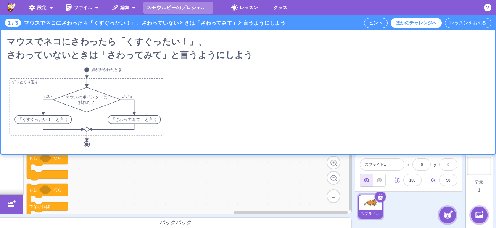

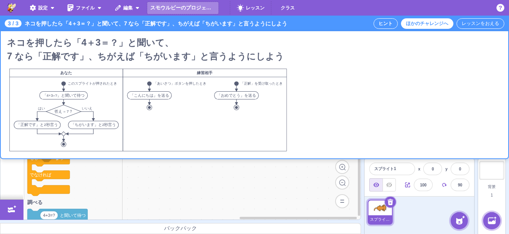

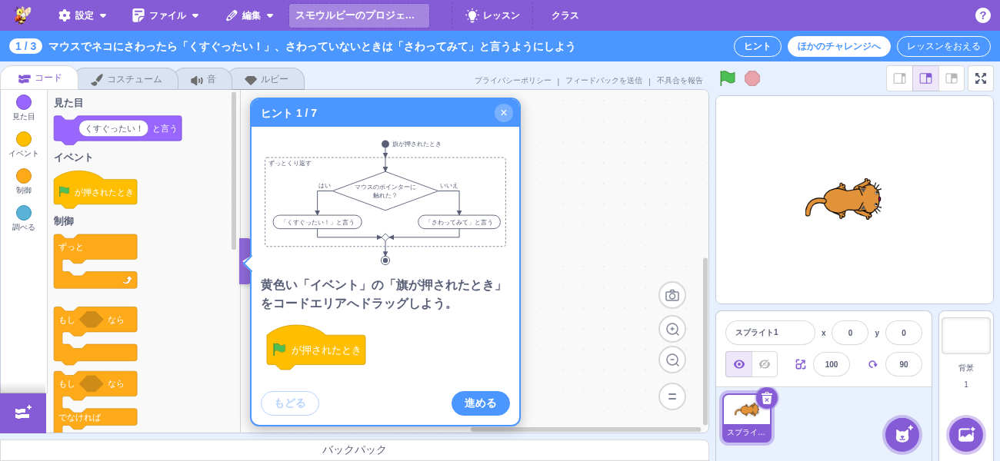

### 吹き出しの共通の土台

吹き出し・ツールチップ・はじめての案内の**見た目**（枠・角丸・影・しっぽの向きと位置・色・閉じるボタン・ボタン・文字）は
`components/balloon/` にまとめてある。**いつ出すか・どこに置くか・中身**は使う側が持つ。

| 部品 | 役割 |
|---|---|
| `balloon.jsx`（`Balloon`） | 吹き出しの枠。`variant` = `callout`（色で塗った小さな案内）/ `panel`（白地に色の枠、中に操作を持つ）、`color` = `blue` / `green`、`arrowSide` = 吹き出しが指す場所のどちら側にあるか（`bottom` なら上の辺にしっぽ。`null` でしっぽなし）、`arrowStyle` = しっぽの辺に沿った位置（`{left}` / `{top}`。無ければ真ん中）。ref と残りの props（`data-testid`・`role`・`style`・`onClick` など）はそのまま根の要素に渡す |
| `balloon-header.jsx`（`BalloonHeader`） | panel のヘッダー（色の帯 + 見出し + 閉じる） |
| `balloon-close-button.jsx`（`BalloonCloseButton`） | 閉じる（×）。色の上に置く半透明の丸 |
| `balloon-button.jsx`（`BalloonButton`） | 吹き出しの中のボタン。`primary` は塗り、そうでなければ枠だけ |
| `balloon-tokens.css` | 色・角丸・影・文字・しっぽ・ボタンの変数。`Balloon` を使わない部品もこれを `@import` してそろえる |

しっぽは `position: absolute` なので、使う側は吹き出しに `position`（relative / absolute / fixed）を付ける。

| 使っているところ | 形 |
|---|---|
| ヒントの吹き出し（`lesson-hint/`） | `panel` + `BalloonHeader` + `BalloonButton`。置き方は `computeHintPlacement`（`position: fixed`） |
| ウェルカムバルーン（`welcome-tooltip/`。`docs/welcome/`） | 青の `callout` + `BalloonCloseButton`、しっぽは右 |
| クラス管理のツールチップ（`classroom-tutorial/`。`docs/tutorial/`） | 画面の真ん中のカードで吹き出しとは形が違うので `Balloon` は使わず、`balloon-tokens.css`（白地・角丸・影・文字色）と `BalloonButton`（OK）だけを使う |

### data-testid

| data-testid | 要素 | 説明 |
|------------|------|------|
| `lesson-task-bar` | div | 課題バー全体（レッスンモードのときだけある） |
| `lesson-task-bar-position` | span | 「何個め / レッスンの中の数」（例: 「3 / 4」。en は "3 of 4"） |
| `lesson-task-bar-task` | button | 課題の 1 行（長いときは省略記号）。タップ・キーボードで全文のパネルを開閉する（`aria-expanded` / `aria-controls`） |
| `lesson-task-bar-full-text` | div | 課題の全文のパネル（マウスを乗せているあいだ・タップで開いているあいだだけある） |
| `lesson-task-bar-full-text-text` | p | パネルの課題の文（改行つき） |
| `lesson-task-bar-full-text-image` | img | パネルの画像（チャレンジに `image` があるときだけ） |
| `lesson-task-bar-full-text-diagram` | div | パネルのアクティビティ図（チャレンジの `activityDiagram` が true のときだけ。文の下） |
| `lesson-task-bar-full-text-diagram-note` | p | 図が大きくて全文に入らないときの「図はヒントの 1 ページ目で見られます」（図の代わり） |
| `lesson-activity-diagram` | svg | アクティビティ図の SVG（全文のパネルとヒントの 1 ページ目）。記号は `[data-shape]`（`start` / `end` / `action` / `decision` / `merge` / `loop` / `guard` / `lane` / `caption`）、矢印は `[data-edge]` |
| `lesson-task-bar-hint` | button | ヒントの吹き出しの出し入れ（ヒントが無ければ disabled） |
| `lesson-task-bar-quit` | button | ほかのチャレンジへ（いまのチャレンジを終えてレッスン表を開く。白地で目立たせる） |
| `lesson-task-bar-end` | button | レッスンをおえる（右端。レッスンから出て、いつもの画面にもどる。レッスン表は開かない） |
| `lesson-hint` | div | ヒントの吹き出し（`data-side` = 置いた側 `right` / `left` / `bottom` / `top` / `inside` / `center`、`data-target` = 指す場所） |
| `lesson-hint-spotlight` | div | スポットライトの穴（照らしているときだけある） |
| `lesson-hint-position` | span | 「ヒント n / N」 |
| `lesson-hint-title` | p | ヒントの文言 |
| `lesson-hint-activity-diagram` | div | ヒントの 1 ページ目のアクティビティ図（文言の上。チャレンジの `activityDiagram` が true のときだけ） |
| `lesson-hint-blocks` | div | 本物のブロックを描く読み取り専用ワークスペース（`.blocklyBlockCanvas g[data-id]` がブロック） |
| `lesson-hint-blocks-error` | p | ブロックを描けなかったときの注意 |
| `lesson-hint-debug-title` / `lesson-hint-debug` | div / ul | 「うまく動かないときは」と箇条書き（最後のページ） |
| `lesson-hint-insert-code` | button | 正解のプログラムを確認する（最後のページ。`code` があるときだけ。押すと確認を出す） |
| `lesson-hint-insert-code-confirm` | div | 「正解のプログラムで置き換えますか？…」の確認（押したあとだけある） |
| `lesson-hint-insert-code-yes` / `lesson-hint-insert-code-no` | button | 確認の「はい」（プログラムを入れる）/「いいえ」（何もしない） |
| `lesson-hint-finish` | button | おわり（最後のページで「進める」の代わり。押すと閉じ、次は 1 ページ目から開く） |
| `lesson-hint-drag-handle` | div | 吹き出しのヘッダー（ドラッグで動かす取っ手） |
| `lesson-hint-insert-code-error` | div | プログラムを入れられないときのわけ（音・背景をまだ足していない等） |
| `lesson-hint-prev` / `lesson-hint-next` / `lesson-hint-close` | button | もどる / 進める（最後のページには無い） / 閉じる |

### スクリーンショット

| ファイル | 説明 |
|---------|------|
| `screenshots/0201-lesson-mode-1300x600.png` | 授業のパソコン（1300×600）でチャレンジ 3「押したら話そう」を開いたところ |
| `screenshots/0202-lesson-mode-667x375.png` | SP 横（MobileGui）で同じチャレンジを開いたところ |
| `screenshots/0203-lesson-task-full-text-1300x600.png` | 1300×600 でチャレンジ 5「もし〜なら」の課題バーにマウスを乗せ、改行つきの全文を出したところ |
| `screenshots/0204-lesson-task-full-text-667x375.png` | SP 横（MobileGui）で同じ課題の文をタップして全文を開いたところ |
| `screenshots/0206-lesson-task-bar-end-1300x600.png` | 課題バーの右端の「レッスンをおえる」（「ほかのチャレンジへ」は白地、「レッスンをおえる」は透明地に白い枠） |
| `screenshots/0205-lesson-task-full-text-image-1300x600.png` | 1300×600 でチャレンジ 2「矢印キーで動かそう」の全文（画像つき）を出したところ |
| `screenshots/0207-lesson-task-full-text-activity-diagram-1300x600.png` | 1300×600 で全文にアクティビティ図を出したところ（「もし〜なら」を `activityDiagram: true` にして撮影。ずっと・分岐・合流） |
| `screenshots/0208-lesson-task-full-text-activity-diagram-swimlane-1300x600.png` | 練習相手の定義があるときのスイムレーン（「クイズを作ろう」にテスト用の `partner`（ボタンで変数を変えて合図を送る・合図を受け取ったら返す）を足して撮影） |
| `screenshots/0209-lesson-task-full-text-activity-diagram-too-tall-1300x600.png` | 図が大きくて全文に入らないときの案内の 1 行（テスト用の 8 ブロックの答えで撮影） |
| `screenshots/0410-lesson-hint-activity-diagram-scroll-1300x600.png` | 同じ大きい図をヒントの 1 ページ目で出したところ（下限の大きさで、図の枠の中をスクロールできる） |
| `screenshots/0401-lesson-hint-1300x600.png` | ヒント 2（パレットを指す・はじめてなのでスポットライト・本物のブロック）を 1300×600 で開いたところ |
| `screenshots/0402-lesson-hint-667x375.png` | 同じヒントを SP 横（667×375）で開いたところ（パレットの右に収まる） |
| `screenshots/0403-lesson-hint-375x667.png` | 同じヒントを SP 縦（375×667。縦持ちゲートを閉じたあと）で開いたところ（収まらないのでパレットの中） |
| `screenshots/0404-lesson-hint-last-resort-1300x600.png` | 最後の手段のページ（うまく動かないときは・正解のプログラムを確認する・おわり） |
| `screenshots/0405-lesson-hint-check-answer-confirm-1300x600.png` | 「正解のプログラムを確認する」を押したあとの確認（いいえ・はい） |
| `screenshots/0406-lesson-hint-auto-open-1300x600.png` | チャレンジを始めたら自動で開いたヒントの 1 ページ目（1300×600） |
| `screenshots/0407-lesson-hint-dragged-667x375.png` | SP 横でヘッダーをタッチでドラッグして動かしたところ（しっぽは消える） |
| `screenshots/0408-lesson-hint-auto-open-375x667.png` | SP 縦（縦持ちの案内を閉じたあと）で自動で開いたヒント（サイドレールの右に置く） |
| `screenshots/0409-lesson-hint-activity-diagram-1300x600.png` | ヒントの 1 ページ目にアクティビティ図を出したところ（1300×600。図・文言・ブロックの順） |
| `screenshots/0301-lessons-button-1300x600.png` | メニューバーの「レッスン」ボタン（1300×600。はじめての人にも吹き出しは出ない） |
| `screenshots/0302-lessons-library-1300x600.png` | レッスン表（1300×600）。3 つのレッスンで、いくつかできた状態 |
| `screenshots/0303-lessons-library-375x667.png` | レッスン表（SP 縦 375×667。カード 2 列） |
| `screenshots/0304-lessons-library-cleared-1300x600.png` | コースのチャレンジが全部できた状態（コース名の前に ✓） |
| `screenshots/0306-lessons-library-667x375.png` | レッスン表（SP 横 667×375） |
| `screenshots/0307-lessons-library-search-1300x600.png` | 検索したとき（「キー」） |
| `screenshots/0101-completed-toast-1300x600.png` | 「できた！」（レッスンの途中。丸と「あと n つ」・次のチャレンジへ・もう少し見る） |
| `screenshots/0102-completed-toast-last-1300x600.png` | 最後のレッスン（レッスン 3）のチャレンジが全部できたときの「レッスン 3 ぜんぶできた！」（コース名の行・レッスン表へ） |
| `screenshots/0103-completed-toast-lesson-1300x600.png` | レッスン 1 のチャレンジが全部できたときの「レッスン 1 ぜんぶできた！」（レッスン名の行・次のレッスンへ） |
| `screenshots/0104-completed-toast-quiz-1300x600.png` | ふりかえりのクイズのある「できた！」（選ぶ前）。撮影のため、チャレンジ 3 に見本のクイズを足して撮った（いまのコースのチャレンジはクイズを持たない） |
| `screenshots/0105-completed-toast-quiz-wrong-1300x600.png` | 同じクイズで、はずれを選んだところ（×・「はずれ。もう一度選んでみよう」・解説） |
| `screenshots/0106-completed-toast-quiz-lesson-correct-1300x600.png` | 「レッスン 1 ぜんぶできた！」の中のクイズで正解を選んだところ（○・「正解！」・解説） |
| `screenshots/0305-lessons-library-next-1300x600.png` | 「次のチャレンジ」で開いたレッスン表（1〜3 ができていて、4 に「次はこれ！」） |
| `screenshots/0501-challenge1-key-sound-hint1-1300x600.png` | チャレンジ 1「キーで音を鳴らそう」の最初のヒント（音タブを指す） |
| `screenshots/0502-challenge2-arrow-move-hint1-1300x600.png` | チャレンジ 2「矢印キーで動かそう」の最初のヒント（パレットを指し、帽子のブロック「上向き矢印キーが押されたとき」を描く） |
| `screenshots/0503-challenge3-click-say-hint1-1300x600.png` | チャレンジ 3「押したら話そう」の最初のヒント（コスチュームタブを指す） |
| `screenshots/0504-challenge4-repeat-hint1-1300x600.png` | チャレンジ 4「くり返そう」の最初のヒント（背景を選ぶを指す） |
| `screenshots/0505-challenge5-if-hint1-1300x600.png` | チャレンジ 5「もし〜なら」のヒント 1（帽子のブロック「旗が押されたとき」を描く） |
| `screenshots/0506-challenge6-ask-answer-hint1-1300x600.png` | チャレンジ 6「聞いて答えよう」のヒント 1（帽子のブロック「このスプライトが押されたとき」を描く） |
| `screenshots/0507-challenge7-quiz-hint1-1300x600.png` | チャレンジ 7「クイズを作ろう」のヒント 1（帽子のブロック「このスプライトが押されたとき」を描く） |
| `screenshots/0508-challenge8-count-hint1-1300x600.png` | チャレンジ 8「数えよう」のヒント 1（「変数を作る」） |
| `screenshots/0512-challenge8-count-variables-1300x600.png` | チャレンジ 8 のパレット（「変数」カテゴリに「変数を作る」と許可した変数のブロックだけ。「ブロック定義」は無い） |
| `screenshots/0513-challenge4-no-variables-1300x600.png` | チャレンジ 4 のパレット（変数を使わないので「変数」「ブロック定義」が無い） |
| `screenshots/0514-challenge4-repeat-hint3-1300x600.png` | チャレンジ 4 のヒント 3（帽子のブロック「1 キーが押されたとき」を置く） |
| `screenshots/0515-challenge4-repeat-hint5-1300x600.png` | チャレンジ 4 のヒント 5（「繰り返す」の中に入れる 4 つを、入れる並びのまま描く） |
| `screenshots/0516-challenge7-quiz-hint3-1300x600.png` | チャレンジ 7 のヒント 3（「もし〜なら でなければ」と、その中の「言う」2 つ） |
| `screenshots/0517-challenge9-broadcast-hint4-1300x600.png` | チャレンジ 9 のヒント 4（ペンギンの「あいさつを受け取ったとき」と「やあ！と 2 秒言う」） |
| `screenshots/0518-challenge3-click-say-hint5-1300x600.png` | チャレンジ 3 のヒント 5（ブロックの消し方。コードエリアを照らす。押して試すページより前） |
| `screenshots/0519-challenge3-click-say-hint6-1300x600.png` | チャレンジ 3 のヒント 6（最後のヒント「ステージのスプライトをクリックしてみよう。」。ステージを照らす） |
| `screenshots/0520-challenge5-if-hint2-1300x600.png` | チャレンジ 5 のヒント 2（旗のブロックとつないだ「ずっと」） |
| `screenshots/0521-challenge5-if-hint3-1300x600.png` | チャレンジ 5 のヒント 3（空の穴の「もし <  > なら でなければ」） |
| `screenshots/0522-challenge6-ask-answer-hint4-1300x600.png` | チャレンジ 6 のヒント 4（「タイマーをリセット」の下に「なまえは？と聞いて待つ」） |

### チャレンジ 9〜11 のメモ

レッスン 1 のチャレンジ 9〜11 の中身を入れたときに決めたこと・確かめたこと。

- **9 なかまに合図しよう**: ペンギンはライブラリの **`Penguin`**（「スプライトを2つ使ってみよう」の操作 GIF で
  えらんでいるもの。`Penguin 2` ではない）。`code` はネコのプログラム、ペンギンのプログラムは `spriteCodes` で持つ。
  「プログラムを入れる」はペンギンがいればそこに、いなければライブラリから足して入れ、最後にネコをえらんで
  ネコのプログラムを入れる（上の「最後の手段」）。判定は「スプライト 2 つ以上・ネコの押されたときで送った・
  別のスプライトが受け取ったときに言った（`sentBy: 'other'`）」。
- **10 しゃべらせよう**: ブロックは `text2speech_speakAndWait`（ja「[WORDS]としゃべる」、ja-Hira も同じ、
  Ruby は `text2speech.speak("...")`）。拡張機能は子どもがヒント 1 で足す（`setup.extensions` では入れない）。
  足す前に「プログラムを入れる」を押しても、Ruby → ブロックの変換が音声合成を読み込む（`target-applier.js`）ので
  失敗しない。音声の取得（インターネット）に失敗しても、ブロックの実行は記録されるので「できた」になる
  （headless の integration テストで確かめている）。拡張機能のカテゴリはパレットを絞っても全部出る
  （`allowedBlocks` の `text2speech` は使うブロックの記録）。
- **11 メッセージをためよう**: Ruby の `$トーク` はステージのリスト（「リストを作る」の既定 = すべてのスプライト用）。
  先に「リストを作る」で「トーク」を作ってから「プログラムを入れる」でも、リストは 1 つのまま（integration テスト）。
  日本語のリスト名も Ruby ⇔ ブロックで行き来できる（`$トーク.clear` = 「トーク のすべてを削除する」、
  `$トーク.push(answer)` = 「(答え) を トーク に追加する」）。

| ファイル | 説明 |
|---------|------|
| `screenshots/0509-challenge9-hint-1300x600.png` | チャレンジ 9「なかまに合図しよう」のヒント 1（スプライトリストを照らす） |
| `screenshots/0510-challenge10-hint-1300x600.png` | チャレンジ 10「しゃべらせよう」のヒント 1（拡張機能のボタンを照らす） |
| `screenshots/0511-challenge11-hint-1300x600.png` | チャレンジ 11「メッセージをためよう」のヒント 1（「リストを作る」） |


## GA の計測

レッスン全体（課題の外もふくむ・クラスに参加していないときもふくむ）の使われ方を GA で計測する。目的は
**人気のないコンテンツ**と**滞在の長いヒント**を見つけて見直すこと（方針は [`design.md`](design.md) の
「GA の計測の方針」）。

仕組みは、いまの GUI の計測（ルビータブ・接続など）と同じ `lib/analytics.js`（GTM の `dataLayer` に push）。
`category` はすべて **`lessons`**、`action` がイベントの名前、`label` はチャレンジ id（レッスン表はどう開いたか）。
数を見る項目（ページ・秒・課題からか）は、`label` に詰めずに **dataLayer の項目**として同じ push に入れる
（`analytics.js` の Smalruby マーカー `extra GA params`。GA4 で見るには GTM でデータレイヤー変数を作る）。
- **`lessons` のイベントは、いつも 6 つの項目（`course_id`・`lesson_id`・`challenge_id`・`from_assignment`・`page`・
  `seconds`）を全部入れ、使わない項目は `undefined` にする**。GTM の data layer は前の push の値を
  上書きされるまで覚えているので、消さないと前のイベントの `page` / `seconds` やチャレンジの id が次のイベントに残る。
  同じ理由で `analytics.js` は、前のイベントで入れた追加の項目を、それを入れないあとのイベント（ルビータブ・接続など
  ほかの category もふくむ）で `undefined` にもどす（マーカー `extra GA params`）。

| `action` | いつ | `label` | 項目 |
|---|---|---|---|
| `library_open` | レッスン表を開いた（メニュー・SP のドロワー・「ほかのチャレンジへ」・「できた！」の「次のチャレンジへ」） | `menu`（ふつうに開いた）／`next`（「次のチャレンジへ」で、いまのレッスンを見せて開いた） | — |
| `challenge_open` | チャレンジを開いた（レッスンモードに入った。同じチャレンジを開き直しても送る） | チャレンジ id | `course_id`・`lesson_id`・`challenge_id`・`from_assignment` |
| `challenge_complete` | 「できた！」になった（もう一度できたときも送る） | チャレンジ id | 上の 4 つ + `seconds`（チャレンジを開いてから「できた！」まで） |
| `hint_view` | ヒントの 1 ページを見おわった（下の「ヒントの滞在時間」） | チャレンジ id | 上の 4 つ + `page`（1 から。最後の手段のページもふくむ）・`seconds` |
| `answer_view` | 「正解のプログラムを確認する」で、正解のプログラムを入れた（「はい」で入れたとき。「いいえ」・入れられなかったときは送らない） | チャレンジ id | 上の 4 つ |
| `other_challenge` | 課題バーの「ほかのチャレンジへ」を押した | チャレンジ id | 上の 4 つ |
| `lesson_end` | 課題バーの「レッスンをおえる」を押した | チャレンジ id | 上の 4 つ |

- **ヒントの滞在時間**（`hint_view` の `seconds`）: ページごとに、**そのページを出してから、次のページ・前のページへ
  移る・吹き出しを閉じる（×・「おわり」）・「できた！」になる・チャレンジを閉じる／ほかのチャレンジを開く**までの秒
  （整数に丸める）。1 ページを見おわるたびに 1 回送る（ページを出したときには送らない）。同じページを閉じて開き直すと、
  開き直したところから測りなおして、もう 1 回送る。タブを閉じた・再読み込みしたときの見ていたページは送らない。
- **秒（`hint_view` と `challenge_complete` の `seconds`）は、タブが裏にあった時間を引く**。
  `visibilitychange` で `document.hidden` のあいだを数え（PC のスリープもふくむ）、見えていた時間だけで測る
  （`activeNow`）。別のタブへ行ったままの何十分が平均を引っぱらないため。
- **PC 表示とスマホ表示の切りかえ**（`<GUI>` と `<MobileGui>` の入れかえでコンテナがマウントし直される）では、
  二重に送らず、見ていたページの滞在時間も続けて測る。どこまで送ったかの覚えをコンテナではなくモジュールに
  1 つ持つため（画面に GUI は 1 つだけ）。
- **`from_assignment`**: クラスの課題のチャレンジから開いたか（true / false だけ）。レッスン表が、
  課題のチャレンジを開くときに `startChallenge(id, {fromAssignment: true})` を渡す（課題の外のチャレンジや、課題に参加していないときは false）。
- **送らないもの**: 個人を特定する ID・クラス・席番号・ニックネーム・セッション・課題の ID・参加コード・入力した文字
  （検索の文字もふくむ）。送るのはコース・レッスン・チャレンジの id・ページの番号・秒・課題からか、だけ。
- **先生（ログイン中）からは送らない**: 先生がクラス管理にログインしているあいだは、エディタでレッスンを開いても
  何も送らない（`state.scratchGui.classroom.teacherLoggedIn`。授業の準備で開くと数がゆがむため）。どこまで送ったかの
  覚えだけは進めるので、ログアウトしても、先生のときに開いたチャレンジを開いたことにはしない。
- 計測の失敗（`dataLayer` が無いなど）は握りつぶし、レッスンの動きを止めない。
- 判断は純粋関数 `lib/lessons/lesson-analytics.js`（`stepLessonAnalytics`。前の状態と今の状態と時刻から、送るイベントを
  決める）、送るのは `containers/lesson-analytics.jsx`（gui.jsx のマーカー `lesson mode` の中に常時マウント）。
  ボタンで決まる `answer_view` / `other_challenge` / `lesson_end` は、押したところ（`containers/lesson-hint.jsx` /
  `containers/lesson-mode.jsx`）から `sendLessonEvent` で送る。

## いまのチュートリアルの入口

レッスン機能がチュートリアルの役目を引き継ぐため、従来の **「チュートリアル」「デバッグ」のボタンはメニューバーから外し、右上の「?」メニューの項目**にした（ふだんは目に入らないようにする。そろったら消す）。

- 「?」メニュー › チュートリアル → チュートリアル一覧（`tips-library`）
- 「?」メニュー › デバッグ → デバッグ画面（`debug-modal`）
- `?tutorial=<urlId>` で直接開く経路はそのまま動く（教科書や授業資料のリンク用）
- はじめての人向けの吹き出し（旧 `tutorial-tooltip`）は出さない。代わりに「レッスン」ボタンの下に吹き出しを出す（上の「レッスン表」）

詳細は [`docs/menu-bar/`](../menu-bar/) の「「?」メニュー（ヘルプ）」と [`docs/tutorial/`](../tutorial/) を参照。

## 主要ファイル

| ファイル | 説明 |
|---------|------|
| `packages/scratch-gui/src/lib/lessons/images/` | チャレンジの `image` に使う画像（`courses.js` で import する） |
| `packages/scratch-gui/src/lib/lessons/card-color.js` | レッスン表のカードの色の決め方（ブロックをなかまごとに数える・いちばん多いなかま、同数ならメイン） |
| `packages/scratch-gui/src/lib/lessons/courses.js` | コース・レッスン・チャレンジのデータと検索。locale ごとの Ruby を選ぶ `localizeCode` / `challengeCodeFor` / `challengeCodeCandidates`。ふりかえりのクイズを作る `challengeQuiz` と形を確かめる `validateQuiz` |
| `packages/scratch-gui/src/lib/lessons/lessons.locale.js` | 文言（en / ja / ja-Hira。`src/locales/*.js` に spread） |
| `packages/scratch-gui/src/lib/lessons/lesson-progress.js` | 端末への記録（いまの定義での読みかえ）・レッスン／コースの進み具合・「できた！」のボタンとレッスン表で見せるもの |
| `packages/scratch-gui/src/lib/lessons/challenge-setup.js` | チャレンジを開くときの setup（言語の既定 + チャレンジの `setup`） |
| `packages/scratch-gui/src/components/balloon/` | 吹き出し・ツールチップの見た目の土台（`Balloon` / `BalloonHeader` / `BalloonCloseButton` / `BalloonButton` / `balloon-tokens.css`。上の「吹き出しの共通の土台」） |
| `packages/scratch-gui/src/components/lesson-hint/` | ヒントの吹き出し（`lesson-hint.jsx` = 中身・置き方・スポットライト・ドラッグ・正解のプログラムの確認（枠は `balloon/`）、`lesson-hint-blocks.jsx` = 読み取り専用ワークスペースに本物のブロックを描く） |
| `packages/scratch-gui/src/containers/lesson-hint.jsx` | 吹き出しのコンテナ（`getCurrentHint` を読み、`blocks` を XML にし、「プログラムを入れる」を dispatch） |
| `packages/scratch-gui/src/lib/lessons/hint-targets.js` | 指す場所の名前（`HINT_TARGETS`）・DOM の探し方・置き方・ドラッグした位置を画面に収める（`clampHintPosition`）・置いてよい範囲（`hintViewport`。SP のサイドレールの右）（純粋関数） |
| `packages/scratch-gui/src/lib/lessons/hint-blocks.js` / `blocks-xml.js` | Ruby → ブロック → Blockly の XML |
| `packages/scratch-gui/src/lib/lessons/activity-diagram/` | アクティビティ図。`labels.js`（ブロックの文）・`model.js`（ブロック → 記号の木・練習相手のレーン）・`layout.js`（置き方）は純粋関数。`challenge-diagram.js` がチャレンジの定義から図を作り、`use-challenge-activity-diagram.js` がいまのチャレンジの図を返す hook（変換の結果を覚える）。文言は `activity-diagram.locale.js`（`src/locales/*.js` に spread） |
| `packages/scratch-gui/src/components/lesson-activity-diagram/` | 置き方を SVG に描く部品（課題の全文・ヒントの 1 ページ目） |
| `packages/scratch-gui/test/unit/lib/lessons/activity-diagram.test.js` / `test/unit/components/lesson-activity-diagram.test.jsx` | アクティビティ図の unit テスト（本物の変換でモデル・置き方を確かめる） |
| `packages/scratch-gui/src/lib/lessons/insert-sprite-code.js` | 「プログラムを入れる」で `spriteCodes` をそれぞれのスプライトに入れる（いなければライブラリから足す） |
| `packages/scratch-gui/src/lib/lessons/lesson-analytics.js` | GA の計測の判断（`stepLessonAnalytics`。前の状態・今の状態・時刻から送るイベントを決める純粋関数）と、ボタンで決まるイベントを送る `sendLessonEvent`（上の「GA の計測」） |
| `packages/scratch-gui/src/containers/lesson-analytics.jsx` | GA の計測のコンテナ（描画しない。state を渡して `analytics.event` に送る）。`gui.jsx` のマーカー `lesson mode` の中に常時マウント |
| `packages/scratch-gui/test/unit/lib/lessons/lesson-analytics.test.js` / `test/unit/containers/lesson-analytics.test.jsx` | GA の計測の unit テスト（イベントの名前・項目・ヒントの滞在時間・送らない項目） |
| `packages/scratch-gui/src/lib/lessons/lesson-progress-sync.js` | クラスの課題へ進み具合を送るときの決まり（送る中身・本人の確認を出すか・「前」・送らなくてよいか・失敗の扱い）の純粋関数と、本人の確認の答えの保存（design.md の「本人の確認」「進み具合の送り方」） |
| `packages/scratch-gui/src/containers/lesson-progress-sync.jsx` | 進み具合を送るコンテナ（できた・課題のチャレンジを開いた・クラスの画面を開いたときに `PUT /classrooms/{id}/lesson-progress`）と本人の確認のダイアログ。`gui.jsx` のマーカー `lesson mode` の中に常時マウント |
| `packages/scratch-gui/src/components/lesson-progress-confirm/` | 本人の確認のダイアログ（「わたしの記録です」/「ちがう（記録を消す）」→［戻る］［消す］） |
| `packages/scratch-gui/test/unit/lib/lessons/lesson-progress-sync.test.js` / `test/unit/containers/lesson-progress-sync.test.jsx` | 進み具合の送信と本人の確認の unit テスト |
| `packages/scratch-gui/src/lib/lessons/spotlight-seen.js` | スポットライトを見せたチャレンジの記録（`smalruby:lessonSpotlightSeen`） |
| `packages/scratch-gui/test/unit/components/lesson-hint.test.jsx` / `test/unit/containers/lesson-hint.test.jsx` | 吹き出しとコンテナの unit テスト |
| `packages/scratch-gui/test/unit/components/balloon.test.jsx` | 吹き出しの共通の土台の unit テスト |
| `packages/scratch-gui/test/integration/smalruby-lessons-hint.test.js` | 始めるとヒントが自動で開く → 本物のブロック・指す場所・初回だけのスポットライト → 進める → 正解のプログラムを確認する（いいえで何も変わらない／はいで入れる）→ 2 回目はスポットライト無し。ヘッダーのドラッグ（画面の外に出ない・次のページでも位置を保つ・しっぽが消える）と「おわり」（Selenium） |
| `packages/scratch-gui/test/integration/smalruby-lesson1-challenges-1-4.test.js` | レッスン 1 のチャレンジ 1〜4 を開く → ヒントを最後まで進めて「プログラムを入れる」→ 課題の操作（実際のキー入力・ステージのネコをクリック）→「できた！」（Selenium） |
| `packages/scratch-gui/test/integration/smalruby-lesson1-challenges-5-8.test.js` | チャレンジ 5〜8 を開く → プログラムを入れる → 旗・マウス・ネコを押す・答えを入力する →「できた！」（Selenium・1300×600） |
| `packages/scratch-gui/test/integration/smalruby-lesson1-challenges-9-11.test.js` | チャレンジ 9〜11 を開く → ペンギン・リストを足す → プログラムを入れる → ネコを押す・旗・答えを入力する →「できた！」（Selenium・1300×600） |
| `packages/scratch-gui/test/integration/smalruby-lesson1-clear.test.js` | コースの全体: レッスン表から 11 個すべてが開ける（課題バーはレッスンの中の番号）→ レッスン 1・2 を 1 つのレッスンだったころの記録で入れ、レッスン 3 の 4 つを「プログラムを入れる」→ 操作 →「できた！」→ コースの進み具合とコース名の前の ✓（Selenium・1300×600） |
| `packages/scratch-gui/src/lib/lessons/practice-partner.js` | 練習相手の定義を読む純粋関数（`normalizePartner`・`repliesFor`・`practiceAllowed`） |
| `packages/scratch-gui/src/lib/lessons/practice-loopback.js` | 練習相手のブラウザの中での折り返し（`attachPracticeLoopback`） |
| `packages/scratch-gui/src/components/lesson-practice-partner/` | 練習相手のパネル |
| `packages/scratch-gui/src/containers/lesson-practice-partner.jsx` | 練習相手のコンテナ（開閉・本物のメッシュのつながりを見る・置き場所を測る）。`lesson-mode.jsx` からマウント |
| `packages/scratch-gui/test/unit/lib/lessons/practice-partner.test.js` / `test/unit/containers/lesson-practice-partner.test.jsx` | 練習相手の unit テスト |
| `packages/scratch-gui/src/lib/lessons/goal.js` | できた の判定（`goal` の形・事実の記録・判定の純粋関数・`validateGoal`） |
| `packages/scratch-gui/src/lib/lessons/vm-execution-hook.js` | ブロックの実行をスレッドつきで取るフック（runtime の `getOpcodeFunction` を包む） |
| `packages/scratch-gui/src/lib/lessons/goal-monitor.js` | VM を見張って goal を判定する（`attachGoalMonitor` / `takeSnapshot`） |
| `packages/scratch-gui/src/containers/lesson-goal-watcher.jsx` | レッスンモードのあいだ見張りをつなぎ、できたら記録して「できた！」を出す（gui.jsx に常時マウント） |
| `packages/scratch-gui/src/components/lesson-completed-toast/` | 「できた！」の表示（`lesson-completed-quiz.jsx` = その中のふりかえりのクイズ） |
| `packages/scratch-gui/src/reducers/lesson-mode.js` | いま開いているチャレンジ・開こうとしているチャレンジ・ヒント・「できた！」・記録の写し |
| `packages/scratch-gui/src/containers/lesson-mode.jsx` | チャレンジを開く流れ（新しい作品 → setup → レッスンモード）と課題バーのマウント。`gui.jsx` のエディタ列の先頭に常時マウント |
| `packages/scratch-gui/src/components/lesson-task-bar/` | 課題バー（1 行・40px） |
| `packages/scratch-gui/src/components/lessons-library/` | レッスン表（モーダル） |
| `packages/scratch-gui/src/lib/lessons/library-filter.js` | レッスン表の検索（`filterCourseStatuses`）・出す言語（`libraryLanguages`）・コースのボタンを出すか（`showCourseNav`） |
| `packages/scratch-gui/test/unit/lib/lessons/library-filter.test.js` | 上の unit テスト |
| `packages/scratch-gui/src/lib/lessons/open-lessons-library.js` | レッスン表をいまのレッスンを見せて開く（`openLessonsLibraryAt`。「次のチャレンジ」が使う）・クラスの課題のチャレンジだけで開く（`openAssignmentLessonsLibrary`。「はじめる」「レッスンを続ける」） |
| `packages/scratch-gui/src/lib/lessons/assignment-progress.js` | クラスの課題のレッスンの数え方（設定をそろえる・条件の数・あと n つ・課題クリア・メニューバーの印・はじめての課題クリア・レッスン表を課題のチャレンジに絞る・次にやる課題のチャレンジ・クラスへ送る分の記録）の純粋関数 |
| `packages/scratch-gui/test/unit/lib/lessons/assignment-progress.test.js` | 上の unit テスト |
| `packages/scratch-gui/src/components/lesson-assignment-band/` | クラスの課題の帯（レッスン表の上の 1 行の文・課題バーの小さな帯・クラスの画面の丸と数） |
| `packages/scratch-gui/src/components/classroom-modal/classroom-menu-status.jsx` | メニューバーの課題の横の印（提出状態、レッスンの課題では ○ / 2/4 / ✓） |
| `packages/scratch-gui/test/integration/smalruby-lessons-next-challenge.test.js` | 「できた！」の「次のチャレンジ」→ レッスン表のいまのレッスン・「次はこれ！」→ 選ぶと開く。3 つの場面のタイトル・丸・「あと n つ」・2 行目・ボタンの文言（Selenium） |
| `packages/scratch-gui/src/containers/lessons-library.jsx` | レッスン表のコンテナ（開くたびに記録を取り込む・チャレンジを押したら `startChallenge` + 閉じる）。`gui.jsx` に常時マウント（Smalruby マーカー `lessons library`） |
| `packages/scratch-gui/src/reducers/modals.js` | `lessonsLibrary` モーダルの開閉（Smalruby マーカー `lessons library`） |
| `packages/scratch-gui/src/components/mobile-drawer/mobile-drawer.jsx` | SP のドロワーの「レッスン」 |
| `packages/scratch-gui/src/containers/blocks.jsx` | `getLessonAllowedBlocks` でパレットを絞る（Smalruby マーカー `lesson mode`）。「変数」「ブロック定義」のコールバックも絞る（マーカー `lesson dynamic category filtering`） |
| `packages/scratch-gui/src/lib/lessons/block-defaults.js` | `allowedBlocks` に書いたブロックの初期値を集め、ツールボックスの XML・flyout の要素に入れる純粋関数（`blocks.jsx` のマーカー `lesson palette block defaults`） |
| `packages/scratch-gui/src/lib/lesson-dynamic-categories.js` | 「変数」「ブロック定義」を `allowedBlocks` で絞る純粋関数（カテゴリを出すか・flyout の中身） |
| `packages/scratch-gui/src/lib/make-toolbox-xml.js` | `allowedBlocks` に無ければ「変数」「ブロック定義」のカテゴリを出さない（マーカー `lesson dynamic category filtering`） |
| `packages/scratch-gui/test/unit/lib/lesson-dynamic-categories.test.js` | 上の純粋関数・toolbox XML・既存の deck / チャレンジの unit テスト |
| `packages/scratch-gui/test/unit/lib/lesson-dynamic-categories-decks.test.js` | すべての deck・チャレンジのプログラムを変換し、使う変数・リスト・ブロック定義の opcode が `allowedBlocks` にあるか |
| `packages/scratch-gui/test/unit/lib/lessons/` | データの形・記録・クリア判定・setup・できた の判定・見張り・カードの色の決め方（`card-color.test.js`）の unit テスト |
| `packages/scratch-gui/test/unit/reducers/lesson-mode-reducer.test.js` | reducer の unit テスト |
| `packages/scratch-gui/test/unit/components/lesson-completed-toast.test.jsx` / `test/unit/components/lesson-completed-quiz.test.jsx` / `test/unit/containers/lesson-goal-watcher.test.jsx` | 「できた！」と見張りのコンテナの unit テスト |
| `packages/scratch-gui/test/integration/lesson-goal.test.js` | 本物の VM に Ruby のプログラムを入れて動かし、判定が true になる integration テスト |
| `packages/scratch-gui/src/components/menu-bar/menu-bar.jsx` | 「レッスン」ボタン（`lessons button` マーカー）、「?」メニューのチュートリアル / デバッグ項目（`help menu` マーカー） |
| `packages/scratch-gui/src/containers/menu-bar-hoc.jsx` | `onOpenLessonsLibrary` / `lessonModeActive`（`lessons button` マーカー）と `onOpenTipsLibrary`（`help menu` マーカー）の供給 |
| `packages/scratch-gui/test/unit/components/lesson-task-bar.test.jsx` / `test/unit/containers/lesson-mode.test.jsx` | 課題バーとチャレンジを開く流れの unit テスト |
| `packages/scratch-gui/test/integration/smalruby-lesson-task-bar-full-text.test.js` | 課題バーにマウスを乗せると改行つきの全文（画像も）が出て離すと消える・ヒントの吹き出しが出ていても吹き出しより上に出る・タップで開閉・「ほかのチャレンジへ」でレッスン表（Selenium・1300×600） |
| `packages/scratch-gui/test/integration/smalruby-lesson-task-bar-layout.test.js` | 課題バーが画面の幅いっぱい・ボタンが右端・ステージの列の旗/止める/ステージの大きさが押せる・ページがスクロールしない、中サイズのステージのスプライトの情報が詰まった形でどの入力欄も押せる（大きいステージでは upstream の形）（Selenium・1300×600） |
| `packages/scratch-gui/test/unit/components/sprite-info-compact.test.jsx` | 中サイズのステージのスプライトの情報（「スプライト」の字なし・x / y が左隣・大きさ / 向きのアイコンとツールチップ en / ja / ja-Hira、小・大は upstream のまま） |
| `packages/scratch-gui/test/integration/smalruby-lessons.test.js` | チャレンジを開く → 課題バー・絞ったパレット → やめる → 元にもどる。「レッスンをおえる」でレッスン表を開かずに出て、プログラムが残り、パレットが全部にもどる（Selenium） |
| `packages/scratch-gui/test/unit/components/lessons-library.test.jsx` / `test/unit/containers/lessons-library.test.jsx` / `test/unit/components/menu-bar-lessons.test.jsx` | レッスン表（3 つのレッスン・カードの色の帯・✓・コースのバー・検索・言語とコースのボタン・「次はこれ！」）、コンテナ、「レッスン」ボタン（吹き出しを出さないこと）の unit テスト |
| `packages/scratch-gui/test/integration/smalruby-lessons-library.test.js` | メニューから開く → チャレンジを押す → レッスンモード → やめる → レッスン表にもどる・記録に合わせた ✓ とコースの進み具合・検索（Selenium） |

## 設定・データ永続化

| 種類 | キー | 説明 |
|------|------|------|
| localStorage | `smalruby:lessonProgress` | チャレンジ ID → できた日時（とコース・レッスン） |
| localStorage | `smalruby:lessonAssignmentConsent` | 本人の確認の答え（課題 × 席 × 席に入った人（参加した時刻、無ければトークンの短いハッシュ）→ `{answer: mine\|cleared\|none, beforeIds, decidedAt}`。新しいものから 50 件） |
| localStorage | `smalruby:lessonSpotlightSeen` | チャレンジ ID → はじめて開いた日時（ヒントのスポットライトを 2 回目から出さないため） |
| localStorage | `smalruby:tutorialSeen` | レッスン表を開くと `true` を書く（`tutorial-onboarding` reducer の `markTutorialSeen`）。いまは読む画面が無い（「レッスン」ボタンの下の吹き出しは出さないため） |
