# Mesh v2

> **🆕 Smalruby 独自** — upstream に存在しない、Smalruby のために新規追加された機能

## 概要

複数の Smalruby インスタンス間で **broadcast event** と **グローバル変数** をリアルタイム共有する機能。子供たちが教室や家庭でネットワークを通じて連携した作品（複数人で協力するゲーム、リレー型のお絵描きなど）を作れるようにする。

旧 Mesh (v1) は外部サービス Skyway に依存していたが、v1 のサービス停止に伴い、AWS AppSync + DynamoDB をバックエンドに自社で再構築したのが Mesh v2。v1 拡張のランタイム（`scratch3_mesh/`）と依存の `skyway-js` は削除済みで、v1 のブロックを含む作品・スプライト・バックパックは読み込み時に v2 のブロックへ書き換える（[`docs/scratch-vm/serialization.md`](../scratch-vm/serialization.md) の「Mesh v1 → v2 マイグレーション」）。

## ユーザーストーリー

- **小学生**として、友達のスモウルビーと自分のスモウルビーで「メッセージを送る」「相手の変数を読む」をして、複数人で動くゲームを作りたい
- **教師**として、教室全員がインターネット越しに簡単な合言葉でグループに入れて、リアルタイム通信を体験させたい
- **家庭学習中の子**として、別の場所にいる家族や友達と画面を分けて協力プレイができる作品を作りたい

## UI / 操作フロー

1. ブロックパレットの「拡張機能を追加」から **Mesh** を選ぶ
2. 接続モーダル (`connection-modal`) が開く。**ホスト**として新しいグループを作るか、**メンバー**として既存グループ名で参加するかを選択

   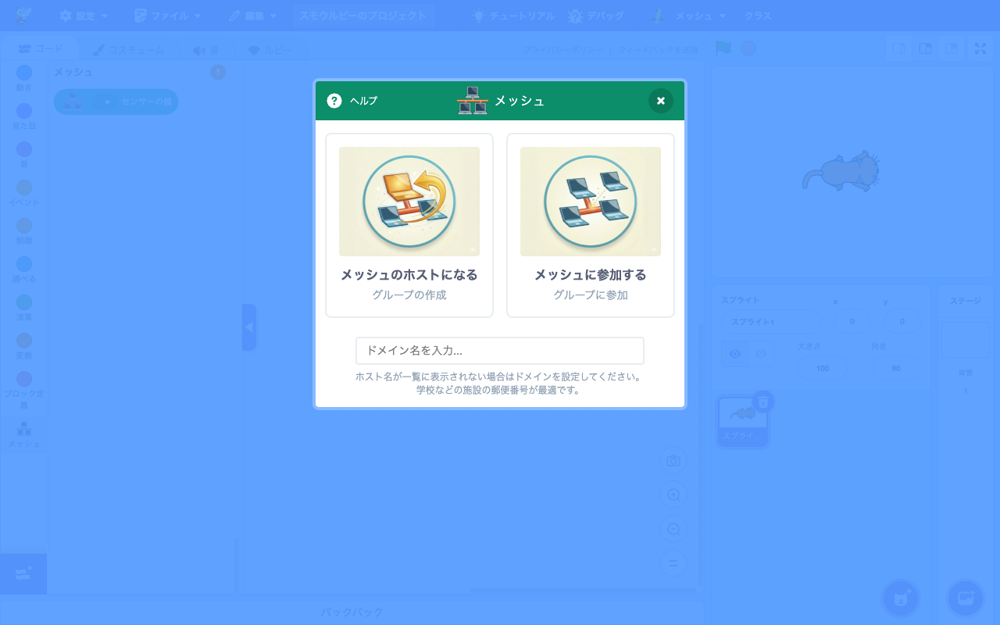

3. ホスト選択時：自動的にランダムグループ名（例: `【いきたにんた】`）が割り当てられて登録完了

   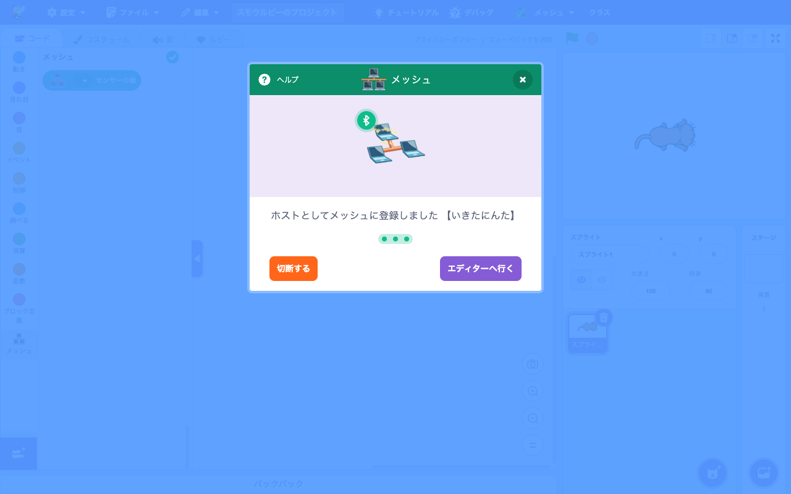

4. 「エディターへ行く」でブロックパレットに戻ると、メッシュカテゴリに緑チェックが付く

   

5. メニューバーの「メッシュ」をクリックすると、ドメイン / グループ名 / **接続期限のカウントダウン** が確認できる

   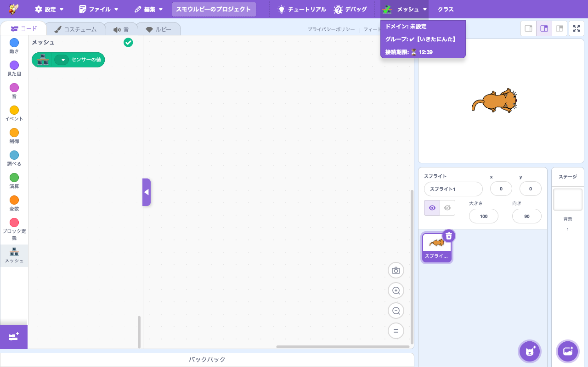

   メッシュカテゴリのブロックは少なく、`センサーの値` で他ノードのグローバル変数を読み取るのが基本。

   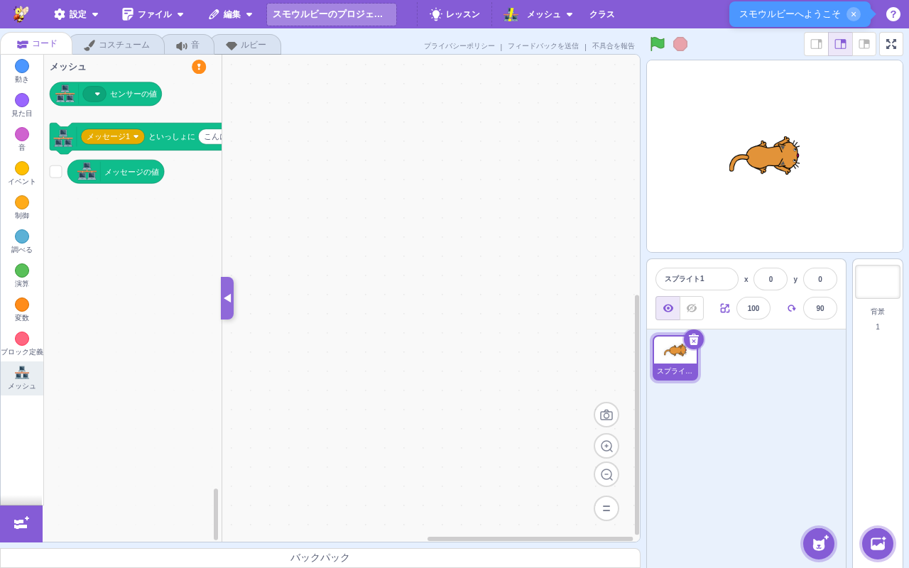

6. 接続後、`broadcast` ブロックでイベント送信、グローバル変数の自動同期、`mesh.sensor_value(name)` で他ノードの値読み取りが可能に
7. グループの最大接続時間は **35 分**（`MESH_MAX_CONNECTION_TIME_SECONDS`）

通信モードは環境に応じて自動選択される：

| モード | リアルタイム配信 | 環境制約 |
|---|---|---|
| **WebSocket** | AppSync subscription | プロキシ/フィルタが WebSocket を許可 |
| **Polling** | 2 秒周期の query | フォールバック（403/503 で WebSocket 不可な環境）|

URL パラメータ `?force_polling=1` でクライアント側から強制 polling 化できる。

### クラス管理との連動

クラスに参加中（生徒）または先生がクラス管理でクラスを選択中の場合、**Mesh ドメインはそのクラスの参加コードに自動で固定される**。

- 例: 参加コードが `xuzk93` のクラスに参加中 → Mesh ドメインの初期値・固定値は `xuzk93`
- 接続モーダルのドメイン入力欄は読み取り専用になる（クラスを抜けると編集可能に戻る）
- 同じクラスの先生・生徒は自動的に同じドメインに集まるため、グループ検索・参加が容易になる
- 先生の「選択中のクラス」は Redux 上に保持される（モーダルを閉じても維持／ページリロードでクリア。先生 idToken のキャッシュ仕様と整合）
- **連動解除時の挙動**: 生徒がクラスから退出 / 先生がログアウトすると、Mesh ドメインは**連動前の値に戻る**（連動開始時にスタッシュ）。連動前にユーザーが手動で設定したドメインや URL `?mesh=` のデフォルト値が復元される

実装: `packages/scratch-gui/src/lib/mesh-v2-classroom-binding.jsx`

#### 出席番号（グループ名・ノード ID）

クラス参加中は、出席番号をグループ名とノード ID に入れる。**メッシュのサーバーは変えない**（名前はただの文字列として保存され、ノード ID は `GROUP#<groupId>#NODE#<nodeId>` のキーの一部になるだけ）。

- **ノード ID**: 生徒は末尾に `s<2 桁以上の番号>` が付く（例 `…s07`）。先生とクラス外では付かない。元の ID は uuid の hex なので `s` で区別できる。グループ内のノード一覧 `listNodesInGroup`（`MeshV2Service#listNodesInGroup`）を読めば、何番が参加したかが分かる。ノード ID はグループに入っている間は変えない（接続中に `setClassroomSeat` で番号が変わったら覚えておき、次の接続の開始時（`connect`）に反映する。どの経路から接続しても最新の番号になる）。
- **グループ名**: 先頭はホストのノード ID のまま、うしろに `|` 区切りで番号の情報を足す。

  | 場面 | グループ名 |
  |---|---|
  | クラス外 | `<hostNodeId>`（従来どおり） |
  | 生徒が「ホストになる」 | `<hostNodeId>\|host=7` |
  | 先生が「ホストになる」 | `<hostNodeId>\|host=teacher` |
  | 番号を選んだグループ | `<hostNodeId>\|seats=3,7,12\|host=3` |

  先頭 6 文字から作る合言葉（`makeMeshIdLabel`）と、名前の前方一致で探す `searchGroupsByNamePrefix` は変わらないので、古いクライアントには従来どおりの名前に見える。壊れた名前や古い名前は「番号の情報なし」として扱う。
- **名前を信じすぎない**: グループ名とノード ID はほかのクライアントが自由に決められ、サーバーは長さも文字も検査しない。そのため読み取り（`parseGroupName`）は厳しくし、次のどれかに当たる名前は「番号の情報なし」（従来の「【…】」表示）にする: 名前が 512 文字を超える / 先頭がノード ID の形（16 進 + 任意の `s<番号>`）でない / 番号が 1〜999 の範囲外・重複・100 個超 / `host=<番号>` が先頭のノード ID の番号と一致しない / `host=teacher` なのに先頭に番号が付いている / 先頭がサーバーに記録されたホスト（`hostId`）と一致しない。それでも番号の情報は**ホストの自己申告**であり、本人確認ではない（「先生のグループ」と名乗ることは、合言葉＝ドメインを知っていれば誰でもできる）。一覧の表示と参加前の確認にだけ使い、権限の判断には使わない。
- **一覧の表示**（クラス参加中のみ）: 「3・7・12番のグループ（ほしくま）」「7番がホストのグループ（…）」「先生のグループ（…）」。番号の情報が無いグループとクラス外では従来の「【…】」のまま。
- **選ばれていない番号での参加**: `seats=` のグループに含まれない番号の生徒が入ろうとすると、確認（「このグループは 3・7・12番用です。あなた（20番）は選ばれていません。それでも参加しますか？」）を出す。

実装: `packages/scratch-vm/src/extensions/scratch3_mesh_v2/seat-naming.js`（名前の組み立て・読み取りの純粋関数）、`packages/scratch-gui/src/lib/mesh-v2-seat-label.js`（一覧の表示と確認の判定）

end-to-end 動作確認: [`tools/playwright-verify/mesh-v2-classroom-binding.mjs`](../../tools/playwright-verify/README.md) — 2 タブ (教師 + 生徒) を自動で操作してドメイン連動を検証する手動 E2E スクリプト。

#### 出席番号でつながる

クラスに参加中の生徒は、接続モーダルの最初の画面の先頭（横幅いっぱい）に「出席番号でつながる」が出る。ホストを決めて合言葉を伝え合う手間（授業で約 10 分かかっていた）を、番号を選ぶだけにするため。従来の「メッシュのホストになる」「メッシュに参加する」は、その下の「従来の方法でつなぐ（ホストになる / グループに参加）▾ ひらく」の中にたたむ（`mesh-v2-classic-methods.jsx`）。授業では使わない方法だと伝え、生徒が迷わず「出席番号でつながる」を押すようにするため。開くと「クラスの外や、先生に言われたときだけ使います。」と 2 つのボタンが出る。開いた状態は覚えず、モーダルを開くたびにたたんだ状態から始まる。出席番号・従来の方法・ドメイン欄は左右の端をそろえる。先生とクラス外ではたたまず、従来どおりの画面のまま。

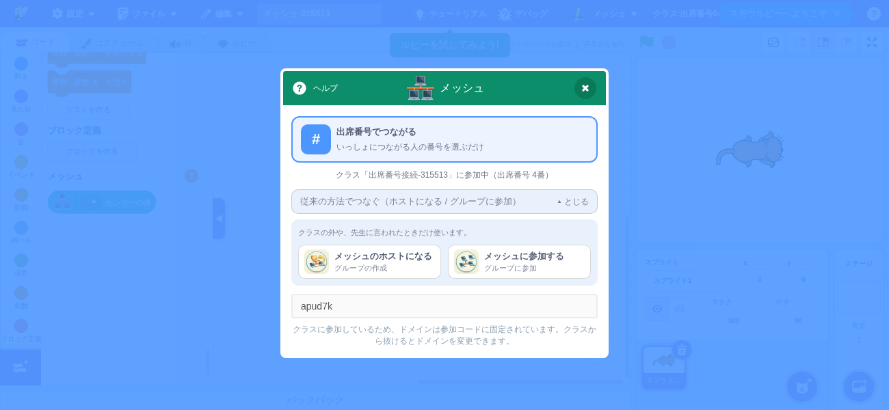

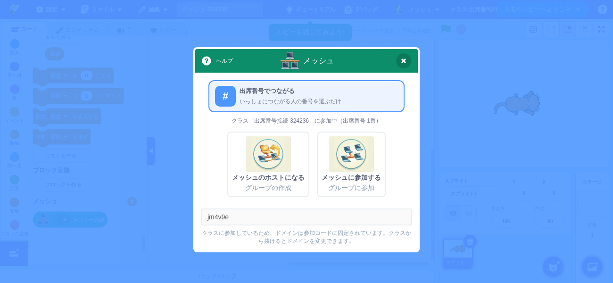

1. **番号を選ぶ**: クラスの人数ぶんの番号を 8 列で出す。自分の番号は外せない。人数と参加中の番号は開くたびに `POST /classrooms/lookup`（`studentCount` / `takenSeats`）で照会し、参加していない番号は点線の「欠席」（選べるが待たない）。ほかのグループに参加中の番号は「使用中」で、押すとそのグループに入るか尋ねる。上限は課題の `meshGroupLimit`（6 人まで / `0` = 制限なし。値が無い応答も制限なし）。上限に達したら残りは押せず「6人まで」、制限なしなら「全員を選ぶ」。下に選んだ人とホストを要約する。

   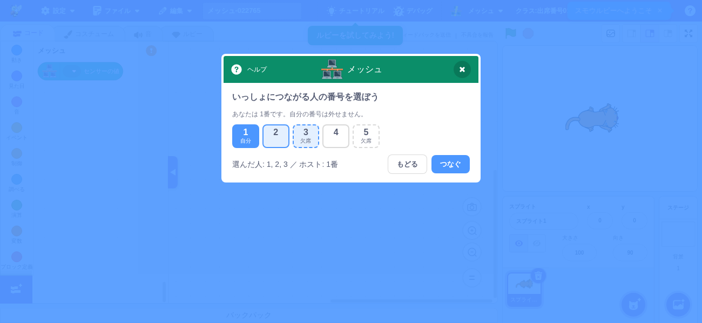

2. **待ち合わせ**: 選んだ番号ごとに「参加しました / 待っています / 欠席のため待ちません / 別のグループにいます」を出す。3 秒ごとにクラスのグループ一覧（と 9 秒ごとに参加中の番号）を読み直し、下の決まりで「作る / 入る / 待つ」を決める。ホストでない人は「ホストの N番さんを待っています」。

   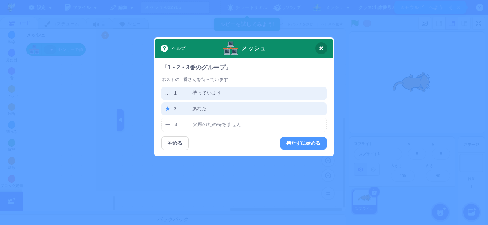

   - 全員（欠席を除く）そろったら「そろいました！」を 2 秒出して自動で閉じる。
   - 「待たずに始める」でその時点のメンバーで始める（自分の番号が入ったグループがあれば入り、無ければホストになる）。選んだ全員が欠席なら 1 人で始めるかを尋ねる。
   - 選んだ人が別の組み合わせのグループにいたら ⚠ と［外す / 番号を選びなおす / このまま待つ］。

   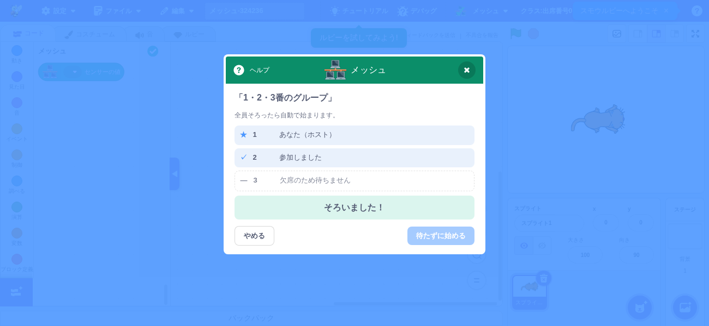

3. **つないだあと**: 接続済みの画面に「そろい具合」の 1 行（`1 ✓ 2 ✓ 3 欠席`）を出す。モーダルを閉じても拡張のボタンから開き直せば見られる。

   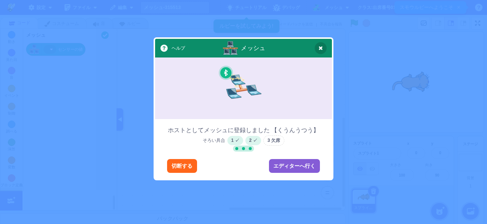

- **［先生のグループに入る］**: 課題が制限なしで、先生が「ホストになる」で作ったグループ（`host=teacher`）があれば、最初の画面の先頭に「出席番号でつながる」と横並びで出る（クラス全員を先生とつなぐ使い方）。

  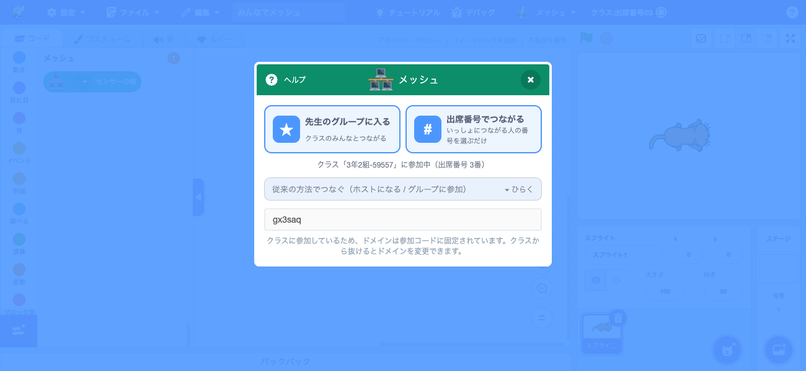
- **［グループに呼ばれています］**: 自分の番号を選んだグループ（名前の `seats=`）があるのにまだ入っていないとき（例: 欠席中に「待たずに始める」で始まり、あとからクラスに参加した）は、モーダルを開くと最初の画面の代わりに「1番さんのグループに呼ばれています」を出す。だれが参加中か（ホスト・参加中 / 参加中 / まだ来ていません / 欠席）と自分（まだ入っていません）を並べ、［グループに入る］ですぐ入る。［入らずに、ほかの方法でつなぐ］でいつもの最初の画面へ。待っている側の生徒に気付かず別のグループを作ってしまうのを防ぐため。自分がもうどこかのグループに入っているとき・先生・クラス外では出ない。複数あればホストの番号が小さいグループ（`findInvitingGroup`）。選ばれていない人がそのグループに入るときの確認は変わらない。

  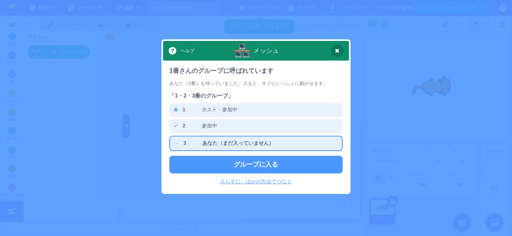
- **従来の方法と混ぜてよい**: 番号で作ったグループは従来の「メッシュに参加する」（「従来の方法でつなぐ」を開いた中）の一覧にも「1・2・3番のグループ（…）」として出る（選ばれていない番号なら確認してから入る）。

  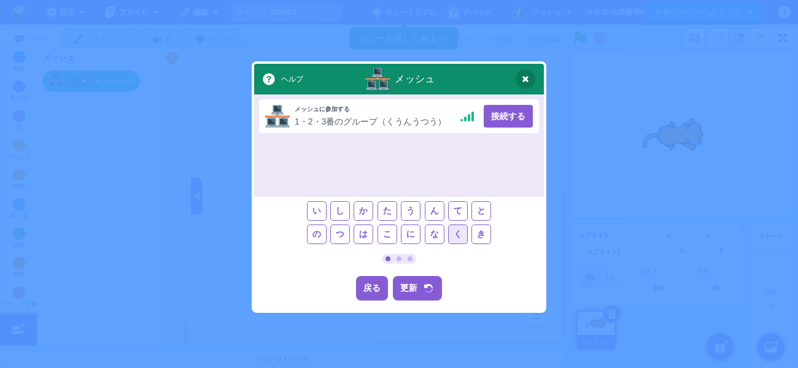

**決まり**（`packages/scratch-gui/src/lib/mesh-v2-seat-connect.js` の純粋関数。画面はその結果を出すだけ）:

| 決まり | 内容 |
|---|---|
| ホスト | 選んだ中で、クラスに参加している一番小さい番号の人。その人がクラスにいてもメッシュを開いていなければ、20 秒ごとに次に小さい番号へ交代（`pickHostSeat`） |
| 作る前に一覧を見る | 自分の番号が入ったグループ（名前の `seats=` か、参加中のノード ID の番号）があれば作らずに入る。遅れて来た元のホストも、交代後のグループに入る（`decideSeatAction`） |
| 2 つできたとき | ホストの番号が小さいグループを残す。大きい方のホストは自分のグループを抜け（解散）、次の読み直しで残った方に入る。メンバーも同じく入り直す（`findGroupToMergeInto`） |
| 呼ばれている | 名前の `seats=` に自分の番号があり、参加中の番号に無い生徒のグループ（先生・番号情報なしは除く）。自分がどこかに入っていれば無し。複数ならホストの番号が小さい方（`findInvitingGroup`） |
| 番号の状態 | `describeSeatStatuses` / `isEveryoneHere` / `needsAloneConfirm` |

グループ名の `seats=` は、ホストが作る直前に `setSeatGroupSeats(seats)` で VM に渡す。グループ一覧と各グループの参加番号は VM の `listSeatGroups()`（`seats=` / `host=` のあるグループだけ `listNodesInGroup` で番号を集める）。番号の情報は自己申告なので、待ち合わせの目印にだけ使う。

実装: 画面 = `src/containers/mesh-v2-seat-connect.jsx`（番号を選ぶ・待ち合わせ）、`src/components/connection-modal/mesh-v2-seat-{entry,pick-step,wait-step,status-line}.jsx`、`mesh-v2-classic-methods.jsx`（たたんだ従来の方法）、データ = `src/lib/mesh-v2-seat-snapshot.js`、決まり = `src/lib/mesh-v2-seat-connect.js`。

end-to-end 動作確認: [`tools/playwright-verify/verify-mesh-v2-seat-connect.mjs`](../../tools/playwright-verify/README.md)（生徒 3 タブ・選んだ 1 人が欠席・従来の参加と混在）。

### クラスで読み込んだ作品の接続モーダル自動表示

生徒がクラスの流れで作品を読み込んだとき、次の 3 つがすべて当てはまれば、拡張の接続ボタンと同じ接続モーダル（`meshV2`）を**自動で開く**。授業で生徒が接続ボタンを探して止まらないようにするため。

1. 読み込み元がクラスの流れ: スターター（選択肢の「スターターから始める」・課題パネルの「スタータープロジェクトを開く」）、または提出物から続ける（前回 / 今回）
2. 読み込んだ作品がメッシュ拡張を使っている（mesh v1 から v2 へ移行された作品も含む）
3. まだメッシュに接続していない

- **クラスのモーダルと重ねない**: 接続モーダルはクラスのモーダル（生徒・先生とも）が閉じてから開く。選択肢から始めた場合は読み込み直後にクラスのモーダルが閉じるのでそのまま開き、課題パネルの「スタータープロジェクトを開く」でパネルが開いたままの場合は、**パネルを閉じたときに開く**（その場で前面に出すと課題パネルと接続モーダルが重なり、どちらを操作すればよいか分かりにくいため）。
- **出さない**: 上書き確認をキャンセルしたとき、読み込みに失敗したとき、メッシュを使わない作品を読み込んだとき（それ以前の未表示の依頼も取り消す）、表示までの間に接続済みになったとき。
- **1 回だけ**: 依頼は開いた時点で消える。生徒が接続モーダルを閉じても、次にクラスの流れで読み込むまでは再表示しない。
- 対象外: 先生が提出物を開く経路、クラス外でのファイル / URL 読み込み。

実装: 判定 = `packages/scratch-gui/src/lib/classroom-mesh-connect.js`（純粋関数）、依頼 = `src/containers/use-student-assignment.js` → Redux `classroom.meshConnectPending`、表示 = `src/containers/classroom-mesh-connect-prompt.jsx`。

end-to-end 動作確認: [`tools/playwright-verify/verify-classroom-mesh-connect.mjs`](../../tools/playwright-verify/README.md)。

### 状態と履歴のウィンドウ

メッシュがつながっているか・だれとつながっているか・相手の変数の値・送った／受け取ったメッセージを、作品を動かしたまま確かめられる小さなウィンドウ。メッシュのプログラムがうまく動かないときに、生徒が自分で原因を探せるようにするため。

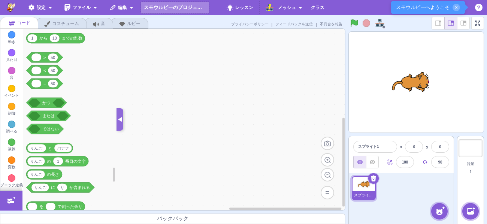

- **開き方**: ステージの上の緑の旗・停止のすぐ右にあるメッシュのボタン（メッシュの拡張を足した作品のときだけ出る。つながっていると右下に緑の点）。ほかに、メニューバーの「メッシュ」→「状態と履歴を見る」、接続済みの画面の［状態と履歴］、スマホではドロワーの「メッシュの状態と履歴」。
- **形**: モーダルではない、動かせる小さなウィンドウ（見出しをドラッグ。画面の外には出ない）。開いたまま作品を動かせる。全画面のステージの上にも出る（全画面で［つなぐ…］を押すと、全画面を解除してから接続の画面を開く）。
- **キーボード**: 開くとフォーカスがウィンドウに移り、閉じると開いたボタンに戻る。Escape で閉じる。タブは左右の矢印キーで切り替える（`tablist` / `tab` / `tabpanel`）。
- **状態**のタブ: 接続（WebSocket / ポーリング / つながっていない）、グループ（合言葉）、つないでいる人数、相手ごとの変数と値・最後に値が届いた時刻。つながっていないときは［つなぐ…］で接続の画面を開く。

  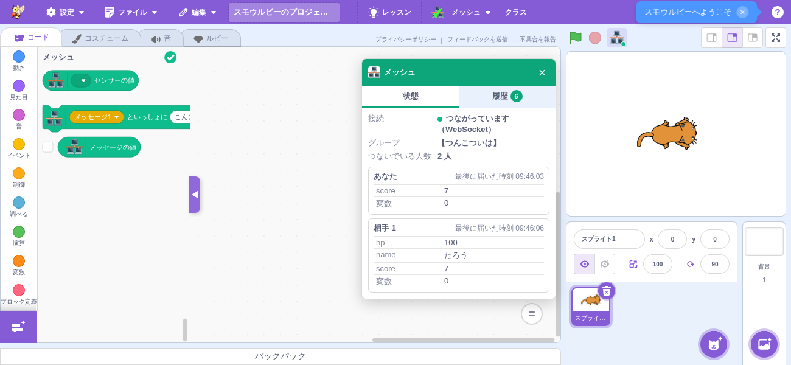

- **相手の見せ方**（名前は集めない）: クラスに参加中は出席番号で「03 番」（自分は「03 番（あなた）」）。クラスの外や番号の無いノード（先生など）は、自分が「あなた」、ほかは初めて見えた順（最初の値が届いた順。値をまだ送っていない相手はそのあと、履歴にだけ出る相手は古い順）に「相手 1」「相手 2」…。同じグループの間は一度付けた番号を変えない（ウィンドウを閉じても同じ）。グループが変わったとき・抜けたときは 1 から付け直す。
- **履歴**のタブ: 送ったもの・受け取ったものを新しい順に、時刻・送った／受け取った・だれ・メッセージの名前・値。ふだんは 3 件、［もっと見る（50 件まで）］で 50 件まで。

  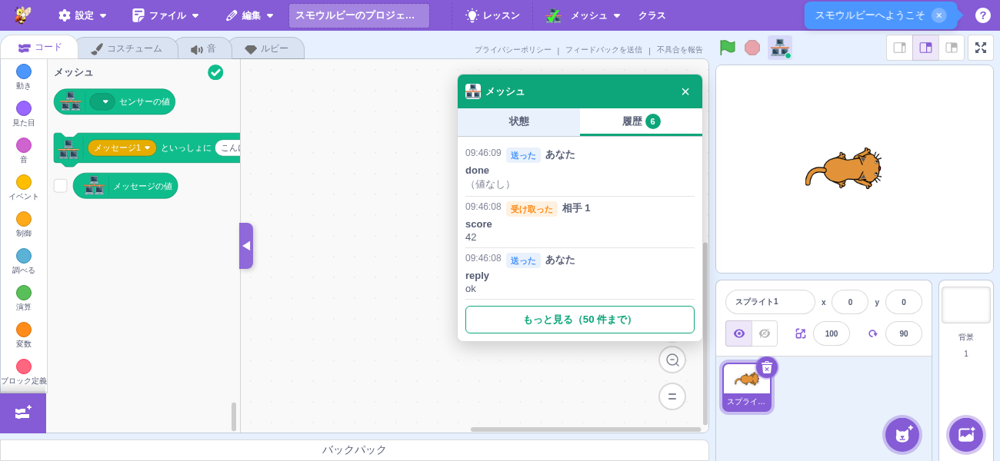

**見るだけ・サーバーの負担を増やさない**:

- 画面は VM がすでに受け取っている値（`remoteData`）と、VM のメモリの履歴を 1 秒ごとに読み直すだけ。
- 履歴は VM（`MeshV2Service`）がメモリに新しい順で 50 件まで持つ。記録は送受信の処理のあと・別の try で行い、記録に失敗しても送受信や接続には影響しない。作品にもサーバーにも残さない。新しいグループに入ると空にする（切れたあとは残る）。「送った」は実際に送れた（まとめ送りが成功した）ものだけ。同じ名前を 1 秒の間に何回も送ると最後の 1 つしか送らないので、履歴にも 1 つだけ出る。
- 人数は、変数の値を 1 つも送っていない相手や、抜けた相手の古い値もあるので `listNodesInGroup` で確かめる。問い合わせるのはウィンドウを開いたとき・つないだときと、開いている間 30 秒ごと。VM の側でも 30 秒に 1 回までにしている（`refreshGroupNodes`）。ウィンドウを閉じていれば問い合わせない。一覧を知るまでは値の届いた相手を出す。`listNodesInGroup` はホストを返さない（サーバーはホストを `hostId` にだけ記録する）ので、参加するときにグループ一覧の `hostId` を覚えておいて足す。`hostId` が分からないとき（一覧に無いグループに ID で参加したなど）だけ、グループ名の先頭（ホストのノード ID）から足す。一覧を問い合わせたあとに値が届いた相手は、次の問い合わせを待たずに出す。

**data-testid**:

| data-testid | 要素 |
|---|---|
| `mesh-status-button` | ステージの上のボタン（中の点は `mesh-status-button-connected` / `mesh-status-button-disconnected`） |
| `menu-bar-mesh-status` | メニューバーの「状態と履歴を見る」 |
| `mesh-v2-open-status` | 接続済みの画面の［状態と履歴］ |
| `mobile-drawer-mesh-status` | スマホのドロワーの項目 |
| `mesh-status-popup` / `mesh-status-drag-handle` / `mesh-status-close` | ウィンドウ / 見出し（ドラッグ） / 閉じる |
| `mesh-status-panel` | タブの中身（`tabpanel`） |
| `mesh-status-tab-status` / `mesh-status-tab-history` / `mesh-status-tab-practice` | タブ |
| `mesh-status-connection` / `mesh-status-group` / `mesh-status-count` / `mesh-status-connect` | 接続 / グループ / 人数 / ［つなぐ…］ |
| `mesh-status-nodes` / `mesh-status-node` | 相手の一覧 / 1 人ぶん |
| `mesh-status-history` / `mesh-status-history-item` / `mesh-status-history-expand` / `mesh-status-history-empty` | 履歴 / 1 件 / もっと見る・たたむ / まだ無い |

実装: VM = `scratch3_mesh_v2/status-history.js`（履歴とノード一覧の問い合わせ）・`status-snapshot.js`（ウィンドウに渡す値）・`index.js` の `getStatusSnapshot()` / `refreshGroupNodes()`、画面 = `src/components/mesh-status-popup/`・`src/containers/mesh-status-popup.jsx`・`src/components/mesh-status-button/`、表示の決まり = `src/lib/mesh-v2-status.js`、拡張の有無 = `src/lib/use-mesh-v2-presence.js`、開閉 = Redux `meshV2.statusPopupOpen`。

### ひとりで使える練習相手

ペアが休み・学校に来られないなど、ひとりでメッシュのプログラムを作ってデバッグする生徒のための、ブラウザの中だけで動く「相手」。メッシュのウィンドウの「練習相手」のタブで使う。

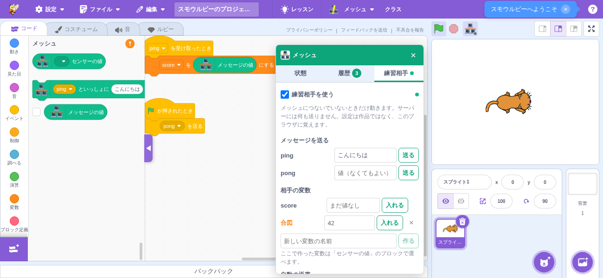

- **並ぶもの**: 作品にあるメッセージと、ステージの（すべてのスプライト用の）変数を自動で並べる（1 秒ごとに読み直す）。
  - **メッセージを送る**: 値の欄（なくてもよい）と［送る］。相手が送ったのと同じように「〜を受け取ったとき」が動き、値つきなら「メッセージの値」がその値になる（スクリプトごと）。
  - **相手の変数**: 作品の変数と、ここで作った変数。値を入れて［入れる］と、相手がその値を持つ（「センサーの値」で読める）。新しい名前で［作る］と相手の変数ができ、メッシュの「センサーの値」のドロップダウンに出る。作った変数は × で消せる（作品の変数は消せない）。
  - **自動の返事**: 「X を受け取ったら Y（値）を送り返す」。生徒の作品が X を送る（「送る」「送って待つ」「といっしょに送る」）と、0.5 秒あとに Y を送り返す。
- **入れる・切る**: 「練習相手を使う」は、開いたとき（ページを開いた・作品を読み込んだ）は切れている。チェックを入れるか、［送る］［入れる］［作る］［足す］を押すと入る。ウィンドウを閉じても動き続ける。
- **動いているしるし**（色だけにしない）: ステージの上のメッシュのボタンに「練習」の文字（ボタンの名前も「メッシュの状態と履歴（練習相手と練習中）」になる）、「練習相手」のタブに点（名前「練習中」）、「使う」の横に「練習中」。ウィンドウを閉じていても、相手の値が「センサーの値」に出ていることが分かるようにするため。
- **状態と履歴**: 入っている間、状態のタブは「つながっていません（練習相手と練習中）」になり、「あなた」（作品の変数）と「相手（練習相手）」（相手の変数）を出す。練習相手が送ったもの・生徒の作品が送ったものは、本物のメッシュと同じ履歴に出る（同じものが 1 秒の間に続いたときは 1 つだけ）。

  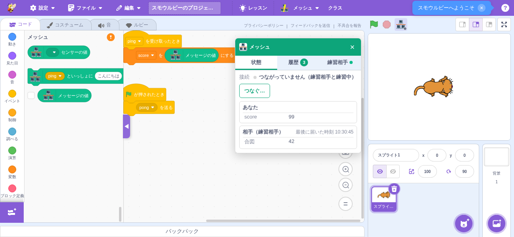

**本物のメッシュと混ぜない**:

- 動くのはメッシュにつないでいないときだけ。サーバーには何も送らない（ブラウザの中で折り返す）。
- つなぎ始めると（つないでいる途中も含む）、その場で練習相手の値と、練習で残した履歴を消し、「使う」を切る。つなぐのに失敗して切れたとき（WebSocket が通らないなど）も切れたままにする（勝手に動き出さない）。つないでいる間はタブを休ませる。切れたあとは、もう一度入れれば使える。
- 1 つの作品（VM）につながる練習相手は 1 つだけ（`loopback.js` が runtime ごとにだれがつないでいるかを覚える）。レッスンの練習相手があるチャレンジを開いているあいだは、こちらは休み、「レッスンの練習相手が動いているので、この練習相手は休みます。」と出す。
- 待っている自動の返事は、メッセージの名前ごとに 1 つ、全部で 100 まで（本物のメッシュの送るキューの上限と同じ）。値は 1,000 文字（JavaScript の `length`）までに切る（本物のメッシュとサーバーの上限と同じ）。
- 練習相手のノード ID は `smalruby-mesh-practice-partner`（本物のノード ID と重ならない）。

**設定は作品に入れない**: 相手の変数と値・メッセージごとの値・自動の返事は、作品ではなくこのブラウザに覚える。提出した作品に練習の設定は混ざらない。

- 作品の ID がある作品（Google ドライブなど）: localStorage に作品の ID ごとに 20 作品まで。
- 作品の ID が無い作品（新しい作品・ファイルから読んだ作品・クラスの課題）: このタブの sessionStorage だけ（タブを閉じると消える）。作品の名前は、既定の名前・同じファイル名・同じ課題名で別の作品とぶつかるので使わない。
- 書くのは生徒が練習相手の設定を変えたときだけ。ページを開いた・作品を変えたときは読むだけで、練習相手を使わない人のブラウザには何も残さない。覚えていない作品に変えたときは、いまの設定をそのまま使う（変えたときに、その作品の設定として覚える）。

**レッスンの練習相手との関係**: 仕組み（ブラウザの中で折り返す・つないでいないときだけ・相手の値はノード ID ごと・返事の数の上限・つないだら外す）は、レッスンの練習相手と同じ。共通の部品は `src/lib/mesh-practice/`（`partner.js` = データの形と決まり、`loopback.js` = 折り返し）に置き、練習相手の形はレッスンと同じ `{name, buttons, replies}`（`set` / `broadcast` に、値つきメッセージの `value` を足したもの）。レッスンの練習相手は、あとからこの部品に乗り換えられる。

**data-testid**:

| data-testid | 要素 |
|---|---|
| `mesh-practice` | 練習相手のタブの中身 |
| `mesh-practice-use` / `mesh-practice-active` | 「練習相手を使う」 / 「練習中」 |
| `mesh-practice-paused` / `mesh-practice-blocked` | つないでいる間の「休みます」 / レッスンの練習相手が動いている間の「休みます」 |
| `mesh-status-button-practice` | ステージの上のボタンの「練習」 |
| `mesh-practice-message` / `mesh-practice-message-value` / `mesh-practice-send` | メッセージの行 / 値 / ［送る］ |
| `mesh-practice-variable` / `mesh-practice-variable-value` / `mesh-practice-variable-set` / `mesh-practice-variable-remove` | 相手の変数の行 / 値 / ［入れる］ / × |
| `mesh-practice-new-variable` / `mesh-practice-add-variable` | 新しい変数の名前 / ［作る］ |
| `mesh-practice-reply` / `mesh-practice-reply-remove` | 自動の返事 / × |
| `mesh-practice-reply-form` / `mesh-practice-reply-on` / `mesh-practice-reply-send` / `mesh-practice-reply-value` / `mesh-practice-add-reply` | 返事を足す欄 / 受け取ったら / 送り返す / 値 / ［足す］ |

実装: 決まり = `src/lib/mesh-practice/partner.js`、折り返し = `src/lib/mesh-practice/loopback.js`（VM は変えない。`remoteData`・`recordMessage`・`startMessageHats`・`startHats` と、ブロックの実行を見る `src/lib/lessons/vm-execution-hook.js` を使う）、ブラウザに覚える = `src/lib/mesh-practice/storage.js`、状態と操作 = `src/lib/mesh-practice/use-mesh-practice-partner.js`（`src/containers/mesh-status-popup.jsx` がいつも呼ぶ）、画面 = `src/components/mesh-practice-partner/`。

## 主要ファイル

### scratch-gui

- **拡張機能登録**: `packages/scratch-gui/src/lib/libraries/extensions/index.jsx` — `extensionId: 'meshV2'`
- **接続 UI（接続モーダルの mesh-v2 専用ステップ）**:
  - `packages/scratch-gui/src/components/connection-modal/mesh-v2-initial-step.jsx`
  - `packages/scratch-gui/src/components/connection-modal/mesh-v2-network-filtered-step.jsx`
  - `packages/scratch-gui/src/components/connection-modal/mesh-v2-scanning-step.jsx`
  - `packages/scratch-gui/src/components/connection-modal/mesh-v2-classic-methods.jsx` — クラス参加中の生徒の画面で従来の 2 つをたたむ
  - `packages/scratch-gui/src/components/connection-modal/mesh-v2-seat-entry.jsx` / `mesh-v2-seat-pick-step.jsx` / `mesh-v2-seat-wait-step.jsx` / `mesh-v2-seat-status-line.jsx` / `mesh-v2-seat-invite-step.jsx` + `mesh-v2-seat-connect.css` — 出席番号でつながる（画面 1・2・3・5 と「呼ばれています」）
  - `packages/scratch-gui/src/containers/mesh-v2-seat-connect.jsx` — 番号を選ぶ・待ち合わせのコンテナ
- **出席番号でつながるの決まりとデータ**: `packages/scratch-gui/src/lib/mesh-v2-seat-connect.js`（純粋関数）、`packages/scratch-gui/src/lib/mesh-v2-seat-snapshot.js`（照会と一覧の読み直し）
- **状態管理**: `packages/scratch-gui/src/reducers/mesh-v2.js`
- **状態と履歴のウィンドウ**: `packages/scratch-gui/src/components/mesh-status-popup/`、`packages/scratch-gui/src/containers/mesh-status-popup.jsx`、`packages/scratch-gui/src/components/mesh-status-button/`、`packages/scratch-gui/src/components/connection-modal/mesh-v2-open-status-button.jsx`、`packages/scratch-gui/src/lib/mesh-v2-status.js`、`packages/scratch-gui/src/lib/use-mesh-v2-presence.js`
- **ひとりで使える練習相手**: `packages/scratch-gui/src/lib/mesh-practice/`（`partner.js` / `loopback.js` / `storage.js` / `use-mesh-practice-partner.js`）、`packages/scratch-gui/src/components/mesh-practice-partner/`
- **Ruby 連携**:
  - `packages/scratch-gui/src/lib/ruby-generator/mesh_v2.js` — Ruby コード → mesh ブロック変換
  - `packages/scratch-gui/src/lib/ruby-to-blocks-converter/mesh_v2.js` — mesh ブロック → Ruby コード

### scratch-vm（拡張機能本体）

`packages/scratch-vm/src/extensions/scratch3_mesh_v2/`:

| ファイル | 責務 |
|---|---|
| `index.js` | scratch 拡張ブロック定義、UI 連携 |
| `mesh-service.js` | ファサード。各 manager mixin を集約 |
| `mesh-client.js` | Apollo Client、GraphQL endpoint URL |
| `gql-operations.js` | GraphQL queries / mutations / subscription 定義 |
| `network-filter.js` | エラー分類、503 検出、testWebSocket |
| `periodic-sync.js` | WebSocket モード時の 15 秒 fallback (`fetchAllNodesData`) |
| `polling-client.js` | Polling モードの 2 秒周期 (`pollEvents` / `POLL_GROUP_DATA`) |
| `subscription-manager.js` | WebSocket subscription 受信 |
| `heartbeat-manager.js` | host/member heartbeat と接続タイマー |
| `data-sender.js` | グローバル変数送信 (REPORT_DATA) |
| `broadcast-receiver.js` | 受信した event を順序保証して Scratch broadcast に流す |
| `event-sender.js` | `fireEvent` キューイング + バッチ送信 + orderKey 生成 |
| `group-lifecycle.js` | createDomain / createGroup / joinGroup / leaveGroup |
| `rate-limiter.js` | `sendData` の rate limit + マージ |
| `utils.js`, `name-search-utils.js` | URL パラメータ、グループ名検索 |
| `seat-naming.js` | 出席番号入りのグループ名・ノード ID の組み立てと読み取り |
| `message-value.js` | 値つきメッセージの値の決まり（文字列にする・1,000 文字で切る・スレッドに持たせるプロパティ名） |
| `status-history.js` | 状態と履歴のウィンドウ用: 送った・受け取ったメッセージの履歴（メモリに 50 件）と、30 秒に 1 回までのノード一覧の問い合わせ |
| `status-snapshot.js` | 状態と履歴のウィンドウに渡す値（接続・人数・相手ごとの変数・履歴）を手元の値だけで作る |

### infra/smalruby-mesh-v2 (CDK + AppSync + DynamoDB)

サーバー側実装。詳細は専用ドキュメントを参照：

- [`infra/smalruby-mesh-v2/docs/architecture.md`](../../infra/smalruby-mesh-v2/docs/architecture.md) — システムアーキテクチャ、データフロー、テーブル設計
- [`infra/smalruby-mesh-v2/docs/api-reference.md`](../../infra/smalruby-mesh-v2/docs/api-reference.md) — GraphQL スキーマ完全リファレンス
- [`infra/smalruby-mesh-v2/docs/deployment.md`](../../infra/smalruby-mesh-v2/docs/deployment.md) — デプロイ手順
- [`infra/smalruby-mesh-v2/docs/development.md`](../../infra/smalruby-mesh-v2/docs/development.md) — 開発ガイド
- [`infra/smalruby-mesh-v2/docs/operations.md`](../../infra/smalruby-mesh-v2/docs/operations.md) — モニタリング・コスト・スケーリング

## 関連ブロック

Mesh 拡張機能のブロックは「メッセージ送信」「他ノードの変数読み取り」が中心：

| ブロック ID | 説明 |
|---|---|
| `meshV2_broadcast` | 名前付きイベントを送信 |
| `meshV2_broadcastAndWait` | イベント送信して受信側の処理完了を待つ |
| `meshV2_whenIReceive` | イベント受信時の Hat ブロック |
| `meshV2_getSensorValue` | 他ノードのグローバル変数を読み取り |
| `meshV2_broadcastWithValue` | 値といっしょにメッセージを送る（同じ名前は、値があってもなくても 1 秒の間で最後に送ったものだけ送る。詳細は [`docs/extension-mesh-v2/`](../extension-mesh-v2/README.md#値つきメッセージといっしょに送るとメッセージの値)） |
| `meshV2_messageValue` | そのスクリプトを動かしたメッセージの値 |

> 各ブロックの詳細仕様は [`docs/smalruby-language-spec-extensions.ja.md`](../smalruby-language-spec-extensions.ja.md) を参照。

## 設定・データ永続化

### 環境変数（クライアント側、`.env`）

- `MESH_GRAPHQL_ENDPOINT` — AppSync GraphQL エンドポイント
- `MESH_API_KEY` — API キー
- `MESH_AWS_REGION` — リージョン (`ap-northeast-1`)

### localStorage

- `meshV2:domain` — ユーザー固有のドメイン名（CRC32 ハッシュベース）
- `smalruby:meshPracticePartner` — ひとりで使える練習相手の設定（`{version: 1, projects: {'id:<作品 ID>': 設定}}`、20 作品まで）。作品の ID が無い作品は sessionStorage の同じキー（`{version: 1, settings: 設定}`）。作品には入れない

### URL パラメータ

- `?force_polling=1` — Polling モード強制
- `?mesh_debug=1` — mesh 通信のデバッグログを表示

## コスト

詳細試算は **[`cost.md`](cost.md)** を参照。AppSync + DynamoDB の per-operation 単価と production 設定での月額試算を網羅。

## 開発・テスト

mesh は最重要機能のため、関連コードを変更したときは必ず **Playwright によるデグレ確認** を実施する。手順は `.claude/rules/scratch-gui/mesh.md` の「デグレ確認手順」を参照（heartbeat TTL の関係で 5 分以内に完了させること）。

```bash
# 単体テスト
bin/dx bash -c "cd packages/scratch-vm && npm exec tap -- test/unit/mesh_service_v2*.js"

# integration test
bin/dx bash -c "cd packages/scratch-vm && npm exec jest test/integration/extensions/mesh-v2-*.test.js"
```

## 関連ドキュメント

- [`cost.md`](cost.md) — AWS コスト試算
- [`docs/extension-mesh-v2/`](../extension-mesh-v2/) — 拡張機能としての観点 (準備中、本ページとの分担は要検討)
- `.claude/rules/scratch-gui/mesh.md` — クライアント側開発ルール、デグレ確認手順
- `.claude/rules/infra/smalruby-mesh-v2.md` — サーバー側開発ルール

## 関連 Issue / PR

- 旧 Mesh (v1) → v2 移行: 複数の関連 Issue
- Issue #554 (pollGroupData 統合) — PR #564
- Issue #555 (プロトコルロギング) — PR #557
- Issue #556 (orderKey によるイベント順序保証) — PR #563
- Issue #566 (mesh-service.js 責務分割) — PR #569
- Issue #592 (Skyway 停止対応によるバックパック自動マイグレーション)
