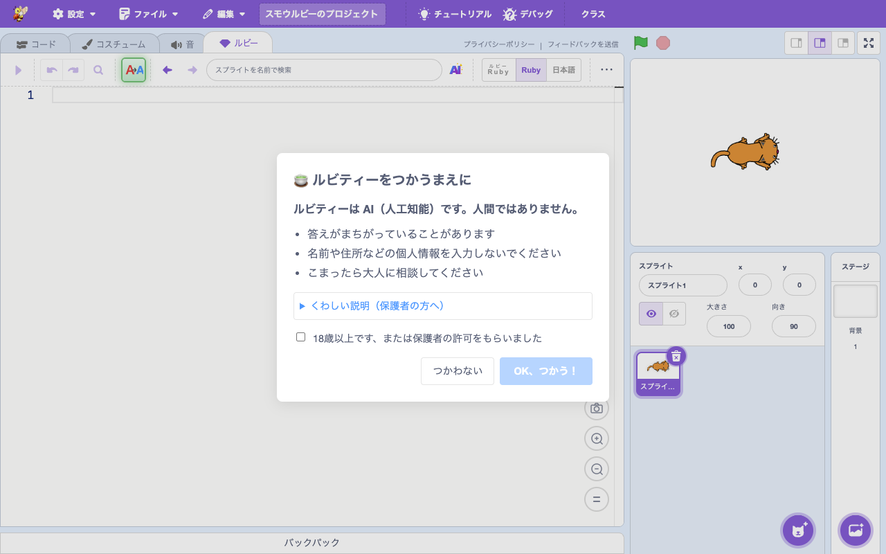
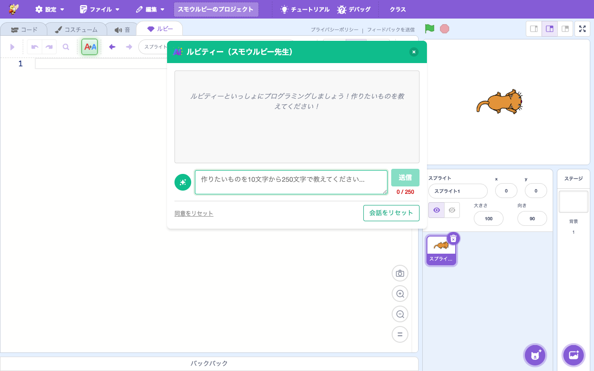
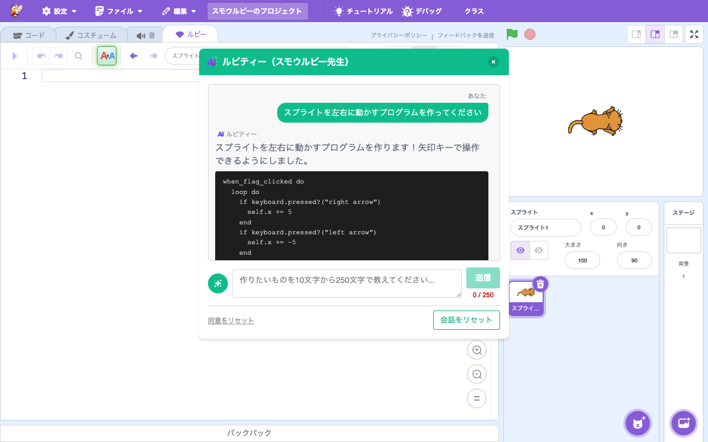

# Rubytee（ルビティー）

> **🆕 Smalruby 独自** — upstream に存在しない、Smalruby のために新規追加された機能
> Anthropic Claude API を使った AI コード生成支援機能。upstream の Scratch には AI 機能なし。

## 概要

Rubytee（ルビティー）は **Anthropic Claude API（claude-haiku-4-5）** を使って Ruby コードの生成・修正をチャット形式で支援する機能。Ruby タブの "ルビティー" ボタンから起動し、自然言語で要望を伝えると、現在のスプライト・ステージ・コードのコンテキストを踏まえたコードを生成する。

API キーをクライアントに直接持たせず、AWS Lambda の専用リレー（`infra/smalruby-rubytee-relay`）を経由することで、API キー管理・レート制限・入力検証・年齢適合チェックを集約している。

> **命名**: ルビティー = Ruby + ティー(Teacher)、また "Ruby Tea" 🍵 のニュアンス。前身の **スモウルビー先生** は Gemini API を使っていたが、Anthropic に移行する際にリブランディングした (Issue #346)。

## ユーザーストーリー

- **Ruby を書き始めた小学生**として、「キャラクターを左右に動かしたい」と日本語で頼んで、動くサンプルコードを得たい
- **教師**として、生徒が詰まったときに「どこをどう直せばよいか」を AI に聞ける環境を提供したい
- **保護者**として、子どもが AI に依存しすぎないよう、初回利用時に**同意ダイアログ**で AI の特性を説明してほしい
- **共通テスト対策中の高校生**として、自分が書いた DNCL/Ruby コードのレビューを AI に頼みたい

## 安全・コンプライアンス（重要）

このプロダクトは **未成年者向け** であり、Anthropic の利用規約に明示的に準拠する形で設計されている：

- **同意ダイアログ**: 初回利用時に `rubytee-consent` モーダルで AI の特性・利用規約を表示し、ユーザーの同意を取得（localStorage に保存）
- **年齢チェック**: 同意ダイアログにチェックボックス
- **AI 生成物であることの明示**: 出力に AI 生成のラベル
- **COPPA 対応**: 法的文書（プライバシーポリシー）でも明示
- **API キー秘匿**: クライアントは API キーを持たず、Lambda リレー経由
- **レート制限**: IP ベースで `35 分あたり 40 リクエスト`（DynamoDB の TTL で実装）
- **入力長制限**: ユーザーメッセージ 10〜250 文字、現在コード 1000 文字、履歴 20 ターン

> **背景**: Gemini/Vertex AI ToS は 18 歳未満ユーザー向けアプリでの利用を禁止していたため、Anthropic へ移行した。Anthropic は安全措置を取れば未成年向け製品での利用を明示的に許可している。

## UI / 操作フロー

1. Ruby タブの **ruby-toolbar** で「ルビティー」ボタン (`ruby-toolbar-rubytee`) をクリック
2. **初回のみ**: 同意ダイアログ (`rubytee-consent`) が表示される。チェックを入れて「OK」で `localStorage.smalruby:rubyteeConsent = 'true'` が保存される

   

3. チャットモーダル (`rubytee-modal`) が開く

   

4. 自然言語で要望を入力 → AI が現在のコンテキスト（編集中スプライト、ステージ、コード）を踏まえて Ruby コードを生成

   

5. 生成されたコードは「適用」ボタンでエディタに挿入できる
6. 「同意をリセット」で同意状態を削除可能

## 主要ファイル

### scratch-gui

#### UI コンポーネント

- `packages/scratch-gui/src/components/rubytee-modal/rubytee-modal.jsx` — チャット UI 本体
- `packages/scratch-gui/src/components/rubytee-modal/rubytee-modal.css` — スタイル
- `packages/scratch-gui/src/components/rubytee-consent/rubytee-consent.jsx` — 同意ダイアログ
- `packages/scratch-gui/src/components/ruby-toolbar/ruby-toolbar.jsx` — ルビティーボタン

#### コンテナ・ライブラリ

| ファイル | 役割 |
|---|---|
| `packages/scratch-gui/src/containers/rubytee-modal-hoc.jsx` | モーダル HOC、同意フロー、チャット履歴、API 呼び出し |
| `packages/scratch-gui/src/lib/rubytee-api.js` | Relay API クライアント (`RubyteeAPI` クラス、`RateLimitError`)|
| `packages/scratch-gui/src/lib/rubytee-context.js` | スプライト/ステージの状態コンテキスト構築 |

#### Props 配線

`RubyteeModalHOC` → `RubyTab` → `RubyToolbar` の props 伝播：

- `onOpenRubyteeModal` — ルビティーボタンのクリックハンドラ
- `onRegisterRubyteeApply` — AI 生成コードをエディタに挿入するコールバック登録

### infra/smalruby-rubytee-relay

AWS Lambda リレーサービス（API Gateway HTTP API + Lambda + DynamoDB）：

| ファイル | 役割 |
|---|---|
| `infra/smalruby-rubytee-relay/lambda/handler.ts` | API Lambda。リクエスト検証、レート制限、Claude API 呼び出し（Ruby タブ）、takeover のジョブ作成と `GET /jobs/{jobId}` |
| `infra/smalruby-rubytee-relay/lambda/takeover.ts` | 「ルビティーにまかせる」の上限・システムプロンプト・キー・ジョブの形（純粋関数） |
| `infra/smalruby-rubytee-relay/lambda/takeover-worker.ts` | takeover の worker Lambda。非同期で呼ばれ、Claude（Sonnet）を呼んで結果を jobs 表に書く |
| `infra/smalruby-rubytee-relay/lambda/smalruby-reference.ts` | スモウルビーの言語仕様（Ruby タブと takeover のプロンプトで共有） |
| `infra/smalruby-rubytee-relay/lib/rubytee-relay-stack.ts` | CDK スタック定義 |
| `infra/smalruby-rubytee-relay/lambda/tests/` | 単体テスト |

#### Lambda の主要ロジック

- 入力検証（メッセージ長、フィールド長、履歴ターン数の上限）
- IP ベースレート制限（DynamoDB の TTL 機能で window 管理）
- `system` プロンプト + `messages` 配列に変換して Anthropic API へ POST
- **Prompt caching** (`cache_control: ephemeral`) を有効化してコスト削減
- CORS 検証（`CORS_ALLOWED_ORIGINS` 環境変数）
- エラー時は `429 RATE_LIMIT_EXCEEDED` などの構造化エラー

### scratch-vm

なし（GUI 側で完結）。

## 設定・データ永続化

### クライアント側（webpack で `process.env` に注入、`.env` から読込）

| 環境変数 | 用途 |
|---|---|
| `RUBYTEE_RELAY_ENDPOINT` | Lambda リレーのエンドポイント URL |

ローカル開発では stg エンドポイントを使う（prod は CORS で localhost を許可しない）。

### Lambda 側（CDK で渡す）

| 環境変数 | デフォルト | 用途 |
|---|---|---|
| `ANTHROPIC_API_KEY` | - | Anthropic API キー |
| `CLAUDE_MODEL` | `claude-haiku-4-5-20251001` | 使用モデル（Ruby タブのルビティー。`purpose` 未指定のとき） |
| `CLAUDE_TAKEOVER_MODEL` | `claude-sonnet-5-5` | 「ルビティーにまかせる」用モデル（`purpose: "genai-takeover"` のとき） |
| `RATE_LIMIT_WINDOW_MINUTES` | `35` | レート制限ウィンドウ |
| `RATE_LIMIT_MAX_REQUESTS` | `40` | ウィンドウ内最大リクエスト |
| `MAX_USER_MESSAGE_LENGTH` | `250` | ユーザーメッセージ最大文字数 |
| `MIN_USER_MESSAGE_LENGTH` | `10` | ユーザーメッセージ最小文字数 |
| `CORS_ALLOWED_ORIGINS` | `https://smalruby.app` | CORS 許可オリジン |
| `RATE_LIMIT_TABLE_NAME` | - | DynamoDB テーブル名（CDK で設定）|
| `JOBS_TABLE_NAME` / `USAGE_TABLE_NAME` / `TAKEOVER_WORKER_FUNCTION_NAME` | - | takeover の jobs 表・集計表・worker 名（CDK で設定） |
| `CLASSROOM_MEMBERSHIPS_TABLE_NAME` | - | 席を確かめるクラス管理の memberships 表名（CDK が `ClassroomMemberships{suffix}` を設定。GSI `sessionToken-index` の `Query` だけを許可） |
| `TAKEOVER_SEAT_MAX_REQUESTS` | `40` | takeover の 1 席（`sessionToken` で確かめた classroom + 出席番号）あたりの上限 / 窓 |
| `TAKEOVER_IP_MAX_REQUESTS` | `1600` | takeover に重ねる IP 単位の上限 / 窓（40 人 × 40 回） |
| `TAKEOVER_WORKER_RESERVED_CONCURRENCY` | prod `50` / 他 `10` | worker の同時実行数の上限（CDK のみ。費用が青天井にならないように） |

固定の上限値:
- `MAX_FIELD_NAME_LENGTH = 100`（スプライト/コスチューム/サウンド名）
- `MAX_CURRENT_CODE_LENGTH = 1000`（現在編集中コード）
- `MAX_HISTORY_TURNS = 20`（会話履歴）
- `MAX_HISTORY_TURN_TEXT_LENGTH = 1000`（履歴 1 ターンあたり）
- takeover だけの上限は下の「ルビティーにまかせる（takeover）の呼び方」を参照

### localStorage

- `smalruby:rubyteeConsent` — 同意状態（`'true'` のみ ON）

## モニタリング

CloudWatch ログで利用状況を監視。Rubytee 利用パターンとコスト異常検出は `rubytee-monitor` skill を使用（`.claude/skills/rubytee-monitor/`）。

### リクエストの任意フィールドと構造化ログ

`POST /generate` のリクエストには、従来の `userMessage` / `history` / `stateContext` に加えて
次の**任意**フィールドを付けられる（付けない従来のクライアントはそのまま動く）。

| フィールド | 例 | 用途 |
|---|---|---|
| `purpose` | `"genai-takeover"` | 用途。`genai-takeover` のときだけ `CLAUDE_TAKEOVER_MODEL`（Sonnet）を使う。未指定・未知の値は従来のモデル |
| `sessionToken` | `"3b241101-…"` | 生徒がクラスに参加したときにもらうトークン（クラス管理の `sessionToken`）。relay が席を確かめる。クラスに参加していなければ送らない |

**席は `sessionToken` からだけ決める**（`classroom` / `seat` は自己申告なので、送られてきても**無視する**）。
relay はクラス管理の `ClassroomMemberships{suffix}` の GSI `sessionToken-index` を**読み取り専用で Query** し、
行の `classroomId` と `memberId`（`seat-03` → 出席番号 `3`）を席にする。クラス管理の `verifySessionToken`
と同じく **kicked の行は認めない**。確かめられないとき（トークンなし・UUID の形でない・見つからない・
kicked・表が読めない）は**席として数えない**（ログ・集計は `classroom` / `seat` なし）。
これは不正防止の判定なので fail-open（席として信じる）にはしないが、答えは返す。

確かめた席は CloudWatch ログ・集計表・takeover の席の上限に使う。`purpose` 未指定の呼び出しは
今の IP レート制限のまま（席で上限は変わらない）。takeover は 1 席ごとに数える（下記）。
クラス管理のメンバー一覧の `aiUsage` はこの classroomId / 出席番号で relay の表を引く
（`docs/classroom/architecture.md`）。

`sessionToken` で確かめる理由: 以前は `classroom` / `seat` を自己申告で受けていたので、`classroomId` を
知っていれば誰でも、他の生徒の席の枠を使い切る・先生に見せる `aiUsage` をずらす・RETAIN の集計表に
好きな `classroom#...` の行を作る・自己申告の席だけで IP 1600 回の枠を使う、ができた（#1317）。

1 リクエストにつき 1 行の JSON ログ（`event: "rubytee_response"`）が出る:

```json
{"event":"rubytee_response","model":"claude-sonnet-5-5","outputTokens":350,"inputTokens":17,"cacheCreationTokens":0,"cacheReadTokens":4964,"userMessageLength":42,"purpose":"genai-takeover","classroom":"cls_abc123","seat":"12"}
```

### CloudWatch Logs Insights の集計クエリ例

ロググループ `/aws/lambda/RubyteeRelayHandler`（prod）/ `/aws/lambda/RubyteeRelayHandler-stg`（stg）で実行する。

とても多く使っている利用者（クラス・出席番号ごとの回数とトークン）:

```
fields @timestamp, classroom, seat
| filter event = "rubytee_response" and ispresent(classroom)
| stats count(*) as requests, sum(outputTokens) as output, sum(inputTokens + cacheCreationTokens + cacheReadTokens) as input by classroom, seat
| sort requests desc
| limit 50
```

用途・モデルごとの回数（Sonnet の利用量の把握）:

```
fields @timestamp
| filter event = "rubytee_response"
| stats count(*) as requests, sum(outputTokens) as output by purpose, model
| sort requests desc
```

クラスごとの日別の回数:

```
fields @timestamp
| filter event = "rubytee_response" and ispresent(classroom)
| stats count(*) as requests by classroom, bin(1d)
| sort requests desc
```

## ルビティーにまかせる（takeover）の呼び方

`purpose: "genai-takeover"` のときだけ、上限を広げて **非同期ジョブ**で答える（Sonnet が 8192 トークンを
出し切ると API Gateway HTTP API の統合タイムアウト 30 秒を超えうるため）。`purpose` 未指定の
呼び出しは今の同期のまま（モデル・上限・プロンプト・IP レート制限も今のまま）。

### 流れ

1. `POST /generate`（本文は従来と同じ形 + `purpose: "genai-takeover"`、クラスに参加していれば `sessionToken`）
   → 入力チェックとレート制限を通ると **`202 { "jobId": "<uuid>", "status": "pending" }`**
2. `GET /jobs/{jobId}` を問い合わせる → `200` で次のどれか:
   - `{ "jobId", "status": "pending" }` — まだ考え中。間隔を空けて再度問い合わせる
   - `{ "jobId", "status": "done", "text": "<答え>", "outputTokens": 1234 }`
   - `{ "jobId", "status": "error", "error": "<CODE>" }`
3. GUI は `text` をそのまま `checkAnswer` に通す（答えの形は下記）。

問い合わせ間隔は **3 秒から始めて少しずつ伸ばす**（例: 3 → 4 → 5 秒…、最大 10 秒）。クラス全員が
同時に問い合わせても API Gateway の上限に当たらないよう、`GET /jobs/{jobId}` だけルート単位の
スロットリング（prod 40 rps / burst 80、stg 10 / 20）を持つ。`GET` はレート制限の回数に数えない。
ジョブは **1 時間**で消える（それ以降は `404 JOB_NOT_FOUND`）。

### 上限（takeover のときだけ）

| 項目 | takeover | 従来（`purpose` 未指定） |
|---|---|---|
| `userMessage` | 10000 字（`DANGEROUS_PATTERNS` のチェックは残る） | 250 字 |
| `stateContext.sprite.currentCode` | 10000 字 | 1000 字 |
| `history` | 20 ターン × 10000 字 | 20 ターン × 1000 字 |
| リクエスト全体 | **200KB（UTF-8）**。上の各項目の上限を通った後に判定し、超えたら `400 HISTORY_TOO_LONG`（`userMessage` / `currentCode` だけでは届かず、超えるのは往復を重ねたとき） | 判定しない（各項目の上限だけ） |
| `max_tokens` | 8192 | 1024 |
| レート制限 | `sessionToken` で席を確かめられれば IP 1600 回 / 35 分 + **1 席 40 回 / 35 分**。確かめられなければ IP 40 回 / 35 分 | IP 40 回 / 35 分 |

レート制限は **IP → 席の順**に数える。IP の上限で 429 になったときは席を数えない（先生に見せる席の回数が、
その生徒が使っていない分で増えないように）。席のキー `seat#<classroom>:<seat>` は `:` で区切るので、
確かめた行の `classroomId` に `:` を含むものや、`memberId` が `seat-<数字>` でないものは席として数えず、
IP 40 回 / 35 分に回す（クラス管理の `classroomId` は UUID、`memberId` は `seat-03` の形なので、正しい呼び出しは影響しない）。

リクエスト全体の 200KB は Lambda の非同期呼び出しの payload 上限（256KB）に収めるため。1 万字の
作品 + 何往復かは収まるが、20 往復すべてに作品全体を入れると超えうるので、**GUI は古い往復から
落として送る**。

### エラーコード（takeover で増えるもの）

| コード | いつ |
|---|---|
| `INVALID_JOB_ID`（400） | `GET /jobs/{jobId}` の jobId が UUID の形でない |
| `JOB_NOT_FOUND`（404） | ジョブが無い（1 時間を過ぎて消えた・存在しない） |
| `JOB_TIMEOUT`（`status: "error"`） | 作成から 240 秒を過ぎても `pending`（worker が落ちた・混んでいて 60 秒以内に起動できなかった） |
| `AI_TIMEOUT`（`status: "error"`） | Claude の呼び出しが 150 秒で終わらなかった |
| `AI_OVERLOADED` / `AI_API_ERROR` / `INTERNAL_ERROR`（`status: "error"`） | 同期の経路と同じ意味 |

`POST` のエラー（`INPUT_TOO_LONG` / `RATE_LIMIT_EXCEEDED` など）は従来どおり `POST` の応答で返る。

### 答えの形とシステムプロンプト

- 1〜3 行の日本語の説明 → `▼▼ ここから下をコピーして、スモウルビーにもどろう ▼▼` → ```` ```ruby ```` の
  コードブロック 1 つ → `▲▲ ここまで ▲▲` → 確かめ方 1 つ。コードブロックの中は、変えたスプライトごとに
  `# 「スプライト名」` の行 + そのスプライトの作品全体（ステージは `# 「ステージ」`）。
- `system` は 2 ブロック。**先頭 = 固定部分**（役割・言語仕様 `smalruby-reference.ts`・答えの形・Child
  Safety）に `cache_control: { type: "ephemeral", ttl: "1h" }` を付ける（授業中に間隔が空いてもキャッシュが
  残るように）。**後ろ = 毎回変わる部分**（今のスプライト・名前の一覧・`currentCode`）。作品・困りごと・
  失敗理由は後ろのブロックか `messages` に置き、先頭ブロックの一致を崩さない。

### 作り（安全のための決めごと）

| 部品 | 役割 | 権限 |
|---|---|---|
| API Lambda `RubyteeRelayHandler{suffix}` | 入力チェック → レート制限 → ジョブを `pending` で作る → worker を非同期で起動 → `202`。`GET /jobs/{jobId}` に答える | rate limit 表の読み書き、jobs 表の `PutItem` / `GetItem`、usage 表の `UpdateItem`、**worker 1 つだけ**の `lambda:InvokeFunction` |
| worker Lambda `RubyteeRelayTakeoverWorker{suffix}` | Claude を呼び、結果を jobs 表に書く。**HTTP のルートは無い**。再試行 0 回・timeout 180 秒・同時実行数の上限あり・起動待ちが 60 秒を超えた呼び出しは捨てる（`maxEventAge`） | jobs 表と usage 表の `UpdateItem` だけ |
| DynamoDB `RubyteeJobs{suffix}` | `{ jobId, status, createdAt, text?, outputTokens?, error?, ttl }`。**入力は保存しない**（worker には非同期呼び出しの payload だけで渡す）。TTL 1 時間 | — |

- 新しい外部サービス・仕組み（Step Functions / SQS / Function URL / Anthropic SDK）は使わない。増えた依存は
  AWS 公式の `@aws-sdk/client-lambda`（v3）だけ。
- jobId は `crypto.randomUUID()`（推測できない乱数）。UUID の形でなければ DynamoDB を見ずに 400。

## 利用の集計・席ごとの状況

### 集計表 `RubyteeRelayUsage{suffix}`（RETAIN・TTL なし）

takeover と Ruby タブのルビティー（`purpose` 未指定 = `chat`）の**両方**を、`sessionToken` で確かめた席ごと・日ごとに
足し込む（1 回ごとの行は作らない）。書き込みに失敗しても答えは返す（fail-open）。

- キー: `pk = classroom#<classroomId>`（席を確かめられなければ `classroom#-`）、`sk = <YYYY-MM-DD(JST)>#seat#<seat>#<purpose>`
  （`seat` が無ければ `-`、`purpose` 未指定は `chat`）
- 属性（`ADD` で足し込む数）: `requests`（受け付けた回数）/ `rateLimited`（429）/ `succeeded` / `failed` /
  `inputTokens` / `outputTokens` / `cacheReadTokens` / `cacheCreationTokens`
- 名前・メールアドレス・IP・入力や答えの中身は残さない。

集計は `Query` で取る（例: あるクラスの 11 月）:

```bash
aws dynamodb query --table-name RubyteeRelayUsage \
  --key-condition-expression 'pk = :pk AND sk BETWEEN :from AND :to' \
  --expression-attribute-values '{":pk":{"S":"classroom#<classroomId>"},":from":{"S":"2026-11-01"},":to":{"S":"2026-11-30~"}}'
```

### 席ごとの「今の状況」（クラス管理が読む）

takeover で 1 席ぶん数えるたびに、レート制限表に席ごとに 1 行だけの要約を上書きする:
キー `sourceIp = seat#<classroomId>:<seat>#current`、`windowStart = 0`、属性 `count` / `limit` / `windowMinutes` /
`resetAt`（窓が終わる epoch 秒）/ `ttl`（= `resetAt`）。上限と窓も relay が書くので、クラス管理は計算せずに読むだけ。

relay は 2 つの表の ARN を CfnOutput と SSM（`/smalruby/rubytee-relay/<stage>/rate-limit-table-arn`、
`.../usage-table-arn`）に出す。クラス管理のスタックは**読み取り権限（`GetItem` / `BatchGetItem` / `Query`）だけ**を
持つ（表名は `RubyteeRelayRateLimit{suffix}` / `RubyteeRelayUsage{suffix}` から組み立てるので、スタックの
デプロイ順に依存しない）。メンバー一覧の `aiUsage` の形は `docs/classroom/architecture.md` を参照。

逆向きに、relay の API Lambda はクラス管理の `ClassroomMemberships{suffix}` の **GSI `sessionToken-index` への
`dynamodb:Query` だけ**を持つ（表本体への権限は無い）。こちらも表名から ARN を組み立て、デプロイ順に依存しない
（クラス管理の表がまだ無ければ、席として数えず IP だけの上限になるだけ）。

キーの組み立て（`seat#...#current`・JST の日付・集計表の `sk`）は relay の `lambda/takeover.ts` と
クラス管理の `lambda/ai-usage-lib.ts` に**別々に書いてあり、対で変える**。1 つのモジュールにまとめないのは、
`infra/` の CDK プロジェクトがそれぞれ独立していて（`package.json`・`tsconfig.json` の `rootDir`・
デプロイの workflow が `infra/<project>/` ごとに差分を見る）、共有の置き場を作ると片方だけデプロイされる
ずれが起きるため。両方のテストが同じ文字列（例: `seat#c1:3#current`、`2026-11-01#seat#3#genai-takeover`）を
期待値に持っているので、片方だけ変えるとテストで気付ける。

## デプロイ

詳細手順は `.claude/rules/infra/smalruby-rubytee-relay.md` を参照。

```bash
# stg
docker compose run --rm -w /app/infra/smalruby-rubytee-relay infra npx cdk deploy

# prod
cd infra/smalruby-rubytee-relay && rm .env && ln -s .env.prod .env
docker compose run --rm -w /app/infra/smalruby-rubytee-relay infra npx cdk deploy
```

## テスト

- 単体テスト（クライアント）: `packages/scratch-gui/test/unit/lib/rubytee-api.test.js`, `rubytee-context.test.js`, `containers/rubytee-modal-hoc-sanitize.test.js`
- 結合テスト（クライアント）: `packages/scratch-gui/test/integration/rubytee-consent.test.js`
- 単体テスト（Lambda）: `infra/smalruby-rubytee-relay/lambda/tests/`

## 関連ドキュメント

- [`docs/ruby-editor/`](../ruby-editor/) — Rubytee の起点となる Ruby エディタ
- `.claude/rules/infra/smalruby-rubytee-relay.md` — リレー実装・デプロイ・運用ルール
- `.claude/rules/scratch-gui/development.md` — Rubytee セクション (props 配線等)
- `.claude/skills/rubytee-monitor/SKILL.md` — CloudWatch ログ監視運用

## 関連 Issue / PR

- Issue #346 — Gemini → Claude 移行、ルビティーへのリブランディング
- 主要 PR は履歴を参照（`feat:.*rubytee` で grep）
