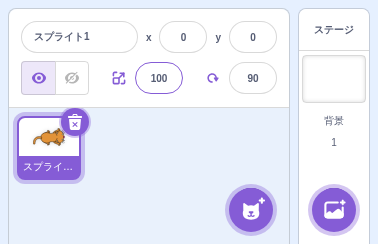

# スプライト

> **🔧 upstream 改良** — upstream にあるが Smalruby で機能を改良・拡張している
> 改良点: 中サイズのステージ（Smalruby 独自）では、スプライトの情報のラベルを詰めてスプライトの一覧を広くする

## 概要

Scratch プロジェクトに登場する**キャラクター（スプライト）**の追加・選択・配置・属性編集を扱う機能群。スプライトライブラリからの選択、自分で描く、ファイルから取り込む、ステージ上のドラッグでの配置、座標・向き・サイズの編集など、upstream Scratch から継承する機能をそのまま提供している。

## ユーザーストーリー

- **小学生**として、ライブラリから猫やボールなどのキャラクターを選んで作品に追加したい
- **オリジナル作品を作る子**として、自分で描いたスプライトを使いたい
- **発表会の出展者**として、複数のキャラクターを配置して画面構成を作りたい
- **作品制作中の子**として、スプライトの座標・向き・サイズを GUI で直接調整したい

## UI / 操作フロー

エディタ右下の **スプライトペイン** で操作：

| 操作 | UI |
|---|---|
| スプライト追加 | 「+」ボタン → スプライトライブラリ / カメラ撮影 / ファイル / 自分で描く |
| スプライト選択 | スプライト一覧をクリック |
| スプライト削除 | スプライトカードの「×」 |
| 座標設定 | スプライト情報の x, y 入力欄 |
| 向き設定 | direction-picker (時計型 UI) |
| サイズ設定 | size 入力欄 |
| 表示/非表示 | show/hide トグル |
| ロック | スプライトをドラッグ移動できないようにロック |

### 中サイズのステージのスプライトの情報

中サイズのステージ（Smalruby 独自。既定のステージの大きさ）のときは、スプライトの情報（名前・x・y・表示・
大きさ・向き）を 2 行に詰め、その分スプライトを選ぶ一覧の高さを増やす。授業のパソコン（1300×600）で
レッスンの課題バーが出ると縦が 40px 減るため、一覧が隠れないようにする。レッスンモードかどうかに関係なく、
中サイズのステージのときは常にこの形。

- 「スプライト」の字は出さない（名前の入力欄だけ。名前の入力欄は x / y の残りの幅を使う）。
- 「x」「y」は入力欄の**左隣**に置く（上ではなく）。
- 「大きさ」「向き」は、1 文字ぶんの**アイコン**（大きさ = `sprite-info/icon--size.svg`、向き = direction-picker の
  `icon--all-around.svg`）にして入力欄の左隣に置く。マウスを乗せると意味が出る（`title` / `aria-label`。
  en「Size (%)」「Direction (degrees)」・ja「大きさ（%）」「向き（度）」・ja-Hira「おおきさ（%）」「むき（ど）」）。
- 大きさ・向きの入力欄は x / y と同じ幅（3rem）。字の代わりのアイコンの分、列の幅を広げない。
- ほかのステージの大きさ（小・大）は upstream のまま。SP のスプライトのパネル（`MobileSpritePanel`）は
  `stageSize="middle"` を渡しているので、SP でも同じ詰めた形になる（縦の短い SP でも一覧が広くなる）。

| data-testid | 要素 | 説明 |
|---|---|---|
| `sprite-info-compact` | div | 中サイズのステージの詰めたスプライトの情報 |
| `sprite-info-size-icon` | img | 大きさのアイコン |
| `sprite-info-direction-icon` | img | 向きのアイコン |

## 主要ファイル

### scratch-gui

#### コンポーネント / コンテナ

| ファイル | 役割 |
|---|---|
| `packages/scratch-gui/src/containers/sprite-info.jsx` | スプライト情報パネル (座標・向き・サイズ・表示) |
| `packages/scratch-gui/src/components/sprite-info/` | UI コンポーネント（中サイズのステージの詰めた形は `sprite-info.jsx` のマーカー `compact middle sprite info`） |
| `packages/scratch-gui/src/components/sprite-info/icon--size.svg` | 大きさのアイコン（Smalruby で追加） |
| `packages/scratch-gui/src/containers/sprite-selector-item.jsx` | スプライト一覧の各カード |
| `packages/scratch-gui/src/components/sprite-selector/` | スプライト一覧 UI |
| `packages/scratch-gui/src/components/sprite-selector-item/` | カード UI |
| `packages/scratch-gui/src/containers/sprite-library.jsx` | スプライトライブラリモーダル |
| `packages/scratch-gui/src/containers/target-pane.jsx` | スプライトペイン全体 |
| `packages/scratch-gui/src/containers/target-highlight.jsx` | 選択中スプライトのハイライト |

#### 向き・方向

- `packages/scratch-gui/src/containers/direction-picker.jsx` — 向き選択 UI

#### State 管理

- `packages/scratch-gui/src/reducers/targets.js` — スプライト一覧 / 選択中ターゲット
- `packages/scratch-gui/src/reducers/hovered-target.js` — ホバー中ターゲット

### scratch-vm

`packages/scratch-vm/src/sprites/` — Sprite, RenderedTarget の実装。

### infra

なし。

## 関連ブロック

スプライト自体の操作に関連するブロック：

| ブロック | 説明 |
|---|---|
| `motion_gotoxy` | 指定座標へ移動 |
| `motion_setx` / `motion_sety` | x / y 座標設定 |
| `motion_changexby` / `motion_changeyby` | 座標変化 |
| `motion_pointindirection` | 向き設定 |
| `motion_movesteps` | 歩数移動 |
| `looks_changesizeby` / `looks_setsizeto` | サイズ変更 |
| `control_create_clone_of` | クローン作成 |
| `control_delete_this_clone` | クローン削除 |

> 各ブロックの Ruby 表現は [`docs/smalruby-language-spec.ja.md`](../smalruby-language-spec.ja.md) を参照。
> 「見た目」関連のブロック (`looks_say`, `looks_show` など) は将来 `docs/looks/` を作る場合に分離可能。

## 設定・データ永続化

### Redux state

- `targets` — スプライト一覧 / 編集中ターゲット
- `hovered-target` — ホバー中
- `asset-drag` — アセットドラッグ状態
- `dynamic-assets` — 動的アセット

## 関連ドキュメント

- [`docs/costume/`](../costume/) — スプライトのコスチューム編集
- [`docs/sound/`](../sound/) — スプライトのサウンド編集
- [`docs/stage/`](../stage/) — ステージ全体

## 関連 Issue / PR

upstream そのままの機能のため、Smalruby 固有の Issue はほとんどなし。
