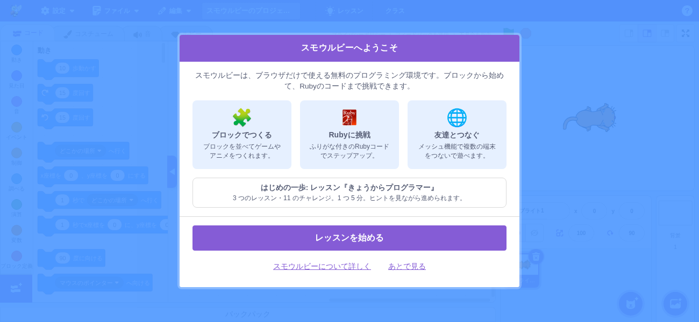
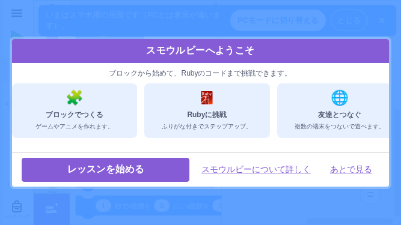
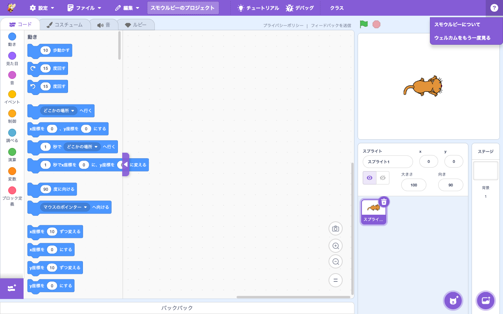
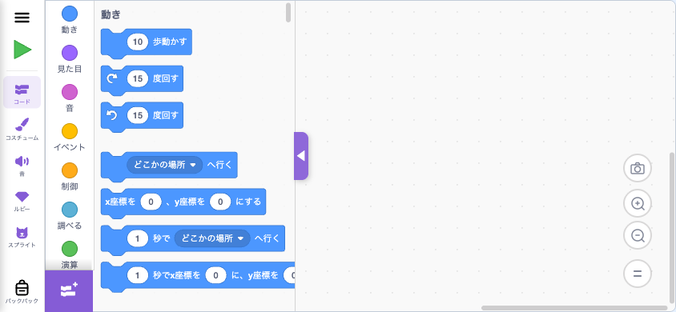

# ウェルカム / About 動線

> **🆕 Smalruby 独自** — upstream に存在しない、Smalruby のために新規追加された機能

## 概要

スモウルビーに初めて訪れたユーザーが「これは何ができるサイトか」を理解し、最初の一歩を踏み出せるようにするための導線をまとめた機能。3 つの構成要素からなる:

1. **ウェルカムモーダル** — エディタ内で「スモウルビーで何ができるか」を 3 枚のカードで紹介し、レッスンや紹介ページへ誘導するダイアログ
2. **About ページ** (`/about.html`) — 検索流入や紙のチラシから到達する SP 完全対応の紹介ページ。SNS 共有ボタンと QR コードを備え、紹介を広めやすい
3. **About メニュー / ヘルプセクション** — エディタ内のメニューから上記 2 つに常時アクセスできる動線（PC: メニューバー About、SP: MobileDrawer のヘルプセクション）

## ユーザーストーリー

- **初めて訪れたユーザー**として、スモウルビーが何ができるサイトかを知り、最初に何をすればよいか分かりたい
- **学校の先生**として、生徒や保護者に「スモウルビーって何？」をスマホ・PC 両方で簡単に紹介できるリンク（紙チラシも含む）が欲しい
- **既存ユーザー**として、ウェルカム画面を後からもう一度見られるようにしたい

## UI / 操作フロー

### ウェルカムモーダル (PC)

3 枚のカード（ブロック / Ruby / メッシュ）で「できること」を紹介。Ruby のカードには公式 Ruby ロゴ SVG を使用。
カードの下に、はじめの一歩のコースの案内を 1 段出す（「はじめの一歩: レッスン『きょうからプログラマー』」「3 つのレッスン・11 のチャレンジ。1 つ 5 分。ヒントを見ながら進められます。」）。
コースは `COURSES` の先頭、レッスンの数・チャレンジの数はコースのデータから出す（`courses.js` の `courseSize`。直書きしない）。「1 つ 5 分」はチャレンジの大きさのきまり（[`docs/lessons/design.md`](../lessons/design.md)）。

CTA:
- **レッスンを始める** (Primary) — ウェルカムを閉じてレッスン表を開き、次にやるチャレンジに「次はこれ！」を付ける（下の「レッスンを始める」）
- **スモウルビーについて詳しく** — `/about.html` を新規タブで開く
- **あとで見る** — モーダルを閉じる

チュートリアル一覧はウェルカムからは開かない（「?」メニュー › チュートリアル と `?tutorial=` はそのまま）。先生向けの入口も置かない（先生は「スモウルビーについて詳しく」から）。

#### レッスンを始める

レッスン表の「次はこれ！」の見せ方（そのレッスンへスクロールして薄い紫で囲み、カードにオレンジの枠と「次はこれ！」）は、「できた！」の「次のチャレンジへ」と同じ仕組みを使う（[`docs/lessons/README.md`](../lessons/README.md) の「レッスン表」）。どのチャレンジに付けるかは記録から決める（`lesson-progress.js` の `startLessonsFocus`）:

| 記録 | 「次はこれ！」 |
|---|---|
| まだ何もしていない | レッスン 1 の最初のチャレンジ |
| 途中 | いちばん最近できたチャレンジを「いまのチャレンジ」として、「次のチャレンジへ」と同じ決め方（`lessonsLibraryFocus`）。それで印が付かないとき（後ろのレッスンだけ全部できている）は、コースの並び順で最初のまだできていないチャレンジ |
| ぜんぶできた | 付けない（メニューから開いたときと同じ） |

#### 見た目

上流のモーダル（`components/modal/modal.css`）に合わせる: 青い幕（`$color-overlay`）、白い 4px の縁と角丸（`$radius-medium`）、紫のヘッダー（`.header` と同じ高さ `$library-header-height`・`$color-primary`）、紫の主ボタン（`$color-primary`・枠 `1px solid $color-primary`・文字 `$ui-white`。ホバーの見た目は付けず、押したときに `$color-primary-dark`）。ボタンの形とフォーカス（`:focus-visible` で 2px の紫の線を 2px 外に）は [`docs/design-system/components/README.md`](../design-system/components/README.md) の「独自の画面で使う形」に合わせる。角丸・文字・余白は `smalruby-tokens.css` のトークンで書く（[`docs/design-system/tokens.md`](../design-system/tokens.md)）。

#### キーボード

- 開いたら主ボタン（レッスンを始める）にフォーカスを移す（ダイアログは `document.body` の最後に出すので、そのままだと Tab で届くのが遅いため）。
- Tab / Shift+Tab はダイアログの中を回る（端で反対の端へ）。
- Esc は「あとで見る」と同じ（GA も `later`）。

### ウェルカムモーダル (SP 横持ち)

SP では `useIsNarrowScreen` で narrow 判定し、レイアウトを切り替え:

- 3 カードを横スクロール（`scroll-snap-type: x mandatory`）にして縦領域を節約
- Primary CTA は PC と同じ「レッスンを始める」（レッスン表は SP でも使える）。CTA は 1 行に並べる
- コースの案内は出さない（縦が足りないため）
- ダイアログを縦の flex にし、本文（`.dialog-body`）だけをスクロールさせ、CTA の段（`.buttons`）は `flex-shrink: 0` で縮めずに下に置くので、CTA はいつも画面内に見える。スマホ横はヘッダーを `$library-filter-bar-height`（2.5rem）に低くする
- ダイアログは `document.body` の直下に出し（portal）、SP では幕の重なり順を共有のモーダルと同じく底上げする（`mobile-gui.css`。左のレールやお知らせの帯の下に隠れないため）

縦持ちスマホでは `MobileOrientationGate` が優先するため、ウェルカムモーダルは描画されない（横向きに回転すると自動的に表示される）。

### About メニュー (PC)

メニューバー右側の「ⓘ」アイコンから「スモウルビーについて」「ウェルカムをもう一度見る」にアクセスできる。

### MobileDrawer ヘルプセクション (SP)

SP ではメニューバーが表示されないため、`☰` から開く MobileDrawer のヘルプセクションに同じ 2 項目を配置。

## 起動条件

ウェルカムモーダルは **自動表示しない**（既存ユーザーに突然モーダルを出さないため）。代わりに、メニューバー右端の About (`?`) ボタンの **左隣** に **ウェルカムバルーン**（吹き出し）を表示し、クリックでモーダルを開く。

### バルーンの表示条件

- 初回訪問時にメニューバー右端の About (`?`) ボタンの左隣に「スモウルビーへようこそ」バルーンを表示
- バルーンクリックでウェルカムモーダルが開く（同時にバルーンは永続的に非表示）
- バルーン右端の `×` でも閉じられる（モーダルは開かない）
- 初回表示から **5 日経過すると次回起動時に自動的に非表示**（起動時のみチェック、滞在中は消えない）
- **レッスンモード（チャレンジを開いている）のあいだは出さない**（課題バーに重なるため）。記録は変えないので、レッスンモードを抜けると元どおり出る
- クラス管理の先生がログインしているあいだも出さない（先生メニューがその位置に出るため）

### モーダル本体の表示トリガー

- ウェルカムバルーンをクリック
- About メニュー → 「ウェルカムをもう一度見る」
- MobileDrawer → ヘルプ → 「ウェルカムをもう一度見る」
- URL パラメータ `?welcome=1` （実機検証 / Playwright 用）

`?classcode=<code>` 起動時はクラスルームフローが優先されるため、ウェルカムは表示されない。

## 主要ファイル

- **scratch-gui**:
  - `src/components/welcome-modal/welcome-modal.{jsx,css}` — モーダル本体
  - `src/components/welcome-modal/icon-ruby.svg` — Ruby カードの公式ロゴアイコン
  - `src/components/welcome-tooltip/welcome-tooltip.{jsx,css}` — About (`?`) ボタン左隣のウェルカムバルーン（5 日後に自動非表示）。見た目は共通の吹き出し `src/components/balloon/`（青の callout + 閉じるボタン）
  - `src/components/menu-bar/menu-bar.jsx` — `WelcomeTooltip` の配置と `openWelcomeModal` の dispatch（マーカー）
  - `src/containers/welcome-modal-hoc.jsx` — Redux 接続。`isOpen` を読み、CTA で dispatch。コースの案内に出すコース（`COURSES` の先頭と `courseSize`）を渡す
  - `src/lib/lessons/open-lessons-library.js` — `openLessonsLibraryToStart`（「レッスンを始める」でレッスン表を開く）
  - `src/lib/lessons/lesson-progress.js` — `startLessonsFocus`（どのチャレンジに「次はこれ！」を付けるか）
  - `src/reducers/lesson-mode.js` — `focusLessonsLibraryStart` / `libraryStartFocus`
  - `src/containers/lessons-library.jsx` — `libraryStartFocus` のときに `startLessonsFocus` で見せる
  - `src/components/mobile-gui/mobile-gui.css` — SP でウェルカムの幕をサイドレールより上に出す
  - `src/components/gui/gui.jsx` — About メニュー項目の構築（マーカー）と HOC のレンダリング
  - `src/containers/gui.jsx` — `onShowWelcomeModal` を `openWelcomeModal()` にマップ
  - `src/components/mobile-drawer/mobile-drawer.jsx` — ヘルプセクション（About リンク + ウェルカム再表示）
  - `src/reducers/modals.js` — `welcomeModal` open/close アクション
  - `src/lib/url-params.js` — `?welcome=1` の解釈
  - `src/locales/{en,ja,ja-Hira}.js` — 英語 / 日本語 / ひらがなメッセージ
  - `pages/about.html` — 紹介ページ（QR コード + SNS 共有）
  - `pages/assets/smalruby-app-qr.svg` — `https://smalruby.app/` を符号化した QR コード SVG

## 設定・データ永続化

- **Redux state**: `state.scratchGui.modals.welcomeModal` (boolean) — モーダル表示状態。「レッスンを始める」で開いたレッスン表は `state.scratchGui.lessonMode.libraryStartFocus`（レッスン表を閉じると消える）
- **URL パラメータ**: `?welcome=1` または `?welcome=true` でモーダルを初回ロード時に自動表示
- **localStorage**:
  - `smalruby:welcomeTooltipFirstShownAt` — バルーンを最初に表示した時刻（ms）。バルーンは 5 日経過後に自動非表示
  - `smalruby:welcomeTooltipDismissed` — `'true'` でバルーンが永続的に非表示（クリック / `×` / 5 日経過のいずれかで設定）
  - 注: モーダル本体は seen フラグを持たない（初回モーダル自動表示は行わないため）

## 関連動作

| 操作 | 結果 |
|---|---|
| ウェルカムバルーン → クリック | `dispatch(openWelcomeModal())` + `localStorage.setItem('smalruby:welcomeTooltipDismissed', 'true')` |
| ウェルカムバルーン → `×` | バルーンを閉じる（モーダルは開かない） + dismissed フラグセット |
| ウェルカムバルーン初回表示 | `localStorage.setItem('smalruby:welcomeTooltipFirstShownAt', Date.now())` |
| 初回表示から 5 日経過後の起動時 | バルーン非表示 + dismissed フラグセット（起動時のみチェック） |
| About メニュー → スモウルビーについて | `window.open('about.html', '_blank', 'noopener,noreferrer')` |
| About メニュー → ウェルカムをもう一度見る | `dispatch(openWelcomeModal())` |
| ウェルカムモーダル → レッスンを始める | `dispatch(closeWelcomeModal())` → `dispatch(focusLessonsLibraryStart())` → `dispatch(openLessonsLibrary())` |
| ウェルカムモーダル → スモウルビーについて詳しく | `dispatch(closeWelcomeModal())` → `window.open('about.html', ...)` |
| ウェルカムモーダル → あとで見る | `dispatch(closeWelcomeModal())` |
| MobileDrawer → ヘルプ → 同上 2 項目 | 同様 |
| `?welcome=1` で起動 | マウント時に `dispatch(openWelcomeModal())` |
| 縦持ち SP（narrow + portrait） | `MobileOrientationGate` 優先で render しない |

## GA4 イベント

すべて `category: 'welcome'` で `window.dataLayer.push` される。

GTM・GA4 の設定は [`docs/analytics/README.md`](../analytics/README.md)。GA4 ではイベント名 `welcome`、パラメータ `action` / `label` で見る。

| action | label | 発火タイミング |
|---|---|---|
| `balloon_shown` | `balloon` | バルーンを初回表示したとき（`firstShownAt` を記録した瞬間） |
| `balloon_clicked` | `balloon` | バルーン本体をクリックしてモーダルが開いたとき |
| `balloon_closed` | `balloon` | バルーンの `×` を押して閉じたとき |
| `balloon_expired` | `balloon` | 初回表示から 5 日経過した起動時にバルーンが自動非表示になったとき |
| `modal_shown` | `modal` | ウェルカムモーダルが表示されたとき（バルーン経由 / About メニュー / MobileDrawer / `?welcome=1` のいずれでも） |
| `modal_action` | `start_lessons` / `learn_more` / `later` | モーダル内の各 CTA を押したとき |

「レッスンを始める」で開いたレッスン表は、`lessons` の `library_open` では `label: menu` として数える（`next` は「次のチャレンジへ」だけ）。ウェルカムから開いた数は `start_lessons` で見る。

### data-testid

| data-testid | 要素 | 説明 |
|---|---|---|
| `welcome-modal` | div | 幕（ダイアログ全体） |
| `welcome-modal-header` | div | 紫のヘッダー |
| `welcome-modal-course-guide` | div | コースの案内（PC だけ） |
| `welcome-modal-start-lessons` | button | レッスンを始める |
| `welcome-modal-learn-more` | button | スモウルビーについて詳しく |
| `welcome-modal-later` | button | あとで見る |

実装: `src/lib/analytics.js`（共通の GA4 ラッパー）を使い、`src/components/welcome-tooltip/welcome-tooltip.jsx` と `src/containers/welcome-modal-hoc.jsx` から発火する。`analytics.event(...)` の例外は握りつぶしてエディタが落ちないようにしている。

## about.html の特徴

- 1525 行の単一 HTML（フォント・CSS インライン、Font Awesome を CDN 経由で読み込む）
- SEO メタ + Open Graph + Twitter Card 設定済み
- セクション構成: Hero → 機能紹介 → 統計 → CTA → **共有** → Footer
- 共有セクション: QR コード（PC: 左、SP: 上）と X / LINE / Facebook / メールの共有ボタン

## 関連ドキュメント

- `docs/maintenance/smalruby-markers-gui.md` — `gui.jsx` / `containers/gui.jsx` のマーカー一覧
- `packages/scratch-gui/.prettierignore` — Prettier 対象ファイルのホワイトリスト
- `docs/mobile-ui/` — MobileDrawer / MobileOrientationGate の設計
- Issue #658 — 機能設計の出発点
- Discussion #88 — 「どういうサイトかわからない」フィードバック（機能の発端）
